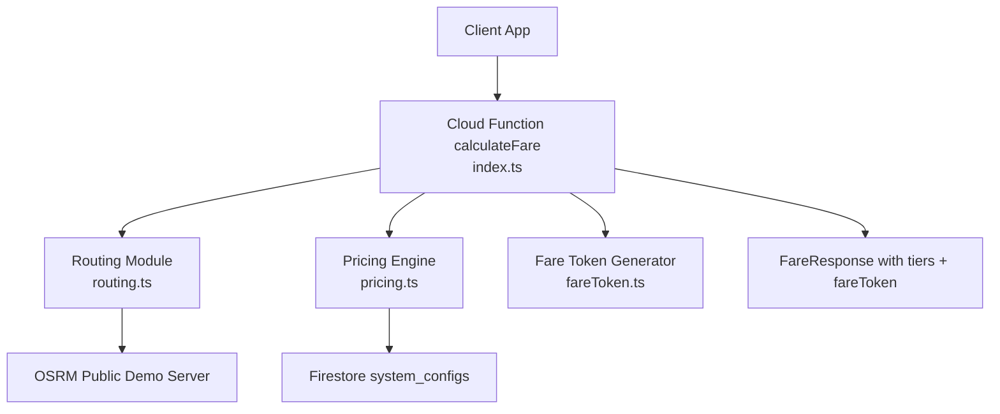
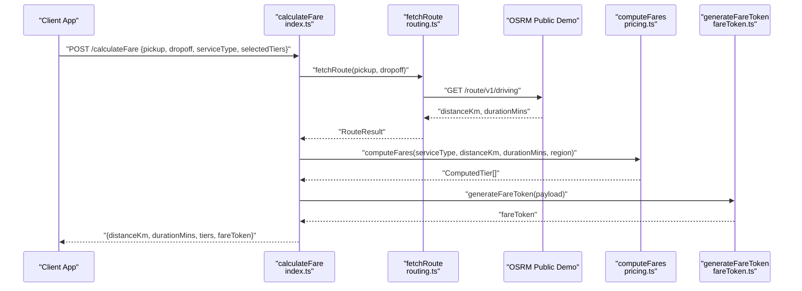
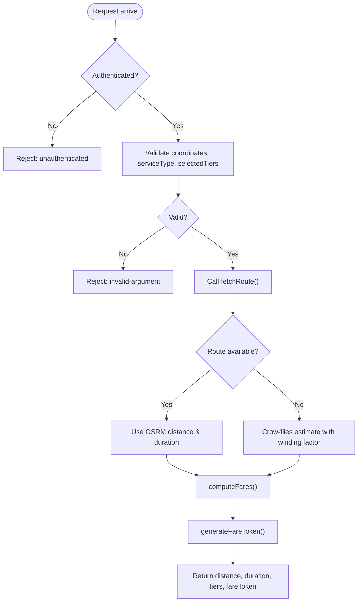
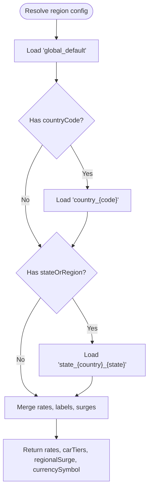
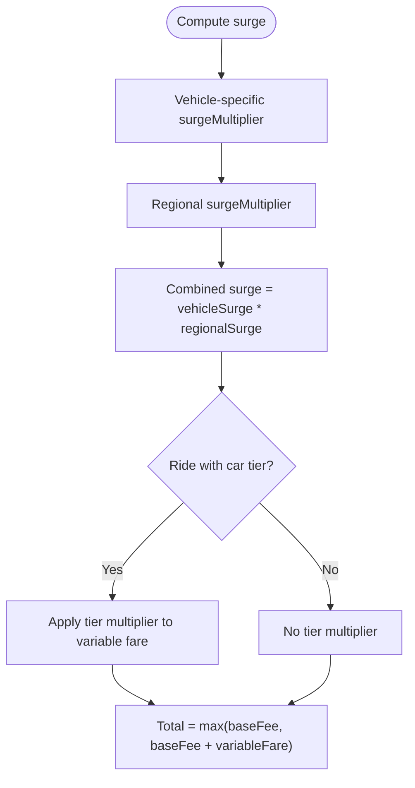
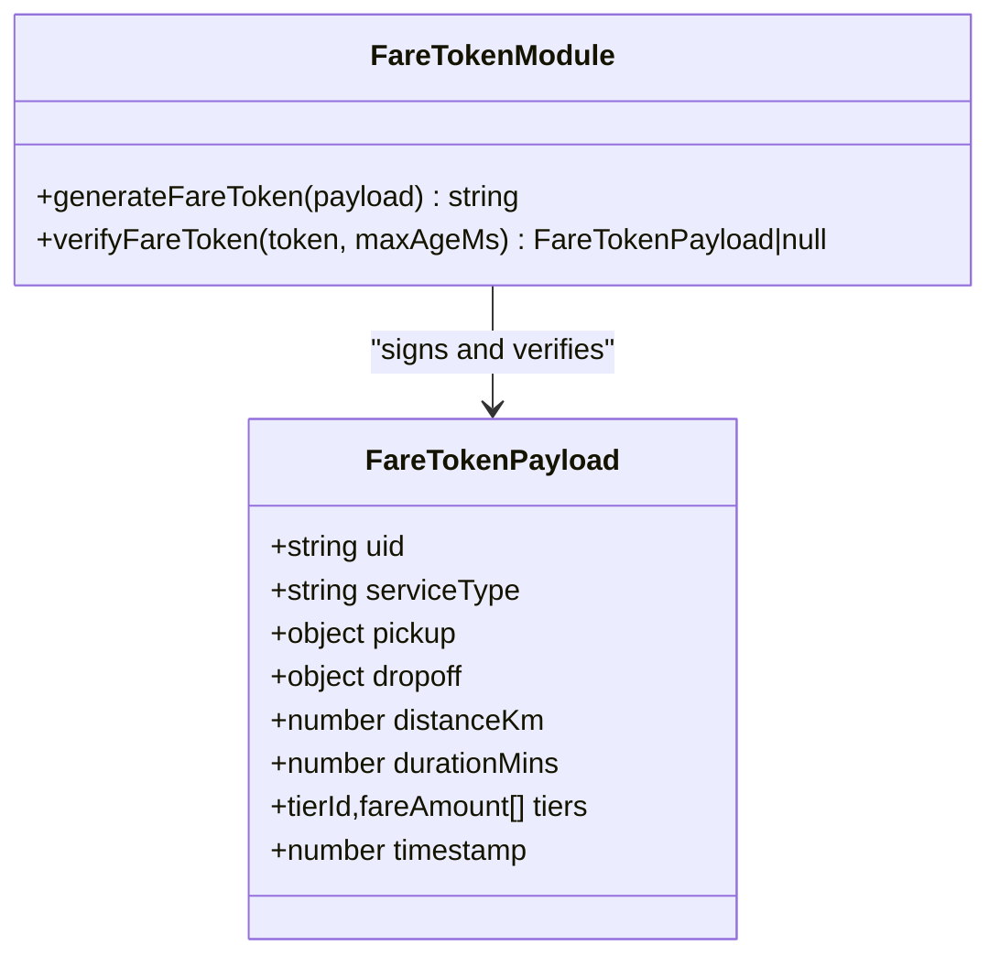
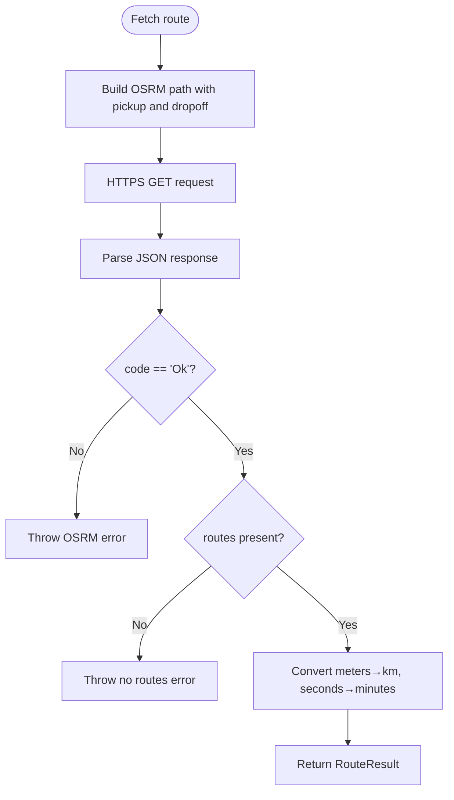
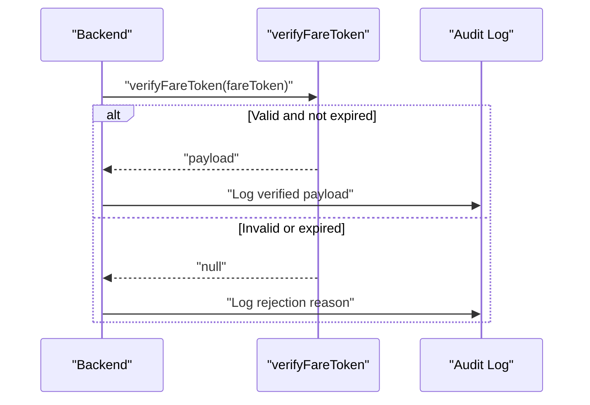
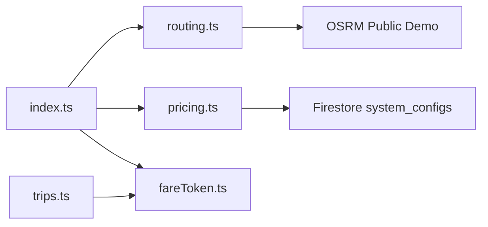

# Fare Calculation Engine

<cite>
**Referenced Files in This Document**
- [index.ts](file://functions/src/index.ts)
- [pricing.ts](file://functions/src/pricing.ts)
- [routing.ts](file://functions/src/routing.ts)
- [fareToken.ts](file://functions/src/fareToken.ts)
- [trips.ts](file://functions/src/trips.ts)
- [pricing_calculator.dart](file://sese_core/lib/services/pricing_calculator.dart)
- [pricing_config.dart](file://sese_core/lib/models/pricing_config.dart)
</cite>

## Table of Contents
1. [Introduction](#introduction)
2. [Project Structure](#project-structure)
3. [Core Components](#core-components)
4. [Architecture Overview](#architecture-overview)
5. [Detailed Component Analysis](#detailed-component-analysis)
6. [Dependency Analysis](#dependency-analysis)
7. [Performance Considerations](#performance-considerations)
8. [Troubleshooting Guide](#troubleshooting-guide)
9. [Conclusion](#conclusion)

## Introduction
This document explains the zero-trust fare calculation engine used by the application. It covers server-side pricing algorithms, regional configuration, dynamic surge pricing, fare token generation and verification, routing integration, and the complete pricing model including base fare, per-mile/per-kilometer rates, per-minute rates, surge multipliers, and additional fees. It also addresses estimation accuracy, price adjustments during trips, and dispute resolution for pricing discrepancies.

The system is intentionally designed so that clients never compute authoritative fares. All pricing logic runs on the server, uses authenticated calls, and returns a signed fare token that prevents tampering.

## Project Structure
The fare calculation engine spans Cloud Functions (Node.js/TypeScript) and shared core models (Dart). The key files are:

- `functions/src/index.ts`: Callable endpoint that validates inputs, computes route metrics, calculates fares, and signs them.
- `functions/src/pricing.ts`: Server-side pricing algorithm, regional configuration fallback chain, and fare computation.
- `functions/src/routing.ts`: Routing module that fetches road-network distance and duration via OSRM.
- `functions/src/fareToken.ts`: HMAC-based fare token generation and verification.
- `functions/src/trips.ts`: Trip lifecycle functions that verify fare tokens before booking or charging.
- `sese_core/lib/services/pricing_calculator.dart`: Client-side reference implementation mirroring server pricing rules.
- `sese_core/lib/models/pricing_config.dart`: Region-scoped pricing configuration model and defaults.

**Diagram sources**
- [index.ts:81-198](file://functions/src/index.ts#L81-L198)
- [routing.ts:40-67](file://functions/src/routing.ts#L40-L67)
- [pricing.ts:166-236](file://functions/src/pricing.ts#L166-L236)
- [fareToken.ts:21-28](file://functions/src/fareToken.ts#L21-L28)

**Section sources**
- [index.ts:1-199](file://functions/src/index.ts#L1-L199)
- [pricing.ts:1-237](file://functions/src/pricing.ts#L1-L237)
- [routing.ts:1-109](file://functions/src/routing.ts#L1-L109)
- [fareToken.ts:1-59](file://functions/src/fareToken.ts#L1-L59)
- [pricing_calculator.dart:1-147](file://sese_core/lib/services/pricing_calculator.dart#L1-L147)
- [pricing_config.dart:1-499](file://sese_core/lib/models/pricing_config.dart#L1-L499)

## Core Components
- Zero-trust callable endpoint: Validates authentication, input bounds, service type, and tier selection. Computes distances and durations, then generates a signed fare token.
- Regional pricing resolver: Reads global, country, and state overrides from Firestore to determine currency, surge, and per-vehicle rates.
- Pricing calculator: Applies base fee floor, per-kilometer and per-minute variable fares, vehicle-specific surge multiplier, regional surge, and car-tier multipliers.
- Routing module: Fetches driving route distance and duration using OSRM; includes a crow-flies fallback when OSRM is unavailable.
- Fare token system: Generates an HMAC-SHA256-signed token containing the authoritative fare payload and verifies it later to prevent tampering.

**Section sources**
- [index.ts:81-198](file://functions/src/index.ts#L81-L198)
- [pricing.ts:65-147](file://functions/src/pricing.ts#L65-L147)
- [pricing.ts:166-236](file://functions/src/pricing.ts#L166-L236)
- [routing.ts:40-67](file://functions/src/routing.ts#L40-L67)
- [fareToken.ts:21-58](file://functions/src/fareToken.ts#L21-L58)

## Architecture Overview
The end-to-end flow enforces zero trust:

**Diagram sources**
- [index.ts:81-198](file://functions/src/index.ts#L81-L198)
- [routing.ts:40-67](file://functions/src/routing.ts#L40-L67)
- [pricing.ts:166-236](file://functions/src/pricing.ts#L166-L236)
- [fareToken.ts:21-28](file://functions/src/fareToken.ts#L21-L28)

## Detailed Component Analysis

### Zero-Trust Callable Endpoint
The `calculateFare` function enforces strict validation and centralizes all pricing decisions:

- Authentication guard: Rejects unauthenticated requests.
- Input validation: Ensures pickup/dropoff coordinates are valid numbers within geographic bounds, service type is allowed, and optional tier/category arrays contain non-empty strings.
- Routing integration: Calls `fetchRoute`; if OSRM fails, falls back to a crow-flies estimate with a winding factor and urban speed heuristic.
- Fare computation: Delegates to `computeFares`, which resolves regional configuration and applies pricing rules.
- Tokenization: Produces a signed fare token containing the authoritative payload.

**Diagram sources**
- [index.ts:81-198](file://functions/src/index.ts#L81-L198)

**Section sources**
- [index.ts:81-198](file://functions/src/index.ts#L81-L198)

### Regional Pricing Configuration
Regional configuration follows a clear fallback chain:

- Global default: Always loaded first.
- Country-specific rule: Overrides global settings for a given country code.
- State-specific override: Further narrows configuration for a specific state or region.

Configuration fields include:

- Currency symbol and code.
- Regional surge multiplier applied across all vehicles.
- Per-vehicle pricing rates: base fee, distance rate per kilometer, time rate per minute, and vehicle-specific surge multiplier.
- Car tier thresholds: comfort/premium/luxe multipliers and labels.

If Firestore is unreachable, the system falls back to in-memory defaults.

**Diagram sources**
- [pricing.ts:65-147](file://functions/src/pricing.ts#L65-L147)

**Section sources**
- [pricing.ts:65-147](file://functions/src/pricing.ts#L65-L147)
- [pricing_config.dart:251-499](file://sese_core/lib/models/pricing_config.dart#L251-L499)

### Dynamic Surge Pricing Mechanisms
Dynamic surge pricing combines two layers:

- Vehicle-specific surge multiplier: Defined per vehicle category in regional configuration.
- Regional surge multiplier: Applied globally across all vehicles in a region.

For rides, car tiers apply an additional multiplier to the variable fare portion only, while the base fee remains the minimum floor. For deliveries, each vehicle category uses its own surge multiplier combined with the regional surge.

**Diagram sources**
- [pricing.ts:184-233](file://functions/src/pricing.ts#L184-L233)
- [pricing_calculator.dart:11-60](file://sese_core/lib/services/pricing_calculator.dart#L11-L60)

**Section sources**
- [pricing.ts:184-233](file://functions/src/pricing.ts#L184-L233)
- [pricing_calculator.dart:11-60](file://sese_core/lib/services/pricing_calculator.dart#L11-L60)

### Fare Token Generation and Verification
The fare token system ensures tamper-proof calculations:

- Generation: Serializes the authoritative payload (user ID, service type, pickup/dropoff, distance, duration, per-tier amounts, timestamp), signs it with HMAC-SHA256 using a secret, and encodes the data in base64url followed by the signature.
- Verification: Splits the token into encoded data and signature, recomputes the HMAC, compares signatures using constant-time comparison, parses the payload, and checks expiration against a maximum age.

**Diagram sources**
- [fareToken.ts:6-15](file://functions/src/fareToken.ts#L6-L15)
- [fareToken.ts:21-58](file://functions/src/fareToken.ts#L21-L58)

**Section sources**
- [fareToken.ts:1-59](file://functions/src/fareToken.ts#L1-L59)

### Integration with Routing and Distance/Time Calculations
The current production routing integration uses OSRM, not Google Routes API:

- OSRM public demo server provides driving routes without requiring an API key.
- Returns distance in meters and duration in seconds; converted to kilometers and minutes.
- Includes error handling for unreachable endpoints or missing routes.
- If OSRM fails, the endpoint falls back to a crow-flies estimate with a winding factor and approximate urban speed.

Note: While the endpoint comment mentions Google Routes API, the actual implementation uses OSRM. There is no direct Google Maps Routes API integration in the analyzed source files.

**Diagram sources**
- [routing.ts:40-67](file://functions/src/routing.ts#L40-L67)

**Section sources**
- [routing.ts:1-109](file://functions/src/routing.ts#L1-L109)
- [index.ts:144-166](file://functions/src/index.ts#L144-L166)

### Pricing Model Components
The pricing model consists of:

- Base fare: Minimum charge floor for any trip or delivery.
- Per-kilometer rate: Variable cost based on road-network distance.
- Per-minute rate: Variable cost based on estimated travel time.
- Surge multipliers:
  - Vehicle-specific surge multiplier.
  - Regional surge multiplier.
  - Car-tier multiplier (rides only).
- Additional fees: Not explicitly modeled in the analyzed code beyond base fee and multipliers. Any additional fees would need to be added to the pricing model and token payload.

The Dart client-side reference mirrors the server logic:

- Calculates distance and time fares.
- Applies surge and tier multipliers.
- Enforces base fee floor.
- Rounds totals to two decimal places.

**Section sources**
- [pricing.ts:18-25](file://functions/src/pricing.ts#L18-L25)
- [pricing.ts:184-233](file://functions/src/pricing.ts#L184-L233)
- [pricing_calculator.dart:11-60](file://sese_core/lib/services/pricing_calculator.dart#L11-L60)
- [pricing_config.dart:4-64](file://sese_core/lib/models/pricing_config.dart#L4-L64)

### Fare Estimation Accuracy and Price Adjustments During Trips
- Estimation accuracy depends on OSRM’s road-network distance and duration estimates.
- When OSRM is unavailable, the fallback uses crow-flies distance multiplied by a winding factor and approximates duration using a fixed urban speed.
- Price adjustments during trips are not implemented in the analyzed fare calculation flow. To support dynamic adjustments, the system should:
  - Re-calculate fares at trip milestones (e.g., significant route changes, extended wait times).
  - Issue updated fare tokens reflecting new distance/duration and applicable multipliers.
  - Persist adjustment reasons and timestamps for auditability.

**Section sources**
- [index.ts:144-166](file://functions/src/index.ts#L144-L166)
- [routing.ts:40-67](file://functions/src/routing.ts#L40-L67)

### Dispute Resolution for Pricing Discrepancies
Dispute resolution relies on the signed fare token:

- The client receives a fare token containing the authoritative fare breakdown.
- Before booking or payment, the backend verifies the token using `verifyFareToken`.
- If verification fails due to tampering or expiration, the request is rejected.
- For disputes, the backend can re-run `computeFares` with the same inputs and compare results to the stored token payload.

**Diagram sources**
- [fareToken.ts:33-58](file://functions/src/fareToken.ts#L33-L58)
- [trips.ts:161-161](file://functions/src/trips.ts#L161-L161)

**Section sources**
- [fareToken.ts:33-58](file://functions/src/fareToken.ts#L33-L58)
- [trips.ts:161-161](file://functions/src/trips.ts#L161-L161)

## Dependency Analysis
The fare calculation engine has clear dependencies:

- `index.ts` depends on `routing.ts`, `pricing.ts`, and `fareToken.ts`.
- `pricing.ts` depends on Firestore (`system_configs`) for regional configuration.
- `routing.ts` depends on OSRM public demo server.
- `trips.ts` depends on `fareToken.ts` for verification.

**Diagram sources**
- [index.ts:21-24](file://functions/src/index.ts#L21-L24)
- [pricing.ts:80-147](file://functions/src/pricing.ts#L80-L147)
- [routing.ts:40-67](file://functions/src/routing.ts#L40-L67)
- [trips.ts:9-9](file://functions/src/trips.ts#L9-L9)

**Section sources**
- [index.ts:21-24](file://functions/src/index.ts#L21-L24)
- [pricing.ts:80-147](file://functions/src/pricing.ts#L80-L147)
- [routing.ts:40-67](file://functions/src/routing.ts#L40-L67)
- [trips.ts:9-9](file://functions/src/trips.ts#L9-L9)

## Performance Considerations
- OSRM public demo server is rate-limited and returns free-flow durations without live traffic. At scale, self-host OSRM/Valhalla or add caching to reduce latency and costs.
- Firestore reads follow a small fallback chain (global, country, state); ensure indexes and document structure minimize read costs.
- Round distance and duration early to reduce floating-point operations.
- Avoid recalculating fares for unchanged inputs by caching computed results keyed on pickup/dropoff coordinates, service type, and region.

[No sources needed since this section provides general guidance]

## Troubleshooting Guide
Common issues and resolutions:

- Unauthenticated requests: Ensure the client sends a valid Firebase session; the endpoint rejects requests without `request.auth`.
- Invalid coordinates: Verify latitude and longitude are finite and within valid bounds.
- Unsupported service type: Only `ride`, `send_item`, and `receive_item` are accepted.
- Invalid tier/category array: Ensure `selectedTiers` is an array of non-empty strings.
- OSRM failures: Check network connectivity and environment variable `OSRM_BASE_URL`; consider enabling caching or self-hosting OSRM.
- Fare token verification failures: Confirm the signing secret is configured securely and tokens are not expired; use `verifyFareToken` before booking or payment.

**Section sources**
- [index.ts:81-142](file://functions/src/index.ts#L81-L142)
- [index.ts:144-166](file://functions/src/index.ts#L144-L166)
- [fareToken.ts:33-58](file://functions/src/fareToken.ts#L33-L58)

## Conclusion
The zero-trust fare calculation engine centralizes all pricing logic on the server, enforces authentication and input validation, integrates with OSRM for accurate distance and duration estimates, and produces tamper-proof fare tokens. Regional configuration allows flexible pricing across countries and states, while dynamic surge and car-tier multipliers adjust fares based on demand and service level. For full reliability at scale, consider self-hosting OSRM, adding caching, and extending the model to support additional fees and real-time trip adjustments with updated fare tokens.

[No sources needed since this section summarizes without analyzing specific files]