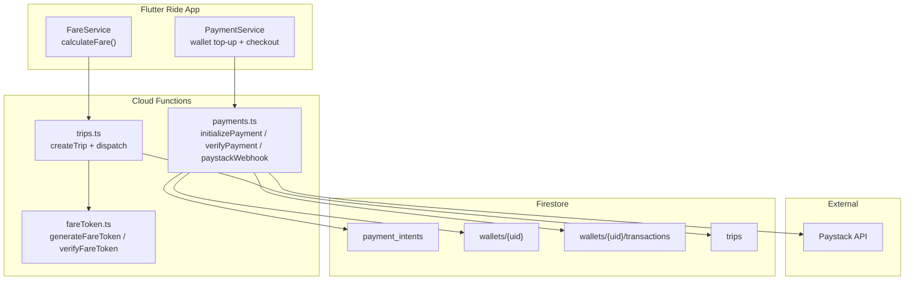
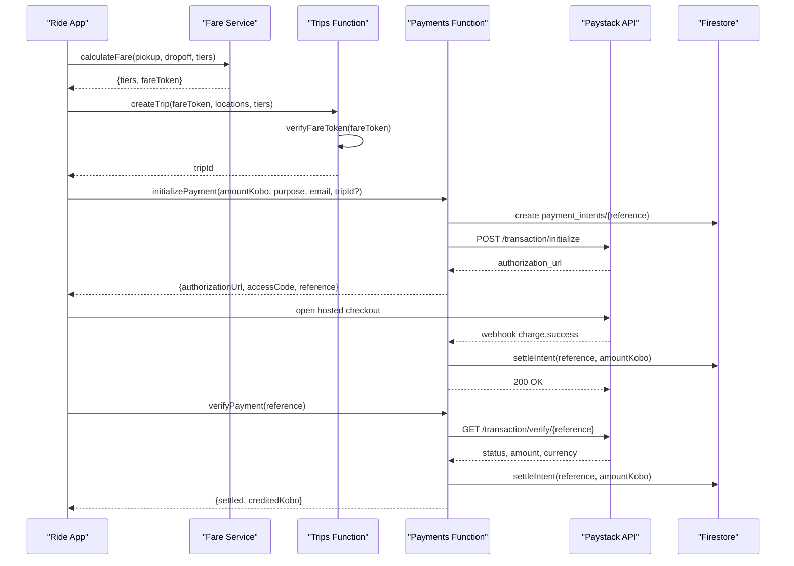
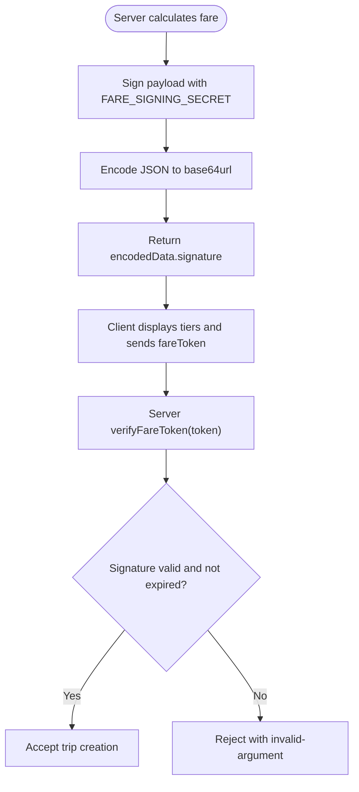
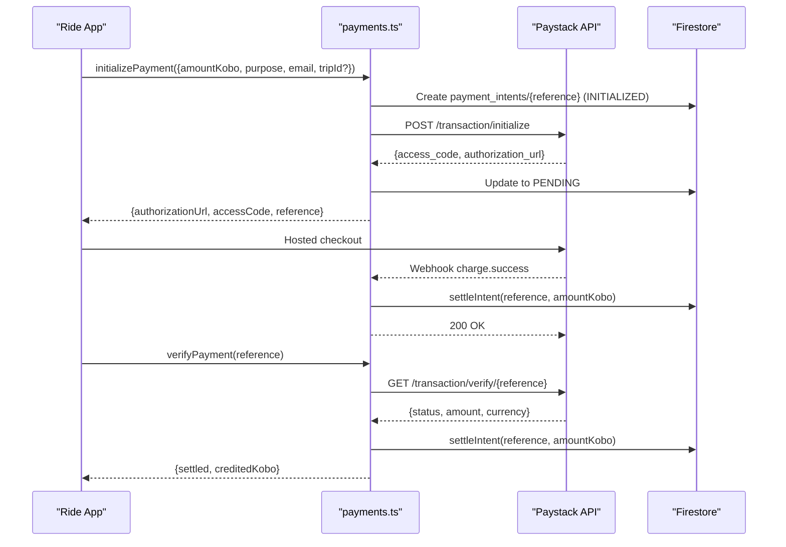
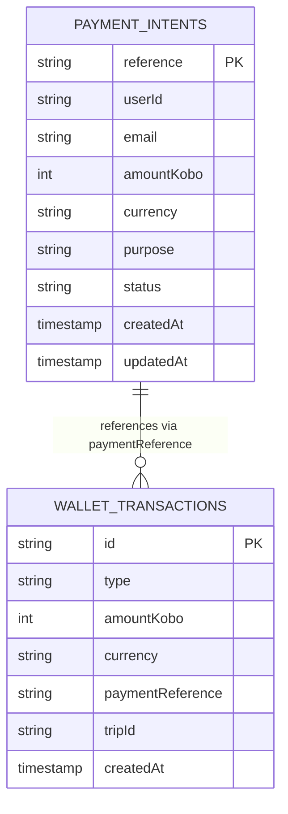
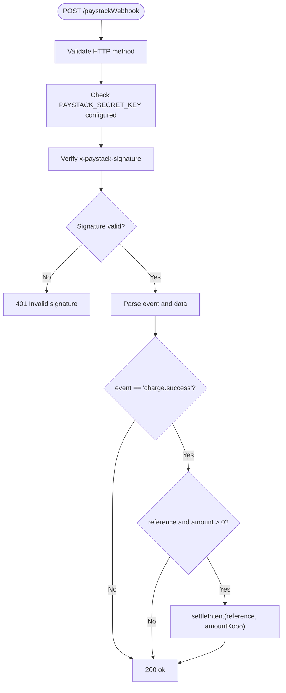
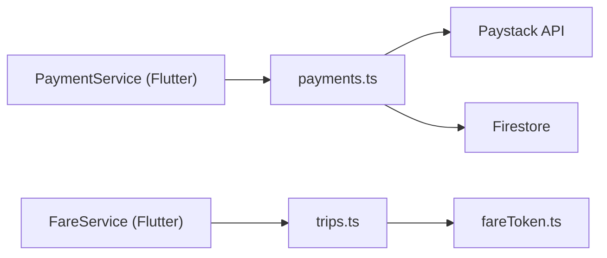

# Payment Integration

<cite>
**Referenced Files in This Document**
- [payments.ts](file://functions/src/payments.ts)
- [fareToken.ts](file://functions/src/fareToken.ts)
- [trips.ts](file://functions/src/trips.ts)
- [payment_service.dart](file://sese_ride/lib/features/payments/payment_service.dart)
- [fare_service.dart](file://sese_ride/lib/features/customer/services/fare_service.dart)
</cite>

## Table of Contents
1. [Introduction](#introduction)
2. [Project Structure](#project-structure)
3. [Core Components](#core-components)
4. [Architecture Overview](#architecture-overview)
5. [Detailed Component Analysis](#detailed-component-analysis)
6. [Dependency Analysis](#dependency-analysis)
7. [Performance Considerations](#performance-considerations)
8. [Troubleshooting Guide](#troubleshooting-guide)
9. [Conclusion](#conclusion)
10. [Appendices](#appendices)

## Introduction
This document explains the payment processing integration for ride transactions. It covers the secure payment flow, fare token validation, payment authorization, automatic charge execution upon trip completion, tip handling, receipt generation, payment history tracking, webhook processing, failure handling and retry behavior, refund and dispute considerations, compliance guidance, testing strategies, and debugging tools.

The system uses a zero-trust model: clients never compute or submit monetary amounts that are trusted by the backend. Fare calculations and payment authorizations are performed server-side, with cryptographic verification protecting against tampering.

## Project Structure
The payment-related code spans three main areas:

- Backend Cloud Functions (Node/TypeScript):
  - Fare token signing and verification.
  - Payment initialization, verification, and webhook settlement.
  - Trip lifecycle and fare token enforcement during booking.
- Flutter Ride App:
  - Payment service for wallet top-ups and checkout orchestration.
  - Fare service client calling the server-side fare calculator.

**Diagram sources**
- [payments.ts:1-371](file://functions/src/payments.ts#L1-L371)
- [fareToken.ts:1-59](file://functions/src/fareToken.ts#L1-L59)
- [trips.ts:125-225](file://functions/src/trips.ts#L125-L225)
- [payment_service.dart:240-432](file://sese_ride/lib/features/payments/payment_service.dart#L240-L432)
- [fare_service.dart:1-108](file://sese_ride/lib/features/customer/services/fare_service.dart#L1-L108)

**Section sources**
- [payments.ts:1-371](file://functions/src/payments.ts#L1-L371)
- [fareToken.ts:1-59](file://functions/src/fareToken.ts#L1-L59)
- [trips.ts:125-225](file://functions/src/trips.ts#L125-L225)
- [payment_service.dart:240-432](file://sese_ride/lib/features/payments/payment_service.dart#L240-L432)
- [fare_service.dart:1-108](file://sese_ride/lib/features/customer/services/fare_service.dart#L1-L108)

## Core Components
- Fare Token Module: Generates and verifies HMAC-SHA256 tokens containing authoritative fare data. Prevents clients from forging fares.
- Payments Module: Initializes Paystack checkouts, verifies payments, settles wallet balances idempotently, and processes webhooks.
- Trips Module: Enforces fare token validation when creating trips and stores verified fare details.
- Flutter Payment Service: Orchestrates wallet top-ups, opens hosted checkout, verifies results, and streams wallet balance and transaction history.
- Flutter Fare Service: Calls the server-side fare calculator and maps errors to user-friendly messages.

Key responsibilities:
- Secure amount handling on the server only.
- Idempotent settlement via Firestore transactions.
- Webhook signature verification.
- Zero-trust fare validation before trip creation.

**Section sources**
- [fareToken.ts:1-59](file://functions/src/fareToken.ts#L1-L59)
- [payments.ts:1-371](file://functions/src/payments.ts#L1-L371)
- [trips.ts:125-225](file://functions/src/trips.ts#L125-L225)
- [payment_service.dart:240-432](file://sese_ride/lib/features/payments/payment_service.dart#L240-L432)
- [fare_service.dart:1-108](file://sese_ride/lib/features/customer/services/fare_service.dart#L1-L108)

## Architecture Overview
The payment architecture follows a zero-trust design:

- Clients request fare calculations; the server returns signed fare tokens.
- Clients cannot alter fares without invalidating the token.
- For payments, clients initiate a server-side payment intent; the app opens Paystack’s hosted checkout.
- Settlement occurs either through explicit verification or asynchronous webhook, both guarded by idempotency.
- Wallet balances and transaction histories are updated atomically.

**Diagram sources**
- [fareToken.ts:21-58](file://functions/src/fareToken.ts#L21-L58)
- [trips.ts:125-225](file://functions/src/trips.ts#L125-L225)
- [payments.ts:108-197](file://functions/src/payments.ts#L108-L197)
- [payments.ts:283-326](file://functions/src/payments.ts#L283-L326)
- [payments.ts:333-370](file://functions/src/payments.ts#L333-L370)

## Detailed Component Analysis

### Fare Token Validation
The fare token is an HMAC-SHA256-signed payload containing user identity, service type, coordinates, distance, duration, and tier fares. The server generates it; clients must present it unchanged when creating a trip. Verification checks signature integrity and expiration.

**Diagram sources**
- [fareToken.ts:21-58](file://functions/src/fareToken.ts#L21-L58)
- [trips.ts:160-167](file://functions/src/trips.ts#L160-L167)

**Section sources**
- [fareToken.ts:1-59](file://functions/src/fareToken.ts#L1-L59)
- [trips.ts:125-225](file://functions/src/trips.ts#L125-L225)

### Payment Authorization and Settlement
The payment flow supports two settlement paths:

- Explicit verification: The app calls `verifyPayment` after the user completes checkout.
- Webhook settlement: Paystack posts `charge.success`; the function verifies the signature and settles.

Both paths converge on `settleIntent`, which updates the wallet balance and writes a ledger entry atomically.

**Diagram sources**
- [payments.ts:108-197](file://functions/src/payments.ts#L108-L197)
- [payments.ts:206-271](file://functions/src/payments.ts#L206-L271)
- [payments.ts:283-326](file://functions/src/payments.ts#L283-L326)
- [payments.ts:333-370](file://functions/src/payments.ts#L333-L370)

**Section sources**
- [payments.ts:1-371](file://functions/src/payments.ts#L1-L371)

### Automatic Charge Execution Upon Trip Completion
The current implementation provides:

- A payment purpose field supporting `trip_payment`.
- A required `tripId` when purpose is `trip_payment`.
- A stored `tripId` in the payment intent and wallet transaction records.

However, there is no explicit function in the analyzed files that automatically charges the customer’s wallet at trip completion. The existing payment functions support:

- Wallet top-ups (`wallet_topup`).
- Trip-linked payment intents (`trip_payment`) that can be settled later.

To implement automatic charging upon trip completion, you would need to add a trip-completion handler that:

- Reads the finalized fare from the completed trip.
- Creates a `trip_payment` payment intent.
- Initiates a Paystack transaction or debits the wallet if sufficient funds exist.
- Records the charge and updates trip payment state.

Until such a handler exists, automatic charge execution is not implemented in the analyzed code.

**Section sources**
- [payments.ts:97-150](file://functions/src/payments.ts#L97-L150)
- [payments.ts:206-271](file://functions/src/payments.ts#L206-L271)
- [trips.ts:125-225](file://functions/src/trips.ts#L125-L225)

### Tip Handling
There is no dedicated tip handling logic in the analyzed payment or trip modules. Tips could be integrated by:

- Extending the fare calculation to include optional tips.
- Adding a `tipAmountKobo` field to the fare token payload.
- Including tip in the total charged amount for `trip_payment`.
- Recording tip separately in wallet transactions for reporting.

These changes require coordinated updates to fare calculation, fare token schema, payment intent creation, and transaction recording.

[No sources needed since this section proposes future enhancements not present in the analyzed code]

### Receipt Generation
Receipts are generated by Paystack using the email provided during payment initialization. The backend requires a valid email address and stores it in the payment intent. The app should ensure the authenticated user’s email is used or validated before initiating payment.

**Section sources**
- [payments.ts:142-150](file://functions/src/payments.ts#L142-L150)
- [payments.ts:152-167](file://functions/src/payments.ts#L152-L167)

### Payment History Tracking
Wallet transactions are recorded under `wallets/{uid}/transactions` with fields including type, amount, currency, payment reference, trip ID, and timestamp. The Flutter `PaymentService` streams these records and formats them for display.

**Diagram sources**
- [payments.ts:241-262](file://functions/src/payments.ts#L241-L262)
- [payment_service.dart:26-148](file://sese_ride/lib/features/payments/payment_service.dart#L26-L148)

**Section sources**
- [payments.ts:241-262](file://functions/src/payments.ts#L241-L262)
- [payment_service.dart:26-148](file://sese_ride/lib/features/payments/payment_service.dart#L26-L148)

### Webhook Processing for Payment Confirmations
The webhook endpoint validates the `x-paystack-signature` header using HMAC-SHA512 over the raw body. On successful `charge.success` events, it settles the corresponding payment intent. Unknown references return success to prevent repeated retries while logging mismatches.

**Diagram sources**
- [payments.ts:333-370](file://functions/src/payments.ts#L333-L370)

**Section sources**
- [payments.ts:333-370](file://functions/src/payments.ts#L333-L370)

### Failure Handling and Retry Mechanisms
- Client-side failures map to user-friendly messages via `PaymentException`.
- Backend throws structured `HttpsError` codes such as `unauthenticated`, `invalid-argument`, `not-found`, `failed-precondition`, `permission-denied`, and `data-loss`.
- Webhook errors are logged but return 200 to avoid poison retries; mismatches are already captured in logs.
- Idempotency prevents double crediting via Firestore transactions checking intent status.

**Section sources**
- [payment_service.dart:14-24](file://sese_ride/lib/features/payments/payment_service.dart#L14-L24)
- [payment_service.dart:416-431](file://sese_ride/lib/features/payments/payment_service.dart#L416-L431)
- [payments.ts:39-48](file://functions/src/payments.ts#L39-L48)
- [payments.ts:206-271](file://functions/src/payments.ts#L206-L271)
- [payments.ts:333-370](file://functions/src/payments.ts#L333-L370)

### Refund Processing and Dispute Resolution
The analyzed payment module does not implement refunds or disputes. To add support:

- Add refund endpoints that call Paystack’s refund API.
- Record refund transactions in the wallet ledger with negative amounts.
- Handle dispute events via additional webhook handlers.
- Maintain audit trails for regulatory compliance.

These features require new backend functions and database schema extensions.

[No sources needed since this section proposes future enhancements not present in the analyzed code]

### Compliance with Payment Regulations
Recommendations based on the current implementation:

- Keep secret keys server-only; do not embed secrets in client apps.
- Use minor units (kobo) for all monetary values to avoid floating-point errors.
- Validate and sanitize all inputs; enforce minimum and maximum limits.
- Log security-relevant events without exposing sensitive data.
- Implement rate limiting and fraud detection at the gateway or function level.
- Ensure PCI-DSS scope is minimized by using hosted checkout and avoiding card data in your systems.
- Add audit logs for financial operations and retain records per jurisdictional requirements.

[No sources needed since this section provides general guidance]

### Testing Strategies for Payment Scenarios
- Unit tests for fare token generation and verification.
- Mock Paystack responses for initialization, verification, and webhook flows.
- Test idempotency by invoking settlement multiple times.
- Validate error mapping and user-facing messages.
- Simulate webhook signature verification failures.
- Test wallet balance and transaction history streams.

Relevant test files referenced in the repository structure include payment service tests and fare service tests.

**Section sources**
- [payment_service.dart:240-432](file://sese_ride/lib/features/payments/payment_service.dart#L240-L432)
- [fare_service.dart:1-108](file://sese_ride/lib/features/customer/services/fare_service.dart#L1-L108)

### Debugging Tools for Payment-Related Issues
- Inspect `payment_intents` documents for status, failure reasons, timestamps, and references.
- Review wallet transactions for correct amounts, types, and references.
- Use Firebase Logs to inspect function errors and webhook outcomes.
- Validate Paystack signatures locally using the same HMAC algorithm and secret.
- Correlate trip IDs with payment references to trace end-to-end flows.

**Section sources**
- [payments.ts:152-197](file://functions/src/payments.ts#L152-L197)
- [payments.ts:241-262](file://functions/src/payments.ts#L241-L262)
- [payments.ts:333-370](file://functions/src/payments.ts#L333-L370)

## Dependency Analysis
The components interact as follows:

- Flutter `PaymentService` depends on Cloud Functions `initializePayment` and `verifyPayment`.
- Flutter `FareService` depends on Cloud Functions `calculateFare`.
- Cloud Functions `trips.ts` depends on `fareToken.ts` for verification.
- Cloud Functions `payments.ts` depends on Paystack API and Firestore.

**Diagram sources**
- [payment_service.dart:240-432](file://sese_ride/lib/features/payments/payment_service.dart#L240-L432)
- [fare_service.dart:1-108](file://sese_ride/lib/features/customer/services/fare_service.dart#L1-L108)
- [trips.ts:125-225](file://functions/src/trips.ts#L125-L225)
- [payments.ts:1-371](file://functions/src/payments.ts#L1-L371)

**Section sources**
- [payment_service.dart:240-432](file://sese_ride/lib/features/payments/payment_service.dart#L240-L432)
- [fare_service.dart:1-108](file://sese_ride/lib/features/customer/services/fare_service.dart#L1-L108)
- [trips.ts:125-225](file://functions/src/trips.ts#L125-L225)
- [payments.ts:1-371](file://functions/src/payments.ts#L1-L371)

## Performance Considerations
- Use minor units (kobo) to avoid floating-point rounding issues.
- Prefer server-side calculations and validations to reduce client trust assumptions.
- Leverage Firestore transactions for atomic updates to prevent race conditions.
- Minimize network calls by batching where possible and caching non-sensitive UI data.
- Rate-limit sensitive endpoints and monitor webhook throughput.

[No sources needed since this section provides general guidance]

## Troubleshooting Guide
Common issues and resolutions:

- Unauthenticated requests: Ensure the user is signed in before calling payment functions.
- Invalid arguments: Validate amounts, emails, and trip IDs before sending requests.
- Not found: Confirm the payment reference exists and belongs to the caller.
- Failed precondition: Check intent status transitions and ensure settlement has not already occurred.
- Permission denied: Verify the caller owns the payment intent.
- Data loss: Ensure currency and amount match expectations.

Use logs and Firestore inspection to diagnose failures.

**Section sources**
- [payment_service.dart:416-431](file://sese_ride/lib/features/payments/payment_service.dart#L416-L431)
- [payments.ts:39-48](file://functions/src/payments.ts#L39-L48)
- [payments.ts:206-271](file://functions/src/payments.ts#L206-L271)

## Conclusion
The payment integration implements a secure, zero-trust flow with server-side fare validation and payment settlement. Fare tokens protect against tampering, and payments are settled idempotently via both explicit verification and webhook processing. While automatic charging upon trip completion is not fully implemented in the analyzed code, the foundation exists to extend the system with trip-linked payment intents and automated settlement. Future enhancements should include tip handling, refund processing, dispute resolution, and robust compliance controls.

[No sources needed since this section summarizes without analyzing specific files]

## Appendices

### Security Checklist
- Never trust client-provided amounts.
- Store secrets server-side only.
- Verify all cryptographic signatures.
- Enforce input validation and business rules server-side.
- Audit financial operations and retain logs securely.

[No sources needed since this section provides general guidance]