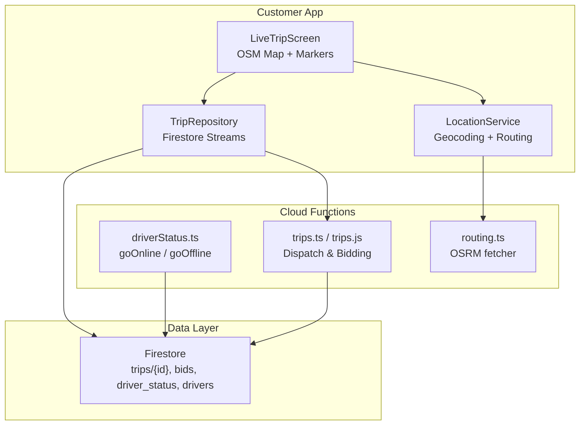
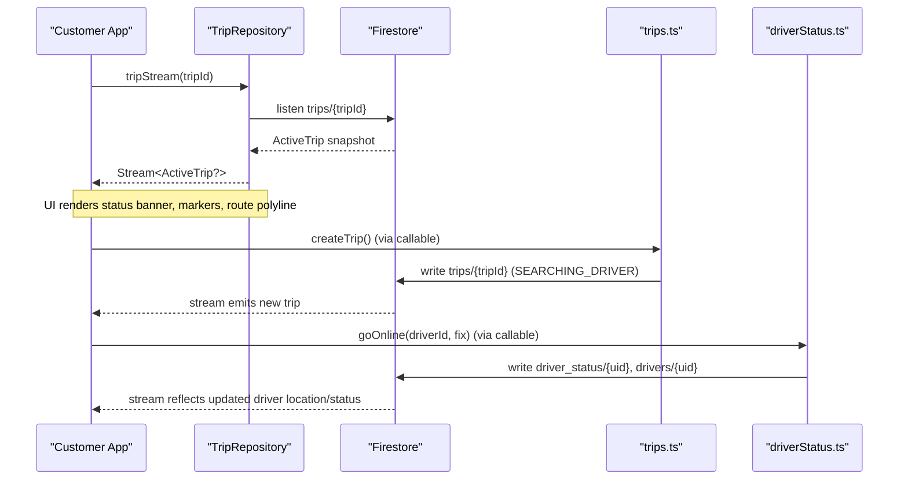
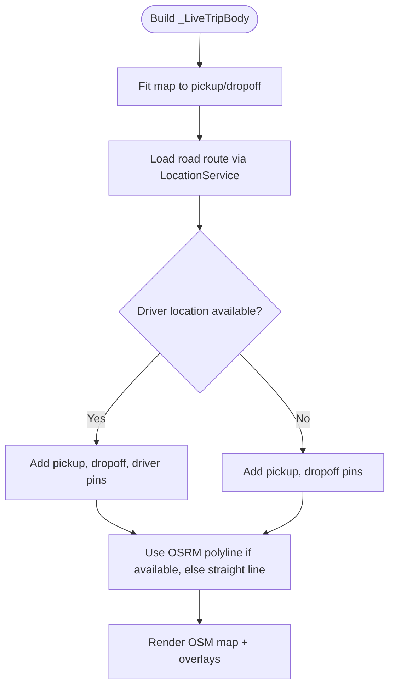
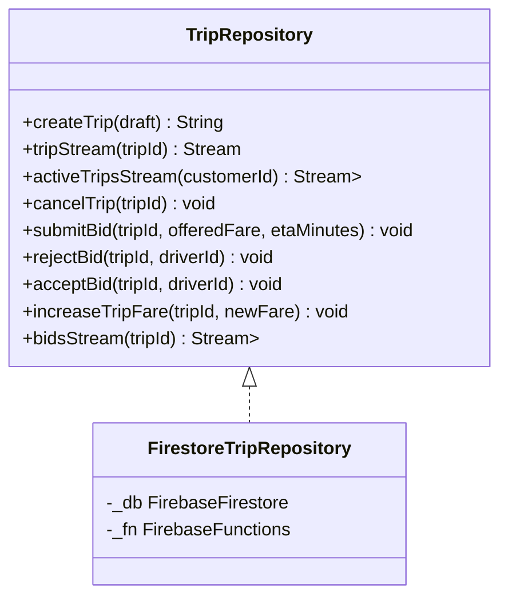
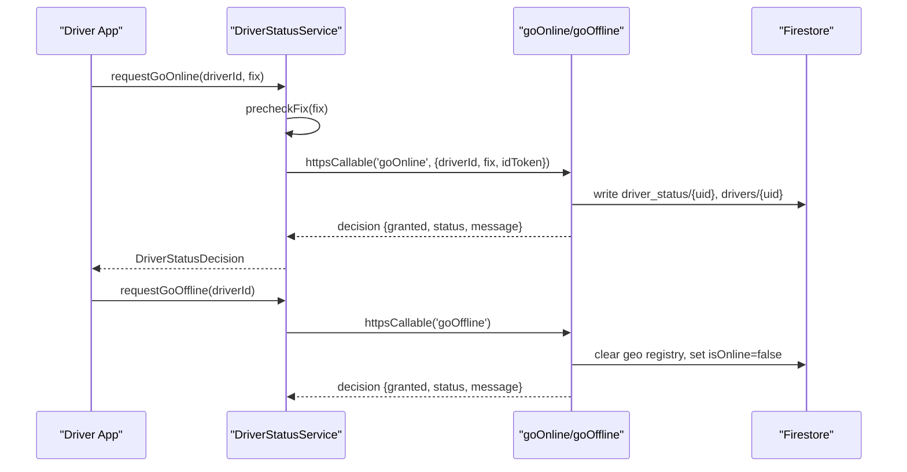
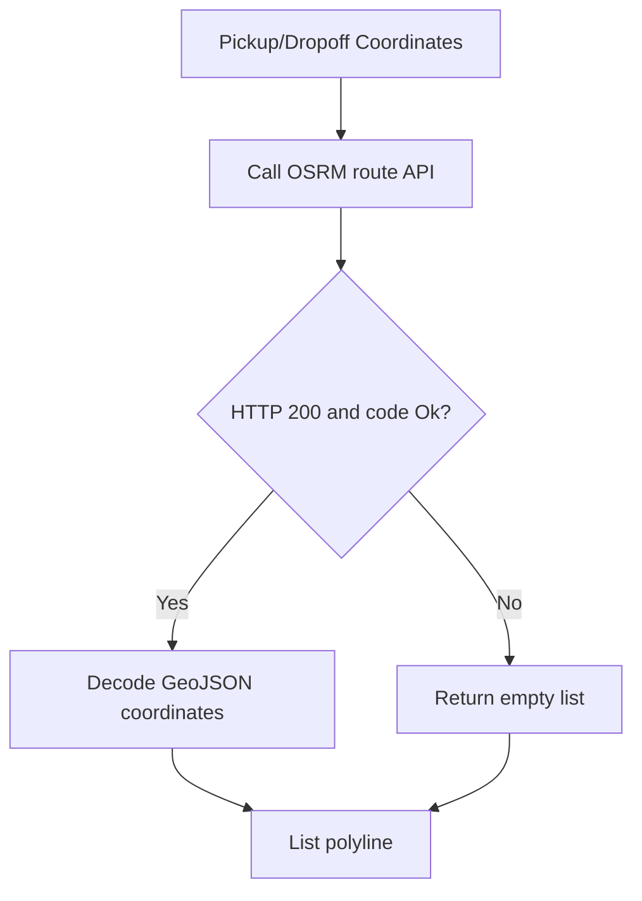
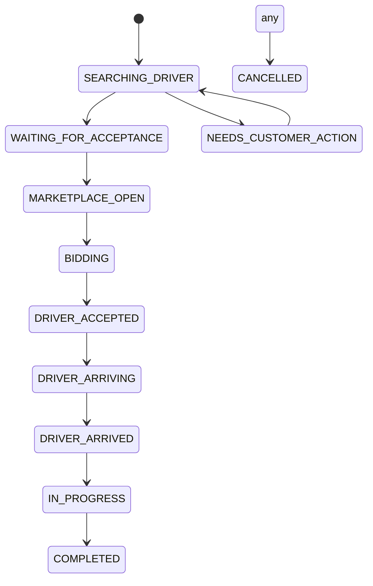
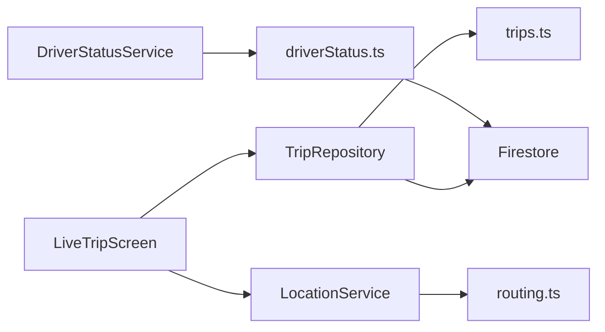

# Real-Time Tracking

<cite>
**Referenced Files in This Document**
- [live_trip_screen.dart](file://sese_ride/lib/features/trips/presentation/live_trip_screen.dart)
- [trip_service.dart](file://sese_ride/lib/features/trips/services/trip_service.dart)
- [trip_models.dart](file://sese_ride/lib/features/trips/models/trip_models.dart)
- [location_service.dart](file://sese_ride/lib/features/customer/services/location_service.dart)
- [driver_status_service.dart](file://sese_ride/lib/features/driver/services/driver_status_service.dart)
- [driverStatus.ts](file://functions/src/driverStatus.ts)
- [trips.js](file://functions/lib/trips.js)
- [index.ts](file://functions/src/index.ts)
- [routing.ts](file://functions/src/routing.ts)
</cite>

## Table of Contents
1. [Introduction](#introduction)
2. [Project Structure](#project-structure)
3. [Core Components](#core-components)
4. [Architecture Overview](#architecture-overview)
5. [Detailed Component Analysis](#detailed-component-analysis)
6. [Dependency Analysis](#dependency-analysis)
7. [Performance Considerations](#performance-considerations)
8. [Troubleshooting Guide](#troubleshooting-guide)
9. [Conclusion](#conclusion)

## Introduction
This document explains the real-time tracking system that enables live location sharing between drivers and customers. It covers:
- Location update frequency, battery optimization strategies, and background location permissions
- Map integration, marker positioning, and route visualization
- Real-time data synchronization via Firestore listeners, connection management, and offline handling
- Privacy controls, location data retention policies, and user consent mechanisms
- Performance optimization for high-frequency updates, map rendering efficiency, and network bandwidth management

The system is server-driven: clients subscribe to Firestore streams and call Cloud Functions for authoritative state changes. The customer app renders trip status, driver information, and a live OpenStreetMap view with markers and optional road-network routes. Driver availability and location are governed by zero-trust callable functions that validate identity, GPS integrity, and business rules before updating authoritative state.

## Project Structure
The real-time tracking feature spans three layers:
- Customer UI layer: Live trip screen and OSM map rendering
- Data access layer: Trip repository using Firestore streams and callable functions
- Server layer: Cloud Functions for dispatch, driver status, routing, and fare computation

**Diagram sources**
- [live_trip_screen.dart:14-87](file://sese_ride/lib/features/trips/presentation/live_trip_screen.dart#L14-L87)
- [trip_service.dart:20-64](file://sese_ride/lib/features/trips/services/trip_service.dart#L20-L64)
- [location_service.dart:23-38](file://sese_ride/lib/features/customer/services/location_service.dart#L23-L38)
- [index.ts:26-41](file://functions/src/index.ts#L26-L41)
- [routing.ts:1-12](file://functions/src/routing.ts#L1-L12)

**Section sources**
- [live_trip_screen.dart:14-87](file://sese_ride/lib/features/trips/presentation/live_trip_screen.dart#L14-L87)
- [trip_service.dart:20-64](file://sese_ride/lib/features/trips/services/trip_service.dart#L20-L64)
- [location_service.dart:23-38](file://sese_ride/lib/features/customer/services/location_service.dart#L23-L38)
- [index.ts:26-41](file://functions/src/index.ts#L26-L41)
- [routing.ts:1-12](file://functions/src/routing.ts#L1-L12)

## Core Components
- Live trip UI: Renders trip status banner, OSM map with pickup/dropoff pins, optional driver pin, and road-network polyline. Supports recentering and cancel actions.
- Trip repository: Provides create/cancel operations via callable functions and live streams for trip snapshots and bids.
- Location service: Supplies GPS coordinates, reverse/forward geocoding, and OSRM route geometry; includes test seams for offline testing.
- Driver status service: Zero-trust handshake to go online/offline, validating JWT and GPS integrity before server grants state changes.
- Cloud Functions: Dispatch lifecycle, bidding, driver availability, routing helper, and fare calculation orchestration.

**Section sources**
- [live_trip_screen.dart:234-398](file://sese_ride/lib/features/trips/presentation/live_trip_screen.dart#L234-L398)
- [trip_service.dart:66-217](file://sese_ride/lib/features/trips/services/trip_service.dart#L66-L217)
- [location_service.dart:39-291](file://sese_ride/lib/features/customer/services/location_service.dart#L39-L291)
- [driver_status_service.dart:147-232](file://sese_ride/lib/features/driver/services/driver_status_service.dart#L147-L232)
- [index.ts:26-41](file://functions/src/index.ts#L26-L41)

## Architecture Overview
Real-time tracking uses Firestore as the source of truth. The customer app subscribes to trip documents and bid collections. Driver availability and location updates are enforced through callable functions that write to authoritative Firestore collections.

**Diagram sources**
- [trip_service.dart:101-122](file://sese_ride/lib/features/trips/services/trip_service.dart#L101-L122)
- [index.ts:26-41](file://functions/src/index.ts#L26-L41)
- [driverStatus.ts:32-164](file://functions/src/driverStatus.ts#L32-L164)

## Detailed Component Analysis

### Live Trip Screen and Map Integration
Responsibilities:
- Subscribes to a single trip stream and renders terminal states (completed, cancelled) or active tracking UI.
- Displays pickup and dropoff pins, an optional driver pin when available, and a polyline representing either the road-network route or a straight fallback.
- Fits the map viewport to the route and provides a recenter button.

Key behaviors:
- Road-network route loading is skipped in tests when a debug tile provider override is present.
- Markers and polylines are recomputed when pickup/dropoff coordinates change.

**Diagram sources**
- [live_trip_screen.dart:279-328](file://sese_ride/lib/features/trips/presentation/live_trip_screen.dart#L279-L328)
- [location_service.dart:231-278](file://sese_ride/lib/features/customer/services/location_service.dart#L231-L278)

**Section sources**
- [live_trip_screen.dart:234-398](file://sese_ride/lib/features/trips/presentation/live_trip_screen.dart#L234-L398)

### Trip Repository and Real-Time Synchronization
Responsibilities:
- Creates trips via callable function and returns tripId.
- Exposes streams for a single trip and all active trips for a customer.
- Handles cancellation and bidding operations via callable functions.
- Maps backend errors to user-friendly messages.

Synchronization model:
- Uses Firestore snapshots for real-time updates.
- Terminal states are filtered client-side for active trips list.

**Diagram sources**
- [trip_service.dart:26-64](file://sese_ride/lib/features/trips/services/trip_service.dart#L26-L64)
- [trip_service.dart:66-217](file://sese_ride/lib/features/trips/services/trip_service.dart#L66-L217)

**Section sources**
- [trip_service.dart:20-64](file://sese_ride/lib/features/trips/services/trip_service.dart#L20-L64)
- [trip_service.dart:66-217](file://sese_ride/lib/features/trips/services/trip_service.dart#L66-L217)

### Driver Availability Handshake and Location Updates
Responsibilities:
- Client pre-checks GPS accuracy and mock-location flags.
- Calls callable functions to go online/offline with verified ID token and GPS fix.
- Server validates JWT, enforces business rules, and writes authoritative state.

**Diagram sources**
- [driver_status_service.dart:189-232](file://sese_ride/lib/features/driver/services/driver_status_service.dart#L189-L232)
- [driverStatus.ts:32-164](file://functions/src/driverStatus.ts#L32-L164)
- [driverStatus.ts:170-219](file://functions/src/driverStatus.ts#L170-L219)

**Section sources**
- [driver_status_service.dart:147-232](file://sese_ride/lib/features/driver/services/driver_status_service.dart#L147-L232)
- [driverStatus.ts:32-164](file://functions/src/driverStatus.ts#L32-L164)
- [driverStatus.ts:170-219](file://functions/src/driverStatus.ts#L170-L219)

### Route Visualization and Geocoding
Responsibilities:
- Fetches driving route points from OSRM public demo server and decodes GeoJSON into LatLng points.
- Provides reverse and forward geocoding via Nominatim with fair-use headers and timeouts.
- Offers test seams to avoid network calls during tests.

**Diagram sources**
- [location_service.dart:231-278](file://sese_ride/lib/features/customer/services/location_service.dart#L231-L278)
- [routing.ts:40-67](file://functions/src/routing.ts#L40-L67)

**Section sources**
- [location_service.dart:103-143](file://sese_ride/lib/features/customer/services/location_service.dart#L103-L143)
- [location_service.dart:167-212](file://sese_ride/lib/features/customer/services/location_service.dart#L167-L212)
- [location_service.dart:231-278](file://sese_ride/lib/features/customer/services/location_service.dart#L231-L278)
- [routing.ts:40-67](file://functions/src/routing.ts#L40-L67)

### Trip Models and State Machine
Responsibilities:
- Defines trip lifecycle states and maps wire values to enum types.
- Parses trip documents into ActiveTrip snapshots including driver info, locations, timestamps, and settlement fields.
- Determines whether a trip is still live for streaming and UI purposes.

**Diagram sources**
- [trip_models.dart:11-53](file://sese_ride/lib/features/trips/models/trip_models.dart#L11-L53)
- [trip_models.dart:229-232](file://sese_ride/lib/features/trips/models/trip_models.dart#L229-L232)

**Section sources**
- [trip_models.dart:11-53](file://sese_ride/lib/features/trips/models/trip_models.dart#L11-L53)
- [trip_models.dart:115-340](file://sese_ride/lib/features/trips/models/trip_models.dart#L115-L340)

## Dependency Analysis
- Customer UI depends on TripRepository for live data and LocationService for route geometry.
- TripRepository depends on Firestore streams and callable functions exported from index.ts.
- Driver status flows through DriverStatusService to callable functions that write to driver_status and drivers collections.
- Routing utilities are used both in the client (for route polyline) and server (for distance/duration estimation).

**Diagram sources**
- [live_trip_screen.dart:14-87](file://sese_ride/lib/features/trips/presentation/live_trip_screen.dart#L14-L87)
- [trip_service.dart:20-64](file://sese_ride/lib/features/trips/services/trip_service.dart#L20-L64)
- [driver_status_service.dart:147-232](file://sese_ride/lib/features/driver/services/driver_status_service.dart#L147-L232)
- [index.ts:26-41](file://functions/src/index.ts#L26-L41)
- [routing.ts:1-12](file://functions/src/routing.ts#L1-L12)

**Section sources**
- [live_trip_screen.dart:14-87](file://sese_ride/lib/features/trips/presentation/live_trip_screen.dart#L14-L87)
- [trip_service.dart:20-64](file://sese_ride/lib/features/trips/services/trip_service.dart#L20-L64)
- [driver_status_service.dart:147-232](file://sese_ride/lib/features/driver/services/driver_status_service.dart#L147-L232)
- [index.ts:26-41](file://functions/src/index.ts#L26-L41)
- [routing.ts:1-12](file://functions/src/routing.ts#L1-L12)

## Performance Considerations
- High-frequency location updates:
  - Prefer throttling location sampling on the driver side based on device motion and battery state.
  - Use debounced uploads to reduce Firestore write volume and network overhead.
  - Batch small updates where possible and rely on server-side smoothing for ETA calculations.
- Map rendering efficiency:
  - Reuse markers and polylines; only update positions rather than recreating overlays on every frame.
  - Limit polyline point count by simplifying geometry when necessary.
  - Avoid unnecessary fitBounds calls; cache previous bounds and animate transitions.
- Network bandwidth management:
  - Cache route polylines per trip and reuse across sessions until endpoints change.
  - Respect fair-use limits for Nominatim and OSRM; consider self-hosting or caching proxies at scale.
  - Use Firestore offline persistence judiciously; ensure streams are scoped to relevant documents to minimize payload size.

[No sources needed since this section provides general guidance]

## Troubleshooting Guide
Common issues and resolutions:
- Session expired or unauthenticated:
  - Ensure the user is signed in and tokens are refreshed before calling callable functions.
  - Handle unauthenticated errors gracefully and prompt sign-in.
- Invalid or spoofed GPS:
  - Reject mock locations and low-accuracy fixes on the client; guide users to move outdoors for better GPS.
  - Server will reject invalid arguments; surface user-friendly messages.
- No route geometry:
  - If OSRM returns no routes or errors, fall back to straight-line polyline.
  - Check network connectivity and fair-use rate limits.
- Trip not found or already completed:
  - Handle not-found and failed-precondition errors; prevent further mutations on terminal trips.

**Section sources**
- [trip_service.dart:202-215](file://sese_ride/lib/features/trips/services/trip_service.dart#L202-L215)
- [driver_status_service.dart:189-204](file://sese_ride/lib/features/driver/services/driver_status_service.dart#L189-L204)
- [location_service.dart:231-278](file://sese_ride/lib/features/customer/services/location_service.dart#L231-L278)

## Conclusion
The real-time tracking system combines Firestore streams for live state, callable functions for authoritative updates, and OpenStreetMap-based services for mapping and routing. It emphasizes zero-trust validation for driver availability, robust error handling, and scalable patterns for high-frequency updates. For production at scale, consider self-hosting geocoding and routing services, implementing aggressive throttling and batching for location updates, and optimizing map rendering to maintain smooth interactions under load.

[No sources needed since this section summarizes without analyzing specific files]