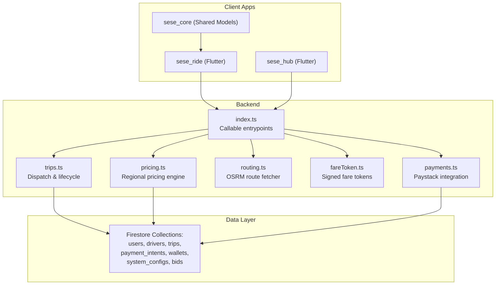
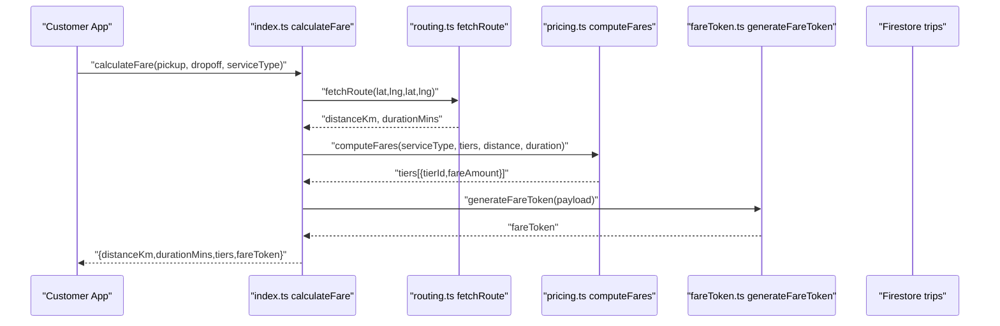
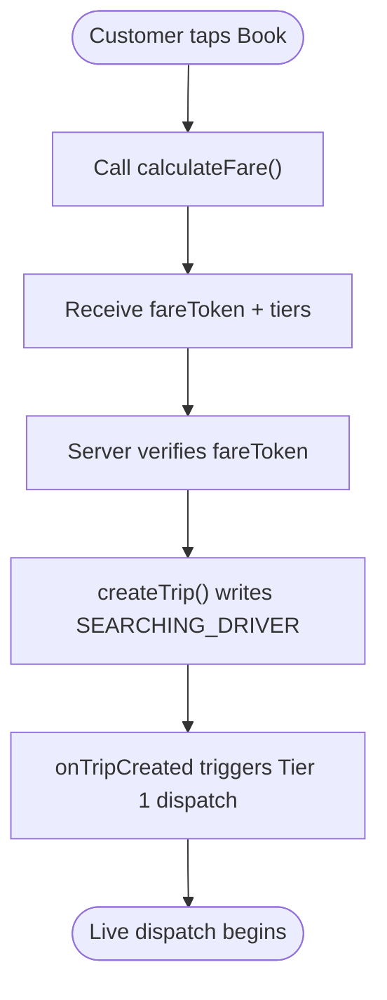
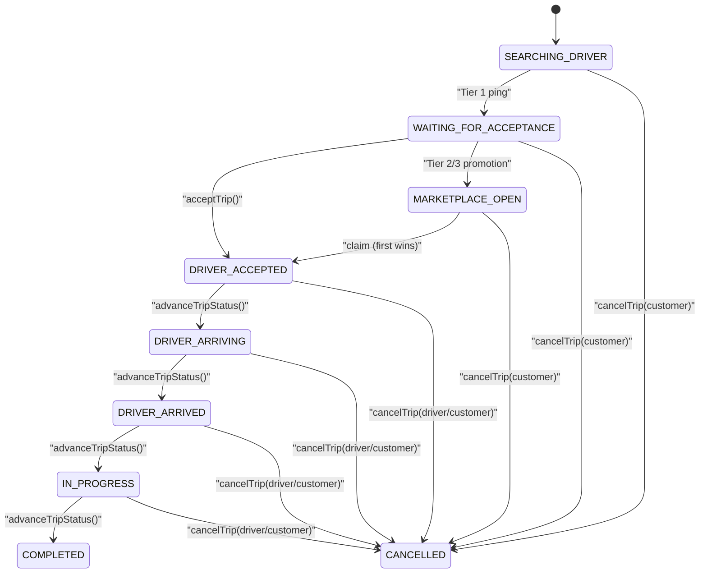
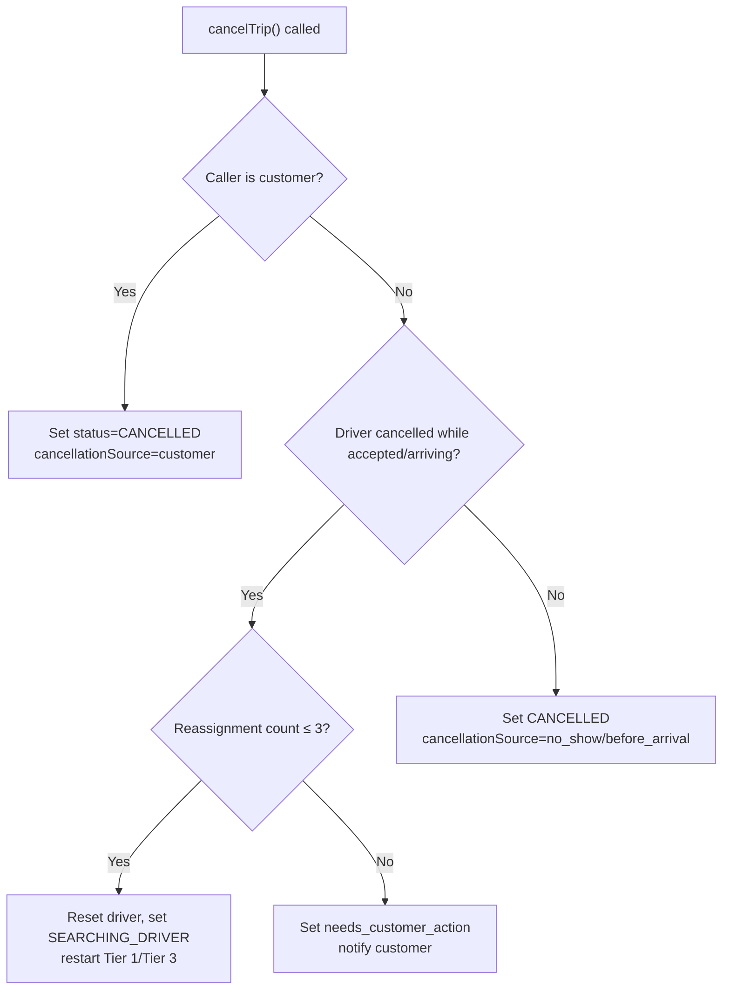
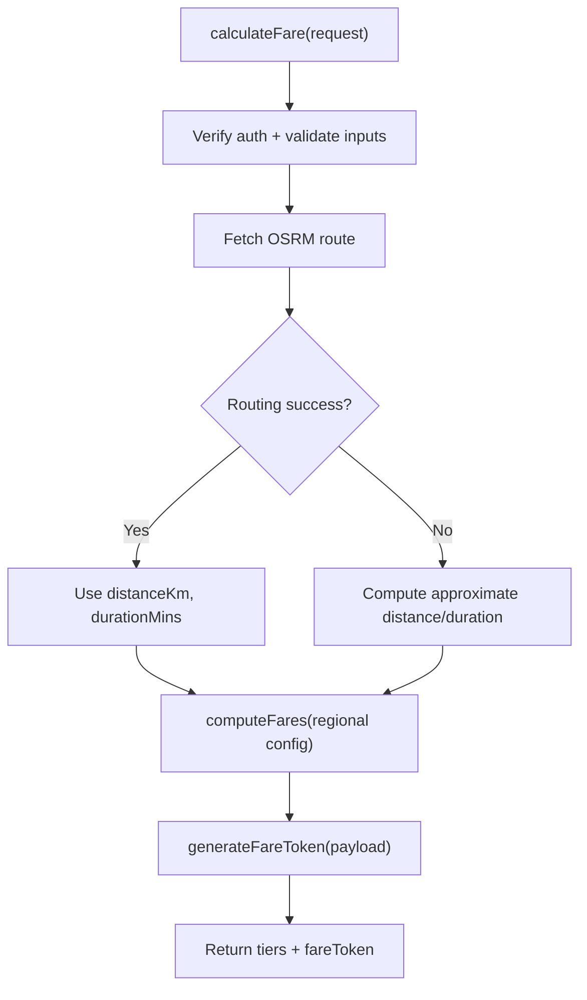
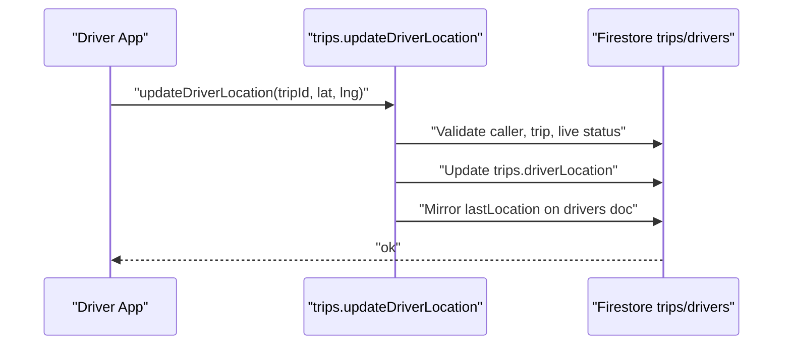
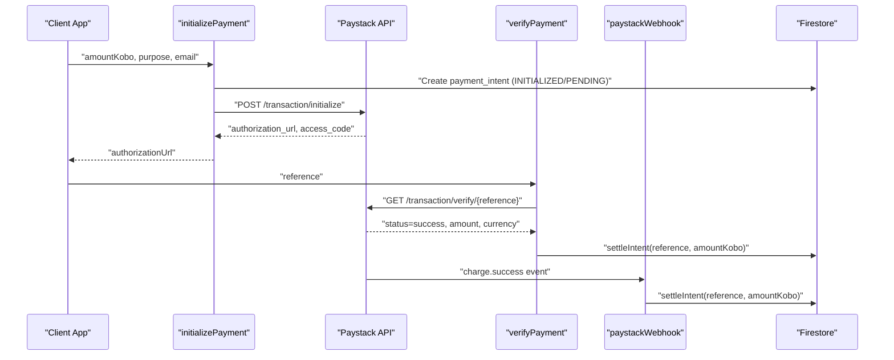
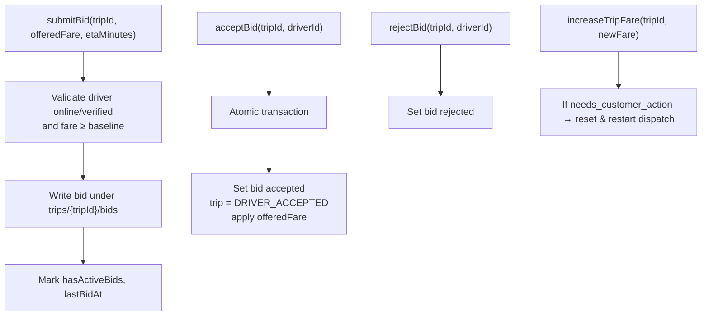
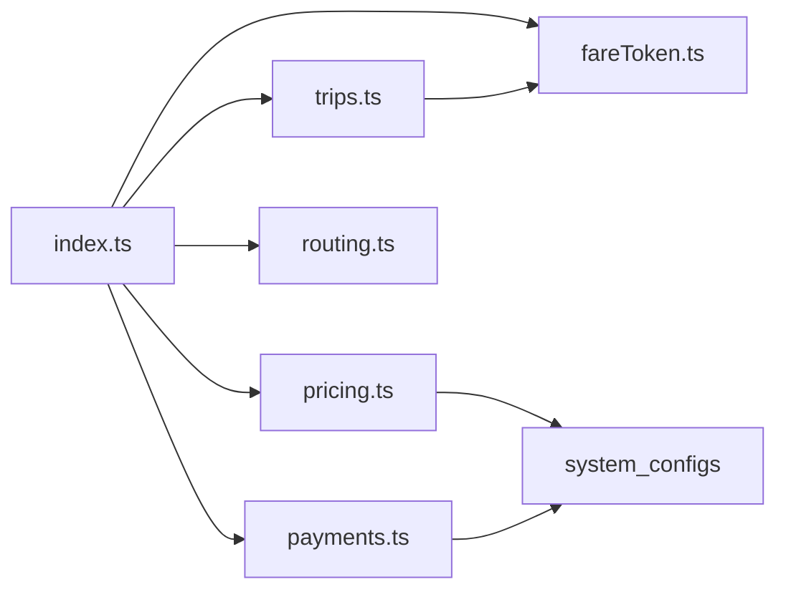

# Ride Services

<cite>
**Referenced Files in This Document**
- [index.ts](file://functions/src/index.ts)
- [trips.ts](file://functions/src/trips.ts)
- [pricing.ts](file://functions/src/pricing.ts)
- [fareToken.ts](file://functions/src/fareToken.ts)
- [routing.ts](file://functions/src/routing.ts)
- [payments.ts](file://functions/src/payments.ts)
- [trip_service.dart](file://sese_ride/lib/features/trips/services/trip_service.dart)
- [customer_dispatch_screen.dart](file://sese_ride/lib/features/customer/presentation/customer_dispatch_screen.dart)
- [trip_estimate.dart](file://sese_core/lib/models/trip_estimate.dart)
</cite>

## Table of Contents
1. [Introduction](#introduction)
2. [Project Structure](#project-structure)
3. [Core Components](#core-components)
4. [Architecture Overview](#architecture-overview)
5. [Detailed Component Analysis](#detailed-component-analysis)
6. [Dependency Analysis](#dependency-analysis)
7. [Performance Considerations](#performance-considerations)
8. [Troubleshooting Guide](#troubleshooting-guide)
9. [Conclusion](#conclusion)

## Introduction
This document explains the ride-hailing service architecture, focusing on customer booking workflows, real-time dispatch, trip lifecycle management, fare calculation and zero-trust pricing, driver-customer matching, location tracking, cancellation policies, payment processing, and the bid-based delivery extension. The system is implemented as Firebase Cloud Functions with Firestore state, a Flutter client layer, and server-side routing and pricing logic.

## Project Structure
The backend lives under `functions/src` and exposes callable HTTPS functions for fare calculation, trip creation, dispatch, driver actions, payments, and support utilities. The Flutter apps (`sese_ride`, `sese_hub`) and shared core (`sese_core`) model UI flows, trip estimates, and domain entities.

**Diagram sources**
- [index.ts:21-53](file://functions/src/index.ts#L21-L53)
- [trips.ts:129-225](file://functions/src/trips.ts#L129-L225)
- [pricing.ts:166-236](file://functions/src/pricing.ts#L166-L236)
- [routing.ts:40-67](file://functions/src/routing.ts#L40-L67)
- [fareToken.ts:21-58](file://functions/src/fareToken.ts#L21-L58)
- [payments.ts:108-197](file://functions/src/payments.ts#L108-L197)

**Section sources**
- [index.ts:1-53](file://functions/src/index.ts#L1-L53)
- [trips.ts:1-1225](file://functions/src/trips.ts#L1-L1225)
- [pricing.ts:1-237](file://functions/src/pricing.ts#L1-L237)
- [routing.ts:1-109](file://functions/src/routing.ts#L1-L109)
- [fareToken.ts:1-59](file://functions/src/fareToken.ts#L1-L59)
- [payments.ts:1-371](file://functions/src/payments.ts#L1-L371)
- [trip_service.dart:37-64](file://sese_ride/lib/features/trips/services/trip_service.dart#L37-L64)
- [customer_dispatch_screen.dart:156-177](file://sese_ride/lib/features/customer/presentation/customer_dispatch_screen.dart#L156-L177)
- [trip_estimate.dart:75-122](file://sese_core/lib/models/trip_estimate.dart#L75-L122)

## Core Components
- Callable API surface: centralized in `index.ts`, exporting trip, driver, payment, verification, and fare endpoints.
- Trip lifecycle and dispatch: `trips.ts` implements the authoritative state machine, cascading matchmaking tiers, driver actions, and bidding.
- Pricing engine: `pricing.ts` resolves regional rates and computes per-tier fares.
- Zero-trust fare token: `fareToken.ts` signs and verifies fare payloads to prevent client tampering.
- Routing: `routing.ts` fetches road-network distance/duration via OSRM.
- Payments: `payments.ts` integrates Paystack for wallet top-ups and trip payments with idempotent settlement.

**Section sources**
- [index.ts:21-53](file://functions/src/index.ts#L21-L53)
- [trips.ts:129-225](file://functions/src/trips.ts#L129-L225)
- [pricing.ts:166-236](file://functions/src/pricing.ts#L166-L236)
- [fareToken.ts:21-58](file://functions/src/fareToken.ts#L21-L58)
- [routing.ts:40-67](file://functions/src/routing.ts#L40-L67)
- [payments.ts:108-197](file://functions/src/payments.ts#L108-L197)

## Architecture Overview
The ride service follows a zero-trust, server-authoritative design:
- Clients never compute or trust final fares; they request a signed fare token from the backend.
- Dispatch state is owned by the server; clients observe live updates through Firestore.
- Driver-customer matching uses a tiered cascade with time-bound pings and scheduled promotions.
- Payments are settled only after server-side verification against Paystack.

**Diagram sources**
- [index.ts:81-198](file://functions/src/index.ts#L81-L198)
- [routing.ts:40-67](file://functions/src/routing.ts#L40-L67)
- [pricing.ts:166-236](file://functions/src/pricing.ts#L166-L236)
- [fareToken.ts:21-28](file://functions/src/fareToken.ts#L21-L28)

## Detailed Component Analysis

### Customer Booking Workflow
- The customer selects pickup/dropoff, service type, and vehicle tiers.
- The app calls `calculateFare` to obtain authoritative distances, durations, and tiered fares, plus a signed `fareToken`.
- On booking, `createTrip` validates inputs, verifies the fare token, and creates a trip document starting in `SEARCHING_DRIVER`.

**Diagram sources**
- [index.ts:81-198](file://functions/src/index.ts#L81-L198)
- [trips.ts:129-225](file://functions/src/trips.ts#L129-L225)
- [trips.ts:373-384](file://functions/src/trips.ts#L373-L384)

**Section sources**
- [index.ts:81-198](file://functions/src/index.ts#L81-L198)
- [trips.ts:129-225](file://functions/src/trips.ts#L129-L225)

### Real-Time Dispatch System and Driver-Customer Matching
- Cascading tiers:
  - Tier 1: exclusive ping to nearest online driver for 15 seconds.
  - Tier 2: simultaneous ping to next two nearest drivers for 15 seconds.
  - Tier 3: marketplace broadcast to all nearby online drivers.
- A cron job promotes offers when deadlines pass, expires ignored pings, and re-dispatches long-waiting searches.
- Driver acceptance uses an atomic transaction to ensure first-wins semantics.

**Diagram sources**
- [trips.ts:44-63](file://functions/src/trips.ts#L44-L63)
- [trips.ts:295-370](file://functions/src/trips.ts#L295-L370)
- [trips.ts:591-653](file://functions/src/trips.ts#L591-L653)
- [trips.ts:756-796](file://functions/src/trips.ts#L756-L796)
- [trips.ts:800-927](file://functions/src/trips.ts#L800-L927)

**Section sources**
- [trips.ts:29-43](file://functions/src/trips.ts#L29-L43)
- [trips.ts:252-370](file://functions/src/trips.ts#L252-L370)
- [trips.ts:373-512](file://functions/src/trips.ts#L373-L512)
- [trips.ts:591-653](file://functions/src/trips.ts#L591-L653)

### Trip Lifecycle Management and Cancellation Policies
- Allowed transitions are enforced server-side; drivers can only advance along a defined chain.
- Cancellations:
  - Customer cancels → trip becomes `CANCELLED`.
  - Driver cancels while accepted/arriving → up to three automatic reassignments; beyond that, trip enters `needs_customer_action` prompting price increase.
  - Driver no-show detection uses `arrivedAt` and configurable wait minutes.
- Streak logic breaks on declines and expired pings; customer cancellations and driver no-shows are streak-protected.

**Diagram sources**
- [trips.ts:800-927](file://functions/src/trips.ts#L800-L927)

**Section sources**
- [trips.ts:756-796](file://functions/src/trips.ts#L756-L796)
- [trips.ts:800-927](file://functions/src/trips.ts#L800-L927)

### Fare Calculation Engine and Zero-Trust Architecture
- Zero-trust enforcement:
  - `calculateFare` requires authentication and validates coordinates, service type, and selected tiers.
  - Road distance/duration comes from OSRM; fallback to crow-flies approximation if unavailable.
  - Server computes fares using regional configuration and returns a signed `fareToken`.
  - `createTrip` verifies the token and binds the baseline fare into the trip document.
- Regional pricing:
  - Fallback chain: Global default → Country-specific → State-specific overrides.
  - Car tiers apply multipliers to variable fare components; base fee remains a floor.
  - Delivery categories use category-specific rates.

**Diagram sources**
- [index.ts:81-198](file://functions/src/index.ts#L81-L198)
- [routing.ts:40-67](file://functions/src/routing.ts#L40-L67)
- [pricing.ts:65-147](file://functions/src/pricing.ts#L65-L147)
- [pricing.ts:166-236](file://functions/src/pricing.ts#L166-L236)
- [fareToken.ts:21-58](file://functions/src/fareToken.ts#L21-L58)
- [trips.ts:160-178](file://functions/src/trips.ts#L160-L178)

**Section sources**
- [index.ts:81-198](file://functions/src/index.ts#L81-L198)
- [pricing.ts:18-58](file://functions/src/pricing.ts#L18-L58)
- [pricing.ts:65-147](file://functions/src/pricing.ts#L65-L147)
- [pricing.ts:166-236](file://functions/src/pricing.ts#L166-L236)
- [fareToken.ts:1-59](file://functions/src/fareToken.ts#L1-L59)
- [trips.ts:160-178](file://functions/src/trips.ts#L160-L178)

### Location Services Integration and Real-Time Tracking
- Drivers send GPS heartbeats via `updateDriverLocation`; the server updates the trip’s `driverLocation` and mirrors the fix onto the driver doc for ranking.
- Live statuses restrict who can update location and when.
- The sweep cron also maintains freshness by promoting offers and restarting dispatch for stale searches.

**Diagram sources**
- [trips.ts:716-754](file://functions/src/trips.ts#L716-L754)

**Section sources**
- [trips.ts:716-754](file://functions/src/trips.ts#L716-L754)

### Payment Processing, Tips, and Receipt Generation
- Wallet top-ups and trip payments flow through Paystack:
  - `initializePayment` validates amount, creates a `payment_intent`, and returns a hosted checkout URL.
  - `verifyPayment` verifies with Paystack and settles the intent exactly once via a transaction.
  - `paystackWebhook` performs HMAC signature verification and settles via the same idempotent path.
- Settlement credits the user’s wallet and records a transaction; receipts are associated with the stored email and reference.
- Tip handling and receipt generation are not explicitly implemented in the referenced files; tips would require additional fields and post-completion logic.

**Diagram sources**
- [payments.ts:108-197](file://functions/src/payments.ts#L108-L197)
- [payments.ts:206-272](file://functions/src/payments.ts#L206-L272)
- [payments.ts:283-326](file://functions/src/payments.ts#L283-L326)
- [payments.ts:333-371](file://functions/src/payments.ts#L333-L371)

**Section sources**
- [payments.ts:1-371](file://functions/src/payments.ts#L1-L371)

### Bid-Based Delivery System Extension
- Drivers may submit custom-fare bids on open trips; bids include driver info, offered fare, and ETA.
- Customers can reject or accept bids; acceptance atomically sets the trip to `DRIVER_ACCEPTED`, applies the bid fare, and rejects other pending bids.
- Customers can raise the fare to attract drivers faster; this resets or restarts dispatch when needed.
- This extends the ride architecture by adding a bidding collection under each trip and additional trip states/status messages.

**Diagram sources**
- [trips.ts:931-1034](file://functions/src/trips.ts#L931-L1034)
- [trips.ts:1036-1070](file://functions/src/trips.ts#L1036-L1070)
- [trips.ts:1072-1170](file://functions/src/trips.ts#L1072-L1170)
- [trips.ts:1172-1225](file://functions/src/trips.ts#L1172-L1225)

**Section sources**
- [trips.ts:931-1225](file://functions/src/trips.ts#L931-L1225)

### Dispute Resolution Mechanisms
- Disputes are not explicitly modeled in the referenced backend code. However, the system provides audit-friendly fields such as `cancellationSource`, `declineCount`, `reassignmentHistory`, and `statusMessage` that can support dispute review and moderation workflows.
- Verification endpoints exist for customers and drivers, which can be used to gate eligibility and inform dispute outcomes.

**Section sources**
- [trips.ts:800-927](file://functions/src/trips.ts#L800-L927)
- [index.ts:55-60](file://functions/src/index.ts#L55-L60)

## Dependency Analysis
The backend modules have clear separation of concerns:
- `index.ts` orchestrates callables and imports business modules.
- `trips.ts` depends on `fareToken.ts` and `driverStreak.ts` (not shown here).
- `pricing.ts` reads from `system_configs` in Firestore.
- `routing.ts` is a thin HTTP client to OSRM.
- `payments.ts` interacts with Paystack and Firestore.

**Diagram sources**
- [index.ts:21-53](file://functions/src/index.ts#L21-L53)
- [trips.ts:1-10](file://functions/src/trips.ts#L1-L10)
- [pricing.ts:1-10](file://functions/src/pricing.ts#L1-L10)
- [payments.ts:1-10](file://functions/src/payments.ts#L1-L10)

**Section sources**
- [index.ts:21-53](file://functions/src/index.ts#L21-L53)
- [trips.ts:1-10](file://functions/src/trips.ts#L1-L10)
- [pricing.ts:1-10](file://functions/src/pricing.ts#L1-L10)
- [payments.ts:1-10](file://functions/src/payments.ts#L1-L10)

## Performance Considerations
- Routing fallback: If OSRM is unreachable, the system falls back to a crow-flies estimate with a winding factor and urban speed assumption to keep fare estimation responsive.
- Dispatch efficiency: The sweep cron batches operations (limit 25) and avoids redundant work by checking updated timestamps and existing statuses.
- Pricing resolution: Reads at most three `system_configs` documents and merges overrides incrementally, minimizing Firestore reads.
- Payment idempotency: Settlement uses transactions to prevent double crediting across webhook and callable paths.

[No sources needed since this section provides general guidance]

## Troubleshooting Guide
- Unauthenticated requests: All callables enforce authentication; missing `request.auth` results in `unauthenticated` errors.
- Invalid arguments: Coordinate bounds, phone formats, required fields, and amount ranges are validated; invalid inputs return `invalid-argument`.
- Permission issues: Only the trip owner or assigned driver can perform actions; unauthorized attempts return `permission-denied`.
- Precondition failures: Attempting unsupported state transitions or claiming already-assigned trips returns `failed-precondition`.
- Payment mismatches: Amount/currency mismatches during verification result in `data-loss` errors; always verify Paystack response before settling.

**Section sources**
- [index.ts:81-142](file://functions/src/index.ts#L81-L142)
- [trips.ts:129-178](file://functions/src/trips.ts#L129-L178)
- [trips.ts:591-653](file://functions/src/trips.ts#L591-L653)
- [trips.ts:764-796](file://functions/src/trips.ts#L764-L796)
- [payments.ts:108-197](file://functions/src/payments.ts#L108-L197)
- [payments.ts:283-326](file://functions/src/payments.ts#L283-L326)

## Conclusion
The ride service implements a robust, zero-trust architecture where all critical computations and state transitions occur server-side. The fare engine produces signed, tamper-proof quotes; the dispatch system manages driver-customer matching through a tiered cascade; and the trip lifecycle is strictly enforced. Payments integrate securely with Paystack, and the bidding extension adds flexibility for both rides and deliveries. Operational safeguards like scheduled sweeps, idempotent settlements, and comprehensive validation provide resilience and clarity for troubleshooting.