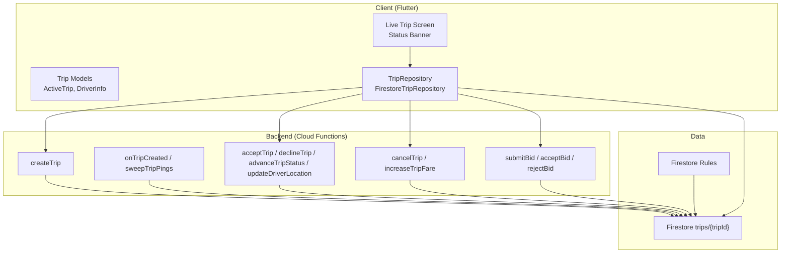
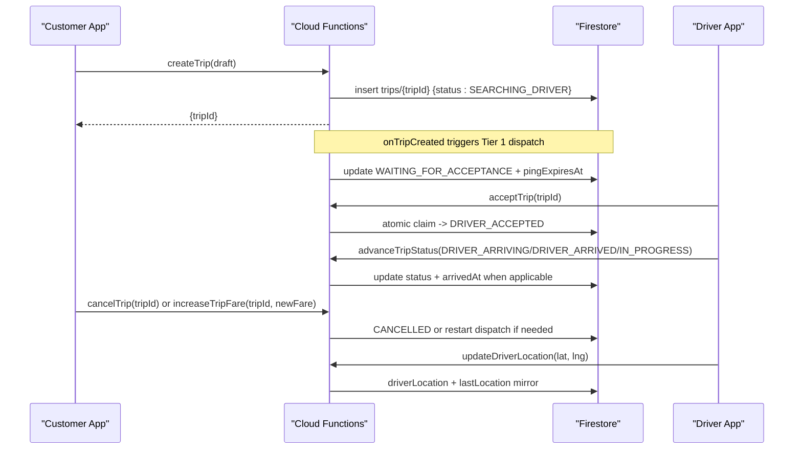
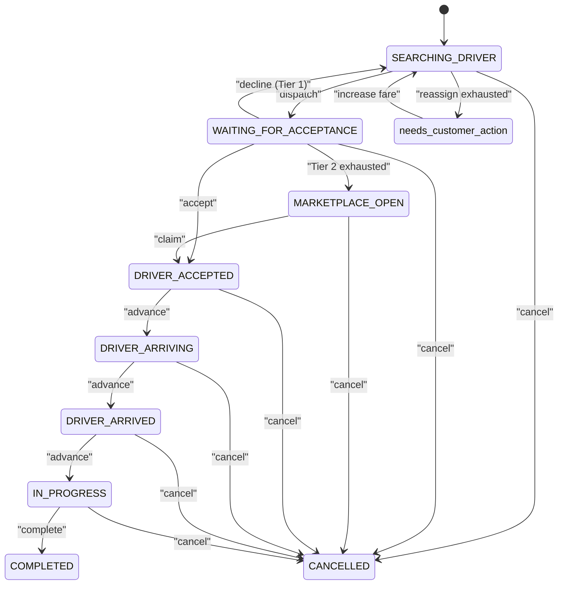
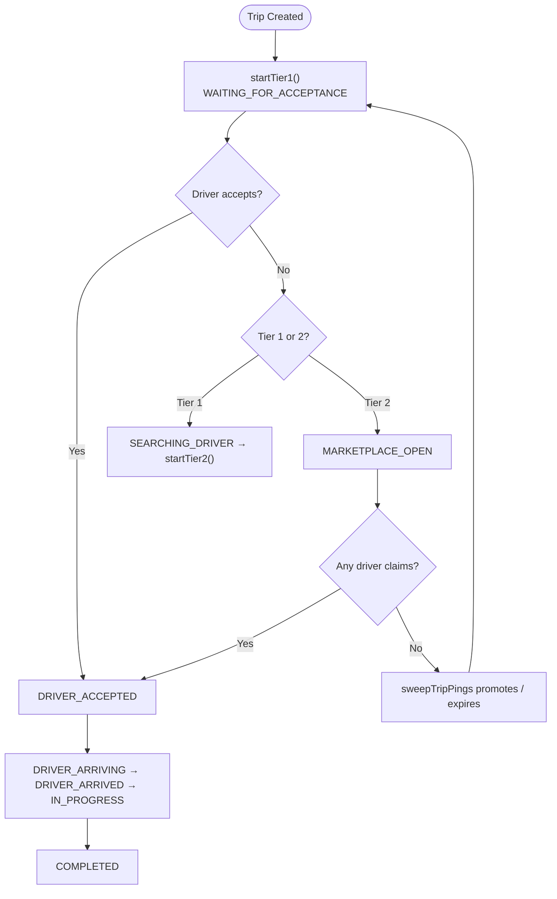
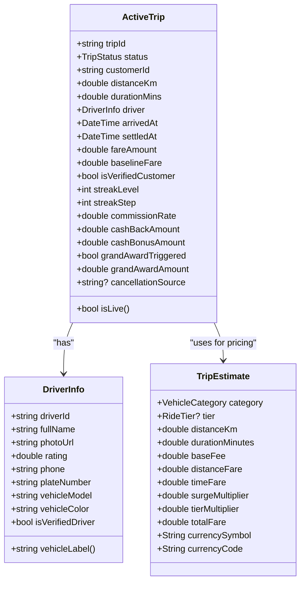
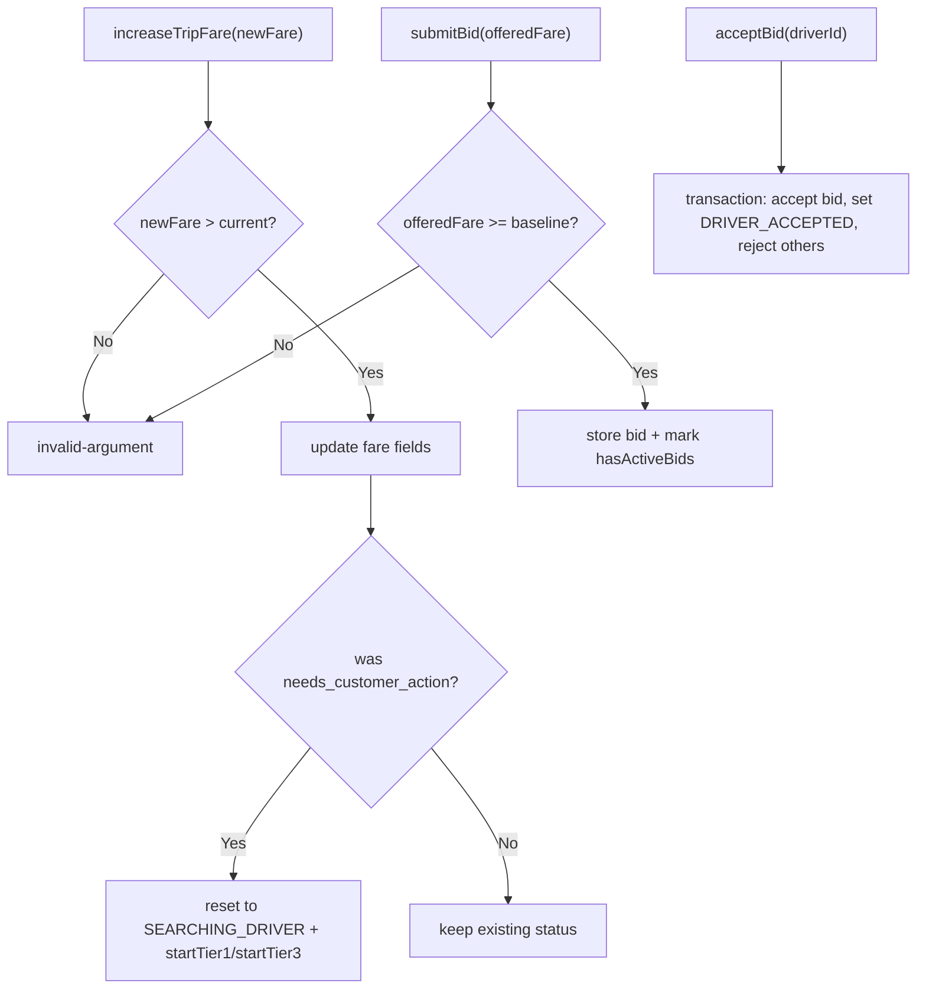
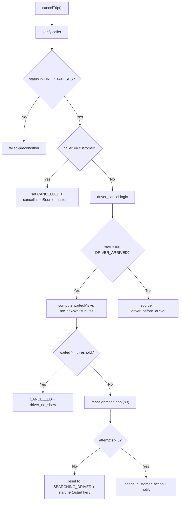
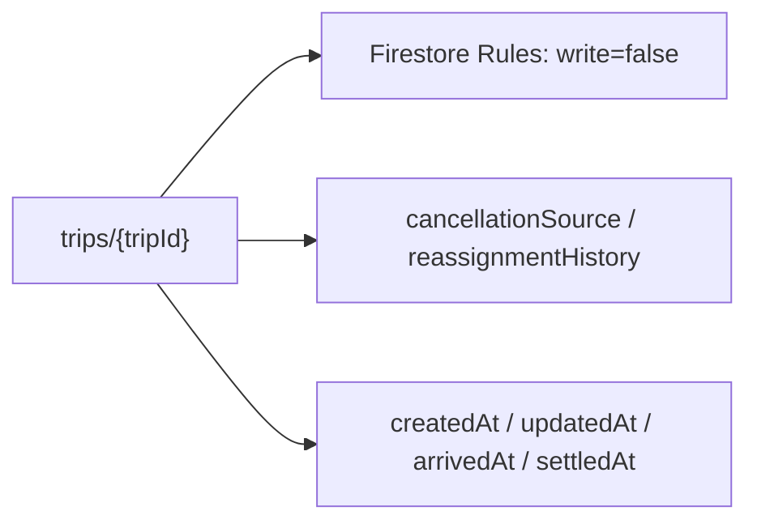
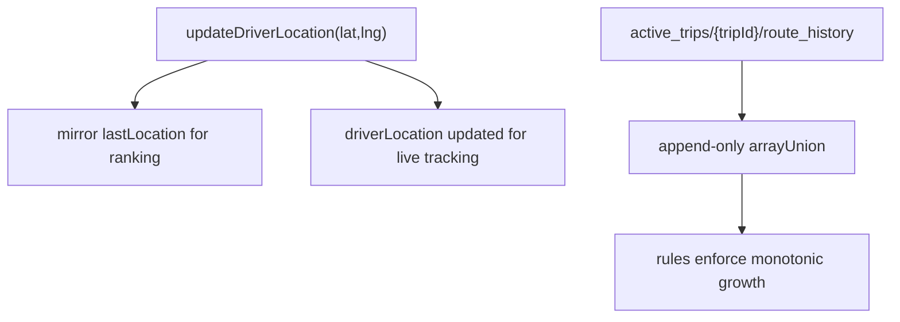
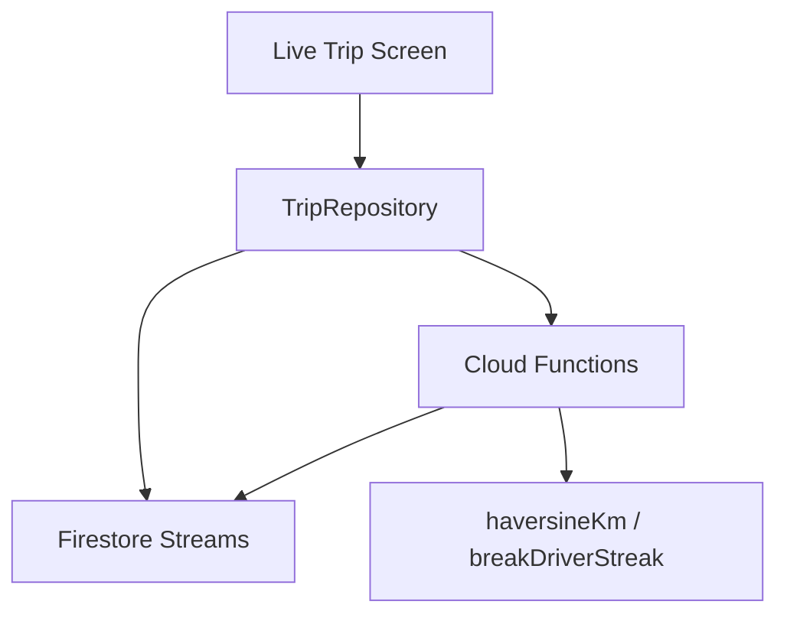

# Trip Lifecycle Management

<cite>
**Referenced Files in This Document**
- [trips.ts](file://functions/src/trips.ts)
- [trip_models.dart](file://sese_ride/lib/features/trips/models/trip_models.dart)
- [trip_service.dart](file://sese_ride/lib/features/trips/services/trip_service.dart)
- [live_trip_screen.dart](file://sese_ride/lib/features/trips/presentation/live_trip_screen.dart)
- [trip_estimate.dart](file://sese_core/lib/models/trip_estimate.dart)
- [firestore.rules](file://firestore.rules)
</cite>

## Table of Contents
1. [Introduction](#introduction)
2. [Project Structure](#project-structure)
3. [Core Components](#core-components)
4. [Architecture Overview](#architecture-overview)
5. [Detailed Component Analysis](#detailed-component-analysis)
6. [Dependency Analysis](#dependency-analysis)
7. [Performance Considerations](#performance-considerations)
8. [Troubleshooting Guide](#troubleshooting-guide)
9. [Conclusion](#conclusion)

## Introduction
This document explains the complete trip lifecycle from booking completion to finalization, focusing on the server-authoritative state machine that manages dispatch, real-time updates, and consistency across customer and driver apps. It covers all trip states, transitions, event-driven orchestration, modification capabilities (fare increases, bidding), emergency procedures (cancellations, reassignment loops), exception handling, data structures, metadata tracking, audit logging, duration monitoring, route deviation detection, and safety features integrated into lifecycle management.

## Project Structure
The trip lifecycle spans three layers:
- Cloud Functions backend: authoritative state machine, matchmaking, scheduling, and security.
- Flutter client models and services: typed domain models, repository abstraction, and Firestore streams.
- Firestore rules: strict read/write policies ensuring server-only writes for trips.

**Diagram sources**
- [trips.ts:129-225](file://functions/src/trips.ts#L129-L225)
- [trips.ts:373-512](file://functions/src/trips.ts#L373-L512)
- [trips.ts:591-796](file://functions/src/trips.ts#L591-L796)
- [trips.ts:800-927](file://functions/src/trips.ts#L800-L927)
- [trips.ts:931-1225](file://functions/src/trips.ts#L931-L1225)
- [trip_models.dart:11-49](file://sese_ride/lib/features/trips/models/trip_models.dart#L11-L49)
- [trip_service.dart:20-64](file://sese_ride/lib/features/trips/services/trip_service.dart#L20-L64)
- [firestore.rules:917-936](file://firestore.rules#L917-L936)

**Section sources**
- [trips.ts:129-225](file://functions/src/trips.ts#L129-L225)
- [trip_models.dart:11-49](file://sese_ride/lib/features/trips/models/trip_models.dart#L11-L49)
- [trip_service.dart:20-64](file://sese_ride/lib/features/trips/services/trip_service.dart#L20-L64)
- [firestore.rules:917-936](file://firestore.rules#L917-L936)

## Core Components
- Server state machine: defines live statuses and allowed transitions; orchestrates cascading tiered dispatch and scheduled sweeps.
- Client models: strongly typed TripStatus enum and ActiveTrip snapshot with rich metadata.
- Repository layer: abstracts callable calls and Firestore streams; maps errors to user-friendly messages.
- Live UI: renders status banner and accepted-driver sheet based on current trip state.

Key responsibilities:
- Backend owns every transition; clients only render snapshots and invoke authorized callables.
- Real-time consistency via Firestore streams and server timestamps.
- Safety and integrity enforced by Firestore rules and function-level validations.

**Section sources**
- [trips.ts:44-63](file://functions/src/trips.ts#L44-L63)
- [trip_models.dart:11-49](file://sese_ride/lib/features/trips/models/trip_models.dart#L11-L49)
- [trip_service.dart:20-64](file://sese_ride/lib/features/trips/services/trip_service.dart#L20-L64)
- [live_trip_screen.dart:613-671](file://sese_ride/lib/features/trips/presentation/live_trip_screen.dart#L613-L671)

## Architecture Overview
The system is event-driven:
- createTrip mints a trip in SEARCHING_DRIVER.
- onTripCreated triggers Tier 1 dispatch; sweepTripPings promotes tiers and handles timeouts.
- Driver actions (accept/decline/location/status) and customer actions (cancel/increase fare/bid) mutate state atomically where needed.
- Clients subscribe to trip streams for real-time updates.

**Diagram sources**
- [trips.ts:129-225](file://functions/src/trips.ts#L129-L225)
- [trips.ts:373-512](file://functions/src/trips.ts#L373-L512)
- [trips.ts:591-796](file://functions/src/trips.ts#L591-L796)
- [trips.ts:800-927](file://functions/src/trips.ts#L800-L927)
- [trips.ts:1173-1225](file://functions/src/trips.ts#L1173-L1225)

## Detailed Component Analysis

### Trip State Machine and Transitions
States:
- SEARCHING_DRIVER: initial search; promoted by sweep if no drivers online.
- WAITING_FOR_ACCEPTANCE: driver ping(s) active with timeout.
- MARKETPLACE_OPEN: broadcast to nearby drivers; first tap claims.
- DRIVER_ACCEPTED: driver assigned; sheet shown.
- DRIVER_ARRIVING: en route to pickup.
- DRIVER_ARRIVED: at pickup; no-show timer starts.
- IN_PROGRESS: passenger picked up; trip underway.
- COMPLETED: terminal; settlement recorded.
- CANCELLED: terminal; cancellationSource recorded.
- needs_customer_action: auto-reassignment exhausted; customer must raise fare or cancel.
- bidding: marketplace-style bidding active.

Allowed transitions:
- SEARCHING_DRIVER → WAITING_FOR_ACCEPTANCE (dispatch).
- WAITING_FOR_ACCEPTANCE → DRIVER_ACCEPTED (accept).
- WAITING_FOR_ACCEPTANCE → SEARCHING_DRIVER (decline Tier 1) or MARKETPLACE_OPEN (Tier 2 exhaustion).
- MARKETPLACE_OPEN → DRIVER_ACCEPTED (first-wins claim).
- DRIVER_ACCEPTED → DRIVER_ARRIVING → DRIVER_ARRIVED → IN_PROGRESS → COMPLETED.
- Any live state → CANCELLED (customer/driver/system).
- DRIVER_ACCEPTED/DRIVER_ARRIVING may loop back to SEARCHING_DRIVER via reassignment (up to 3 attempts), then needs_customer_action.

**Diagram sources**
- [trips.ts:44-63](file://functions/src/trips.ts#L44-L63)
- [trips.ts:756-796](file://functions/src/trips.ts#L756-L796)
- [trips.ts:800-927](file://functions/src/trips.ts#L800-L927)
- [trip_models.dart:11-49](file://sese_ride/lib/features/trips/models/trip_models.dart#L11-L49)

**Section sources**
- [trips.ts:44-63](file://functions/src/trips.ts#L44-L63)
- [trips.ts:756-796](file://functions/src/trips.ts#L756-L796)
- [trips.ts:800-927](file://functions/src/trips.ts#L800-L927)
- [trip_models.dart:11-49](file://sese_ride/lib/features/trips/models/trip_models.dart#L11-L49)

### Event-Driven Orchestration and Real-Time Updates
- onTripCreated: immediate Tier 1 dispatch upon trip creation.
- sweepTripPings (cron): promotes tiers, expires ignored pings, restarts long-waiting searches, and sends idle prompts after 30 minutes in marketplace.
- Driver location heartbeat: updates driverLocation and mirrors lastLocation for ranking.
- Client streams: tripStream and activeTripsStream provide real-time snapshots; UI reacts to status changes.

**Diagram sources**
- [trips.ts:295-370](file://functions/src/trips.ts#L295-L370)
- [trips.ts:373-512](file://functions/src/trips.ts#L373-L512)
- [trips.ts:591-714](file://functions/src/trips.ts#L591-L714)

**Section sources**
- [trips.ts:295-370](file://functions/src/trips.ts#L295-L370)
- [trips.ts:373-512](file://functions/src/trips.ts#L373-L512)
- [trip_service.dart:101-122](file://sese_ride/lib/features/trips/services/trip_service.dart#L101-L122)

### Trip Data Model and Metadata Tracking
ActiveTrip captures:
- Route endpoints (pickup/dropoff coordinates, addresses, phones).
- Service type, selected tiers, fare details (baseline, proposed, formatted, amount).
- Dispatch metadata (tier, ping targets, attempted drivers, decline count).
- Driver snapshot (identity, vehicle, rating, verification).
- Timing (arrivedAt, createdAt, updatedAt, settledAt).
- Streak/settlement annotations (streak level, step, commission, cashback, grand award).
- Cancellation source and baseline fare guardrails.

TripEstimate and MultiVehicleDispatchProposal define per-tier pricing components used during booking and dispatch.

**Diagram sources**
- [trip_models.dart:63-113](file://sese_ride/lib/features/trips/models/trip_models.dart#L63-L113)
- [trip_models.dart:115-339](file://sese_ride/lib/features/trips/models/trip_models.dart#L115-L339)
- [trip_estimate.dart:4-73](file://sese_core/lib/models/trip_estimate.dart#L4-L73)

**Section sources**
- [trip_models.dart:115-339](file://sese_ride/lib/features/trips/models/trip_models.dart#L115-L339)
- [trip_estimate.dart:4-73](file://sese_core/lib/models/trip_estimate.dart#L4-L73)

### Trip Modification Capabilities
- Fare increase: customer can raise fare above current; if trip was needs_customer_action, it resets to SEARCHING_DRIVER and restarts dispatch.
- Bidding: drivers submit bids (offeredFare ≥ baseline); customer rejects or atomically accepts one bid; other pending bids are rejected.
- Reassignment loop: driver cancellations in DRIVER_ACCEPTED/DRIVER_ARRIVING trigger up to 3 reassignments; beyond that, trip enters needs_customer_action with notifications.

**Diagram sources**
- [trips.ts:931-1034](file://functions/src/trips.ts#L931-L1034)
- [trips.ts:1072-1170](file://functions/src/trips.ts#L1072-L1170)
- [trips.ts:1173-1225](file://functions/src/trips.ts#L1173-L1225)

**Section sources**
- [trips.ts:931-1034](file://functions/src/trips.ts#L931-L1034)
- [trips.ts:1072-1170](file://functions/src/trips.ts#L1072-L1170)
- [trips.ts:1173-1225](file://functions/src/trips.ts#L1173-L1225)

### Emergency Procedures and Exception Handling
- CancelTrip: validates caller (customer or driver), ensures trip is live, sets cancellationSource, and either cancels or initiates reassignment loop.
- DeclineTrip: breaks driver streak, advances dispatch immediately (Tier 1 → Tier 2; Tier 2 → marketplace).
- Ping expiration: sweepTripPings breaks streaks for ignored pings and re-promotes or restarts dispatch.
- Error mapping: client maps server error codes to user-friendly messages.

**Diagram sources**
- [trips.ts:800-927](file://functions/src/trips.ts#L800-L927)
- [trips.ts:662-714](file://functions/src/trips.ts#L662-L714)
- [trip_service.dart:202-215](file://sese_ride/lib/features/trips/services/trip_service.dart#L202-L215)

**Section sources**
- [trips.ts:800-927](file://functions/src/trips.ts#L800-L927)
- [trips.ts:662-714](file://functions/src/trips.ts#L662-L714)
- [trip_service.dart:202-215](file://sese_ride/lib/features/trips/services/trip_service.dart#L202-L215)

### Audit Logging and Security Controls
- All writes to trips are server-only via Admin SDK; clients cannot mutate trip state directly.
- CancellationSource records who initiated cancellation and why (customer, driver, system, ping_expired, driver_declined, etc.).
- ReassignmentHistory tracks each driver cancellation attempt with timestamps.
- Streak breaking logs reasons (ping_expired, driver_declined) for analytics and fairness.

**Diagram sources**
- [firestore.rules:917-936](file://firestore.rules#L917-L936)
- [trips.ts:800-927](file://functions/src/trips.ts#L800-L927)

**Section sources**
- [firestore.rules:917-936](file://firestore.rules#L917-L936)
- [trips.ts:800-927](file://functions/src/trips.ts#L800-L927)

### Duration Monitoring, Route Deviation Detection, and Safety Features
- Duration monitoring: durationMins is captured at booking and persisted; arrival timestamp enables no-show timers and earnings bucketing.
- Route deviation detection: active_trips collection supports append-only route_history updates by the assigned driver; rules enforce pure arrayUnion and monotonic growth to prevent tampering.
- Safety features:
  - Verified customer badge resolved server-side.
  - Driver verification checks before accepting/bidding.
  - GPS spoof sanity and active-trip state checks referenced in driver status validation.
  - Idle price prompt nudges customers to increase fares after prolonged marketplace exposure.

**Diagram sources**
- [trips.ts:716-754](file://functions/src/trips.ts#L716-L754)
- [firestore.rules:849-865](file://firestore.rules#L849-L865)

**Section sources**
- [trips.ts:716-754](file://functions/src/trips.ts#L716-L754)
- [firestore.rules:849-865](file://firestore.rules#L849-L865)

## Dependency Analysis
- Client depends on TripRepository for all trip operations; repository delegates to Firebase Functions and Firestore.
- Backend functions depend on Firestore queries, haversine distance calculation, and driver/streak utilities.
- UI depends on ActiveTrip and TripStatus enums for rendering.

**Diagram sources**
- [trip_service.dart:20-64](file://sese_ride/lib/features/trips/services/trip_service.dart#L20-L64)
- [trips.ts:66-79](file://functions/src/trips.ts#L66-L79)
- [trips.ts:386-392](file://functions/src/trips.ts#L386-L392)

**Section sources**
- [trip_service.dart:20-64](file://sese_ride/lib/features/trips/services/trip_service.dart#L20-L64)
- [trips.ts:66-79](file://functions/src/trips.ts#L66-L79)

## Performance Considerations
- Cascading dispatch reduces latency by limiting initial offers to nearest drivers and escalating to broader broadcasts only when necessary.
- Scheduled sweep runs every minute to promote tiers and handle timeouts without relying on client presence.
- Location heartbeats mirror lastLocation to improve ranking efficiency while keeping trip tracking authoritative.
- Client streams filter terminal states locally to reduce UI overhead.

[No sources needed since this section provides general guidance]

## Troubleshooting Guide
Common issues and resolutions:
- Unauthenticated requests: ensure user session is valid; client maps 'unauthenticated' to sign-in prompt.
- Invalid arguments: validate inputs (coordinates, phone numbers, fares); client surfaces message from server.
- Not found: trip may have been cancelled; inform user and navigate away.
- Failed precondition: trip state no longer allows requested action; guide user to appropriate next step.

Error mapping reference:
- unauthenticated → sign-in required.
- invalid-argument → review input details.
- not-found → trip unavailable.
- failed-precondition → trip state changed; retry later.

**Section sources**
- [trip_service.dart:202-215](file://sese_ride/lib/features/trips/services/trip_service.dart#L202-L215)

## Conclusion
The trip lifecycle is governed by a robust, server-authoritative state machine that ensures consistency, safety, and real-time responsiveness. Through cascading dispatch, scheduled sweeps, atomic transactions, and strict Firestore rules, the system maintains integrity across participants. Rich metadata, audit trails, and safety mechanisms support operational transparency and reliability. The client layer remains thin, focused on rendering and invoking authorized actions, while the backend handles complexity and correctness.