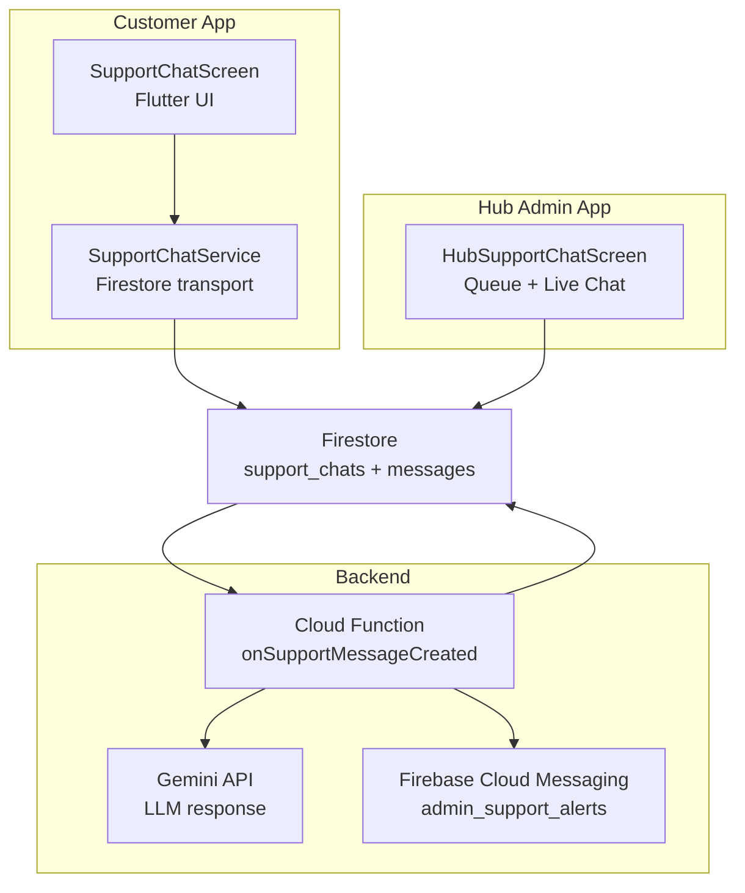
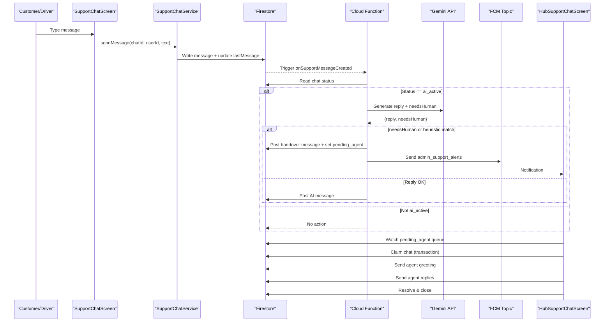
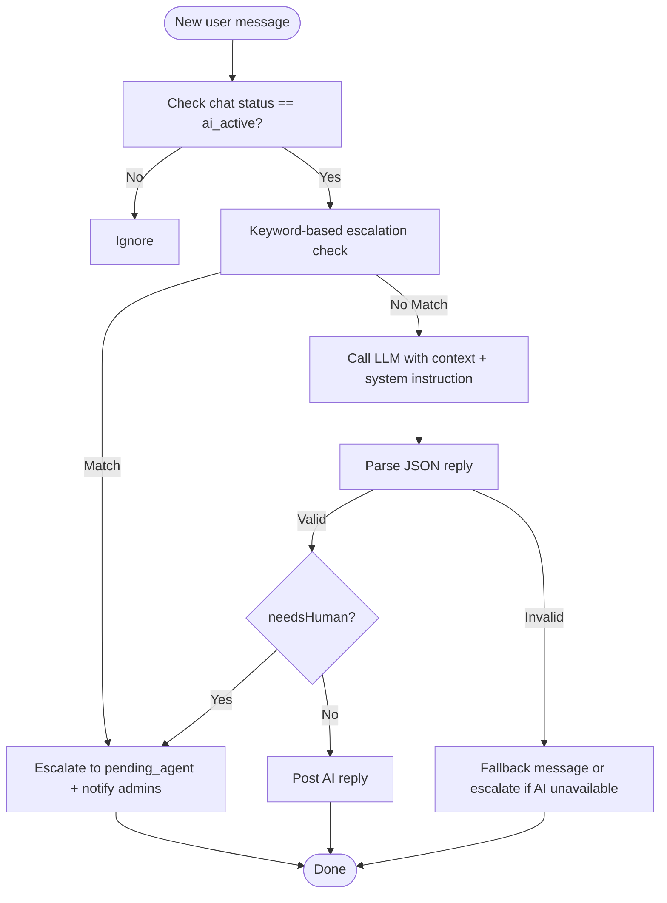
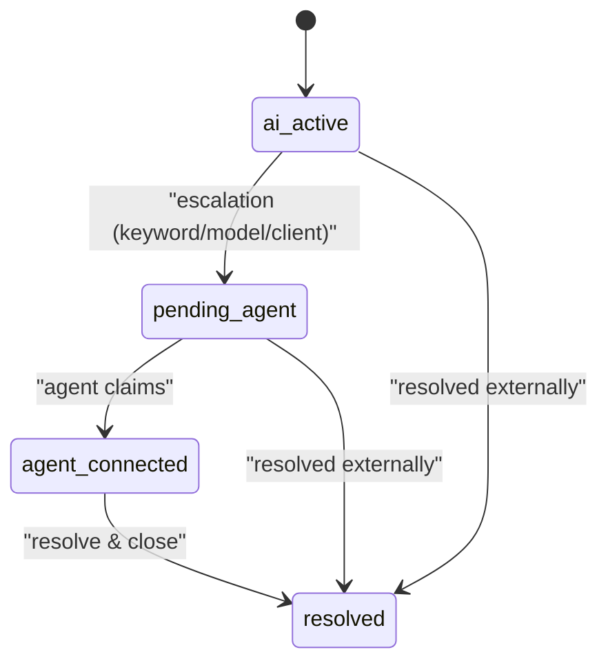
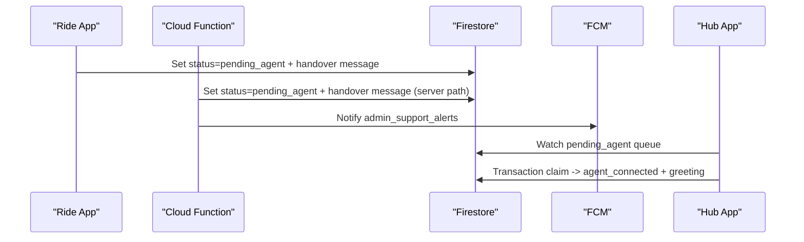
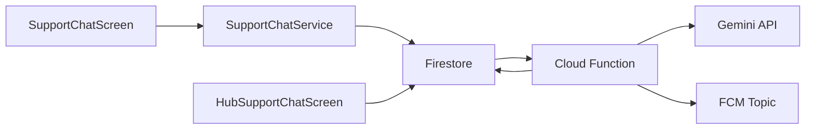

# Support System

<cite>
**Referenced Files in This Document**
- [supportBot.ts](file://functions/src/supportBot.ts)
- [support_chat_service.dart](file://sese_ride/lib/features/support/support_chat_service.dart)
- [support_chat_screen.dart](file://sese_ride/lib/features/support/support_chat_screen.dart)
- [hub_support_chat_screen.dart](file://sese_hub/lib/features/support/hub_support_chat_screen.dart)
</cite>

## Table of Contents
1. [Introduction](#introduction)
2. [Project Structure](#project-structure)
3. [Core Components](#core-components)
4. [Architecture Overview](#architecture-overview)
5. [Detailed Component Analysis](#detailed-component-analysis)
6. [Dependency Analysis](#dependency-analysis)
7. [Performance Considerations](#performance-considerations)
8. [Troubleshooting Guide](#troubleshooting-guide)
9. [Conclusion](#conclusion)

## Introduction
This document explains the AI-powered support system that combines a conversational chatbot, real-time ticket management, and human agent handover. It covers how customer and driver users interact with the SeSe Assistant, how escalation works, how agents claim and resolve tickets, and how the backend uses an LLM to generate automated responses. It also addresses multilingual behavior, accessibility considerations, privacy implications, and quality assurance practices derived from the implementation.

## Project Structure
The support system spans three main areas:
- Backend Cloud Function for AI response generation and escalation logic.
- Customer/driver app UI and service layer for chat sessions.
- Hub admin UI for queue management, live chat, and resolution.

**Diagram sources**
- [support_chat_screen.dart:1-549](file://sese_ride/lib/features/support/support_chat_screen.dart#L1-L549)
- [support_chat_service.dart:1-351](file://sese_ride/lib/features/support/support_chat_service.dart#L1-L351)
- [supportBot.ts:1-256](file://functions/src/supportBot.ts#L1-L256)
- [hub_support_chat_screen.dart:1-800](file://sese_hub/lib/features/support/hub_support_chat_screen.dart#L1-L800)

**Section sources**
- [support_chat_screen.dart:1-549](file://sese_ride/lib/features/support/support_chat_screen.dart#L1-L549)
- [support_chat_service.dart:1-351](file://sese_ride/lib/features/support/support_chat_service.dart#L1-L351)
- [supportBot.ts:1-256](file://functions/src/supportBot.ts#L1-L256)
- [hub_support_chat_screen.dart:1-800](file://sese_hub/lib/features/support/hub_support_chat_screen.dart#L1-L800)

## Core Components
- SeSe Assistant (AI): Responds to user messages using an LLM with domain knowledge and safety rules. It can escalate to a human when needed.
- Support Chat Service: Manages session lifecycle, message streaming, sending, and client-side escalation.
- Support Chat Screen (Ride App): Provides the customer/driver chat UI, including status banners, typing indicator, and escalation button.
- Hub Support Chat Screen (Admin): Provides a queue of pending escalations, first-come-first-served claiming, live chat, and resolution.

Key responsibilities:
- Real-time messaging via Firestore streams.
- Session state machine: ai_active → pending_agent → agent_connected → resolved.
- Escalation triggers both on the client and server.
- Agent claim transaction ensuring atomicity.
- Push notifications to alert admins of escalations.

**Section sources**
- [support_chat_service.dart:88-108](file://sese_ride/lib/features/support/support_chat_service.dart#L88-L108)
- [support_chat_screen.dart:8-12](file://sese_ride/lib/features/support/support_chat_screen.dart#L8-L12)
- [hub_support_chat_screen.dart:8-26](file://sese_hub/lib/features/support/hub_support_chat_screen.dart#L8-L26)
- [supportBot.ts:4-19](file://functions/src/supportBot.ts#L4-L19)

## Architecture Overview
The system follows a reactive architecture:
- The ride app writes user messages to Firestore.
- A Cloud Function listens for new user messages while the session is AI-active.
- The function calls the LLM to generate a reply or decide escalation.
- The function posts AI replies or escalates by changing session status and notifying admins.
- The hub app watches pending and active chats and allows agents to claim and respond.

**Diagram sources**
- [support_chat_service.dart:240-334](file://sese_ride/lib/features/support/support_chat_service.dart#L240-L334)
- [supportBot.ts:183-256](file://functions/src/supportBot.ts#L183-L256)
- [hub_support_chat_screen.dart:151-189](file://sese_hub/lib/features/support/hub_support_chat_screen.dart#L151-L189)

## Detailed Component Analysis

### AI Chatbot Integration and Natural Language Processing
- The Cloud Function triggers on new user messages in `support_chats/{chatId}/messages/{messageId}` only when the session status is `ai_active`.
- It builds a conversation history from recent messages and sends it to the LLM along with a system instruction that encodes platform knowledge, safety guidance, and escalation criteria.
- The LLM returns structured JSON indicating whether a human agent is needed and a concise user-facing reply.
- If the model call fails or no API key is configured, the function either posts a fallback message or escalates automatically.
- Heuristic keyword matching provides immediate escalation for sensitive topics such as accidents, crime, money disputes, or explicit requests for a human.

**Diagram sources**
- [supportBot.ts:81-115](file://functions/src/supportBot.ts#L81-L115)
- [supportBot.ts:117-177](file://functions/src/supportBot.ts#L117-L177)
- [supportBot.ts:183-256](file://functions/src/supportBot.ts#L183-L256)

**Section sources**
- [supportBot.ts:4-43](file://functions/src/supportBot.ts#L4-L43)
- [supportBot.ts:45-59](file://functions/src/supportBot.ts#L45-L59)
- [supportBot.ts:61-79](file://functions/src/supportBot.ts#L61-L79)
- [supportBot.ts:81-115](file://functions/src/supportBot.ts#L81-L115)
- [supportBot.ts:117-177](file://functions/src/supportBot.ts#L117-L177)
- [supportBot.ts:183-256](file://functions/src/supportBot.ts#L183-L256)

### Conversation Flows and Ticket Management
- Session lifecycle states:
  - ai_active: AI handles the conversation.
  - pending_agent: Escalated; waiting for an agent to claim.
  - agent_connected: An agent has claimed and is chatting.
  - resolved: Closed; input locked.
- The ride app opens or resumes a session per user, streams messages, and shows status banners.
- The hub app streams pending and active chats, supports claiming via a transaction, and allows agents to send messages and resolve sessions.

**Diagram sources**
- [support_chat_service.dart:88-108](file://sese_ride/lib/features/support/support_chat_service.dart#L88-L108)
- [hub_support_chat_screen.dart:151-189](file://sese_hub/lib/features/support/hub_support_chat_screen.dart#L151-L189)

**Section sources**
- [support_chat_service.dart:147-196](file://sese_ride/lib/features/support/support_chat_service.dart#L147-L196)
- [support_chat_screen.dart:8-12](file://sese_ride/lib/features/support/support_chat_screen.dart#L8-L12)
- [hub_support_chat_screen.dart:100-122](file://sese_hub/lib/features/support/hub_support_chat_screen.dart#L100-L122)

### Human Agent Handover and Escalation Protocols
- Client-side escalation: The ride app’s “Connect to Human Agent” button posts a handover message and sets the session to `pending_agent`.
- Server-side escalation: The Cloud Function escalates based on keywords, model verdict, or AI unavailability, posting a handover message and updating the session status.
- Admin notification: On server-side escalation, a push notification is sent to the `admin_support_alerts` topic so the hub app can surface the request.
- Agent claim: The hub app performs a transaction to ensure only one agent claims a pending chat, updates the status to `agent_connected`, and posts a greeting.

**Diagram sources**
- [support_chat_service.dart:293-334](file://sese_ride/lib/features/support/support_chat_service.dart#L293-L334)
- [supportBot.ts:140-177](file://functions/src/supportBot.ts#L140-L177)
- [hub_support_chat_screen.dart:151-189](file://sese_hub/lib/features/support/hub_support_chat_screen.dart#L151-L189)

**Section sources**
- [support_chat_screen.dart:89-111](file://sese_ride/lib/features/support/support_chat_screen.dart#L89-L111)
- [supportBot.ts:140-177](file://functions/src/supportBot.ts#L140-L177)
- [hub_support_chat_screen.dart:151-189](file://sese_hub/lib/features/support/hub_support_chat_screen.dart#L151-L189)

### External Platform Integration
- LLM integration: The Cloud Function calls the Gemini API with a system instruction and recent conversation context to generate replies and escalation decisions.
- Push notifications: Firebase Cloud Messaging is used to alert admins about escalations via a dedicated topic.
- Real-time data: Firestore streams power live chat and queue updates across apps.

**Section sources**
- [supportBot.ts:23-25](file://functions/src/supportBot.ts#L23-L25)
- [supportBot.ts:81-115](file://functions/src/supportBot.ts#L81-L115)
- [supportBot.ts:165-176](file://functions/src/supportBot.ts#L165-L176)

### Knowledge Base Management and Automated Response Generation
- Domain knowledge and policies are embedded in the LLM system instruction within the Cloud Function. This includes payout rules, verification requirements, cancellation policies, fare handling, and safety guidance.
- The model is instructed to be concise, polite, and helpful, and to answer in the user’s language unless otherwise specified.
- Responses are short (1–3 sentences) and include an escalation flag when necessary.

**Section sources**
- [supportBot.ts:27-43](file://functions/src/supportBot.ts#L27-L43)
- [supportBot.ts:81-115](file://functions/src/supportBot.ts#L81-L115)

### Agent Dashboard Functionality, Monitoring, and Metrics
- Queue monitoring: The hub app streams chats where `status == 'pending_agent'` and displays them sorted by recency.
- Active chats: Streams chats with `status` in `['agent_connected', 'resolved']`.
- Live chat thread: Streams messages for the selected chat and allows agents to send replies and resolve sessions.
- Operational metrics: While not explicitly implemented as analytics endpoints, the codebase exposes observable fields useful for metrics:
  - Session status transitions (`ai_active`, `pending_agent`, `agent_connected`, `resolved`).
  - Timestamps (`createdAt`, `updatedAt`, `escalatedAt`).
  - Escalation reason (`escalateReason`).
  - Assigned agent (`assignedAgentId`).

**Section sources**
- [hub_support_chat_screen.dart:100-122](file://sese_hub/lib/features/support/hub_support_chat_screen.dart#L100-L122)
- [hub_support_chat_screen.dart:456-587](file://sese_hub/lib/features/support/hub_support_chat_screen.dart#L456-L587)
- [hub_support_chat_screen.dart:594-685](file://sese_hub/lib/features/support/hub_support_chat_screen.dart#L594-L685)
- [hub_support_chat_screen.dart:692-800](file://sese_hub/lib/features/support/hub_support_chat_screen.dart#L692-L800)

### Multilingual Support
- The LLM system instruction encourages responding in the user’s language, enabling basic multilingual support without additional localization code.
- The client does not enforce language selection; the assistant adapts to the user’s input language.

**Section sources**
- [supportBot.ts:27-43](file://functions/src/supportBot.ts#L27-L43)

### Accessibility Features
- The ride app’s chat UI uses standard Flutter widgets and Material design patterns, which provide baseline accessibility features such as semantic labels and screen reader support.
- Status banners and typing indicators improve situational awareness for users during AI processing and agent handover.
- Input fields are enabled/disabled based on session state to prevent confusion when a chat is closed.

**Section sources**
- [support_chat_screen.dart:218-379](file://sese_ride/lib/features/support/support_chat_screen.dart#L218-L379)

### Privacy Considerations
- Messages are stored in Firestore under `support_chats/{chatId}/messages`, accessible according to security rules (not shown here).
- Sensitive escalation reasons and timestamps are recorded to aid operations and QA.
- PII such as user names and roles are included in session metadata for agent context.
- Push notifications carry minimal data (chat ID and reason) to alert admins.

**Section sources**
- [supportBot.ts:140-177](file://functions/src/supportBot.ts#L140-L177)
- [support_chat_service.dart:177-186](file://sese_ride/lib/features/support/support_chat_service.dart#L177-L186)

### Transition from AI to Human Agents and Quality Assurance
- Transition triggers:
  - Explicit user request for a human.
  - Sensitive keywords (accidents, crime, money disputes, blocked accounts).
  - Model decides escalation.
  - AI unavailability falls back to escalation.
- Quality assurance:
  - All escalations record a reason (`keyword`, `model`, `ai-unavailable`) and timestamp.
  - Agents see the full conversation history and can resolve sessions with a confirmation dialog.
  - The hub app ensures only one agent claims a pending chat through a transaction.

**Section sources**
- [supportBot.ts:45-59](file://functions/src/supportBot.ts#L45-L59)
- [supportBot.ts:236-256](file://functions/src/supportBot.ts#L236-L256)
- [hub_support_chat_screen.dart:151-189](file://sese_hub/lib/features/support/hub_support_chat_screen.dart#L151-L189)
- [hub_support_chat_screen.dart:272-337](file://sese_hub/lib/features/support/hub_support_chat_screen.dart#L272-L337)

## Dependency Analysis
The following diagram maps the primary dependencies between components:

**Diagram sources**
- [support_chat_screen.dart:1-549](file://sese_ride/lib/features/support/support_chat_screen.dart#L1-L549)
- [support_chat_service.dart:1-351](file://sese_ride/lib/features/support/support_chat_service.dart#L1-L351)
- [supportBot.ts:1-256](file://functions/src/supportBot.ts#L1-L256)
- [hub_support_chat_screen.dart:1-800](file://sese_hub/lib/features/support/hub_support_chat_screen.dart#L1-L800)

**Section sources**
- [support_chat_service.dart:1-351](file://sese_ride/lib/features/support/support_chat_service.dart#L1-L351)
- [supportBot.ts:1-256](file://functions/src/supportBot.ts#L1-L256)
- [hub_support_chat_screen.dart:1-800](file://sese_hub/lib/features/support/hub_support_chat_screen.dart#L1-L800)

## Performance Considerations
- Firestore batching: Both client and server use batched writes to atomically post messages and update parent documents, reducing round-trips and improving consistency.
- History windowing: The Cloud Function reads only the most recent messages to keep LLM payloads small and latency low.
- Stream efficiency: Real-time listeners are scoped to specific chats or filtered queries to minimize unnecessary data transfer.
- Error resilience: The function logs warnings on HTTP failures and model errors, providing fallback behaviors to maintain user experience.

[No sources needed since this section provides general guidance]

## Troubleshooting Guide
Common issues and resolutions:
- Chat cannot open:
  - Ensure Firestore is initialized and the user is authenticated.
  - Retry opening the session; the ride app surfaces a retry option.
- Message not sent:
  - Check network connectivity; the service throws a user-friendly exception on failure.
- AI not replying:
  - Verify the environment variable for the LLM API key is configured.
  - If unavailable, the function may escalate automatically or post a fallback message.
- Escalation not appearing in hub:
  - Confirm the hub app is subscribed to the `pending_agent` stream.
  - Ensure FCM topic subscription exists for admin devices.
- Agent cannot claim chat:
  - The claim transaction requires the chat to still be `pending_agent`; if already claimed, the error will indicate that.

**Section sources**
- [support_chat_service.dart:240-284](file://sese_ride/lib/features/support/support_chat_service.dart#L240-L284)
- [supportBot.ts:102-115](file://functions/src/supportBot.ts#L102-L115)
- [supportBot.ts:236-256](file://functions/src/supportBot.ts#L236-L256)
- [hub_support_chat_screen.dart:151-189](file://sese_hub/lib/features/support/hub_support_chat_screen.dart#L151-L189)

## Conclusion
The support system integrates a responsive AI assistant with robust ticket management and seamless human handover. It leverages Firestore for real-time communication, a Cloud Function for LLM-driven automation, and a hub dashboard for operational control. The design emphasizes safety, clarity, and reliability, with clear escalation paths, atomic operations, and informative status feedback. Future enhancements could include richer analytics, policy-driven routing, and expanded multilingual capabilities.