# User Management

<cite>
**Referenced Files in This Document**
- [auth_repository.dart](file://sese_core/lib/auth/auth_repository.dart)
- [firebase_auth_repository.dart](file://sese_core/lib/auth/firebase_auth_repository.dart)
- [user_model.dart](file://sese_core/lib/models/user_model.dart)
- [user_role.dart](file://sese_core/lib/models/user_role.dart)
- [role_controller.dart](file://sese_ride/lib/features/settings/role_controller.dart)
- [main.dart](file://sese_ride/lib/main.dart)
- [registration_page.dart](file://sese_ride/lib/features/auth/registration_page.dart)
- [auth_screen.dart](file://sese_ride/lib/features/auth/auth_screen.dart)
- [login_page.dart](file://sese_hub/lib/features/auth/login_page.dart)
- [delete_account_dialog.dart](file://sese_ride/lib/features/settings/delete_account_dialog.dart)
- [firestore.rules](file://firestore.rules)
</cite>

## Table of Contents
1. [Introduction](#introduction)
2. [Project Structure](#project-structure)
3. [Core Components](#core-components)
4. [Architecture Overview](#architecture-overview)
5. [Detailed Component Analysis](#detailed-component-analysis)
6. [Dependency Analysis](#dependency-analysis)
7. [Performance Considerations](#performance-considerations)
8. [Troubleshooting Guide](#troubleshooting-guide)
9. [Conclusion](#conclusion)

## Introduction
This document explains the user management system across the ride-hailing app and its admin hub. It covers authentication flows, role-based access control (RBAC), profile management, registration workflows, login processes, password recovery, account verification, and security considerations for tokens and sessions. The system supports multiple roles: customers, drivers, and administrative staff, with a repository pattern for authentication and a global controller for role switching and trip protection.

## Project Structure
The user management features are implemented across shared core logic and platform-specific UI layers:
- Core abstractions and models define the authentication contract, user model, and roles.
- A Firebase-backed implementation provides the concrete authentication behavior.
- The ride app includes an auth gate that routes users based on their authenticated state and role.
- The hub app enforces stricter sign-in policies for administrative accounts.
- Role switching and driver eligibility are governed by a global controller.

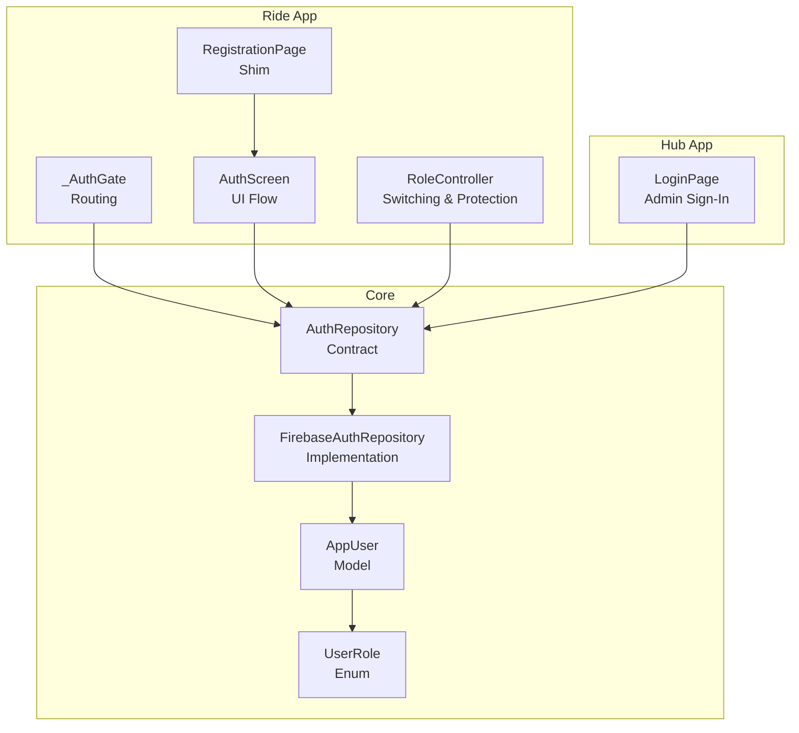

**Diagram sources**
- [auth_repository.dart:5-80](file://sese_core/lib/auth/auth_repository.dart#L5-L80)
- [firebase_auth_repository.dart:436-472](file://sese_core/lib/auth/firebase_auth_repository.dart#L436-L472)
- [user_model.dart:5-30](file://sese_core/lib/models/user_model.dart#L5-L30)
- [user_role.dart:5-11](file://sese_core/lib/models/user_role.dart#L5-L11)
- [main.dart:89-121](file://sese_ride/lib/main.dart#L89-L121)
- [registration_page.dart:7-24](file://sese_ride/lib/features/auth/registration_page.dart#L7-L24)
- [auth_screen.dart:761-791](file://sese_ride/lib/features/auth/auth_screen.dart#L761-L791)
- [login_page.dart:156-171](file://sese_hub/lib/features/auth/login_page.dart#L156-L171)
- [role_controller.dart:26-55](file://sese_ride/lib/features/settings/role_controller.dart#L26-L55)

**Section sources**
- [auth_repository.dart:5-80](file://sese_core/lib/auth/auth_repository.dart#L5-L80)
- [user_model.dart:5-30](file://sese_core/lib/models/user_model.dart#L5-L30)
- [user_role.dart:5-11](file://sese_core/lib/models/user_role.dart#L5-L11)
- [main.dart:89-121](file://sese_ride/lib/main.dart#L89-L121)
- [registration_page.dart:7-24](file://sese_ride/lib/features/auth/registration_page.dart#L7-L24)
- [auth_screen.dart:761-791](file://sese_ride/lib/features/auth/auth_screen.dart#L761-L791)
- [login_page.dart:156-171](file://sese_hub/lib/features/auth/login_page.dart#L156-L171)
- [role_controller.dart:26-55](file://sese_ride/lib/features/settings/role_controller.dart#L26-L55)

## Core Components
- AuthRepository: Defines the authentication contract used by both apps, including email/password sign-in, Google OAuth, registration, driver existence checks, driver Google registration, account deletion, and sign-out.
- FirebaseAuthRepository: Implements the contract using Firebase Authentication and Firestore, including soft-deletion and archival during account deletion.
- AppUser: Centralized user model carrying identity, role, activity status, timestamps, photo URL, and driver verification status.
- UserRole: Enumerates supported roles and helpers for self-registration and hub-managed roles.
- RoleController: Manages dual-role switching, driver onboarding scenarios, active-trip protection, and a 10-minute countdown to prevent unsafe role changes during trips.

Key responsibilities:
- Authentication flows: email/password and Google OAuth.
- Registration: customer direct; driver pending onboarding and approval.
- Profile management: user model fields and verification status.
- RBAC: role-aware routing and Firestore custom claims enforcement.
- Security: re-authentication before destructive actions, soft-delete with regulatory archival.

**Section sources**
- [auth_repository.dart:5-80](file://sese_core/lib/auth/auth_repository.dart#L5-L80)
- [firebase_auth_repository.dart:436-472](file://sese_core/lib/auth/firebase_auth_repository.dart#L436-L472)
- [user_model.dart:5-30](file://sese_core/lib/models/user_model.dart#L5-L30)
- [user_role.dart:5-11](file://sese_core/lib/models/user_role.dart#L5-L11)
- [role_controller.dart:26-55](file://sese_ride/lib/features/settings/role_controller.dart#L26-L55)

## Architecture Overview
The system uses a repository pattern to abstract authentication from UI layers. The ride app’s auth gate listens to the auth stream to route users appropriately. Driver eligibility and role switching are enforced via RoleController, which queries Firestore for onboarding and vehicle data. Admin hub login is restricted and maps provider errors to user-friendly messages.

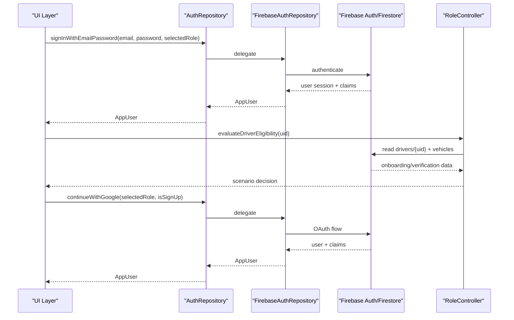

**Diagram sources**
- [auth_repository.dart:11-23](file://sese_core/lib/auth/auth_repository.dart#L11-L23)
- [auth_repository.dart:62-73](file://sese_core/lib/auth/auth_repository.dart#L62-L73)
- [firebase_auth_repository.dart:436-472](file://sese_core/lib/auth/firebase_auth_repository.dart#L436-L472)
- [role_controller.dart:57-114](file://sese_ride/lib/features/settings/role_controller.dart#L57-L114)

## Detailed Component Analysis

### Authentication Repository Pattern
- Contract: AuthRepository exposes streams and methods for sign-in, sign-up, Google OAuth, driver checks, and sign-out.
- Implementation: FirebaseAuthRepository implements these operations against Firebase services, handling re-authentication and Firestore archival during account deletion.

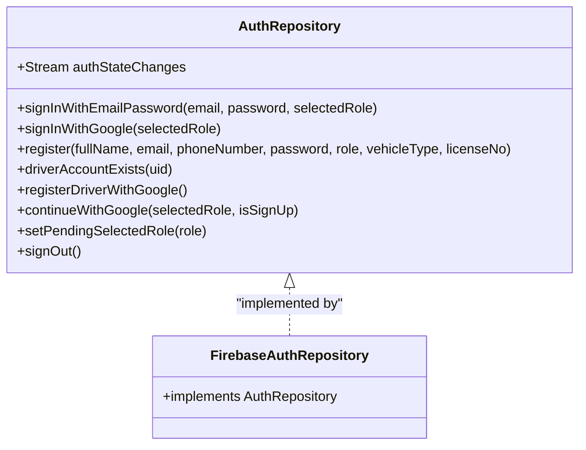

**Diagram sources**
- [auth_repository.dart:5-80](file://sese_core/lib/auth/auth_repository.dart#L5-L80)
- [firebase_auth_repository.dart:436-472](file://sese_core/lib/auth/firebase_auth_repository.dart#L436-L472)

**Section sources**
- [auth_repository.dart:5-80](file://sese_core/lib/auth/auth_repository.dart#L5-L80)
- [firebase_auth_repository.dart:436-472](file://sese_core/lib/auth/firebase_auth_repository.dart#L436-L472)

### Session Management and Routing
- The ride app’s _AuthGate listens to the auth stream and renders either the login page or the appropriate shell based on the current user.
- When no user is present, it shows the login page; otherwise, it proceeds to role-aware navigation.

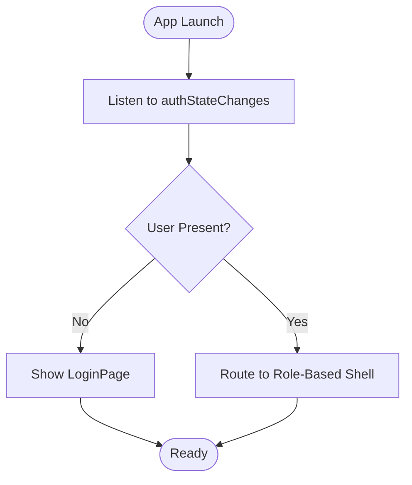

**Diagram sources**
- [main.dart:89-121](file://sese_ride/lib/main.dart#L89-L121)

**Section sources**
- [main.dart:89-121](file://sese_ride/lib/main.dart#L89-L121)

### Multi-Role Architecture and RBAC
- Roles: customer, driver, agent, admin, super.
- Self-registration allowed for customer and driver roles in the ride app; hub-managed roles (agent, admin, super) are provisioned within the hub.
- Firestore rules enforce custom claims for admin-like scopes, ensuring only authorized users can perform privileged operations.

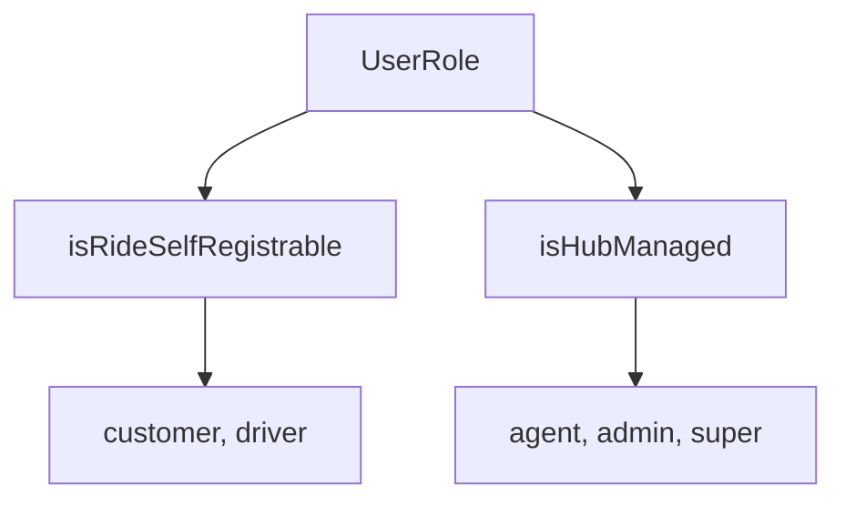

**Diagram sources**
- [user_role.dart:5-11](file://sese_core/lib/models/user_role.dart#L5-L11)
- [user_role.dart:45-53](file://sese_core/lib/models/user_role.dart#L45-L53)
- [firestore.rules:116-140](file://firestore.rules#L116-L140)

**Section sources**
- [user_role.dart:5-11](file://sese_core/lib/models/user_role.dart#L5-L11)
- [user_role.dart:45-53](file://sese_core/lib/models/user_role.dart#L45-L53)
- [firestore.rules:116-140](file://firestore.rules#L116-L140)

### User Registration Workflows
- Customer registration: standard email/password or Google OAuth flow through AuthScreen.
- Driver registration: creates a driver record with pending onboarding status and routes to Step 2 onboarding form.
- Legacy RegistrationPage shims to AuthScreen in sign-up mode.

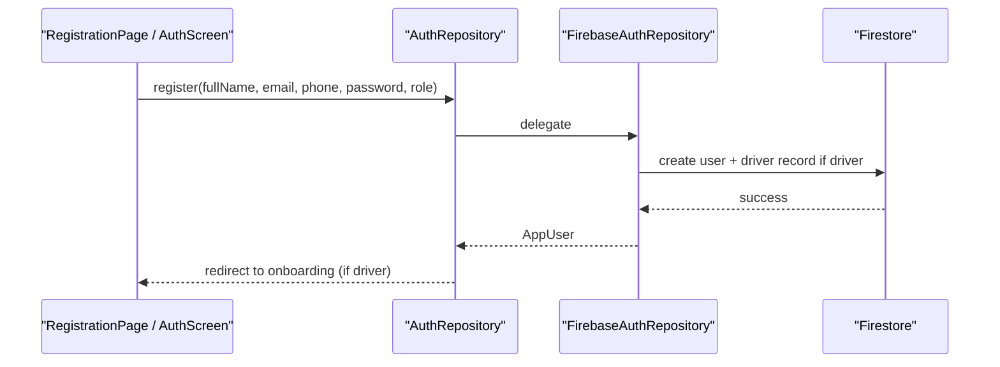

**Diagram sources**
- [auth_repository.dart:25-41](file://sese_core/lib/auth/auth_repository.dart#L25-L41)
- [registration_page.dart:7-24](file://sese_ride/lib/features/auth/registration_page.dart#L7-L24)

**Section sources**
- [auth_repository.dart:25-41](file://sese_core/lib/auth/auth_repository.dart#L25-L41)
- [registration_page.dart:7-24](file://sese_ride/lib/features/auth/registration_page.dart#L7-L24)

### Login Processes and Error Handling
- Email/password sign-in: validated at UI layer and delegated to AuthRepository.
- Hub login restricts self-registration and maps provider error codes to user-friendly messages.

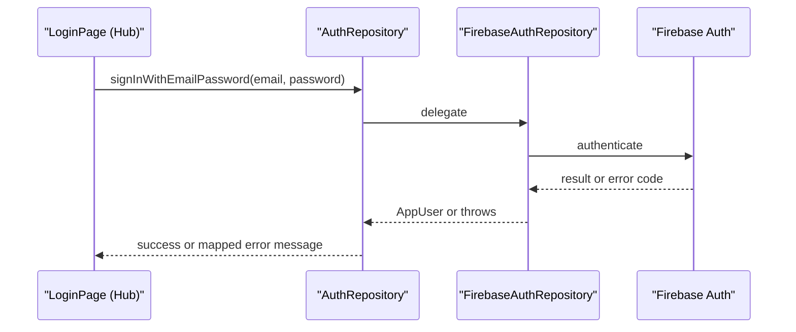

**Diagram sources**
- [login_page.dart:156-171](file://sese_hub/lib/features/auth/login_page.dart#L156-L171)

**Section sources**
- [login_page.dart:156-171](file://sese_hub/lib/features/auth/login_page.dart#L156-L171)

### Password Recovery and Account Verification
- Password recovery: handled by Firebase Authentication; UI collects password where required for sensitive operations.
- Account verification: driver records include verificationStatus and related flags; RoleController evaluates eligibility based on onboarding and vehicle data.

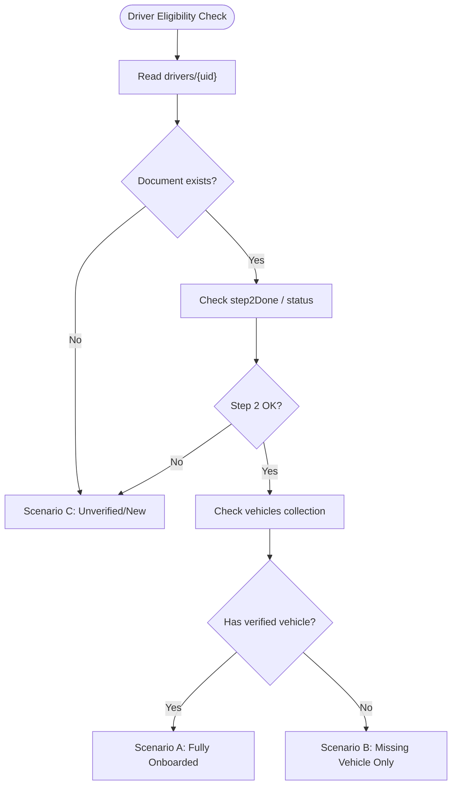

**Diagram sources**
- [role_controller.dart:57-114](file://sese_ride/lib/features/settings/role_controller.dart#L57-L114)

**Section sources**
- [role_controller.dart:57-114](file://sese_ride/lib/features/settings/role_controller.dart#L57-L114)

### Role Controller Implementation and Permission Enforcement
- RoleController manages current role, driver onboarding scenarios, and active trip protection.
- Active trip protection prevents role switching while a driver has an active order, enforcing safety with a 10-minute countdown.

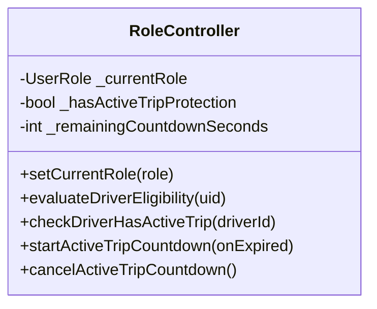

**Diagram sources**
- [role_controller.dart:26-55](file://sese_ride/lib/features/settings/role_controller.dart#L26-L55)
- [role_controller.dart:116-180](file://sese_ride/lib/features/settings/role_controller.dart#L116-L180)

**Section sources**
- [role_controller.dart:26-55](file://sese_ride/lib/features/settings/role_controller.dart#L26-L55)
- [role_controller.dart:116-180](file://sese_ride/lib/features/settings/role_controller.dart#L116-L180)

### Profile Management
- AppUser centralizes user profile fields and helper methods for serialization/deserialization.
- Driver verification status mirrors Firestore state and influences routing and eligibility.

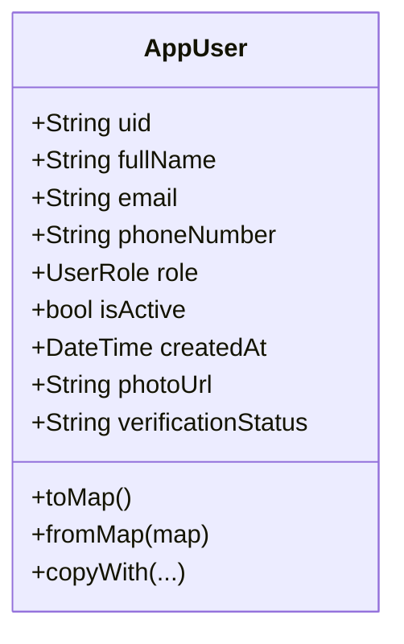

**Diagram sources**
- [user_model.dart:5-30](file://sese_core/lib/models/user_model.dart#L5-L30)
- [user_model.dart:40-70](file://sese_core/lib/models/user_model.dart#L40-L70)

**Section sources**
- [user_model.dart:5-30](file://sese_core/lib/models/user_model.dart#L5-L30)
- [user_model.dart:40-70](file://sese_core/lib/models/user_model.dart#L40-L70)

### Security Considerations
- Token management: Firestore rules validate custom claims for admin-like roles and scope lists.
- Session handling: Auth stream persists across app restarts; UI reacts to auth state changes.
- Data protection: Account deletion requires re-authentication and performs soft-delete with scheduled purge for regulatory compliance.

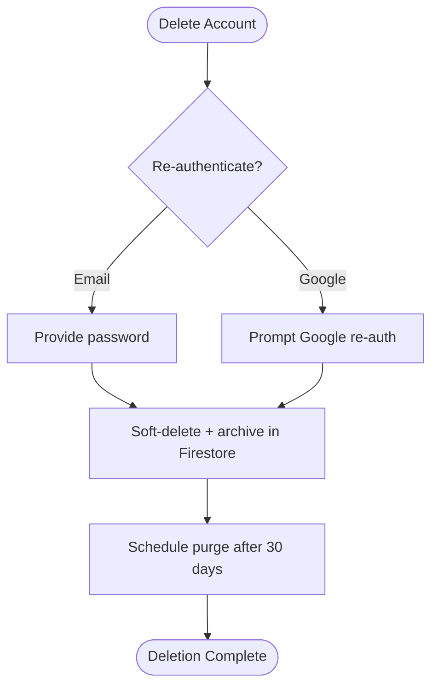

**Diagram sources**
- [firebase_auth_repository.dart:436-472](file://sese_core/lib/auth/firebase_auth_repository.dart#L436-L472)
- [delete_account_dialog.dart:301-352](file://sese_ride/lib/features/settings/delete_account_dialog.dart#L301-L352)
- [firestore.rules:116-140](file://firestore.rules#L116-L140)

**Section sources**
- [firebase_auth_repository.dart:436-472](file://sese_core/lib/auth/firebase_auth_repository.dart#L436-L472)
- [delete_account_dialog.dart:301-352](file://sese_ride/lib/features/settings/delete_account_dialog.dart#L301-L352)
- [firestore.rules:116-140](file://firestore.rules#L116-L140)

## Dependency Analysis
The following diagram highlights key dependencies between components involved in user management.

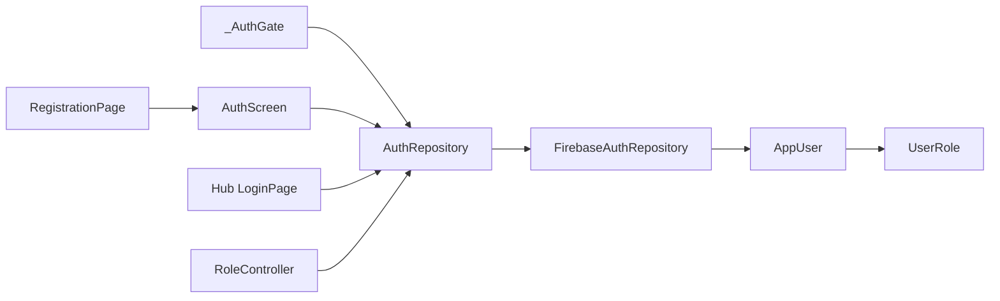

**Diagram sources**
- [auth_repository.dart:5-80](file://sese_core/lib/auth/auth_repository.dart#L5-L80)
- [firebase_auth_repository.dart:436-472](file://sese_core/lib/auth/firebase_auth_repository.dart#L436-L472)
- [user_model.dart:5-30](file://sese_core/lib/models/user_model.dart#L5-L30)
- [user_role.dart:5-11](file://sese_core/lib/models/user_role.dart#L5-L11)
- [main.dart:89-121](file://sese_ride/lib/main.dart#L89-L121)
- [auth_screen.dart:761-791](file://sese_ride/lib/features/auth/auth_screen.dart#L761-L791)
- [registration_page.dart:7-24](file://sese_ride/lib/features/auth/registration_page.dart#L7-L24)
- [login_page.dart:156-171](file://sese_hub/lib/features/auth/login_page.dart#L156-L171)
- [role_controller.dart:26-55](file://sese_ride/lib/features/settings/role_controller.dart#L26-L55)

**Section sources**
- [auth_repository.dart:5-80](file://sese_core/lib/auth/auth_repository.dart#L5-L80)
- [firebase_auth_repository.dart:436-472](file://sese_core/lib/auth/firebase_auth_repository.dart#L436-L472)
- [user_model.dart:5-30](file://sese_core/lib/models/user_model.dart#L5-L30)
- [user_role.dart:5-11](file://sese_core/lib/models/user_role.dart#L5-L11)
- [main.dart:89-121](file://sese_ride/lib/main.dart#L89-L121)
- [auth_screen.dart:761-791](file://sese_ride/lib/features/auth/auth_screen.dart#L761-L791)
- [registration_page.dart:7-24](file://sese_ride/lib/features/auth/registration_page.dart#L7-L24)
- [login_page.dart:156-171](file://sese_hub/lib/features/auth/login_page.dart#L156-L171)
- [role_controller.dart:26-55](file://sese_ride/lib/features/settings/role_controller.dart#L26-L55)

## Performance Considerations
- Stream-based auth state minimizes redundant network calls and ensures consistent UI updates.
- RoleController queries Firestore selectively and caches local state for countdown timers to avoid unnecessary work.
- Firestore rules offload authorization checks to the server, reducing client-side overhead and improving security posture.

[No sources needed since this section provides general guidance]

## Troubleshooting Guide
Common issues and resolutions:
- Sign-in failures: Map provider error codes to user-friendly messages; ensure correct email/password and account status.
- Driver onboarding not proceeding: Verify driver document exists and step 2 completion; check vehicle verification status.
- Role switching blocked: Ensure no active trip; use RoleController to check active orders and countdown protection.
- Account deletion errors: Confirm re-authentication path (password for email accounts, Google prompt for OAuth); verify Firestore archival succeeded.

**Section sources**
- [login_page.dart:156-171](file://sese_hub/lib/features/auth/login_page.dart#L156-L171)
- [role_controller.dart:57-114](file://sese_ride/lib/features/settings/role_controller.dart#L57-L114)
- [firebase_auth_repository.dart:436-472](file://sese_core/lib/auth/firebase_auth_repository.dart#L436-L472)

## Conclusion
The user management system combines a clean repository pattern, robust multi-role support, and strong security controls. Authentication flows cover email/password and Google OAuth, with clear registration paths for customers and drivers. Role-based access is enforced via Firestore custom claims and scoped permissions. Profile management and driver verification integrate seamlessly with RoleController to ensure safe and compliant user experiences.

[No sources needed since this section summarizes without analyzing specific files]