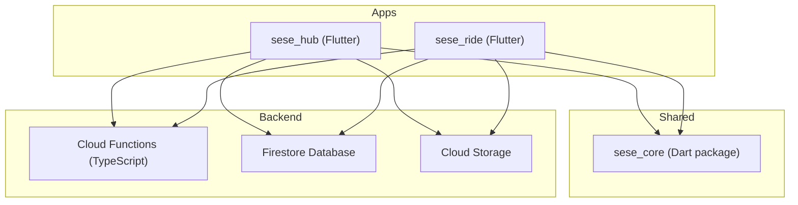
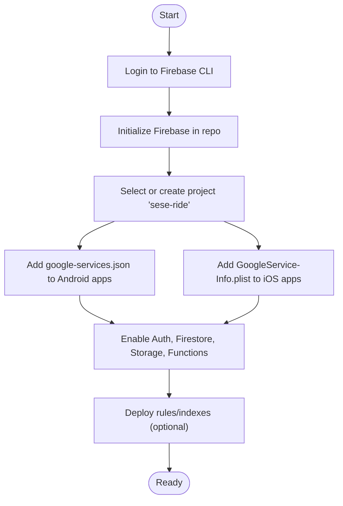
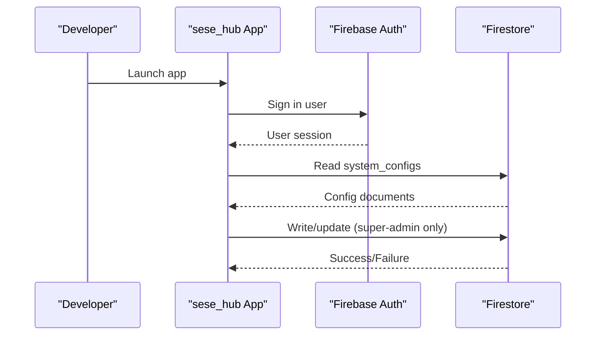
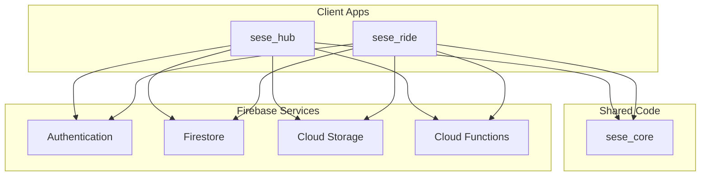
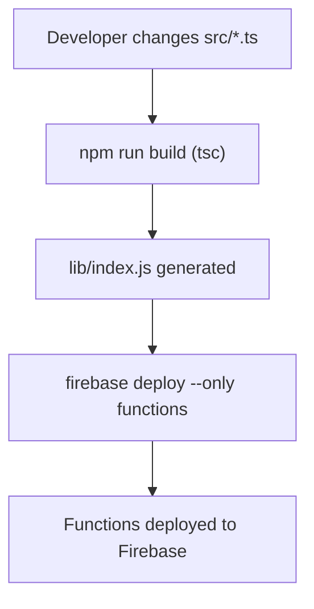
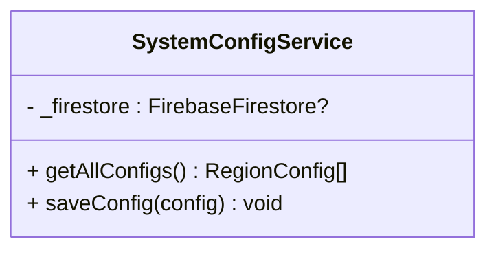
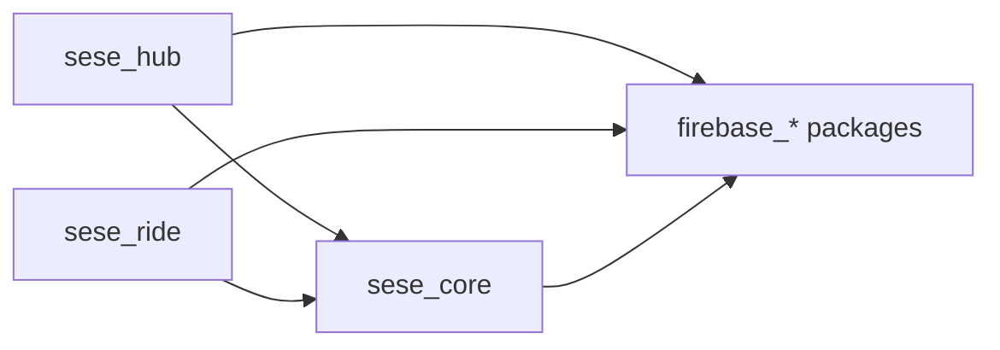

# Getting Started Guide

<cite>
**Referenced Files in This Document**
- [firebase.json](file://firebase.json)
- [.firebaserc](file://.firebaserc)
- [functions/package.json](file://functions/package.json)
- [sese_hub/pubspec.yaml](file://sese_hub/pubspec.yaml)
- [sese_ride/pubspec.yaml](file://sese_ride/pubspec.yaml)
- [sese_core/pubspec.yaml](file://sese_core/pubspec.yaml)
- [sese_hub/lib/features/config/services/system_config_service.dart](file://sese_hub/lib/features/config/services/system_config_service.dart)
</cite>

## Table of Contents
1. Introduction
2. Project Structure
3. Prerequisites
4. Installation and Setup
5. Firebase Configuration
6. Running the Applications
7. Admin Dashboard Access
8. Troubleshooting
9. Architecture Overview
10. Detailed Component Analysis
11. Dependency Analysis
12. Performance Considerations
13. Conclusion

## Introduction
This guide helps you set up the SeSe App development environment, including dependencies, Firebase project configuration, and platform tooling (Flutter SDK, Node.js, Android Studio/Xcode). It also provides commands to initialize the project, build apps locally, and access the admin dashboard. The content is beginner-friendly while enabling experienced developers to get the environment running quickly.

## Project Structure
The repository contains:
- Two Flutter applications:
  - sese_hub: Management/admin application
  - sese_ride: Customer and driver application
- A shared Dart package:
  - sese_core: Shared models, repositories, and widgets
- Cloud Functions backend:
  - functions: TypeScript-based Cloud Functions with a predeploy build step

[No sources needed since this diagram shows conceptual workflow, not actual code structure]

## Prerequisites
- Flutter SDK: The apps require Dart SDK ^3.13.2. Ensure your Flutter installation supports this version.
- Node.js: Cloud Functions specify engines.node = 22. Use Node.js 22.x for local function builds and emulators.
- Firebase CLI: Required for initialization, emulation, and deployment.
- Platform toolchains:
  - Android: Android Studio with Android SDK/NDK configured; ensure emulator or device is ready.
  - iOS/macOS: Xcode installed and command-line tools configured; iOS simulator or device ready.
- Google account: To create and manage a Firebase project.

Key version references:
- Dart SDK: ^3.13.2 (apps and core)
- Node.js: 22 (functions)

**Section sources**
- [sese_hub/pubspec.yaml:7-8](file://sese_hub/pubspec.yaml#L7-L8)
- [sese_ride/pubspec.yaml:7-8](file://sese_ride/pubspec.yaml#L7-L8)
- [sese_core/pubspec.yaml:5-7](file://sese_core/pubspec.yaml#L5-L7)
- [functions/package.json:11-13](file://functions/package.json#L11-L13)

## Installation and Setup
1. Install Flutter SDK and verify it is available in PATH.
2. Install Node.js 22.x.
3. Install Firebase CLI globally.
4. Install Android Studio and configure Android SDK/NDK.
5. On macOS, install Xcode and run xcode-select --install.
6. Clone the repository and navigate to the root directory.

Commands (illustrative):
- flutter doctor
- node --version
- npm i -g firebase-tools
- firebase --version

**Section sources**
- [functions/package.json:11-13](file://functions/package.json#L11-L13)

## Firebase Configuration
The project is associated with an existing Firebase project named “sese-ride”.

Steps:
1. Create a Firebase project (if you do not have one) or use an existing one.
2. Associate the repo with the project using the Firebase CLI.
3. Add platform-specific app configurations:
   - Android: Download google-services.json and place it under each app’s android/app directory.
   - iOS: Download GoogleService-Info.plist and add it to ios/Runner for both apps.
4. Enable required services in the Firebase console:
   - Authentication (Email/Password, Google Sign-In)
   - Firestore Database
   - Cloud Storage
   - Cloud Functions
5. Deploy security rules and indexes if you are setting them from scratch.

Project association reference:
- Default project mapping: .firebaserc points to “sese-ride”
- Firestore location and rules: firebase.json defines database location and rule files

**Diagram sources**
- [.firebaserc:1-6](file://.firebaserc#L1-L6)
- [firebase.json:1-28](file://firebase.json#L1-L28)

**Section sources**
- [.firebaserc:1-6](file://.firebaserc#L1-L6)
- [firebase.json:1-28](file://firebase.json#L1-L28)

## Running the Applications
After setup:

1. Install dependencies for all packages:
   - dart pub get (from root or per-package directories as needed)
2. Run the apps:
   - For the management app: flutter run -t lib/main.dart (from sese_hub)
   - For the customer/driver app: flutter run -t lib/main.dart (from sese_ride)
3. Build for platforms:
   - Android: flutter build apk or flutter build appbundle
   - iOS: flutter build ios
   - Web: flutter build web

Notes:
- Both apps depend on Firebase services; ensure platform config files are present.
- Cloud Functions can be emulated locally during development.

**Section sources**
- [sese_hub/pubspec.yaml:10-29](file://sese_hub/pubspec.yaml#L10-L29)
- [sese_ride/pubspec.yaml:10-38](file://sese_ride/pubspec.yaml#L10-L38)

## Admin Dashboard Access
- The management app (sese_hub) serves as the admin dashboard.
- After launching the app, sign in with an account that has super-admin privileges as defined by the system configuration service and Firestore rules.
- System configuration reads from Firestore collection system_configs; only authenticated users can read, and only super-admins can write.

Access flow:
- Launch sese_hub
- Authenticate via Firebase Auth (e.g., Email/Password or Google Sign-In)
- Navigate to configuration screens to view/edit system configs

**Diagram sources**
- [sese_hub/lib/features/config/services/system_config_service.dart:1-121](file://sese_hub/lib/features/config/services/system_config_service.dart#L1-L121)

**Section sources**
- [sese_hub/lib/features/config/services/system_config_service.dart:1-121](file://sese_hub/lib/features/config/services/system_config_service.dart#L1-L121)

## Troubleshooting
Common issues and resolutions:

- Dependency conflicts
  - Symptom: Dart/Flutter version mismatch errors.
  - Resolution: Ensure Dart SDK ^3.13.2 and Flutter compatible with it. Re-run flutter pub get.

- Firebase authentication problems
  - Symptom: Sign-in fails or unauthorized access.
  - Resolution: Verify enabled providers in Firebase Console; confirm platform config files (google-services.json, GoogleService-Info.plist) are correctly added; check Firestore rules allow intended operations.

- Platform-specific configurations
  - Android: Missing INTERNET permission in debug/profile manifests can block dev features; ensure permissions are declared.
  - iOS: Ensure GoogleService-Info.plist is linked in Xcode workspace and Firebase is initialized early in app lifecycle.

- Cloud Functions build failures
  - Symptom: Predeploy script fails due to Node version mismatch.
  - Resolution: Use Node.js 22.x as specified in functions/package.json.

- Firestore rules and indexes
  - Symptom: Permission denied or missing index errors.
  - Resolution: Deploy firestore.rules and firestore.indexes.json; ensure firebase.json points to correct files and location.

**Section sources**
- [sese_hub/pubspec.yaml:7-8](file://sese_hub/pubspec.yaml#L7-L8)
- [sese_ride/pubspec.yaml:7-8](file://sese_ride/pubspec.yaml#L7-L8)
- [functions/package.json:11-13](file://functions/package.json#L11-L13)
- [firebase.json:1-28](file://firebase.json#L1-L28)

## Architecture Overview
High-level architecture showing how apps interact with shared code and backend services:

[No sources needed since this diagram shows conceptual workflow, not actual code structure]

## Detailed Component Analysis

### Cloud Functions Build Pipeline
The functions directory uses TypeScript and a predeploy build step.

**Diagram sources**
- [functions/package.json:5-10](file://functions/package.json#L5-L10)
- [firebase.json:11-26](file://firebase.json#L11-L26)

**Section sources**
- [functions/package.json:1-24](file://functions/package.json#L1-L24)
- [firebase.json:11-26](file://firebase.json#L11-L26)

### System Configuration Service (Admin)
The system configuration service manages dynamic settings stored in Firestore under system_configs. It enforces read/write policies aligned with security rules.

**Diagram sources**
- [sese_hub/lib/features/config/services/system_config_service.dart:1-121](file://sese_hub/lib/features/config/services/system_config_service.dart#L1-L121)

**Section sources**
- [sese_hub/lib/features/config/services/system_config_service.dart:1-121](file://sese_hub/lib/features/config/services/system_config_service.dart#L1-L121)

## Dependency Analysis
Key dependency relationships across packages:

**Diagram sources**
- [sese_hub/pubspec.yaml:10-29](file://sese_hub/pubspec.yaml#L10-L29)
- [sese_ride/pubspec.yaml:10-38](file://sese_ride/pubspec.yaml#L10-L38)
- [sese_core/pubspec.yaml:9-21](file://sese_core/pubspec.yaml#L9-L21)

**Section sources**
- [sese_hub/pubspec.yaml:10-29](file://sese_hub/pubspec.yaml#L10-L29)
- [sese_ride/pubspec.yaml:10-38](file://sese_ride/pubspec.yaml#L10-L38)
- [sese_core/pubspec.yaml:9-21](file://sese_core/pubspec.yaml#L9-L21)

## Performance Considerations
- Keep Firestore queries minimal and leverage indexes defined in firestore.indexes.json.
- Cache frequently accessed data locally where appropriate (the system config service demonstrates local caching behavior).
- Use Cloud Functions for server-side logic to reduce client payload and improve security.
- Optimize images and assets in storage; consider lazy loading in apps.

[No sources needed since this section provides general guidance]

## Conclusion
You now have the steps to set up the SeSe App environment, configure Firebase, and run both the management and customer/driver apps locally. Use the troubleshooting tips to resolve common issues and refer to the architecture diagrams to understand component interactions. For advanced scenarios, consult the referenced configuration files and service implementations.