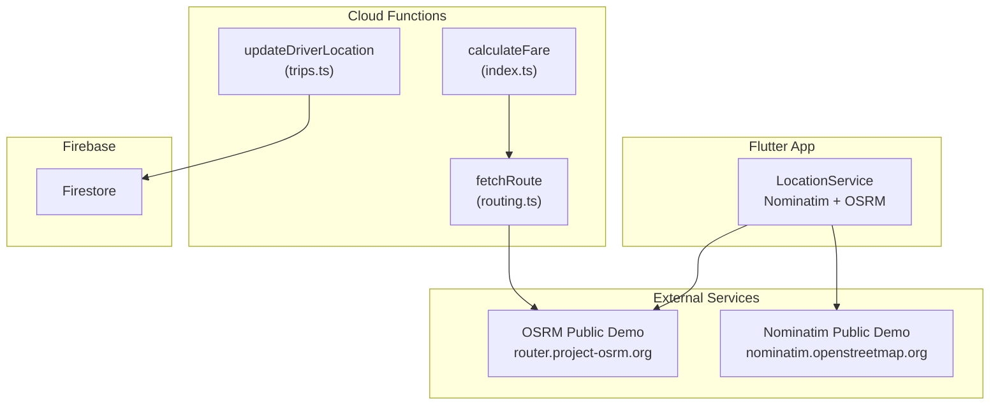
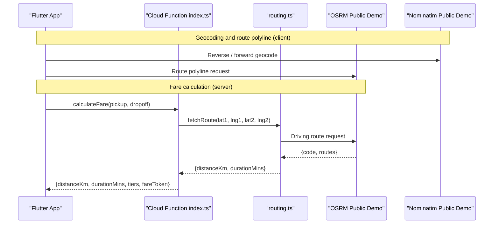
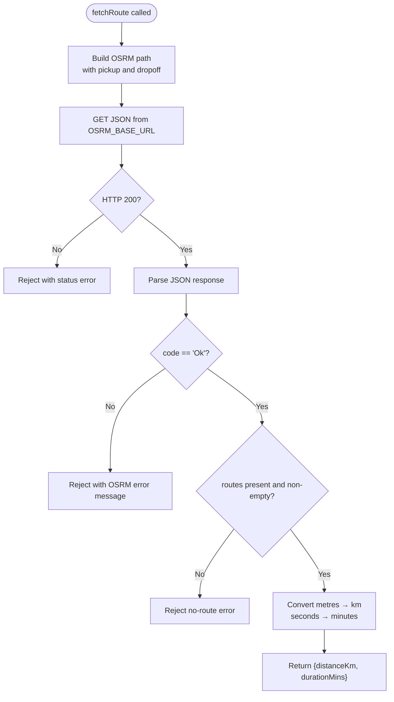
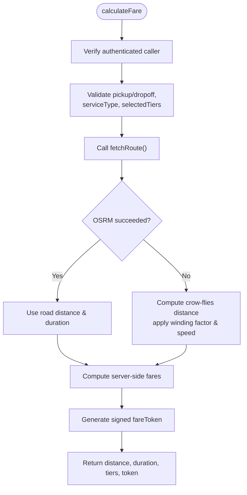
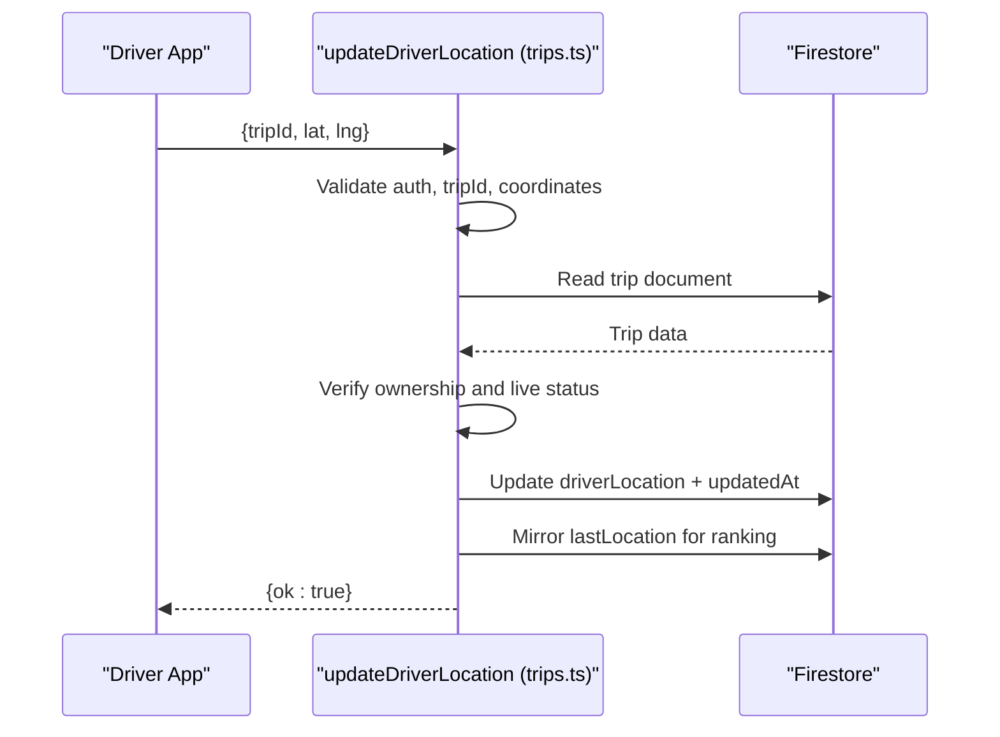
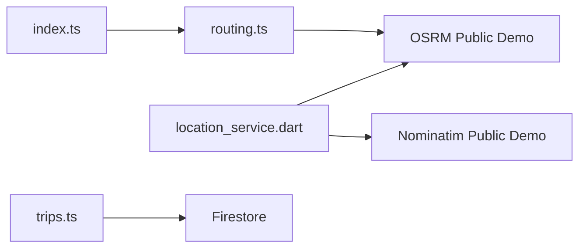

# External APIs

<cite>
**Referenced Files in This Document**   
- [routing.ts](file://functions/src/routing.ts)
- [index.ts](file://functions/src/index.ts)
- [trips.ts](file://functions/src/trips.ts)
- [location_service.dart](file://sese_ride/lib/features/customer/services/location_service.dart)
</cite>

## Table of Contents
1. [Introduction](#introduction)
2. [Project Structure](#project-structure)
3. [Core Components](#core-components)
4. [Architecture Overview](#architecture-overview)
5. [Detailed Component Analysis](#detailed-component-analysis)
6. [Dependency Analysis](#dependency-analysis)
7. [Performance Considerations](#performance-considerations)
8. [Troubleshooting Guide](#troubleshooting-guide)
9. [Security and Privacy](#security-and-privacy)
10. [Monitoring and Observability](#monitoring-and-observability)
11. [Conclusion](#conclusion)

## Introduction
This document explains how the application integrates external mapping, routing, and geocoding services. The codebase currently uses OpenStreetMap-based services rather than Google Maps:
- OSRM for road-network distance, duration, and route geometry.
- Nominatim for reverse and forward geocoding plus autocomplete suggestions.
- A server-side Cloud Function that calls OSRM to compute fare-relevant distance and duration, with a local crow-flies fallback when the external service is unavailable.
- Real-time driver location tracking through Firestore, not an external GPS provider.

The goal is to make these integrations clear for developers who need to extend, secure, or replace them.

## Project Structure
External API usage is split between:
- Server-side routing logic in Firebase Cloud Functions.
- Client-side geocoding and route visualization in the Flutter app.



**Diagram sources**
- [location_service.dart:23-38](file://sese_ride/lib/features/customer/services/location_service.dart#L23-L38)
- [location_service.dart:113-143](file://sese_ride/lib/features/customer/services/location_service.dart#L113-L143)
- [location_service.dart:181-212](file://sese_ride/lib/features/customer/services/location_service.dart#L181-L212)
- [location_service.dart:231-278](file://sese_ride/lib/features/customer/services/location_service.dart#L231-L278)
- [index.ts:81-198](file://functions/src/index.ts#L81-L198)
- [routing.ts:15-67](file://functions/src/routing.ts#L15-L67)
- [trips.ts:716-754](file://functions/src/trips.ts#L716-L754)

**Section sources**
- [location_service.dart:23-38](file://sese_ride/lib/features/customer/services/location_service.dart#L23-L38)
- [index.ts:81-198](file://functions/src/index.ts#L81-L198)
- [routing.ts:15-67](file://functions/src/routing.ts#L15-L67)
- [trips.ts:716-754](file://functions/src/trips.ts#L716-L754)

## Core Components
- **Server-side routing**: `routing.ts` fetches driving routes from OSRM and returns distance in kilometres and duration in minutes.
- **Fare calculation entry point**: `index.ts` exposes `calculateFare`, which validates inputs, calls OSRM via `fetchRoute`, computes fares, and returns a signed fare token.
- **Real-time location tracking**: `trips.ts` exposes `updateDriverLocation`, which persists driver position updates into Firestore for live tracking.
- **Client-side geocoding and route display**: `location_service.dart` calls Nominatim for address search and reverse geocoding, and OSRM for route polylines.

Key responsibilities:
- Input validation and authentication are enforced on the server.
- External service failures are handled gracefully with fallbacks or best-effort behavior.
- No API keys are required for the public OSRM and Nominatim endpoints used here.

**Section sources**
- [routing.ts:15-67](file://functions/src/routing.ts#L15-L67)
- [index.ts:81-198](file://functions/src/index.ts#L81-L198)
- [trips.ts:716-754](file://functions/src/trips.ts#L716-L754)
- [location_service.dart:113-143](file://sese_ride/lib/features/customer/services/location_service.dart#L113-L143)
- [location_service.dart:181-212](file://sese_ride/lib/features/customer/services/location_service.dart#L181-L212)
- [location_service.dart:231-278](file://sese_ride/lib/features/customer/services/location_service.dart#L231-L278)

## Architecture Overview
The external API architecture centers on two public OpenStreetMap services and one server-side function:



**Diagram sources**
- [location_service.dart:113-143](file://sese_ride/lib/features/customer/services/location_service.dart#L113-L143)
- [location_service.dart:181-212](file://sese_ride/lib/features/customer/services/location_service.dart#L181-L212)
- [location_service.dart:231-278](file://sese_ride/lib/features/customer/services/location_service.dart#L231-L278)
- [index.ts:81-198](file://functions/src/index.ts#L81-L198)
- [routing.ts:40-67](file://functions/src/routing.ts#L40-L67)

## Detailed Component Analysis

### OSRM Routing Service Integration
The server-side routing module connects to the OSRM public demo endpoint for driving routes. It constructs a path using pickup and dropoff coordinates, parses the response, and converts units to kilometres and minutes.

Important behaviors:
- Base URL is configurable via environment variable; default points to the public demo.
- Success requires HTTP 200 and a response body with code `"Ok"` and at least one route.
- Errors include network failures, non-200 status codes, invalid JSON, missing routes, and timeouts.



**Diagram sources**
- [routing.ts:40-67](file://functions/src/routing.ts#L40-L67)
- [routing.ts:70-108](file://functions/src/routing.ts#L70-L108)

**Section sources**
- [routing.ts:15-67](file://functions/src/routing.ts#L15-L67)
- [routing.ts:70-108](file://functions/src/routing.ts#L70-L108)

### Fare Calculation and Fallback Strategy
The `calculateFare` callable enforces authentication, validates coordinates and service type, then attempts to fetch real road-network distance and duration from OSRM. If OSRM fails, it falls back to a local haversine-based estimate with a winding factor and assumed urban speed.



**Diagram sources**
- [index.ts:81-198](file://functions/src/index.ts#L81-L198)

**Section sources**
- [index.ts:81-198](file://functions/src/index.ts#L81-L198)

### Real-Time Driver Location Tracking
Real-time tracking is implemented by having drivers send periodic location updates to a Cloud Function, which writes the latest position into the trip document and mirrors it to the driver document for ranking purposes.



**Diagram sources**
- [trips.ts:716-754](file://functions/src/trips.ts#L716-L754)

**Section sources**
- [trips.ts:716-754](file://functions/src/trips.ts#L716-L754)

### Client-Side Geocoding and Route Geometry
The Flutter `LocationService` provides:
- Reverse geocoding via Nominatim.
- Forward geocoding and autocomplete via Nominatim.
- Route polyline fetching via OSRM.

All client-side external calls are best-effort: failures return safe defaults such as coordinate strings or empty lists so the booking flow remains usable.

```mermaid
classDiagram
class LocationService {
+getCurrentLatLng() LatLng?
+getCleanAddress(lat, lng) String
+reverseGeocode(lat, lng) String
+forwardGeocode(query) LatLng?
+fetchSuggestions(query) PlaceSuggestion[]
+searchAddress(query) ({latLng, displayName})?
+fetchRoutePolyline(pickup, dropoff) LatLng[]
}
class PlaceSuggestion {
+String description
+double lat
+double lng
+LatLng latLng
}
LocationService --> PlaceSuggestion : "returns"
```

**Diagram sources**
- [location_service.dart:8-21](file://sese_ride/lib/features/customer/services/location_service.dart#L8-L21)
- [location_service.dart:39-65](file://sese_ride/lib/features/customer/services/location_service.dart#L39-L65)
- [location_service.dart:73-101](file://sese_ride/lib/features/customer/services/location_service.dart#L73-L101)
- [location_service.dart:113-143](file://sese_ride/lib/features/customer/services/location_service.dart#L113-L143)
- [location_service.dart:150-179](file://sese_ride/lib/features/customer/services/location_service.dart#L150-L179)
- [location_service.dart:181-212](file://sese_ride/lib/features/customer/services/location_service.dart#L181-L212)
- [location_service.dart:231-278](file://sese_ride/lib/features/customer/services/location_service.dart#L231-L278)

**Section sources**
- [location_service.dart:8-21](file://sese_ride/lib/features/customer/services/location_service.dart#L8-L21)
- [location_service.dart:39-65](file://sese_ride/lib/features/customer/services/location_service.dart#L39-L65)
- [location_service.dart:73-101](file://sese_ride/lib/features/customer/services/location_service.dart#L73-L101)
- [location_service.dart:113-143](file://sese_ride/lib/features/customer/services/location_service.dart#L113-L143)
- [location_service.dart:150-179](file://sese_ride/lib/features/customer/services/location_service.dart#L150-L179)
- [location_service.dart:181-212](file://sese_ride/lib/features/customer/services/location_service.dart#L181-L212)
- [location_service.dart:231-278](file://sese_ride/lib/features/customer/services/location_service.dart#L231-L278)

## Dependency Analysis
The main dependencies are:
- Cloud Functions depend on Firebase Admin SDK and call OSRM.
- Flutter app depends on Nominatim and OSRM for geocoding and route visualization.
- Real-time tracking depends on Firestore for persistence and live updates.



**Diagram sources**
- [index.ts:21-24](file://functions/src/index.ts#L21-L24)
- [index.ts:81-198](file://functions/src/index.ts#L81-L198)
- [routing.ts:15-67](file://functions/src/routing.ts#L15-L67)
- [location_service.dart:113-143](file://sese_ride/lib/features/customer/services/location_service.dart#L113-L143)
- [location_service.dart:181-212](file://sese_ride/lib/features/customer/services/location_service.dart#L181-L212)
- [location_service.dart:231-278](file://sese_ride/lib/features/customer/services/location_service.dart#L231-L278)
- [trips.ts:716-754](file://functions/src/trips.ts#L716-L754)

**Section sources**
- [index.ts:21-24](file://functions/src/index.ts#L21-L24)
- [index.ts:81-198](file://functions/src/index.ts#L81-L198)
- [routing.ts:15-67](file://functions/src/routing.ts#L15-L67)
- [location_service.dart:113-143](file://sese_ride/lib/features/customer/services/location_service.dart#L113-L143)
- [location_service.dart:181-212](file://sese_ride/lib/features/customer/services/location_service.dart#L181-L212)
- [location_service.dart:231-278](file://sese_ride/lib/features/customer/services/location_service.dart#L231-L278)
- [trips.ts:716-754](file://functions/src/trips.ts#L716-L754)

## Performance Considerations
- **Rate limits**: The public OSRM and Nominatim endpoints have fair-use constraints. The client-side service comments explicitly mention Nominatim’s 1 request per second limit and the requirement for a valid User-Agent header.
- **Timeouts**: 
  - Server-side OSRM requests time out after 10 seconds.
  - Client-side Nominatim and OSRM calls use short timeouts to keep UI responsive.
- **Fallbacks**:
  - Server-side fare calculation falls back to crow-flies distance with a winding factor and assumed urban speed when OSRM is unreachable.
  - Client-side geocoding and route geometry return safe defaults instead of throwing, preserving user experience.
- **Caching recommendation**: The routing module comments recommend self-hosting OSRM/Valhalla or fronting with caching at scale.

[No sources needed since this section provides general guidance]

## Troubleshooting Guide
Common issues and their handling patterns:

- **OSRM unreachable or invalid response**:
  - Server throws errors for non-200 status, invalid JSON, missing routes, or timeout.
  - Caller catches exceptions and applies crow-flies fallback for fare estimation.
- **Nominatim rate limiting or bad response**:
  - Client returns fallback coordinate string or empty suggestion list.
  - Logs debug output for diagnostics.
- **Authentication failures**:
  - Cloud Functions reject unauthenticated callers with explicit error codes.
- **Permission and state errors**:
  - Driver location updates require ownership and a live trip status; otherwise they fail with specific error codes.

Recommended debugging steps:
- Check logs for OSRM/Nominatim status codes and messages.
- Validate coordinates and service types before calling server functions.
- Ensure proper User-Agent headers for Nominatim.
- Monitor Firestore writes for driver location updates.

**Section sources**
- [routing.ts:52-67](file://functions/src/routing.ts#L52-L67)
- [routing.ts:83-108](file://functions/src/routing.ts#L83-L108)
- [index.ts:148-166](file://functions/src/index.ts#L148-L166)
- [location_service.dart:113-143](file://sese_ride/lib/features/customer/services/location_service.dart#L113-L143)
- [location_service.dart:181-212](file://sese_ride/lib/features/customer/services/location_service.dart#L181-L212)
- [location_service.dart:231-278](file://sese_ride/lib/features/customer/services/location_service.dart#L231-L278)
- [trips.ts:716-754](file://functions/src/trips.ts#L716-L754)

## Security and Privacy
- **Authentication**:
  - `calculateFare` requires an authenticated caller; unauthenticated requests are rejected.
  - `updateDriverLocation` requires the caller to be the assigned driver and the trip to be live.
- **Input validation**:
  - Coordinates are validated for numeric values and geographic bounds.
  - Service type and tier selections are validated.
- **Tamper protection**:
  - Fare responses include a signed token that must be verified before booking.
- **API keys**:
  - The current integration uses public OSRM and Nominatim endpoints without API keys.
  - If migrating to Google Maps or other paid services, store keys securely in server-side configuration and never expose them to clients.
- **Data privacy**:
  - Driver location updates are persisted in Firestore; ensure access rules protect sensitive trip and location data.
  - Avoid logging full addresses or precise coordinates unnecessarily.

**Section sources**
- [index.ts:81-198](file://functions/src/index.ts#L81-L198)
- [trips.ts:716-754](file://functions/src/trips.ts#L716-L754)

## Monitoring and Observability
- **Error logging**:
  - Client-side service prints debug logs for geocoding and routing failures.
  - Server-side routing rejects with descriptive errors for OSRM issues.
- **Metrics to track**:
  - OSRM/Nominatim success rates and latency.
  - Frequency of fallback usage in fare calculation.
  - Driver location update success/failure rates.
- **Alerting**:
  - Alert on increased OSRM/Nominatim error rates or timeouts.
  - Alert if fallback usage spikes, indicating external service degradation.

[No sources needed since this section provides general guidance]

## Conclusion
The application’s external API strategy relies on OpenStreetMap services for geocoding and routing, with robust fallbacks and best-effort client behavior. Authentication, input validation, and tamper-proof tokens protect core business logic. For production scale, consider self-hosting OSRM/Nominatim or switching to paid providers like Google Maps with proper key management, rate-limit handling, caching, and observability.

[No sources needed since this section summarizes without analyzing specific files]