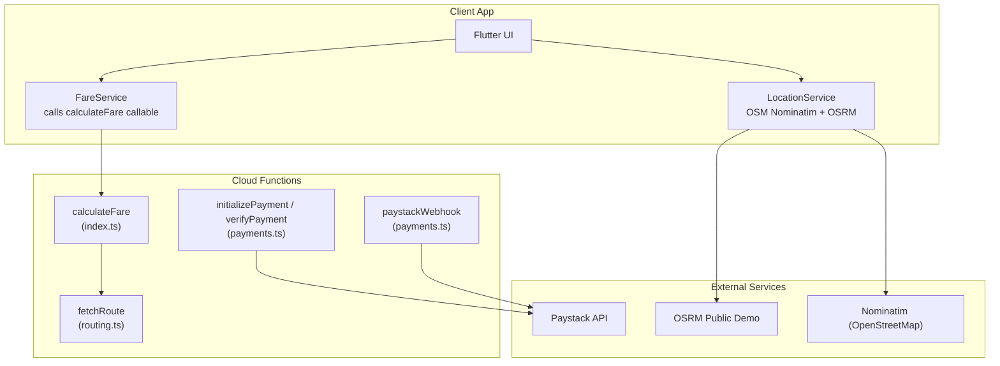
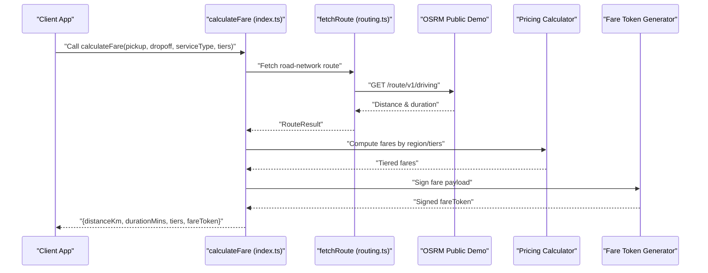
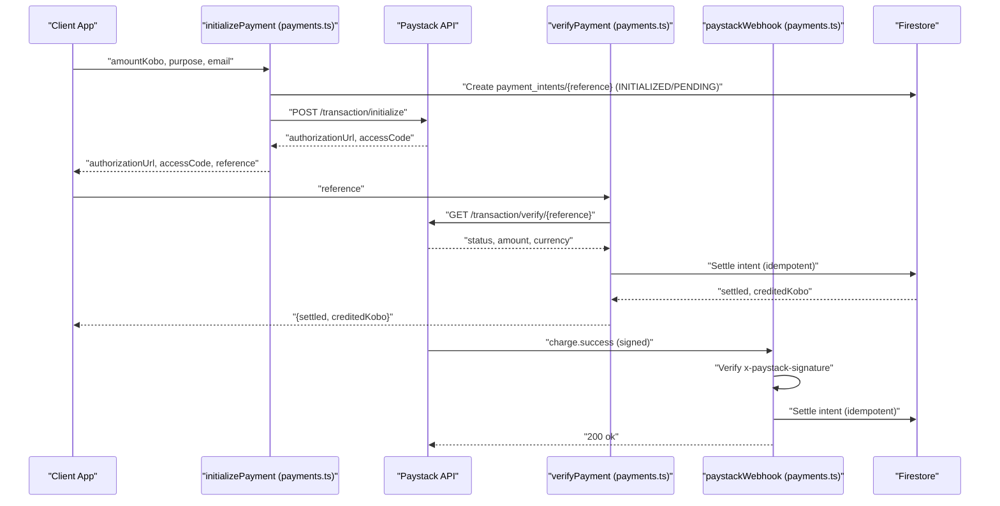
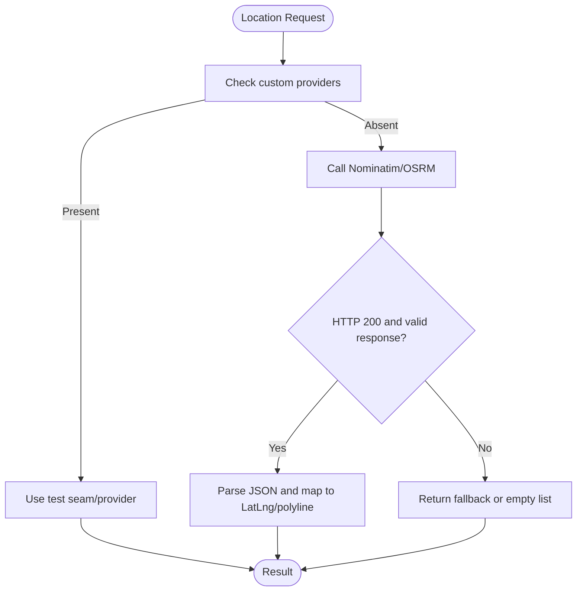
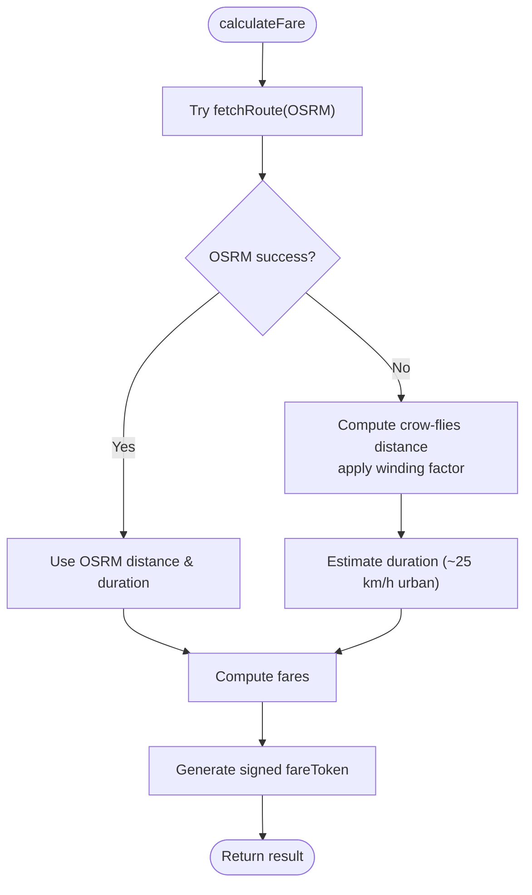
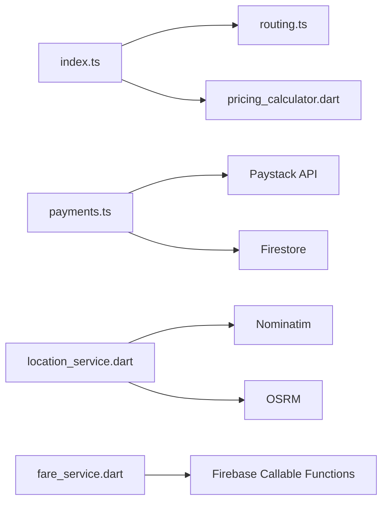

# Integration Guides

<cite>
**Referenced Files in This Document**
- [payments.ts](file://functions/src/payments.ts)
- [routing.ts](file://functions/src/routing.ts)
- [index.ts](file://functions/src/index.ts)
- [location_service.dart](file://sese_ride/lib/features/customer/services/location_service.dart)
- [fare_service.dart](file://sese_ride/lib/features/customer/services/fare_service.dart)
- [pricing_calculator.dart](file://sese_core/lib/services/pricing_calculator.dart)
</cite>

## Table of Contents
1. [Introduction](#introduction)
2. [Project Structure](#project-structure)
3. [Core Components](#core-components)
4. [Architecture Overview](#architecture-overview)
5. [Detailed Component Analysis](#detailed-component-analysis)
6. [Dependency Analysis](#dependency-analysis)
7. [Performance Considerations](#performance-considerations)
8. [Troubleshooting Guide](#troubleshooting-guide)
9. [Conclusion](#conclusion)

## Introduction
This document explains how external services and third-party APIs are integrated into the application, focusing on:
- Payment gateway integration with webhook handling, transaction security, and error recovery.
- Location and routing service integration using OpenStreetMap-based services for geocoding, route geometry, and distance/duration estimation.
- Authentication, request/response formats, rate limiting considerations, and fallback strategies when external services are unavailable.
- Security best practices, monitoring approaches, and debugging techniques for reliable integrations.

The payment flow is implemented server-side through Firebase Cloud Functions to enforce a zero-trust model where clients never handle sensitive amounts or secrets. The location and routing layer currently uses public OpenStreetMap endpoints for geocoding and routing, with explicit notes about fair-use limits and production scaling options.

## Project Structure
The integration points relevant to this guide live primarily in:
- Server-side Cloud Functions for payments, routing, fare calculation, and token signing.
- Client-side Flutter services for location, geocoding, routing, and fare requests.
- Shared core logic for pricing calculations.

**Diagram sources**
- [index.ts:81-198](file://functions/src/index.ts#L81-L198)
- [payments.ts:108-370](file://functions/src/payments.ts#L108-L370)
- [routing.ts:40-67](file://functions/src/routing.ts#L40-L67)
- [location_service.dart:225-278](file://sese_ride/lib/features/customer/services/location_service.dart#L225-L278)

**Section sources**
- [index.ts:1-199](file://functions/src/index.ts#L1-L199)
- [payments.ts:1-371](file://functions/src/payments.ts#L1-L371)
- [routing.ts:1-109](file://functions/src/routing.ts#L1-L109)
- [location_service.dart:1-298](file://sese_ride/lib/features/customer/services/location_service.dart#L1-L298)

## Core Components
- Payments module: initializes Paystack transactions, verifies payments, settles wallet balances idempotently, and processes signed webhooks.
- Routing module: fetches driving routes from OSRM and returns distance and duration.
- Fare calculation entry point: validates inputs, calls routing, computes fares, and signs a tamper-proof fare token.
- Location service: provides GPS, reverse/forward geocoding via Nominatim, and route polyline via OSRM.
- Fare service client: wraps callable fare calculation with error mapping and logging.

**Section sources**
- [payments.ts:5-48](file://functions/src/payments.ts#L5-L48)
- [routing.ts:1-12](file://functions/src/routing.ts#L1-L12)
- [index.ts:71-198](file://functions/src/index.ts#L71-L198)
- [location_service.dart:23-38](file://sese_ride/lib/features/customer/services/location_service.dart#L23-L38)
- [fare_service.dart:7-17](file://sese_ride/lib/features/customer/services/fare_service.dart#L7-L17)

## Architecture Overview
The system enforces zero-trust boundaries:
- Clients authenticate via Firebase Auth and call server-side functions.
- Sensitive operations (payment initialization, verification, settlement) run in Cloud Functions.
- External payment provider (Paystack) communicates securely via HMAC-signed webhooks.
- Routing and geocoding use OpenStreetMap services; the server also has a routing helper that can be swapped for self-hosted instances.

**Diagram sources**
- [index.ts:81-198](file://functions/src/index.ts#L81-L198)
- [routing.ts:40-67](file://functions/src/routing.ts#L40-L67)
- [pricing_calculator.dart:11-59](file://sese_core/lib/services/pricing_calculator.dart#L11-L59)

## Detailed Component Analysis

### Payment Gateway Integration (Paystack)
The payment module implements a secure, idempotent flow:
- Initialization: validates caller identity and amount bounds, creates a payment intent, initializes Paystack, and returns an authorization URL.
- Verification: verifies the reference server-side, checks amount/currency, and settles the wallet exactly once.
- Webhook: receives charge.success events, verifies HMAC signature, and settles the same intent idempotently.

Key behaviors:
- Secret key is read only from environment variables inside Cloud Functions.
- Amounts are validated against minimum and maximum thresholds.
- Settlement uses a Firestore transaction to ensure idempotency and atomic updates to wallet balance and transaction records.
- Webhook signature verification prevents unauthorized settlement attempts.

**Diagram sources**
- [payments.ts:108-197](file://functions/src/payments.ts#L108-L197)
- [payments.ts:206-271](file://functions/src/payments.ts#L206-L271)
- [payments.ts:283-326](file://functions/src/payments.ts#L283-L326)
- [payments.ts:333-370](file://functions/src/payments.ts#L333-L370)

Security and error recovery highlights:
- Zero-trust architecture: client never handles amounts directly; server validates and persists intents.
- Idempotent settlement: concurrent verify calls and webhooks settle once via transactional guard.
- Signature verification: webhook rejects invalid signatures and logs failures.
- Error mapping: Paystack errors are converted to structured HttpsError responses.

**Section sources**
- [payments.ts:5-48](file://functions/src/payments.ts#L5-L48)
- [payments.ts:108-197](file://functions/src/payments.ts#L108-L197)
- [payments.ts:206-271](file://functions/src/payments.ts#L206-L271)
- [payments.ts:283-326](file://functions/src/payments.ts#L283-L326)
- [payments.ts:333-370](file://functions/src/payments.ts#L333-L370)

### Google Maps and Routing Service Integration
Current implementation uses OpenStreetMap services:
- Geocoding and autocomplete: Nominatim for forward/reverse geocoding.
- Route geometry: OSRM public demo server for driving routes and polylines.
- Server-side routing helper: fetchRoute returns distance and duration, configurable via environment variable.

Important notes:
- Public endpoints have fair-use limits and require a valid User-Agent header.
- Production guidance suggests self-hosting Nominatim/OSRM or caching via backend functions.
- Client-side location service returns fallback values on failure to keep booking flows responsive.

**Diagram sources**
- [location_service.dart:113-143](file://sese_ride/lib/features/customer/services/location_service.dart#L113-L143)
- [location_service.dart:167-212](file://sese_ride/lib/features/customer/services/location_service.dart#L167-L212)
- [location_service.dart:231-278](file://sese_ride/lib/features/customer/services/location_service.dart#L231-L278)

Server-side routing fallback:
- If OSRM is unreachable, calculateFare falls back to crow-flies distance with a winding factor and estimated duration.

**Diagram sources**
- [index.ts:144-166](file://functions/src/index.ts#L144-L166)
- [index.ts:168-198](file://functions/src/index.ts#L168-L198)

**Section sources**
- [location_service.dart:23-38](file://sese_ride/lib/features/customer/services/location_service.dart#L23-L38)
- [location_service.dart:113-143](file://sese_ride/lib/features/customer/services/location_service.dart#L113-L143)
- [location_service.dart:167-212](file://sese_ride/lib/features/customer/services/location_service.dart#L167-L212)
- [location_service.dart:231-278](file://sese_ride/lib/features/customer/services/location_service.dart#L231-L278)
- [routing.ts:1-12](file://functions/src/routing.ts#L1-L12)
- [routing.ts:40-67](file://functions/src/routing.ts#L40-L67)
- [index.ts:144-166](file://functions/src/index.ts#L144-L166)

### Authentication Methods
- Client authentication: Firebase Auth context is attached to callable function requests; unauthenticated callers are rejected.
- Payment secret management: Paystack secret key is stored in environment variables and accessed only within Cloud Functions.
- Fare token signing: fare payloads are signed server-side to prevent client tampering.

Operational implications:
- Always validate request.auth before processing sensitive data.
- Never expose secret keys to clients.
- Use signed tokens for critical business data passed between client and server.

**Section sources**
- [index.ts:81-90](file://functions/src/index.ts#L81-L90)
- [payments.ts:39-48](file://functions/src/payments.ts#L39-L48)
- [fare_service.dart:7-17](file://sese_ride/lib/features/customer/services/fare_service.dart#L7-L17)

### Request/Response Formats
- Payment initialization:
  - Input: amountKobo, purpose, tripId (optional), email.
  - Output: authorizationUrl, accessCode, reference.
- Payment verification:
  - Input: reference.
  - Output: settled boolean, creditedKobo.
- Webhook:
  - Event: charge.success with reference and amount.
  - Signature: x-paystack-signature HMAC-SHA512 over raw body.
- Fare calculation:
  - Input: pickup/dropoff coordinates, serviceType, selectedTiers, optional region fields.
  - Output: distanceKm, durationMins, tiers, fareToken.

Best practices:
- Validate all inputs server-side.
- Enforce currency and amount consistency.
- Map external errors to user-friendly messages on the client.

**Section sources**
- [payments.ts:97-102](file://functions/src/payments.ts#L97-L102)
- [payments.ts:108-197](file://functions/src/payments.ts#L108-L197)
- [payments.ts:274-326](file://functions/src/payments.ts#L274-L326)
- [payments.ts:333-370](file://functions/src/payments.ts#L333-L370)
- [index.ts:62-69](file://functions/src/index.ts#L62-L69)
- [index.ts:81-198](file://functions/src/index.ts#L81-L198)

### Rate Limiting Considerations
- OSRM public demo: rate-limited; consider self-hosting or caching at scale.
- Nominatim: fair-use policy requires a valid User-Agent and respects request limits.
- Client-side timeouts: location service applies network timeouts to avoid blocking UI.

Recommendations:
- Add retry/backoff for transient failures.
- Cache frequent route/geocode results server-side.
- Monitor external endpoint status and adjust behavior accordingly.

**Section sources**
- [routing.ts:1-12](file://functions/src/routing.ts#L1-L12)
- [location_service.dart:23-38](file://sese_ride/lib/features/customer/services/location_service.dart#L23-L38)
- [location_service.dart:44-45](file://sese_ride/lib/features/customer/services/location_service.dart#L44-L45)

### Fallback Strategies for Service Unavailability
- Routing fallback: if OSRM fails, calculateFare computes crow-flies distance and estimates duration.
- Location service fallback: returns coordinate strings or empty lists on failure to keep UX responsive.
- Payment fallback: webhook returns 200 for unknown references to stop retries while logging mismatches.

**Section sources**
- [index.ts:144-166](file://functions/src/index.ts#L144-L166)
- [location_service.dart:126-143](file://sese_ride/lib/features/customer/services/location_service.dart#L126-L143)
- [location_service.dart:249-278](file://sese_ride/lib/features/customer/services/location_service.dart#L249-L278)
- [payments.ts:364-370](file://functions/src/payments.ts#L364-L370)

## Dependency Analysis
The main dependencies and relationships:
- index.ts depends on routing.ts for distance/duration and on pricing logic for fare computation.
- payments.ts depends on Paystack API and Firestore for intent/wallet state.
- location_service.dart depends on Nominatim and OSRM public endpoints.
- fare_service.dart depends on Firebase Callable Functions and maps errors to user-friendly messages.

**Diagram sources**
- [index.ts:21-24](file://functions/src/index.ts#L21-L24)
- [payments.ts:1-4](file://functions/src/payments.ts#L1-L4)
- [location_service.dart:1-6](file://sese_ride/lib/features/customer/services/location_service.dart#L1-L6)
- [fare_service.dart:1-5](file://sese_ride/lib/features/customer/services/fare_service.dart#L1-L5)

**Section sources**
- [index.ts:21-24](file://functions/src/index.ts#L21-L24)
- [payments.ts:1-4](file://functions/src/payments.ts#L1-L4)
- [location_service.dart:1-6](file://sese_ride/lib/features/customer/services/location_service.dart#L1-L6)
- [fare_service.dart:1-5](file://sese_ride/lib/features/customer/services/fare_service.dart#L1-L5)

## Performance Considerations
- External API latency: OSRM/Nominatim calls add network overhead; apply timeouts and caching.
- Transaction safety: payment settlement uses Firestore transactions to avoid race conditions.
- Response size: OSRM route geometry can be large; consider simplifying polylines or caching.
- Function cold starts: minimize heavy initialization in Cloud Functions; pre-warm critical paths if needed.

[No sources needed since this section provides general guidance]

## Troubleshooting Guide
Common issues and diagnostics:
- Payment initialization fails: check amount validation, email format, and Paystack configuration.
- Payment verification fails: inspect Paystack status and currency mismatch; review intent state.
- Webhook signature invalid: verify HMAC computation and raw body handling; ensure correct secret.
- Routing errors: check OSRM status codes, route availability, and coordinate validity.
- Geocoding failures: confirm User-Agent header and Nominatim rate limits.

Debugging tips:
- Log structured errors with HttpsError codes for client mapping.
- Inspect Firestore documents for payment intents and wallet transactions.
- Use test seams in location service to isolate network failures.

**Section sources**
- [payments.ts:116-150](file://functions/src/payments.ts#L116-L150)
- [payments.ts:303-326](file://functions/src/payments.ts#L303-L326)
- [payments.ts:344-370](file://functions/src/payments.ts#L344-L370)
- [routing.ts:70-108](file://functions/src/routing.ts#L70-L108)
- [location_service.dart:113-143](file://sese_ride/lib/features/customer/services/location_service.dart#L113-L143)
- [location_service.dart:167-212](file://sese_ride/lib/features/customer/services/location_service.dart#L167-L212)

## Conclusion
The integration design emphasizes security, reliability, and resilience:
- Payments are handled server-side with strict validation, idempotent settlement, and signed webhooks.
- Location and routing rely on OpenStreetMap services with clear production guidance for scaling.
- Fallback mechanisms ensure continuity when external services are unavailable.
- Monitoring, error mapping, and test seams support robust debugging and maintainability.

For production readiness:
- Self-host or cache OSRM/Nominatim to meet rate limits.
- Centralize secrets and audit webhook handlers.
- Instrument metrics for external API latency and error rates.
- Continuously validate input constraints and response schemas.

[No sources needed since this section summarizes without analyzing specific files]