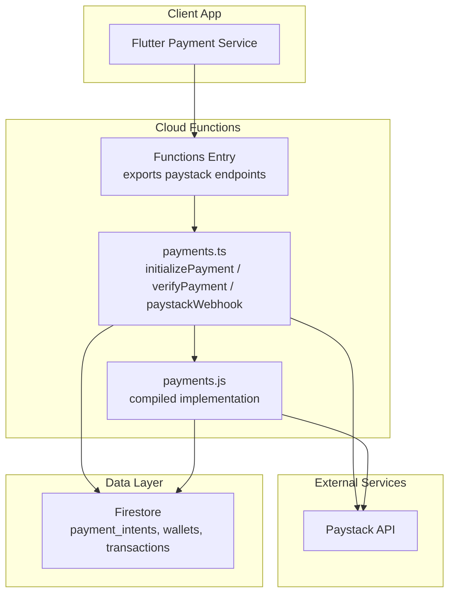
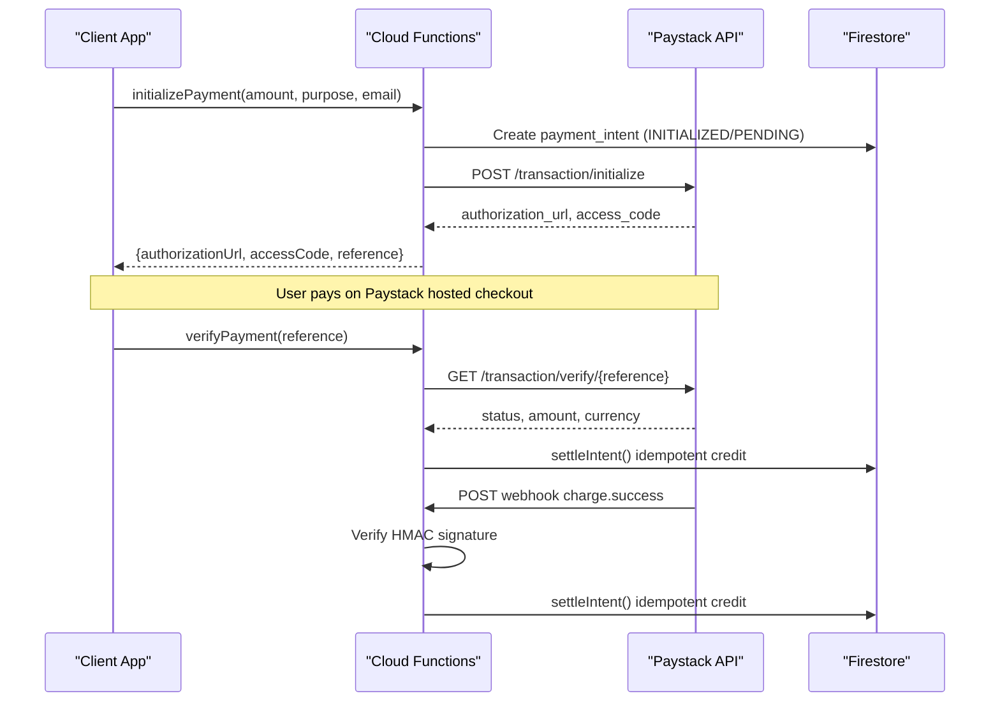
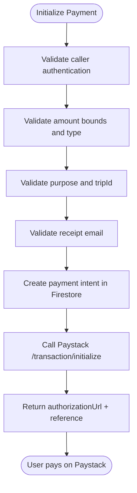
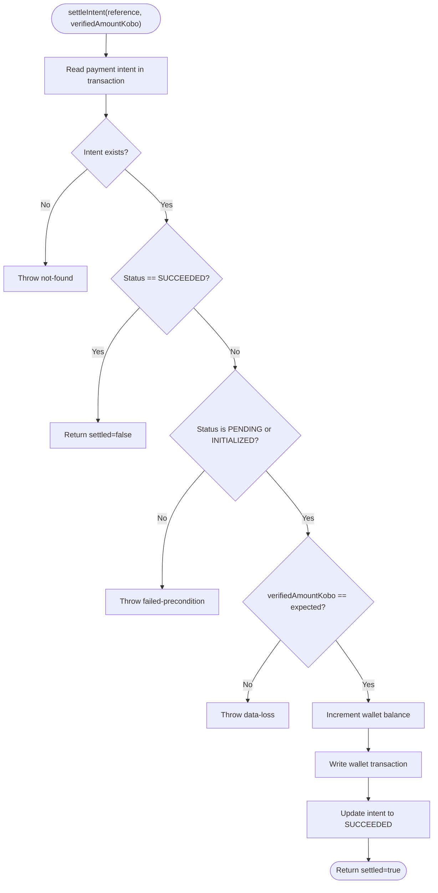
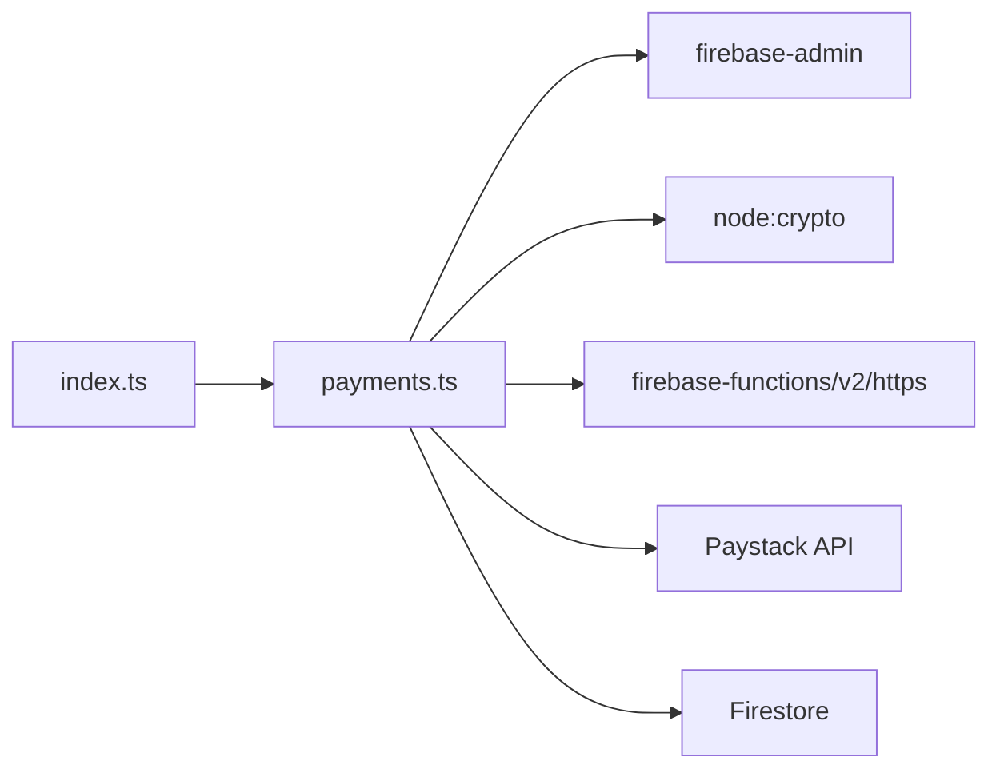

# Payment Processing

<cite>
**Referenced Files in This Document**
- [payments.ts](file://functions/src/payments.ts)
- [index.ts](file://functions/src/index.ts)
- [payments.js](file://functions/lib/payments.js)
- [payment_service.dart](file://sese_ride/lib/features/payments/payment_service.dart)
</cite>

## Table of Contents
1. [Introduction](#introduction)
2. [Project Structure](#project-structure)
3. [Core Components](#core-components)
4. [Architecture Overview](#architecture-overview)
5. [Detailed Component Analysis](#detailed-component-analysis)
6. [Dependency Analysis](#dependency-analysis)
7. [Performance Considerations](#performance-considerations)
8. [Troubleshooting Guide](#troubleshooting-guide)
9. [Conclusion](#conclusion)

## Introduction
This document describes the Paystack payment integration and its zero-trust architecture. All financial calculations, validation, and settlement occur server-side to prevent client tampering. The system exposes:
- A callable function that initializes a payment intent, validates amounts, creates a Firestore payment intent, and returns a hosted checkout URL.
- A callable function that verifies a transaction with Paystack and credits the user wallet exactly once.
- An HTTPS webhook endpoint that settles transactions from Paystack events using HMAC signature verification.

The design ensures that clients never control monetary values during settlement, that currency is enforced, and that concurrent settlement paths are idempotent.

## Project Structure
The payment logic lives in Cloud Functions. The TypeScript source defines the callable functions and webhook handler, while the compiled JavaScript is deployed. The mobile app calls the callable functions through a service layer.

**Diagram sources**
- [index.ts:49-49](file://functions/src/index.ts#L49-L49)
- [payments.ts:108-198](file://functions/src/payments.ts#L108-L198)
- [payments.ts:283-326](file://functions/src/payments.ts#L283-L326)
- [payments.ts:333-370](file://functions/src/payments.ts#L333-L370)
- [payments.js:111-175](file://functions/lib/payments.js#L111-L175)
- [payments.js:235-305](file://functions/lib/payments.js#L235-L305)

**Section sources**
- [index.ts:49-49](file://functions/src/index.ts#L49-L49)
- [payments.ts:1-26](file://functions/src/payments.ts#L1-L26)

## Core Components
- Zero-trust payment flow: all amount validation and settlement happens on the server.
- `initializePayment`: validates caller identity, amount bounds, purpose, email, creates a payment intent, and returns a Paystack authorization URL.
- `verifyPayment`: verifies the reference with Paystack, enforces currency and amount, then settles the payment idempotently.
- `paystackWebhook`: receives Paystack events, verifies HMAC signatures, and settles successful charges.
- Idempotent settlement: both `verifyPayment` and the webhook can settle the same transaction; only one succeeds.

Key security properties:
- Client cannot set or alter final amounts.
- Currency is validated against NGN.
- Webhooks require HMAC signature verification.
- Settlement uses a Firestore transaction to guarantee exactly-once crediting.

**Section sources**
- [payments.ts:5-26](file://functions/src/payments.ts#L5-L26)
- [payments.ts:108-198](file://functions/src/payments.ts#L108-L198)
- [payments.ts:283-326](file://functions/src/payments.ts#L283-L326)
- [payments.ts:333-370](file://functions/src/payments.ts#L333-L370)

## Architecture Overview
The payment lifecycle follows these steps:
1. Client calls `initializePayment` with an amount and metadata.
2. Server validates inputs, creates a payment intent in Firestore, and asks Paystack for a hosted checkout URL.
3. User completes payment on Paystack’s hosted page.
4. Either:
   - Client calls `verifyPayment`, which checks Paystack and settles the payment.
   - Paystack sends a webhook event, which the server verifies and settles.
5. Wallet balance is credited exactly once, and a transaction record is created.

**Diagram sources**
- [payments.ts:108-198](file://functions/src/payments.ts#L108-L198)
- [payments.ts:283-326](file://functions/src/payments.ts#L283-L326)
- [payments.ts:333-370](file://functions/src/payments.ts#L333-L370)

## Detailed Component Analysis

### Zero-Trust Payment Flow
All monetary decisions are made server-side:
- Amount bounds are enforced before creating any external request.
- Purpose and trip context are validated.
- Email is required for receipts.
- Currency is fixed to NGN at initialization and verified again after Paystack verification.
- Settlement compares the amount returned by Paystack with the stored intent amount.

**Diagram sources**
- [payments.ts:108-198](file://functions/src/payments.ts#L108-L198)

**Section sources**
- [payments.ts:108-198](file://functions/src/payments.ts#L108-L198)

### `initializePayment` Callable
Responsibilities:
- Require authenticated callers.
- Validate amount is a finite number within allowed bounds.
- Validate purpose and required fields for trip payments.
- Validate email format.
- Generate a unique reference and create a payment intent document.
- Call Paystack to initialize the transaction.
- Update the intent status and return the hosted checkout URL.

Error handling:
- Unauthenticated requests are rejected.
- Invalid arguments produce clear error messages.
- Paystack errors update the intent status to FAILED and surface a meaningful message.

Security:
- Secret key is read from environment variables and never exposed to the client.
- Amounts are validated server-side before any external call.

**Section sources**
- [payments.ts:39-48](file://functions/src/payments.ts#L39-L48)
- [payments.ts:50-53](file://functions/src/payments.ts#L50-L53)
- [payments.ts:55-95](file://functions/src/payments.ts#L55-L95)
- [payments.ts:108-198](file://functions/src/payments.ts#L108-L198)

### `settleIntent` Transaction Logic
Responsibilities:
- Load the payment intent inside a Firestore transaction.
- Reject already succeeded intents (idempotency).
- Ensure the intent is payable.
- Compare the verified amount with the expected amount.
- Credit the user wallet atomically.
- Record a wallet transaction entry.
- Mark the intent as SUCCEEDED.

Idempotency:
- Concurrent calls from `verifyPayment` and the webhook will settle only once because the transaction detects a SUCCEEDED state and short-circuits.

Complexity:
- One Firestore read, multiple writes within a single transaction.
- Time complexity is dominated by network latency to Paystack and Firestore.

**Diagram sources**
- [payments.ts:206-272](file://functions/src/payments.ts#L206-L272)

**Section sources**
- [payments.ts:200-272](file://functions/src/payments.ts#L200-L272)

### `verifyPayment` Callable
Responsibilities:
- Require authenticated callers.
- Validate the provided reference.
- Confirm the reference belongs to the caller.
- Query Paystack to verify the transaction.
- Enforce currency equals NGN.
- Settle the payment through `settleIntent`.

Error handling:
- Missing or invalid references are rejected.
- Unauthorized attempts to verify another user’s payment are denied.
- Non-success Paystack responses mark the intent as FAILED and return a user-safe error.
- Unexpected currency triggers a data-loss error.

**Section sources**
- [payments.ts:274-326](file://functions/src/payments.ts#L274-L326)

### `paystackWebhook` Endpoint
Responsibilities:
- Accept only POST requests.
- Require the Paystack secret to be configured.
- Verify the HMAC signature using the raw request body and the secret.
- Process `charge.success` events.
- Extract reference and amount, then settle via `settleIntent`.

Security:
- Signature verification prevents forged or tampered webhook payloads.
- Unknown or malformed events are logged but return success to avoid repeated retries from Paystack.

Configuration:
- Configure the webhook URL in the Paystack dashboard under Settings → Webhooks.

**Section sources**
- [payments.ts:328-370](file://functions/src/payments.ts#L328-L370)

### Client Integration Surface
The Flutter payment service provides methods to:
- Verify a top-up payment by calling the backend callable.
- Launch the Paystack hosted checkout using the authorization URL returned by initialization.

This keeps sensitive operations on the server while allowing the client to drive the UI flow.

**Section sources**
- [payment_service.dart:374-403](file://sese_ride/lib/features/payments/payment_service.dart#L374-L403)

## Dependency Analysis
The payment module depends on:
- Firebase Admin SDK for Firestore access.
- Node crypto for HMAC signature verification.
- Firebase Functions v2 for callable and HTTP handlers.
- Paystack REST API for initialization and verification.
- Environment variables for secrets and base URL configuration.

**Diagram sources**
- [payments.ts:1-3](file://functions/src/payments.ts#L1-L3)
- [index.ts:49-49](file://functions/src/index.ts#L49-L49)

**Section sources**
- [payments.ts:1-3](file://functions/src/payments.ts#L1-L3)
- [index.ts:49-49](file://functions/src/index.ts#L49-L49)

## Performance Considerations
- Use integer kobo values to avoid floating-point rounding issues.
- Keep Paystack calls minimal and rely on idempotent settlement to reduce duplicate work.
- Prefer server-side verification and settlement to minimize client retries.
- Monitor Firestore transaction contention when many concurrent verifications or webhooks target the same reference.
- Cache or rate-limit unnecessary re-verification of already settled intents.

[No sources needed since this section provides general guidance]

## Troubleshooting Guide
Common issues and resolutions:
- Missing Paystack secret:
  - Symptom: Initialization or verification fails due to missing configuration.
  - Resolution: Set the Paystack secret in the functions environment.
- Invalid signature on webhook:
  - Symptom: Webhook returns unauthorized.
  - Resolution: Ensure the correct secret is used and the raw body is hashed consistently.
- Amount mismatch:
  - Symptom: Settlement throws data-loss.
  - Resolution: Investigate whether the Paystack response amount differs from the stored intent amount.
- Currency mismatch:
  - Symptom: Verification rejects unexpected currency.
  - Resolution: Ensure Paystack is configured for NGN and the client does not override currency.
- Intent not found:
  - Symptom: Reference does not exist.
  - Resolution: Confirm the reference was created by `initializePayment` and belongs to the authenticated user.
- Payment no longer payable:
  - Symptom: Intent is not in a payable state.
  - Resolution: Check intent status; already succeeded or failed intents cannot be re-settled.

Operational recommendations:
- Log Paystack errors and webhook failures for observability.
- Add monitoring alerts for failed settlements and signature mismatches.
- Review intent documents for audit trails and reconciliation.

**Section sources**
- [payments.ts:39-48](file://functions/src/payments.ts#L39-L48)
- [payments.ts:333-370](file://functions/src/payments.ts#L333-L370)
- [payments.ts:206-272](file://functions/src/payments.ts#L206-L272)

## Conclusion
The Paystack integration implements a secure, zero-trust payment flow where all financial logic is server-side. The system validates amounts, enforces currency, verifies webhook signatures, and guarantees idempotent settlement. Clients interact only with safe surfaces: initializing a payment, launching the hosted checkout, and verifying a reference. For reliable operations, configure secrets securely, monitor webhook health, and reconcile payment intents regularly.

[No sources needed since this section summarizes without analyzing specific files]