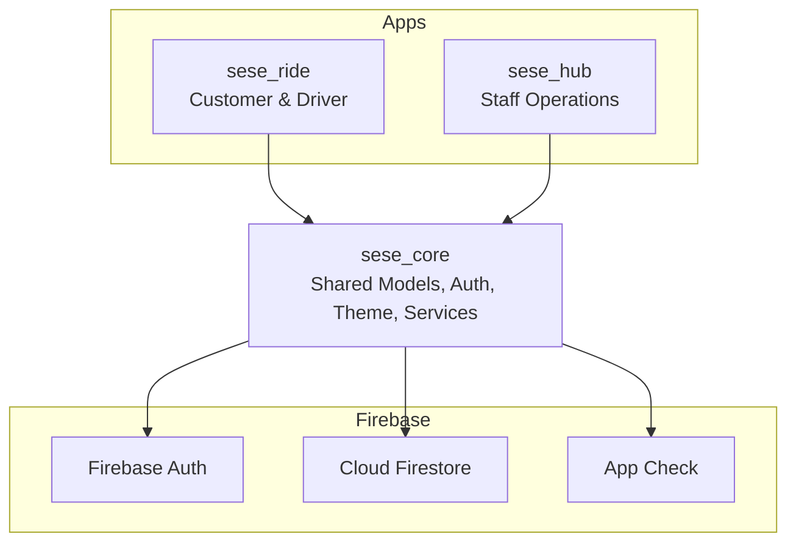
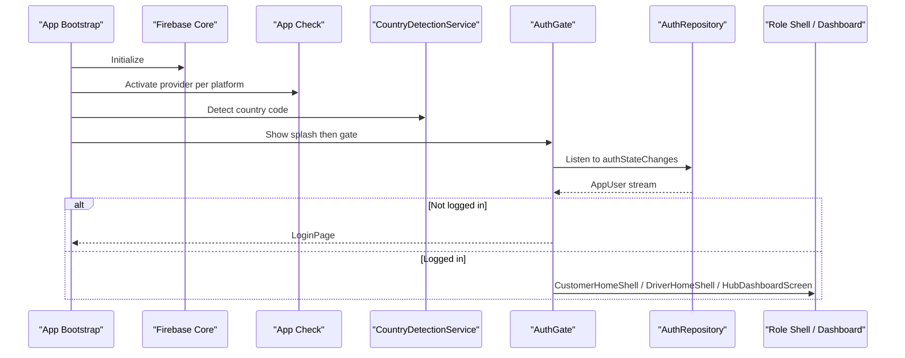
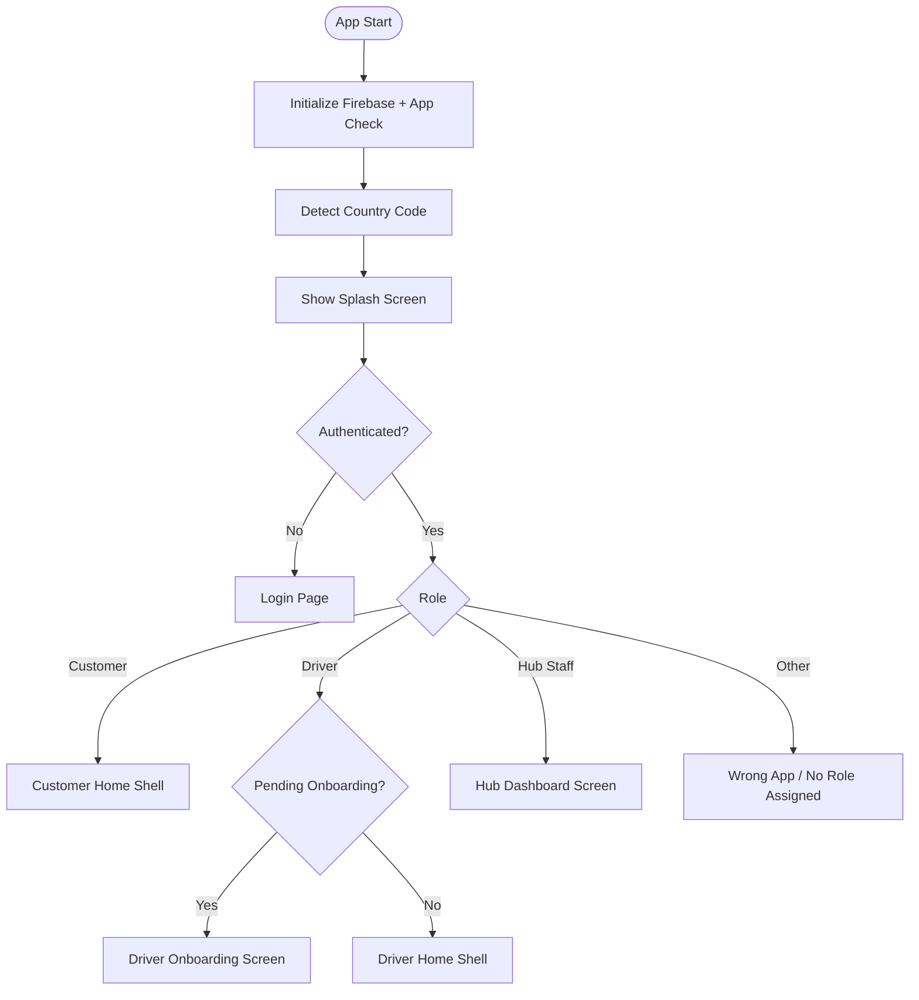
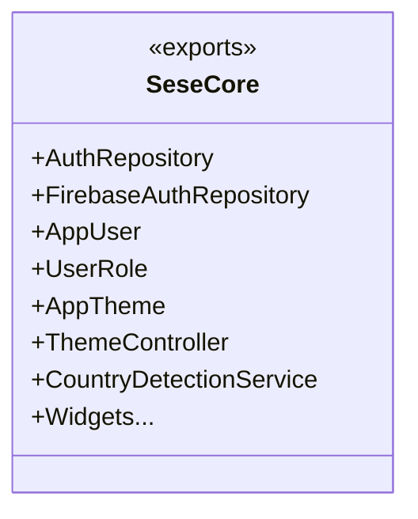
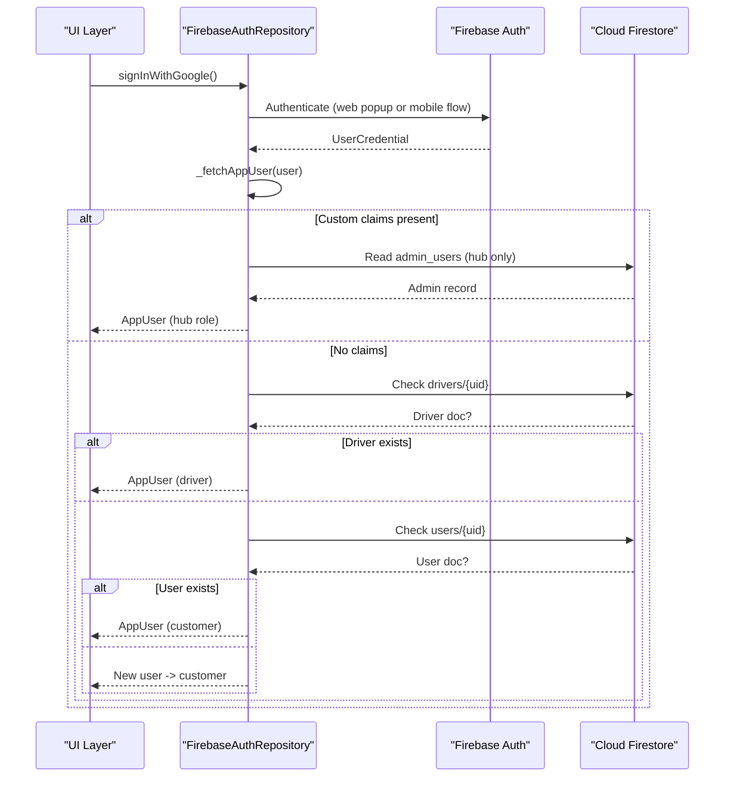
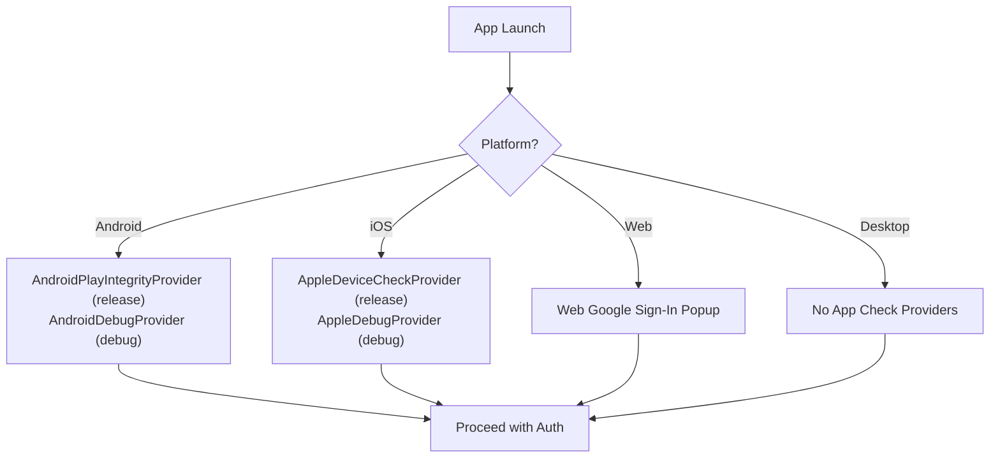
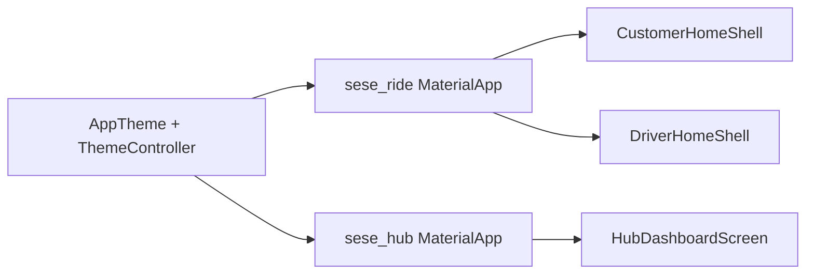
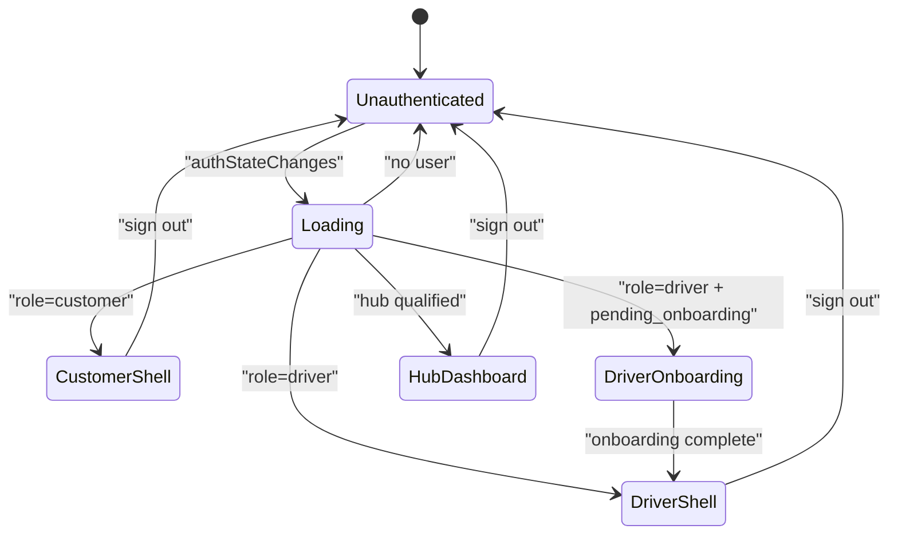
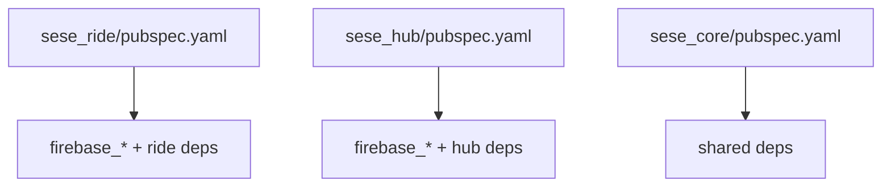
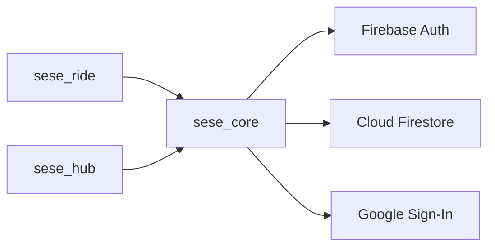

# Mobile Applications

<cite>
**Referenced Files in This Document**
- [sese_ride/lib/main.dart](file://sese_ride/lib/main.dart)
- [sese_hub/lib/main.dart](file://sese_hub/lib/main.dart)
- [sese_core/lib/sese_core.dart](file://sese_core/lib/sese_core.dart)
- [sese_core/lib/auth/firebase_auth_repository.dart](file://sese_core/lib/auth/firebase_auth_repository.dart)
- [sese_core/lib/models/user_model.dart](file://sese_core/lib/models/user_model.dart)
- [sese_core/lib/models/user_role.dart](file://sese_core/lib/models/user_role.dart)
- [sese_core/lib/theme/app_theme.dart](file://sese_core/lib/theme/app_theme.dart)
- [sese_core/lib/theme/theme_controller.dart](file://sese_core/lib/theme/theme_controller.dart)
- [sese_core/lib/services/country_detection_service.dart](file://sese_core/lib/services/country_detection_service.dart)
- [sese_ride/pubspec.yaml](file://sese_ride/pubspec.yaml)
- [sese_hub/pubspec.yaml](file://sese_hub/pubspec.yaml)
- [sese_core/pubspec.yaml](file://sese_core/pubspec.yaml)
</cite>

## Table of Contents
1. [Introduction](#introduction)
2. [Project Structure](#project-structure)
3. [Core Components](#core-components)
4. [Architecture Overview](#architecture-overview)
5. [Detailed Component Analysis](#detailed-component-analysis)
6. [Dependency Analysis](#dependency-analysis)
7. [Performance Considerations](#performance-considerations)
8. [Troubleshooting Guide](#troubleshooting-guide)
9. [Conclusion](#conclusion)

## Introduction
This document explains the dual-app architecture for SeSe:
- sese_ride: customer and driver mobile experience.
- sese_hub: administrative operations for staff.

Both apps share a common core library (sese_core) that provides authentication, models, theme, utilities, and shared widgets. The apps initialize Firebase, enforce App Check, detect country/dial code, and route users based on role and verification state. Platform-specific implementations exist for Android, iOS, Web, and Desktop via Flutter’s multi-target support.

## Project Structure
The repository contains three main packages:
- sese_core: shared Dart package with auth repository, models, services, theme, and UI primitives.
- sese_ride: customer/driver app entry point and feature screens.
- sese_hub: admin/staff app entry point and dashboard features.

**Diagram sources**
- [sese_ride/lib/main.dart:13-40](file://sese_ride/lib/main.dart#L13-L40)
- [sese_hub/lib/main.dart:13-37](file://sese_hub/lib/main.dart#L13-L37)
- [sese_core/lib/sese_core.dart:1-34](file://sese_core/lib/sese_core.dart#L1-L34)

**Section sources**
- [sese_ride/lib/main.dart:13-40](file://sese_ride/lib/main.dart#L13-L40)
- [sese_hub/lib/main.dart:13-37](file://sese_hub/lib/main.dart#L13-L37)
- [sese_core/lib/sese_core.dart:1-34](file://sese_core/lib/sese_core.dart#L1-L34)

## Core Components
- Shared core exports:
  - Authentication repository and stubs.
  - User model and role enumeration.
  - Theme definitions and theme controller.
  - Country detection service and phone utilities.
  - Common widgets (splash screen, logo, app bar, sign-in buttons).
- Role-based routing:
  - Customer and driver shells in sese_ride.
  - Hub dashboard and access checks in sese_hub.
- Theme persistence:
  - System default with manual override persisted across restarts.

Key responsibilities:
- FirebaseAuthRepository resolves user roles from multiple sources and enforces platform-specific behaviors.
- AppUser encapsulates authenticated user data and driver onboarding state.
- UserRole defines shared roles across both apps.
- AppTheme and ThemeController provide consistent appearance.

**Section sources**
- [sese_core/lib/sese_core.dart:1-34](file://sese_core/lib/sese_core.dart#L1-L34)
- [sese_core/lib/models/user_model.dart:1-109](file://sese_core/lib/models/user_model.dart#L1-L109)
- [sese_core/lib/models/user_role.dart:1-55](file://sese_core/lib/models/user_role.dart#L1-L55)
- [sese_core/lib/theme/app_theme.dart:1-85](file://sese_core/lib/theme/app_theme.dart#L1-L85)
- [sese_core/lib/theme/theme_controller.dart:1-90](file://sese_core/lib/theme/theme_controller.dart#L1-L90)

## Architecture Overview
The apps follow a zero-trust gate pattern:
- Initialize Firebase and App Check.
- Prime country detection.
- Render splash then an auth gate.
- Route to role-appropriate shell or deny access.

**Diagram sources**
- [sese_ride/lib/main.dart:13-40](file://sese_ride/lib/main.dart#L13-L40)
- [sese_hub/lib/main.dart:13-37](file://sese_hub/lib/main.dart#L13-L37)
- [sese_core/lib/services/country_detection_service.dart:20-63](file://sese_core/lib/services/country_detection_service.dart#L20-L63)

## Detailed Component Analysis

### Dual-App Strategy
- sese_ride:
  - Initializes Firebase and App Check.
  - Detects country code.
  - Routes to CustomerHomeShell or DriverHomeShell based on role; shows driver onboarding when pending.
  - Blocks hub staff accounts with a “Wrong App” screen.
- sese_hub:
  - Initializes Firebase and App Check.
  - Performs silent hub_staff qualification check.
  - Shows HubDashboardScreen if qualified; otherwise signs out and displays a no-role block screen.

**Diagram sources**
- [sese_ride/lib/main.dart:89-144](file://sese_ride/lib/main.dart#L89-L144)
- [sese_hub/lib/main.dart:87-196](file://sese_hub/lib/main.dart#L87-L196)

**Section sources**
- [sese_ride/lib/main.dart:13-184](file://sese_ride/lib/main.dart#L13-L184)
- [sese_hub/lib/main.dart:13-235](file://sese_hub/lib/main.dart#L13-L235)

### Shared Core Library Integration
- Exports:
  - Auth repository interfaces and implementations.
  - User model and role enum.
  - Theme and theme controller.
  - Country detection and phone utilities.
  - Shared widgets for splash, logo, app bar, sign-in buttons, and inputs.
- Usage:
  - Both apps import the core package and rely on its single source of truth for theme, user model, and auth repository.

**Diagram sources**
- [sese_core/lib/sese_core.dart:1-34](file://sese_core/lib/sese_core.dart#L1-L34)

**Section sources**
- [sese_core/lib/sese_core.dart:1-34](file://sese_core/lib/sese_core.dart#L1-L34)

### Authentication Flows and Role Resolution
- FirebaseAuthRepository:
  - Provides streams for auth state changes.
  - Supports email/password and Google Sign-In flows.
  - Resolves roles by checking:
    - Owner bootstrap email.
    - Firebase ID-token custom claims.
    - Hub admin_users collection (hub app only).
    - drivers/{uid}.
    - users/{uid}.
    - Default to customer for new users.
  - Handles driver account existence checks and registration paths.
  - Signs out gracefully and soft-deletes accounts with archival metadata.

**Diagram sources**
- [sese_core/lib/auth/firebase_auth_repository.dart:81-122](file://sese_core/lib/auth/firebase_auth_repository.dart#L81-L122)
- [sese_core/lib/auth/firebase_auth_repository.dart:519-671](file://sese_core/lib/auth/firebase_auth_repository.dart#L519-L671)

**Section sources**
- [sese_core/lib/auth/firebase_auth_repository.dart:1-707](file://sese_core/lib/auth/firebase_auth_repository.dart#L1-L707)
- [sese_core/lib/models/user_model.dart:1-109](file://sese_core/lib/models/user_model.dart#L1-L109)
- [sese_core/lib/models/user_role.dart:1-55](file://sese_core/lib/models/user_role.dart#L1-L55)

### Platform-Specific Implementations
- Android:
  - Uses Google Play Integrity Provider for App Check in release builds.
  - Uses AndroidDebugProvider in debug builds.
  - Google Sign-In requires SHA configuration and google-services.json.
- iOS:
  - Uses DeviceCheck Provider for App Check in release builds.
  - Uses AppleDebugProvider in debug builds.
- Web:
  - Uses web-specific Google Sign-In popup flow.
  - Requires correct OAuth client configuration.
- Desktop:
  - Inherits behavior from Flutter desktop targets; App Check providers are not applicable on desktop.

**Diagram sources**
- [sese_ride/lib/main.dart:17-34](file://sese_ride/lib/main.dart#L17-L34)
- [sese_hub/lib/main.dart:17-32](file://sese_hub/lib/main.dart#L17-L32)
- [sese_core/lib/auth/firebase_auth_repository.dart:323-361](file://sese_core/lib/auth/firebase_auth_repository.dart#L323-L361)

**Section sources**
- [sese_ride/lib/main.dart:17-34](file://sese_ride/lib/main.dart#L17-L34)
- [sese_hub/lib/main.dart:17-32](file://sese_hub/lib/main.dart#L17-L32)
- [sese_core/lib/auth/firebase_auth_repository.dart:323-361](file://sese_core/lib/auth/firebase_auth_repository.dart#L323-L361)

### UI/UX Patterns and Navigation Structures
- Theme:
  - Centralized brand colors and Material 3 themes.
  - Dark/light modes with system default and persistent manual selection.
- Splash and Gates:
  - SeSeSplashScreen transitions to role-based gates.
  - AuthGate routes to login, onboarding, or shells.
- Navigation:
  - Customer and driver shells encapsulate respective navigation structures.
  - Hub dashboard is gated by access checks and permissions.

**Diagram sources**
- [sese_core/lib/theme/app_theme.dart:23-84](file://sese_core/lib/theme/app_theme.dart#L23-L84)
- [sese_core/lib/theme/theme_controller.dart:21-75](file://sese_core/lib/theme/theme_controller.dart#L21-L75)
- [sese_ride/lib/main.dart:66-86](file://sese_ride/lib/main.dart#L66-L86)
- [sese_hub/lib/main.dart:64-84](file://sese_hub/lib/main.dart#L64-L84)

**Section sources**
- [sese_core/lib/theme/app_theme.dart:1-85](file://sese_core/lib/theme/app_theme.dart#L1-L85)
- [sese_core/lib/theme/theme_controller.dart:1-90](file://sese_core/lib/theme/theme_controller.dart#L1-L90)
- [sese_ride/lib/main.dart:66-86](file://sese_ride/lib/main.dart#L66-L86)
- [sese_hub/lib/main.dart:64-84](file://sese_hub/lib/main.dart#L64-L84)

### State Management Approaches
- Stream-based auth state:
  - StreamBuilder listens to AuthRepository.authStateChanges.
  - Rebuilds UI upon sign-in/sign-out events.
- Theme state:
  - ValueNotifier exposes current ThemeMode.
  - Persisted via SharedPreferences.
- Country detection:
  - Cached result for synchronous use in input fields.

**Diagram sources**
- [sese_ride/lib/main.dart:97-144](file://sese_ride/lib/main.dart#L97-L144)
- [sese_hub/lib/main.dart:132-196](file://sese_hub/lib/main.dart#L132-L196)
- [sese_core/lib/theme/theme_controller.dart:21-75](file://sese_core/lib/theme/theme_controller.dart#L21-L75)

**Section sources**
- [sese_ride/lib/main.dart:97-144](file://sese_ride/lib/main.dart#L97-L144)
- [sese_hub/lib/main.dart:132-196](file://sese_hub/lib/main.dart#L132-L196)
- [sese_core/lib/theme/theme_controller.dart:21-75](file://sese_core/lib/theme/theme_controller.dart#L21-L75)

### Real-Time Feature Implementation Notes
- Real-time updates are enabled through Cloud Firestore usage in the apps and core.
- App Check enforcement ensures secure reads/writes; without activation, requests fail with permission errors.
- For real-time features, ensure:
  - App Check providers are correctly configured per platform.
  - Firestore security rules allow intended operations.
  - Streams are properly managed in UI layers.

[No sources needed since this section provides general guidance]

### Build Configurations and Deployment Processes
- Dependencies:
  - Both apps depend on firebase_core, firebase_app_check, cloud_firestore, firebase_auth, and google_sign_in.
  - sese_ride additionally includes image_picker, geolocator, flutter_map, and other ride-specific dependencies.
  - sese_hub focuses on auth and firestore for admin operations.
- Environment:
  - SDK constraints and Flutter settings are defined per app.
- Deployment:
  - Use platform-native build tools (Gradle for Android, Xcode for iOS) and Flutter tooling for Web/Desktop.
  - Ensure Firebase project configuration files are present and up-to-date.

**Diagram sources**
- [sese_ride/pubspec.yaml:10-30](file://sese_ride/pubspec.yaml#L10-L30)
- [sese_hub/pubspec.yaml:10-21](file://sese_hub/pubspec.yaml#L10-L21)
- [sese_core/pubspec.yaml:9-20](file://sese_core/pubspec.yaml#L9-L20)

**Section sources**
- [sese_ride/pubspec.yaml:1-38](file://sese_ride/pubspec.yaml#L1-L38)
- [sese_hub/pubspec.yaml:1-29](file://sese_hub/pubspec.yaml#L1-L29)
- [sese_core/pubspec.yaml:1-33](file://sese_core/pubspec.yaml#L1-L33)

## Dependency Analysis
- Coupling:
  - Apps depend on sese_core for auth, models, theme, and services.
  - FirebaseAuthRepository depends on Firebase Auth, Firestore, and Google Sign-In.
- Cohesion:
  - Each module has clear responsibilities: auth resolution, user modeling, theme management, country detection.
- External integrations:
  - Firebase ecosystem (Auth, Firestore, Storage, Functions).
  - Google Sign-In for cross-platform identity.

**Diagram sources**
- [sese_ride/pubspec.yaml:10-30](file://sese_ride/pubspec.yaml#L10-L30)
- [sese_hub/pubspec.yaml:10-21](file://sese_hub/pubspec.yaml#L10-L21)
- [sese_core/pubspec.yaml:9-20](file://sese_core/pubspec.yaml#L9-L20)

**Section sources**
- [sese_ride/pubspec.yaml:10-30](file://sese_ride/pubspec.yaml#L10-L30)
- [sese_hub/pubspec.yaml:10-21](file://sese_hub/pubspec.yaml#L10-L21)
- [sese_core/pubspec.yaml:9-20](file://sese_core/pubspec.yaml#L9-L20)

## Performance Considerations
- Minimize Firestore reads during role resolution by leveraging cached results where appropriate.
- Avoid unnecessary rebuilds by using ValueListenableBuilder for theme and StreamBuilder for auth state.
- Use platform-specific providers for App Check to reduce overhead and improve security posture.
- Defer heavy initialization until after splash to improve perceived performance.

[No sources needed since this section provides general guidance]

## Troubleshooting Guide
Common issues and resolutions:
- Permission denied on Firestore:
  - Ensure App Check is activated with correct providers per platform.
- Google Sign-In failures:
  - Verify SHA-1/SHA-256 fingerprints and google-services.json freshness.
  - On Huawei devices without GMS, Google Sign-In is unavailable.
- Wrong app access:
  - Hub staff opening sese_ride will see a “Wrong App” screen; sign out and open sese_hub.
- No role assigned in hub:
  - Missing hub_staff record or no active permissions triggers sign out and denial screen.

**Section sources**
- [sese_ride/lib/main.dart:147-184](file://sese_ride/lib/main.dart#L147-L184)
- [sese_hub/lib/main.dart:199-235](file://sese_hub/lib/main.dart#L199-L235)
- [sese_core/lib/auth/firebase_auth_repository.dart:323-361](file://sese_core/lib/auth/firebase_auth_repository.dart#L323-L361)

## Conclusion
The SeSe mobile applications implement a robust dual-app strategy with a shared core library. Authentication and role resolution are centralized, ensuring consistent behavior across customer, driver, and hub experiences. Platform-specific configurations for App Check and Google Sign-In are handled explicitly, while theme and country detection are unified. The architecture supports scalable real-time features and maintains clear separation between app concerns and shared logic.