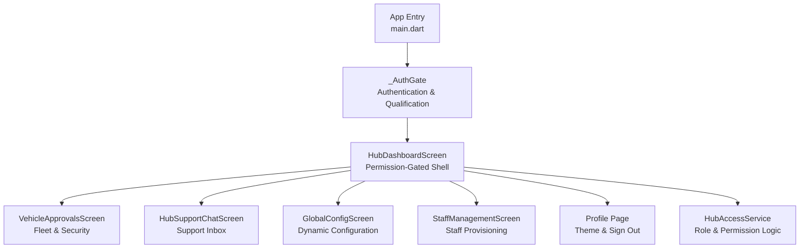
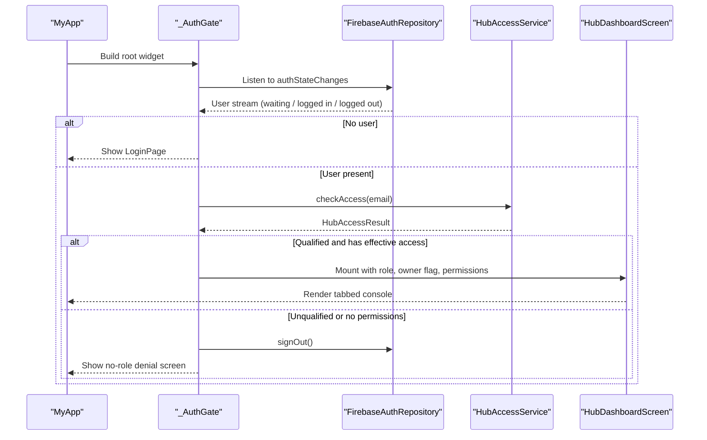
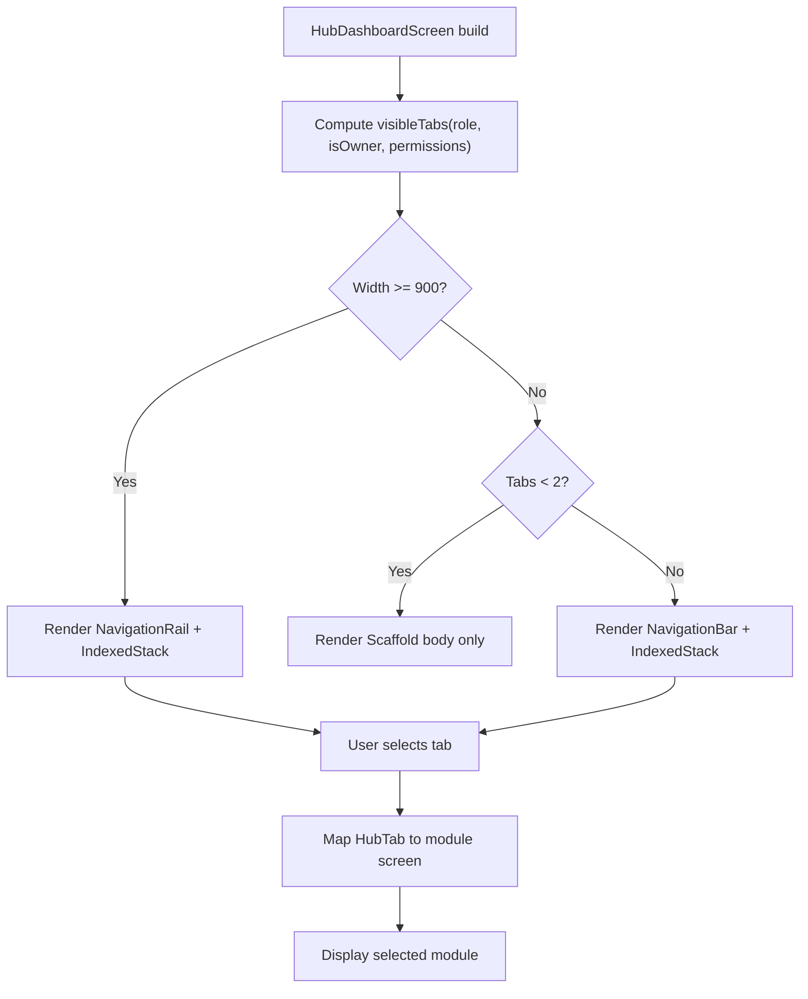
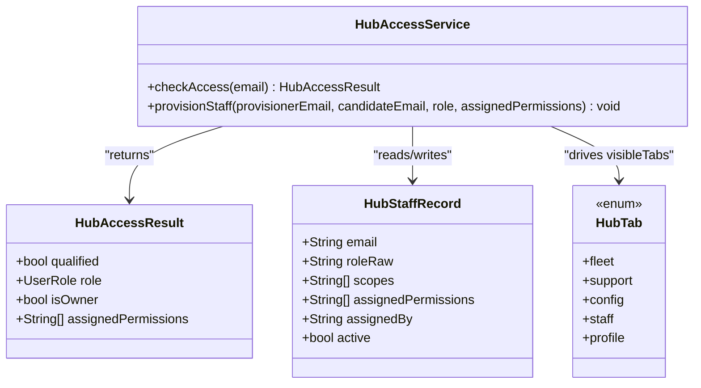
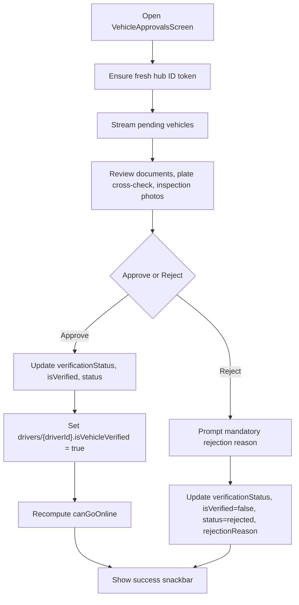
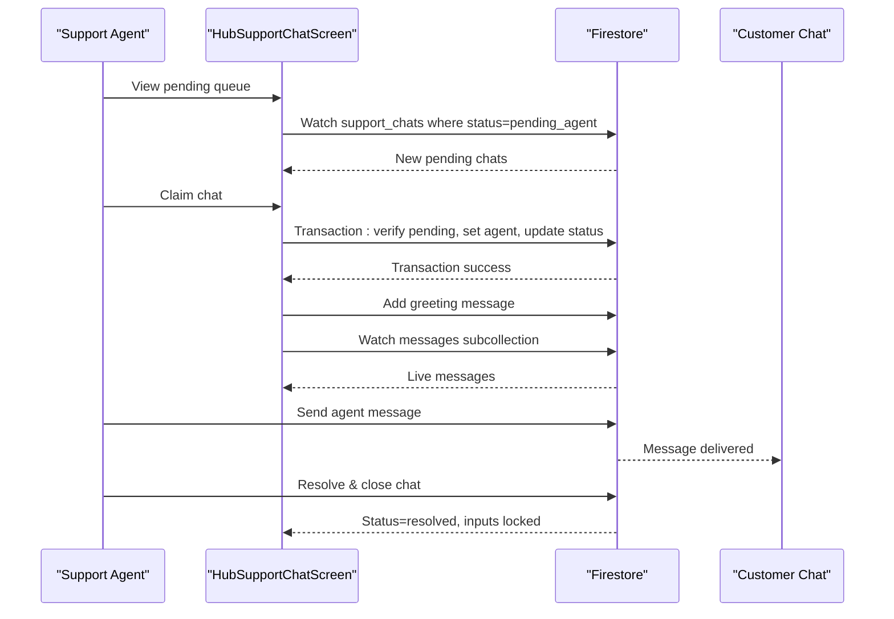
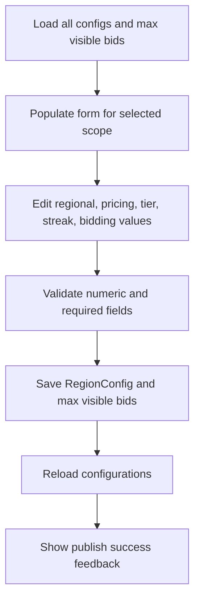
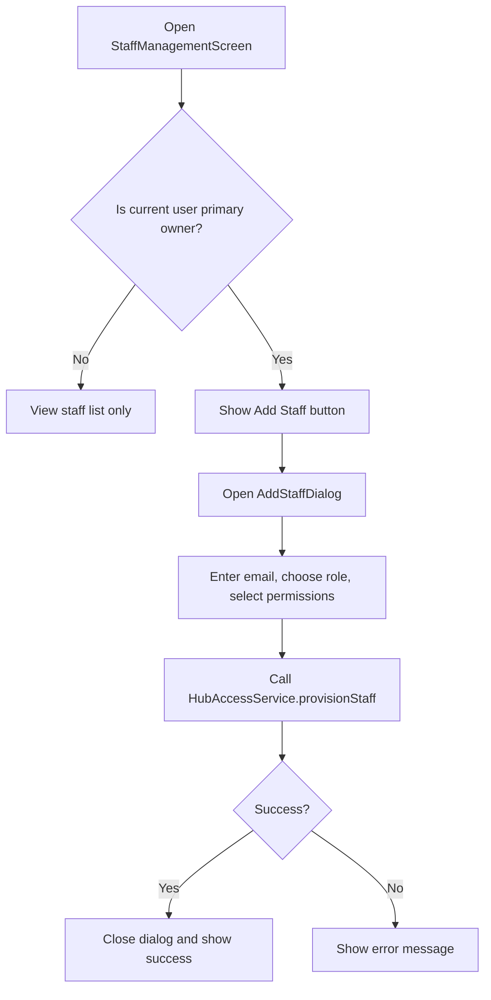
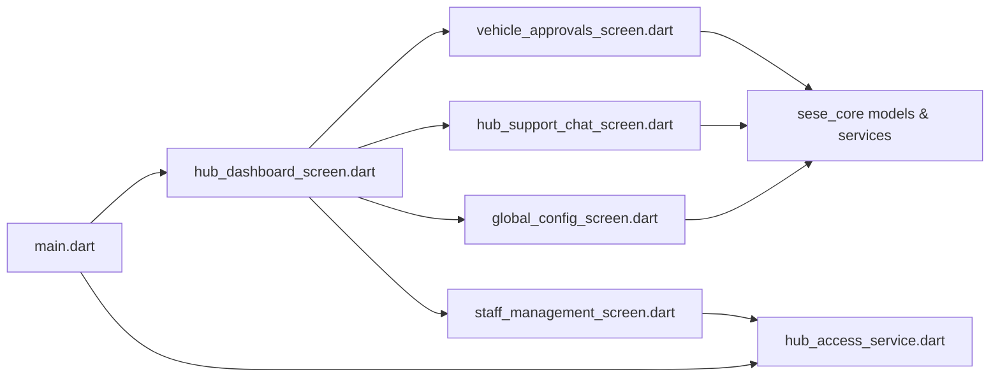

# Administrative Dashboard

<cite>
**Referenced Files in This Document**
- [main.dart](file://sese_hub/lib/main.dart)
- [hub_dashboard_screen.dart](file://sese_hub/lib/features/dashboard/presentation/hub_dashboard_screen.dart)
- [hub_access_service.dart](file://sese_hub/lib/features/staff/services/hub_access_service.dart)
- [vehicle_approvals_screen.dart](file://sese_hub/lib/features/verification/presentation/vehicle_approvals_screen.dart)
- [hub_support_chat_screen.dart](file://sese_hub/lib/features/support/hub_support_chat_screen.dart)
- [global_config_screen.dart](file://sese_hub/lib/features/config/presentation/global_config_screen.dart)
- [staff_management_screen.dart](file://sese_hub/lib/features/staff/presentation/staff_management_screen.dart)
</cite>

## Table of Contents
1. [Introduction](#introduction)
2. [Project Structure](#project-structure)
3. [Core Components](#core-components)
4. [Architecture Overview](#architecture-overview)
5. [Detailed Component Analysis](#detailed-component-analysis)
6. [Dependency Analysis](#dependency-analysis)
7. [Performance Considerations](#performance-considerations)
8. [Troubleshooting Guide](#troubleshooting-guide)
9. [Conclusion](#conclusion)

## Introduction
This document explains the administrative dashboard that serves as the central entry point for Sese Hub staff operations. It covers the dashboard layout, navigation structure, permission-driven quick access panels, responsive design behavior, real-time data integration, and how the hub aggregates operational modules such as fleet verification, support escalation, dynamic configuration, and staff management.

The dashboard is not a traditional metrics-only landing page. Instead, it is a unified, role-scoped console shell that:
- Authenticates users through Firebase Authentication.
- Silently qualifies them against the `hub_staff` collection.
- Renders only the tabs and actions allowed by their role and assigned permissions.
- Provides quick access to operational screens rather than static summary cards.
- Integrates with live Firestore streams for real-time queues, audit logs, chat threads, and configuration updates.

## Project Structure
The administrative dashboard lives under the `sese_hub` Flutter application. The relevant code is organized by feature:

**Diagram sources**
- [main.dart:13-85](file://sese_hub/lib/main.dart#L13-L85)
- [main.dart:87-196](file://sese_hub/lib/main.dart#L87-L196)
- [hub_dashboard_screen.dart:20-250](file://sese_hub/lib/features/dashboard/presentation/hub_dashboard_screen.dart#L20-L250)
- [hub_access_service.dart:43-83](file://sese_hub/lib/features/staff/services/hub_access_service.dart#L43-L83)

**Section sources**
- [main.dart:13-85](file://sese_hub/lib/main.dart#L13-L85)
- [hub_dashboard_screen.dart:10-45](file://sese_hub/lib/features/dashboard/presentation/hub_dashboard_screen.dart#L10-L45)

## Core Components
The dashboard system consists of five primary components:

| Component | Responsibility | Key Behaviors |
|---|---|---|
| Application entry and authentication gate | Initializes Firebase, theme, splash screen, and guards access | Shows login when unauthenticated; silently checks `hub_staff`; signs out if unqualified |
| Dashboard shell | Central navigation container | Renders side rail on wide screens and bottom bar on narrow screens; maps tabs to module screens |
| Access service | Role and permission evaluation | Defines owner, Super, Admin, Agent roles; computes visible tabs from `assignedPermissions` |
| Module screens | Operational consoles | Fleet approvals, support chat, dynamic configuration, staff provisioning |
| Profile page | User identity and session controls | Displays user avatar/name, theme picker, and sign-out action |

**Section sources**
- [main.dart:40-85](file://sese_hub/lib/main.dart#L40-L85)
- [hub_dashboard_screen.dart:20-92](file://sese_hub/lib/features/dashboard/presentation/hub_dashboard_screen.dart#L20-L92)
- [hub_access_service.dart:6-32](file://sese_hub/lib/features/staff/services/hub_access_service.dart#L6-L32)
- [hub_access_service.dart:43-83](file://sese_hub/lib/features/staff/services/hub_access_service.dart#L43-L83)

## Architecture Overview
The dashboard follows a zero-trust, permission-gated architecture:

1. **Application bootstrap**: Firebase is initialized, App Check is activated, country detection is primed, and the app runs with theme restoration.
2. **Authentication gate**: Listens to auth state changes. If no user is present, it shows the login page. If a user exists, it performs a silent qualification check using `HubAccessService`.
3. **Qualification result**:
   - Qualified with owner or Super role: dashboard is mounted with full or near-full access.
   - Qualified with Admin or Agent: dashboard is mounted with only granted module tabs.
   - Unqualified: the user is signed out and shown a generic denial screen.
4. **Dashboard rendering**: The shell computes visible tabs and renders either a wide NavigationRail or a mobile NavigationBar, then displays the selected module screen.

**Diagram sources**
- [main.dart:13-38](file://sese_hub/lib/main.dart#L13-L38)
- [main.dart:87-196](file://sese_hub/lib/main.dart#L87-L196)
- [hub_access_service.dart:214-284](file://sese_hub/lib/features/staff/services/hub_access_service.dart#L214-L284)

**Section sources**
- [main.dart:13-38](file://sese_hub/lib/main.dart#L13-L38)
- [main.dart:87-196](file://sese_hub/lib/main.dart#L87-L196)

## Detailed Component Analysis

### Dashboard Shell: Layout, Navigation, and Quick Access Panels
The dashboard shell is responsible for:
- Computing the list of visible tabs based on role, owner status, and assigned permissions.
- Rendering a consistent console title depending on the staff role.
- Mapping each tab to its corresponding module screen.
- Providing responsive navigation:
  - Wide screens use a side NavigationRail with a profile header.
  - Narrow screens use a bottom NavigationBar.
  - A single-tab case avoids asserting on an invalid bottom navigation bar.

#### Dashboard Layout Behavior
- **Wide layout (`>= 900px`)**: Side rail with destinations for Fleet & Security, Support Inbox, Dynamic Config, Staff, and Profile.
- **Narrow layout (`< 900px`)**: Bottom navigation bar with the same destinations.
- **Single destination**: The shell renders the body without a bottom navigation bar to avoid framework assertions.

#### Quick Access Panels
The dashboard does not expose generic metric cards. Instead, quick access is implemented as permission-filtered tabs:
- **Fleet & Security**: Vehicle approvals, driver profiles, customer approvals, and pre-online audit logs.
- **Support Inbox**: Live escalation queue, active chats, and real-time message threads.
- **Dynamic Config**: Global, country, and state configuration editor for pricing, tiers, streak rewards, and bidding settings.
- **Staff**: Owner-only staff provisioning and viewing.
- **Profile**: Theme selection and sign-out.

**Diagram sources**
- [hub_dashboard_screen.dart:47-92](file://sese_hub/lib/features/dashboard/presentation/hub_dashboard_screen.dart#L47-L92)
- [hub_dashboard_screen.dart:121-219](file://sese_hub/lib/features/dashboard/presentation/hub_dashboard_screen.dart#L121-L219)
- [hub_access_service.dart:57-83](file://sese_hub/lib/features/staff/services/hub_access_service.dart#L57-L83)

**Section sources**
- [hub_dashboard_screen.dart:10-45](file://sese_hub/lib/features/dashboard/presentation/hub_dashboard_screen.dart#L10-L45)
- [hub_dashboard_screen.dart:47-92](file://sese_hub/lib/features/dashboard/presentation/hub_dashboard_screen.dart#L47-L92)
- [hub_dashboard_screen.dart:121-219](file://sese_hub/lib/features/dashboard/presentation/hub_dashboard_screen.dart#L121-L219)
- [hub_access_service.dart:57-83](file://sese_hub/lib/features/staff/services/hub_access_service.dart#L57-L83)

### Permission Model and Tab Visibility
The permission model defines:
- **Primary owner**: Permanent master control over every tab.
- **Super role**: Every module tab; Staff Management requires explicit `staff_manage`, which only Super may hold.
- **Admin/Agent**: Only tabs explicitly granted via `assignedPermissions`; Profile is always visible.
- **Non-staff roles**: Only Profile is visible.

Module permission codes include:
- `fleet_verify`: Fleet & Security
- `support_chat`: Support Inbox
- `dynamic_config`: Dynamic Config
- `staff_manage`: Staff Management

**Diagram sources**
- [hub_access_service.dart:120-167](file://sese_hub/lib/features/staff/services/hub_access_service.dart#L120-L167)
- [hub_access_service.dart:169-207](file://sese_hub/lib/features/staff/services/hub_access_service.dart#L169-L207)
- [hub_access_service.dart:214-284](file://sese_hub/lib/features/staff/services/hub_access_service.dart#L214-L284)
- [hub_access_service.dart:57-83](file://sese_hub/lib/features/staff/services/hub_access_service.dart#L57-L83)

**Section sources**
- [hub_access_service.dart:6-32](file://sese_hub/lib/features/staff/services/hub_access_service.dart#L6-L32)
- [hub_access_service.dart:43-83](file://sese_hub/lib/features/staff/services/hub_access_service.dart#L43-L83)
- [hub_access_service.dart:120-167](file://sese_hub/lib/features/staff/services/hub_access_service.dart#L120-L167)
- [hub_access_service.dart:169-207](file://sese_hub/lib/features/staff/services/hub_access_service.dart#L169-L207)
- [hub_access_service.dart:214-284](file://sese_hub/lib/features/staff/services/hub_access_service.dart#L214-L284)

### Fleet & Security Module
The Fleet & Security screen provides:
- Pending vehicle registration queue.
- Pre-online live camera audit logs.
- Driver profile approvals.
- Customer approvals.

It integrates with Firestore through a `FleetRepository` and direct queries where needed. Approving or rejecting vehicles updates canonical verification fields and legacy aliases so both old and new client apps remain consistent. After approval, it recomputes whether a driver can go online based on profile and vehicle verification flags.

**Diagram sources**
- [vehicle_approvals_screen.dart:27-39](file://sese_hub/lib/features/verification/presentation/vehicle_approvals_screen.dart#L27-L39)
- [vehicle_approvals_screen.dart:41-82](file://sese_hub/lib/features/verification/presentation/vehicle_approvals_screen.dart#L41-L82)
- [vehicle_approvals_screen.dart:84-144](file://sese_hub/lib/features/verification/presentation/vehicle_approvals_screen.dart#L84-L144)
- [vehicle_approvals_screen.dart:222-259](file://sese_hub/lib/features/verification/presentation/vehicle_approvals_screen.dart#L222-L259)

**Section sources**
- [vehicle_approvals_screen.dart:10-32](file://sese_hub/lib/features/verification/presentation/vehicle_approvals_screen.dart#L10-L32)
- [vehicle_approvals_screen.dart:41-82](file://sese_hub/lib/features/verification/presentation/vehicle_approvals_screen.dart#L41-L82)
- [vehicle_approvals_screen.dart:84-144](file://sese_hub/lib/features/verification/presentation/vehicle_approvals_screen.dart#L84-L144)
- [vehicle_approvals_screen.dart:222-259](file://sese_hub/lib/features/verification/presentation/vehicle_approvals_screen.dart#L222-L259)

### Support Inbox Module
The Support Inbox is a live escalation hub with:
- A pending queue of support requests.
- A first-come-first-served claim system using Firestore transactions.
- Real-time chat threads between users and agents.
- Session closure with resolved status and input locking.

**Diagram sources**
- [hub_support_chat_screen.dart:27-75](file://sese_hub/lib/features/support/hub_support_chat_screen.dart#L27-L75)
- [hub_support_chat_screen.dart:100-145](file://sese_hub/lib/features/support/hub_support_chat_screen.dart#L100-L145)
- [hub_support_chat_screen.dart:151-211](file://sese_hub/lib/features/support/hub_support_chat_screen.dart#L151-L211)
- [hub_support_chat_screen.dart:233-337](file://sese_hub/lib/features/support/hub_support_chat_screen.dart#L233-L337)

**Section sources**
- [hub_support_chat_screen.dart:8-27](file://sese_hub/lib/features/support/hub_support_chat_screen.dart#L8-L27)
- [hub_support_chat_screen.dart:100-145](file://sese_hub/lib/features/support/hub_support_chat_screen.dart#L100-L145)
- [hub_support_chat_screen.dart:151-211](file://sese_hub/lib/features/support/hub_support_chat_screen.dart#L151-L211)
- [hub_support_chat_screen.dart:233-337](file://sese_hub/lib/features/support/hub_support_chat_screen.dart#L233-L337)

### Dynamic Configuration Module
The Dynamic Configuration screen allows administrators to manage:
- Regional and currency scoping.
- Per-vehicle-type pricing rates.
- Car tier thresholds and multipliers.
- Streak rewards and daily streak configuration.
- Multi-driver bidding visibility.

Configuration is loaded from `SystemConfigService`, edited locally, and published back through the service. The UI adapts to narrow screens by switching button layouts and wrapping form fields.

**Diagram sources**
- [global_config_screen.dart:121-131](file://sese_hub/lib/features/config/presentation/global_config_screen.dart#L121-L131)
- [global_config_screen.dart:140-208](file://sese_hub/lib/features/config/presentation/global_config_screen.dart#L140-L208)
- [global_config_screen.dart:217-315](file://sese_hub/lib/features/config/presentation/global_config_screen.dart#L217-L315)
- [global_config_screen.dart:317-387](file://sese_hub/lib/features/config/presentation/global_config_screen.dart#L317-L387)

**Section sources**
- [global_config_screen.dart:5-15](file://sese_hub/lib/features/config/presentation/global_config_screen.dart#L5-L15)
- [global_config_screen.dart:121-131](file://sese_hub/lib/features/config/presentation/global_config_screen.dart#L121-L131)
- [global_config_screen.dart:217-315](file://sese_hub/lib/features/config/presentation/global_config_screen.dart#L217-L315)
- [global_config_screen.dart:317-387](file://sese_hub/lib/features/config/presentation/global_config_screen.dart#L317-L387)

### Staff Management Module
The Staff Management screen is owner-exclusive:
- Only the primary owner can add staff.
- It lists provisioned staff with role, activity status, and assigned permissions.
- The Add Staff dialog collects Gmail address, role, and module permissions.
- `HubAccessService.provisionStaff` enforces owner-only provisioning and strips `staff_manage` for non-Super roles.

**Diagram sources**
- [staff_management_screen.dart:7-29](file://sese_hub/lib/features/staff/presentation/staff_management_screen.dart#L7-L29)
- [staff_management_screen.dart:31-123](file://sese_hub/lib/features/staff/presentation/staff_management_screen.dart#L31-L123)
- [staff_management_screen.dart:201-403](file://sese_hub/lib/features/staff/presentation/staff_management_screen.dart#L201-L403)
- [hub_access_service.dart:286-332](file://sese_hub/lib/features/staff/services/hub_access_service.dart#L286-L332)

**Section sources**
- [staff_management_screen.dart:7-29](file://sese_hub/lib/features/staff/presentation/staff_management_screen.dart#L7-L29)
- [staff_management_screen.dart:31-123](file://sese_hub/lib/features/staff/presentation/staff_management_screen.dart#L31-L123)
- [staff_management_screen.dart:201-403](file://sese_hub/lib/features/staff/presentation/staff_management_screen.dart#L201-L403)
- [hub_access_service.dart:286-332](file://sese_hub/lib/features/staff/services/hub_access_service.dart#L286-L332)

### Profile Page and Theme Controls
The Profile page:
- Displays the user’s full name and email.
- Provides a theme picker supporting system default, light mode, and dark mode.
- Exposes the sign-out action.
- Uses `ThemeController` to persist and reactively apply theme preferences.

**Section sources**
- [hub_dashboard_screen.dart:302-388](file://sese_hub/lib/features/dashboard/presentation/hub_dashboard_screen.dart#L302-L388)
- [hub_dashboard_screen.dart:390-471](file://sese_hub/lib/features/dashboard/presentation/hub_dashboard_screen.dart#L390-L471)

## Dependency Analysis
The dashboard depends on several core services and modules:

**Diagram sources**
- [main.dart:8-11](file://sese_hub/lib/main.dart#L8-L11)
- [hub_dashboard_screen.dart:3-8](file://sese_hub/lib/features/dashboard/presentation/hub_dashboard_screen.dart#L3-L8)
- [hub_access_service.dart:1-4](file://sese_hub/lib/features/staff/services/hub_access_service.dart#L1-L4)

Key dependency relationships:
- `main.dart` wires Firebase, theme, splash, and the authentication gate.
- `HubDashboardScreen` depends on `HubAccessService` for tab visibility and on module screens for operational tasks.
- Module screens depend on Firestore and `sese_core` types for data modeling and business logic.
- `HubAccessService` centralizes role parsing, owner detection, and staff provisioning.

**Section sources**
- [main.dart:8-11](file://sese_hub/lib/main.dart#L8-L11)
- [hub_dashboard_screen.dart:3-8](file://sese_hub/lib/features/dashboard/presentation/hub_dashboard_screen.dart#L3-L8)
- [hub_access_service.dart:1-4](file://sese_hub/lib/features/staff/services/hub_access_service.dart#L1-L4)

## Performance Considerations
- **Real-time streams**: Fleet approvals, support queues, active chats, and staff lists use Firestore streams. These provide live updates but should be scoped carefully to avoid excessive reads.
- **Token refresh**: Several screens call a helper to ensure a fresh hub ID token before opening streams, reducing UNAUTHENTICATED retry loops.
- **IndexedStack**: The dashboard uses `IndexedStack` to keep module screens alive while switching tabs, improving perceived responsiveness at the cost of memory.
- **Responsive layout**: The shell switches between NavigationRail and NavigationBar based on width, avoiding unnecessary widgets on small screens.
- **Batched writes**: Support chat send and resolve actions use Firestore batches to reduce round trips and maintain consistency.

[No sources needed since this section provides general guidance]

## Troubleshooting Guide
Common issues and their handling patterns:

| Issue | Symptom | Handling Strategy |
|---|---|---|
| Unauthenticated or expired session | Streams fail with hub session expiration errors | Screens detect session expiration and show a dedicated view prompting re-authentication |
| No hub staff record | User cannot reach dashboard | `_AuthGate` signs out and shows a no-role denial screen |
| Missing module permissions | Tabs are hidden | `visibleTabs` filters tabs based on `assignedPermissions` |
| Firestore unavailable | Module screens show “Firestore unavailable” | Defensive try/catch around Firestore instance creation |
| Invalid staff provisioning | Errors during Add Staff submission | Dialog catches exceptions and displays validation or server-side errors |

**Section sources**
- [main.dart:199-234](file://sese_hub/lib/main.dart#L199-L234)
- [hub_support_chat_screen.dart:456-487](file://sese_hub/lib/features/support/hub_support_chat_screen.dart#L456-L487)
- [hub_support_chat_screen.dart:594-685](file://sese_hub/lib/features/support/hub_support_chat_screen.dart#L594-L685)
- [staff_management_screen.dart:79-122](file://sese_hub/lib/features/staff/presentation/staff_management_screen.dart#L79-L122)
- [staff_management_screen.dart:249-280](file://sese_hub/lib/features/staff/presentation/staff_management_screen.dart#L249-L280)

## Conclusion
The Sese Hub administrative dashboard is a permission-gated, responsive console that serves as the central entry point for all administrative functions. Rather than presenting static metrics, it aggregates operational data from multiple services and presents it through focused module screens:

- Fleet & Security handles vehicle and driver verification workflows.
- Support Inbox manages live escalation and real-time chat resolution.
- Dynamic Configuration enables global, country, and state-level runtime tuning.
- Staff Management restricts provisioning to the primary owner while exposing role-based permissions.
- Profile provides identity display, theme control, and secure sign-out.

The dashboard’s strength lies in its clear separation of concerns: authentication and qualification happen once at the gate, tab visibility is computed centrally, and each module owns its data flow and user interactions. For future enhancements, consider adding lightweight operational counters or alerts within module screens while preserving the existing permission model and real-time integration patterns.

[No sources needed since this section summarizes without analyzing specific files]