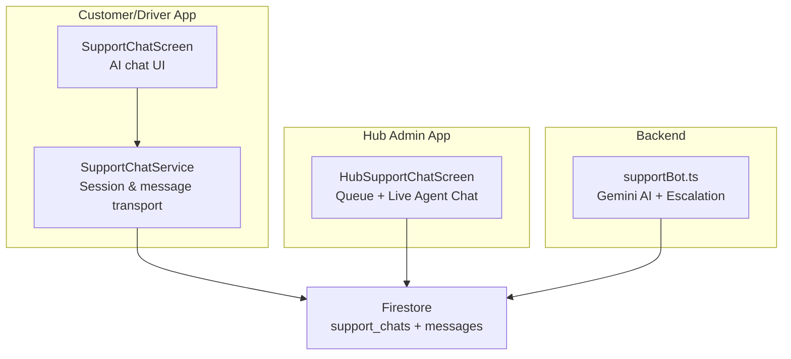
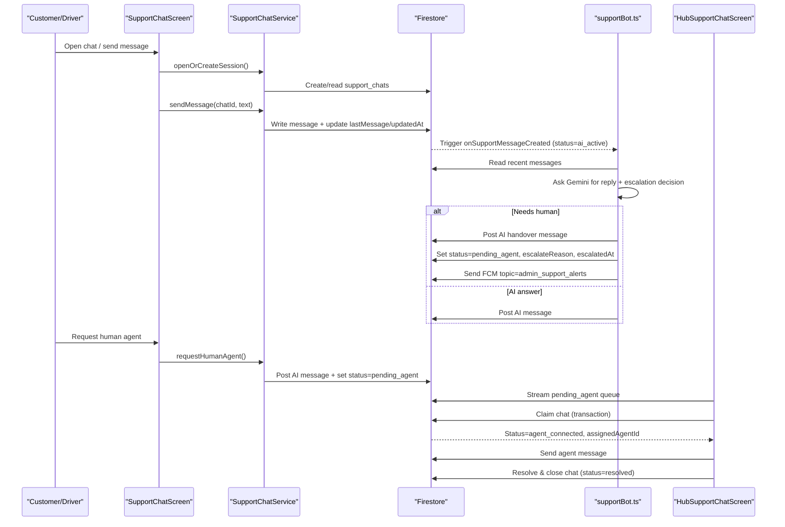
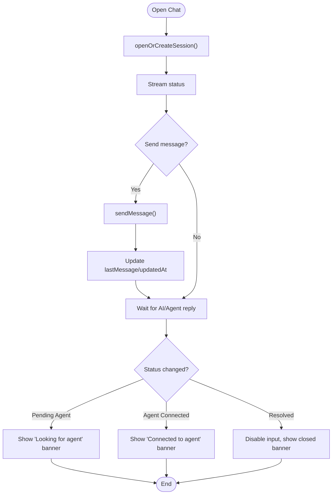
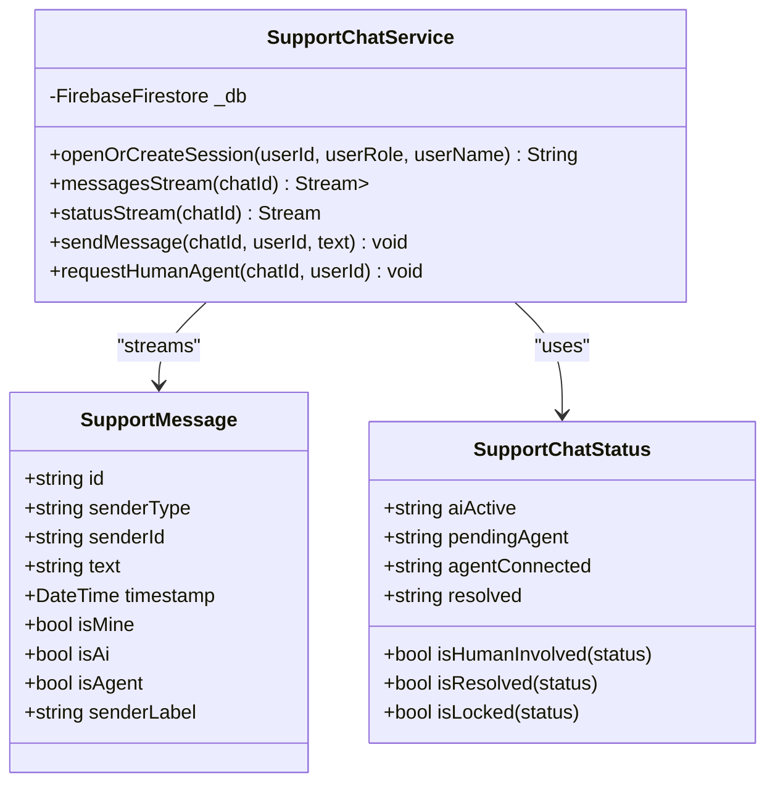
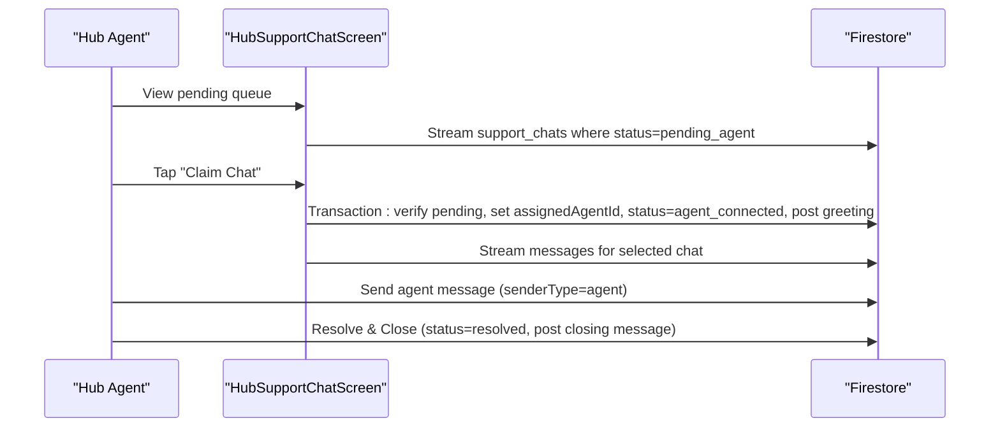
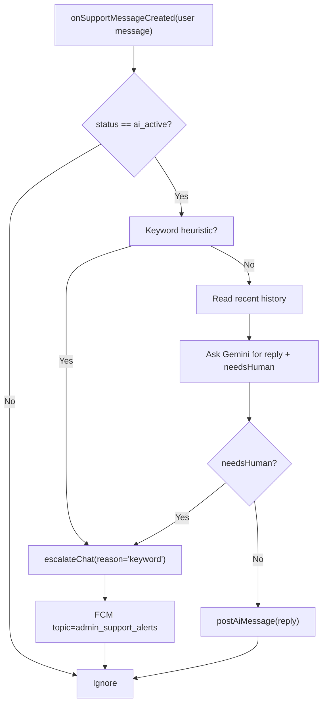
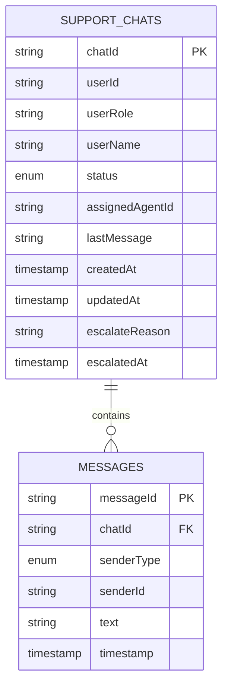
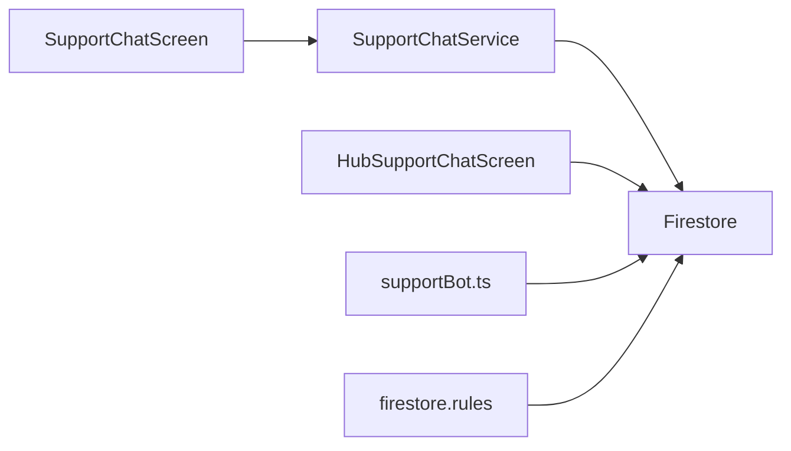

# Administrative Support System

<cite>
**Referenced Files in This Document**   
- [hub_support_chat_screen.dart](file://sese_hub/lib/features/support/hub_support_chat_screen.dart)
- [support_chat_screen.dart](file://sese_ride/lib/features/support/support_chat_screen.dart)
- [support_chat_service.dart](file://sese_ride/lib/features/support/support_chat_service.dart)
- [supportBot.ts](file://functions/src/supportBot.ts)
- [firestore.rules](file://firestore.rules)
</cite>

## Table of Contents
1. [Introduction](#introduction)
2. [Project Structure](#project-structure)
3. [Core Components](#core-components)
4. [Architecture Overview](#architecture-overview)
5. [Detailed Component Analysis](#detailed-component-analysis)
6. [Dependency Analysis](#dependency-analysis)
7. [Performance Considerations](#performance-considerations)
8. [Troubleshooting Guide](#troubleshooting-guide)
9. [Conclusion](#conclusion)

## Introduction
This document explains the administrative support chat system that allows hub staff to interact with customers and drivers through an integrated AI-first support workflow. The system starts with a customer or driver chatting with an AI assistant, escalates to a human agent when needed, and is managed by a live escalation hub for hub staff. It covers:
- Chat interface features for customers, drivers, and hub agents
- Message handling and conversation state management
- Integration with the AI chatbot via Cloud Functions
- Escalation procedures and agent handover
- How administrative actions are logged and tracked within the support workflow

## Project Structure
The support system spans three main areas:
- Customer/driver app (`sese_ride`): AI chat UI and session service
- Hub admin app (`sese_hub`): Live escalation queue, agent claim flow, and live chat thread
- Backend (`functions`): AI response logic, escalation triggers, and push notifications
- Security rules (`firestore.rules`): Access control for chats and messages

**Diagram sources**
- [support_chat_screen.dart:6-12](file://sese_ride/lib/features/support/support_chat_screen.dart#L6-L12)
- [support_chat_service.dart:123-196](file://sese_ride/lib/features/support/support_chat_service.dart#L123-L196)
- [hub_support_chat_screen.dart:8-26](file://sese_hub/lib/features/support/hub_support_chat_screen.dart#L8-L26)
- [supportBot.ts:4-19](file://functions/src/supportBot.ts#L4-L19)

**Section sources**
- [support_chat_screen.dart:6-12](file://sese_ride/lib/features/support/support_chat_screen.dart#L6-L12)
- [hub_support_chat_screen.dart:8-26](file://sese_hub/lib/features/support/hub_support_chat_screen.dart#L8-L26)
- [supportBot.ts:4-19](file://functions/src/supportBot.ts#L4-L19)

## Core Components
- Customer/Driver AI Chat Screen: Provides a chat UI where users can send messages, see AI responses, request a human agent, and observe session status changes.
- Support Chat Service: Encapsulates Firestore operations for opening/resuming sessions, sending messages, streaming messages/status, and escalating to a human agent.
- Hub Support Chat Screen: Provides a real-time queue of pending escalations, first-come-first-served agent claim, live agent messaging, and session resolution.
- AI Support Function: Listens for user messages, calls Gemini for replies and escalation decisions, posts AI messages, escalates to human agents, and sends FCM alerts to admins.
- Firestore Rules: Enforce who can read/write chats and messages, including AI, user, and agent roles.

Key responsibilities:
- Session lifecycle states: `ai_active`, `pending_agent`, `agent_connected`, `resolved`
- Message types: `user`, `ai`, `agent`
- Escalation triggers: explicit keywords, model decision, or client-side escalation
- Audit trail: all actions create messages and update timestamps on the parent chat document

**Section sources**
- [support_chat_screen.dart:6-12](file://sese_ride/lib/features/support/support_chat_screen.dart#L6-L12)
- [support_chat_service.dart:88-108](file://sese_ride/lib/features/support/support_chat_service.dart#L88-L108)
- [hub_support_chat_screen.dart:8-26](file://sese_hub/lib/features/support/hub_support_chat_screen.dart#L8-L26)
- [supportBot.ts:4-19](file://functions/src/supportBot.ts#L4-L19)

## Architecture Overview
The support system uses Firestore as the single source of truth for conversations. The AI function orchestrates automated responses and escalations, while the hub provides a live operational interface for agents.

**Diagram sources**
- [support_chat_screen.dart:51-65](file://sese_ride/lib/features/support/support_chat_screen.dart#L51-L65)
- [support_chat_service.dart:147-196](file://sese_ride/lib/features/support/support_chat_service.dart#L147-L196)
- [support_chat_service.dart:240-284](file://sese_ride/lib/features/support/support_chat_service.dart#L240-L284)
- [support_chat_service.dart:293-334](file://sese_ride/lib/features/support/support_chat_service.dart#L293-L334)
- [supportBot.ts:183-255](file://functions/src/supportBot.ts#L183-L255)
- [hub_support_chat_screen.dart:151-211](file://sese_hub/lib/features/support/hub_support_chat_screen.dart#L151-L211)

## Detailed Component Analysis

### Customer/Driver AI Chat Interface
The customer/driver chat screen manages:
- Opening or resuming a session using the service
- Streaming messages and status updates
- Sending messages and showing typing indicators
- Displaying status banners for pending agent, connected agent, and resolved states
- Providing a “Connect to Human Agent” action during AI handling

Important behaviors:
- Input is disabled when the session is resolved
- A status banner informs users about escalation and connection states
- The UI reacts to status transitions from Firestore streams

**Diagram sources**
- [support_chat_screen.dart:51-65](file://sese_ride/lib/features/support/support_chat_screen.dart#L51-L65)
- [support_chat_screen.dart:117-140](file://sese_ride/lib/features/support/support_chat_screen.dart#L117-L140)
- [support_chat_screen.dart:209-246](file://sese_ride/lib/features/support/support_chat_screen.dart#L209-L246)
- [support_chat_screen.dart:307-377](file://sese_ride/lib/features/support/support_chat_screen.dart#L307-L377)

**Section sources**
- [support_chat_screen.dart:6-12](file://sese_ride/lib/features/support/support_chat_screen.dart#L6-L12)
- [support_chat_screen.dart:51-65](file://sese_ride/lib/features/support/support_chat_screen.dart#L51-L65)
- [support_chat_screen.dart:117-140](file://sese_ride/lib/features/support/support_chat_screen.dart#L117-L140)
- [support_chat_screen.dart:209-246](file://sese_ride/lib/features/support/support_chat_screen.dart#L209-L246)
- [support_chat_screen.dart:307-377](file://sese_ride/lib/features/support/support_chat_screen.dart#L307-L377)

### Support Chat Service (Transport Layer)
Responsibilities:
- Open or resume active sessions for a user
- Stream messages and status
- Send user messages atomically with metadata
- Escalate to a human agent by posting an AI message and setting status to `pending_agent`
- Provide typed models and exceptions for robust error handling

Data model highlights:
- `SupportMessage`: normalized sender type (`user`, `ai`, `agent`) and ID
- `SupportChatStatus`: lifecycle constants and helpers (`isHumanInvolved`, `isResolved`, `isLocked`)

**Diagram sources**
- [support_chat_service.dart:8-82](file://sese_ride/lib/features/support/support_chat_service.dart#L8-L82)
- [support_chat_service.dart:88-108](file://sese_ride/lib/features/support/support_chat_service.dart#L88-L108)
- [support_chat_service.dart:128-196](file://sese_ride/lib/features/support/support_chat_service.dart#L128-L196)
- [support_chat_service.dart:202-284](file://sese_ride/lib/features/support/support_chat_service.dart#L202-L284)
- [support_chat_service.dart:293-334](file://sese_ride/lib/features/support/support_chat_service.dart#L293-L334)

**Section sources**
- [support_chat_service.dart:8-82](file://sese_ride/lib/features/support/support_chat_service.dart#L8-L82)
- [support_chat_service.dart:88-108](file://sese_ride/lib/features/support/support_chat_service.dart#L88-L108)
- [support_chat_service.dart:128-196](file://sese_ride/lib/features/support/support_chat_service.dart#L128-L196)
- [support_chat_service.dart:202-284](file://sese_ride/lib/features/support/support_chat_service.dart#L202-L284)
- [support_chat_service.dart:293-334](file://sese_ride/lib/features/support/support_chat_service.dart#L293-L334)

### Hub Support Chat Screen (Admin Live Escalation Hub)
Features:
- Real-time queue of pending escalations (`status == pending_agent`)
- First-come-first-served claim system using a Firestore transaction
- Live chat thread with distinct styling for user/AI/agent messages
- Resolve and close chat functionality that locks inputs

Operational flow:
- Agents view pending tickets and click “Claim Chat”
- Transaction verifies ticket is still pending, assigns current admin UID, sets status to `agent_connected`, and posts a greeting message
- Agent sends replies; both sides see messages in real time
- Agent resolves the session, which sets status to `resolved` and archives the conversation

**Diagram sources**
- [hub_support_chat_screen.dart:100-122](file://sese_hub/lib/features/support/hub_support_chat_screen.dart#L100-L122)
- [hub_support_chat_screen.dart:151-211](file://sese_hub/lib/features/support/hub_support_chat_screen.dart#L151-L211)
- [hub_support_chat_screen.dart:233-270](file://sese_hub/lib/features/support/hub_support_chat_screen.dart#L233-L270)
- [hub_support_chat_screen.dart:272-337](file://sese_hub/lib/features/support/hub_support_chat_screen.dart#L272-L337)

**Section sources**
- [hub_support_chat_screen.dart:8-26](file://sese_hub/lib/features/support/hub_support_chat_screen.dart#L8-L26)
- [hub_support_chat_screen.dart:100-122](file://sese_hub/lib/features/support/hub_support_chat_screen.dart#L100-L122)
- [hub_support_chat_screen.dart:151-211](file://sese_hub/lib/features/support/hub_support_chat_screen.dart#L151-L211)
- [hub_support_chat_screen.dart:233-270](file://sese_hub/lib/features/support/hub_support_chat_screen.dart#L233-L270)
- [hub_support_chat_screen.dart:272-337](file://sese_hub/lib/features/support/hub_support_chat_screen.dart#L272-L337)

### AI Chatbot Integration (Cloud Function)
The backend function:
- Triggers on new user messages when the chat status is `ai_active`
- Calls Gemini to generate a reply and decide if escalation is needed
- Posts AI messages to the chat
- Escalates to human agents by setting status to `pending_agent`, recording escalation reason and timestamp, and sending FCM alerts to the `admin_support_alerts` topic

Escalation paths:
- Heuristic keyword detection (e.g., accident, police, money missing)
- Model decision (`needsHuman: true`)
- Client-side escalation via the service

**Diagram sources**
- [supportBot.ts:183-255](file://functions/src/supportBot.ts#L183-L255)
- [supportBot.ts:117-177](file://functions/src/supportBot.ts#L117-L177)

**Section sources**
- [supportBot.ts:4-19](file://functions/src/supportBot.ts#L4-L19)
- [supportBot.ts:56-79](file://functions/src/supportBot.ts#L56-L79)
- [supportBot.ts:117-177](file://functions/src/supportBot.ts#L117-L177)
- [supportBot.ts:183-255](file://functions/src/supportBot.ts#L183-L255)

### Data Model and Security Rules
Firestore structure:
- Collection: `support_chats/{chatId}`
  - Fields include: `userId`, `userRole`, `userName`, `status`, `assignedAgentId`, `lastMessage`, `updatedAt`, `createdAt`, plus escalation metadata like `escalateReason` and `escalatedAt`
- Subcollection: `support_chats/{chatId}/messages/{messageId}`
  - Fields include: `senderType` (`user`, `ai`, `agent`), `senderId`, `text`, `timestamp`

Security rules enforce:
- Only authenticated, non-suspended users can create chats with allowed statuses and roles
- Users can update their own chat status only in allowed transitions
- Messages are immutable after creation
- Participants (user or assigned agent) can read/write messages according to sender type
- Admins have elevated access for support operations

**Diagram sources**
- [firestore.rules:667-703](file://firestore.rules#L667-L703)

**Section sources**
- [firestore.rules:667-703](file://firestore.rules#L667-L703)

## Dependency Analysis
Component relationships:
- `SupportChatScreen` depends on `SupportChatService` for data operations
- `SupportChatService` interacts with Firestore collections and documents
- `HubSupportChatScreen` directly reads/writes Firestore for queue, claim, messaging, and resolution
- `supportBot.ts` listens to Firestore events and writes back AI messages and escalation state
- Firestore rules govern access across all components

**Diagram sources**
- [support_chat_screen.dart:1-5](file://sese_ride/lib/features/support/support_chat_screen.dart#L1-L5)
- [support_chat_service.dart:128-196](file://sese_ride/lib/features/support/support_chat_service.dart#L128-L196)
- [hub_support_chat_screen.dart:1-7](file://sese_hub/lib/features/support/hub_support_chat_screen.dart#L1-L7)
- [supportBot.ts:1-3](file://functions/src/supportBot.ts#L1-L3)
- [firestore.rules:667-703](file://firestore.rules#L667-L703)

**Section sources**
- [support_chat_screen.dart:1-5](file://sese_ride/lib/features/support/support_chat_screen.dart#L1-L5)
- [support_chat_service.dart:128-196](file://sese_ride/lib/features/support/support_chat_service.dart#L128-L196)
- [hub_support_chat_screen.dart:1-7](file://sese_hub/lib/features/support/hub_support_chat_screen.dart#L1-L7)
- [supportBot.ts:1-3](file://functions/src/supportBot.ts#L1-L3)
- [firestore.rules:667-703](file://firestore.rules#L667-L703)

## Performance Considerations
- Real-time streams: Both customer/driver and hub apps use Firestore snapshots for messages and status. Ensure indexes exist for queries such as ordering by `timestamp` and filtering by `status`.
- Batched writes: Messaging and escalation use batched writes to keep chat metadata consistent with message history.
- Scroll performance: Large message lists benefit from efficient list builders and avoiding unnecessary rebuilds.
- AI latency: Gemini calls introduce latency; the UI shows typing indicators and fallback messages to maintain responsiveness.
- Queue sorting: Pending and active queues sort by `updatedAt`/`createdAt` in memory; consider server-side sorting if datasets grow significantly.

[No sources needed since this section provides general guidance]

## Troubleshooting Guide
Common issues and resolutions:
- Chat fails to open:
  - Verify authentication and network connectivity
  - Check that the service returns a valid chat ID
- Escalation not appearing in hub:
  - Confirm status transitioned to `pending_agent`
  - Ensure FCM alerts are configured and subscribed to `admin_support_alerts`
- Agent cannot claim chat:
  - Transaction may fail if another agent claimed it first
  - Validate that the chat is still `pending_agent`
- Messages not visible:
  - Check Firestore rules for participant permissions
  - Ensure `senderType` matches expected values (`user`, `ai`, `agent`)
- Resolved chat still editable:
  - Verify status is `resolved`; input should be locked on both ends

Operational checks:
- Inspect chat document fields: `status`, `assignedAgentId`, `lastMessage`, `updatedAt`, `escalateReason`, `escalatedAt`
- Review message subcollection for correct sender types and timestamps
- Monitor FCM delivery logs for escalation alerts

**Section sources**
- [support_chat_service.dart:147-196](file://sese_ride/lib/features/support/support_chat_service.dart#L147-L196)
- [support_chat_service.dart:293-334](file://sese_ride/lib/features/support/support_chat_service.dart#L293-L334)
- [hub_support_chat_screen.dart:151-211](file://sese_hub/lib/features/support/hub_support_chat_screen.dart#L151-L211)
- [supportBot.ts:140-177](file://functions/src/supportBot.ts#L140-L177)
- [firestore.rules:667-703](file://firestore.rules#L667-L703)

## Conclusion
The administrative support system provides a robust, secure, and scalable workflow for handling customer and driver inquiries. It begins with AI assistance, seamlessly escalates to human agents when necessary, and gives hub staff a live dashboard to manage queues, claim chats, communicate in real time, and resolve sessions. All interactions are recorded in Firestore with clear ownership and auditability, ensuring transparency and accountability throughout the support lifecycle.

[No sources needed since this section summarizes without analyzing specific files]