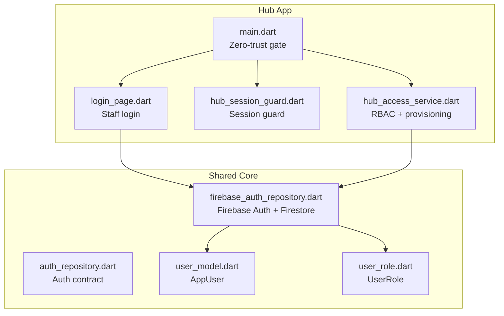
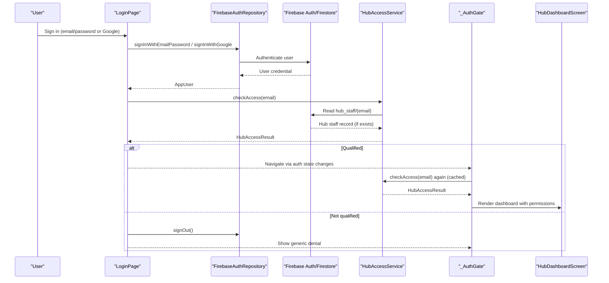
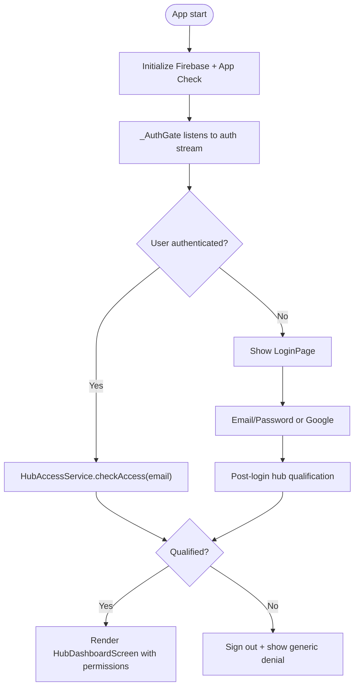
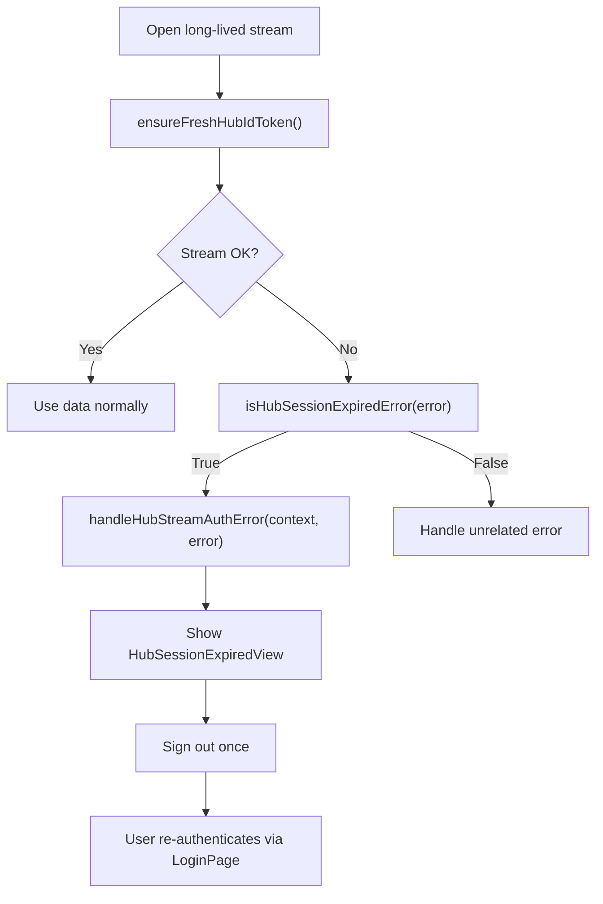
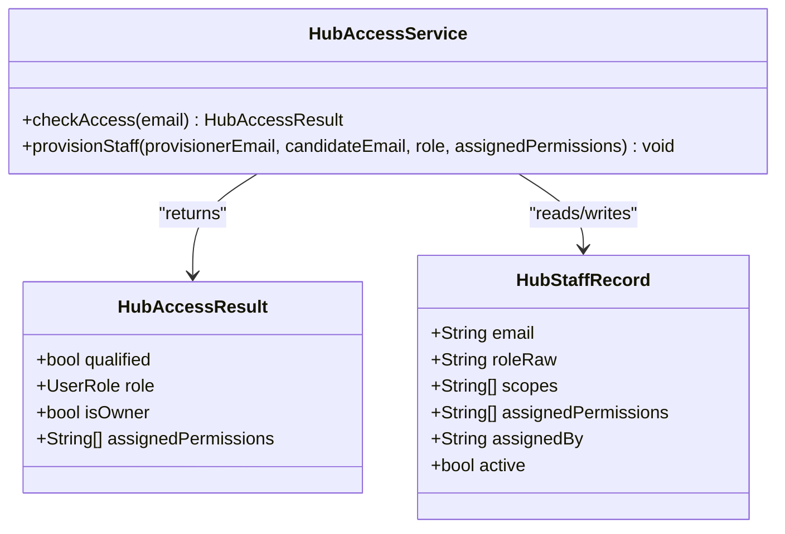
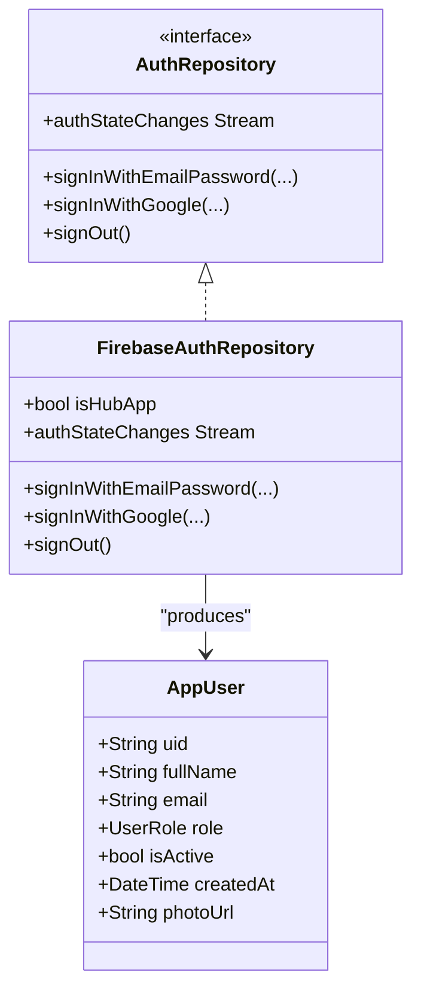
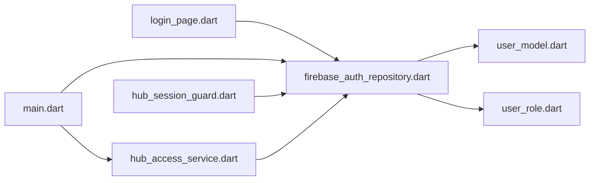

# Hub Authentication & Authorization

<cite>
**Referenced Files in This Document**
- [main.dart](file://sese_hub/lib/main.dart)
- [login_page.dart](file://sese_hub/lib/features/auth/login_page.dart)
- [hub_session_guard.dart](file://sese_hub/lib/features/auth/hub_session_guard.dart)
- [hub_access_service.dart](file://sese_hub/lib/features/staff/services/hub_access_service.dart)
- [auth_repository.dart](file://sese_core/lib/auth/auth_repository.dart)
- [firebase_auth_repository.dart](file://sese_core/lib/auth/firebase_auth_repository.dart)
- [user_model.dart](file://sese_core/lib/models/user_model.dart)
- [user_role.dart](file://sese_core/lib/models/user_role.dart)
</cite>

## Table of Contents
1. [Introduction](#introduction)
2. [Project Structure](#project-structure)
3. [Core Components](#core-components)
4. [Architecture Overview](#architecture-overview)
5. [Detailed Component Analysis](#detailed-component-analysis)
6. [Dependency Analysis](#dependency-analysis)
7. [Performance Considerations](#performance-considerations)
8. [Troubleshooting Guide](#troubleshooting-guide)
9. [Conclusion](#conclusion)

## Introduction
This document explains the Sese Hub authentication and authorization system. It covers:
- The hub-specific login flow for staff using email/password or Google OAuth.
- Session management, including token refresh, session expiration handling, and logout behavior.
- Security guards that protect administrative features from unauthorized access.
- Role-based access control (RBAC), permission levels, and role-based UI rendering.
- How the hub app integrates with the shared authentication repository while maintaining admin-only access patterns.
- Session persistence, logout handling, and security best practices for administrative applications.

## Project Structure
The hub application is a Flutter app that shares core authentication logic with other apps through a common repository. The key files are:
- Hub entry point and zero-trust gate: `sese_hub/lib/main.dart`
- Staff login screen: `sese_hub/lib/features/auth/login_page.dart`
- Session guard utilities: `sese_hub/lib/features/auth/hub_session_guard.dart`
- Hub RBAC and staff provisioning: `sese_hub/lib/features/staff/services/hub_access_service.dart`
- Shared auth contract and implementation: `sese_core/lib/auth/auth_repository.dart`, `sese_core/lib/auth/firebase_auth_repository.dart`
- Shared user model and roles: `sese_core/lib/models/user_model.dart`, `sese_core/lib/models/user_role.dart`

**Diagram sources**
- [main.dart:13-38](file://sese_hub/lib/main.dart#L13-L38)
- [login_page.dart:1-20](file://sese_hub/lib/features/auth/login_page.dart#L1-L20)
- [hub_session_guard.dart:1-20](file://sese_hub/lib/features/auth/hub_session_guard.dart#L1-L20)
- [hub_access_service.dart:1-33](file://sese_hub/lib/features/staff/services/hub_access_service.dart#L1-L33)
- [auth_repository.dart:1-10](file://sese_core/lib/auth/auth_repository.dart#L1-L10)
- [firebase_auth_repository.dart:11-20](file://sese_core/lib/auth/firebase_auth_repository.dart#L11-L20)
- [user_model.dart:1-10](file://sese_core/lib/models/user_model.dart#L1-L10)
- [user_role.dart:1-11](file://sese_core/lib/models/user_role.dart#L1-L11)

**Section sources**
- [main.dart:13-38](file://sese_hub/lib/main.dart#L13-L38)
- [auth_repository.dart:1-10](file://sese_core/lib/auth/auth_repository.dart#L1-L10)

## Core Components
- Zero-trust hub gate: Ensures only qualified staff can enter the hub after sign-in. Unqualified users are signed out and shown a generic denial without leaking role information.
- Staff login page: Supports email/password and Google OAuth. Performs a silent post-login qualification check against hub staff records.
- Session guard: Prevents infinite retry loops caused by stale Firebase ID tokens on long-lived streams. Provides helpers to detect expired sessions and render an appropriate notice.
- Hub access service: Implements hub-specific RBAC, module permissions, tab visibility, and staff provisioning. Enforces owner-only provisioning and strips sensitive permissions for non-super roles.
- Shared auth repository: Provides a unified interface for authentication across apps. In hub mode, it also resolves hub staff roles via custom claims and admin documents when available.

**Section sources**
- [main.dart:87-197](file://sese_hub/lib/main.dart#L87-L197)
- [login_page.dart:6-11](file://sese_hub/lib/features/auth/login_page.dart#L6-L11)
- [hub_session_guard.dart:5-20](file://sese_hub/lib/features/auth/hub_session_guard.dart#L5-L20)
- [hub_access_service.dart:6-33](file://sese_hub/lib/features/staff/services/hub_access_service.dart#L6-L33)
- [auth_repository.dart:4-10](file://sese_core/lib/auth/auth_repository.dart#L4-L10)

## Architecture Overview
The hub uses a layered approach:
- Presentation layer: Login page and dashboard shell.
- Gate layer: `_AuthGate` enforces authentication and hub qualification before any feature is exposed.
- Access control layer: `HubAccessService` checks hub staff records and computes effective permissions.
- Session protection layer: `HubSessionGuard` ensures stream listeners do not hang due to stale credentials.
- Shared identity layer: `FirebaseAuthRepository` handles Firebase Auth flows and maps identities to `AppUser`.

**Diagram sources**
- [login_page.dart:87-123](file://sese_hub/lib/features/auth/login_page.dart#L87-L123)
- [firebase_auth_repository.dart:98-122](file://sese_core/lib/auth/firebase_auth_repository.dart#L98-L122)
- [hub_access_service.dart:233-284](file://sese_hub/lib/features/staff/services/hub_access_service.dart#L233-L284)
- [main.dart:131-197](file://sese_hub/lib/main.dart#L131-L197)

## Detailed Component Analysis

### Hub Login Flow and Zero-Trust Gate
- The hub initializes Firebase and activates App Check to enforce backend security rules.
- `_AuthGate` listens to the shared auth stream:
  - If no user is present, it shows the login page.
  - If a user is present, it performs a silent hub staff qualification check.
  - Qualified users receive the dashboard with their effective permissions; unqualified users are signed out and shown a generic denial.
- The login page supports both email/password and Google OAuth. After successful sign-in, it calls the hub access service to verify hub eligibility.

**Diagram sources**
- [main.dart:13-38](file://sese_hub/lib/main.dart#L13-L38)
- [main.dart:87-197](file://sese_hub/lib/main.dart#L87-L197)
- [login_page.dart:87-123](file://sese_hub/lib/features/auth/login_page.dart#L87-L123)
- [hub_access_service.dart:233-284](file://sese_hub/lib/features/staff/services/hub_access_service.dart#L233-L284)

**Section sources**
- [main.dart:13-38](file://sese_hub/lib/main.dart#L13-L38)
- [main.dart:87-197](file://sese_hub/lib/main.dart#L87-L197)
- [login_page.dart:87-123](file://sese_hub/lib/features/auth/login_page.dart#L87-L123)

### Session Management and Security Guards
- Stale Firebase ID tokens can cause Firestore watch streams to fail repeatedly with UNAUTHENTICATED errors.
- `ensureFreshHubIdToken` forces a server round-trip to refresh the ID token before opening long-lived streams.
- `isHubSessionExpiredError` detects session-expired errors (UNAUTHENTICATED or PERMISSION_DENIED).
- `handleHubStreamAuthError` signs the user out and shows a snackbar when a session error occurs.
- `HubSessionExpiredView` renders a full-area notice and triggers a one-time sign-out, then routes back to the login page via the auth stream.

**Diagram sources**
- [hub_session_guard.dart:21-38](file://sese_hub/lib/features/auth/hub_session_guard.dart#L21-L38)
- [hub_session_guard.dart:43-62](file://sese_hub/lib/features/auth/hub_session_guard.dart#L43-L62)
- [hub_session_guard.dart:68-85](file://sese_hub/lib/features/auth/hub_session_guard.dart#L68-L85)
- [hub_session_guard.dart:103-175](file://sese_hub/lib/features/auth/hub_session_guard.dart#L103-L175)

**Section sources**
- [hub_session_guard.dart:21-38](file://sese_hub/lib/features/auth/hub_session_guard.dart#L21-L38)
- [hub_session_guard.dart:43-62](file://sese_hub/lib/features/auth/hub_session_guard.dart#L43-L62)
- [hub_session_guard.dart:68-85](file://sese_hub/lib/features/auth/hub_session_guard.dart#L68-L85)
- [hub_session_guard.dart:103-175](file://sese_hub/lib/features/auth/hub_session_guard.dart#L103-L175)

### Hub RBAC, Permissions, and UI Rendering
- Hub roles: Super, Admin, Agent.
- Module permissions: Fleet & Security, Dynamic Config, Staff Management, Support Inbox.
- Owner bootstrap: A hardcoded primary owner email has permanent Super authority and full module access.
- Staff records: Stored under `hub_staff/{email}` with fields such as role, assignedPermissions, active status, and assignment metadata.
- Visibility rules:
  - Owner sees all tabs.
  - Super sees all module tabs; Staff tab additionally requires explicit staff_manage permission.
  - Other staff see only tabs corresponding to their assignedPermissions; Profile is always visible.
- Tab computation is centralized in `visibleTabs`, which drives the navigation rail and bottom bar.

**Diagram sources**
- [hub_access_service.dart:120-167](file://sese_hub/lib/features/staff/services/hub_access_service.dart#L120-L167)
- [hub_access_service.dart:169-207](file://sese_hub/lib/features/staff/services/hub_access_service.dart#L169-L207)
- [hub_access_service.dart:214-284](file://sese_hub/lib/features/staff/services/hub_access_service.dart#L214-L284)
- [hub_access_service.dart:294-332](file://sese_hub/lib/features/staff/services/hub_access_service.dart#L294-L332)

**Section sources**
- [hub_access_service.dart:6-33](file://sese_hub/lib/features/staff/services/hub_access_service.dart#L6-L33)
- [hub_access_service.dart:57-83](file://sese_hub/lib/features/staff/services/hub_access_service.dart#L57-L83)
- [hub_access_service.dart:120-167](file://sese_hub/lib/features/staff/services/hub_access_service.dart#L120-L167)
- [hub_access_service.dart:214-284](file://sese_hub/lib/features/staff/services/hub_access_service.dart#L214-L284)
- [hub_access_service.dart:294-332](file://sese_hub/lib/features/staff/services/hub_access_service.dart#L294-L332)

### Integration with Shared Authentication Repository
- The hub constructs `FirebaseAuthRepository(isHubApp: true)` to enable hub-specific behaviors:
  - Resolves hub staff roles from custom claims and admin documents when available.
  - Skips admin lookups in non-hub apps to avoid unnecessary permission denials.
- The shared `AppUser` model carries role and profile data used across apps.
- The hub’s `_AuthGate` uses the shared auth stream to react to sign-in/sign-out events and route accordingly.

**Diagram sources**
- [auth_repository.dart:4-81](file://sese_core/lib/auth/auth_repository.dart#L4-L81)
- [firebase_auth_repository.dart:20-54](file://sese_core/lib/auth/firebase_auth_repository.dart#L20-L54)
- [firebase_auth_repository.dart:82-95](file://sese_core/lib/auth/firebase_auth_repository.dart#L82-L95)
- [firebase_auth_repository.dart:490-503](file://sese_core/lib/auth/firebase_auth_repository.dart#L490-L503)
- [user_model.dart:1-30](file://sese_core/lib/models/user_model.dart#L1-L30)

**Section sources**
- [main.dart:103-113](file://sese_hub/lib/main.dart#L103-L113)
- [firebase_auth_repository.dart:31-36](file://sese_core/lib/auth/firebase_auth_repository.dart#L31-L36)
- [firebase_auth_repository.dart:519-671](file://sese_core/lib/auth/firebase_auth_repository.dart#L519-L671)
- [user_model.dart:1-30](file://sese_core/lib/models/user_model.dart#L1-L30)

## Dependency Analysis
- Hub presentation depends on shared auth repository for authentication state and user identity.
- Hub access service depends on Firestore for hub staff records and on Firebase Auth for current user context.
- Session guard depends on Firebase Auth exceptions and the shared repository for consistent sign-out behavior.
- Shared repository abstracts platform differences and centralizes role resolution logic.

**Diagram sources**
- [login_page.dart:1-5](file://sese_hub/lib/features/auth/login_page.dart#L1-L5)
- [main.dart:1-11](file://sese_hub/lib/main.dart#L1-L11)
- [hub_session_guard.dart:1-4](file://sese_hub/lib/features/auth/hub_session_guard.dart#L1-L4)
- [hub_access_service.dart:1-4](file://sese_hub/lib/features/staff/services/hub_access_service.dart#L1-L4)
- [firebase_auth_repository.dart:1-10](file://sese_core/lib/auth/firebase_auth_repository.dart#L1-L10)
- [user_model.dart:1-3](file://sese_core/lib/models/user_model.dart#L1-L3)
- [user_role.dart:1-11](file://sese_core/lib/models/user_role.dart#L1-L11)

**Section sources**
- [main.dart:1-11](file://sese_hub/lib/main.dart#L1-L11)
- [hub_access_service.dart:1-4](file://sese_hub/lib/features/staff/services/hub_access_service.dart#L1-L4)
- [hub_session_guard.dart:1-4](file://sese_hub/lib/features/auth/hub_session_guard.dart#L1-L4)
- [firebase_auth_repository.dart:1-10](file://sese_core/lib/auth/firebase_auth_repository.dart#L1-L10)

## Performance Considerations
- Token refresh before stream creation reduces repeated UNAUTHENTICATED failures and improves responsiveness.
- Caching hub access checks per email avoids redundant Firestore reads during a single session.
- Avoiding admin collection reads in non-hub apps prevents unnecessary permission denials and network overhead.
- Using a single permission-filtered tab set simplifies UI rendering and reduces conditional complexity.

[No sources needed since this section provides general guidance]

## Troubleshooting Guide
Common issues and resolutions:
- Infinite UNAUTHENTICATED retries on live streams:
  - Ensure `ensureFreshHubIdToken()` is called before opening long-lived streams.
  - In stream error branches, check `isHubSessionExpiredError` and render `HubSessionExpiredView`.
- Generic “Access Denied” after login:
  - Indicates the account is not qualified in hub staff records or lacks active permissions.
  - Confirm the email exists in `hub_staff` with a valid role and active status.
- Google sign-in failures:
  - Error 10 indicates build registration mismatch; rebuild and ensure signing certificate is added in Firebase console.
  - Network errors require Play Services connectivity; fallback to email sign-in if necessary.
- Logout behavior:
  - Hub sign-out clears cached Google accounts and Firebase sessions to force re-authentication on next attempt.

**Section sources**
- [hub_session_guard.dart:21-38](file://sese_hub/lib/features/auth/hub_session_guard.dart#L21-L38)
- [hub_session_guard.dart:43-62](file://sese_hub/lib/features/auth/hub_session_guard.dart#L43-L62)
- [hub_session_guard.dart:68-85](file://sese_hub/lib/features/auth/hub_session_guard.dart#L68-L85)
- [login_page.dart:125-154](file://sese_hub/lib/features/auth/login_page.dart#L125-L154)
- [hub_access_service.dart:233-284](file://sese_hub/lib/features/staff/services/hub_access_service.dart#L233-L284)

## Conclusion
Sese Hub implements a secure, zero-trust authentication and authorization model tailored for staff operations:
- Login is gated by hub staff qualification, preventing unauthorized access even if Firebase Auth succeeds.
- Session guards protect long-lived streams from stale credentials and provide clear recovery paths.
- RBAC is enforced through hub staff records and module permissions, with owner-only provisioning and strict permission filtering.
- The hub integrates cleanly with the shared authentication repository while preserving admin-only access patterns.
Following the recommended practices—token refresh, guarded streams, minimal role leakage, and strict permission checks—ensures a robust administrative experience.

[No sources needed since this section summarizes without analyzing specific files]