# Sese Hub Admin App

<cite>
**Referenced Files in This Document**   
- [main.dart](file://sese_hub/lib/main.dart)
- [login_page.dart](file://sese_hub/lib/features/auth/login_page.dart)
- [hub_session_guard.dart](file://sese_hub/lib/features/auth/hub_session_guard.dart)
- [hub_dashboard_screen.dart](file://sese_hub/lib/features/dashboard/presentation/hub_dashboard_screen.dart)
- [system_config_service.dart](file://sese_hub/lib/features/config/services/system_config_service.dart)
- [global_config_screen.dart](file://sese_hub/lib/features/config/presentation/global_config_screen.dart)
- [staff_management_screen.dart](file://sese_hub/lib/features/staff/presentation/staff_management_screen.dart)
- [hub_access_service.dart](file://sese_hub/lib/features/staff/services/hub_access_service.dart)
- [vehicle_approvals_screen.dart](file://sese_hub/lib/features/verification/presentation/vehicle_approvals_screen.dart)
- [hub_support_chat_screen.dart](file://sese_hub/lib/features/support/hub_support_chat_screen.dart)
- [firebase_auth_repository.dart](file://sese_core/lib/auth/firebase_auth_repository.dart)
- [user_role.dart](file://sese_core/lib/models/user_role.dart)
- [config_resolution_engine.dart](file://sese_core/lib/services/config_resolution_engine.dart)
- [firestore.rules](file://firestore.rules)
</cite>

## Table of Contents
1. [Introduction](#introduction)
2. [Project Structure](#project-structure)
3. [Core Components](#core-components)
4. [Architecture Overview](#architecture-overview)
5. [Detailed Component Analysis](#detailed-component-analysis)
6. [Dependency Analysis](#dependency-analysis)
7. [Performance Considerations](#performance-considerations)
8. [Troubleshooting Guide](#troubleshooting-guide)
9. [Conclusion](#conclusion)

## Introduction
Sese Hub is the administrative application for operations staff and system administrators. It provides a unified, permission-gated console for fleet verification, support escalation, dynamic system configuration, and staff provisioning. The app integrates with Firebase Authentication, Firestore, and App Check, and shares core models and services through the `sese_core` library.

Key capabilities covered by this document:
- Hub-specific authentication and authorization flow
- Role-based access control (RBAC) and module permissions
- Administrative UI shell and tab visibility rules
- User verification workflows for vehicles, drivers, and customers
- System configuration management with regional fallback resolution
- Live support chat queue and session handling
- Session guard against stale tokens and stream retry loops
- Integration points with shared business logic in `sese_core`

## Project Structure
The hub app is organized by feature under `sese_hub/lib/features`, with a top-level entry point that initializes Firebase, enforces App Check, primes country detection, and mounts the zero-trust auth gate.

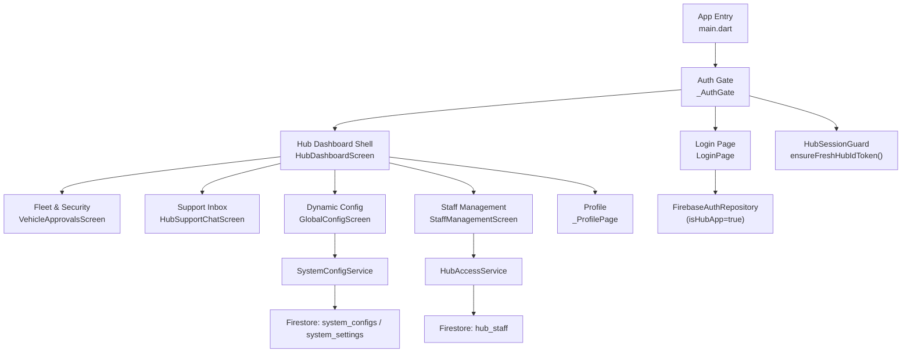

**Diagram sources**
- [main.dart:13-37](file://sese_hub/lib/main.dart#L13-L37)
- [main.dart:87-196](file://sese_hub/lib/main.dart#L87-L196)
- [login_page.dart:1-277](file://sese_hub/lib/features/auth/login_page.dart#L1-L277)
- [hub_dashboard_screen.dart:10-250](file://sese_hub/lib/features/dashboard/presentation/hub_dashboard_screen.dart#L10-L250)
- [system_config_service.dart:5-180](file://sese_hub/lib/features/config/services/system_config_service.dart#L5-L180)
- [hub_access_service.dart:209-333](file://sese_hub/lib/features/staff/services/hub_access_service.dart#L209-L333)
- [hub_session_guard.dart:21-38](file://sese_hub/lib/features/auth/hub_session_guard.dart#L21-L38)

**Section sources**
- [main.dart:13-37](file://sese_hub/lib/main.dart#L13-L37)
- [pubspec.yaml](file://sese_hub/pubspec.yaml)

## Core Components
- Zero-trust auth gate: routes unauthenticated users to login; performs silent hub qualification and role-scoped dashboard routing.
- Login page: supports email/password and Google OAuth; enforces hub qualification after sign-in without leaking roles.
- Hub dashboard shell: single navigation surface whose tabs are filtered by role, owner status, and assigned permissions.
- Staff provisioning: owner-only console to provision new staff with explicit module permissions.
- Fleet verification desk: pending vehicle approvals, live camera audit logs, driver profiles, and customer approvals.
- Dynamic configuration editor: regional scoping, pricing engine, car tiering, streak rewards, daily commission settings, and bid visibility.
- Support inbox: live queue, claim workflow, message thread, and session closure.
- Session guard: prevents Firestore WatchStream UNAUTHENTICATED retry loops by refreshing ID tokens and handling expired sessions.

**Section sources**
- [main.dart:87-196](file://sese_hub/lib/main.dart#L87-L196)
- [login_page.dart:1-277](file://sese_hub/lib/features/auth/login_page.dart#L1-L277)
- [hub_dashboard_screen.dart:10-250](file://sese_hub/lib/features/dashboard/presentation/hub_dashboard_screen.dart#L10-L250)
- [staff_management_screen.dart:1-403](file://sese_hub/lib/features/staff/presentation/staff_management_screen.dart#L1-L403)
- [vehicle_approvals_screen.dart:1-716](file://sese_hub/lib/features/verification/presentation/vehicle_approvals_screen.dart#L1-L716)
- [global_config_screen.dart:1-800](file://sese_hub/lib/features/config/presentation/global_config_screen.dart#L1-L800)
- [hub_support_chat_screen.dart:1-800](file://sese_hub/lib/features/support/hub_support_chat_screen.dart#L1-L800)
- [hub_session_guard.dart:1-176](file://sese_hub/lib/features/auth/hub_session_guard.dart#L1-L176)

## Architecture Overview
The hub uses a layered architecture:
- Presentation layer: Flutter screens and widgets for admin consoles.
- Service layer: `SystemConfigService`, `HubAccessService`, and repository abstractions.
- Data layer: Firestore collections (`hub_staff`, `system_configs`, `system_settings`, `support_chats`, etc.).
- Shared core: `sese_core` provides user roles, auth repository, config resolution engine, and domain models.

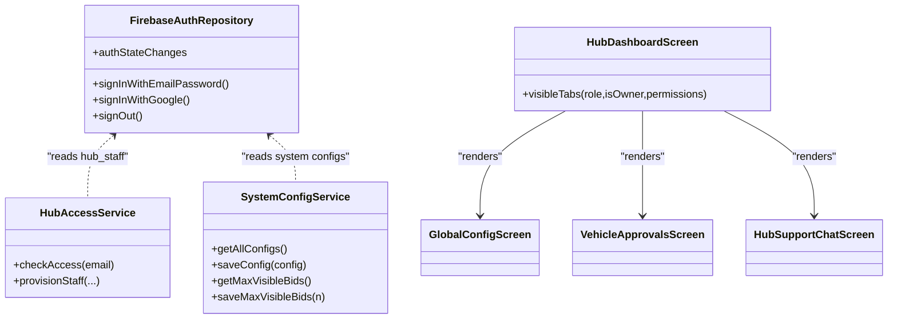

**Diagram sources**
- [firebase_auth_repository.dart:20-122](file://sese_core/lib/auth/firebase_auth_repository.dart#L20-L122)
- [hub_access_service.dart:209-333](file://sese_hub/lib/features/staff/services/hub_access_service.dart#L209-L333)
- [system_config_service.dart:5-180](file://sese_hub/lib/features/config/services/system_config_service.dart#L5-L180)
- [hub_dashboard_screen.dart:10-250](file://sese_hub/lib/features/dashboard/presentation/hub_dashboard_screen.dart#L10-L250)
- [vehicle_approvals_screen.dart:1-259](file://sese_hub/lib/features/verification/presentation/vehicle_approvals_screen.dart#L1-L259)
- [hub_support_chat_screen.dart:1-146](file://sese_hub/lib/features/support/hub_support_chat_screen.dart#L1-L146)
- [global_config_screen.dart:1-130](file://sese_hub/lib/features/config/presentation/global_config_screen.dart#L1-L130)

## Detailed Component Analysis

### Authentication and Authorization Flow
- App initialization enables Firebase App Check and primes country detection.
- `_AuthGate` listens to auth state changes:
  - Unauthenticated -> `LoginPage`.
  - Authenticated -> calls `HubAccessService.checkAccess` with the current email.
  - Qualified and granted at least one module (or Super/Owner) -> `HubDashboardScreen`.
  - Otherwise -> signs out and shows a generic denial screen.
- `LoginPage` supports email/password and Google OAuth, then runs the same hub qualification check silently.

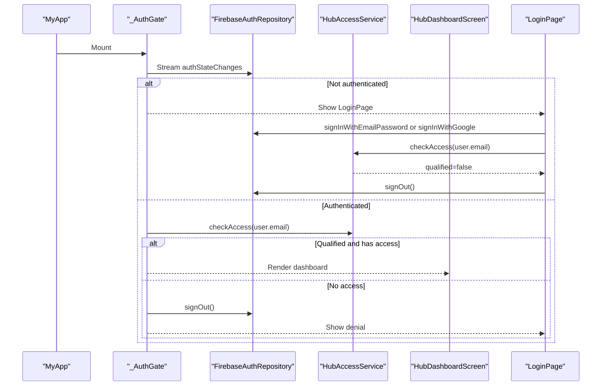

**Diagram sources**
- [main.dart:87-196](file://sese_hub/lib/main.dart#L87-L196)
- [login_page.dart:51-123](file://sese_hub/lib/features/auth/login_page.dart#L51-L123)
- [hub_access_service.dart:233-284](file://sese_hub/lib/features/staff/services/hub_access_service.dart#L233-L284)

**Section sources**
- [main.dart:13-37](file://sese_hub/lib/main.dart#L13-L37)
- [main.dart:87-196](file://sese_hub/lib/main.dart#L87-L196)
- [login_page.dart:1-277](file://sese_hub/lib/features/auth/login_page.dart#L1-L277)
- [hub_access_service.dart:209-333](file://sese_hub/lib/features/staff/services/hub_access_service.dart#L209-L333)

### RBAC, Permissions, and Module Visibility
- Roles: `customer`, `driver`, `agent`, `admin`, `superRole` (shared via `sese_core`).
- Hub staff records: stored under `hub_staff/{email}` with fields including `role`, `assignedPermissions`, `active`, and `assignedBy`.
- Owner bootstrap: a hardcoded primary owner email grants permanent Super authority and full module permissions.
- Module permissions:
  - `fleet_verify`: Fleet & Security
  - `dynamic_config`: Dynamic Config
  - `staff_manage`: Staff Management (Super only)
  - `support_chat`: Support Inbox
- Tab visibility:
  - Owner: all tabs
  - Super: all module tabs; Staff tab requires explicit `staff_manage` grant
  - Other roles: only tabs matching their `assignedPermissions`; Profile always visible

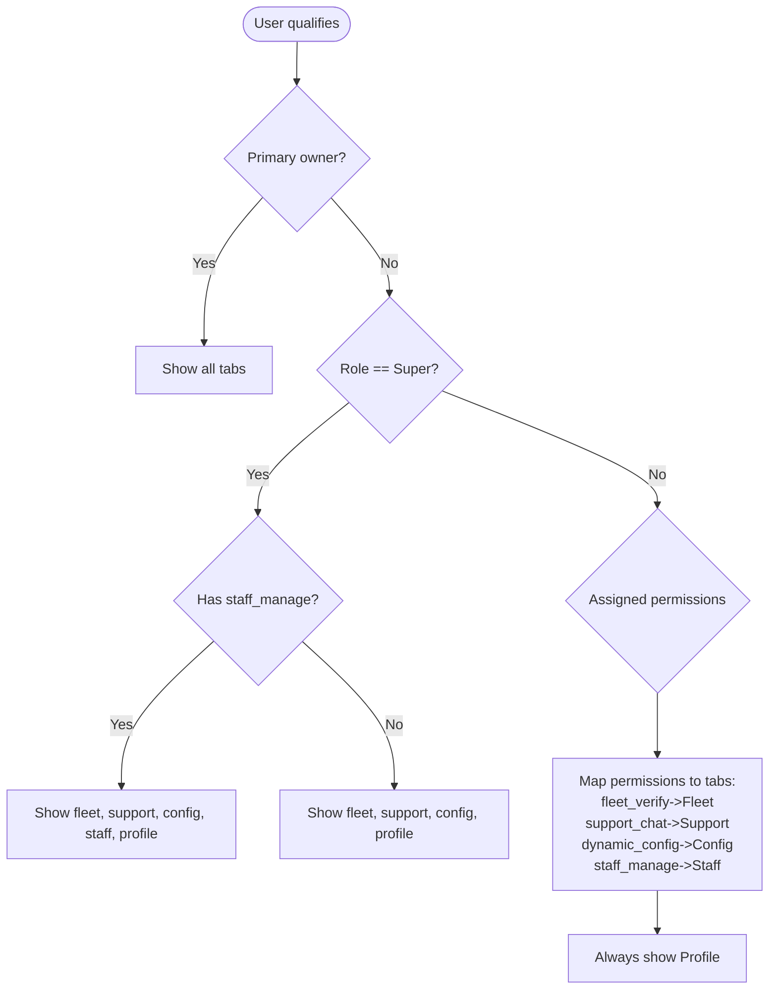

**Diagram sources**
- [hub_access_service.dart:20-83](file://sese_hub/lib/features/staff/services/hub_access_service.dart#L20-L83)
- [hub_access_service.dart:85-118](file://sese_hub/lib/features/staff/services/hub_access_service.dart#L85-L118)
- [hub_access_service.dart:120-207](file://sese_hub/lib/features/staff/services/hub_access_service.dart#L120-L207)

**Section sources**
- [user_role.dart:1-55](file://sese_core/lib/models/user_role.dart#L1-L55)
- [hub_access_service.dart:20-83](file://sese_hub/lib/features/staff/services/hub_access_service.dart#L20-L83)
- [hub_access_service.dart:85-118](file://sese_hub/lib/features/staff/services/hub_access_service.dart#L85-L118)
- [hub_access_service.dart:120-207](file://sese_hub/lib/features/staff/services/hub_access_service.dart#L120-L207)

### Administrative UI Shell and Navigation
- `HubDashboardScreen` renders a responsive layout:
  - Wide screens: side rail navigation
  - Narrow screens: bottom navigation bar
- Tabs are computed from role, owner status, and permissions using `visibleTabs`.
- Logout is intentionally placed only in the Profile screen to avoid accidental sign-outs from the nav bar.

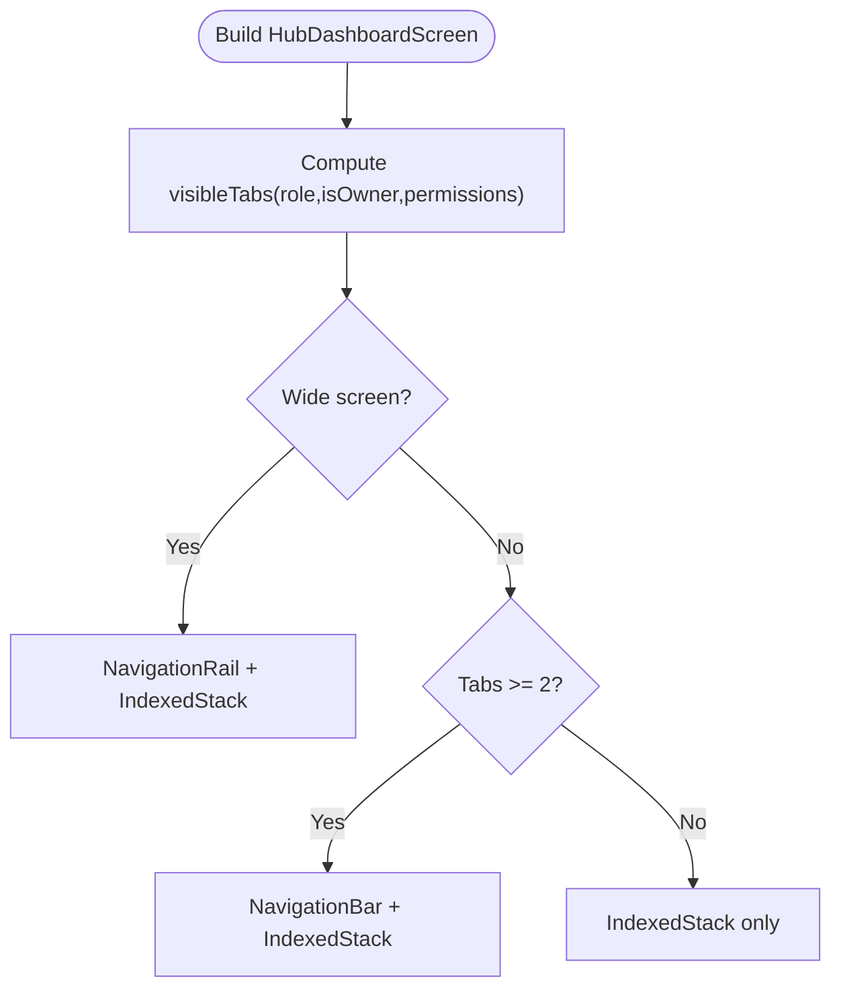

**Diagram sources**
- [hub_dashboard_screen.dart:47-250](file://sese_hub/lib/features/dashboard/presentation/hub_dashboard_screen.dart#L47-L250)

**Section sources**
- [hub_dashboard_screen.dart:10-250](file://sese_hub/lib/features/dashboard/presentation/hub_dashboard_screen.dart#L10-L250)

### Staff Provisioning and Management
- Only the primary owner can open the “Add Staff” dialog and write to `hub_staff`.
- The dialog allows selecting a role and checking module permissions; `staff_manage` is restricted to Super.
- On submit, `HubAccessService.provisionStaff` validates inputs, filters permissions for the selected role, and writes the record with server timestamps.

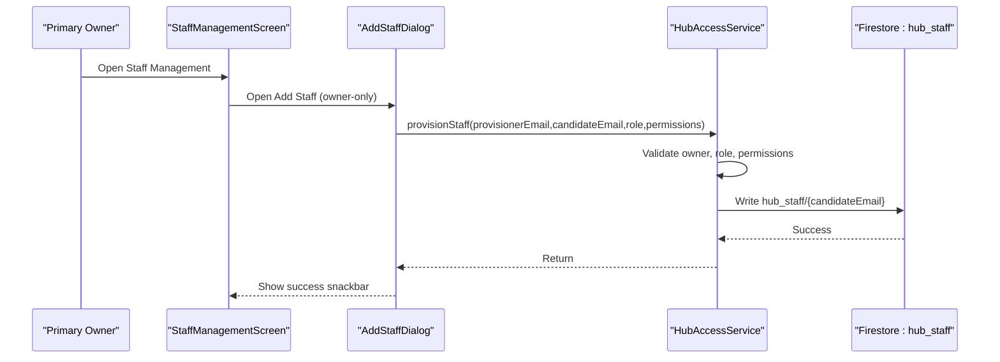

**Diagram sources**
- [staff_management_screen.dart:49-59](file://sese_hub/lib/features/staff/presentation/staff_management_screen.dart#L49-L59)
- [staff_management_screen.dart:249-280](file://sese_hub/lib/features/staff/presentation/staff_management_screen.dart#L249-L280)
- [hub_access_service.dart:294-333](file://sese_hub/lib/features/staff/services/hub_access_service.dart#L294-L333)

**Section sources**
- [staff_management_screen.dart:1-403](file://sese_hub/lib/features/staff/presentation/staff_management_screen.dart#L1-L403)
- [hub_access_service.dart:294-333](file://sese_hub/lib/features/staff/services/hub_access_service.dart#L294-L333)

### Fleet Verification and Security Pipeline
- Pending vehicles stream from `drivers/{driverId}/vehicles` where verification is pending or legacy aliases indicate not verified.
- Approve sets canonical verification status plus legacy alias fields and recomputes `canGoOnline` based on both profile and vehicle verification flags.
- Reject prompts for a mandatory reason and persists it for audit.
- Live camera audit logs stream from `driver_vehicle_verification`.

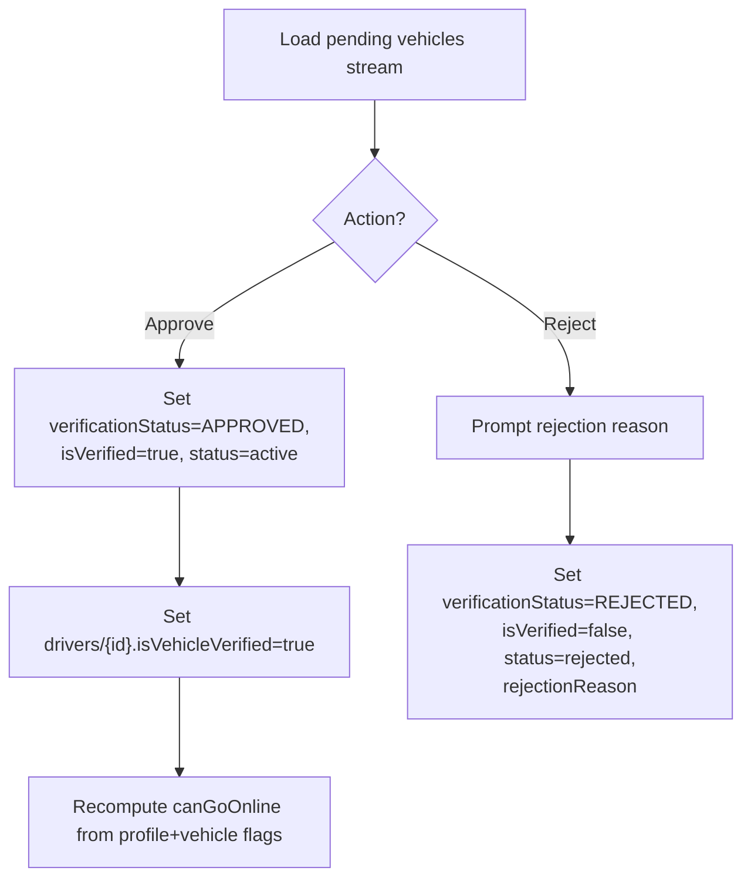

**Diagram sources**
- [vehicle_approvals_screen.dart:41-144](file://sese_hub/lib/features/verification/presentation/vehicle_approvals_screen.dart#L41-L144)
- [vehicle_approvals_screen.dart:261-414](file://sese_hub/lib/features/verification/presentation/vehicle_approvals_screen.dart#L261-L414)
- [vehicle_approvals_screen.dart:564-643](file://sese_hub/lib/features/verification/presentation/vehicle_approvals_screen.dart#L564-L643)

**Section sources**
- [vehicle_approvals_screen.dart:1-716](file://sese_hub/lib/features/verification/presentation/vehicle_approvals_screen.dart#L1-L716)

### Dynamic System Configuration Management
- `GlobalConfigScreen` manages:
  - Regional and currency scoping (global default, country rule, state override)
  - Dynamic pricing per vehicle category
  - Car tier thresholds and labels/multipliers
  - Streak rewards tiers and grand completion targets
  - Daily streak/commission toggles and disable lists
  - Maximum visible bids in the customer carousel
- `SystemConfigService` reads/writes `system_configs` and `system_settings/dispatch`, with local cache fallback.
- `ConfigResolutionEngine` merges configurations across the fallback chain.

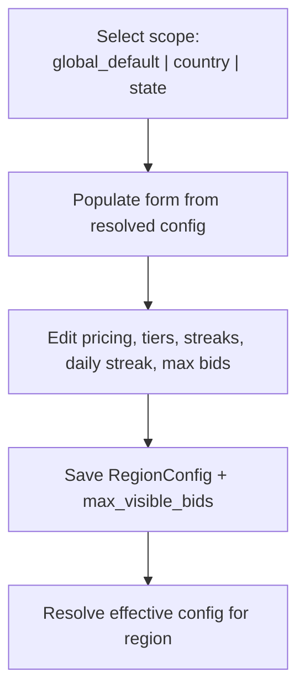

**Diagram sources**
- [global_config_screen.dart:121-315](file://sese_hub/lib/features/config/presentation/global_config_screen.dart#L121-L315)
- [system_config_service.dart:92-180](file://sese_hub/lib/features/config/services/system_config_service.dart#L92-L180)
- [config_resolution_engine.dart:7-66](file://sese_core/lib/services/config_resolution_engine.dart#L7-L66)

**Section sources**
- [global_config_screen.dart:1-800](file://sese_hub/lib/features/config/presentation/global_config_screen.dart#L1-L800)
- [system_config_service.dart:5-180](file://sese_hub/lib/features/config/services/system_config_service.dart#L5-L180)
- [config_resolution_engine.dart:7-218](file://sese_core/lib/services/config_resolution_engine.dart#L7-L218)

### Support Inbox and Live Escalation
- Two-tab interface:
  - Queue: pending chats awaiting an agent
  - Active Chats: claimed/resolved sessions
- Claim workflow uses a Firestore transaction to atomically assign the chat to the current admin and inject a greeting message.
- Message thread streams messages and updates last message metadata.
- Resolve and close sets status to resolved and posts a closing message.

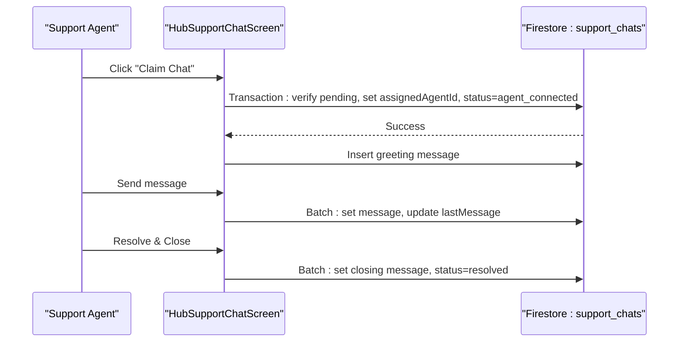

**Diagram sources**
- [hub_support_chat_screen.dart:151-211](file://sese_hub/lib/features/support/hub_support_chat_screen.dart#L151-L211)
- [hub_support_chat_screen.dart:233-337](file://sese_hub/lib/features/support/hub_support_chat_screen.dart#L233-L337)

**Section sources**
- [hub_support_chat_screen.dart:1-800](file://sese_hub/lib/features/support/hub_support_chat_screen.dart#L1-L800)

### Session Guard and Stream Error Handling
- `ensureFreshHubIdToken` forces a token refresh before opening long-lived streams to prevent UNAUTHENTICATED retry loops.
- `isHubSessionExpiredError` detects session-expired errors.
- `handleHubStreamAuthError` signs out and shows a notice when session errors occur.
- `HubSessionExpiredView` renders a full-screen notice and triggers sign-out once.

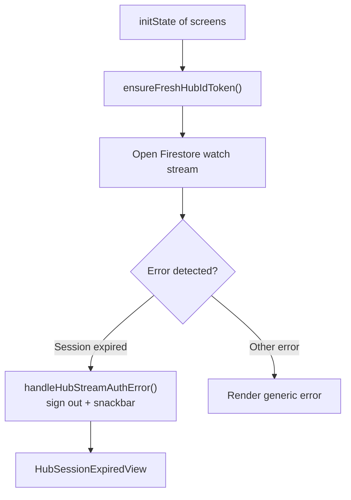

**Diagram sources**
- [hub_session_guard.dart:21-85](file://sese_hub/lib/features/auth/hub_session_guard.dart#L21-L85)
- [hub_session_guard.dart:103-176](file://sese_hub/lib/features/auth/hub_session_guard.dart#L103-L176)

**Section sources**
- [hub_session_guard.dart:1-176](file://sese_hub/lib/features/auth/hub_session_guard.dart#L1-L176)

## Dependency Analysis
- `sese_hub` depends on `sese_core` for shared models, auth repository, and config resolution.
- Hub-specific services interact directly with Firestore:
  - `hub_staff` for staff qualification and provisioning
  - `system_configs` and `system_settings` for dynamic configuration
  - `support_chats` for live support queues and threads
  - Driver and vehicle collections for verification workflows
- Firestore security rules enforce:
  - Hub staff read/write restrictions to primary owner
  - System config writes limited to Super Admin
  - Support chat and ticket access by admins/participants
  - Driver/vehicle data access by owners, agents, hub staff, and admins

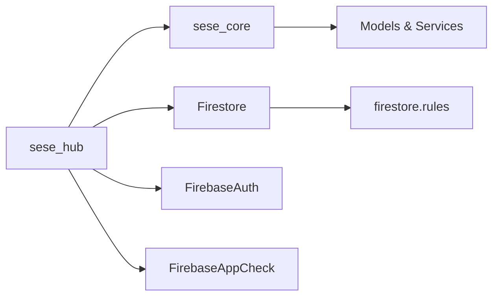

**Diagram sources**
- [pubspec.yaml](file://sese_hub/pubspec.yaml)
- [firestore.rules:487-536](file://firestore.rules#L487-L536)
- [firestore.rules:531-536](file://firestore.rules#L531-L536)
- [firestore.rules:667-703](file://firestore.rules#L667-L703)

**Section sources**
- [firestore.rules:487-536](file://firestore.rules#L487-L536)
- [firestore.rules:531-536](file://firestore.rules#L531-L536)
- [firestore.rules:667-703](file://firestore.rules#L667-L703)

## Performance Considerations
- Prefer `ensureFreshHubIdToken()` before opening long-lived streams to reduce UNAUTHENTICATED retries.
- Use batched writes for multi-document updates (e.g., support chat message + metadata).
- Keep UI components lightweight; defer heavy computations off the build path.
- Leverage local cache in `SystemConfigService` to mitigate transient Firestore failures.

[No sources needed since this section provides general guidance]

## Troubleshooting Guide
Common issues and resolutions:
- UNAUTHENTICATED or PERMISSION_DENIED on streams:
  - Call `ensureFreshHubIdToken()` before stream creation.
  - In stream error branches, check `isHubSessionExpiredError` and render `HubSessionExpiredView`.
- Sign-in failures:
  - Email/password: handle specific `FirebaseAuthException` codes and map to user-friendly messages.
  - Google Sign-In: map raw exceptions to actionable messages (developer error, network error, consent issues).
- Staff provisioning denied:
  - Ensure the caller is the primary owner; non-owner attempts throw a clear error.
- Configuration save failures:
  - Verify Super Admin rights and Firestore connectivity; service falls back to local cache on read errors.

**Section sources**
- [hub_session_guard.dart:21-85](file://sese_hub/lib/features/auth/hub_session_guard.dart#L21-L85)
- [login_page.dart:87-171](file://sese_hub/lib/features/auth/login_page.dart#L87-L171)
- [hub_access_service.dart:294-333](file://sese_hub/lib/features/staff/services/hub_access_service.dart#L294-L333)
- [system_config_service.dart:92-180](file://sese_hub/lib/features/config/services/system_config_service.dart#L92-L180)

## Conclusion
Sese Hub provides a secure, permission-driven administrative console for operations staff. Its zero-trust authentication, strict RBAC, and owner-only provisioning ensure safe administration. The unified dashboard exposes fleet verification, support escalation, dynamic configuration, and staff management, all backed by robust Firestore rules and resilient session handling. Integration with `sese_core` centralizes shared models and services, enabling consistent behavior across the platform.

[No sources needed since this section summarizes without analyzing specific files]