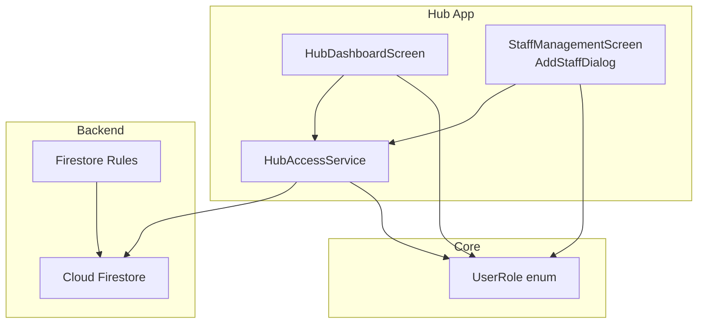
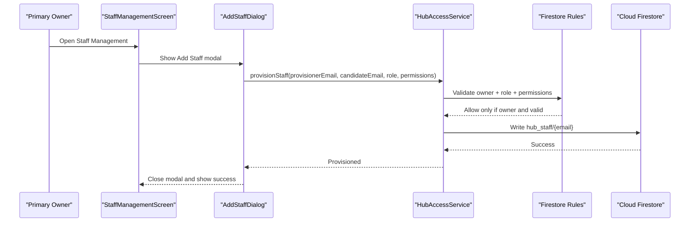
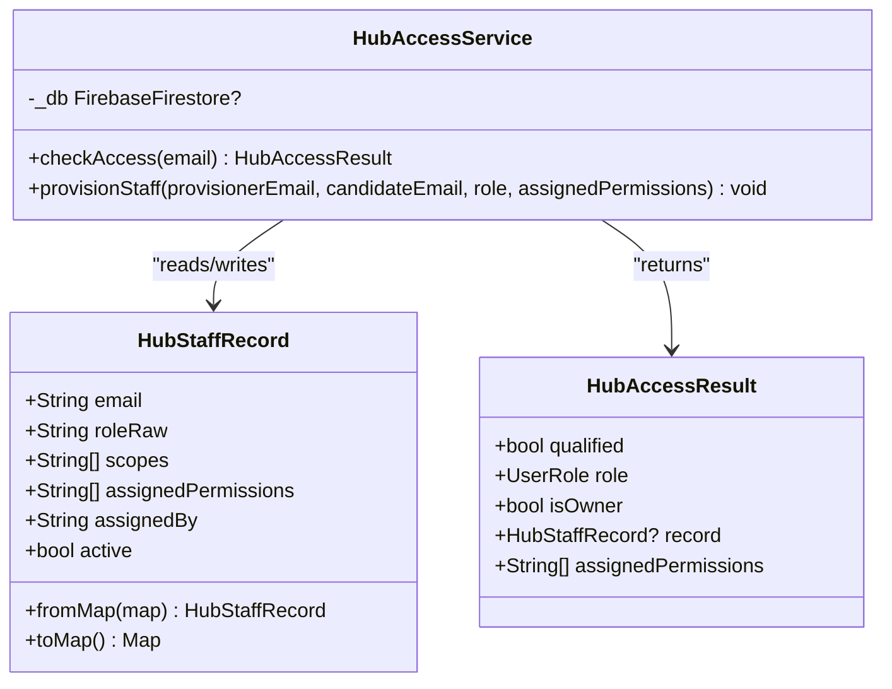
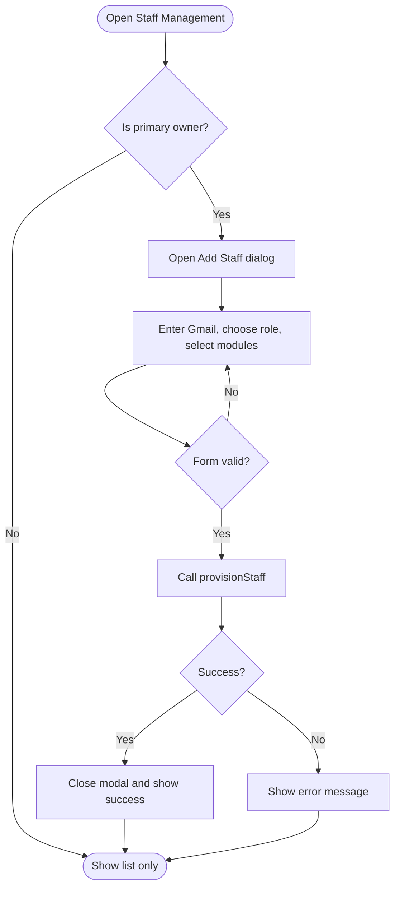
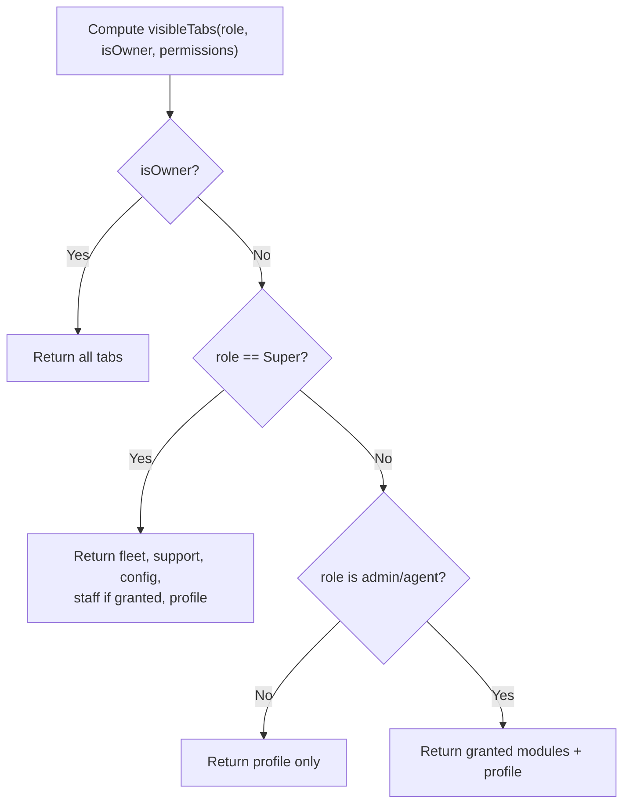
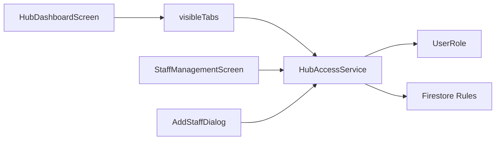

# Staff Access Management

<cite>
**Referenced Files in This Document**
- [hub_access_service.dart](file://sese_hub/lib/features/staff/services/hub_access_service.dart)
- [staff_management_screen.dart](file://sese_hub/lib/features/staff/presentation/staff_management_screen.dart)
- [hub_dashboard_screen.dart](file://sese_hub/lib/features/dashboard/presentation/hub_dashboard_screen.dart)
- [user_role.dart](file://sese_core/lib/models/user_role.dart)
- [firestore.rules](file://firestore.rules)
- [hub_rbac_test.dart](file://sese_hub/test/hub_rbac_test.dart)
- [hub_access_test.dart](file://sese_hub/test/hub_access_test.dart)
</cite>

## Table of Contents
1. Introduction
2. Project Structure
3. Core Components
4. Architecture Overview
5. Detailed Component Analysis
6. Dependency Analysis
7. Performance Considerations
8. Troubleshooting Guide
9. Conclusion

## Introduction
This document explains the staff access management system used by Sese Hub. It covers:
- The Staff Management screen for adding, modifying, and removing administrative users.
- The hub access service that manages permissions, roles, and access scopes.
- Permission inheritance, role hierarchy, and how privileges are enforced across the application.
- User lifecycle management for staff accounts.
- Audit logging considerations and security controls for administrative accounts.

The system uses a zero-trust model: client-side UI is permission-gated, but server-side Firestore rules enforce the same policies. Only the primary owner can provision or modify staff records.

## Project Structure
Staff access management spans three main areas:
- Service layer: HubAccessService defines roles, module permissions, qualification checks, and provisioning logic.
- Presentation layer: StaffManagementScreen provides the owner-only console to list and add staff; AddStaffDialog collects Gmail, role, and module permissions.
- Shell layer: HubDashboardScreen renders tabs based on visibleTabs, which depends on role, owner status, and assignedPermissions.

**Diagram sources**
- [hub_dashboard_screen.dart:10-19](file://sese_hub/lib/features/dashboard/presentation/hub_dashboard_screen.dart#L10-L19)
- [staff_management_screen.dart:7-10](file://sese_hub/lib/features/staff/presentation/staff_management_screen.dart#L7-L10)
- [hub_access_service.dart:209-214](file://sese_hub/lib/features/staff/services/hub_access_service.dart#L209-L214)
- [user_role.dart:5-11](file://sese_core/lib/models/user_role.dart#L5-L11)
- [firestore.rules:487-498](file://firestore.rules#L487-L498)

**Section sources**
- [hub_access_service.dart:1-334](file://sese_hub/lib/features/staff/services/hub_access_service.dart#L1-L334)
- [staff_management_screen.dart:1-403](file://sese_hub/lib/features/staff/presentation/staff_management_screen.dart#L1-L403)
- [hub_dashboard_screen.dart:1-472](file://sese_hub/lib/features/dashboard/presentation/hub_dashboard_screen.dart#L1-L472)
- [user_role.dart:1-55](file://sese_core/lib/models/user_role.dart#L1-L55)
- [firestore.rules:487-498](file://firestore.rules#L487-L498)

## Core Components
- HubAccessService
  - Defines module permission codes and the hub module catalog.
  - Parses and maps hub_staff roles to UserRole.
  - Provides visibleTabs for shell navigation rendering.
  - Performs silent post-login qualification via checkAccess.
  - Enforces exclusive owner-only provisioning via provisionStaff.
- StaffManagementScreen and AddStaffDialog
  - Owner-only console listing all hub_staff records.
  - Modal form to provision new staff with Gmail, role, and modules.
  - Guards against leaking privileged modules (e.g., staff_manage).
- HubDashboardScreen
  - Unified shell that renders tabs according to visibleTabs.
  - Integrates Fleet & Security, Support Inbox, Dynamic Config, Staff, and Profile.
- UserRole
  - Shared enum across apps; includes hub-managed roles.

Key responsibilities:
- Role parsing and mapping: parseHubStaffRole, hubStaffRoleName.
- Module permissions: permFleetVerify, permDynamicConfig, permStaffManage, permSupportChat.
- Tab visibility: visibleTabs.
- Qualification: HubAccessResult and checkAccess.
- Provisioning: filterPermissionsForRole and provisionStaff.

**Section sources**
- [hub_access_service.dart:17-41](file://sese_hub/lib/features/staff/services/hub_access_service.dart#L17-L41)
- [hub_access_service.dart:85-118](file://sese_hub/lib/features/staff/services/hub_access_service.dart#L85-L118)
- [hub_access_service.dart:120-167](file://sese_hub/lib/features/staff/services/hub_access_service.dart#L120-L167)
- [hub_access_service.dart:169-207](file://sese_hub/lib/features/staff/services/hub_access_service.dart#L169-L207)
- [hub_access_service.dart:214-334](file://sese_hub/lib/features/staff/services/hub_access_service.dart#L214-L334)
- [staff_management_screen.dart:11-23](file://sese_hub/lib/features/staff/presentation/staff_management_screen.dart#L11-L23)
- [staff_management_screen.dart:201-403](file://sese_hub/lib/features/staff/presentation/staff_management_screen.dart#L201-L403)
- [hub_dashboard_screen.dart:20-45](file://sese_hub/lib/features/dashboard/presentation/hub_dashboard_screen.dart#L20-L45)
- [user_role.dart:5-11](file://sese_core/lib/models/user_role.dart#L5-L11)

## Architecture Overview
The system enforces least privilege at multiple layers:
- Client UI: Tabs and actions are hidden unless explicitly granted.
- Service layer: Roles and permissions are parsed and validated before writes.
- Server rules: Only the primary owner can write hub_staff; roles must be allowed values; assignment metadata is enforced.

**Diagram sources**
- [staff_management_screen.dart:49-59](file://sese_hub/lib/features/staff/presentation/staff_management_screen.dart#L49-L59)
- [staff_management_screen.dart:249-280](file://sese_hub/lib/features/staff/presentation/staff_management_screen.dart#L249-L280)
- [hub_access_service.dart:294-332](file://sese_hub/lib/features/staff/services/hub_access_service.dart#L294-L332)
- [firestore.rules:487-498](file://firestore.rules#L487-L498)

## Detailed Component Analysis

### HubAccessService
Responsibilities:
- Module constants and catalog.
- Role parsing and canonical name mapping.
- Visible tab computation for the shell.
- Silent qualification check for login gating.
- Owner-only staff provisioning with permission filtering.

Key behaviors:
- Primary owner bootstrap grants permanent full access without a hub_staff record.
- Unknown or inactive roles fail closed.
- Non-owner attempts to provision throw errors immediately.
- Non-Super roles cannot receive staff_manage even if requested.

**Diagram sources**
- [hub_access_service.dart:120-167](file://sese_hub/lib/features/staff/services/hub_access_service.dart#L120-L167)
- [hub_access_service.dart:169-207](file://sese_hub/lib/features/staff/services/hub_access_service.dart#L169-L207)
- [hub_access_service.dart:214-334](file://sese_hub/lib/features/staff/services/hub_access_service.dart#L214-L334)

Permission and role enforcement highlights:
- Module catalog and filtering: hubModuleCatalog, filterPermissionsForRole.
- Role mapping: parseHubStaffRole, hubStaffRoleName.
- Visibility: visibleTabs.
- Qualification: checkAccess returns HubAccessResult.
- Provisioning: provisionStaff validates owner, candidate, role, and filters permissions.

**Section sources**
- [hub_access_service.dart:17-41](file://sese_hub/lib/features/staff/services/hub_access_service.dart#L17-L41)
- [hub_access_service.dart:85-118](file://sese_hub/lib/features/staff/services/hub_access_service.dart#L85-L118)
- [hub_access_service.dart:120-167](file://sese_hub/lib/features/staff/services/hub_access_service.dart#L120-L167)
- [hub_access_service.dart:169-207](file://sese_hub/lib/features/staff/services/hub_access_service.dart#L169-L207)
- [hub_access_service.dart:214-334](file://sese_hub/lib/features/staff/services/hub_access_service.dart#L214-L334)

### StaffManagementScreen and AddStaffDialog
Responsibilities:
- Display all hub_staff records in a live stream.
- Provide an owner-only “Add Staff” action.
- Collect Gmail address, role, and module permissions.
- Guard privileged modules (staff_manage) to Super only.

User flow:
- Owner opens Staff Management.
- Opens Add Staff dialog.
- Enters Gmail, selects role, checks modules.
- Submits to HubAccessService.provisionStaff.
- Shows success or error feedback.

**Diagram sources**
- [staff_management_screen.dart:49-59](file://sese_hub/lib/features/staff/presentation/staff_management_screen.dart#L49-L59)
- [staff_management_screen.dart:249-280](file://sese_hub/lib/features/staff/presentation/staff_management_screen.dart#L249-L280)
- [staff_management_screen.dart:312-370](file://sese_hub/lib/features/staff/presentation/staff_management_screen.dart#L312-L370)

Security notes:
- The “Add Staff” button is only shown to the primary owner.
- Even if a non-owner reaches the code path, HubAccessService.provisionStaff throws.
- Firestore rules reject non-owner writes to hub_staff.

**Section sources**
- [staff_management_screen.dart:7-10](file://sese_hub/lib/features/staff/presentation/staff_management_screen.dart#L7-L10)
- [staff_management_screen.dart:49-59](file://sese_hub/lib/features/staff/presentation/staff_management_screen.dart#L49-L59)
- [staff_management_screen.dart:201-403](file://sese_hub/lib/features/staff/presentation/staff_management_screen.dart#L201-L403)
- [hub_access_service.dart:294-332](file://sese_hub/lib/features/staff/services/hub_access_service.dart#L294-L332)
- [firestore.rules:487-498](file://firestore.rules#L487-L498)

### HubDashboardScreen and Tab Rendering
Responsibilities:
- Render a unified set of tabs based on visibleTabs.
- Map tabs to screens: Fleet & Security, Support Inbox, Dynamic Config, Staff, Profile.
- Ensure logout is only available in Profile.

Visibility rules:
- Owner sees every tab.
- Super role sees every module tab; Staff tab requires explicit staff_manage grant.
- Other staffers see only granted modules plus Profile.

**Diagram sources**
- [hub_access_service.dart:47-83](file://sese_hub/lib/features/staff/services/hub_access_service.dart#L47-L83)
- [hub_dashboard_screen.dart:51-92](file://sese_hub/lib/features/dashboard/presentation/hub_dashboard_screen.dart#L51-L92)

**Section sources**
- [hub_dashboard_screen.dart:10-19](file://sese_hub/lib/features/dashboard/presentation/hub_dashboard_screen.dart#L10-L19)
- [hub_dashboard_screen.dart:51-92](file://sese_hub/lib/features/dashboard/presentation/hub_dashboard_screen.dart#L51-L92)
- [hub_access_service.dart:47-83](file://sese_hub/lib/features/staff/services/hub_access_service.dart#L47-L83)

### Permission Inheritance and Role Hierarchy
- Roles: Agent, Admin, Super.
- Owner: Permanent master control regardless of role.
- Super: Full module access; Staff Management tab additionally requires explicit staff_manage grant.
- Admin/Agent: Receive only explicitly granted modules from assignedPermissions.
- No read-only states: If a module tab is visible, it grants full operational actions within that module.

Inheritance summary:
- Owner > Super > Admin/Agent (by granted modules).
- staff_manage is Super-only and stripped for non-Super roles both in UI and on write.

**Section sources**
- [hub_access_service.dart:47-83](file://sese_hub/lib/features/staff/services/hub_access_service.dart#L47-L83)
- [hub_access_service.dart:34-41](file://sese_hub/lib/features/staff/services/hub_access_service.dart#L34-L41)
- [staff_management_screen.dart:340-370](file://sese_hub/lib/features/staff/presentation/staff_management_screen.dart#L340-L370)

### User Lifecycle Management
Lifecycle stages:
- Provisioning: Only primary owner can create/update hub_staff records.
- Activation: Records must be active and have a known role to qualify.
- Deactivation: Setting active to false denies access.
- Modification: Only primary owner can change role, permissions, or deactivation.

Data model:
- hub_staff/{email}: email, role, scopes (legacy), assignedPermissions, assignedBy, active, timestamps.

Server constraints:
- Allowed roles: Super, Admin, Agent.
- assignedBy must equal the primary owner email.
- Reads allowed for owner and self; writes restricted to owner.

**Section sources**
- [hub_access_service.dart:120-167](file://sese_hub/lib/features/staff/services/hub_access_service.dart#L120-L167)
- [hub_access_service.dart:227-284](file://sese_hub/lib/features/staff/services/hub_access_service.dart#L227-L284)
- [hub_access_service.dart:294-332](file://sese_hub/lib/features/staff/services/hub_access_service.dart#L294-L332)
- [firestore.rules:487-498](file://firestore.rules#L487-L498)

### Audit Logging of Access Changes
- Hub staff records include assignedBy and timestamps (createdAt, updatedAt) to provide basic provenance.
- There is no dedicated audit log collection referenced for hub_staff changes in the analyzed files.
- For broader audit capabilities, the repository contains generic audit-related rules and collections elsewhere; however, hub staff provisioning does not write to those logs in the analyzed code paths.

Recommendation:
- Extend provisioning to append immutable audit entries (e.g., via Cloud Functions) when hub_staff records are created, updated, or deactivated.

**Section sources**
- [hub_access_service.dart:320-331](file://sese_hub/lib/features/staff/services/hub_access_service.dart#L320-L331)
- [firestore.rules:182-189](file://firestore.rules#L182-L189)

### Security Considerations for Administrative Accounts
- Zero-trust design: Client-side guards are complemented by Firestore rules.
- Owner exclusivity: Only the primary owner can provision or modify hub_staff.
- Fail-closed: Unknown roles or inactive records deny access.
- Permission stripping: Non-Super roles cannot receive staff_manage.
- Token refresh: ID token refresh before opening streams avoids stale credential issues.

Operational guidance:
- Restrict knowledge of the primary owner account.
- Regularly review hub_staff records and remove unnecessary permissions.
- Monitor for unexpected role changes and ensure server-side rules remain aligned with policy.

**Section sources**
- [hub_access_service.dart:6-15](file://sese_hub/lib/features/staff/services/hub_access_service.dart#L6-L15)
- [hub_access_service.dart:227-284](file://sese_hub/lib/features/staff/services/hub_access_service.dart#L227-L284)
- [hub_access_service.dart:294-332](file://sese_hub/lib/features/staff/services/hub_access_service.dart#L294-L332)
- [staff_management_screen.dart:312-370](file://sese_hub/lib/features/staff/presentation/staff_management_screen.dart#L312-L370)
- [firestore.rules:487-498](file://firestore.rules#L487-L498)

## Dependency Analysis
Component relationships:
- HubDashboardScreen depends on visibleTabs to render tabs.
- StaffManagementScreen depends on HubAccessService for provisioning.
- Both UI components depend on UserRole for consistent role handling.
- All data operations are constrained by Firestore rules.

**Diagram sources**
- [hub_dashboard_screen.dart:51-92](file://sese_hub/lib/features/dashboard/presentation/hub_dashboard_screen.dart#L51-L92)
- [hub_access_service.dart:47-83](file://sese_hub/lib/features/staff/services/hub_access_service.dart#L47-L83)
- [staff_management_screen.dart:49-59](file://sese_hub/lib/features/staff/presentation/staff_management_screen.dart#L49-L59)
- [user_role.dart:5-11](file://sese_core/lib/models/user_role.dart#L5-L11)
- [firestore.rules:487-498](file://firestore.rules#L487-L498)

**Section sources**
- [hub_dashboard_screen.dart:51-92](file://sese_hub/lib/features/dashboard/presentation/hub_dashboard_screen.dart#L51-L92)
- [hub_access_service.dart:47-83](file://sese_hub/lib/features/staff/services/hub_access_service.dart#L47-L83)
- [staff_management_screen.dart:49-59](file://sese_hub/lib/features/staff/presentation/staff_management_screen.dart#L49-L59)
- [user_role.dart:5-11](file://sese_core/lib/models/user_role.dart#L5-L11)
- [firestore.rules:487-498](file://firestore.rules#L487-L498)

## Performance Considerations
- Stream-based staff list: Uses a single collection snapshot; efficient for small-to-medium staff rosters.
- ID token refresh: Ensures fresh credentials before opening long-lived streams to avoid retry loops.
- Minimal client-side processing: visibleTabs is O(n) over permissions; negligible given the small module set.

Optimization tips:
- Keep hub_staff documents minimal and indexed fields limited to what is queried.
- Avoid excessive re-provisioning; use merge updates to reduce writes.

[No sources needed since this section provides general guidance]

## Troubleshooting Guide
Common issues and resolutions:
- “No role assigned”: The user has no hub_staff record or the record is inactive or has an unknown role. Verify the document exists, active is true, and role is one of Super/Admin/Agent.
- “Only the primary owner can provision staff”: Attempted provisioning by a non-owner. Confirm the provisionerEmail matches the primary owner.
- “Invalid email or role”: Candidate email must contain @; role must be Agent, Admin, or Super.
- “Firestore unavailable”: Network or initialization issue; verify connectivity and Firebase configuration.
- “Unauthorized reads/writes to hub_staff”: Firestore rules denied the operation; confirm the caller is the primary owner for writes and authorized for reads.

Diagnostic references:
- checkAccess failure paths and error logging.
- provisionStaff validation and exceptions.
- Firestore rules for hub_staff.

**Section sources**
- [hub_access_service.dart:227-284](file://sese_hub/lib/features/staff/services/hub_access_service.dart#L227-L284)
- [hub_access_service.dart:294-332](file://sese_hub/lib/features/staff/services/hub_access_service.dart#L294-L332)
- [firestore.rules:487-498](file://firestore.rules#L487-L498)

## Conclusion
The staff access management system implements a robust, layered approach to administrative access:
- Clear role hierarchy and module-based permissions.
- Owner-exclusive provisioning with strict server-side enforcement.
- Consistent UI gating through visibleTabs.
- Basic provenance fields for auditability, with room to extend into immutable audit logs.

Adhering to these controls ensures that administrative privileges are granted intentionally, enforced consistently, and auditable where required.

[No sources needed since this section summarizes without analyzing specific files]