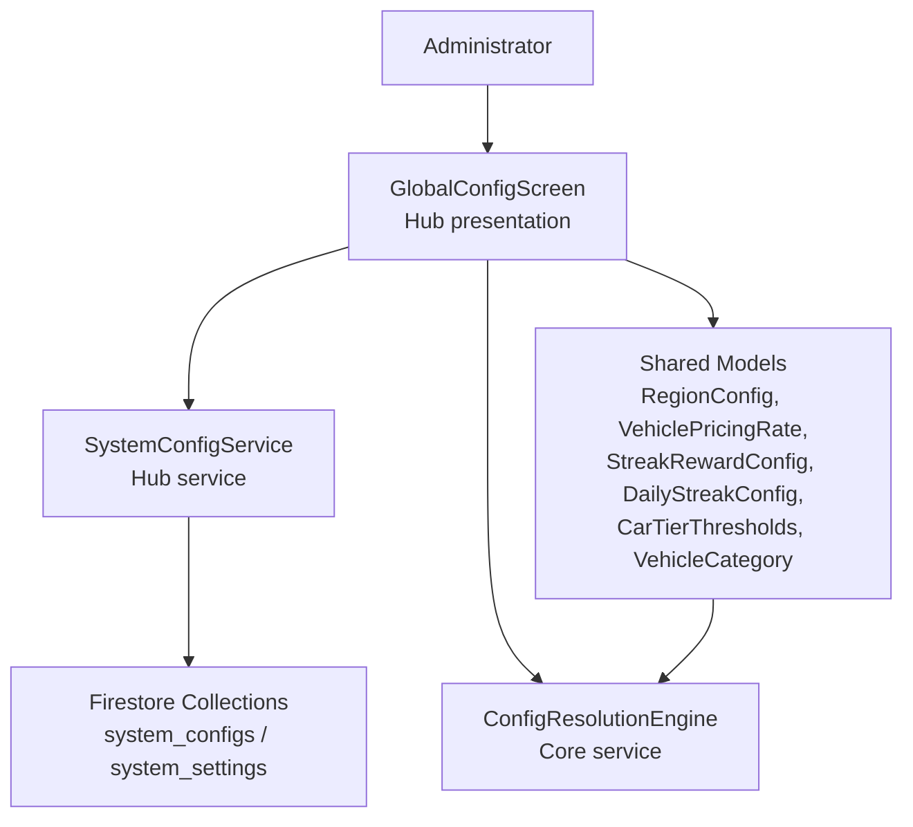
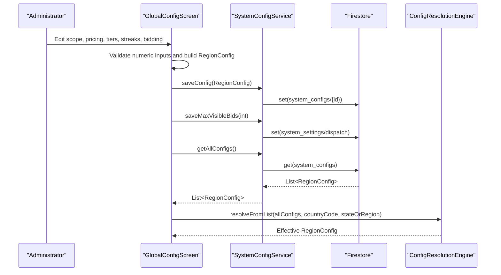
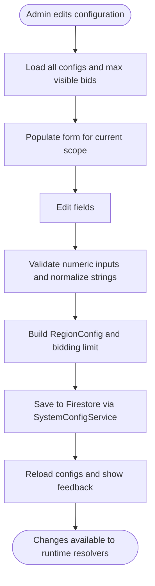
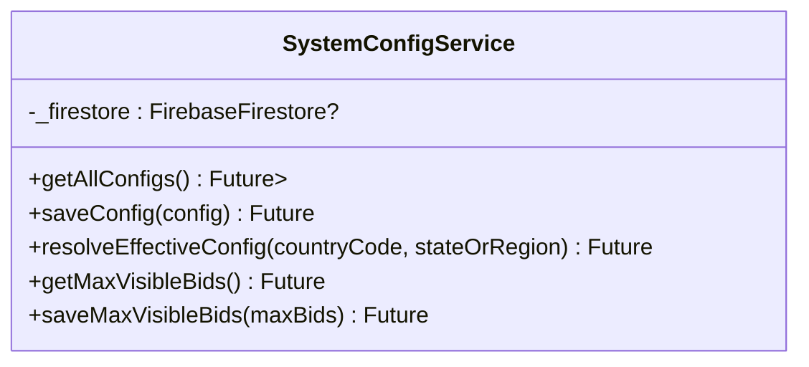
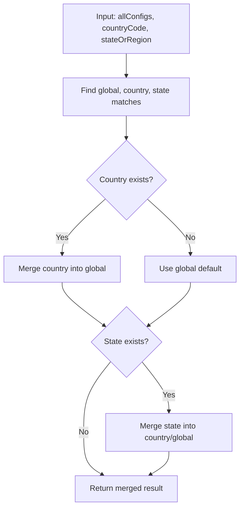
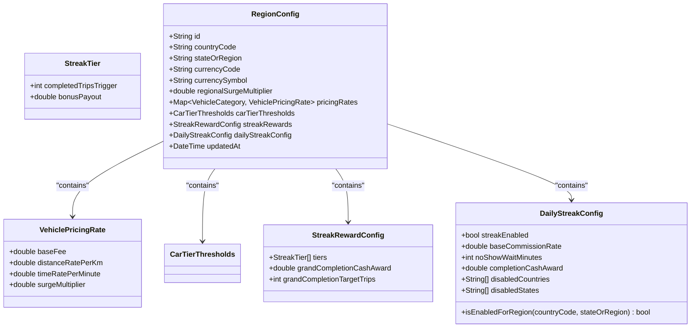
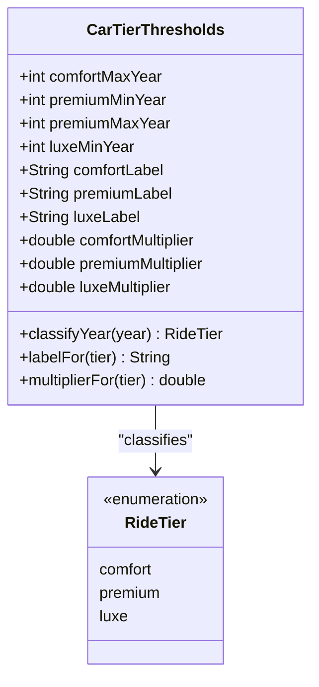
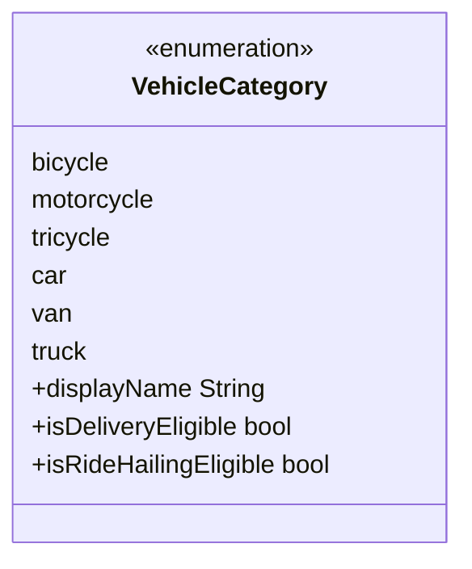
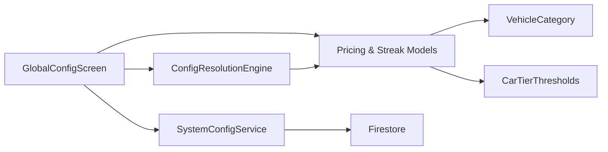

# System Configuration Management

<cite>
**Referenced Files in This Document**
- [global_config_screen.dart](file://sese_hub/lib/features/config/presentation/global_config_screen.dart)
- [system_config_service.dart](file://sese_hub/lib/features/config/services/system_config_service.dart)
- [pricing_config.dart](file://sese_core/lib/models/pricing_config.dart)
- [config_resolution_engine.dart](file://sese_core/lib/services/config_resolution_engine.dart)
- [car_tier_thresholds.dart](file://sese_core/lib/models/car_tier_thresholds.dart)
- [vehicle_category.dart](file://sese_core/lib/models/vehicle_category.dart)
</cite>

## Table of Contents
1. [Introduction](#introduction)
2. [Project Structure](#project-structure)
3. [Core Components](#core-components)
4. [Architecture Overview](#architecture-overview)
5. [Detailed Component Analysis](#detailed-component-analysis)
6. [Dependency Analysis](#dependency-analysis)
7. [Performance Considerations](#performance-considerations)
8. [Troubleshooting Guide](#troubleshooting-guide)
9. [Conclusion](#conclusion)

## Introduction
This document explains the system configuration management interface and backend service used by administrators to manage global, country-level, and state-level operational settings. It covers:

- The global configuration screen where administrators modify pricing, vehicle tiering, streak rewards, driver commission rules, and marketplace limits.
- The system configuration service that persists and resolves dynamic configurations.
- The configuration resolution engine that merges fallback scopes.
- Data models for pricing, streak rewards, daily streak commission rules, car tier thresholds, and vehicle categories.
- Validation behavior, default values, and how changes propagate across the platform.

The goal is to help both technical and non-technical readers understand how configuration changes are captured, validated, stored, resolved, and applied.

## Project Structure
The configuration feature spans three layers:

- Presentation layer (Hub app): Global configuration UI for administrators.
- Service layer (Hub app): Firestore-backed persistence and helper operations.
- Core domain layer (Core library): Shared data models and configuration resolution logic.

**Diagram sources**
- [global_config_screen.dart:5-1305](file://sese_hub/lib/features/config/presentation/global_config_screen.dart#L5-L1305)
- [system_config_service.dart:8-181](file://sese_hub/lib/features/config/services/system_config_service.dart#L8-L181)
- [pricing_config.dart:5-499](file://sese_core/lib/models/pricing_config.dart#L5-L499)
- [config_resolution_engine.dart:7-218](file://sese_core/lib/services/config_resolution_engine.dart#L7-L218)
- [car_tier_thresholds.dart:10-137](file://sese_core/lib/models/car_tier_thresholds.dart#L10-L137)
- [vehicle_category.dart:5-142](file://sese_core/lib/models/vehicle_category.dart#L5-L142)

**Section sources**
- [global_config_screen.dart:5-1305](file://sese_hub/lib/features/config/presentation/global_config_screen.dart#L5-L1305)
- [system_config_service.dart:8-181](file://sese_hub/lib/features/config/services/system_config_service.dart#L8-L181)
- [pricing_config.dart:5-499](file://sese_core/lib/models/pricing_config.dart#L5-L499)
- [config_resolution_engine.dart:7-218](file://sese_core/lib/services/config_resolution_engine.dart#L7-L218)
- [car_tier_thresholds.dart:10-137](file://sese_core/lib/models/car_tier_thresholds.dart#L10-L137)
- [vehicle_category.dart:5-142](file://sese_core/lib/models/vehicle_category.dart#L5-L142)

## Core Components
This section summarizes the main building blocks.

- Global configuration screen: Provides a single admin interface to configure regional scoping, currency, per-vehicle pricing, car tier thresholds, streak rewards, daily streak commission rules, and multi-driver bidding limits.
- System configuration service: Persists region configs under `system_configs`, reads them with fallback to local cache, resolves effective config for a given country/state, and manages dispatch-related settings under `system_settings`.
- Configuration resolution engine: Merges global, country, and state configurations using a well-defined fallback chain.
- Data models: Define pricing rates, streak reward tiers, daily streak commission rules, car tier thresholds, and vehicle categories.

Key responsibilities:

| Component | Responsibility |
|---|---|
| GlobalConfigScreen | Collects admin inputs, validates numeric fields, builds RegionConfig, saves via SystemConfigService, refreshes UI. |
| SystemConfigService | Reads/writes Firestore collections, maintains local cache, resolves effective configuration, exposes max visible bids control. |
| ConfigResolutionEngine | Applies merge semantics across global → country → state scopes. |
| Pricing and streak models | Provide typed configuration structures, defaults, serialization, and region enablement checks. |
| Car tier thresholds | Classify vehicles by manufacture year and provide display labels and multipliers. |
| Vehicle category | Enumerates supported vehicle types and eligibility flags. |

**Section sources**
- [global_config_screen.dart:17-315](file://sese_hub/lib/features/config/presentation/global_config_screen.dart#L17-L315)
- [system_config_service.dart:8-181](file://sese_hub/lib/features/config/services/system_config_service.dart#L8-L181)
- [config_resolution_engine.dart:7-218](file://sese_core/lib/services/config_resolution_engine.dart#L7-L218)
- [pricing_config.dart:5-499](file://sese_core/lib/models/pricing_config.dart#L5-L499)
- [car_tier_thresholds.dart:10-137](file://sese_core/lib/models/car_tier_thresholds.dart#L10-L137)
- [vehicle_category.dart:5-142](file://sese_core/lib/models/vehicle_category.dart#L5-L142)

## Architecture Overview
The configuration flow has two primary paths:

1. Admin publishes a new or updated configuration through the global configuration screen.
2. Runtime consumers resolve the effective configuration for a specific country and optional state.

**Diagram sources**
- [global_config_screen.dart:121-315](file://sese_hub/lib/features/config/presentation/global_config_screen.dart#L121-L315)
- [system_config_service.dart:92-181](file://sese_hub/lib/features/config/services/system_config_service.dart#L92-L181)
- [config_resolution_engine.dart:36-66](file://sese_core/lib/services/config_resolution_engine.dart#L36-L66)

## Detailed Component Analysis

### Global Configuration Screen
The global configuration screen is the administrator-facing interface. It supports:

- Regional and currency scoping: global default, country rule, state override.
- Dynamic pricing per vehicle category: base fee, distance rate, time rate, surge multiplier.
- Car/sedan passenger ride tiering: year-based classification and multipliers.
- Streak rewards: milestone bonuses and grand completion award.
- Driver tiered commission and streak settings: activation flag, base commission, no-show wait threshold, and disable lists by country/state.
- Multi-driver bidding limits: maximum number of visible bids in the customer carousel.

Behavior highlights:

- Loads all configurations and max visible bids on initialization.
- Populates form fields from the selected scope or resolved fallback.
- Validates numeric inputs using safe parsing with sensible defaults.
- Publishes configuration updates and shows success or error feedback.
- Updates both `system_configs` and `system_settings/dispatch` when saving.

Configuration categories exposed by the screen:

| Category | Fields | Default Behavior |
|---|---|---|
| Regional & Currency Scoping | Country, State/Region, Currency Code, Currency Symbol, Regional Surge Multiplier | Defaults come from global default; currency symbol auto-resolved from catalog. |
| Dynamic Pricing Engine | Base Fee, Distance Rate per km, Time Rate per minute, Vehicle Surge per VehicleCategory | Per-category defaults exist; missing values fall back to model defaults. |
| Car/Sedan Tiering | Comfort/Premium/Luxe year thresholds, labels, multipliers | Year thresholds and multipliers have explicit defaults. |
| Streak Rewards | 5-trip bonus, 10-trip bonus, 20-trip bonus, Grand Target Trips, Grand Cash Award | Three-tier defaults and grand award defaults exist. |
| Driver Commission & Streak Settings | Streak Enabled, Base Commission %, Completion Cash Reward, No-Show Wait Minutes, Disabled Countries/States | Enabled by default; disables cascade down hierarchy. |
| Bidding Limits | Max Visible Bids | Stored separately under `system_settings/dispatch`; default 5. |

Validation and defaults:

- Numeric fields use safe parsing; invalid values revert to predefined defaults.
- Currency symbol is derived from the selected currency code.
- State keys are normalized to uppercase with spaces replaced by underscores.
- Disable lists are normalized and sorted before persisting.

Real-time propagation:

- After saving, the screen reloads configurations and displays a success message.
- Consumers can call the service to resolve the effective configuration for any country/state.
- Dispatch limit changes are persisted immediately to `system_settings/dispatch`.

**Diagram sources**
- [global_config_screen.dart:121-315](file://sese_hub/lib/features/config/presentation/global_config_screen.dart#L121-L315)

**Section sources**
- [global_config_screen.dart:17-315](file://sese_hub/lib/features/config/presentation/global_config_screen.dart#L17-L315)
- [global_config_screen.dart:389-1305](file://sese_hub/lib/features/config/presentation/global_config_screen.dart#L389-L1305)

### System Configuration Service
The system configuration service manages dynamic system configurations in Firestore.

Responsibilities:

- Read all region configurations from `system_configs` with fallback to an in-memory cache.
- Save or update a `RegionConfig` document.
- Resolve the effective configuration for a given country and optional state.
- Manage the maximum number of visible bids under `system_settings/dispatch`.

Persistence details:

- Region configurations are stored under `system_configs/{configId}`.
- Dispatch settings are stored under `system_settings/dispatch`.
- Local cache provides offline resilience and development stubbing.

Error handling:

- Firestore read failures print debug logs and return cached values.
- Firestore write failures print debug logs but still update local cache.
- Missing or malformed dispatch settings default to 5 visible bids.

**Diagram sources**
- [system_config_service.dart:8-181](file://sese_hub/lib/features/config/services/system_config_service.dart#L8-L181)

**Section sources**
- [system_config_service.dart:8-181](file://sese_hub/lib/features/config/services/system_config_service.dart#L8-L181)

### Configuration Resolution Engine
The configuration resolution engine evaluates and merges configuration across the fallback chain:

- Global Default
- Country-Specific Rule
- State-Specific Override

Merge semantics:

- Vehicle pricing rates: child overrides parent per vehicle category.
- Car tier thresholds: child wins only if explicitly customized; otherwise inherits parent.
- Streak rewards: child wins only if explicitly customized; otherwise inherits parent.
- Daily streak commission rules:
  - Activation uses AND semantics: a disable at any level cascades down.
  - Scalar fields inherit parent unless child customizes them.
  - Disable lists are unioned and normalized.

Resolution helpers:

- `resolve`: merges provided global, country, and state configs.
- `resolveFromList`: finds matching global/country/state documents from a list and applies merge logic.

**Diagram sources**
- [config_resolution_engine.dart:7-218](file://sese_core/lib/services/config_resolution_engine.dart#L7-L218)

**Section sources**
- [config_resolution_engine.dart:7-218](file://sese_core/lib/services/config_resolution_engine.dart#L7-L218)

### Data Models and Types
The core models define the structure and defaults for system configuration.

#### Pricing and Streak Models
- `VehiclePricingRate`: base fee, distance rate, time rate, surge multiplier.
- `StreakTier`: trip trigger and bonus payout.
- `StreakRewardConfig`: tier list, grand award amount, grand target trips.
- `DailyStreakConfig`: activation flag, base commission rate, no-show wait minutes, completion cash award, disabled countries/states, and region enablement check.
- `RegionConfig`: scoped configuration combining currency, regional surge, pricing rates, car tier thresholds, streak rewards, daily streak config, and timestamp.

Defaults and validation:

- Missing map values fall back to model defaults.
- USD scaling is applied when generating default pricing rates.
- `DailyStreakConfig.isEnabledForRegion` enables or disables streak mechanics based on activation and disable lists.

**Diagram sources**
- [pricing_config.dart:5-499](file://sese_core/lib/models/pricing_config.dart#L5-L499)

**Section sources**
- [pricing_config.dart:5-499](file://sese_core/lib/models/pricing_config.dart#L5-L499)

#### Car Tier Thresholds
Car tier thresholds define year-based classification and multipliers for passenger cars.

Key behaviors:

- Classifies a vehicle manufacture year into comfort, premium, or luxe.
- Provides display labels and multipliers per tier.
- Uses explicit default constants for thresholds and multipliers.

**Diagram sources**
- [car_tier_thresholds.dart:10-137](file://sese_core/lib/models/car_tier_thresholds.dart#L10-L137)

**Section sources**
- [car_tier_thresholds.dart:10-137](file://sese_core/lib/models/car_tier_thresholds.dart#L10-L137)

#### Vehicle Category
Vehicle category enumerates supported vehicle types and eligibility flags.

Key behaviors:

- Defines display names for each category.
- Indicates delivery eligibility and ride-hailing eligibility.
- Supports string-to-enum conversion with fallback.

**Diagram sources**
- [vehicle_category.dart:5-142](file://sese_core/lib/models/vehicle_category.dart#L5-L142)

**Section sources**
- [vehicle_category.dart:5-142](file://sese_core/lib/models/vehicle_category.dart#L5-L142)

## Dependency Analysis
The following diagram maps dependencies between components involved in configuration management.

**Diagram sources**
- [global_config_screen.dart:5-1305](file://sese_hub/lib/features/config/presentation/global_config_screen.dart#L5-L1305)
- [system_config_service.dart:8-181](file://sese_hub/lib/features/config/services/system_config_service.dart#L8-L181)
- [config_resolution_engine.dart:7-218](file://sese_core/lib/services/config_resolution_engine.dart#L7-L218)
- [pricing_config.dart:5-499](file://sese_core/lib/models/pricing_config.dart#L5-L499)
- [car_tier_thresholds.dart:10-137](file://sese_core/lib/models/car_tier_thresholds.dart#L10-L137)
- [vehicle_category.dart:5-142](file://sese_core/lib/models/vehicle_category.dart#L5-L142)

Coupling and cohesion:

- The screen depends on the service for persistence and on shared models for data structures.
- The service depends on Firestore and shared models.
- The resolution engine depends only on shared models, keeping it reusable and testable.
- Models encapsulate type safety, defaults, and serialization, improving cohesion.

Potential circular dependencies:

- None observed among the analyzed files.
- The engine imports models; the screen imports both service and models; the service imports models.

External integration points:

- Firestore collections: `system_configs` and `system_settings`.
- Country and state catalogs are referenced by the screen for dropdowns and currency symbols.

**Section sources**
- [global_config_screen.dart:5-1305](file://sese_hub/lib/features/config/presentation/global_config_screen.dart#L5-L1305)
- [system_config_service.dart:8-181](file://sese_hub/lib/features/config/services/system_config_service.dart#L8-L181)
- [config_resolution_engine.dart:7-218](file://sese_core/lib/services/config_resolution_engine.dart#L7-L218)
- [pricing_config.dart:5-499](file://sese_core/lib/models/pricing_config.dart#L5-L499)
- [car_tier_thresholds.dart:10-137](file://sese_core/lib/models/car_tier_thresholds.dart#L10-L137)
- [vehicle_category.dart:5-142](file://sese_core/lib/models/vehicle_category.dart#L5-L142)

## Performance Considerations
- Local cache: The service maintains an in-memory cache of region configurations to reduce Firestore reads and provide fallback during network errors.
- Fallback defaults: Model constructors and factory methods provide safe defaults, preventing crashes when data is missing or malformed.
- Minimal writes: The service uses merge options when writing to avoid overwriting unrelated fields.
- Efficient resolution: The engine scans once to find global/country/state matches and then applies deterministic merge logic.

Recommendations:

- Cache the resolved effective configuration at the application boundary for frequently accessed regions.
- Debounce rapid configuration updates in the UI to avoid excessive Firestore writes.
- Monitor Firestore latency and consider batching related configuration updates.

[No sources needed since this section provides general guidance]

## Troubleshooting Guide
Common issues and resolutions:

- Firestore read failure:
  - Symptom: Configurations not loading from remote.
  - Behavior: Debug log printed; local cache returned.
  - Action: Check authentication and Firestore permissions; verify network connectivity.

- Firestore write failure:
  - Symptom: Save fails but local cache updates.
  - Behavior: Debug log printed; local cache reflects intended change.
  - Action: Verify super-admin permissions; retry after resolving permission issues.

- Invalid numeric input:
  - Symptom: Unexpected default values appear.
  - Behavior: Safe parsing falls back to model defaults.
  - Action: Ensure numeric fields contain valid numbers; review helper text and defaults in the UI.

- Dispatch limit not updating:
  - Symptom: Max visible bids remains at default.
  - Behavior: Service returns default 5 when field is missing or malformed.
  - Action: Confirm `system_settings/dispatch.max_visible_bids` is set correctly.

- Streak not applying in expected region:
  - Symptom: Driver streak mechanics inactive despite global activation.
  - Behavior: Disable lists cascade; country/state disable overrides global enablement.
  - Action: Review disabled countries and states; ensure normalization matches stored values.

**Section sources**
- [system_config_service.dart:92-181](file://sese_hub/lib/features/config/services/system_config_service.dart#L92-L181)
- [global_config_screen.dart:217-315](file://sese_hub/lib/features/config/presentation/global_config_screen.dart#L217-L315)
- [pricing_config.dart:156-249](file://sese_core/lib/models/pricing_config.dart#L156-L249)

## Conclusion
The system configuration management feature provides a robust, hierarchical configuration system with clear separation of concerns:

- Administrators use the global configuration screen to manage pricing, vehicle tiering, streak rewards, driver commission rules, and marketplace limits.
- The system configuration service persists and retrieves configurations while providing resilient fallback behavior.
- The configuration resolution engine ensures predictable merging across global, country, and state scopes.
- Shared models enforce type safety, defaults, and validation.

With these components, configuration changes can be published safely, resolved deterministically, and applied consistently across the platform.

[No sources needed since this section summarizes without analyzing specific files]