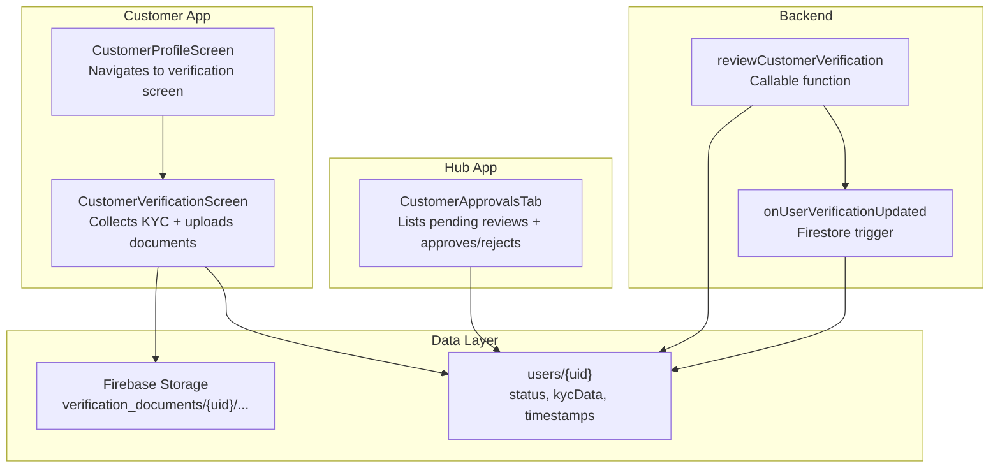
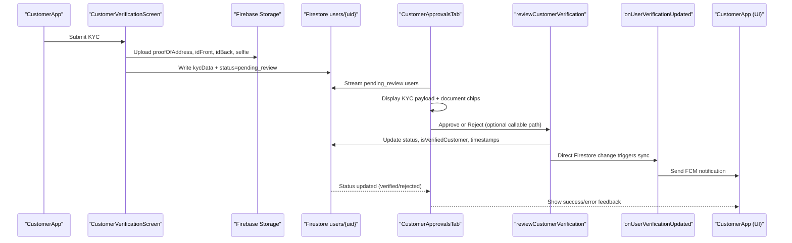
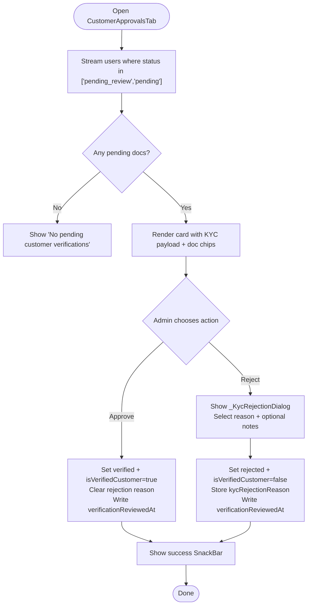
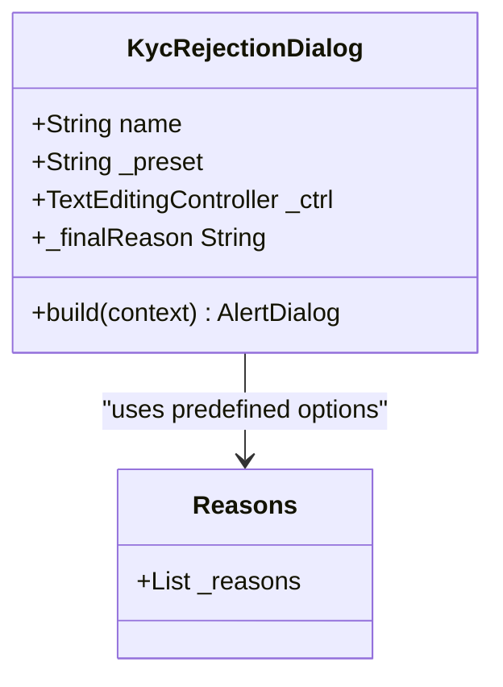
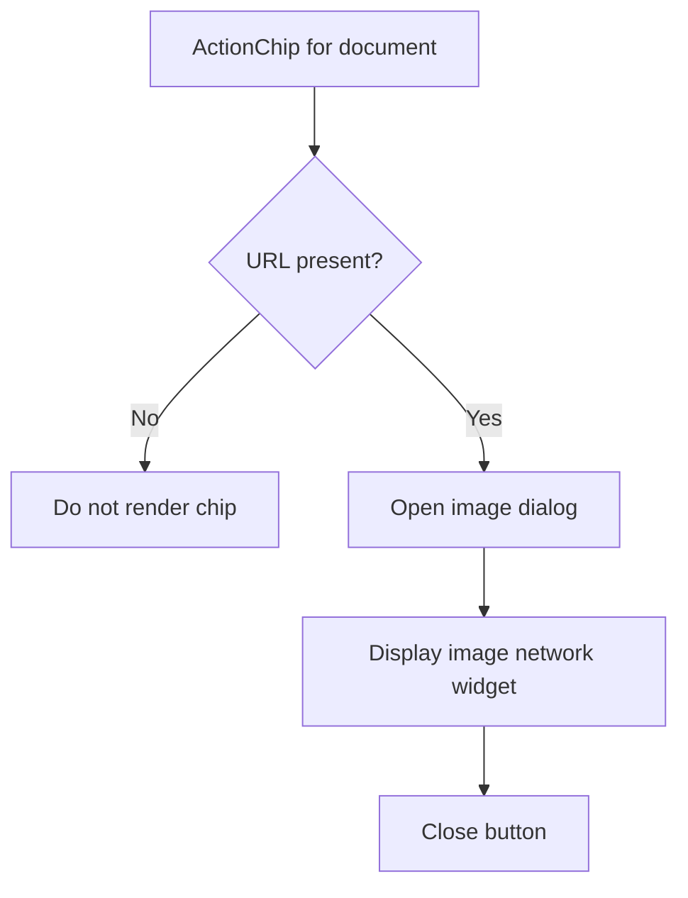
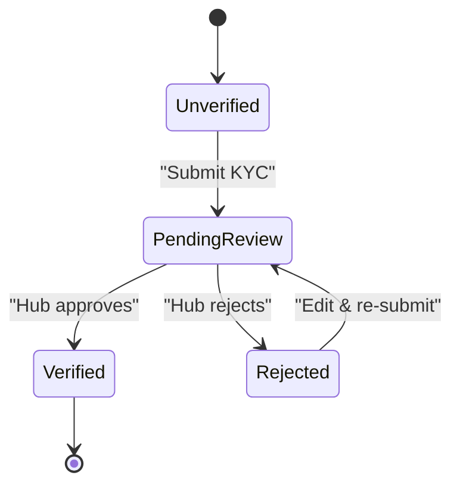
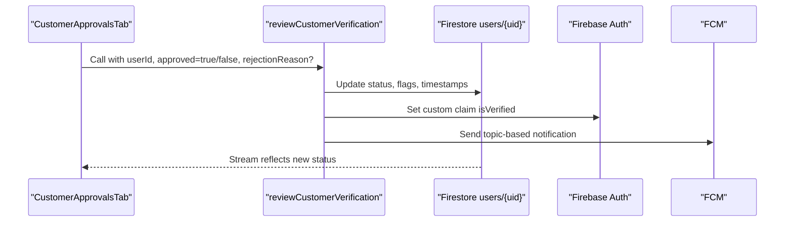
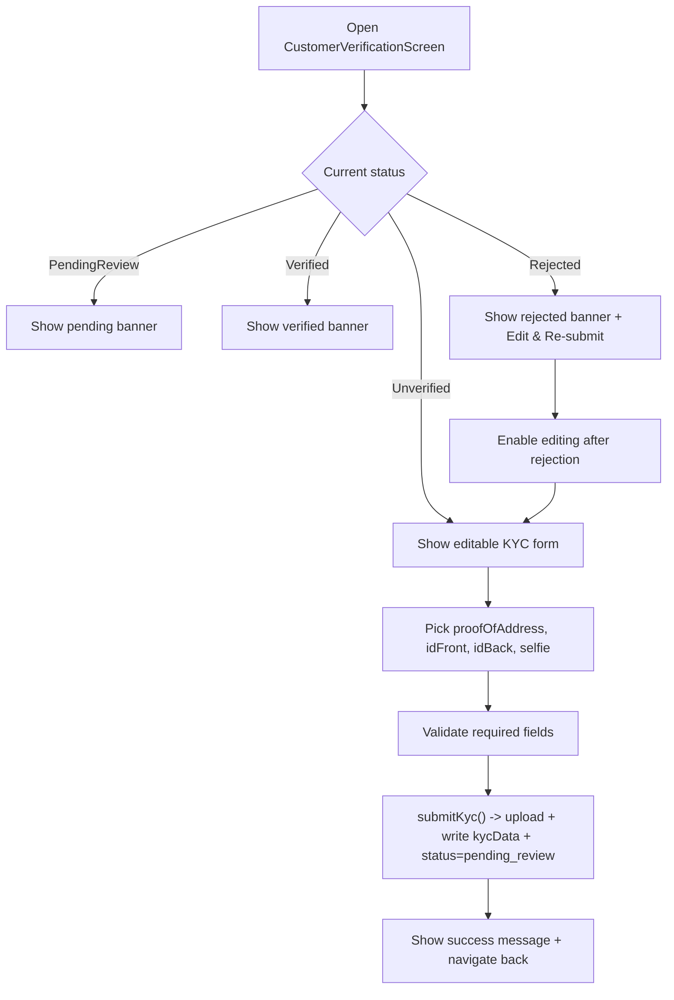
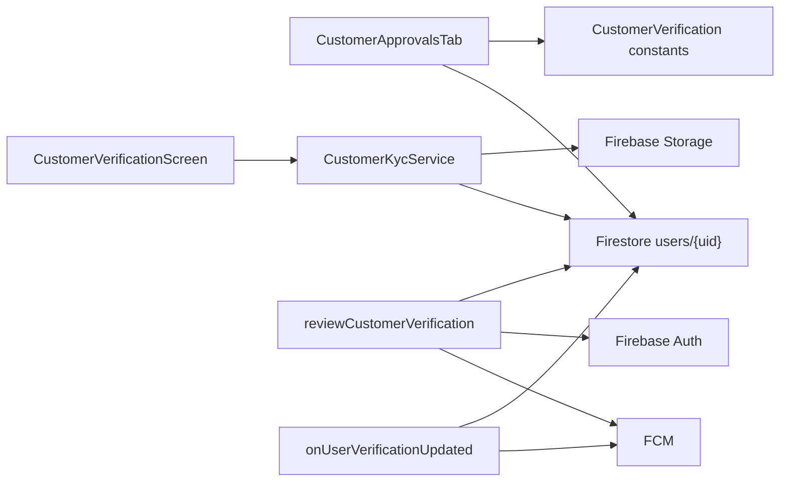

# Customer Verification Workflow

<cite>
**Referenced Files in This Document**
- [customer_approvals_tab.dart](file://sese_hub/lib/features/verification/presentation/customer_approvals_tab.dart)
- [verification.ts](file://functions/src/verification.ts)
- [driver_verification.dart](file://sese_core/lib/models/driver_verification.dart)
- [customer_verification_screen.dart](file://sese_ride/lib/features/customer/presentation/customer_verification_screen.dart)
- [customer_profile_screen.dart](file://sese_ride/lib/features/home/customer_profile_screen.dart)
</cite>

## Table of Contents
1. [Introduction](#introduction)
2. [Project Structure](#project-structure)
3. [Core Components](#core-components)
4. [Architecture Overview](#architecture-overview)
5. [Detailed Component Analysis](#detailed-component-analysis)
6. [Dependency Analysis](#dependency-analysis)
7. [Performance Considerations](#performance-considerations)
8. [Troubleshooting Guide](#troubleshooting-guide)
9. [Conclusion](#conclusion)

## Introduction
This document explains the customer verification workflow centered on the `CustomerApprovalsTab` component in the hub application. It covers how pending KYC submissions are displayed, how approvals and rejections are performed, how structured rejection reasons are captured, how document review works for proof of address, government ID photos, and selfie verification, and how status transitions from `pending_review` to `verified` or `rejected` are recorded with audit timestamps. It also documents integration points with core business logic through shared constants and backend functions that update Firestore, custom claims, and push notifications.

## Project Structure
The customer verification flow spans three main layers:
- Customer app (`sese_ride`): collects KYC data, uploads documents, and sets the user’s verification state to pending.
- Hub app (`sese_hub`): provides an admin UI to review pending verifications and approve or reject them.
- Backend Cloud Functions (`functions`): centralizes verification updates, custom claim synchronization, and push notifications.

**Diagram sources**
- [customer_verification_screen.dart:19-24](file://sese_ride/lib/features/customer/presentation/customer_verification_screen.dart#L19-L24)
- [customer_verification_screen.dart:630-699](file://sese_ride/lib/features/customer/presentation/customer_verification_screen.dart#L630-L699)
- [customer_profile_screen.dart:307-319](file://sese_ride/lib/features/home/customer_profile_screen.dart#L307-L319)
- [customer_approvals_tab.dart:8-17](file://sese_hub/lib/features/verification/presentation/customer_approvals_tab.dart#L8-L17)
- [verification.ts:19-30](file://functions/src/verification.ts#L19-L30)
- [verification.ts:243-297](file://functions/src/verification.ts#L243-L297)

**Section sources**
- [customer_verification_screen.dart:19-24](file://sese_ride/lib/features/customer/presentation/customer_verification_screen.dart#L19-L24)
- [customer_verification_screen.dart:630-699](file://sese_ride/lib/features/customer/presentation/customer_verification_screen.dart#L630-L699)
- [customer_profile_screen.dart:307-319](file://sese_ride/lib/features/home/customer_profile_screen.dart#L307-L319)
- [customer_approvals_tab.dart:8-17](file://sese_hub/lib/features/verification/presentation/customer_approvals_tab.dart#L8-L17)
- [verification.ts:19-30](file://functions/src/verification.ts#L19-L30)
- [verification.ts:243-297](file://functions/src/verification.ts#L243-L297)

## Core Components
- `CustomerVerificationScreen`: Customer-facing KYC form that collects personal information, employment details, government ID, and a live selfie. It uploads documents to storage and writes a nested KYC payload into the user document, setting the status to `pending_review`.
- `CustomerApprovalsTab`: Hub admin UI that streams users with pending verification, displays full KYC payload including document URLs, and allows approve or reject actions. Rejection uses a structured dialog with predefined reasons and optional notes.
- `CustomerVerification` constants: Shared model defining lifecycle states and Firestore field names used across apps and backend.
- `reviewCustomerVerification` callable: Backend function that updates Firestore fields, sets custom claims, and sends FCM notifications upon approval or rejection.
- `onUserVerificationUpdated` trigger: Backend listener that reacts to direct Firestore changes, synchronizing custom claims and sending notifications when status transitions occur.

**Section sources**
- [customer_verification_screen.dart:11-24](file://sese_ride/lib/features/customer/presentation/customer_verification_screen.dart#L11-L24)
- [customer_verification_screen.dart:630-699](file://sese_ride/lib/features/customer/presentation/customer_verification_screen.dart#L630-L699)
- [customer_approvals_tab.dart:8-17](file://sese_hub/lib/features/verification/presentation/customer_approvals_tab.dart#L8-L17)
- [driver_verification.dart:26-68](file://sese_core/lib/models/driver_verification.dart#L26-L68)
- [verification.ts:19-30](file://functions/src/verification.ts#L19-L30)
- [verification.ts:243-297](file://functions/src/verification.ts#L243-L297)

## Architecture Overview
The end-to-end verification process follows this sequence:
1. Customer submits KYC via `CustomerVerificationScreen`, which uploads documents and writes a `kycData` map plus status `pending_review` to `users/{uid}`.
2. Hub admin opens `CustomerApprovalsTab`, which streams pending users and shows their KYC payload and document links.
3. Admin approves or rejects:
   - Approval: sets verified status, clears rejection reason, records audit timestamp, and may call backend callable to synchronize claims and notify the user.
   - Rejection: prompts for a structured reason, stores it, sets rejected status, records audit timestamp, and may call backend callable to synchronize claims and notify the user.
4. Backend callable and trigger ensure consistent state across Firestore and Firebase Auth custom claims, and send push notifications.

**Diagram sources**
- [customer_verification_screen.dart:630-699](file://sese_ride/lib/features/customer/presentation/customer_verification_screen.dart#L630-L699)
- [customer_approvals_tab.dart:37-111](file://sese_hub/lib/features/verification/presentation/customer_approvals_tab.dart#L37-L111)
- [verification.ts:26-130](file://functions/src/verification.ts#L26-L130)
- [verification.ts:243-297](file://functions/src/verification.ts#L243-L297)

## Detailed Component Analysis

### CustomerApprovalsTab: Pending Review Queue and Actions
`CustomerApprovalsTab` streams users whose `customerVerificationStatus` is `pending_review` or legacy `pending`. For each user, it extracts the nested `kycData` map and renders:
- Personal info: date of birth, gender, residential address.
- Employment/organization: occupation, organization name, organization address.
- Government ID: type and number.
- Document photo chips: Proof of Address, ID Front, ID Back, Live Selfie. Clicking a chip opens an image viewer.

Approval action:
- Sets status to `verified`.
- Sets `isVerifiedCustomer` to true.
- Clears rejection reason.
- Writes `verificationReviewedAt` server timestamp.
- Shows success SnackBar.

Rejection action:
- Opens `_KycRejectionDialog` with predefined reasons and optional additional notes.
- Stores selected reason as `kycRejectionReason`.
- Sets status to `rejected`.
- Sets `isVerifiedCustomer` to false.
- Writes `verificationReviewedAt` server timestamp.
- Shows success SnackBar.

Error handling:
- Catches exceptions during Firestore writes and shows error SnackBar.
- Handles session expiration by rendering a dedicated hub session expired view.

**Diagram sources**
- [customer_approvals_tab.dart:37-111](file://sese_hub/lib/features/verification/presentation/customer_approvals_tab.dart#L37-L111)
- [customer_approvals_tab.dart:113-144](file://sese_hub/lib/features/verification/presentation/customer_approvals_tab.dart#L113-L144)
- [customer_approvals_tab.dart:367-449](file://sese_hub/lib/features/verification/presentation/customer_approvals_tab.dart#L367-L449)

**Section sources**
- [customer_approvals_tab.dart:8-17](file://sese_hub/lib/features/verification/presentation/customer_approvals_tab.dart#L8-L17)
- [customer_approvals_tab.dart:37-111](file://sese_hub/lib/features/verification/presentation/customer_approvals_tab.dart#L37-L111)
- [customer_approvals_tab.dart:113-144](file://sese_hub/lib/features/verification/presentation/customer_approvals_tab.dart#L113-L144)
- [customer_approvals_tab.dart:146-319](file://sese_hub/lib/features/verification/presentation/customer_approvals_tab.dart#L146-L319)
- [customer_approvals_tab.dart:367-449](file://sese_hub/lib/features/verification/presentation/customer_approvals_tab.dart#L367-L449)

### Structured Rejection Reason System
The rejection dialog presents radio options:
- Blurry or unreadable document image
- Name mismatch between ID and form
- Invalid or expired ID number
- Selfie does not match ID photo
- Proof of address insufficient
- Other (specify below)

Users can add additional notes. The final reason is either the selected preset or the typed text if “Other” is chosen. This reason is stored in `kycRejectionReason` and later shown to the customer.

**Diagram sources**
- [customer_approvals_tab.dart:367-449](file://sese_hub/lib/features/verification/presentation/customer_approvals_tab.dart#L367-L449)

**Section sources**
- [customer_approvals_tab.dart:367-449](file://sese_hub/lib/features/verification/presentation/customer_approvals_tab.dart#L367-L449)

### Document Review Capabilities
For each pending verification, the tab displays clickable chips for:
- Proof of Address
- ID Front
- ID Back
- Live Selfie

Clicking a chip opens a dialog showing the image URL. If the URL is empty, no chip is rendered. This enables admins to visually verify uploaded documents before making decisions.

**Diagram sources**
- [customer_approvals_tab.dart:265-285](file://sese_hub/lib/features/verification/presentation/customer_approvals_tab.dart#L265-L285)
- [customer_approvals_tab.dart:113-144](file://sese_hub/lib/features/verification/presentation/customer_approvals_tab.dart#L113-L144)

**Section sources**
- [customer_approvals_tab.dart:265-285](file://sese_hub/lib/features/verification/presentation/customer_approvals_tab.dart#L265-L285)
- [customer_approvals_tab.dart:113-144](file://sese_hub/lib/features/verification/presentation/customer_approvals_tab.dart#L113-L144)

### Status Transitions and Audit Trail
Lifecycle states defined in shared constants:
- `unverified`: default; invites submission.
- `pending_review`: submitted; awaiting hub approval.
- `verified`: approved; ride requests carry `isVerifiedCustomer: true`.
- `rejected`: rejected; reason stored in `kycRejectionReason`.

Audit trail:
- Both approval and rejection write `verificationReviewedAt` using server timestamp.
- Backend callable and trigger also set `verificationReviewedAt` when updating status.

**Diagram sources**
- [driver_verification.dart:26-68](file://sese_core/lib/models/driver_verification.dart#L26-L68)
- [customer_verification_screen.dart:19-24](file://sese_ride/lib/features/customer/presentation/customer_verification_screen.dart#L19-L24)
- [customer_approvals_tab.dart:50-111](file://sese_hub/lib/features/verification/presentation/customer_approvals_tab.dart#L50-L111)
- [verification.ts:43-96](file://functions/src/verification.ts#L43-L96)

**Section sources**
- [driver_verification.dart:26-68](file://sese_core/lib/models/driver_verification.dart#L26-L68)
- [customer_verification_screen.dart:19-24](file://sese_ride/lib/features/customer/presentation/customer_verification_screen.dart#L19-L24)
- [customer_approvals_tab.dart:50-111](file://sese_hub/lib/features/verification/presentation/customer_approvals_tab.dart#L50-L111)
- [verification.ts:43-96](file://functions/src/verification.ts#L43-L96)

### Integration with Core Business Logic
Shared constants in `CustomerVerification` define field names and lifecycle values used across apps and backend:
- `fieldStatus`: `customerVerificationStatus`
- `fieldIsVerified`: `isVerifiedCustomer`
- `fieldRejectionReason`: `kycRejectionReason`
- `fieldKycData`: `kycData`

Backend callable `reviewCustomerVerification`:
- Validates authentication and arguments.
- On approval: sets `customerVerificationStatus` and `verificationStatus` to `verified`, sets `isVerifiedCustomer` to true, clears rejection reason, writes `verificationReviewedAt`, updates custom claim `isVerified`, and sends FCM notification.
- On rejection: sets statuses to `rejected`, sets `isVerifiedCustomer` to false, stores `kycRejectionReason`, writes `verificationReviewedAt`, updates custom claim `isVerified` to false, and sends FCM notification.

Backend trigger `onUserVerificationUpdated`:
- Observes changes on `users/{userId}`.
- If status changed to `verified`, ensures custom claim `isVerified` is set to true.
- If status changed to `rejected`, sends FCM notification with reason.

**Diagram sources**
- [verification.ts:26-130](file://functions/src/verification.ts#L26-L130)
- [verification.ts:243-297](file://functions/src/verification.ts#L243-L297)
- [driver_verification.dart:47-54](file://sese_core/lib/models/driver_verification.dart#L47-L54)

**Section sources**
- [driver_verification.dart:47-54](file://sese_core/lib/models/driver_verification.dart#L47-L54)
- [verification.ts:26-130](file://functions/src/verification.ts#L26-L130)
- [verification.ts:243-297](file://functions/src/verification.ts#L243-L297)

### Customer Submission Flow and Read-Only States
`CustomerVerificationScreen`:
- Collects personal info, employment/org info, government ID, and live selfie.
- Uses `DocumentUploadCard` for file picking; selfie is camera-only.
- Submits via `CustomerKycService.submitKyc`, which uploads files to storage and writes a nested `kycData` map plus status `pending_review`.
- Locks the form when status is pending, verified, or rejected (unless editing after rejection).
- Displays contextual banners for verified, pending, and rejected states.

**Diagram sources**
- [customer_verification_screen.dart:94-101](file://sese_ride/lib/features/customer/presentation/customer_verification_screen.dart#L94-L101)
- [customer_verification_screen.dart:195-244](file://sese_ride/lib/features/customer/presentation/customer_verification_screen.dart#L195-L244)
- [customer_verification_screen.dart:256-495](file://sese_ride/lib/features/customer/presentation/customer_verification_screen.dart#L256-L495)
- [customer_verification_screen.dart:630-699](file://sese_ride/lib/features/customer/presentation/customer_verification_screen.dart#L630-L699)

**Section sources**
- [customer_verification_screen.dart:94-101](file://sese_ride/lib/features/customer/presentation/customer_verification_screen.dart#L94-L101)
- [customer_verification_screen.dart:195-244](file://sese_ride/lib/features/customer/presentation/customer_verification_screen.dart#L195-L244)
- [customer_verification_screen.dart:256-495](file://sese_ride/lib/features/customer/presentation/customer_verification_screen.dart#L256-L495)
- [customer_verification_screen.dart:630-699](file://sese_ride/lib/features/customer/presentation/customer_verification_screen.dart#L630-L699)

## Dependency Analysis
Key dependencies and relationships:
- `CustomerApprovalsTab` depends on:
  - Firestore stream filtering by `CustomerVerification.fieldStatus`.
  - Shared constants from `CustomerVerification` for field names and status values.
  - Hub session guard for token refresh and session expiration handling.
- `CustomerVerificationScreen` depends on:
  - `CustomerKycService` for storage upload and Firestore writes.
  - Shared constants for status values and field names.
- Backend callable and trigger depend on:
  - Firestore for reading/writing user documents.
  - Firebase Auth for custom claims.
  - Firebase Messaging for push notifications.

**Diagram sources**
- [customer_approvals_tab.dart:37-111](file://sese_hub/lib/features/verification/presentation/customer_approvals_tab.dart#L37-L111)
- [driver_verification.dart:47-54](file://sese_core/lib/models/driver_verification.dart#L47-L54)
- [customer_verification_screen.dart:630-699](file://sese_ride/lib/features/customer/presentation/customer_verification_screen.dart#L630-L699)
- [verification.ts:26-130](file://functions/src/verification.ts#L26-L130)
- [verification.ts:243-297](file://functions/src/verification.ts#L243-L297)

**Section sources**
- [customer_approvals_tab.dart:37-111](file://sese_hub/lib/features/verification/presentation/customer_approvals_tab.dart#L37-L111)
- [driver_verification.dart:47-54](file://sese_core/lib/models/driver_verification.dart#L47-L54)
- [customer_verification_screen.dart:630-699](file://sese_ride/lib/features/customer/presentation/customer_verification_screen.dart#L630-L699)
- [verification.ts:26-130](file://functions/src/verification.ts#L26-L130)
- [verification.ts:243-297](file://functions/src/verification.ts#L243-L297)

## Performance Considerations
- Streaming pending verifications: Using Firestore snapshots avoids polling and reduces latency. Ensure indexes exist for queries on `customerVerificationStatus` to avoid performance penalties.
- Image loading: Document chips load images over the network; consider caching strategies or preloading thumbnails for large queues.
- Batch operations: When approving or rejecting multiple customers, consider batching Firestore writes to reduce round-trips.
- Error retries: Network failures during storage uploads should be retried with exponential backoff to improve reliability.

[No sources needed since this section provides general guidance]

## Troubleshooting Guide
Common issues and resolutions:
- Session expired in hub:
  - Symptom: Hub session expired view appears when streaming verifications.
  - Resolution: Refresh token via `ensureFreshHubIdToken()` and retry.
- Firestore write errors:
  - Symptom: SnackBar shows error verifying/rejecting.
  - Resolution: Check permissions, network connectivity, and field names; validate that `customerVerificationStatus` matches expected values.
- Missing document URLs:
  - Symptom: Document chips not rendered.
  - Resolution: Confirm storage upload succeeded and URLs are written into `kycData`; check storage rules and paths.
- Rejection reason not persisted:
  - Symptom: Rejection reason missing in customer app.
  - Resolution: Ensure `_KycRejectionDialog` returns non-empty reason and it is stored in `kycRejectionReason`.

**Section sources**
- [customer_approvals_tab.dart:146-162](file://sese_hub/lib/features/verification/presentation/customer_approvals_tab.dart#L146-L162)
- [customer_approvals_tab.dart:50-111](file://sese_hub/lib/features/verification/presentation/customer_approvals_tab.dart#L50-L111)
- [customer_verification_screen.dart:630-699](file://sese_ride/lib/features/customer/presentation/customer_verification_screen.dart#L630-L699)

## Conclusion
The customer verification workflow integrates a robust customer submission flow, a comprehensive hub review interface, and backend safeguards for state consistency and user notifications. `CustomerApprovalsTab` provides clear visibility into pending KYC submissions with full payload inspection and supports structured rejection reasons. Status transitions are audited with server timestamps, and backend callable/trigger mechanisms ensure downstream processes such as custom claims and push notifications are reliably triggered upon approval or rejection.

[No sources needed since this section summarizes without analyzing specific files]