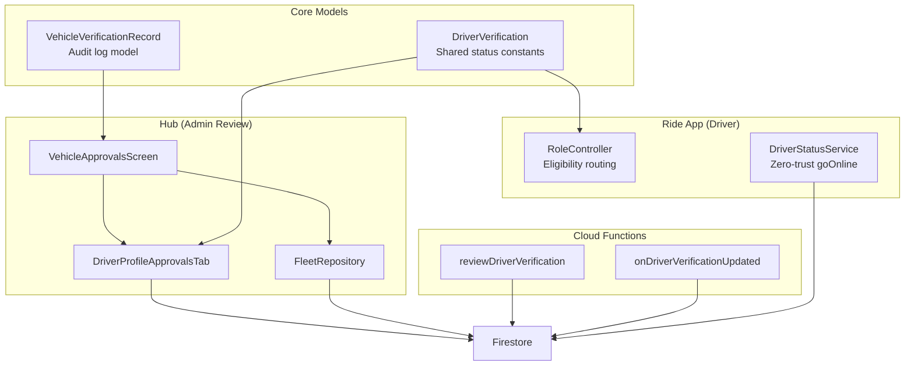
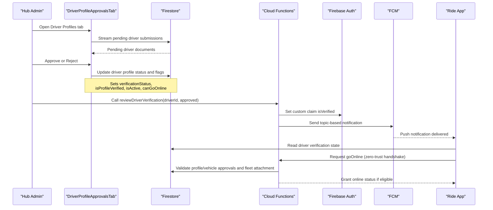
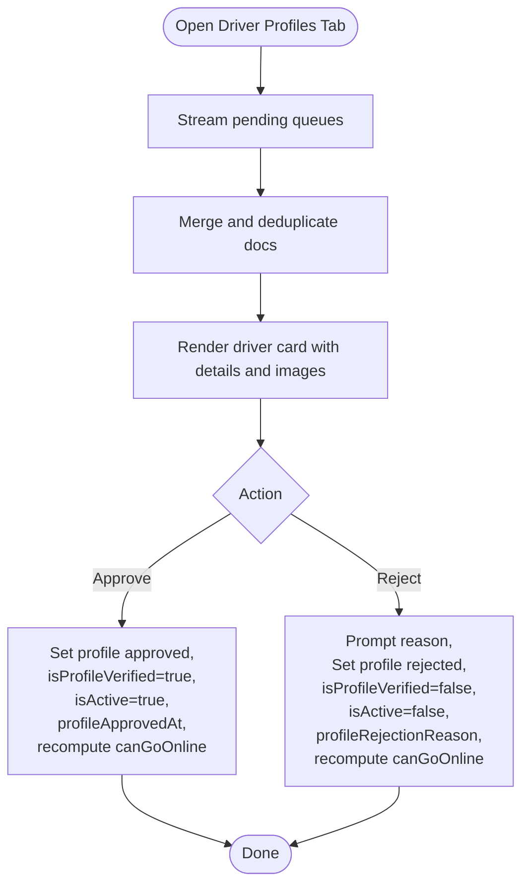
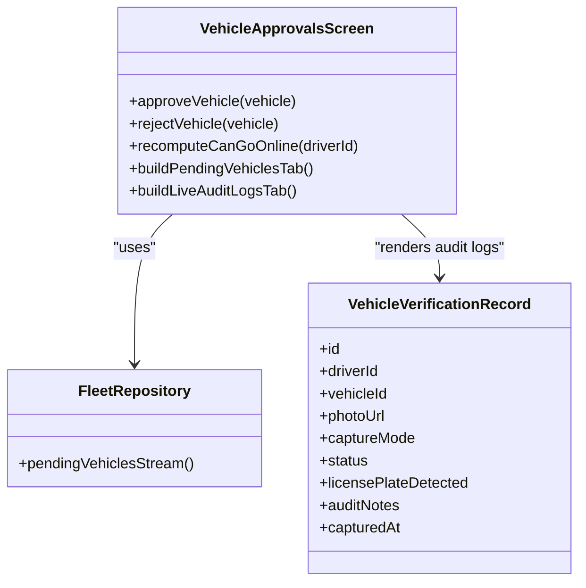
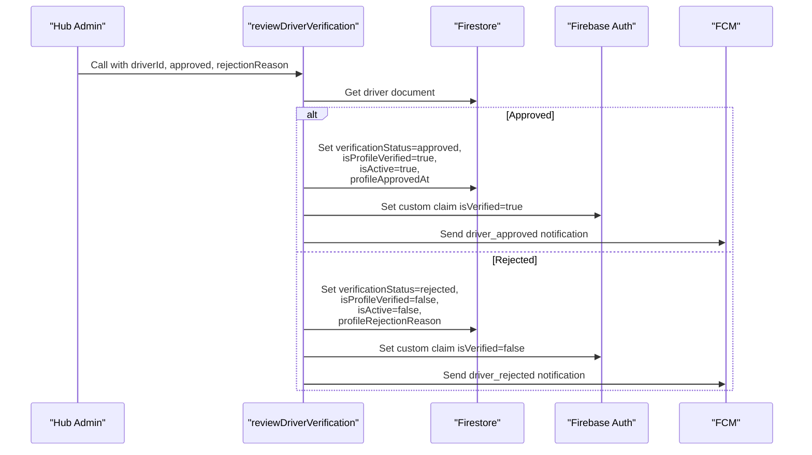
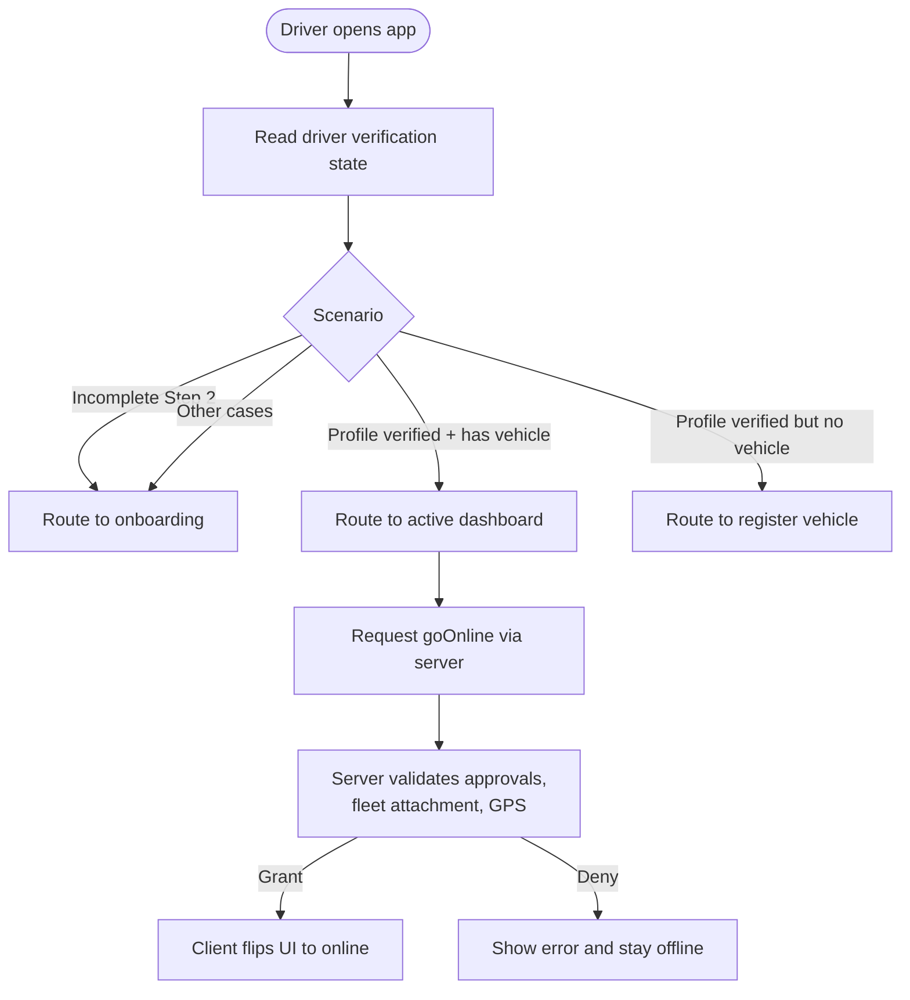
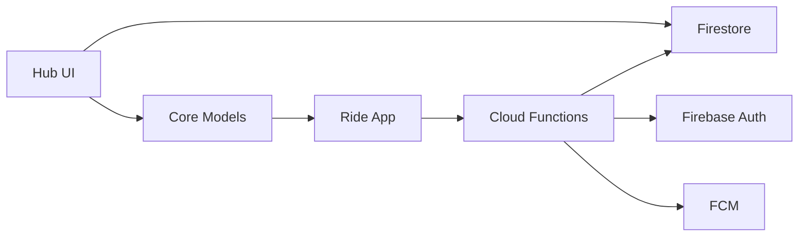

# Driver Profile Verification

<cite>
**Referenced Files in This Document**
- [driver_profile_approvals_tab.dart](file://sese_hub/lib/features/verification/presentation/driver_profile_approvals_tab.dart)
- [vehicle_approvals_screen.dart](file://sese_hub/lib/features/verification/presentation/vehicle_approvals_screen.dart)
- [fleet_repository.dart](file://sese_hub/lib/features/verification/services/fleet_repository.dart)
- [driver_verification.dart](file://sese_core/lib/models/driver_verification.dart)
- [vehicle_verification_model.dart](file://sese_core/lib/models/vehicle_verification_model.dart)
- [verification.ts](file://functions/src/verification.ts)
- [driver_status_service.dart](file://sese_ride/lib/features/driver/services/driver_status_service.dart)
- [role_controller.dart](file://sese_ride/lib/features/settings/role_controller.dart)
- [firestore.rules](file://firestore.rules)
</cite>

## Table of Contents
1. [Introduction](#introduction)
2. [Project Structure](#project-structure)
3. [Core Components](#core-components)
4. [Architecture Overview](#architecture-overview)
5. [Detailed Component Analysis](#detailed-component-analysis)
6. [Dependency Analysis](#dependency-analysis)
7. [Performance Considerations](#performance-considerations)
8. [Troubleshooting Guide](#troubleshooting-guide)
9. [Conclusion](#conclusion)

## Introduction
This document explains the driver profile verification system used for ride-hailing and delivery onboarding. It focuses on how the Hub’s `DriverProfileApprovalsTab` reviews driver credentials, background-related documents, and qualification materials; how verification status is managed; and how approved drivers gain access to online operations through fleet integration. It also covers notifications, audit trails, and compliance controls enforced by Firestore rules and server-side functions.

The system separates responsibilities across:
- Hub UI: manual review and approval/rejection of driver profiles and vehicles.
- Core models: shared verification state constants and audit log structures.
- Cloud Functions: secure backend entry points, custom claims, and push notifications.
- Ride app: client-side eligibility checks and zero-trust availability handshake.
- Firestore rules: read/write guards for sensitive verification data.

## Project Structure
The driver verification flow spans multiple modules:

**Diagram sources**
- [vehicle_approvals_screen.dart:10-39](file://sese_hub/lib/features/verification/presentation/vehicle_approvals_screen.dart#L10-L39)
- [driver_profile_approvals_tab.dart:18-37](file://sese_hub/lib/features/verification/presentation/driver_profile_approvals_tab.dart#L18-L37)
- [fleet_repository.dart:137-187](file://sese_hub/lib/features/verification/services/fleet_repository.dart#L137-L187)
- [driver_verification.dart:1-24](file://sese_core/lib/models/driver_verification.dart#L1-L24)
- [vehicle_verification_model.dart:1-40](file://sese_core/lib/models/vehicle_verification_model.dart#L1-L40)
- [verification.ts:138-240](file://functions/src/verification.ts#L138-L240)
- [verification.ts:304-349](file://functions/src/verification.ts#L304-L349)
- [role_controller.dart:72-114](file://sese_ride/lib/features/settings/role_controller.dart#L72-L114)
- [driver_status_service.dart:147-157](file://sese_ride/lib/features/driver/services/driver_status_service.dart#L147-L157)

**Section sources**
- [vehicle_approvals_screen.dart:10-39](file://sese_hub/lib/features/verification/presentation/vehicle_approvals_screen.dart#L10-L39)
- [driver_profile_approvals_tab.dart:18-37](file://sese_hub/lib/features/verification/presentation/driver_profile_approvals_tab.dart#L18-L37)
- [driver_verification.dart:1-24](file://sese_core/lib/models/driver_verification.dart#L1-L24)

## Core Components
- Driver profile audit queue: The Hub tab streams pending driver submissions and renders personal details, government ID captures, live selfie, and emergency contact information.
- Shared verification state: Constants define lifecycle statuses and fields such as profile verification, vehicle verification, and online eligibility.
- Fleet repository: Aggregates pending vehicle registrations and related driver verification streams for the Hub desk.
- Audit logs: A structured model records pre-online camera-only verifications with timestamps and notes.
- Backend verification callable and triggers: Securely approve or reject drivers, update custom claims, and send push notifications.
- Client eligibility and availability: The Ride app evaluates onboarding scenarios and enforces a zero-trust handshake before going online.

**Section sources**
- [driver_profile_approvals_tab.dart:9-17](file://sese_hub/lib/features/verification/presentation/driver_profile_approvals_tab.dart#L9-L17)
- [driver_verification.dart:1-24](file://sese_core/lib/models/driver_verification.dart#L1-L24)
- [fleet_repository.dart:137-187](file://sese_hub/lib/features/verification/services/fleet_repository.dart#L137-L187)
- [vehicle_verification_model.dart:1-40](file://sese_core/lib/models/vehicle_verification_model.dart#L1-L40)
- [verification.ts:138-240](file://functions/src/verification.ts#L138-L240)
- [role_controller.dart:72-114](file://sese_ride/lib/features/settings/role_controller.dart#L72-L114)
- [driver_status_service.dart:147-157](file://sese_ride/lib/features/driver/services/driver_status_service.dart#L147-L157)

## Architecture Overview
The verification architecture combines real-time Hub UI, shared domain models, server-side enforcement, and client-side eligibility logic.

**Diagram sources**
- [driver_profile_approvals_tab.dart:39-117](file://sese_hub/lib/features/verification/presentation/driver_profile_approvals_tab.dart#L39-L117)
- [driver_profile_approvals_tab.dart:135-202](file://sese_hub/lib/features/verification/presentation/driver_profile_approvals_tab.dart#L135-L202)
- [verification.ts:138-240](file://functions/src/verification.ts#L138-L240)
- [driver_status_service.dart:147-157](file://sese_ride/lib/features/driver/services/driver_status_service.dart#L147-L157)

## Detailed Component Analysis

### DriverProfileApprovalsTab
Responsibilities:
- Streams three overlapping queries to collect all pending driver profiles, including legacy states.
- Renders driver identity, address, date of birth, gender, ID type/number/expiry, next-of-kin details, and document images.
- Provides Approve and Reject actions that update Firestore fields and recompute online eligibility.
- Shows image previews for ID front/back and live selfie.

Key behaviors:
- Queue merging: Combines results from multiple streams and filters out already approved or rejected entries unless they are still pending verification.
- Approval: Sets profile status to approved, marks profile verified, enables the account, clears pending review, records approval timestamp, and recomputes `canGoOnline`.
- Rejection: Prompts for a reason, sets profile status to rejected, disables the account, clears profile verification, stores rejection reason, and recomputes `canGoOnline`.
- Error handling: Displays user-facing messages and handles session expiration errors.

**Diagram sources**
- [driver_profile_approvals_tab.dart:39-117](file://sese_hub/lib/features/verification/presentation/driver_profile_approvals_tab.dart#L39-L117)
- [driver_profile_approvals_tab.dart:135-202](file://sese_hub/lib/features/verification/presentation/driver_profile_approvals_tab.dart#L135-L202)

**Section sources**
- [driver_profile_approvals_tab.dart:9-17](file://sese_hub/lib/features/verification/presentation/driver_profile_approvals_tab.dart#L9-L17)
- [driver_profile_approvals_tab.dart:39-117](file://sese_hub/lib/features/verification/presentation/driver_profile_approvals_tab.dart#L39-L117)
- [driver_profile_approvals_tab.dart:135-202](file://sese_hub/lib/features/verification/presentation/driver_profile_approvals_tab.dart#L135-L202)
- [driver_profile_approvals_tab.dart:204-235](file://sese_hub/lib/features/verification/presentation/driver_profile_approvals_tab.dart#L204-L235)
- [driver_profile_approvals_tab.dart:237-427](file://sese_hub/lib/features/verification/presentation/driver_profile_approvals_tab.dart#L237-L427)

### VehicleApprovalsScreen and Fleet Repository
Responsibilities:
- Unified Hub desk for pending vehicle registrations, pre-online audit logs, driver profiles, and customer approvals.
- Approves or rejects vehicles, updating canonical and legacy fields, marking driver-level vehicle verification, and recomputing `canGoOnline`.
- Presents category-aware document requirements and plate cross-check guidance.
- Streams live audit logs for camera-only pre-online verifications.

Key behaviors:
- Vehicle approval: Updates vehicle verification status, sets driver-level `isVehicleVerified`, and recomputes `canGoOnline`.
- Vehicle rejection: Stores rejection reason and updates legacy alias fields for compatibility.
- Audit logs: Reads recent `driver_vehicle_verification` records with capture mode, detected plate, notes, and timestamps.

**Diagram sources**
- [vehicle_approvals_screen.dart:41-144](file://sese_hub/lib/features/verification/presentation/vehicle_approvals_screen.dart#L41-L144)
- [vehicle_approvals_screen.dart:261-414](file://sese_hub/lib/features/verification/presentation/vehicle_approvals_screen.dart#L261-L414)
- [vehicle_approvals_screen.dart:564-643](file://sese_hub/lib/features/verification/presentation/vehicle_approvals_screen.dart#L564-L643)
- [fleet_repository.dart:137-187](file://sese_hub/lib/features/verification/services/fleet_repository.dart#L137-L187)
- [vehicle_verification_model.dart:1-40](file://sese_core/lib/models/vehicle_verification_model.dart#L1-L40)

**Section sources**
- [vehicle_approvals_screen.dart:41-144](file://sese_hub/lib/features/verification/presentation/vehicle_approvals_screen.dart#L41-L144)
- [vehicle_approvals_screen.dart:261-414](file://sese_hub/lib/features/verification/presentation/vehicle_approvals_screen.dart#L261-L414)
- [vehicle_approvals_screen.dart:564-643](file://sese_hub/lib/features/verification/presentation/vehicle_approvals_screen.dart#L564-L643)
- [fleet_repository.dart:137-187](file://sese_hub/lib/features/verification/services/fleet_repository.dart#L137-L187)
- [vehicle_verification_model.dart:1-40](file://sese_core/lib/models/vehicle_verification_model.dart#L1-L40)

### Shared Verification Model
Purpose:
- Centralizes driver verification lifecycle constants and field names used across Hub and Ride apps.
- Defines statuses: pending onboarding, pending review, approved, rejected.
- Declares fields for profile verification, vehicle verification, and online eligibility.

Implications:
- Ensures consistent status values and field keys across UI and backend.
- Guides eligibility logic: drivers may only go online when both profile and vehicle are verified.

**Section sources**
- [driver_verification.dart:1-24](file://sese_core/lib/models/driver_verification.dart#L1-L24)

### Cloud Functions: Driver Verification Callable and Triggers
Responsibilities:
- `reviewDriverVerification`: Server-side callable for approving or rejecting driver profiles.
- `onDriverVerificationUpdated`: Trigger that syncs custom claims and sends notifications when driver verification status changes.

Key behaviors:
- Approval path: Sets driver verification status to approved, marks profile verified, activates account, clears rejection reason, records approval timestamp, updates custom claim `isVerified`, and sends an FCM notification.
- Rejection path: Sets status to rejected, deactivates account, stores rejection reason, updates custom claim `isVerified` to false, and sends an FCM notification.
- Trigger path: On direct Firestore updates, ensures custom claims match status and notifies drivers when rejected.

**Diagram sources**
- [verification.ts:138-240](file://functions/src/verification.ts#L138-L240)
- [verification.ts:304-349](file://functions/src/verification.ts#L304-L349)

**Section sources**
- [verification.ts:138-240](file://functions/src/verification.ts#L138-L240)
- [verification.ts:304-349](file://functions/src/verification.ts#L304-L349)

### Ride App Eligibility and Zero-Trust Availability
Responsibilities:
- Evaluate driver onboarding scenario based on profile/vehicle verification and step completion.
- Enforce zero-trust availability: clients never self-flip online; every transition requires server grant after validating JWT, approvals, suspension, fleet attachment, and GPS integrity.

Key behaviors:
- Role controller reads driver verification fields and determines whether the driver should be routed to onboarding, vehicle registration, or active dashboard.
- Driver status service calls server functions to request online/offline transitions and displays errors when backend is unavailable or requests are denied.

**Diagram sources**
- [role_controller.dart:72-114](file://sese_ride/lib/features/settings/role_controller.dart#L72-L114)
- [driver_status_service.dart:147-157](file://sese_ride/lib/features/driver/services/driver_status_service.dart#L147-L157)

**Section sources**
- [role_controller.dart:72-114](file://sese_ride/lib/features/settings/role_controller.dart#L72-L114)
- [driver_status_service.dart:147-157](file://sese_ride/lib/features/driver/services/driver_status_service.dart#L147-L157)

### Compliance and Security Controls
- Firestore rules enforce strict write permissions for sensitive verification collections:
  - `/driver_status/{driverId}`: Only server callables can write; agents and owners can read.
  - `/driver_kyc/{driverId}`: Written exclusively by Cloud Functions; readable by owner and agents/admins.
- These rules ensure that verification state cannot be tampered with by clients and that KYC data remains protected.

**Section sources**
- [firestore.rules:1080-1105](file://firestore.rules#L1080-L1105)

## Dependency Analysis
The verification system exhibits clear separation of concerns:
- Hub UI depends on Firestore streams and core models.
- Core models provide shared constants and audit structures consumed by Hub and Ride apps.
- Cloud Functions depend on Firestore and Firebase Auth/FCM to enforce policy and notify users.
- Ride app depends on core models and server callables for eligibility and availability.

**Diagram sources**
- [driver_profile_approvals_tab.dart:18-37](file://sese_hub/lib/features/verification/presentation/driver_profile_approvals_tab.dart#L18-L37)
- [driver_verification.dart:1-24](file://sese_core/lib/models/driver_verification.dart#L1-L24)
- [verification.ts:138-240](file://functions/src/verification.ts#L138-L240)
- [driver_status_service.dart:147-157](file://sese_ride/lib/features/driver/services/driver_status_service.dart#L147-L157)

**Section sources**
- [driver_profile_approvals_tab.dart:18-37](file://sese_hub/lib/features/verification/presentation/driver_profile_approvals_tab.dart#L18-L37)
- [driver_verification.dart:1-24](file://sese_core/lib/models/driver_verification.dart#L1-L24)
- [verification.ts:138-240](file://functions/src/verification.ts#L138-L240)
- [driver_status_service.dart:147-157](file://sese_ride/lib/features/driver/services/driver_status_service.dart#L147-L157)

## Performance Considerations
- Real-time streams: The Hub tab merges three Firestore streams; consider indexing frequently queried fields (`profileStatus`, `isPendingReview`, `verificationStatus`) to reduce latency and costs.
- Batch updates: Approval and rejection actions perform multiple writes; use transactions or batched writes where appropriate to minimize partial updates.
- Image loading: Large document images can impact UI responsiveness; lazy-load and cache images where possible.
- Function retries: FCM and Auth operations are wrapped in try/catch; monitor failures and implement retry strategies for critical paths.

[No sources needed since this section provides general guidance]

## Troubleshooting Guide
Common issues and resolutions:
- Session expiration in Hub UI: When Firestore streams fail due to expired Hub sessions, the UI shows a dedicated expired view; refresh the ID token before opening streams.
- Pending queue not updating: Verify that driver documents contain expected status fields and that indexes exist for queried fields.
- Driver cannot go online: Ensure both `isProfileVerified` and `isVehicleVerified` are true; check server-side validation and fleet attachment.
- Notifications not received: Confirm FCM topics are correct and that device tokens are registered; inspect function logs for send failures.

**Section sources**
- [driver_profile_approvals_tab.dart:237-253](file://sese_hub/lib/features/verification/presentation/driver_profile_approvals_tab.dart#L237-L253)
- [vehicle_approvals_screen.dart:261-290](file://sese_hub/lib/features/verification/presentation/vehicle_approvals_screen.dart#L261-L290)
- [driver_status_service.dart:125-144](file://sese_ride/lib/features/driver/services/driver_status_service.dart#L125-L144)
- [verification.ts:178-193](file://functions/src/verification.ts#L178-L193)

## Conclusion
The driver profile verification system provides a robust, auditable pipeline for onboarding drivers into ride-hailing and delivery services. The Hub’s `DriverProfileApprovalsTab` centralizes manual review of credentials and documents, while shared models and server-side functions enforce consistent state, security, and notifications. Fleet integration ensures that only fully verified drivers can go online, backed by zero-trust availability checks and strict Firestore rules. Together, these components deliver a compliant, scalable verification workflow suitable for high-stakes mobility operations.

[No sources needed since this section summarizes without analyzing specific files]