# User Verification Management

<cite>
**Referenced Files in This Document**
- [driver_verification.dart](file://sese_core/lib/models/driver_verification.dart)
- [vehicle_category.dart](file://sese_core/lib/models/vehicle_category.dart)
- [vehicle_verification_model.dart](file://sese_core/lib/models/vehicle_verification_model.dart)
- [fleet_repository.dart](file://sese_hub/lib/features/verification/services/fleet_repository.dart)
- [vehicle_approvals_screen.dart](file://sese_hub/lib/features/verification/presentation/vehicle_approvals_screen.dart)
- [customer_approvals_tab.dart](file://sese_hub/lib/features/verification/presentation/customer_approvals_tab.dart)
- [driver_profile_approvals_tab.dart](file://sese_hub/lib/features/verification/presentation/driver_profile_approvals_tab.dart)
- [verification.ts](file://functions/src/verification.ts)
- [driverStatus.ts](file://functions/src/driverStatus.ts)
- [customer_verification_screen.dart](file://sese_ride/lib/features/customer/presentation/customer_verification_screen.dart)
- [online_verification_shield_modal.dart](file://sese_ride/lib/features/driver/presentation/online_verification_shield_modal.dart)
</cite>

## Table of Contents
1. [Introduction](#introduction)
2. [Project Structure](#project-structure)
3. [Core Components](#core-components)
4. [Architecture Overview](#architecture-overview)
5. [Detailed Component Analysis](#detailed-component-analysis)
6. [Dependency Analysis](#dependency-analysis)
7. [Performance Considerations](#performance-considerations)
8. [Troubleshooting Guide](#troubleshooting-guide)
9. [Conclusion](#conclusion)

## Introduction
This document explains the user verification and approval system across three workflows:
- Customer KYC approvals
- Driver profile approvals
- Vehicle verifications

It covers how submissions are reviewed, approved or rejected, how statuses are tracked, how notifications are sent, and how downstream business logic is triggered. It also documents the fleet repository service used by the hub to manage vehicle-related verifications, including queue matching, audit logs, and integration points with core models and server-side functions.

## Project Structure
The verification system spans shared models, hub UI for admin review, ride app flows for users/drivers, and backend Cloud Functions for side effects (claims, notifications, guards).

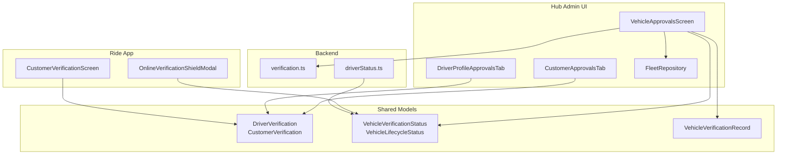

**Diagram sources**
- [driver_verification.dart:1-69](file://sese_core/lib/models/driver_verification.dart#L1-L69)
- [vehicle_category.dart:72-141](file://sese_core/lib/models/vehicle_category.dart#L72-L141)
- [vehicle_verification_model.dart:1-68](file://sese_core/lib/models/vehicle_verification_model.dart#L1-L68)
- [fleet_repository.dart:1-233](file://sese_hub/lib/features/verification/services/fleet_repository.dart#L1-L233)
- [vehicle_approvals_screen.dart:1-716](file://sese_hub/lib/features/verification/presentation/vehicle_approvals_screen.dart#L1-L716)
- [customer_approvals_tab.dart:1-77](file://sese_hub/lib/features/verification/presentation/customer_approvals_tab.dart#L1-L77)
- [driver_profile_approvals_tab.dart:135-165](file://sese_hub/lib/features/verification/presentation/driver_profile_approvals_tab.dart#L135-L165)
- [verification.ts:1-351](file://functions/src/verification.ts#L1-L351)
- [driverStatus.ts:95-121](file://functions/src/driverStatus.ts#L95-L121)
- [customer_verification_screen.dart:256-294](file://sese_ride/lib/features/customer/presentation/customer_verification_screen.dart#L256-L294)
- [online_verification_shield_modal.dart:393-393](file://sese_ride/lib/features/driver/presentation/online_verification_shield_modal.dart#L393-L393)

**Section sources**
- [driver_verification.dart:1-69](file://sese_core/lib/models/driver_verification.dart#L1-L69)
- [vehicle_category.dart:72-141](file://sese_core/lib/models/vehicle_category.dart#L72-L141)
- [vehicle_verification_model.dart:1-68](file://sese_core/lib/models/vehicle_verification_model.dart#L1-L68)
- [fleet_repository.dart:1-233](file://sese_hub/lib/features/verification/services/fleet_repository.dart#L1-L233)
- [vehicle_approvals_screen.dart:1-716](file://sese_hub/lib/features/verification/presentation/vehicle_approvals_screen.dart#L1-L716)
- [customer_approvals_tab.dart:1-77](file://sese_hub/lib/features/verification/presentation/customer_approvals_tab.dart#L1-L77)
- [driver_profile_approvals_tab.dart:135-165](file://sese_hub/lib/features/verification/presentation/driver_profile_approvals_tab.dart#L135-L165)
- [verification.ts:1-351](file://functions/src/verification.ts#L1-L351)
- [driverStatus.ts:95-121](file://functions/src/driverStatus.ts#L95-L121)
- [customer_verification_screen.dart:256-294](file://sese_ride/lib/features/customer/presentation/customer_verification_screen.dart#L256-L294)
- [online_verification_shield_modal.dart:393-393](file://sese_ride/lib/features/driver/presentation/online_verification_shield_modal.dart#L393-L393)

## Core Components
- Shared verification constants and lifecycle states for drivers and customers.
- Vehicle verification status and lifecycle enums.
- Audit log model for pre-online selfie/plate verification.
- Fleet repository that streams a tolerant pending queue for vehicles.
- Hub screens for reviewing and adjudicating customer, driver, and vehicle submissions.
- Backend callable functions and triggers for claims, notifications, and guard checks.

Key responsibilities:
- Status tracking and field mapping across Firestore documents.
- Approval/rejection actions with audit fields and timestamps.
- Notification delivery via FCM topics.
- Guarding driver online capability until both profile and vehicle are verified.

**Section sources**
- [driver_verification.dart:1-69](file://sese_core/lib/models/driver_verification.dart#L1-L69)
- [vehicle_category.dart:72-141](file://sese_core/lib/models/vehicle_category.dart#L72-L141)
- [vehicle_verification_model.dart:1-68](file://sese_core/lib/models/vehicle_verification_model.dart#L1-L68)
- [fleet_repository.dart:1-233](file://sese_hub/lib/features/verification/services/fleet_repository.dart#L1-L233)
- [vehicle_approvals_screen.dart:1-716](file://sese_hub/lib/features/verification/presentation/vehicle_approvals_screen.dart#L1-L716)
- [customer_approvals_tab.dart:1-77](file://sese_hub/lib/features/verification/presentation/customer_approvals_tab.dart#L1-L77)
- [driver_profile_approvals_tab.dart:135-165](file://sese_hub/lib/features/verification/presentation/driver_profile_approvals_tab.dart#L135-L165)
- [verification.ts:1-351](file://functions/src/verification.ts#L1-L351)
- [driverStatus.ts:95-121](file://functions/src/driverStatus.ts#L95-L121)

## Architecture Overview
End-to-end flow from submission to approval and downstream effects:

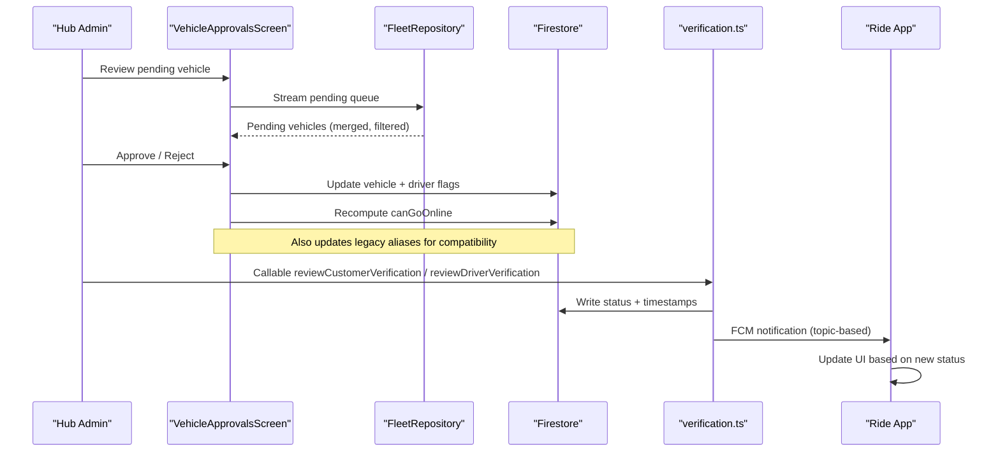

**Diagram sources**
- [vehicle_approvals_screen.dart:41-144](file://sese_hub/lib/features/verification/presentation/vehicle_approvals_screen.dart#L41-L144)
- [fleet_repository.dart:54-170](file://sese_hub/lib/features/verification/services/fleet_repository.dart#L54-L170)
- [verification.ts:26-131](file://functions/src/verification.ts#L26-L131)
- [verification.ts:138-241](file://functions/src/verification.ts#L138-L241)

## Detailed Component Analysis

### Customer KYC Approvals
- Queue: Lists users with customer verification status pending review (including legacy pending).
- Approve: Sets verified status, enables verified flag, clears rejection reason, records review timestamp.
- Reject: Prompts for structured reason, stores rejection reason, sets rejected status.
- Notifications: Backend callable and trigger send FCM notifications; client shows status banners.

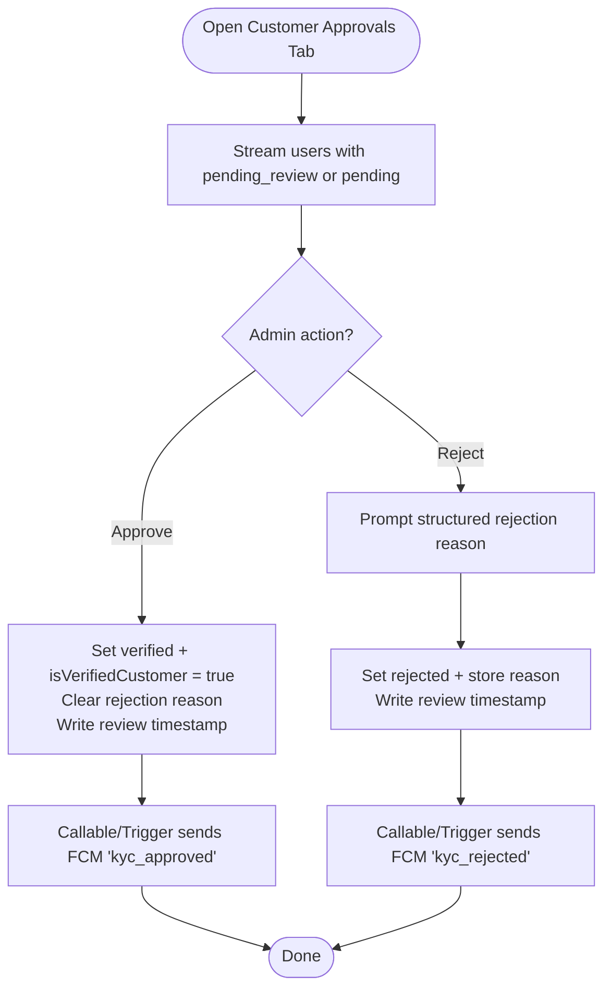

**Diagram sources**
- [customer_approvals_tab.dart:37-77](file://sese_hub/lib/features/verification/presentation/customer_approvals_tab.dart#L37-L77)
- [verification.ts:26-131](file://functions/src/verification.ts#L26-L131)
- [verification.ts:249-297](file://functions/src/verification.ts#L249-L297)

**Section sources**
- [customer_approvals_tab.dart:1-77](file://sese_hub/lib/features/verification/presentation/customer_approvals_tab.dart#L1-L77)
- [verification.ts:26-131](file://functions/src/verification.ts#L26-L131)
- [verification.ts:249-297](file://functions/src/verification.ts#L249-L297)
- [customer_verification_screen.dart:256-294](file://sese_ride/lib/features/customer/presentation/customer_verification_screen.dart#L256-L294)

### Driver Profile Approvals
- Queue: Lists drivers awaiting manual document audit.
- Approve: Sets driver profile approved, enables profile verified flag, marks active, recomputes canGoOnline.
- Reject: Stores rejection reason, disables profile verification.
- Downstream: Backend callable and trigger update custom claims and send FCM notifications.

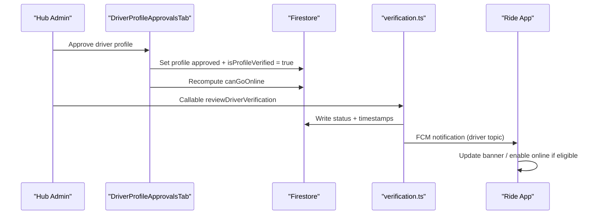

**Diagram sources**
- [driver_profile_approvals_tab.dart:135-165](file://sese_hub/lib/features/verification/presentation/driver_profile_approvals_tab.dart#L135-L165)
- [verification.ts:138-241](file://functions/src/verification.ts#L138-L241)
- [verification.ts:304-350](file://functions/src/verification.ts#L304-L350)

**Section sources**
- [driver_profile_approvals_tab.dart:135-165](file://sese_hub/lib/features/verification/presentation/driver_profile_approvals_tab.dart#L135-L165)
- [verification.ts:138-241](file://functions/src/verification.ts#L138-L241)
- [verification.ts:304-350](file://functions/src/verification.ts#L304-L350)

### Vehicle Verifications
- Queue: Tolerant pending queue merges canonical and legacy markers, excludes rejected/approved, sorts newest first.
- Approve: Updates canonical verification status plus legacy aliases, marks driver’s vehicle verified, recomputes canGoOnline.
- Reject: Requires mandatory reason, updates canonical status plus legacy aliases, persists rejection reason.
- Audit Logs: Live tab showing pre-online selfie/plate verification records with capture mode and notes.

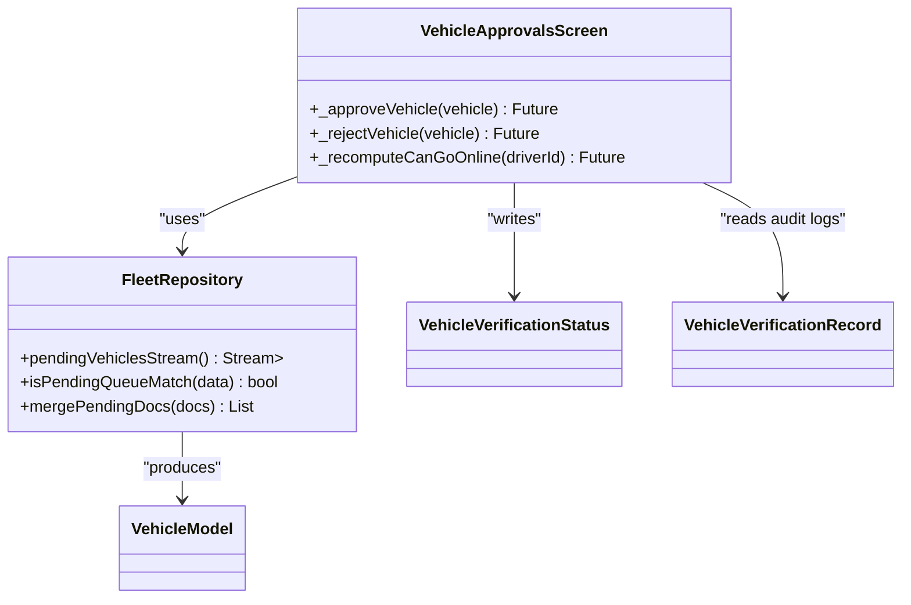

**Diagram sources**
- [fleet_repository.dart:35-233](file://sese_hub/lib/features/verification/services/fleet_repository.dart#L35-L233)
- [vehicle_approvals_screen.dart:41-144](file://sese_hub/lib/features/verification/presentation/vehicle_approvals_screen.dart#L41-L144)
- [vehicle_approvals_screen.dart:564-643](file://sese_hub/lib/features/verification/presentation/vehicle_approvals_screen.dart#L564-L643)
- [vehicle_category.dart:72-141](file://sese_core/lib/models/vehicle_category.dart#L72-L141)
- [vehicle_verification_model.dart:1-68](file://sese_core/lib/models/vehicle_verification_model.dart#L1-L68)

**Section sources**
- [fleet_repository.dart:1-233](file://sese_hub/lib/features/verification/services/fleet_repository.dart#L1-L233)
- [vehicle_approvals_screen.dart:1-716](file://sese_hub/lib/features/verification/presentation/vehicle_approvals_screen.dart#L1-L716)
- [vehicle_category.dart:72-141](file://sese_core/lib/models/vehicle_category.dart#L72-L141)
- [vehicle_verification_model.dart:1-68](file://sese_core/lib/models/vehicle_verification_model.dart#L1-L68)

### Approval/Rejection Process and Status Tracking
- Customer KYC:
  - Fields: status, verified flag, rejection reason, review timestamp.
  - Backend ensures custom claim synchronization and FCM notifications.
- Driver Profile:
  - Fields: status, profile verified flag, active flag, rejection reason, timestamps.
  - Backend ensures custom claim synchronization and FCM notifications.
- Vehicles:
  - Canonical status plus legacy aliases for broad compatibility.
  - Driver-level flags updated; canGoOnline recomputed from profile and vehicle verification flags.

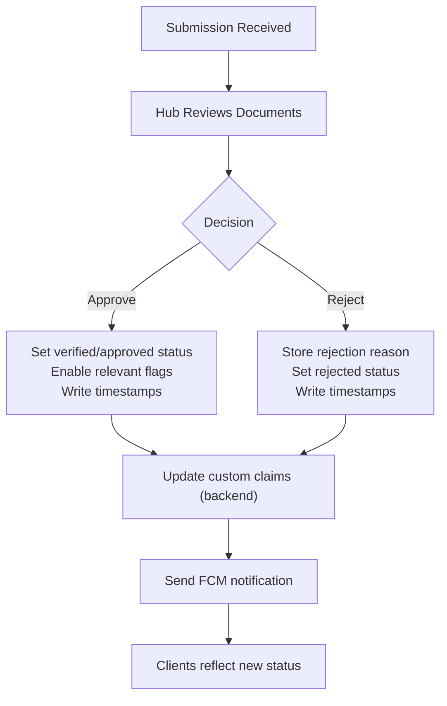

**Diagram sources**
- [customer_approvals_tab.dart:50-77](file://sese_hub/lib/features/verification/presentation/customer_approvals_tab.dart#L50-L77)
- [driver_profile_approvals_tab.dart:135-165](file://sese_hub/lib/features/verification/presentation/driver_profile_approvals_tab.dart#L135-L165)
- [vehicle_approvals_screen.dart:41-144](file://sese_hub/lib/features/verification/presentation/vehicle_approvals_screen.dart#L41-L144)
- [verification.ts:26-131](file://functions/src/verification.ts#L26-L131)
- [verification.ts:138-241](file://functions/src/verification.ts#L138-L241)

**Section sources**
- [customer_approvals_tab.dart:1-77](file://sese_hub/lib/features/verification/presentation/customer_approvals_tab.dart#L1-L77)
- [driver_profile_approvals_tab.dart:135-165](file://sese_hub/lib/features/verification/presentation/driver_profile_approvals_tab.dart#L135-L165)
- [vehicle_approvals_screen.dart:41-144](file://sese_hub/lib/features/verification/presentation/vehicle_approvals_screen.dart#L41-L144)
- [verification.ts:26-131](file://functions/src/verification.ts#L26-L131)
- [verification.ts:138-241](file://functions/src/verification.ts#L138-L241)

### Document Review Capabilities
- Vehicle Approvals Screen:
  - Displays category-specific required documents and inspection photos.
  - Provides plate cross-check guidance and image preview modal.
  - Shows missing document warnings.
- Pre-Online Audit Logs:
  - Streams recent verification captures with driver/vehicle identifiers, detected plate, capture mode, notes, and timestamps.

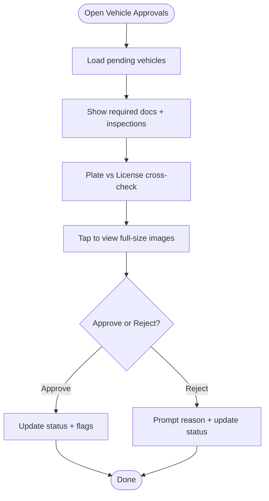

**Diagram sources**
- [vehicle_approvals_screen.dart:418-562](file://sese_hub/lib/features/verification/presentation/vehicle_approvals_screen.dart#L418-L562)
- [vehicle_approvals_screen.dart:564-643](file://sese_hub/lib/features/verification/presentation/vehicle_approvals_screen.dart#L564-L643)

**Section sources**
- [vehicle_approvals_screen.dart:418-562](file://sese_hub/lib/features/verification/presentation/vehicle_approvals_screen.dart#L418-L562)
- [vehicle_approvals_screen.dart:564-643](file://sese_hub/lib/features/verification/presentation/vehicle_approvals_screen.dart#L564-L643)

### Notification Systems
- Backend callables:
  - reviewCustomerVerification: writes user verification state, updates custom claims, sends FCM to user topic.
  - reviewDriverVerification: writes driver verification state, updates custom claims, sends FCM to driver topic.
- Triggers:
  - onUserVerificationUpdated: syncs claims and sends rejection notifications when status changes directly.
  - onDriverVerificationUpdated: syncs claims and sends rejection notifications when status changes directly.

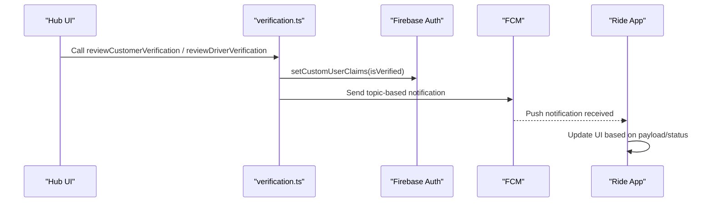

**Diagram sources**
- [verification.ts:26-131](file://functions/src/verification.ts#L26-L131)
- [verification.ts:138-241](file://functions/src/verification.ts#L138-L241)
- [verification.ts:249-297](file://functions/src/verification.ts#L249-L297)
- [verification.ts:304-350](file://functions/src/verification.ts#L304-L350)

**Section sources**
- [verification.ts:26-131](file://functions/src/verification.ts#L26-L131)
- [verification.ts:138-241](file://functions/src/verification.ts#L138-L241)
- [verification.ts:249-297](file://functions/src/verification.ts#L249-L297)
- [verification.ts:304-350](file://functions/src/verification.ts#L304-L350)

### Fleet Repository Service
Responsibilities:
- Streams a tolerant pending queue by merging multiple Firestore queries without composite indexes.
- De-duplicates by driver/id and filters out rejected/approved entries.
- Converts raw maps to VehicleModel instances and sorts newest first.
- Exposes a pure predicate for unit testing queue matching logic.

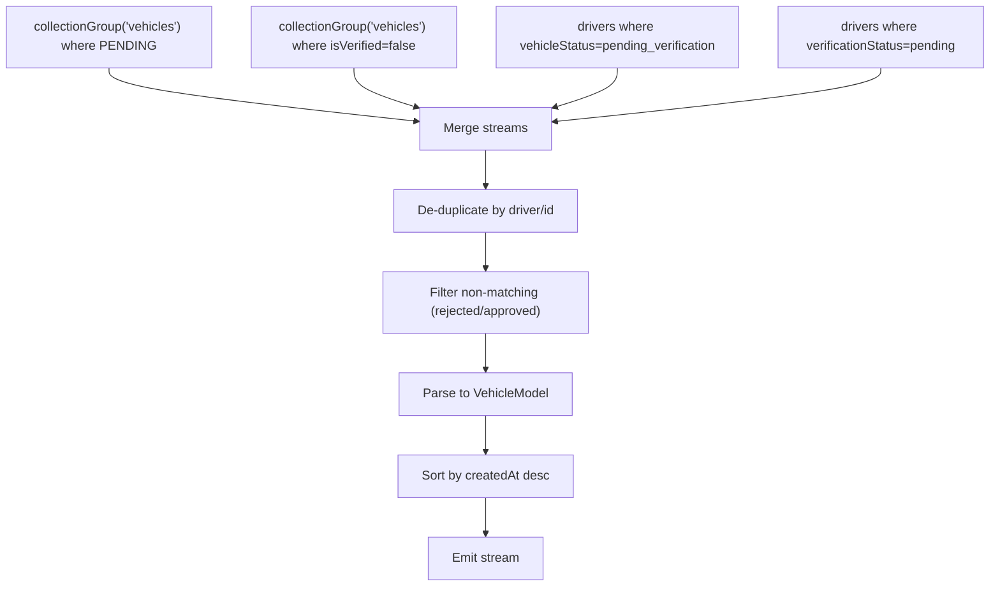

**Diagram sources**
- [fleet_repository.dart:54-170](file://sese_hub/lib/features/verification/services/fleet_repository.dart#L54-L170)
- [fleet_repository.dart:173-233](file://sese_hub/lib/features/verification/services/fleet_repository.dart#L173-L233)

**Section sources**
- [fleet_repository.dart:1-233](file://sese_hub/lib/features/verification/services/fleet_repository.dart#L1-L233)

### Bulk Operations
- The current implementation focuses on per-item operations:
  - Approve/Reject individual vehicles.
  - Approve/Reject individual customers and drivers.
- No explicit bulk endpoints or batch utilities are present in the analyzed files. Bulk operations would require additional orchestration at the UI or backend layer.

[No sources needed since this section provides general guidance]

### Audit Trails
- Vehicle Approvals Screen includes a live audit logs tab streaming pre-online verification records with:
  - Driver and vehicle identifiers
  - Detected license plate
  - Capture mode (camera-only enforcement)
  - Optional audit notes
  - Timestamps and status

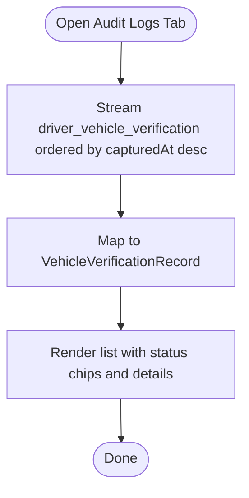

**Diagram sources**
- [vehicle_approvals_screen.dart:564-643](file://sese_hub/lib/features/verification/presentation/vehicle_approvals_screen.dart#L564-L643)
- [vehicle_verification_model.dart:1-68](file://sese_core/lib/models/vehicle_verification_model.dart#L1-L68)

**Section sources**
- [vehicle_approvals_screen.dart:564-643](file://sese_hub/lib/features/verification/presentation/vehicle_approvals_screen.dart#L564-L643)
- [vehicle_verification_model.dart:1-68](file://sese_core/lib/models/vehicle_verification_model.dart#L1-L68)

### Integration with Core Business Logic
- Driver Online Capability:
  - Drivers can only go online when both profile and vehicle are verified.
  - Backend guard enforces at least one APPROVED vehicle before allowing online transitions.
- Custom Claims:
  - Backend ensures isVerified custom claim reflects verification outcomes for both customers and drivers.
- Ride Requests:
  - Verified customers carry a verified flag in ride requests; drivers see a badge.

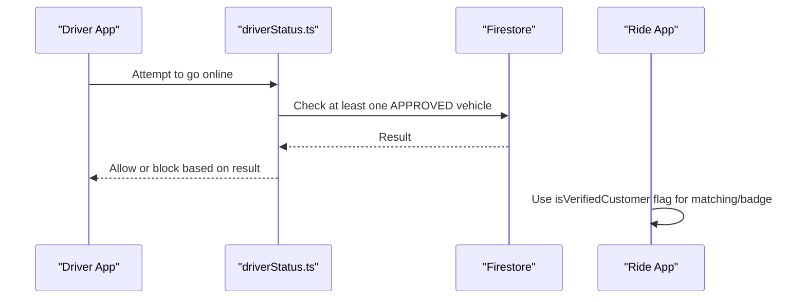

**Diagram sources**
- [driverStatus.ts:95-121](file://functions/src/driverStatus.ts#L95-L121)
- [driver_verification.dart:1-69](file://sese_core/lib/models/driver_verification.dart#L1-L69)

**Section sources**
- [driverStatus.ts:95-121](file://functions/src/driverStatus.ts#L95-L121)
- [driver_verification.dart:1-69](file://sese_core/lib/models/driver_verification.dart#L1-L69)

## Dependency Analysis
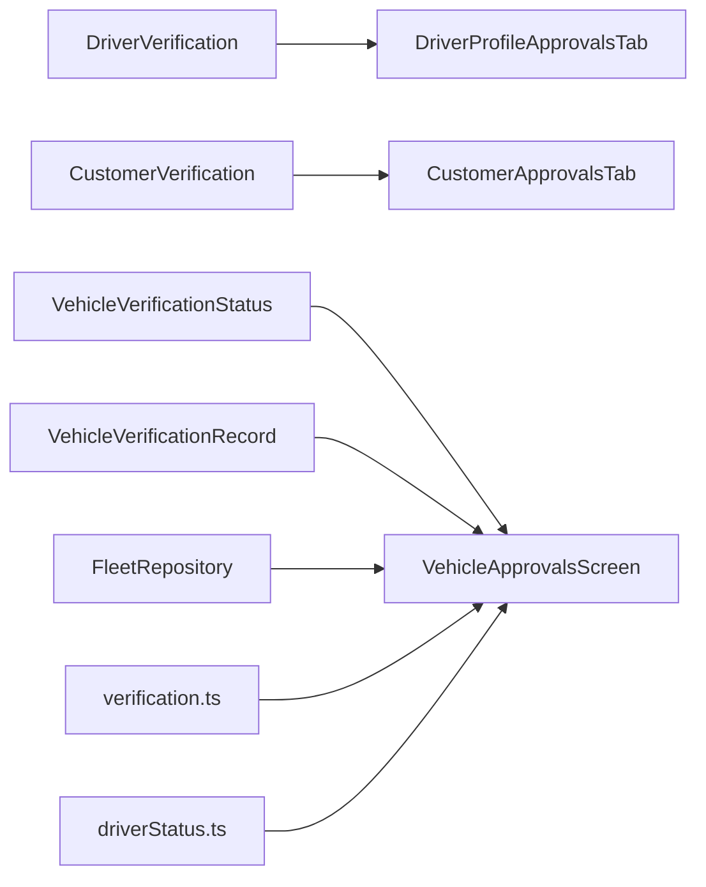

**Diagram sources**
- [driver_verification.dart:1-69](file://sese_core/lib/models/driver_verification.dart#L1-L69)
- [vehicle_category.dart:72-141](file://sese_core/lib/models/vehicle_category.dart#L72-L141)
- [vehicle_verification_model.dart:1-68](file://sese_core/lib/models/vehicle_verification_model.dart#L1-L68)
- [fleet_repository.dart:1-233](file://sese_hub/lib/features/verification/services/fleet_repository.dart#L1-L233)
- [vehicle_approvals_screen.dart:1-716](file://sese_hub/lib/features/verification/presentation/vehicle_approvals_screen.dart#L1-L716)
- [customer_approvals_tab.dart:1-77](file://sese_hub/lib/features/verification/presentation/customer_approvals_tab.dart#L1-L77)
- [driver_profile_approvals_tab.dart:135-165](file://sese_hub/lib/features/verification/presentation/driver_profile_approvals_tab.dart#L135-L165)
- [verification.ts:1-351](file://functions/src/verification.ts#L1-L351)
- [driverStatus.ts:95-121](file://functions/src/driverStatus.ts#L95-L121)

**Section sources**
- [driver_verification.dart:1-69](file://sese_core/lib/models/driver_verification.dart#L1-L69)
- [vehicle_category.dart:72-141](file://sese_core/lib/models/vehicle_category.dart#L72-L141)
- [vehicle_verification_model.dart:1-68](file://sese_core/lib/models/vehicle_verification_model.dart#L1-L68)
- [fleet_repository.dart:1-233](file://sese_hub/lib/features/verification/services/fleet_repository.dart#L1-L233)
- [vehicle_approvals_screen.dart:1-716](file://sese_hub/lib/features/verification/presentation/vehicle_approvals_screen.dart#L1-L716)
- [customer_approvals_tab.dart:1-77](file://sese_hub/lib/features/verification/presentation/customer_approvals_tab.dart#L1-L77)
- [driver_profile_approvals_tab.dart:135-165](file://sese_hub/lib/features/verification/presentation/driver_profile_approvals_tab.dart#L135-L165)
- [verification.ts:1-351](file://functions/src/verification.ts#L1-L351)
- [driverStatus.ts:95-121](file://functions/src/driverStatus.ts#L95-L121)

## Performance Considerations
- FleetRepository avoids composite indexes by splitting queries into single-field collectionGroup streams and merging client-side.
- Streams are broadcast and de-duplicated to minimize redundant processing.
- Sorting by creation time ensures newest items appear first for efficient review.
- Error handling emits empty lists when Firestore is unavailable to keep UI responsive.

[No sources needed since this section provides general guidance]

## Troubleshooting Guide
- Hub session expired errors:
  - Both VehicleApprovalsScreen and CustomerApprovalsTab handle session expiration by rendering an appropriate view and refreshing tokens before opening streams.
- Firestore unavailability:
  - FleetRepository returns empty streams instead of errors when Firestore instance is unavailable.
- Rejection reasons:
  - Vehicle rejections require a mandatory reason; ensure it is provided to avoid validation failures.
- Online capability:
  - If drivers cannot go online, verify both profile and vehicle verification flags are true and that backend guard passes.

**Section sources**
- [vehicle_approvals_screen.dart:261-313](file://sese_hub/lib/features/verification/presentation/vehicle_approvals_screen.dart#L261-L313)
- [fleet_repository.dart:54-56](file://sese_hub/lib/features/verification/services/fleet_repository.dart#L54-L56)
- [vehicle_approvals_screen.dart:88-127](file://sese_hub/lib/features/verification/presentation/vehicle_approvals_screen.dart#L88-L127)
- [driverStatus.ts:95-121](file://functions/src/driverStatus.ts#L95-L121)

## Conclusion
The verification system provides robust, auditable workflows for customer KYC, driver profiles, and vehicle registrations. It uses shared models for consistent state, a tolerant fleet repository for reliable queue management, and backend functions for secure side effects like claims and notifications. Drivers can only go online after both profile and vehicle verifications pass, ensuring safety and compliance. While bulk operations are not implemented in the analyzed code, the modular design allows future extensions for batch processing and enhanced auditability.