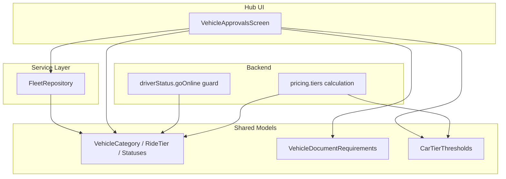
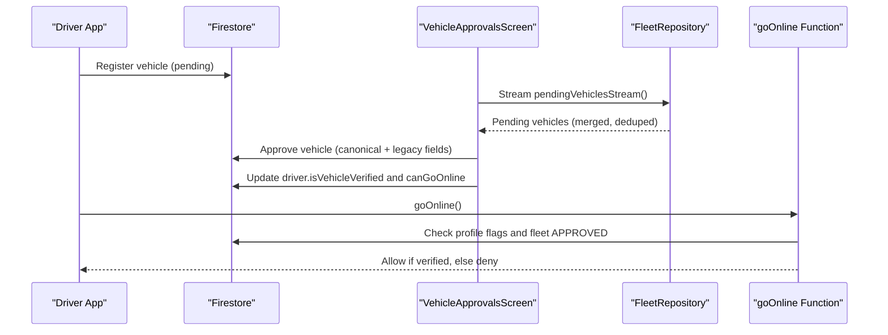
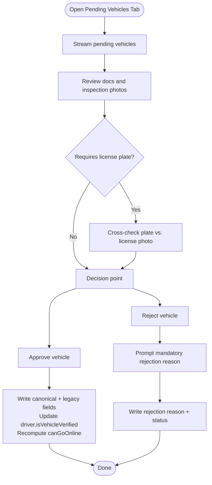
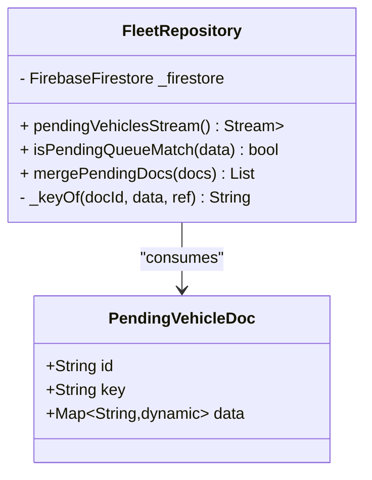
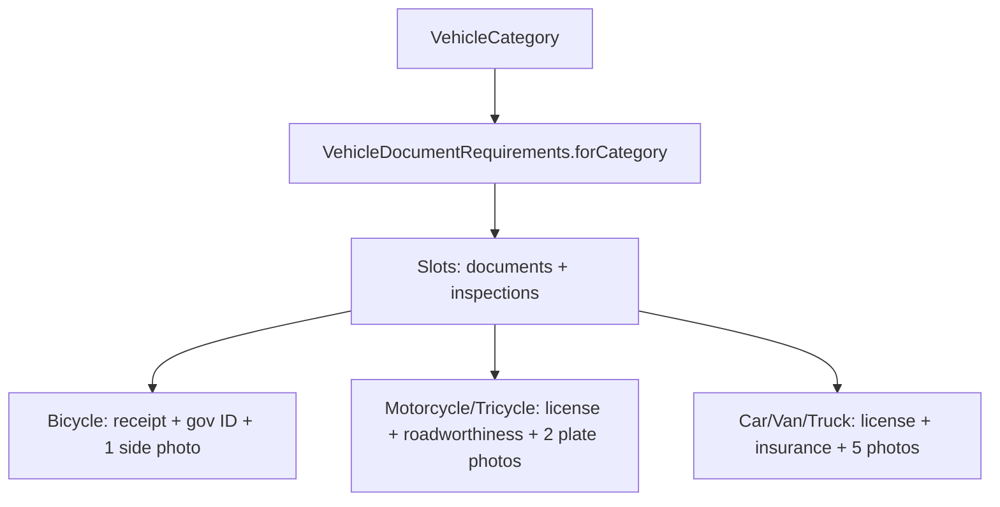
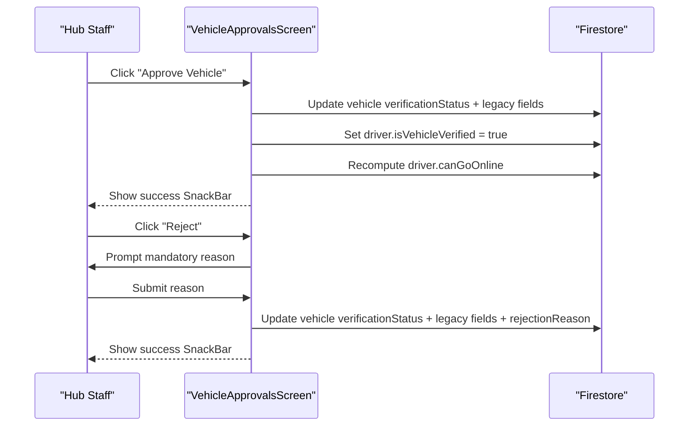
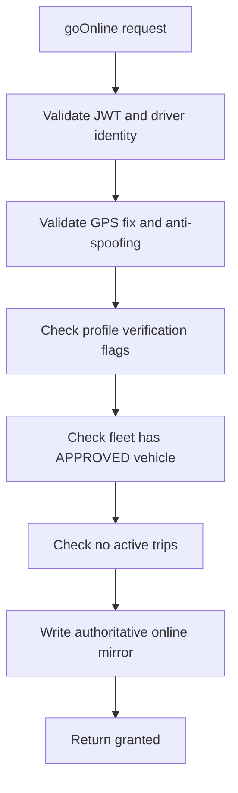
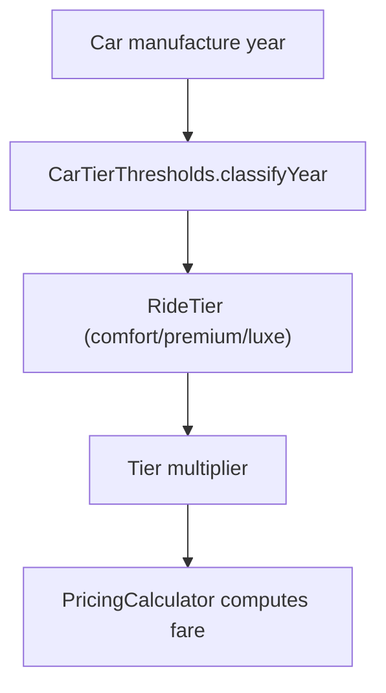
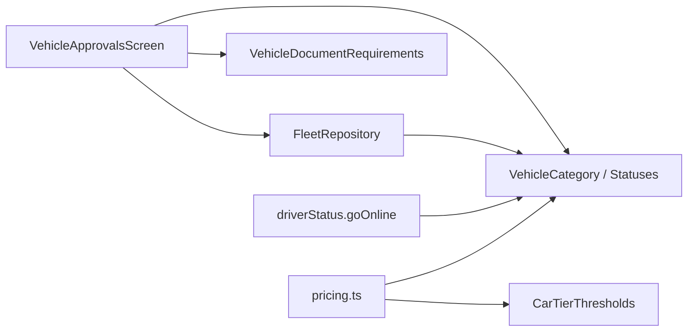

# Vehicle Verification System

<cite>
**Referenced Files in This Document**
- [vehicle_approvals_screen.dart](file://sese_hub/lib/features/verification/presentation/vehicle_approvals_screen.dart)
- [fleet_repository.dart](file://sese_hub/lib/features/verification/services/fleet_repository.dart)
- [vehicle_documents.dart](file://sese_core/lib/models/vehicle_documents.dart)
- [vehicle_category.dart](file://sese_core/lib/models/vehicle_category.dart)
- [car_tier_thresholds.dart](file://sese_core/lib/models/car_tier_thresholds.dart)
- [driverStatus.ts](file://functions/src/driverStatus.ts)
- [pricing.ts](file://functions/src/pricing.ts)
- [dynamic_system_config_test.dart](file://sese_core/test/dynamic_system_config_test.dart)
</cite>

## Table of Contents
1. [Introduction](#introduction)
2. [Project Structure](#project-structure)
3. [Core Components](#core-components)
4. [Architecture Overview](#architecture-overview)
5. [Detailed Component Analysis](#detailed-component-analysis)
6. [Dependency Analysis](#dependency-analysis)
7. [Performance Considerations](#performance-considerations)
8. [Troubleshooting Guide](#troubleshooting-guide)
9. [Conclusion](#conclusion)

## Introduction
This document explains the vehicle verification system used by the hub desk and driver-facing services. It covers:
- How the Fleet Verification Desk manages vehicle registration, inspection review, insurance checks, and regulatory compliance.
- How the FleetRepository service aggregates pending vehicles from multiple Firestore sources with robust legacy support.
- The approval and rejection workflow, including status updates and driver online eligibility.
- Vehicle categorization, documentation requirements, car tier classification, and how verified vehicles become available for ride-hailing and delivery.

## Project Structure
The vehicle verification system spans three layers:
- Hub UI layer (Flutter): a unified approvals screen that streams pending vehicles and lets staff approve or reject them.
- Service layer (Flutter): a tolerant repository that merges multiple Firestore queries into one pending queue.
- Core models (shared library): category definitions, document requirements, verification statuses, and car tier thresholds.
- Backend functions (Cloud Functions): enforce zero-trust availability and pricing rules based on verified vehicles and configuration.

**Diagram sources**
- [vehicle_approvals_screen.dart:10-31](file://sese_hub/lib/features/verification/presentation/vehicle_approvals_screen.dart#L10-L31)
- [fleet_repository.dart:21-35](file://sese_hub/lib/features/verification/services/fleet_repository.dart#L21-L35)
- [vehicle_category.dart:5-111](file://sese_core/lib/models/vehicle_category.dart#L5-L111)
- [vehicle_documents.dart:41-169](file://sese_core/lib/models/vehicle_documents.dart#L41-L169)
- [car_tier_thresholds.dart:10-78](file://sese_core/lib/models/car_tier_thresholds.dart#L10-L78)
- [driverStatus.ts:95-121](file://functions/src/driverStatus.ts#L95-L121)
- [pricing.ts:182-213](file://functions/src/pricing.ts#L182-L213)

**Section sources**
- [vehicle_approvals_screen.dart:10-31](file://sese_hub/lib/features/verification/presentation/vehicle_approvals_screen.dart#L10-L31)
- [fleet_repository.dart:21-35](file://sese_hub/lib/features/verification/services/fleet_repository.dart#L21-L35)
- [vehicle_category.dart:5-111](file://sese_core/lib/models/vehicle_category.dart#L5-L111)
- [vehicle_documents.dart:41-169](file://sese_core/lib/models/vehicle_documents.dart#L41-L169)
- [car_tier_thresholds.dart:10-78](file://sese_core/lib/models/car_tier_thresholds.dart#L10-L78)
- [driverStatus.ts:95-121](file://functions/src/driverStatus.ts#L95-L121)
- [pricing.ts:182-213](file://functions/src/pricing.ts#L182-L213)

## Core Components
- VehicleApprovalsScreen: Hub desk UI for reviewing pending vehicles, inspecting documents/photos, cross-checking license plates, approving or rejecting vehicles, and viewing pre-online camera audit logs.
- FleetRepository: Tolerant stream that merges canonical and legacy pending queues, de-duplicates entries, filters out approved/rejected vehicles, and returns newest-first.
- VehicleDocumentRequirements: Category-specific contract defining required documents and inspection photos.
- VehicleCategory, RideTier, VehicleVerificationStatus: Shared enums for scope, pricing tiers, and verification lifecycle.
- CarTierThresholds: Configurable year-based classification and multipliers for cars.
- driverStatus.goOnline: Server-side gate ensuring drivers can only go online when both profile and at least one vehicle are verified.
- Pricing engine: Applies per-category rates and tier multipliers to compute fares.

**Section sources**
- [vehicle_approvals_screen.dart:10-31](file://sese_hub/lib/features/verification/presentation/vehicle_approvals_screen.dart#L10-L31)
- [fleet_repository.dart:21-35](file://sese_hub/lib/features/verification/services/fleet_repository.dart#L21-L35)
- [vehicle_documents.dart:41-169](file://sese_core/lib/models/vehicle_documents.dart#L41-L169)
- [vehicle_category.dart:5-111](file://sese_core/lib/models/vehicle_category.dart#L5-L111)
- [car_tier_thresholds.dart:10-78](file://sese_core/lib/models/car_tier_thresholds.dart#L10-L78)
- [driverStatus.ts:95-121](file://functions/src/driverStatus.ts#L95-L121)
- [pricing.ts:182-213](file://functions/src/pricing.ts#L182-L213)

## Architecture Overview
The approval flow is a closed loop between the hub desk, Firestore, and backend guards:
- Drivers register vehicles; they enter a pending state.
- The hub desk reviews documents and photos, performs plate cross-checks, and approves or rejects.
- Approving writes canonical and legacy fields so all clients see the updated status immediately.
- Backend guards prevent drivers from going online unless at least one vehicle is approved.
- Pricing uses vehicle category and car tier to compute fares for eligible services.

**Diagram sources**
- [vehicle_approvals_screen.dart:41-144](file://sese_hub/lib/features/verification/presentation/vehicle_approvals_screen.dart#L41-L144)
- [fleet_repository.dart:54-171](file://sese_hub/lib/features/verification/services/fleet_repository.dart#L54-L171)
- [driverStatus.ts:95-121](file://functions/src/driverStatus.ts#L95-L121)

## Detailed Component Analysis

### VehicleApprovalsScreen
Responsibilities:
- Streams pending vehicles via FleetRepository.
- Displays category-aware documents and inspections.
- Provides plate-to-license cross-check banner for motorized categories.
- Approves or rejects vehicles with appropriate field updates and user feedback.
- Recomputes driver-level canGoOnline flag after approval.
- Shows pre-online live camera audit logs.

Key behaviors:
- Approval sets canonical verificationStatus plus legacy aliases for backward compatibility and updates driver-level verification flag.
- Rejection requires a reason and persists it for audit trail.
- Image modal allows full-screen inspection of uploaded documents/photos.

**Diagram sources**
- [vehicle_approvals_screen.dart:41-144](file://sese_hub/lib/features/verification/presentation/vehicle_approvals_screen.dart#L41-L144)
- [vehicle_approvals_screen.dart:416-468](file://sese_hub/lib/features/verification/presentation/vehicle_approvals_screen.dart#L416-L468)
- [vehicle_approvals_screen.dart:474-562](file://sese_hub/lib/features/verification/presentation/vehicle_approvals_screen.dart#L474-L562)

**Section sources**
- [vehicle_approvals_screen.dart:41-144](file://sese_hub/lib/features/verification/presentation/vehicle_approvals_screen.dart#L41-L144)
- [vehicle_approvals_screen.dart:261-414](file://sese_hub/lib/features/verification/presentation/vehicle_approvals_screen.dart#L261-L414)
- [vehicle_approvals_screen.dart:416-562](file://sese_hub/lib/features/verification/presentation/vehicle_approvals_screen.dart#L416-L562)
- [vehicle_approvals_screen.dart:564-643](file://sese_hub/lib/features/verification/presentation/vehicle_approvals_screen.dart#L564-L643)

### FleetRepository
Responsibilities:
- Provide a single, tolerant stream of pending vehicles by merging:
  - Canonical pending queue (verificationStatus == PENDING).
  - Legacy pending queue (isVerified == false).
  - Additional driver-level pending indicators where applicable.
- De-duplicate by driver/id.
- Filter out approved/rejected vehicles using a pure predicate.
- Sort results newest first.

Design highlights:
- Uses separate collectionGroup queries to avoid composite index requirements.
- Emits empty lists rather than errors when Firestore is unavailable.
- Centralizes legacy compatibility logic for smooth migration.

**Diagram sources**
- [fleet_repository.dart:7-19](file://sese_hub/lib/features/verification/services/fleet_repository.dart#L7-L19)
- [fleet_repository.dart:35-46](file://sese_hub/lib/features/verification/services/fleet_repository.dart#L35-L46)
- [fleet_repository.dart:54-171](file://sese_hub/lib/features/verification/services/fleet_repository.dart#L54-L171)
- [fleet_repository.dart:173-231](file://sese_hub/lib/features/verification/services/fleet_repository.dart#L173-L231)

**Section sources**
- [fleet_repository.dart:21-35](file://sese_hub/lib/features/verification/services/fleet_repository.dart#L21-L35)
- [fleet_repository.dart:54-171](file://sese_hub/lib/features/verification/services/fleet_repository.dart#L54-L171)
- [fleet_repository.dart:173-231](file://sese_hub/lib/features/verification/services/fleet_repository.dart#L173-L231)

### Vehicle Categorization and Documentation Requirements
Categories:
- Bicycle, Motorcycle, Tricycle (Keke), Car/Sedan, Van, Truck.
- Delivery eligible: all six categories.
- Ride-hailing eligible: Car/Sedan only.

Documentation requirements:
- Bicycles: proof of ownership, government ID, one side-profile inspection photo. No plate/license/insurance.
- Motorcycles/Tricycles: vehicle license, insurance/roadworthiness, two plate-visible photos (front and rear).
- Cars/Vans/Trucks: vehicle license, insurance certificate, five inspection photos (front, rear, driver side, passenger side, interior/dashboard).

**Diagram sources**
- [vehicle_category.dart:5-44](file://sese_core/lib/models/vehicle_category.dart#L5-L44)
- [vehicle_documents.dart:41-169](file://sese_core/lib/models/vehicle_documents.dart#L41-L169)

**Section sources**
- [vehicle_category.dart:5-44](file://sese_core/lib/models/vehicle_category.dart#L5-L44)
- [vehicle_documents.dart:41-169](file://sese_core/lib/models/vehicle_documents.dart#L41-L169)

### Approval Workflow and Regulatory Compliance
- Approval writes:
  - Canonical verificationStatus.
  - Legacy aliases (isVerified, status) for older clients.
  - Updates driver.isVehicleVerified and recomputes canGoOnline.
- Rejection writes:
  - Canonical verificationStatus and legacy aliases.
  - Persists rejectionReason for audit trail.
- Pre-online camera audit logs are viewable in the hub desk for operational transparency.

**Diagram sources**
- [vehicle_approvals_screen.dart:41-144](file://sese_hub/lib/features/verification/presentation/vehicle_approvals_screen.dart#L41-L144)

**Section sources**
- [vehicle_approvals_screen.dart:41-144](file://sese_hub/lib/features/verification/presentation/vehicle_approvals_screen.dart#L41-L144)

### Backend Availability Guard and Online Eligibility
The server enforces:
- Profile verification flags must be true.
- At least one vehicle must have an APPROVED (or VERIFIED) status.
- Active trip checks prevent changing status mid-trip.
- On success, authoritative online mirror is written.

**Diagram sources**
- [driverStatus.ts:32-68](file://functions/src/driverStatus.ts#L32-L68)
- [driverStatus.ts:70-121](file://functions/src/driverStatus.ts#L70-L121)
- [driverStatus.ts:123-163](file://functions/src/driverStatus.ts#L123-L163)

**Section sources**
- [driverStatus.ts:32-68](file://functions/src/driverStatus.ts#L32-L68)
- [driverStatus.ts:70-121](file://functions/src/driverStatus.ts#L70-L121)
- [driverStatus.ts:123-163](file://functions/src/driverStatus.ts#L123-L163)

### Vehicle Tier Classification and Pricing
- Car tier classification is year-based:
  - Comfort: before threshold.
  - Premium: within range.
  - Luxe: newer threshold and above.
- Thresholds and multipliers are configurable.
- Pricing engine applies per-category rates and tier multipliers to compute fares for rides and deliveries.

**Diagram sources**
- [car_tier_thresholds.dart:45-78](file://sese_core/lib/models/car_tier_thresholds.dart#L45-L78)
- [pricing.ts:182-213](file://functions/src/pricing.ts#L182-L213)

**Section sources**
- [car_tier_thresholds.dart:10-78](file://sese_core/lib/models/car_tier_thresholds.dart#L10-L78)
- [pricing.ts:182-213](file://functions/src/pricing.ts#L182-L213)
- [dynamic_system_config_test.dart:30-92](file://sese_core/test/dynamic_system_config_test.dart#L30-L92)

## Dependency Analysis
- VehicleApprovalsScreen depends on:
  - FleetRepository for pending vehicles.
  - Core models for categories, statuses, and document requirements.
- FleetRepository depends on:
  - Core models for parsing and validation.
  - Firestore streams for real-time updates.
- Backend functions depend on:
  - Firestore for driver and vehicle data.
  - Core enums for consistent status handling.

**Diagram sources**
- [vehicle_approvals_screen.dart:10-31](file://sese_hub/lib/features/verification/presentation/vehicle_approvals_screen.dart#L10-L31)
- [fleet_repository.dart:54-171](file://sese_hub/lib/features/verification/services/fleet_repository.dart#L54-L171)
- [vehicle_category.dart:5-111](file://sese_core/lib/models/vehicle_category.dart#L5-L111)
- [vehicle_documents.dart:41-169](file://sese_core/lib/models/vehicle_documents.dart#L41-L169)
- [car_tier_thresholds.dart:10-78](file://sese_core/lib/models/car_tier_thresholds.dart#L10-L78)
- [driverStatus.ts:95-121](file://functions/src/driverStatus.ts#L95-L121)
- [pricing.ts:182-213](file://functions/src/pricing.ts#L182-L213)

**Section sources**
- [vehicle_approvals_screen.dart:10-31](file://sese_hub/lib/features/verification/presentation/vehicle_approvals_screen.dart#L10-L31)
- [fleet_repository.dart:54-171](file://sese_hub/lib/features/verification/services/fleet_repository.dart#L54-L171)
- [vehicle_category.dart:5-111](file://sese_core/lib/models/vehicle_category.dart#L5-L111)
- [vehicle_documents.dart:41-169](file://sese_core/lib/models/vehicle_documents.dart#L41-L169)
- [car_tier_thresholds.dart:10-78](file://sese_core/lib/models/car_tier_thresholds.dart#L10-L78)
- [driverStatus.ts:95-121](file://functions/src/driverStatus.ts#L95-L121)
- [pricing.ts:182-213](file://functions/src/pricing.ts#L182-L213)

## Performance Considerations
- FleetRepository avoids composite indexes by splitting queries and merging client-side.
- Broadcast stream controller ensures multiple listeners without duplicate subscriptions.
- De-duplication by driver/id prevents redundant UI updates.
- Sorting by createdAt ensures newest registrations appear first.
- Backend guards perform minimal reads and early exits on failures to reduce latency.

[No sources needed since this section provides general guidance]

## Troubleshooting Guide
Common issues and resolutions:
- Hub session expired while loading pending vehicles or audit logs:
  - The screen shows a dedicated expired-session view and refreshes credentials before opening streams.
- Firestore unavailable:
  - FleetRepository emits an empty list instead of errors to keep the UI responsive.
- Unparsable vehicle documents:
  - Repository skips malformed records and continues processing others.
- Missing documents or inspection photos:
  - The approvals screen highlights missing slots for quick remediation.
- Driver cannot go online:
  - Ensure profile and vehicle verification flags are true and at least one vehicle is APPROVED.

**Section sources**
- [vehicle_approvals_screen.dart:261-304](file://sese_hub/lib/features/verification/presentation/vehicle_approvals_screen.dart#L261-L304)
- [vehicle_approvals_screen.dart:564-643](file://sese_hub/lib/features/verification/presentation/vehicle_approvals_screen.dart#L564-L643)
- [fleet_repository.dart:48-56](file://sese_hub/lib/features/verification/services/fleet_repository.dart#L48-L56)
- [fleet_repository.dart:212-231](file://sese_hub/lib/features/verification/services/fleet_repository.dart#L212-L231)
- [driverStatus.ts:70-121](file://functions/src/driverStatus.ts#L70-L121)

## Conclusion
The vehicle verification system integrates a robust hub desk, a tolerant pending queue, shared domain models, and strict backend guards. It supports diverse vehicle types with tailored documentation and inspection requirements, enforces regulatory compliance through plate cross-checks and audit logs, and ensures only verified vehicles participate in ride-hailing and delivery operations. Car tier classification and configurable pricing complete the pipeline, enabling accurate fare computation and scalable operations across regions.

[No sources needed since this section summarizes without analyzing specific files]