# App Architecture & Setup

<cite>
**Referenced Files in This Document**
- [sese_ride/lib/main.dart](file://sese_ride/lib/main.dart)
- [sese_hub/lib/main.dart](file://sese_hub/lib/main.dart)
- [sese_core/lib/sese_core.dart](file://sese_core/lib/sese_core.dart)
- [sese_core/lib/auth/firebase_auth_repository.dart](file://sese_core/lib/auth/firebase_auth_repository.dart)
- [sese_core/lib/models/user_role.dart](file://sese_core/lib/models/user_role.dart)
- [sese_core/lib/theme/app_theme.dart](file://sese_core/lib/theme/app_theme.dart)
- [sese_core/lib/theme/theme_controller.dart](file://sese_core/lib/theme/theme_controller.dart)
- [sese_core/lib/services/country_detection_service.dart](file://sese_core/lib/services/country_detection_service.dart)
- [sese_core/lib/config/app_check_config.dart](file://sese_core/lib/config/app_check_config.dart)
- [sese_ride/pubspec.yaml](file://sese_ride/pubspec.yaml)
- [sese_hub/pubspec.yaml](file://sese_hub/pubspec.yaml)
- [sese_core/pubspec.yaml](file://sese_core/pubspec.yaml)
- [firebase.json](file://firebase.json)
- [firestore.rules](file://firestore.rules)
- [sese_ride/android/app/build.gradle.kts](file://sese_ride/android/app/build.gradle.kts)
- [sese_hub/android/app/build.gradle.kts](file://sese_hub/android/app/build.gradle.kts)
- [sese_ride/ios/Runner/Info.plist](file://sese_ride/ios/Runner/Info.plist)
- [sese_hub/ios/Runner/Info.plist](file://sese_hub/ios/Runner/Info.plist)
</cite>

## Table of Contents
1. [Introduction](#introduction)
2. [Project Structure](#project-structure)
3. [Core Components](#core-components)
4. [Architecture Overview](#architecture-overview)
5. [Detailed Component Analysis](#detailed-component-analysis)
6. [Dependency Analysis](#dependency-analysis)
7. [Performance Considerations](#performance-considerations)
8. [Troubleshooting Guide](#troubleshooting-guide)
9. [Conclusion](#conclusion)

## Introduction
This document explains the Sese Ride application architecture and setup across three packages:
- sese_ride: Customer and Driver app
- sese_hub: Staff operations hub
- sese_core: Shared models, services, theme, and widgets

It covers initialization, dependency injection patterns, role-based navigation, Firebase integration, environment configuration, platform-specific settings for Android and iOS, shared core library usage, theme management, global state handling, build processes, signing configurations, and deployment considerations.

## Project Structure
The repository is a multi-package Flutter project with two apps sharing a common core library.

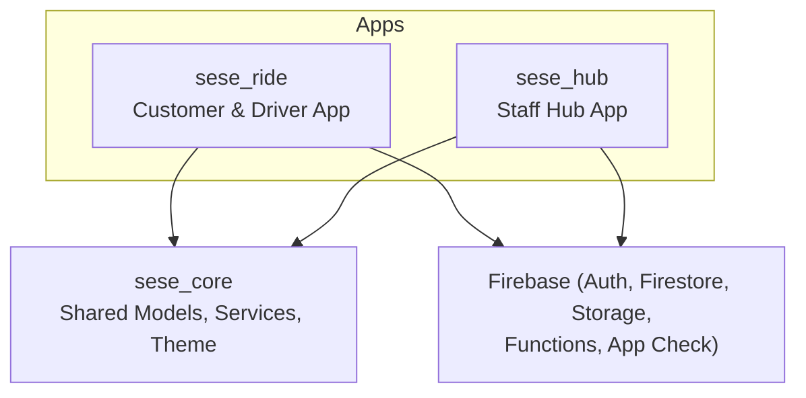

**Diagram sources**
- [sese_ride/pubspec.yaml:10-30](file://sese_ride/pubspec.yaml#L10-L30)
- [sese_hub/pubspec.yaml:10-21](file://sese_hub/pubspec.yaml#L10-L21)
- [sese_core/pubspec.yaml:9-21](file://sese_core/pubspec.yaml#L9-L21)
- [firebase.json:1-27](file://firebase.json#L1-L27)

Key observations:
- Both apps depend on firebase_core, firebase_app_check, cloud_firestore, and firebase_auth.
- The core library centralizes shared models, theme, and utilities.
- Functions are configured under a single firebase.json codebase.

**Section sources**
- [sese_ride/pubspec.yaml:1-38](file://sese_ride/pubspec.yaml#L1-L38)
- [sese_hub/pubspec.yaml:1-29](file://sese_hub/pubspec.yaml#L1-L29)
- [sese_core/pubspec.yaml:1-33](file://sese_core/pubspec.yaml#L1-L33)
- [firebase.json:1-27](file://firebase.json#L1-L27)

## Core Components
- Role model: UserRole defines customer, driver, agent, admin, superRole and helpers for self-registration and hub-managed roles.
- Auth repository: FirebaseAuthRepository implements role resolution from Firestore documents, custom claims, and special owner bootstrap.
- Theme: AppTheme provides light/dark Material themes; ThemeController persists user preference.
- Country detection: CountryDetectionService detects locale/timezone to seed phone input defaults.
- App Check config: AppCheckConfig pins debug tokens per app.

**Section sources**
- [sese_core/lib/models/user_role.dart:1-55](file://sese_core/lib/models/user_role.dart#L1-L55)
- [sese_core/lib/auth/firebase_auth_repository.dart:11-20](file://sese_core/lib/auth/firebase_auth_repository.dart#L11-L20)
- [sese_core/lib/theme/app_theme.dart:1-85](file://sese_core/lib/theme/app_theme.dart#L1-L85)
- [sese_core/lib/theme/theme_controller.dart:1-90](file://sese_core/lib/theme/theme_controller.dart#L1-L90)
- [sese_core/lib/services/country_detection_service.dart:1-114](file://sese_core/lib/services/country_detection_service.dart#L1-L114)
- [sese_core/lib/config/app_check_config.dart:1-38](file://sese_core/lib/config/app_check_config.dart#L1-L38)

## Architecture Overview
At startup, each app initializes Firebase, activates App Check, primes country detection, then renders a root MaterialApp that applies persisted theme mode and routes users based on authentication state and role.

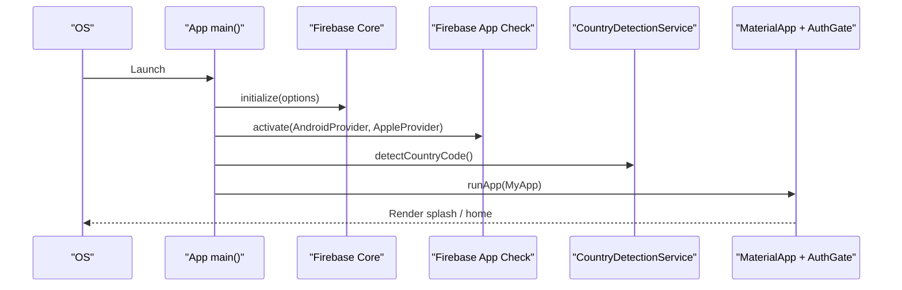

**Diagram sources**
- [sese_ride/lib/main.dart:13-41](file://sese_ride/lib/main.dart#L13-L41)
- [sese_hub/lib/main.dart:13-38](file://sese_hub/lib/main.dart#L13-L38)
- [sese_core/lib/services/country_detection_service.dart:22-63](file://sese_core/lib/services/country_detection_service.dart#L22-L63)

## Detailed Component Analysis

### Application Entry Points and Initialization

#### Sese Ride (Customer & Driver)
- Initializes Flutter binding and Firebase with platform options.
- Activates App Check using debug providers in debug builds and native providers in release.
- Primes country detection for phone inputs.
- Runs MyApp with optional splash screen.
- ThemeController.load() restores persisted theme mode at startup.
- _AuthGate listens to auth stream and navigates to:
  - LoginPage if unauthenticated
  - DriverOnboardingScreen if driver pending onboarding
  - CustomerHomeShell or DriverHomeShell based on role
  - _WrongAppScreen for hub staff accounts

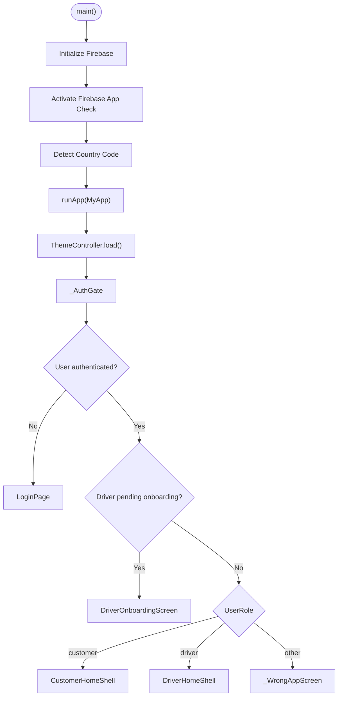

**Diagram sources**
- [sese_ride/lib/main.dart:13-41](file://sese_ride/lib/main.dart#L13-L41)
- [sese_ride/lib/main.dart:43-87](file://sese_ride/lib/main.dart#L43-L87)
- [sese_ride/lib/main.dart:89-145](file://sese_ride/lib/main.dart#L89-L145)
- [sese_ride/lib/main.dart:147-184](file://sese_ride/lib/main.dart#L147-L184)

**Section sources**
- [sese_ride/lib/main.dart:13-184](file://sese_ride/lib/main.dart#L13-L184)

#### Sese Hub (Staff Operations)
- Similar initialization flow: Firebase init, App Check activation, country detection, splash screen.
- Zero-trust gate validates hub_staff access via HubAccessService before rendering dashboard.
- Unqualified users are signed out and shown a no-role screen.

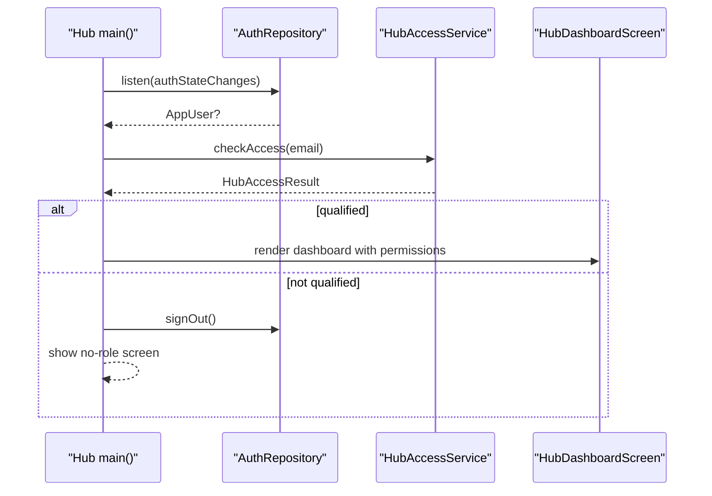

**Diagram sources**
- [sese_hub/lib/main.dart:13-38](file://sese_hub/lib/main.dart#L13-L38)
- [sese_hub/lib/main.dart:87-197](file://sese_hub/lib/main.dart#L87-L197)

**Section sources**
- [sese_hub/lib/main.dart:13-235](file://sese_hub/lib/main.dart#L13-L235)

### Dependency Injection Patterns
- FirebaseAuthRepository supports constructor injection of FirebaseAuth, FirebaseFirestore, GoogleSignIn, and serverClientId for testability and environment control.
- Apps can pass an explicit AuthRepository into their UI components; otherwise, repositories are created internally.
- ThemeController uses a singleton pattern with a test seam for SharedPreferences.

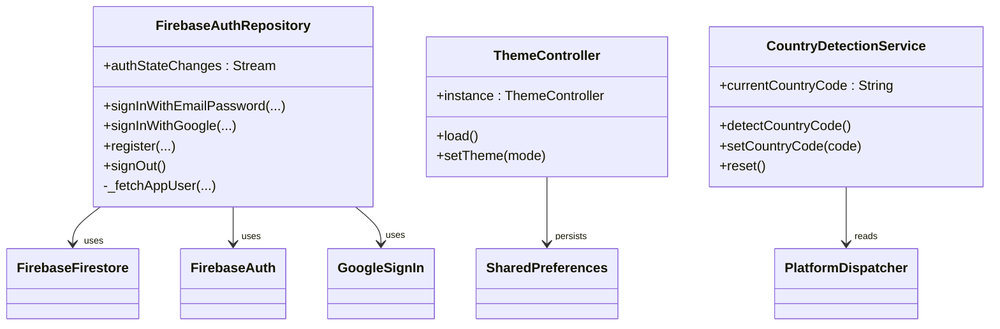

**Diagram sources**
- [sese_core/lib/auth/firebase_auth_repository.dart:45-77](file://sese_core/lib/auth/firebase_auth_repository.dart#L45-L77)
- [sese_core/lib/theme/theme_controller.dart:21-51](file://sese_core/lib/theme/theme_controller.dart#L21-L51)
- [sese_core/lib/services/country_detection_service.dart:11-78](file://sese_core/lib/services/country_detection_service.dart#L11-L78)

**Section sources**
- [sese_core/lib/auth/firebase_auth_repository.dart:45-77](file://sese_core/lib/auth/firebase_auth_repository.dart#L45-L77)
- [sese_core/lib/theme/theme_controller.dart:21-51](file://sese_core/lib/theme/theme_controller.dart#L21-L51)
- [sese_core/lib/services/country_detection_service.dart:11-78](file://sese_core/lib/services/country_detection_service.dart#L11-L78)

### Role-Based Navigation System
- Role resolution order in FirebaseAuthRepository:
  1. Owner email bootstrap -> superRole
  2. Firebase ID-token custom claims
  3. Hub admin_users/{email} (hub app only)
  4. drivers/{uid}
  5. users/{uid}
  6. Default to customer for new users
- UI routing:
  - Driver pending onboarding -> DriverOnboardingScreen
  - customer -> CustomerHomeShell
  - driver -> DriverHomeShell
  - other roles in ride app -> _WrongAppScreen

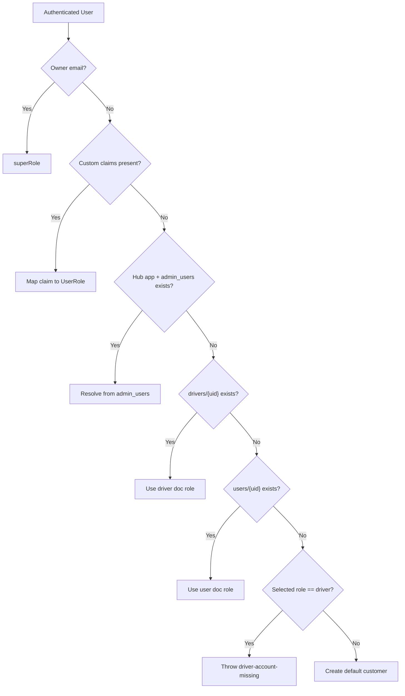

**Diagram sources**
- [sese_core/lib/auth/firebase_auth_repository.dart:519-671](file://sese_core/lib/auth/firebase_auth_repository.dart#L519-L671)
- [sese_core/lib/models/user_role.dart:1-55](file://sese_core/lib/models/user_role.dart#L1-L55)

**Section sources**
- [sese_core/lib/auth/firebase_auth_repository.dart:519-671](file://sese_core/lib/auth/firebase_auth_repository.dart#L519-L671)
- [sese_ride/lib/main.dart:89-145](file://sese_ride/lib/main.dart#L89-L145)

### Firebase Integration Configuration
- firebase.json configures Firestore location, rules, indexes, Storage rules, and Functions codebase with predeploy build step.
- Each app initializes Firebase with platform-specific options generated by FlutterFire.
- App Check is activated with debug providers in debug builds and production providers in release.

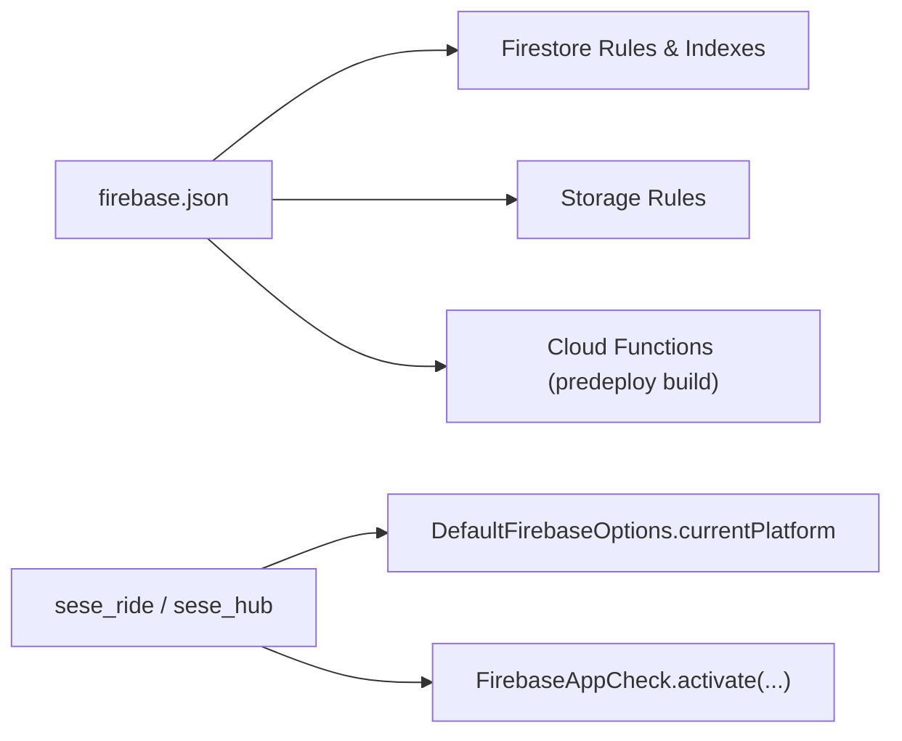

**Diagram sources**
- [firebase.json:1-27](file://firebase.json#L1-L27)
- [sese_ride/lib/main.dart:13-34](file://sese_ride/lib/main.dart#L13-L34)
- [sese_hub/lib/main.dart:13-32](file://sese_hub/lib/main.dart#L13-L32)

**Section sources**
- [firebase.json:1-27](file://firebase.json#L1-L27)
- [sese_ride/lib/main.dart:13-34](file://sese_ride/lib/main.dart#L13-L34)
- [sese_hub/lib/main.dart:13-32](file://sese_hub/lib/main.dart#L13-L32)

### Environment Setup and Platform-Specific Configurations

#### Android
- Gradle plugins include FlutterFire google-services plugin and Flutter gradle plugin.
- Java/Kotlin targets set to JVM 17.
- Release signing currently uses debug keys (needs production keystore).
- Packaging jniLibs useLegacyPackaging enabled due to libdartjni.so loading requirement.

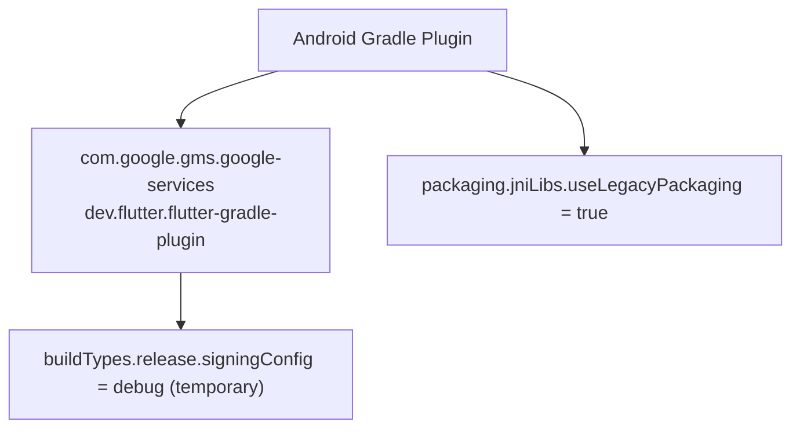

**Diagram sources**
- [sese_ride/android/app/build.gradle.kts:1-68](file://sese_ride/android/app/build.gradle.kts#L1-L68)
- [sese_hub/android/app/build.gradle.kts:1-53](file://sese_hub/android/app/build.gradle.kts#L1-L53)

**Section sources**
- [sese_ride/android/app/build.gradle.kts:1-68](file://sese_ride/android/app/build.gradle.kts#L1-L68)
- [sese_hub/android/app/build.gradle.kts:1-53](file://sese_hub/android/app/build.gradle.kts#L1-L53)

#### iOS
- Info.plist includes URL schemes for Google Sign-In.
- Location permission description provided for ride features.
- Bundle identifiers and display names are configured per app.

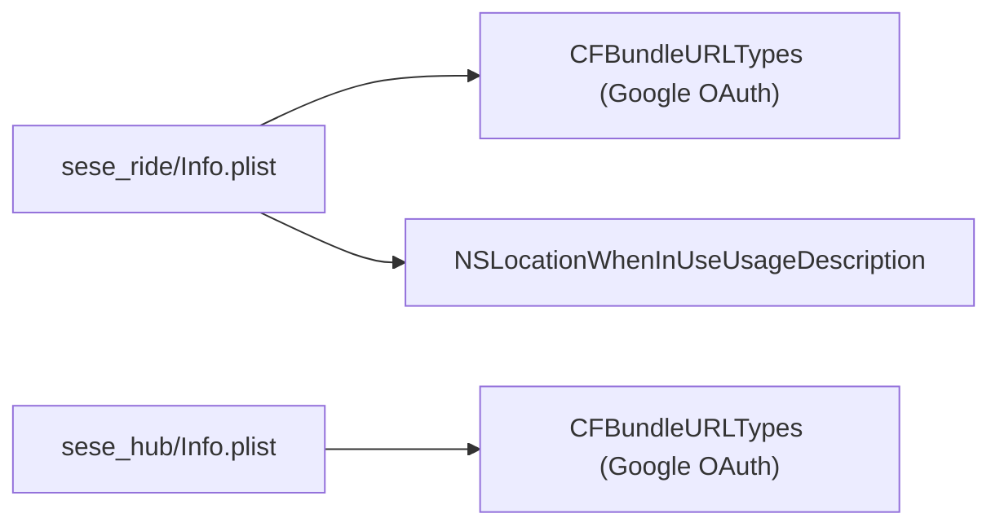

**Diagram sources**
- [sese_ride/ios/Runner/Info.plist:69-81](file://sese_ride/ios/Runner/Info.plist#L69-L81)
- [sese_hub/ios/Runner/Info.plist:69-79](file://sese_hub/ios/Runner/Info.plist#L69-L79)

**Section sources**
- [sese_ride/ios/Runner/Info.plist:1-84](file://sese_ride/ios/Runner/Info.plist#L1-L84)
- [sese_hub/ios/Runner/Info.plist:1-82](file://sese_hub/ios/Runner/Info.plist#L1-L82)

### Shared Core Library Integration
- Both apps import and use sese_core for models, services, and UI components.
- Core exports auth repositories, models, theme, and widgets.

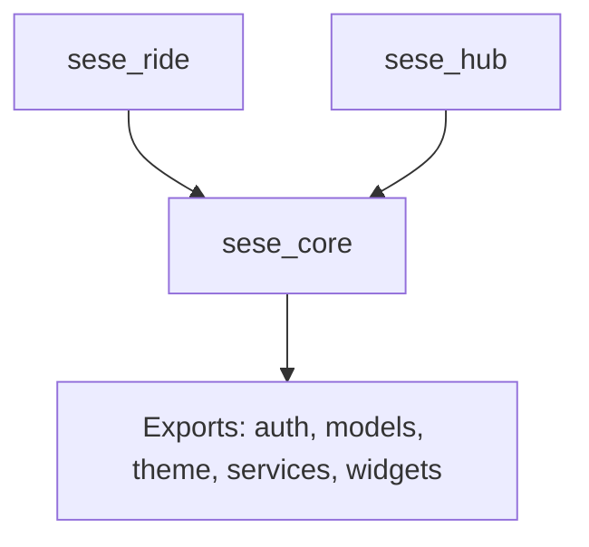

**Diagram sources**
- [sese_ride/pubspec.yaml:10-14](file://sese_ride/pubspec.yaml#L10-L14)
- [sese_hub/pubspec.yaml:10-14](file://sese_hub/pubspec.yaml#L10-L14)
- [sese_core/lib/sese_core.dart:1-35](file://sese_core/lib/sese_core.dart#L1-L35)

**Section sources**
- [sese_core/lib/sese_core.dart:1-35](file://sese_core/lib/sese_core.dart#L1-L35)
- [sese_ride/pubspec.yaml:10-14](file://sese_ride/pubspec.yaml#L10-L14)
- [sese_hub/pubspec.yaml:10-14](file://sese_hub/pubspec.yaml#L10-L14)

### Theme Management and Global State Handling
- AppTheme defines light and dark Material themes with brand gold accents.
- ThemeController persists ThemeMode via SharedPreferences and exposes it as a ValueNotifier.
- Both apps wrap MaterialApp with ValueListenableBuilder to react to theme changes.

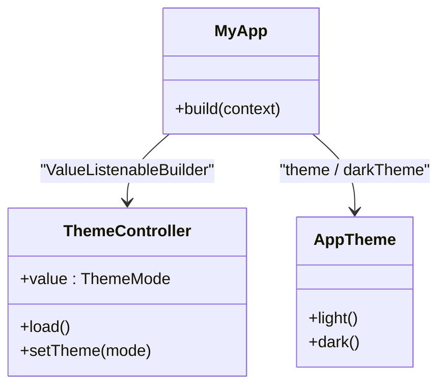

**Diagram sources**
- [sese_core/lib/theme/app_theme.dart:26-84](file://sese_core/lib/theme/app_theme.dart#L26-L84)
- [sese_core/lib/theme/theme_controller.dart:21-51](file://sese_core/lib/theme/theme_controller.dart#L21-L51)
- [sese_ride/lib/main.dart:66-87](file://sese_ride/lib/main.dart#L66-L87)
- [sese_hub/lib/main.dart:64-85](file://sese_hub/lib/main.dart#L64-L85)

**Section sources**
- [sese_core/lib/theme/app_theme.dart:1-85](file://sese_core/lib/theme/app_theme.dart#L1-L85)
- [sese_core/lib/theme/theme_controller.dart:1-90](file://sese_core/lib/theme/theme_controller.dart#L1-L90)
- [sese_ride/lib/main.dart:66-87](file://sese_ride/lib/main.dart#L66-L87)
- [sese_hub/lib/main.dart:64-85](file://sese_hub/lib/main.dart#L64-L85)

### Firestore Security Rules Overview
- Rules define role-based access using custom claims and helper functions.
- Key collections include orders, trips, drivers, users, support tickets/chats, KYC, and system configs.
- Admin scopes and hub staff checks protect sensitive data.

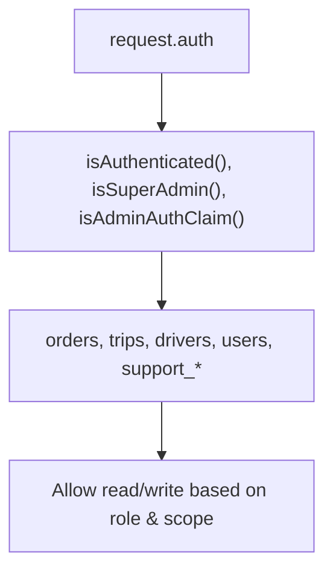

**Diagram sources**
- [firestore.rules:1-157](file://firestore.rules#L1-L157)
- [firestore.rules:237-485](file://firestore.rules#L237-L485)
- [firestore.rules:608-703](file://firestore.rules#L608-L703)

**Section sources**
- [firestore.rules:1-157](file://firestore.rules#L1-L157)
- [firestore.rules:237-485](file://firestore.rules#L237-L485)
- [firestore.rules:608-703](file://firestore.rules#L608-L703)

## Dependency Analysis
- App-level dependencies:
  - firebase_core, firebase_app_check, cloud_firestore, firebase_auth are used by both apps.
  - Additional ride-specific dependencies include image_picker, geolocator, http, cloud_functions, url_launcher, latlong2, shared_preferences, flutter_map.
- Core library dependencies:
  - sign_in_button, firebase_auth, firebase_core, cloud_firestore, google_sign_in, flutter_svg, audioplayers, shared_preferences, intl_phone_number_input.

```mermaid
graph TB
subgraph "sese_ride"
R1["firebase_core"]
R2["firebase_app_check"]
R3["cloud_firestore"]
R4["firebase_auth"]
R5["image_picker"]
R6["geolocator"]
R7["http"]
R8["cloud_functions"]
R9["url_launcher"]
R10["latlong2"]
R11["shared_preferences"]
R12["flutter_map"]
end
subgraph "sese_hub"
H1["firebase_core"]
H2["firebase_app_check"]
H3["cloud_firestore"]
H4["firebase_auth"]
end
subgraph "sese_core"
C1["sign_in_button"]
C2["firebase_auth"]
C3["firebase_core"]
C4["cloud_firestore"]
C5["google_sign_in"]
C6["flutter_svg"]
C7["audioplayers"]
C8["shared_preferences"]
C9["intl_phone_number_input"]
end
RIDE["sese_ride"] --> CORE["sese_core"]
HUB["sese_hub"] --> CORE
RIDE --> R1
RIDE --> R2
RIDE --> R3
RIDE --> R4
RIDE --> R5
RIDE --> R6
RIDE --> R7
RIDE --> R8
RIDE --> R9
RIDE --> R10
RIDE --> R11
RIDE --> R12
HUB --> H1
HUB --> H2
HUB --> H3
HUB --> H4
CORE --> C1
CORE --> C2
CORE --> C3
CORE --> C4
CORE --> C5
CORE --> C6
CORE --> C7
CORE --> C8
CORE --> C9
```

**Diagram sources**
- [sese_ride/pubspec.yaml:10-30](file://sese_ride/pubspec.yaml#L10-L30)
- [sese_hub/pubspec.yaml:10-21](file://sese_hub/pubspec.yaml#L10-L21)
- [sese_core/pubspec.yaml:9-21](file://sese_core/pubspec.yaml#L9-L21)

**Section sources**
- [sese_ride/pubspec.yaml:10-30](file://sese_ride/pubspec.yaml#L10-L30)
- [sese_hub/pubspec.yaml:10-21](file://sese_hub/pubspec.yaml#L10-L21)
- [sese_core/pubspec.yaml:9-21](file://sese_core/pubspec.yaml#L9-L21)

## Performance Considerations
- Use cached country code for synchronous phone input initialization to avoid blocking UI.
- Prefer ValueListenableBuilder for theme updates to minimize rebuilds outside the theme-aware subtree.
- Avoid unnecessary Firestore reads by leveraging streams and selective queries.
- Keep App Check active to prevent denied requests that could degrade performance due to retries.

[No sources needed since this section provides general guidance]

## Troubleshooting Guide
- Google Sign-In missing idToken on mobile:
  - Ensure SHA-1/SHA-256 are registered in Firebase console.
  - Verify google-services.json is up to date.
  - Confirm device has Google Play Services (not applicable on Huawei devices without GMS).
- App Check PERMISSION_DENIED:
  - Activate FirebaseAppCheck with appropriate providers.
  - For debug builds, ensure pinned debug token matches Firebase console registration.
- Wrong App for hub staff:
  - Hub staff accounts opened in sese_ride will see a “Wrong App” screen; sign out and open sese_hub.
- Android dynamic library load failure:
  - packaging.jniLibs.useLegacyPackaging must be enabled for libdartjni.so.
- Release signing:
  - Replace debug signing config with a proper keystore for production releases.

**Section sources**
- [sese_core/lib/auth/firebase_auth_repository.dart:326-361](file://sese_core/lib/auth/firebase_auth_repository.dart#L326-L361)
- [sese_ride/lib/main.dart:17-34](file://sese_ride/lib/main.dart#L17-L34)
- [sese_hub/lib/main.dart:17-32](file://sese_hub/lib/main.dart#L17-L32)
- [sese_ride/lib/main.dart:147-184](file://sese_ride/lib/main.dart#L147-L184)
- [sese_ride/android/app/build.gradle.kts:43-51](file://sese_ride/android/app/build.gradle.kts#L43-L51)
- [sese_ride/android/app/build.gradle.kts:35-41](file://sese_ride/android/app/build.gradle.kts#L35-L41)

## Conclusion
The Sese Ride ecosystem comprises two Flutter apps sharing a robust core library. Initialization sequences standardize Firebase and App Check setup, while role-based navigation ensures correct user experiences for customers, drivers, and hub staff. Centralized theme management and global state handling improve consistency across apps. Platform-specific configurations address Android and iOS requirements, and Firestore rules enforce security and compliance. Proper signing and packaging configurations are essential for production deployments.

[No sources needed since this section summarizes without analyzing specific files]