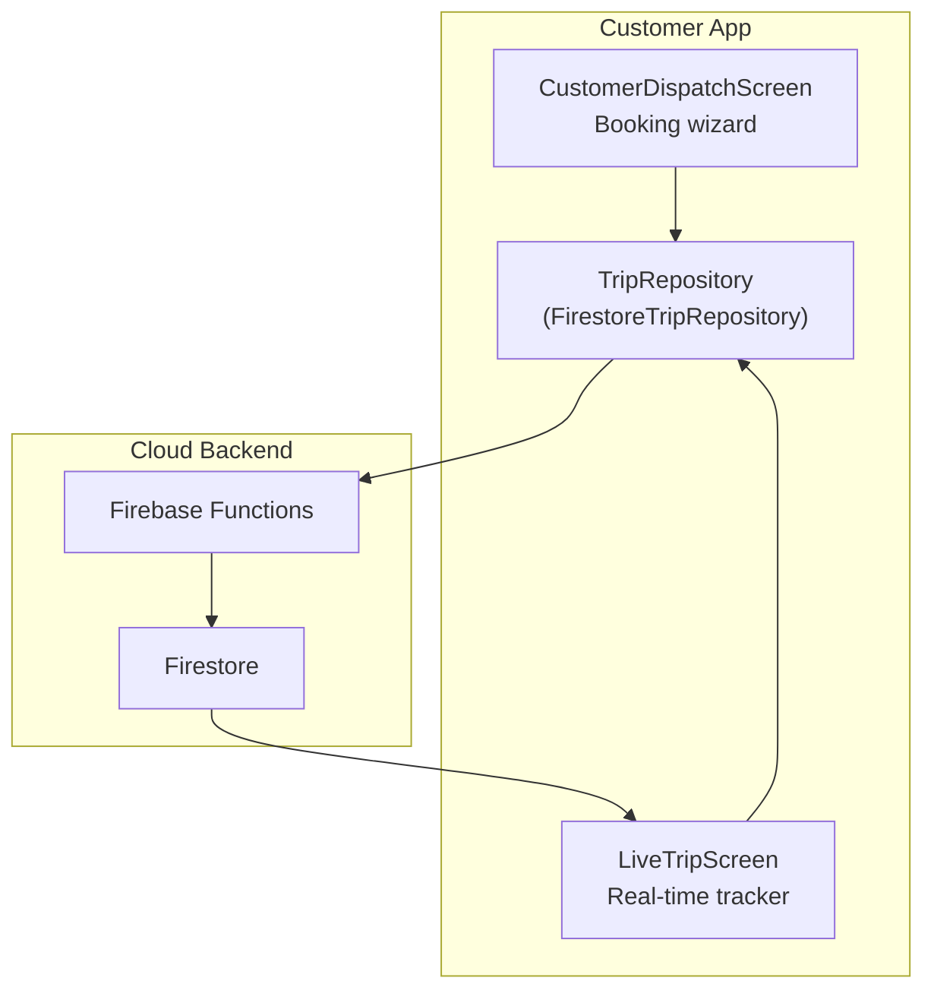
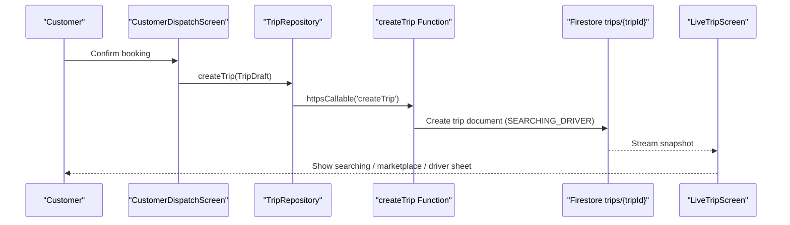
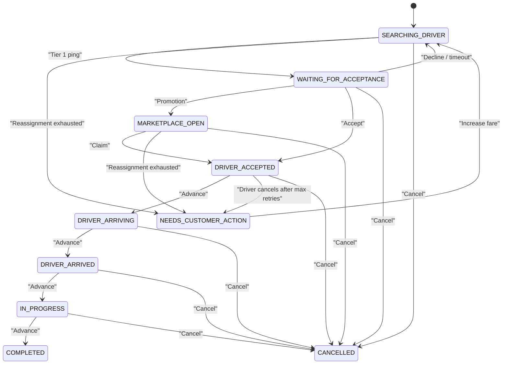
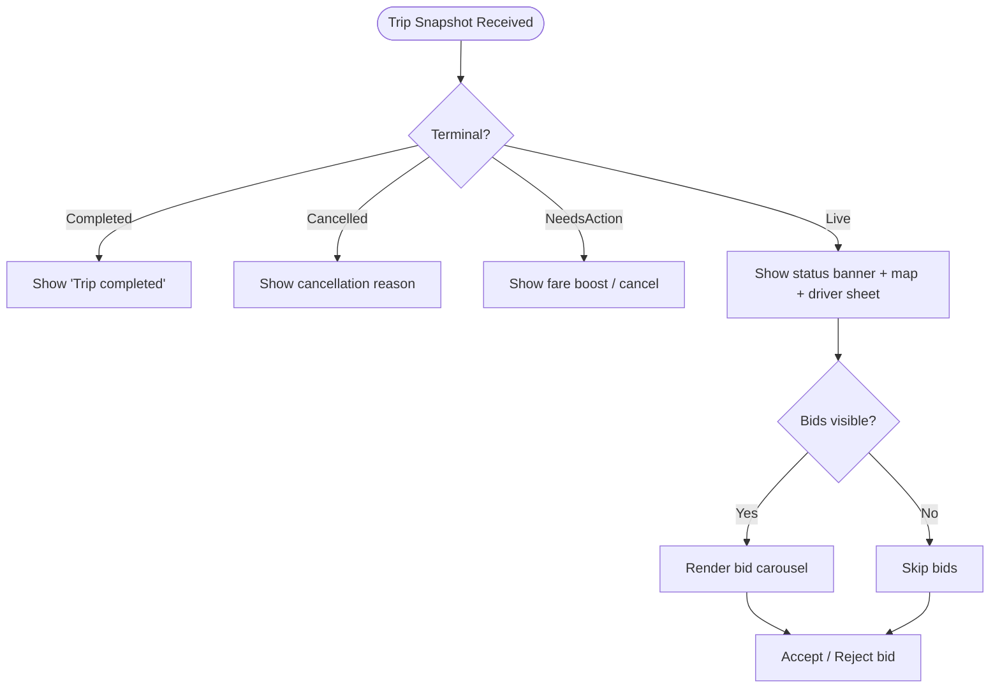
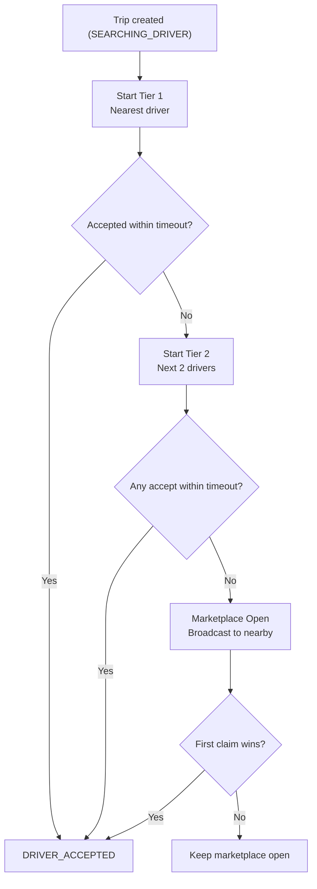
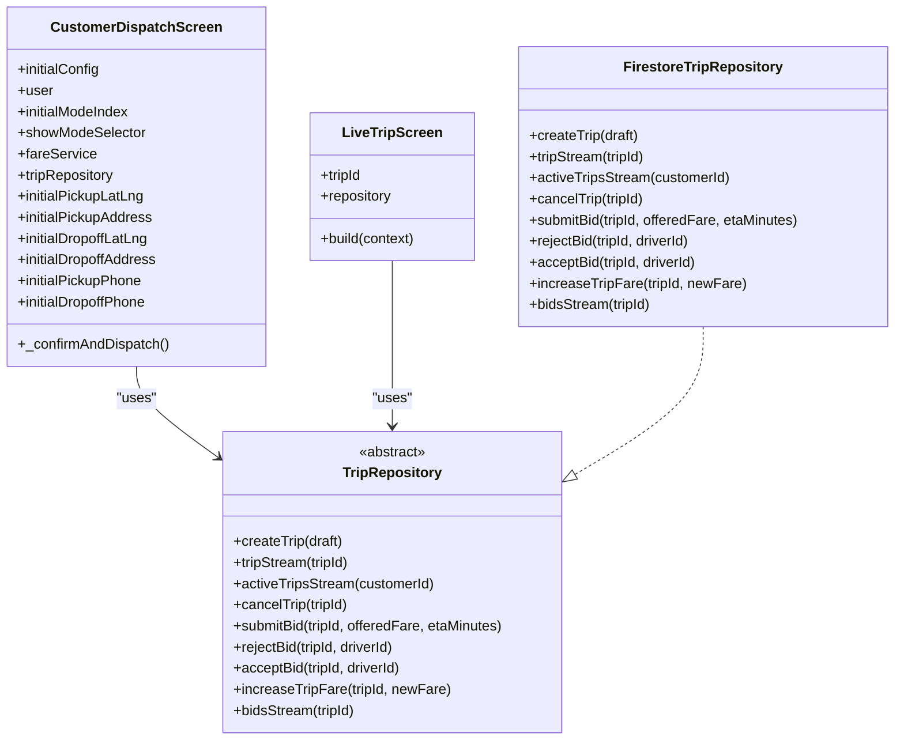
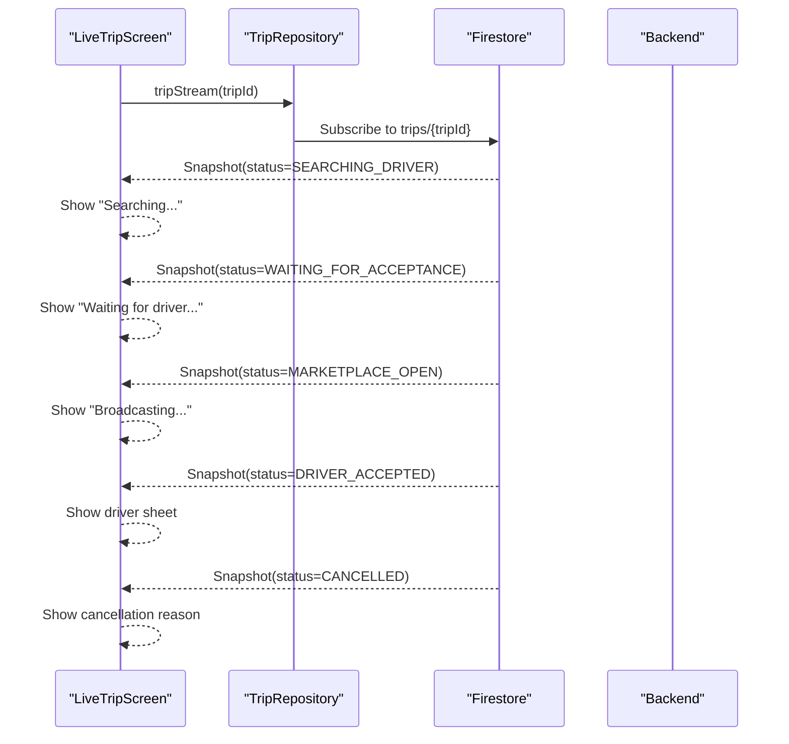
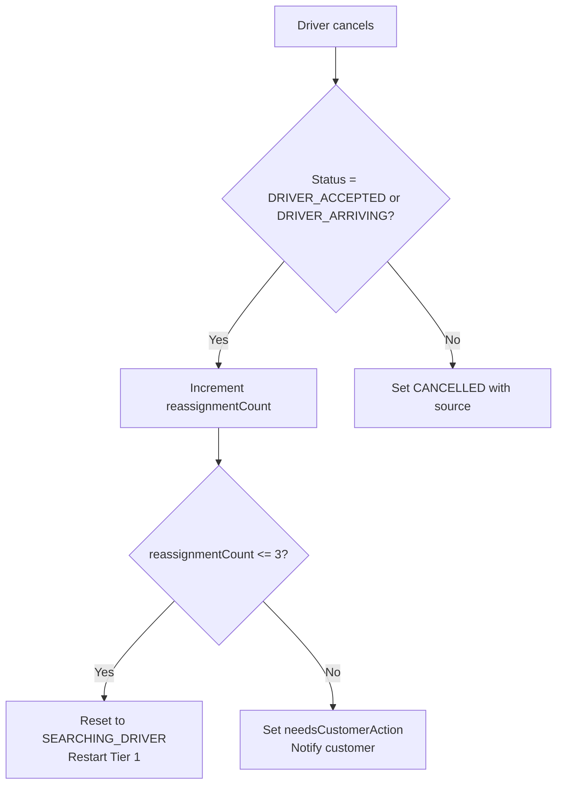
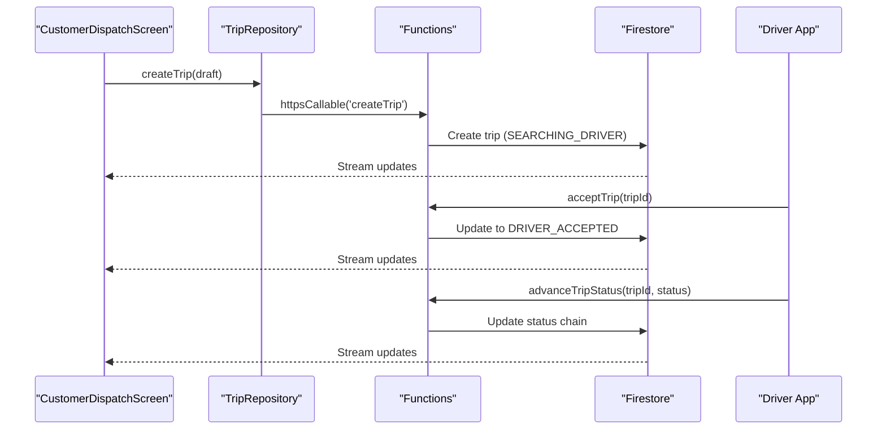
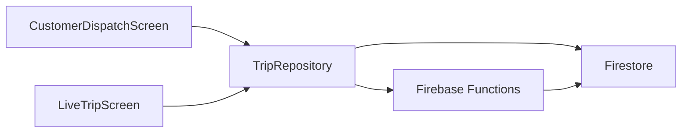

# Customer Dispatch Interface

<cite>
**Referenced Files in This Document**
- [customer_dispatch_screen.dart](file://sese_ride/lib/features/customer/presentation/customer_dispatch_screen.dart)
- [live_trip_screen.dart](file://sese_ride/lib/features/trips/presentation/live_trip_screen.dart)
- [trip_models.dart](file://sese_ride/lib/features/trips/models/trip_models.dart)
- [trip_service.dart](file://sese_ride/lib/features/trips/services/trip_service.dart)
- [trips.ts](file://functions/src/trips.ts)
</cite>

## Table of Contents
1. [Introduction](#introduction)
2. [Project Structure](#project-structure)
3. [Core Components](#core-components)
4. [Architecture Overview](#architecture-overview)
5. [Detailed Component Analysis](#detailed-component-analysis)
6. [Dependency Analysis](#dependency-analysis)
7. [Performance Considerations](#performance-considerations)
8. [Troubleshooting Guide](#troubleshooting-guide)
9. [Conclusion](#conclusion)

## Introduction
This document explains the customer dispatch interface that handles ride and delivery requests, driver matching, trip state management, real-time status updates, and driver assignment notifications. It also covers the user-facing components for viewing available drivers, accepting ride offers, monitoring trip progress, handling driver cancellations, and managing trip lifecycle events. The system is intentionally server-driven: the client creates a trip and listens to live snapshots, while Cloud Functions own matchmaking, tiered dispatch, timeouts, reassignment, and cancellation logic.

## Project Structure
The customer dispatch flow spans three main layers:

- **Customer UI layer**: Booking wizard and live trip tracker.
- **Client transport layer**: Trip repository abstraction over Firebase Functions and Firestore.
- **Server layer**: Cloud Functions implementing the authoritative trip state machine and dispatch algorithms.

**Diagram sources**
- [customer_dispatch_screen.dart:660-787](file://sese_ride/lib/features/customer/presentation/customer_dispatch_screen.dart#L660-L787)
- [live_trip_screen.dart:31-87](file://sese_ride/lib/features/trips/presentation/live_trip_screen.dart#L31-L87)
- [trip_service.dart:66-122](file://sese_ride/lib/features/trips/services/trip_service.dart#L66-L122)
- [trips.ts:129-225](file://functions/src/trips.ts#L129-L225)

**Section sources**
- [customer_dispatch_screen.dart:25-87](file://sese_ride/lib/features/customer/presentation/customer_dispatch_screen.dart#L25-L87)
- [live_trip_screen.dart:14-28](file://sese_ride/lib/features/trips/presentation/live_trip_screen.dart#L14-L28)
- [trip_service.dart:20-64](file://sese_ride/lib/features/trips/services/trip_service.dart#L20-L64)
- [trips.ts:12-26](file://functions/src/trips.ts#L12-L26)

## Core Components
- **CustomerDispatchScreen**: Step-by-step booking screen for ride-hailing and package delivery. It collects locations, computes fares, validates contact numbers, mints a trip via `createTrip`, and navigates to the live tracker.
- **LiveTripScreen**: Real-time trip tracker driven by a Firestore stream. It renders status banners, driver sheets, bid carousels, map markers, and cancellation controls.
- **Trip models**: Defines `TripStatus`, `ActiveTrip`, `DriverInfo`, and `TripDraft`. These types mirror the Firestore trip document and are used across the UI and transport layer.
- **TripRepository**: Abstract seam for trip operations. Production implementation calls Firebase Functions for mutations and subscribes to Firestore for live streams.
- **Cloud Functions (trips.ts)**: Authoritative state machine. Handles trip creation, cascading driver matching, accept/decline, location updates, status advancement, cancellation, bidding, fare increases, and idle prompts.

**Section sources**
- [customer_dispatch_screen.dart:25-87](file://sese_ride/lib/features/customer/presentation/customer_dispatch_screen.dart#L25-L87)
- [live_trip_screen.dart:14-87](file://sese_ride/lib/features/trips/presentation/live_trip_screen.dart#L14-L87)
- [trip_models.dart:1-53](file://sese_ride/lib/features/trips/models/trip_models.dart#L1-L53)
- [trip_service.dart:20-64](file://sese_ride/lib/features/trips/services/trip_service.dart#L20-L64)
- [trips.ts:12-26](file://functions/src/trips.ts#L12-L26)

## Architecture Overview
The dispatch architecture follows a clear separation of concerns:

- The **client** never decides trip transitions; it only sends intents (create, cancel, bid actions) and observes snapshots.
- The **server** owns all state transitions, including matchmaking tiers, ping timeouts, reassignments, and terminal states.
- **Real-time updates** come from Firestore streams consumed by `LiveTripScreen`.
- **User actions** like accepting bids or boosting fares are routed through callable functions with strict validation.

**Diagram sources**
- [customer_dispatch_screen.dart:660-787](file://sese_ride/lib/features/customer/presentation/customer_dispatch_screen.dart#L660-L787)
- [trip_service.dart:73-99](file://sese_ride/lib/features/trips/services/trip_service.dart#L73-L99)
- [trips.ts:129-225](file://functions/src/trips.ts#L129-L225)
- [live_trip_screen.dart:31-87](file://sese_ride/lib/features/trips/presentation/live_trip_screen.dart#L31-L87)

## Detailed Component Analysis

### Trip State Management
The trip lifecycle is defined by `TripStatus` and enforced by the backend. States include searching, waiting for acceptance, marketplace broadcast, driver accepted, arriving, arrived, in progress, completed, cancelled, needs customer action, and bidding. The client maps wire strings to enum values and renders appropriate UI.

**Diagram sources**
- [trip_models.dart:11-49](file://sese_ride/lib/features/trips/models/trip_models.dart#L11-L49)
- [trips.ts:44-63](file://functions/src/trips.ts#L44-L63)
- [trips.ts:295-370](file://functions/src/trips.ts#L295-L370)
- [trips.ts:800-927](file://functions/src/trips.ts#L800-L927)

**Section sources**
- [trip_models.dart:11-49](file://sese_ride/lib/features/trips/models/trip_models.dart#L11-L49)
- [trips.ts:12-26](file://functions/src/trips.ts#L12-L26)

### Real-Time Status Updates and Driver Assignment Notifications
- `LiveTripScreen` subscribes to `repository.tripStream(tripId)` and reacts to terminal states (`completed`, `cancelled`) and special states (`needsCustomerAction`).
- The status banner shows contextual messages per state, such as searching, waiting for acceptance, broadcasting, bidding, driver arrival, and trip in progress.
- When a driver is assigned, the accepted-driver sheet displays driver details and call/message actions.
- Bid carousels appear during searching/marketplace/bidding phases, allowing customers to accept or reject pending bids.

**Diagram sources**
- [live_trip_screen.dart:31-87](file://sese_ride/lib/features/trips/presentation/live_trip_screen.dart#L31-L87)
- [live_trip_screen.dart:296-384](file://sese_ride/lib/features/trips/presentation/live_trip_screen.dart#L296-L384)
- [live_trip_screen.dart:400-487](file://sese_ride/lib/features/trips/presentation/live_trip_screen.dart#L400-L487)
- [live_trip_screen.dart:611-672](file://sese_ride/lib/features/trips/presentation/live_trip_screen.dart#L611-L672)

**Section sources**
- [live_trip_screen.dart:31-87](file://sese_ride/lib/features/trips/presentation/live_trip_screen.dart#L31-L87)
- [live_trip_screen.dart:296-384](file://sese_ride/lib/features/trips/presentation/live_trip_screen.dart#L296-L384)
- [live_trip_screen.dart:400-487](file://sese_ride/lib/features/trips/presentation/live_trip_screen.dart#L400-L487)
- [live_trip_screen.dart:611-672](file://sese_ride/lib/features/trips/presentation/live_trip_screen.dart#L611-L672)

### Driver Matching and Cascading Tiers
The server implements a tiered dispatch strategy:

- **Tier 1**: Exclusive offer to the nearest online driver.
- **Tier 2**: Simultaneous offer to the next two nearest drivers.
- **Tier 3**: Broadcast to all nearby online drivers (marketplace).
- A scheduled sweep promotes expired pings and restarts dispatch when needed.

**Diagram sources**
- [trips.ts:295-370](file://functions/src/trips.ts#L295-L370)
- [trips.ts:372-384](file://functions/src/trips.ts#L372-L384)
- [trips.ts:401-512](file://functions/src/trips.ts#L401-L512)

**Section sources**
- [trips.ts:295-370](file://functions/src/trips.ts#L295-L370)
- [trips.ts:372-384](file://functions/src/trips.ts#L372-L384)
- [trips.ts:401-512](file://functions/src/trips.ts#L401-L512)

### User Interface Components
- **Booking Wizard**: Collects pickup/dropoff, calculates fares, validates phone numbers, and confirms dispatch.
- **Live Tracker**: Shows status banner, OSM map with route polyline, driver marker, accepted-driver sheet, bid carousel, and cancel button.
- **Bid Carousel**: Displays pending bids with driver info, rating, ETA, fare, and accept/reject actions.
- **Needs Action Screen**: Prompts fare increase or cancellation when auto-reassignment fails.

**Diagram sources**
- [customer_dispatch_screen.dart:34-87](file://sese_ride/lib/features/customer/presentation/customer_dispatch_screen.dart#L34-L87)
- [live_trip_screen.dart:20-28](file://sese_ride/lib/features/trips/presentation/live_trip_screen.dart#L20-L28)
- [trip_service.dart:26-64](file://sese_ride/lib/features/trips/services/trip_service.dart#L26-L64)
- [trip_service.dart:66-217](file://sese_ride/lib/features/trips/services/trip_service.dart#L66-L217)

**Section sources**
- [customer_dispatch_screen.dart:25-87](file://sese_ride/lib/features/customer/presentation/customer_dispatch_screen.dart#L25-L87)
- [live_trip_screen.dart:20-87](file://sese_ride/lib/features/trips/presentation/live_trip_screen.dart#L20-L87)
- [trip_service.dart:26-64](file://sese_ride/lib/features/trips/services/trip_service.dart#L26-L64)

### Examples of Implementing Real-Time Listeners and Lifecycle Events
- **Trip status changes**: Use `repository.tripStream(tripId)` to listen for `ActiveTrip` snapshots. Handle terminal states (`completed`, `cancelled`) and special states (`needsCustomerAction`) to update UI accordingly.
- **Driver cancellations**: When the server transitions to `needsCustomerAction`, show the fare boost/cancel prompt. If the trip becomes `CANCELLED`, display the cancellation reason based on `cancellationSource`.
- **Trip lifecycle events**: Observe status transitions from `searchingDriver` → `waitingForAcceptance` → `marketplaceOpen` → `driverAccepted` → `driverArriving` → `driverArrived` → `inProgress` → `completed`.

**Diagram sources**
- [live_trip_screen.dart:31-87](file://sese_ride/lib/features/trips/presentation/live_trip_screen.dart#L31-L87)
- [trip_service.dart:101-122](file://sese_ride/lib/features/trips/services/trip_service.dart#L101-L122)
- [trips.ts:800-927](file://functions/src/trips.ts#L800-L927)

**Section sources**
- [live_trip_screen.dart:31-87](file://sese_ride/lib/features/trips/presentation/live_trip_screen.dart#L31-L87)
- [trip_service.dart:101-122](file://sese_ride/lib/features/trips/services/trip_service.dart#L101-L122)
- [trips.ts:800-927](file://functions/src/trips.ts#L800-L927)

### Handling Driver Cancellations and Reassignment Flow
- **Driver cancellation**: The server determines whether the driver cancelled before arrival or after arrival (no-show window). It may auto-reassign up to three times. After max retries, it sets `needsCustomerAction` and notifies the customer.
- **Customer response**: The UI presents a fare boost input or cancellation option. Increasing the fare resets the trip to `SEARCHING_DRIVER` and restarts dispatch.

**Diagram sources**
- [trips.ts:800-927](file://functions/src/trips.ts#L800-L927)
- [live_trip_screen.dart:90-232](file://sese_ride/lib/features/trips/presentation/live_trip_screen.dart#L90-L232)

**Section sources**
- [trips.ts:800-927](file://functions/src/trips.ts#L800-L927)
- [live_trip_screen.dart:90-232](file://sese_ride/lib/features/trips/presentation/live_trip_screen.dart#L90-L232)

### Managing Trip Lifecycle Events
- **Creation**: `CustomerDispatchScreen` calls `createTrip`, which validates inputs, verifies fare tokens, and creates the trip document in `SEARCHING_DRIVER`.
- **Matchmaking**: On trip creation, the server starts Tier 1 dispatch. Sweep jobs promote tiers and handle timeouts.
- **Assignment**: Driver accepts via `acceptTrip`; the trip moves to `DRIVER_ACCEPTED`.
- **Progression**: Driver advances through `DRIVER_ARRIVING`, `DRIVER_ARRIVED`, `IN_PROGRESS`, and finally `COMPLETED`.
- **Cancellation**: Either party can cancel; the server enforces rules and sets `cancellationSource`.

**Diagram sources**
- [customer_dispatch_screen.dart:660-787](file://sese_ride/lib/features/customer/presentation/customer_dispatch_screen.dart#L660-L787)
- [trip_service.dart:73-99](file://sese_ride/lib/features/trips/services/trip_service.dart#L73-L99)
- [trips.ts:129-225](file://functions/src/trips.ts#L129-L225)
- [trips.ts:591-653](file://functions/src/trips.ts#L591-L653)
- [trips.ts:764-796](file://functions/src/trips.ts#L764-L796)

**Section sources**
- [customer_dispatch_screen.dart:660-787](file://sese_ride/lib/features/customer/presentation/customer_dispatch_screen.dart#L660-L787)
- [trip_service.dart:73-99](file://sese_ride/lib/features/trips/services/trip_service.dart#L73-L99)
- [trips.ts:129-225](file://functions/src/trips.ts#L129-L225)
- [trips.ts:591-653](file://functions/src/trips.ts#L591-L653)
- [trips.ts:764-796](file://functions/src/trips.ts#L764-L796)

## Dependency Analysis
Key dependencies and relationships:

- `CustomerDispatchScreen` depends on `TripRepository` for creating trips and navigating to `LiveTripScreen`.
- `LiveTripScreen` depends on `TripRepository` for streaming trip data and bid data.
- `TripRepository` abstracts Firebase Functions and Firestore; production uses `FirestoreTripRepository`.
- Cloud Functions depend on Firestore for persistence and on other modules for streak logic and fare verification.

**Diagram sources**
- [customer_dispatch_screen.dart:660-787](file://sese_ride/lib/features/customer/presentation/customer_dispatch_screen.dart#L660-L787)
- [live_trip_screen.dart:31-87](file://sese_ride/lib/features/trips/presentation/live_trip_screen.dart#L31-L87)
- [trip_service.dart:66-122](file://sese_ride/lib/features/trips/services/trip_service.dart#L66-L122)
- [trips.ts:129-225](file://functions/src/trips.ts#L129-L225)

**Section sources**
- [customer_dispatch_screen.dart:660-787](file://sese_ride/lib/features/customer/presentation/customer_dispatch_screen.dart#L660-L787)
- [live_trip_screen.dart:31-87](file://sese_ride/lib/features/trips/presentation/live_trip_screen.dart#L31-L87)
- [trip_service.dart:66-122](file://sese_ride/lib/features/trips/services/trip_service.dart#L66-L122)
- [trips.ts:129-225](file://functions/src/trips.ts#L129-L225)

## Performance Considerations
- **Lazy initialization**: The trip repository is constructed lazily to avoid touching Firebase at widget build time.
- **Debounced autocomplete**: Drop-off suggestions are debounced to reduce API calls.
- **Efficient queries**: Active trips query by `customerId` and filter terminal states client-side to avoid composite indexes.
- **Route fallback**: Route geometry falls back to straight-line segments if routing services are unavailable.
- **Server-side scheduling**: Sweep jobs run periodically to promote tiers and restart dispatch without requiring client presence.

[No sources needed since this section provides general guidance]

## Troubleshooting Guide
Common error scenarios and handling:

- **Network timeouts**: `TripException` wraps network errors with user-friendly messages. The UI shows snackbars and retry options where applicable.
- **Driver unavailability**: Server transitions to `needsCustomerAction` after max reassignments; UI prompts fare boost or cancellation.
- **Trip cancellation flows**: Both customer and driver can cancel; server sets `cancellationSource` and updates status accordingly.
- **Invalid inputs**: Phone number validation, coordinate checks, and fare token verification prevent malformed requests.

**Section sources**
- [trip_service.dart:8-18](file://sese_ride/lib/features/trips/services/trip_service.dart#L8-L18)
- [trip_service.dart:202-215](file://sese_ride/lib/features/trips/services/trip_service.dart#L202-L215)
- [customer_dispatch_screen.dart:660-787](file://sese_ride/lib/features/customer/presentation/customer_dispatch_screen.dart#L660-L787)
- [trips.ts:129-225](file://functions/src/trips.ts#L129-L225)
- [trips.ts:800-927](file://functions/src/trips.ts#L800-L927)

## Conclusion
The customer dispatch interface provides a robust, server-driven system for ride and delivery requests. It separates UI concerns from business logic, ensuring reliable trip state management, real-time updates, and resilient handling of driver availability and cancellations. By leveraging Firestore streams and Cloud Functions, the system maintains consistency and scalability while offering a smooth user experience.

[No sources needed since this section summarizes without analyzing specific files]