# Customer Experience Features

<cite>
**Referenced Files in This Document**
- [main.dart](file://sese_ride/lib/main.dart)
- [customer_home_shell.dart](file://sese_ride/lib/features/home/customer_home_shell.dart)
- [customer_home_map_screen.dart](file://sese_ride/lib/features/customer/presentation/customer_home_map_screen.dart)
- [customer_dispatch_screen.dart](file://sese_ride/lib/features/customer/presentation/customer_dispatch_screen.dart)
- [location_service.dart](file://sese_ride/lib/features/customer/services/location_service.dart)
- [fare_service.dart](file://sese_ride/lib/features/customer/services/fare_service.dart)
- [live_trip_screen.dart](file://sese_ride/lib/features/trips/presentation/live_trip_screen.dart)
- [customer_trips_screen.dart](file://sese_ride/lib/features/trips/presentation/customer_trips_screen.dart)
- [trip_service.dart](file://sese_ride/lib/features/trips/services/trip_service.dart)
- [payment_service.dart](file://sese_ride/lib/features/payments/payment_service.dart)
- [top_up_sheet.dart](file://sese_ride/lib/features/payments/top_up_sheet.dart)
- [support_chat_screen.dart](file://sese_ride/lib/features/support/support_chat_screen.dart)
- [customer_profile_screen.dart](file://sese_ride/lib/features/home/customer_profile_screen.dart)
- [pricing.ts](file://functions/src/pricing.ts)
- [routing.ts](file://functions/src/routing.ts)
</cite>

## Table of Contents
1. Introduction
2. Project Structure
3. Core Components
4. Architecture Overview
5. Detailed Component Analysis
6. Dependency Analysis
7. Performance Considerations
8. Troubleshooting Guide
9. Conclusion

## Introduction
This document explains the customer-facing experience in the Sese Ride app, focusing on the complete ride and delivery booking flow from location selection to trip completion. It covers map integration, address autocomplete, fare estimation, real-time driver tracking, payment processing, trip history, support chat, authentication flows, profile management, and preference settings. It also documents integrations with the pricing engine, location services, and real-time updates, along with error handling, loading states, and offline behavior.

## Project Structure
The customer experience is implemented primarily under `sese_ride/lib/features`, with shared UI shells, screens, services, and backend callables in `functions`. The main entry point initializes Firebase, App Check, theme state, and routes users to either the customer or driver shell based on their authenticated role.

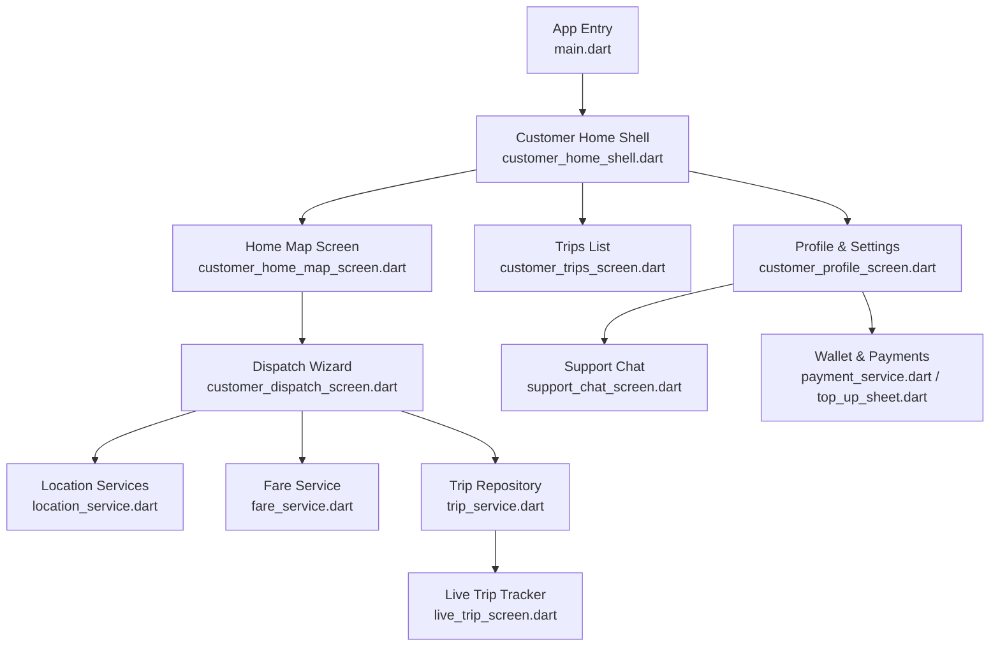

**Diagram sources**
- [main.dart:13-40](file://sese_ride/lib/main.dart#L13-L40)
- [customer_home_shell.dart:16-24](file://sese_ride/lib/features/home/customer_home_shell.dart#L16-L24)
- [customer_home_map_screen.dart:9-14](file://sese_ride/lib/features/customer/presentation/customer_home_map_screen.dart#L9-L14)
- [customer_dispatch_screen.dart:25-33](file://sese_ride/lib/features/customer/presentation/customer_dispatch_screen.dart#L25-L33)
- [location_service.dart:23-38](file://sese_ride/lib/features/customer/services/location_service.dart#L23-L38)
- [fare_service.dart:7-17](file://sese_ride/lib/features/customer/services/fare_service.dart#L7-L17)
- [trip_service.dart:20-25](file://sese_ride/lib/features/trips/services/trip_service.dart#L20-L25)
- [live_trip_screen.dart:14-19](file://sese_ride/lib/features/trips/presentation/live_trip_screen.dart#L14-L19)
- [customer_profile_screen.dart:17-21](file://sese_ride/lib/features/home/customer_profile_screen.dart#L17-L21)
- [payment_service.dart:240-246](file://sese_ride/lib/features/payments/payment_service.dart#L240-L246)
- [top_up_sheet.dart:6-12](file://sese_ride/lib/features/payments/top_up_sheet.dart#L6-L12)
- [support_chat_screen.dart:6-12](file://sese_ride/lib/features/support/support_chat_screen.dart#L6-L12)

**Section sources**
- [main.dart:13-40](file://sese_ride/lib/main.dart#L13-L40)
- [customer_home_shell.dart:16-24](file://sese_ride/lib/features/home/customer_home_shell.dart#L16-L24)

## Core Components
- Authentication and routing gate: Role-based navigation to customer/driver shells after sign-in.
- Customer home shell: Bottom navigation for Trips, Home (map), and Profile; live trip banner.
- Map screen: Full-screen OpenStreetMap with user position marker and action cards to start booking.
- Dispatch wizard: Step-by-step booking for ride-hailing and package delivery with address autocomplete, route preview, fare estimation, vehicle/tier selection, contact phone validation, and dispatch.
- Location service: GPS, reverse/forward geocoding via OSM Nominatim, and OSRM route polyline.
- Fare service: Zero-trust client calling Cloud Function `calculateFare` to compute server-authoritative fares.
- Trip repository: Callable-backed trip creation and Firestore streams for live trip state and bids.
- Live trip tracker: Real-time status banner, bid carousel, accepted-driver sheet, and cancel actions.
- Trips list: Active trips stream for re-entry after app restart.
- Payments: Wallet top-up via Paystack hosted checkout, balance/history streams, and verification.
- Support chat: AI-driven chat with escalation to human agents.
- Profile and settings: Account details, verification status, theme preferences, help access, and sign-out.

**Section sources**
- [main.dart:89-145](file://sese_ride/lib/main.dart#L89-L145)
- [customer_home_shell.dart:16-24](file://sese_ride/lib/features/home/customer_home_shell.dart#L16-L24)
- [customer_home_map_screen.dart:9-14](file://sese_ride/lib/features/customer/presentation/customer_home_map_screen.dart#L9-L14)
- [customer_dispatch_screen.dart:25-33](file://sese_ride/lib/features/customer/presentation/customer_dispatch_screen.dart#L25-L33)
- [location_service.dart:23-38](file://sese_ride/lib/features/customer/services/location_service.dart#L23-L38)
- [fare_service.dart:7-17](file://sese_ride/lib/features/customer/services/fare_service.dart#L7-L17)
- [trip_service.dart:20-25](file://sese_ride/lib/features/trips/services/trip_service.dart#L20-L25)
- [live_trip_screen.dart:14-19](file://sese_ride/lib/features/trips/presentation/live_trip_screen.dart#L14-L19)
- [customer_trips_screen.dart:7-11](file://sese_ride/lib/features/trips/presentation/customer_trips_screen.dart#L7-L11)
- [payment_service.dart:240-246](file://sese_ride/lib/features/payments/payment_service.dart#L240-L246)
- [top_up_sheet.dart:6-12](file://sese_ride/lib/features/payments/top_up_sheet.dart#L6-L12)
- [support_chat_screen.dart:6-12](file://sese_ride/lib/features/support/support_chat_screen.dart#L6-L12)
- [customer_profile_screen.dart:17-21](file://sese_ride/lib/features/home/customer_profile_screen.dart#L17-L21)

## Architecture Overview
The customer journey starts at the app entry, which initializes Firebase and App Check, then routes to the appropriate shell. The customer shell hosts a map-centric home, a trips list, and a profile/settings area. Booking begins on the map screen and proceeds through the dispatch wizard, which integrates location services and the fare service before creating a trip via the trip repository. Real-time trip state is streamed back to the live trip tracker. Payments are handled through a wallet system using Paystack hosted checkout. Support chat provides AI assistance with escalation to human agents.

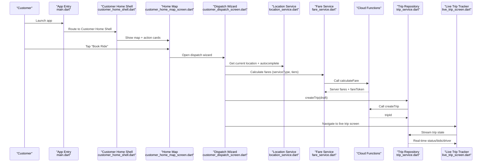

**Diagram sources**
- [main.dart:13-40](file://sese_ride/lib/main.dart#L13-L40)
- [customer_home_shell.dart:16-24](file://sese_ride/lib/features/home/customer_home_shell.dart#L16-L24)
- [customer_home_map_screen.dart:72-86](file://sese_ride/lib/features/customer/presentation/customer_home_map_screen.dart#L72-L86)
- [customer_dispatch_screen.dart:444-540](file://sese_ride/lib/features/customer/presentation/customer_dispatch_screen.dart#L444-L540)
- [location_service.dart:67-101](file://sese_ride/lib/features/customer/services/location_service.dart#L67-L101)
- [fare_service.dart:44-89](file://sese_ride/lib/features/customer/services/fare_service.dart#L44-L89)
- [trip_service.dart:73-99](file://sese_ride/lib/features/trips/services/trip_service.dart#L73-L99)
- [live_trip_screen.dart:30-87](file://sese_ride/lib/features/trips/presentation/live_trip_screen.dart#L30-L87)

## Detailed Component Analysis

### Authentication and Routing Gate
- Initializes Firebase and App Check, detects country code, and loads theme.
- Role-based routing: unauthenticated users see login; drivers pending onboarding go to onboarding; otherwise customers get the customer shell and drivers get the driver shell.

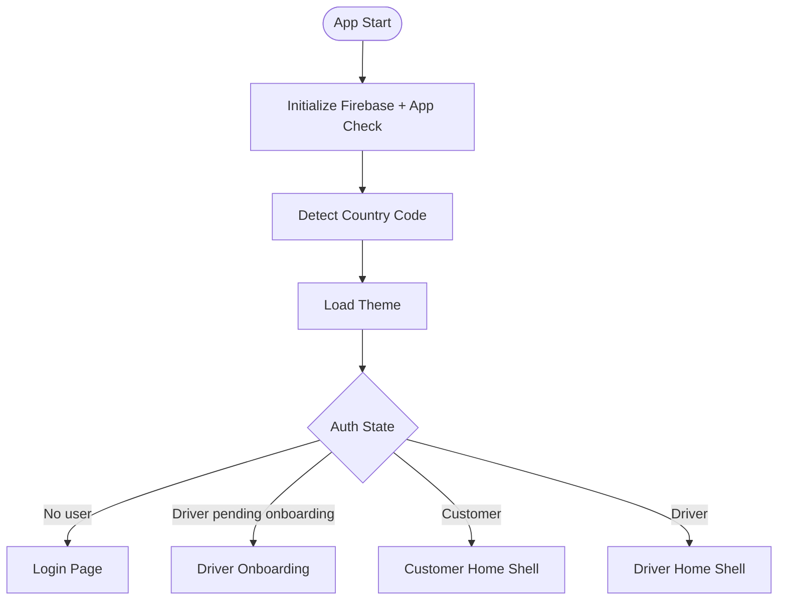

**Diagram sources**
- [main.dart:13-40](file://sese_ride/lib/main.dart#L13-L40)
- [main.dart:89-145](file://sese_ride/lib/main.dart#L89-L145)

**Section sources**
- [main.dart:13-40](file://sese_ride/lib/main.dart#L13-L40)
- [main.dart:89-145](file://sese_ride/lib/main.dart#L89-L145)

### Customer Home Shell
- Provides bottom navigation: Trips, Home (map), Profile.
- Shows a persistent active trip banner that navigates to the live trip tracker.
- Includes optional verification banner and a countdown banner for driver-turned-customer scenarios.

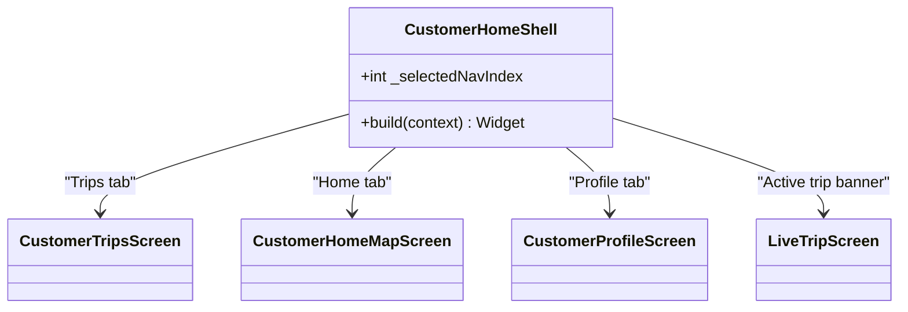

**Diagram sources**
- [customer_home_shell.dart:16-24](file://sese_ride/lib/features/home/customer_home_shell.dart#L16-L24)
- [customer_home_shell.dart:115-131](file://sese_ride/lib/features/home/customer_home_shell.dart#L115-L131)
- [customer_home_shell.dart:133-231](file://sese_ride/lib/features/home/customer_home_shell.dart#L133-L231)

**Section sources**
- [customer_home_shell.dart:16-24](file://sese_ride/lib/features/home/customer_home_shell.dart#L16-L24)
- [customer_home_shell.dart:115-131](file://sese_ride/lib/features/home/customer_home_shell.dart#L115-L131)
- [customer_home_shell.dart:133-231](file://sese_ride/lib/features/home/customer_home_shell.dart#L133-L231)

### Map Integration and Action Cards
- Displays an OpenStreetMap with a blue-dot user marker and a recenter button.
- Action cards open focused booking flows: Book Ride, Send Item, Receive Item.

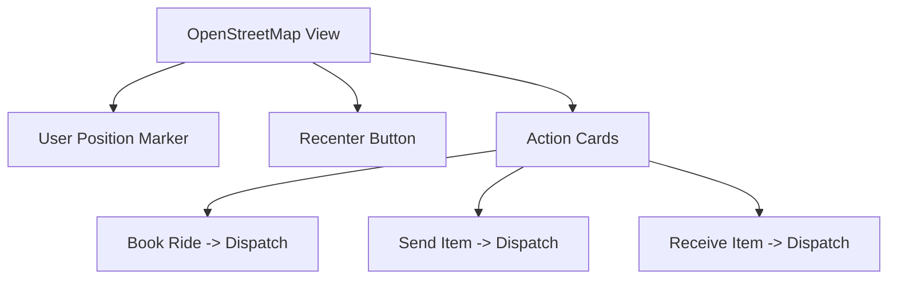

**Diagram sources**
- [customer_home_map_screen.dart:9-14](file://sese_ride/lib/features/customer/presentation/customer_home_map_screen.dart#L9-L14)
- [customer_home_map_screen.dart:72-86](file://sese_ride/lib/features/customer/presentation/customer_home_map_screen.dart#L72-L86)
- [customer_home_map_screen.dart:88-139](file://sese_ride/lib/features/customer/presentation/customer_home_map_screen.dart#L88-L139)

**Section sources**
- [customer_home_map_screen.dart:9-14](file://sese_ride/lib/features/customer/presentation/customer_home_map_screen.dart#L9-L14)
- [customer_home_map_screen.dart:72-86](file://sese_ride/lib/features/customer/presentation/customer_home_map_screen.dart#L72-L86)
- [customer_home_map_screen.dart:88-139](file://sese_ride/lib/features/customer/presentation/customer_home_map_screen.dart#L88-L139)

### Address Autocomplete and Route Preview
- Debounced suggestions via OSM Nominatim; selection locks coordinates and clears keyboard.
- Route polyline fetched from OSRM public demo server; fallback straight line if unavailable.
- All network calls are best-effort with timeouts and safe fallbacks.

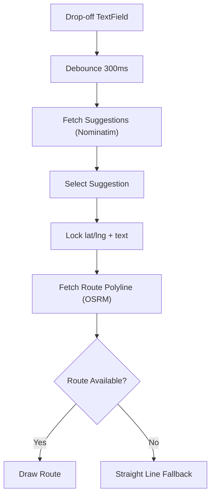

**Diagram sources**
- [customer_dispatch_screen.dart:344-410](file://sese_ride/lib/features/customer/presentation/customer_dispatch_screen.dart#L344-L410)
- [customer_dispatch_screen.dart:424-442](file://sese_ride/lib/features/customer/presentation/customer_dispatch_screen.dart#L424-L442)
- [location_service.dart:163-212](file://sese_ride/lib/features/customer/services/location_service.dart#L163-L212)
- [location_service.dart:225-278](file://sese_ride/lib/features/customer/services/location_service.dart#L225-L278)

**Section sources**
- [customer_dispatch_screen.dart:344-410](file://sese_ride/lib/features/customer/presentation/customer_dispatch_screen.dart#L344-L410)
- [customer_dispatch_screen.dart:424-442](file://sese_ride/lib/features/customer/presentation/customer_dispatch_screen.dart#L424-L442)
- [location_service.dart:163-212](file://sese_ride/lib/features/customer/services/location_service.dart#L163-L212)
- [location_service.dart:225-278](file://sese_ride/lib/features/customer/services/location_service.dart#L225-L278)

### Fare Estimation and Pricing Engine
- Client never computes fares locally; all calculations happen server-side via `calculateFare`.
- Backend resolves regional configuration (global default → country → state), applies distance/time rates, surge multipliers, and car tier multipliers.
- Returns server-signed fare tokens and formatted amounts per tier.

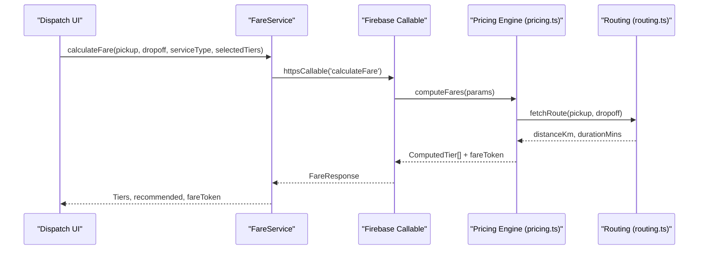

**Diagram sources**
- [fare_service.dart:44-89](file://sese_ride/lib/features/customer/services/fare_service.dart#L44-L89)
- [pricing.ts:166-236](file://functions/src/pricing.ts#L166-L236)
- [routing.ts:40-67](file://functions/src/routing.ts#L40-L67)

**Section sources**
- [fare_service.dart:7-17](file://sese_ride/lib/features/customer/services/fare_service.dart#L7-L17)
- [fare_service.dart:44-89](file://sese_ride/lib/features/customer/services/fare_service.dart#L44-L89)
- [pricing.ts:18-52](file://functions/src/pricing.ts#L18-L52)
- [pricing.ts:60-147](file://functions/src/pricing.ts#L60-L147)
- [pricing.ts:166-236](file://functions/src/pricing.ts#L166-L236)
- [routing.ts:1-12](file://functions/src/routing.ts#L1-L12)
- [routing.ts:40-67](file://functions/src/routing.ts#L40-L67)

### Trip Creation and Real-Time Tracking
- Dispatch wizard validates contact phones, builds a `TripDraft`, and calls `createTrip`.
- Live trip screen streams trip state, shows status banners, bid carousel, and accepted-driver sheet.
- Customer can accept/reject bids, increase fare when needed, or cancel the trip.

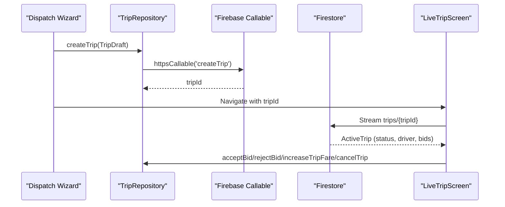

**Diagram sources**
- [customer_dispatch_screen.dart:660-787](file://sese_ride/lib/features/customer/presentation/customer_dispatch_screen.dart#L660-L787)
- [trip_service.dart:73-99](file://sese_ride/lib/features/trips/services/trip_service.dart#L73-L99)
- [live_trip_screen.dart:30-87](file://sese_ride/lib/features/trips/presentation/live_trip_screen.dart#L30-L87)
- [live_trip_screen.dart:234-398](file://sese_ride/lib/features/trips/presentation/live_trip_screen.dart#L234-L398)

**Section sources**
- [customer_dispatch_screen.dart:660-787](file://sese_ride/lib/features/customer/presentation/customer_dispatch_screen.dart#L660-L787)
- [trip_service.dart:73-99](file://sese_ride/lib/features/trips/services/trip_service.dart#L73-L99)
- [live_trip_screen.dart:30-87](file://sese_ride/lib/features/trips/presentation/live_trip_screen.dart#L30-L87)
- [live_trip_screen.dart:234-398](file://sese_ride/lib/features/trips/presentation/live_trip_screen.dart#L234-L398)

### Payment Processing and Wallet
- Wallet top-up uses Paystack hosted checkout; client opens browser, verifies after return.
- Balance and transaction history are streamed from Firestore; errors mapped to user-friendly messages.
- Minimum and maximum top-up limits enforced client-side.

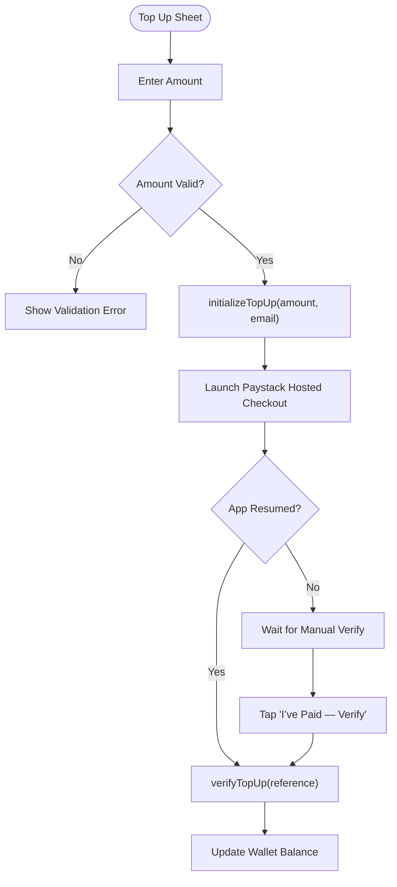

**Diagram sources**
- [top_up_sheet.dart:65-101](file://sese_ride/lib/features/payments/top_up_sheet.dart#L65-L101)
- [top_up_sheet.dart:103-124](file://sese_ride/lib/features/payments/top_up_sheet.dart#L103-L124)
- [payment_service.dart:331-403](file://sese_ride/lib/features/payments/payment_service.dart#L331-L403)

**Section sources**
- [top_up_sheet.dart:6-12](file://sese_ride/lib/features/payments/top_up_sheet.dart#L6-L12)
- [top_up_sheet.dart:65-101](file://sese_ride/lib/features/payments/top_up_sheet.dart#L65-L101)
- [top_up_sheet.dart:103-124](file://sese_ride/lib/features/payments/top_up_sheet.dart#L103-L124)
- [payment_service.dart:240-246](file://sese_ride/lib/features/payments/payment_service.dart#L240-L246)
- [payment_service.dart:331-403](file://sese_ride/lib/features/payments/payment_service.dart#L331-L403)

### Trip History and Re-Entry
- Trips tab lists active trips by streaming `trips` filtered by customerId and client-side live filter.
- Tapping a trip navigates to the live trip tracker.

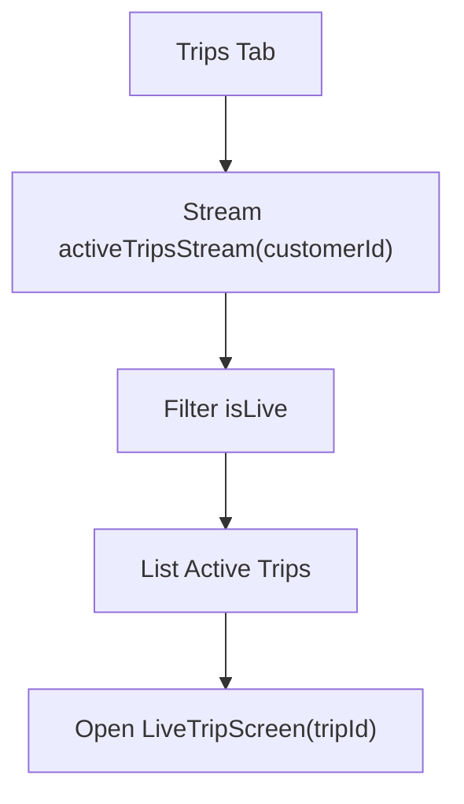

**Diagram sources**
- [customer_trips_screen.dart:7-11](file://sese_ride/lib/features/trips/presentation/customer_trips_screen.dart#L7-L11)
- [customer_trips_screen.dart:24-105](file://sese_ride/lib/features/trips/presentation/customer_trips_screen.dart#L24-L105)
- [trip_service.dart:109-122](file://sese_ride/lib/features/trips/services/trip_service.dart#L109-L122)

**Section sources**
- [customer_trips_screen.dart:7-11](file://sese_ride/lib/features/trips/presentation/customer_trips_screen.dart#L7-L11)
- [customer_trips_screen.dart:24-105](file://sese_ride/lib/features/trips/presentation/customer_trips_screen.dart#L24-L105)
- [trip_service.dart:109-122](file://sese_ride/lib/features/trips/services/trip_service.dart#L109-L122)

### Customer Support Chat
- AI-driven chat session with escalation to human agent; supports typing indicators, status banners, and locked input when resolved.
- Status transitions: ai_active → pending_agent → agent_connected → resolved.

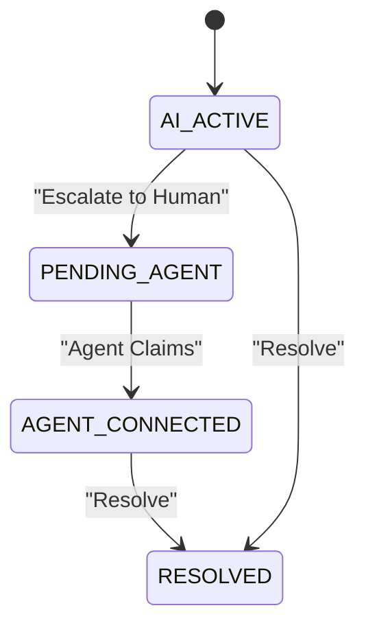

**Diagram sources**
- [support_chat_screen.dart:6-12](file://sese_ride/lib/features/support/support_chat_screen.dart#L6-L12)
- [support_chat_screen.dart:89-140](file://sese_ride/lib/features/support/support_chat_screen.dart#L89-L140)
- [support_chat_screen.dart:147-385](file://sese_ride/lib/features/support/support_chat_screen.dart#L147-L385)

**Section sources**
- [support_chat_screen.dart:6-12](file://sese_ride/lib/features/support/support_chat_screen.dart#L6-L12)
- [support_chat_screen.dart:89-140](file://sese_ride/lib/features/support/support_chat_screen.dart#L89-L140)
- [support_chat_screen.dart:147-385](file://sese_ride/lib/features/support/support_chat_screen.dart#L147-L385)

### Profile Management and Preferences
- Profile header opens detailed editing; verification tile reflects live KYC status and allows submission/editing.
- Theme picker sheet persists light/dark/system mode.
- Help & Support opens AI chat; sign-out triggers auth logout.

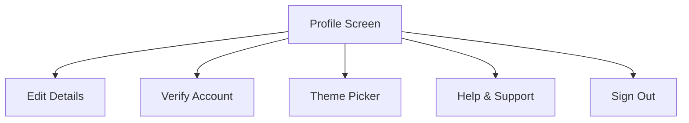

**Diagram sources**
- [customer_profile_screen.dart:17-21](file://sese_ride/lib/features/home/customer_profile_screen.dart#L17-L21)
- [customer_profile_screen.dart:130-385](file://sese_ride/lib/features/home/customer_profile_screen.dart#L130-L385)
- [customer_profile_screen.dart:401-470](file://sese_ride/lib/features/home/customer_profile_screen.dart#L401-L470)
- [customer_profile_screen.dart:472-537](file://sese_ride/lib/features/home/customer_profile_screen.dart#L472-L537)

**Section sources**
- [customer_profile_screen.dart:17-21](file://sese_ride/lib/features/home/customer_profile_screen.dart#L17-L21)
- [customer_profile_screen.dart:130-385](file://sese_ride/lib/features/home/customer_profile_screen.dart#L130-L385)
- [customer_profile_screen.dart:401-470](file://sese_ride/lib/features/home/customer_profile_screen.dart#L401-L470)
- [customer_profile_screen.dart:472-537](file://sese_ride/lib/features/home/customer_profile_screen.dart#L472-L537)

## Dependency Analysis
- UI components depend on services for location, fare calculation, and trip operations.
- Services abstract backend transports (Firebase Functions, Firestore).
- Backend functions encapsulate pricing logic and routing; they rely on OSRM and Firestore configuration.

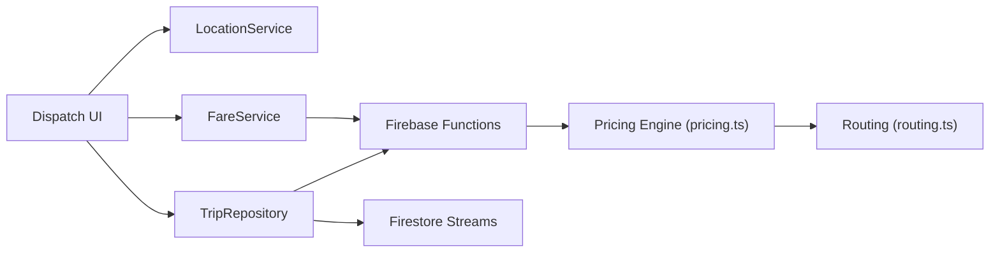

**Diagram sources**
- [customer_dispatch_screen.dart:90-98](file://sese_ride/lib/features/customer/presentation/customer_dispatch_screen.dart#L90-L98)
- [fare_service.dart:23-32](file://sese_ride/lib/features/customer/services/fare_service.dart#L23-L32)
- [trip_service.dart:66-99](file://sese_ride/lib/features/trips/services/trip_service.dart#L66-L99)
- [pricing.ts:166-236](file://functions/src/pricing.ts#L166-L236)
- [routing.ts:40-67](file://functions/src/routing.ts#L40-L67)

**Section sources**
- [customer_dispatch_screen.dart:90-98](file://sese_ride/lib/features/customer/presentation/customer_dispatch_screen.dart#L90-L98)
- [fare_service.dart:23-32](file://sese_ride/lib/features/customer/services/fare_service.dart#L23-L32)
- [trip_service.dart:66-99](file://sese_ride/lib/features/trips/services/trip_service.dart#L66-L99)
- [pricing.ts:166-236](file://functions/src/pricing.ts#L166-L236)
- [routing.ts:40-67](file://functions/src/routing.ts#L40-L67)

## Performance Considerations
- Debounce address autocomplete to reduce API calls.
- Use best-effort network calls with timeouts and fallbacks for location and routing.
- Lazy initialization of trip repository avoids touching Firebase during widget build.
- Stream only necessary data (active trips, bids) and filter client-side where appropriate.
- Avoid local caching of sensitive coordinates; keep them in memory only.

[No sources needed since this section provides general guidance]

## Troubleshooting Guide
- Authentication failures: Session expired or account missing; prompt sign-in again or show account missing message.
- Fare calculation errors: Network or function errors mapped to user-friendly messages; retry option provided.
- Trip creation errors: Invalid arguments or not found; display actionable messages and allow retry.
- Payment errors: Validation or backend issues; clear messages and retry options.
- Offline capabilities: Location and routing degrade gracefully; booking may proceed with manual inputs and fallback route visuals.

**Section sources**
- [main.dart:89-145](file://sese_ride/lib/main.dart#L89-L145)
- [fare_service.dart:76-106](file://sese_ride/lib/features/customer/services/fare_service.dart#L76-L106)
- [trip_service.dart:202-215](file://sese_ride/lib/features/trips/services/trip_service.dart#L202-L215)
- [payment_service.dart:416-431](file://sese_ride/lib/features/payments/payment_service.dart#L416-L431)
- [location_service.dart:31-38](file://sese_ride/lib/features/customer/services/location_service.dart#L31-L38)

## Conclusion
The Sese Ride customer experience combines robust map integration, reliable address autocomplete, server-authoritative fare estimation, and real-time trip tracking. Payments are securely processed via Paystack hosted checkout, while support chat offers AI assistance with human escalation. The architecture emphasizes zero-trust clients, server-side computation, and resilient error handling with graceful degradation for offline scenarios.

[No sources needed since this section summarizes without analyzing specific files]