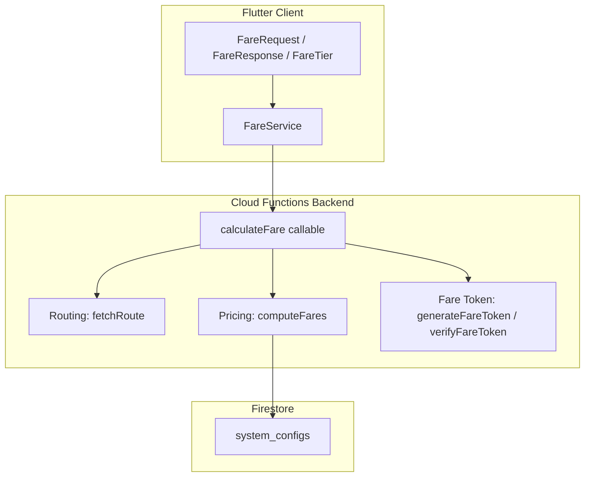
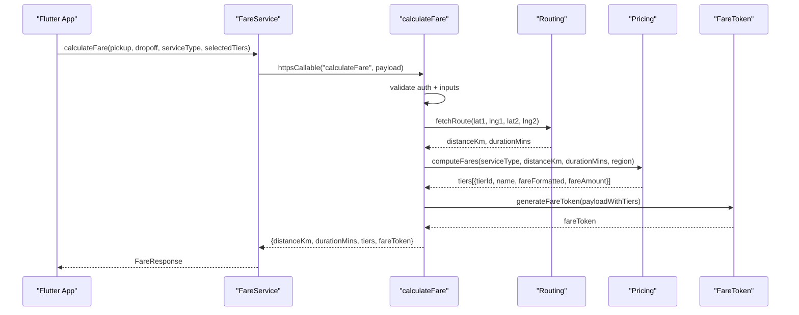
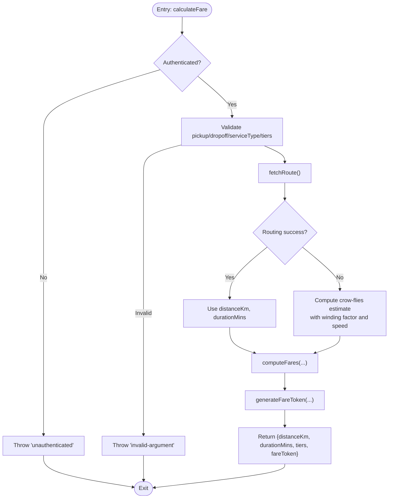
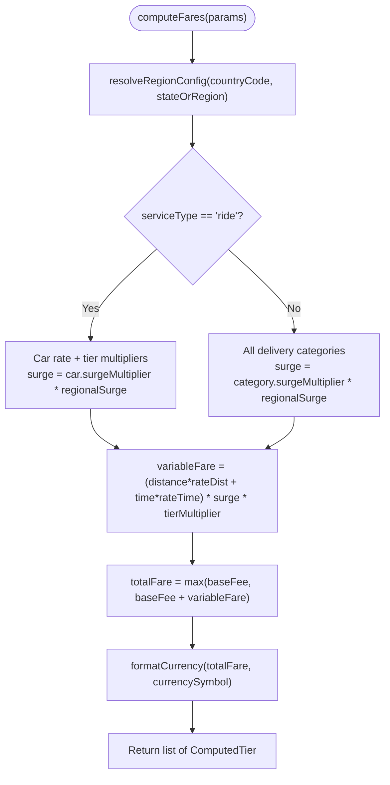
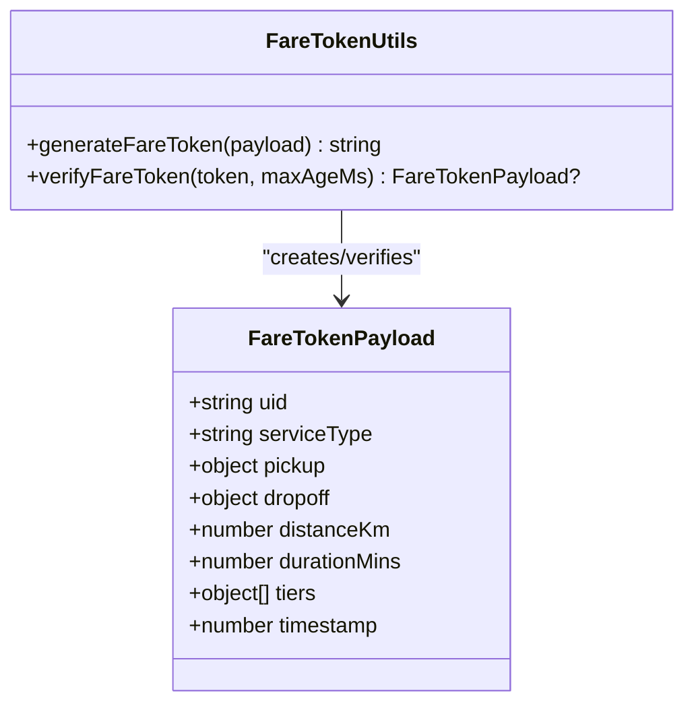
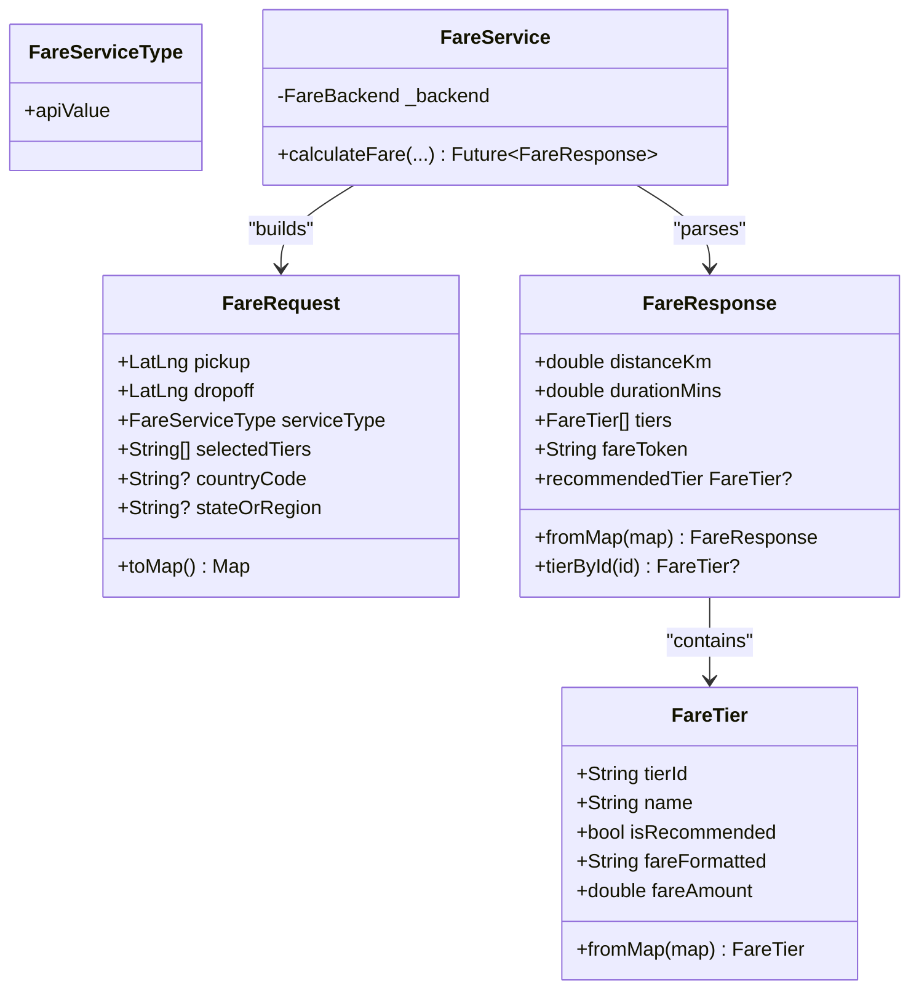
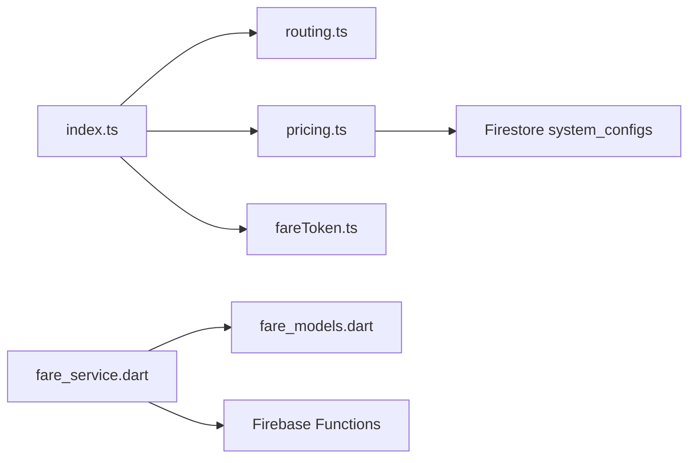

# Fare Calculation System

<cite>
**Referenced Files in This Document**
- [index.ts](file://functions/src/index.ts)
- [pricing.ts](file://functions/src/pricing.ts)
- [fareToken.ts](file://functions/src/fareToken.ts)
- [routing.ts](file://functions/src/routing.ts)
- [trips.ts](file://functions/src/trips.ts)
- [fare_service.dart](file://sese_ride/lib/features/customer/services/fare_service.dart)
- [fare_models.dart](file://sese_ride/lib/features/customer/models/fare_models.dart)
- [pricing_calculator.dart](file://sese_core/lib/services/pricing_calculator.dart)
</cite>

## Table of Contents
1. [Introduction](#introduction)
2. [Project Structure](#project-structure)
3. [Core Components](#core-components)
4. [Architecture Overview](#architecture-overview)
5. [Detailed Component Analysis](#detailed-component-analysis)
6. [Dependency Analysis](#dependency-analysis)
7. [Performance Considerations](#performance-considerations)
8. [Troubleshooting Guide](#troubleshooting-guide)
9. [Conclusion](#conclusion)

## Introduction
This document explains the fare calculation system that powers ride and delivery estimates. The client never computes fares locally. Instead, it sends pickup and dropoff coordinates, service type, and selected vehicle tiers to a server-side pricing engine through a Firebase Callable Function. The server resolves road-network distance and duration, applies regional pricing rules, computes per-tier fares, and returns a signed fare token to prevent tampering.

The system supports:
- Base rates, distance-based pricing, time-based pricing, and surge multipliers.
- Ride tiers (Comfort, Premium, Luxe) for car services.
- Delivery categories (Bicycle, Motorcycle, Tricycle, Car, Van, Truck).
- Regional configuration via Firestore with a global-to-country-to-state fallback chain.
- Secure fare token generation and validation.
- Client error mapping and zero-trust UI rendering.

## Project Structure
The fare system spans three main areas:
- Cloud Functions backend: callable entry point, routing, pricing engine, and fare token utilities.
- Flutter client: fare request/response models and a service that calls the callable function.
- Shared core logic: local pricing calculator used by other parts of the application for consistent formulas.

**Diagram sources**
- [index.ts:81-197](file://functions/src/index.ts#L81-L197)
- [pricing.ts:166-236](file://functions/src/pricing.ts#L166-L236)
- [fareToken.ts:21-58](file://functions/src/fareToken.ts#L21-L58)
- [fare_service.dart:35-89](file://sese_ride/lib/features/customer/services/fare_service.dart#L35-L89)
- [fare_models.dart:30-139](file://sese_ride/lib/features/customer/models/fare_models.dart#L30-L139)

**Section sources**
- [index.ts:1-199](file://functions/src/index.ts#L1-L199)
- [fare_service.dart:1-108](file://sese_ride/lib/features/customer/services/fare_service.dart#L1-L108)
- [fare_models.dart:1-154](file://sese_ride/lib/features/customer/models/fare_models.dart#L1-L154)

## Core Components
- Callable entry point: validates input, computes route metrics, computes fares, and signs the result.
- Pricing engine: resolves regional rates, applies base fee floor, distance/time pricing, surge multipliers, and car tier multipliers.
- Fare token utility: generates HMAC-SHA256 tokens and verifies them with expiration checks.
- Client fare service: wraps the callable call, maps errors, and exposes typed response models.
- Client fare models: define request payload, response structure, and safe user-facing formatting.

Key responsibilities:
- Zero-trust pricing: all monetary values are computed on the server.
- Regional scoping: global default, country-specific, and state-specific overrides.
- Security: authenticated callable, coordinate bounds validation, and signed fare tokens.

**Section sources**
- [index.ts:81-197](file://functions/src/index.ts#L81-L197)
- [pricing.ts:18-236](file://functions/src/pricing.ts#L18-L236)
- [fareToken.ts:21-58](file://functions/src/fareToken.ts#L21-L58)
- [fare_service.dart:35-107](file://sese_ride/lib/features/customer/services/fare_service.dart#L35-L107)
- [fare_models.dart:30-139](file://sese_ride/lib/features/customer/models/fare_models.dart#L30-L139)

## Architecture Overview
The end-to-end flow is:
1. The Flutter app constructs a `FareRequest` with pickup/dropoff coordinates, service type, selected tiers, and optional region fields.
2. `FareService` calls the `calculateFare` Firebase Callable Function.
3. The callable validates authentication and inputs, then obtains road-network distance and duration from the routing layer.
4. The pricing engine resolves regional configuration and computes per-tier fares.
5. A signed fare token is generated and returned alongside formatted fares.
6. The client renders the server-provided formatted fares and stores the opaque token for later booking steps.

**Diagram sources**
- [index.ts:81-197](file://functions/src/index.ts#L81-L197)
- [pricing.ts:166-236](file://functions/src/pricing.ts#L166-L236)
- [fareToken.ts:21-28](file://functions/src/fareToken.ts#L21-L28)
- [fare_service.dart:44-89](file://sese_ride/lib/features/customer/services/fare_service.dart#L44-L89)

## Detailed Component Analysis

### Callable Entry Point: calculateFare
Responsibilities:
- Enforce zero-trust architecture by requiring an authenticated session.
- Validate pickup/dropoff coordinates and service type.
- Compute road-network distance and duration; fall back to approximate crow-flies estimation if routing fails.
- Delegate fare computation to the pricing engine.
- Generate a signed fare token including the authoritative tier amounts.

Error handling:
- Throws structured HTTP errors for unauthenticated requests, invalid arguments, and unavailable services.
- The client maps these codes into friendly messages.

**Diagram sources**
- [index.ts:81-197](file://functions/src/index.ts#L81-L197)

**Section sources**
- [index.ts:81-197](file://functions/src/index.ts#L81-L197)

### Pricing Engine: computeFares and Region Resolution
Responsibilities:
- Resolve effective regional configuration from Firestore using a fallback chain: Global Default → Country-Specific → State-Specific.
- Apply base fees, distance-per-km rates, time-per-minute rates, and surge multipliers.
- For rides, apply car tier multipliers (Comfort, Premium, Luxe).
- For deliveries, compute across all eligible vehicle categories.
- Ensure the total fare is at least the base fee (floor price).

Regional configuration:
- Reads currency symbol, regional surge multiplier, per-vehicle pricing rates, and car tier thresholds.
- Gracefully falls back to in-memory defaults when Firestore is unreachable or documents are missing.

Ride vs delivery:
- Rides: compute Comfort/Premium/Luxe tiers under the car category.
- Deliveries: compute Bicycle, Motorcycle, Tricycle, Car, Van, Truck.

**Diagram sources**
- [pricing.ts:65-147](file://functions/src/pricing.ts#L65-L147)
- [pricing.ts:166-236](file://functions/src/pricing.ts#L166-L236)

**Section sources**
- [pricing.ts:18-236](file://functions/src/pricing.ts#L18-L236)

### Fare Token Generation and Validation
Responsibilities:
- Generate a signed token containing the authoritative payload: user ID, service type, coordinates, distance, duration, tier IDs and amounts, and timestamp.
- Verify tokens by recomputing the HMAC signature and checking expiration.

Security properties:
- Uses HMAC-SHA256 with a signing secret configured via environment variables.
- Tokens include a timestamp and can be rejected if too old.
- Verification uses timing-safe comparison to mitigate side-channel attacks.

Usage:
- The callable includes the signed token in the response.
- Booking flows should pass the token back to the server for verification before finalizing a trip.

**Diagram sources**
- [fareToken.ts:6-15](file://functions/src/fareToken.ts#L6-L15)
- [fareToken.ts:21-58](file://functions/src/fareToken.ts#L21-L58)

**Section sources**
- [fareToken.ts:1-59](file://functions/src/fareToken.ts#L1-L59)
- [index.ts:181-197](file://functions/src/index.ts#L181-L197)

### Client Fare Models and Service
Responsibilities:
- Define the request payload sent to the callable.
- Parse the server response into strongly typed objects.
- Provide helper methods to find specific tiers and the recommended tier.
- Wrap the callable call with error mapping and logging.

Zero-trust UI:
- All monetary values shown in the UI come from the server’s formatted strings.
- Raw amounts are only used for sorting/comparison, not reformatting.

**Diagram sources**
- [fare_models.dart:12-139](file://sese_ride/lib/features/customer/models/fare_models.dart#L12-L139)
- [fare_service.dart:18-89](file://sese_ride/lib/features/customer/services/fare_service.dart#L18-L89)

**Section sources**
- [fare_models.dart:1-154](file://sese_ride/lib/features/customer/models/fare_models.dart#L1-L154)
- [fare_service.dart:1-108](file://sese_ride/lib/features/customer/services/fare_service.dart#L1-L108)

### Local Pricing Calculator (Shared Core)
Responsibilities:
- Implement the same pricing formula used by the server for consistency across the app where needed.
- Support single-category estimates, delivery options, ride-hailing tiers, and multi-vehicle dispatch proposals.

Formula alignment:
- Distance fare = distance × distanceRatePerKm.
- Time fare = duration × timeRatePerMinute.
- Variable fare = (distanceFare + timeFare) × surge × tierMultiplier.
- Total fare = max(baseFee, baseFee + variableFare), rounded to two decimals.

Note:
- The client service does not use this calculator for authoritative pricing; it delegates to the server.

**Section sources**
- [pricing_calculator.dart:7-146](file://sese_core/lib/services/pricing_calculator.dart#L7-L146)

## Dependency Analysis
High-level dependencies:
- `index.ts` depends on routing, pricing, and fare token modules.
- `pricing.ts` reads from Firestore via Admin SDK and formats currency.
- `fareToken.ts` provides cryptographic helpers for secure payloads.
- `fare_service.dart` depends on Firebase Functions and the local fare models.
- `fare_models.dart` defines the contract between client and server.

**Diagram sources**
- [index.ts:21-24](file://functions/src/index.ts#L21-L24)
- [pricing.ts:80-147](file://functions/src/pricing.ts#L80-L147)
- [fare_token.ts:1-59](file://functions/src/fareToken.ts#L1-L59)
- [fare_service.dart:1-31](file://sese_ride/lib/features/customer/services/fare_service.dart#L1-L31)
- [fare_models.dart:1-55](file://sese_ride/lib/features/customer/models/fare_models.dart#L1-L55)

**Section sources**
- [index.ts:1-24](file://functions/src/index.ts#L1-L24)
- [pricing.ts:80-147](file://functions/src/pricing.ts#L80-L147)
- [fare_service.dart:1-31](file://sese_ride/lib/features/customer/services/fare_service.dart#L1-L31)

## Performance Considerations
- Prefer requesting only the necessary tiers via `selectedTiers` to reduce computation and payload size.
- Cache route results at the application level if the same pickup/dropoff pair is queried repeatedly within a short window.
- Avoid frequent recalculations during map drags; debounce location updates before calling `FareService.calculateFare`.
- Reuse the returned `FareResponse` while the user reviews options; do not recalculate unless inputs change.
- On the server, Firestore reads are bounded to at most three documents in the fallback chain, minimizing latency.

[No sources needed since this section provides general guidance]

## Troubleshooting Guide
Common issues and resolutions:
- Unauthenticated caller: ensure the user is signed in before calling `FareService.calculateFare`.
- Invalid coordinates: verify latitude/longitude ranges and that both pickup and dropoff are provided.
- No route found: check network connectivity and try again; the server falls back to an approximate estimate if routing is unavailable.
- Server temporarily unavailable: retry after a short delay; consider exponential backoff.
- Too many requests: throttle calls and implement client-side caching.

Client error mapping:
- The service maps backend error codes to user-friendly messages for unauthenticated, invalid argument, not found, unavailable, and resource-exhausted cases.

Fare token issues:
- If booking fails due to an expired or tampered token, regenerate the fare estimate and pass the new token to the booking step.
- Never parse or modify the token on the client; treat it as opaque.

**Section sources**
- [fare_service.dart:76-107](file://sese_ride/lib/features/customer/services/fare_service.dart#L76-L107)
- [index.ts:81-142](file://functions/src/index.ts#L81-L142)
- [fareToken.ts:33-58](file://functions/src/fareToken.ts#L33-L58)

## Conclusion
The fare calculation system enforces a zero-trust model: clients never compute prices locally. The callable endpoint validates inputs, computes accurate route metrics, applies regional pricing rules, and returns securely signed fare tokens. The Flutter client focuses on presentation and UX, relying on server-provided formatted fares and robust error handling. By following the documented patterns for requests, responses, and token handling, teams can safely display fare estimates, handle pricing errors gracefully, and maintain consistency across platforms.

[No sources needed since this section summarizes without analyzing specific files]