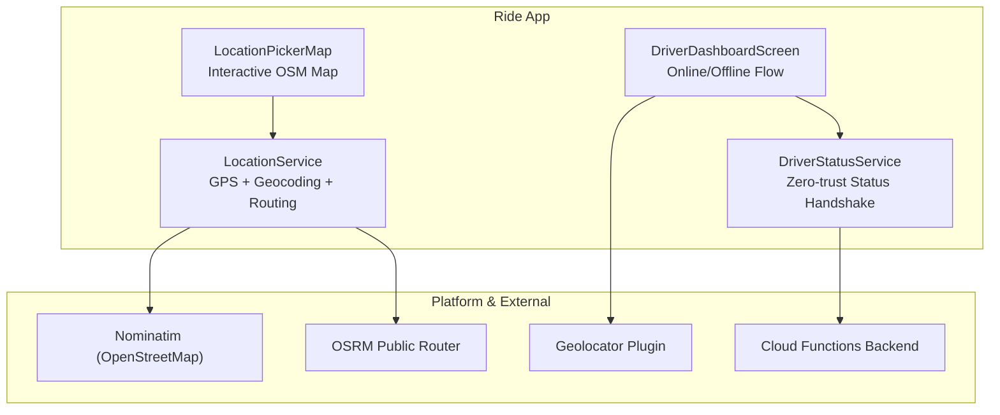
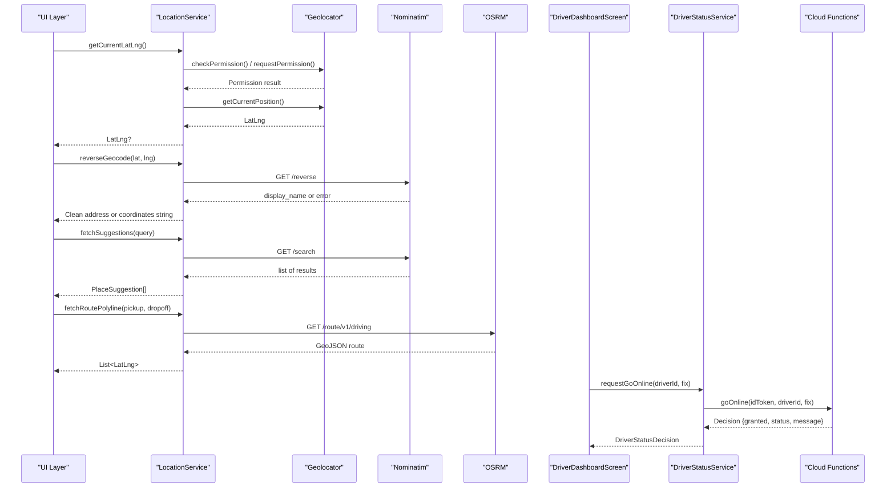
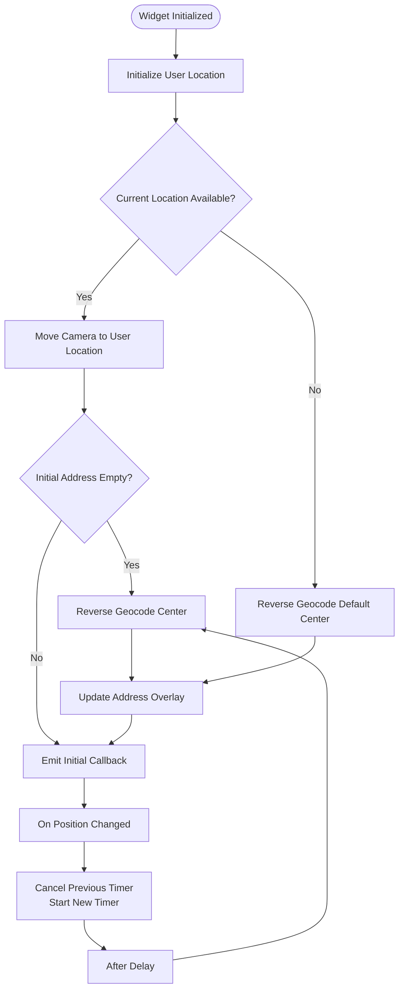
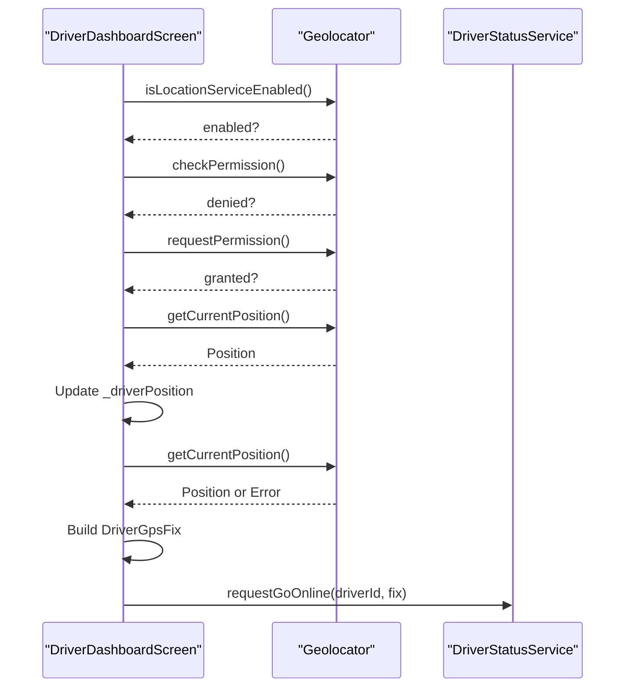
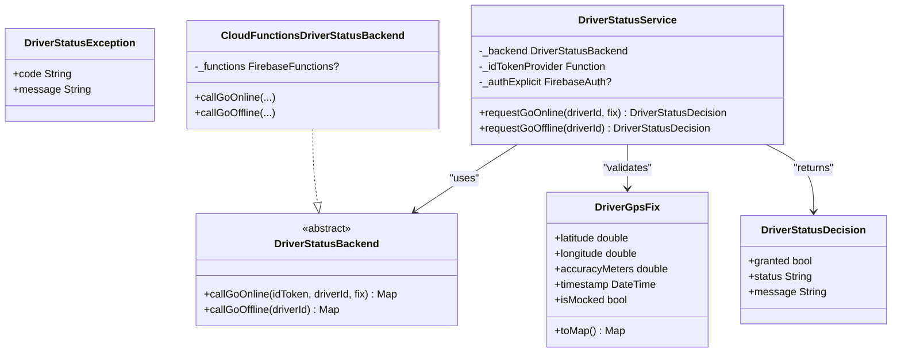
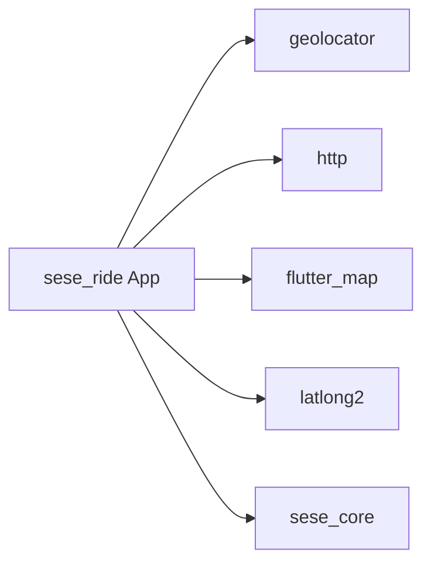

# Location Services Integration

<cite>
**Referenced Files in This Document**
- [location_service.dart](file://sese_ride/lib/features/customer/services/location_service.dart)
- [location_picker_map.dart](file://sese_ride/lib/widgets/location_picker_map.dart)
- [driver_dashboard_screen.dart](file://sese_ride/lib/features/driver/presentation/driver_dashboard_screen.dart)
- [driver_status_service.dart](file://sese_ride/lib/features/driver/services/driver_status_service.dart)
- [pubspec.yaml](file://sese_ride/pubspec.yaml)
</cite>

## Table of Contents
1. [Introduction](#introduction)
2. [Project Structure](#project-structure)
3. [Core Components](#core-components)
4. [Architecture Overview](#architecture-overview)
5. [Detailed Component Analysis](#detailed-component-analysis)
6. [Dependency Analysis](#dependency-analysis)
7. [Performance Considerations](#performance-considerations)
8. [Troubleshooting Guide](#troubleshooting-guide)
9. [Conclusion](#conclusion)

## Introduction
This document explains how location services are integrated in the project. It covers GPS permission handling, current-position retrieval, reverse geocoding, address search and autocomplete suggestions, route geometry fetching, and driver-side GPS validation for online status changes. The implementation uses OpenStreetMap-based services rather than Google Maps or Google Places.

Key points:
- GPS access is handled through a platform location plugin.
- Address lookup and autocomplete use an open geocoding service.
- Route geometry is fetched from an open routing service.
- Driver online/offline transitions include client-side GPS checks and server-gated authorization.

## Project Structure
Location-related functionality lives primarily under the ride application module:
- Customer-facing location utilities and geocoding are implemented as a service class.
- A reusable map widget provides interactive center-pin selection with debounced reverse geocoding.
- Driver screens collect GPS fixes and validate them before calling backend status endpoints.
- Dependencies declare the location plugin, HTTP client, map library, and coordinate model.



**Diagram sources**
- [location_service.dart:23-35](file://sese_ride/lib/features/customer/services/location_service.dart#L23-L35)
- [location_picker_map.dart:7-14](file://sese_ride/lib/widgets/location_picker_map.dart#L7-L14)
- [driver_dashboard_screen.dart:119-143](file://sese_ride/lib/features/driver/presentation/driver_dashboard_screen.dart#L119-L143)
- [driver_status_service.dart:147-157](file://sese_ride/lib/features/driver/services/driver_status_service.dart#L147-L157)

**Section sources**
- [location_service.dart:1-39](file://sese_ride/lib/features/customer/services/location_service.dart#L1-L39)
- [location_picker_map.dart:1-20](file://sese_ride/lib/widgets/location_picker_map.dart#L1-L20)
- [driver_dashboard_screen.dart:1-20](file://sese_ride/lib/features/driver/presentation/driver_dashboard_screen.dart#L1-L20)
- [driver_status_service.dart:1-10](file://sese_ride/lib/features/driver/services/driver_status_service.dart#L1-L10)
- [pubspec.yaml:10-30](file://sese_ride/pubspec.yaml#L10-L30)

## Core Components
- LocationService: Central utility for GPS position retrieval, reverse geocoding, forward geocoding, place suggestions, and route polyline fetching. It also exposes test seams to mock these behaviors.
- LocationPickerMap: Reusable Flutter widget that renders an OpenStreetMap view, keeps a pin at the exact center, and triggers debounced reverse geocoding when the camera moves.
- DriverDashboardScreen: Collects device location during driver onboarding and online transitions, falling back to a seeded default when platform location is unavailable.
- DriverStatusService: Encapsulates the zero-trust online/offline handshake, including client-side GPS pre-checks and server calls via Cloud Functions.

**Section sources**
- [location_service.dart:8-65](file://sese_ride/lib/features/customer/services/location_service.dart#L8-L65)
- [location_picker_map.dart:15-31](file://sese_ride/lib/widgets/location_picker_map.dart#L15-L31)
- [driver_dashboard_screen.dart:22-54](file://sese_ride/lib/features/driver/presentation/driver_dashboard_screen.dart#L22-L54)
- [driver_status_service.dart:5-34](file://sese_ride/lib/features/driver/services/driver_status_service.dart#L5-L34)

## Architecture Overview
The location architecture separates concerns between UI, service logic, and external providers:
- UI components request positions or addresses through LocationService or directly call the platform location API where appropriate.
- LocationService encapsulates network calls to Nominatim and OSRM, returning safe fallbacks instead of throwing.
- Driver flows attach a signed GPS fix to backend requests; the backend remains authoritative for granting online state.



**Diagram sources**
- [location_service.dart:69-101](file://sese_ride/lib/features/customer/services/location_service.dart#L69-L101)
- [location_service.dart:113-143](file://sese_ride/lib/features/customer/services/location_service.dart#L113-L143)
- [location_service.dart:167-179](file://sese_ride/lib/features/customer/services/location_service.dart#L167-L179)
- [location_service.dart:231-278](file://sese_ride/lib/features/customer/services/location_service.dart#L231-L278)
- [driver_dashboard_screen.dart:119-143](file://sese_ride/lib/features/driver/presentation/driver_dashboard_screen.dart#L119-L143)
- [driver_status_service.dart:206-224](file://sese_ride/lib/features/driver/services/driver_status_service.dart#L206-L224)

## Detailed Component Analysis

### LocationService
LocationService is the primary integration point for location and mapping features. It provides:
- Current position retrieval with permission checks and service availability checks.
- Reverse geocoding using an open geocoding endpoint, returning a clean street address or a coordinate fallback.
- Forward geocoding and place suggestions using the same open geocoding endpoint.
- Route polyline fetching from an open routing endpoint, decoding GeoJSON coordinates into latitude/longitude pairs.
- Test seams allowing unit tests to replace location, geocoding, suggestion, search, and route behavior without real network calls.

Implementation highlights:
- Network calls are best-effort: failures return null, empty lists, or fallback strings so user flows remain unblocked.
- A User-Agent header is included for fair-use compliance with the open geocoding service.
- Coordinates are parsed carefully because the geocoding service returns numeric values as strings.
- Display names are shortened to improve readability in UI overlays.

```mermaid
classDiagram
class LocationService {
+getCurrentLatLng() LatLng?
+getCleanAddress(lat, lng) String
+reverseGeocode(lat, lng) String
+forwardGeocode(query) LatLng?
+fetchSuggestions(query) PlaceSuggestion[]
+searchAddress(query) ({latLng, displayName})?
+fetchRoutePolyline(pickup, dropoff) LatLng[]
+resetTestSeams() void
}
class PlaceSuggestion {
+description String
+lat double
+lng double
+latLng LatLng
}
LocationService --> PlaceSuggestion : "returns"
```

**Diagram sources**
- [location_service.dart:8-21](file://sese_ride/lib/features/customer/services/location_service.dart#L8-L21)
- [location_service.dart:69-101](file://sese_ride/lib/features/customer/services/location_service.dart#L69-L101)
- [location_service.dart:113-143](file://sese_ride/lib/features/customer/services/location_service.dart#L113-L143)
- [location_service.dart:147-179](file://sese_ride/lib/features/customer/services/location_service.dart#L147-L179)
- [location_service.dart:214-278](file://sese_ride/lib/features/customer/services/location_service.dart#L214-L278)

**Section sources**
- [location_service.dart:23-65](file://sese_ride/lib/features/customer/services/location_service.dart#L23-L65)
- [location_service.dart:69-101](file://sese_ride/lib/features/customer/services/location_service.dart#L69-L101)
- [location_service.dart:113-143](file://sese_ride/lib/features/customer/services/location_service.dart#L113-L143)
- [location_service.dart:147-179](file://sese_ride/lib/features/customer/services/location_service.dart#L147-L179)
- [location_service.dart:181-212](file://sese_ride/lib/features/customer/services/location_service.dart#L181-L212)
- [location_service.dart:214-278](file://sese_ride/lib/features/customer/services/location_service.dart#L214-L278)
- [location_service.dart:282-297](file://sese_ride/lib/features/customer/services/location_service.dart#L282-L297)

### LocationPickerMap
LocationPickerMap is a reusable map widget that:
- Renders OpenStreetMap tiles through a map library.
- Keeps a pin fixed at the exact center of the viewport.
- Initializes the map with the user’s current location when available.
- Debounces reverse geocoding while the user pans or zooms, then updates the address overlay.
- Emits location changes through a callback for parent widgets to consume.

Behavioral flow:
- On initialization, it attempts to get the current location and reverse geocode it if no initial address is provided.
- During map interaction, it tracks the camera center and schedules a debounced reverse geocode call.
- While geocoding, it shows a loading indicator and displays either the resolved address or raw coordinates.



**Diagram sources**
- [location_picker_map.dart:49-68](file://sese_ride/lib/widgets/location_picker_map.dart#L49-L68)
- [location_picker_map.dart:77-105](file://sese_ride/lib/widgets/location_picker_map.dart#L77-L105)
- [location_picker_map.dart:107-208](file://sese_ride/lib/widgets/location_picker_map.dart#L107-L208)

**Section sources**
- [location_picker_map.dart:7-31](file://sese_ride/lib/widgets/location_picker_map.dart#L7-L31)
- [location_picker_map.dart:49-68](file://sese_ride/lib/widgets/location_picker_map.dart#L49-L68)
- [location_picker_map.dart:77-105](file://sese_ride/lib/widgets/location_picker_map.dart#L77-L105)
- [location_picker_map.dart:107-208](file://sese_ride/lib/widgets/location_picker_map.dart#L107-L208)

### Driver Dashboard GPS Handling
The driver dashboard handles location in two main ways:
- Resolving the driver’s current position during screen initialization, with graceful fallback to a seeded default when platform location is unavailable.
- Collecting a signed GPS fix for the online handshake, including accuracy and mock-location flags. If platform location fails, it falls back to the last known position with unknown accuracy so the backend can make the final decision.

Important characteristics:
- Permission checks and service enablement checks are performed before requesting a position.
- Exceptions and native-load errors are caught to avoid blocking the UI.
- The collected GPS fix includes timestamp, accuracy, and mock flag metadata.



**Diagram sources**
- [driver_dashboard_screen.dart:92-117](file://sese_ride/lib/features/driver/presentation/driver_dashboard_screen.dart#L92-L117)
- [driver_dashboard_screen.dart:119-143](file://sese_ride/lib/features/driver/presentation/driver_dashboard_screen.dart#L119-L143)

**Section sources**
- [driver_dashboard_screen.dart:92-117](file://sese_ride/lib/features/driver/presentation/driver_dashboard_screen.dart#L92-L117)
- [driver_dashboard_screen.dart:119-143](file://sese_ride/lib/features/driver/presentation/driver_dashboard_screen.dart#L119-L143)

### Driver Status Service and GPS Validation
DriverStatusService implements a zero-trust availability handshake:
- Client-side pre-checks reject mocked locations and low-accuracy fixes early.
- The service resolves an authenticated ID token and forwards the GPS fix to Cloud Functions.
- The backend decides whether to grant online or offline state; the client never flips state on its own.



**Diagram sources**
- [driver_status_service.dart:5-34](file://sese_ride/lib/features/driver/services/driver_status_service.dart#L5-L34)
- [driver_status_service.dart:36-67](file://sese_ride/lib/features/driver/services/driver_status_service.dart#L36-L67)
- [driver_status_service.dart:69-145](file://sese_ride/lib/features/driver/services/driver_status_service.dart#L69-L145)
- [driver_status_service.dart:147-233](file://sese_ride/lib/features/driver/services/driver_status_service.dart#L147-L233)

**Section sources**
- [driver_status_service.dart:5-34](file://sese_ride/lib/features/driver/services/driver_status_service.dart#L5-L34)
- [driver_status_service.dart:189-204](file://sese_ride/lib/features/driver/services/driver_status_service.dart#L189-L204)
- [driver_status_service.dart:206-233](file://sese_ride/lib/features/driver/services/driver_status_service.dart#L206-L233)

## Dependency Analysis
The ride app depends on:
- A location plugin for platform GPS access.
- An HTTP client for geocoding and routing network calls.
- A map rendering library for OpenStreetMap tiles.
- Coordinate models for representing latitude/longitude.



**Diagram sources**
- [pubspec.yaml:10-30](file://sese_ride/pubspec.yaml#L10-L30)

**Section sources**
- [pubspec.yaml:10-30](file://sese_ride/pubspec.yaml#L10-L30)

## Performance Considerations
- Best-effort network calls: LocationService returns safe fallbacks instead of throwing, preventing UI stalls during geocoding or routing failures.
- Timeouts: Network requests include timeouts to avoid hanging indefinitely.
- Debounced geocoding: The map widget debounces reverse geocoding during panning to reduce unnecessary network requests.
- High accuracy settings: Current position retrieval requests high accuracy with a time limit, balancing precision and responsiveness.
- Test seams: Mock providers allow tests to run without real GPS or network calls, improving test speed and reliability.

[No sources needed since this section provides general guidance]

## Troubleshooting Guide
Common issues and their handling:

- GPS permission denied or permanently denied:
  - The location service checks permissions and requests them when necessary. If denied or permanently denied, it returns null so callers can show a fallback.
  - Driver screens catch exceptions and fall back to seeded defaults when platform location is unavailable.

- GPS signal loss or poor accuracy:
  - Driver status service performs client-side pre-checks for mocked locations and low accuracy. It throws a specific exception when these conditions fail, prompting users to move to better conditions.
  - When platform location cannot be obtained, the driver dashboard falls back to the last known position with unknown accuracy, leaving final decisions to the backend.

- Network connectivity issues:
  - Geocoding and routing calls handle non-200 responses and parse errors gracefully, returning empty lists or fallback strings.
  - Timeouts prevent long hangs on slow networks.

- Platform location stack errors:
  - Driver screens catch both exceptions and errors (including native-load errors) to keep the UI responsive.

Recommended actions:
- Ensure location services are enabled on the device.
- Grant location permissions when prompted.
- Retry after moving to an area with better GPS reception.
- Check network connectivity if address lookups or routes fail.
- Use test seams in development and testing to isolate location-dependent code.

**Section sources**
- [location_service.dart:69-101](file://sese_ride/lib/features/customer/services/location_service.dart#L69-L101)
- [location_service.dart:113-143](file://sese_ride/lib/features/customer/services/location_service.dart#L113-L143)
- [location_service.dart:167-179](file://sese_ride/lib/features/customer/services/location_service.dart#L167-L179)
- [location_service.dart:231-278](file://sese_ride/lib/features/customer/services/location_service.dart#L231-L278)
- [driver_dashboard_screen.dart:92-117](file://sese_ride/lib/features/driver/presentation/driver_dashboard_screen.dart#L92-L117)
- [driver_dashboard_screen.dart:119-143](file://sese_ride/lib/features/driver/presentation/driver_dashboard_screen.dart#L119-L143)
- [driver_status_service.dart:189-204](file://sese_ride/lib/features/driver/services/driver_status_service.dart#L189-L204)

## Conclusion
The location integration in this project emphasizes resilience and clear separation of responsibilities:
- LocationService centralizes GPS and geocoding logic with safe fallbacks and test seams.
- LocationPickerMap offers a reusable, debounced, and user-friendly map experience.
- Driver flows enforce strict GPS validation and rely on server decisions for online/offline state.
- External services are open and free-tier friendly, with explicit notes about fair-use limits and production scaling considerations.

For production scaling:
- Consider self-hosting or fronting geocoding and routing services behind a caching backend.
- Monitor network timeouts and error rates for geocoding and routing endpoints.
- Continue using test seams to keep location-dependent features fast and deterministic in tests.

[No sources needed since this section summarizes without analyzing specific files]