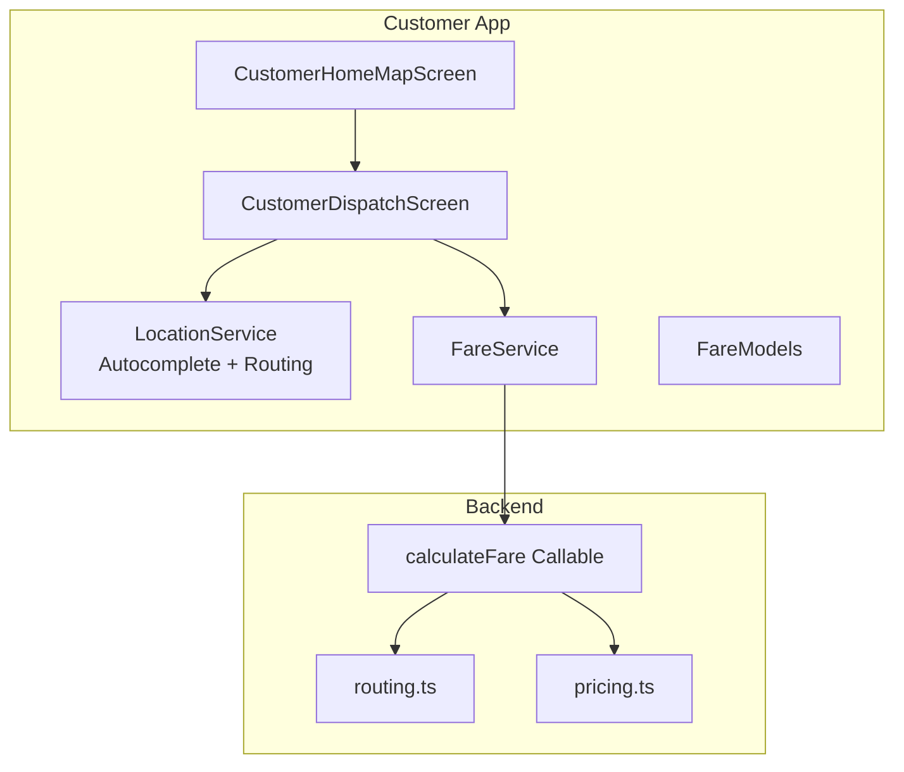
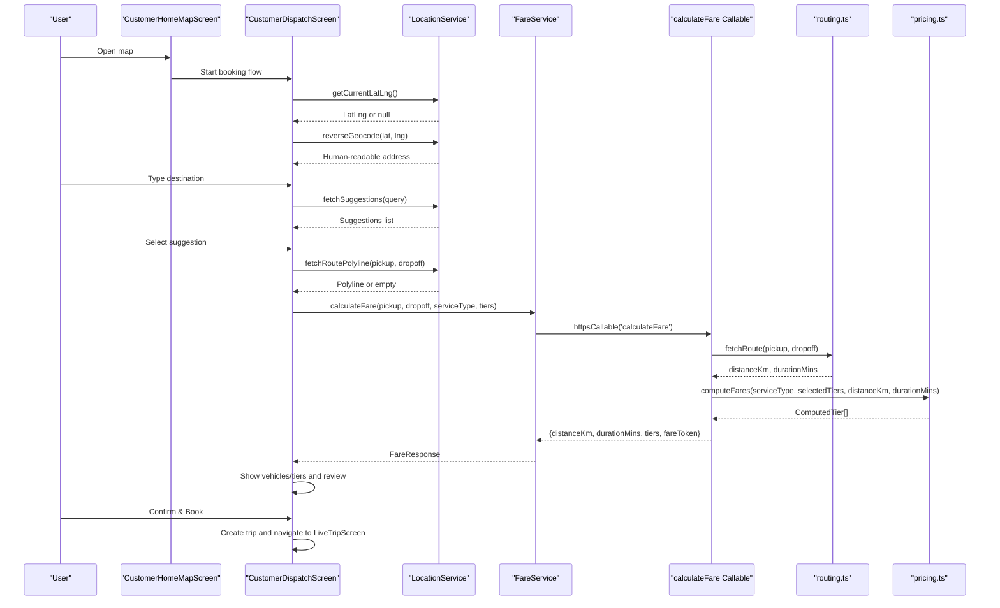
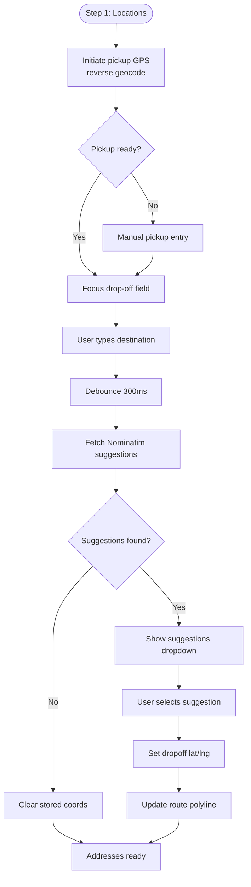
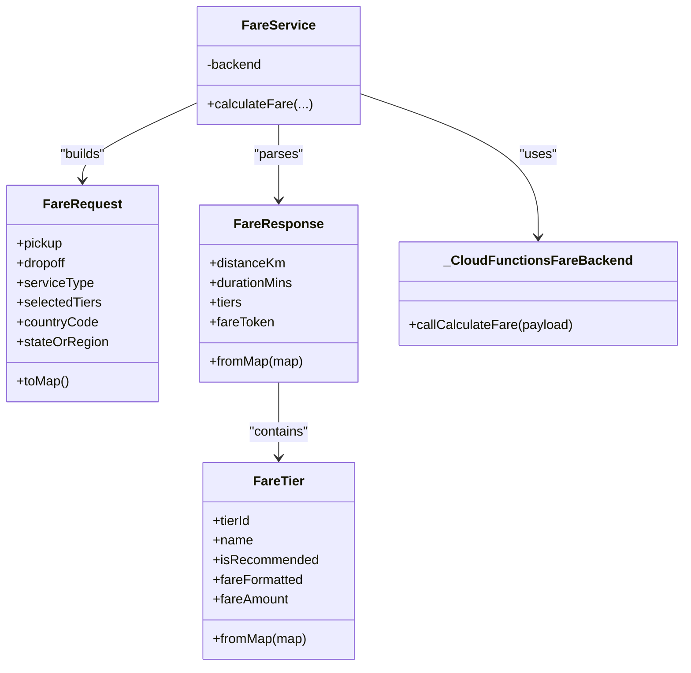
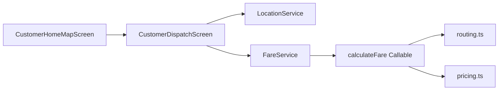

# Ride Booking Flow

<cite>
**Referenced Files in This Document**
- [customer_home_map_screen.dart](file://sese_ride/lib/features/customer/presentation/customer_home_map_screen.dart)
- [customer_dispatch_screen.dart](file://sese_ride/lib/features/customer/presentation/customer_dispatch_screen.dart)
- [location_service.dart](file://sese_ride/lib/features/customer/services/location_service.dart)
- [fare_models.dart](file://sese_ride/lib/features/customer/models/fare_models.dart)
- [fare_service.dart](file://sese_ride/lib/features/customer/services/fare_service.dart)
- [pricing.ts](file://functions/src/pricing.ts)
- [routing.ts](file://functions/src/routing.ts)
- [index.ts](file://functions/src/index.ts)
</cite>

## Table of Contents
1. [Introduction](#introduction)
2. [Project Structure](#project-structure)
3. [Core Components](#core-components)
4. [Architecture Overview](#architecture-overview)
5. [Detailed Component Analysis](#detailed-component-analysis)
6. [Dependency Analysis](#dependency-analysis)
7. [Performance Considerations](#performance-considerations)
8. [Troubleshooting Guide](#troubleshooting-guide)
9. [Conclusion](#conclusion)

## Introduction
This document explains the complete ride booking flow in the Sese Ride app, from opening the customer home map to confirming a ride request. It covers:
- Customer home map screen implementation and location resolution
- Address autocomplete and destination selection
- Route preview and distance/duration estimation
- Fare estimation through the server pricing engine
- Integration with OpenStreetMap-based geocoding and routing services
- Error handling for location permissions, network failures, and invalid addresses

The flow is implemented in Flutter on the client and Firebase Cloud Functions on the backend. The client uses OpenStreetMap (Nominatim and OSRM) for address search and route geometry, while the backend computes authoritative road-network distances, durations, and fares.

## Project Structure
The ride booking feature spans UI screens, services, models, and backend functions:
- Customer UI:
  - Home map entry point
  - Step-by-step dispatch wizard (locations, vehicle/tier selection, review & confirm)
- Location and fare services:
  - Geocoding, suggestions, reverse geocoding, routing
  - Fare calculation client wrapping callable functions
- Backend:
  - Callable function orchestrating routing, pricing, and token generation
  - Pricing logic and OSRM routing helper

**Diagram sources**
- [customer_home_map_screen.dart:15-86](file://sese_ride/lib/features/customer/presentation/customer_home_map_screen.dart#L15-L86)
- [customer_dispatch_screen.dart:34-88](file://sese_ride/lib/features/customer/presentation/customer_dispatch_screen.dart#L34-L88)
- [location_service.dart:39-56](file://sese_ride/lib/features/customer/services/location_service.dart#L39-L56)
- [fare_service.dart:34-39](file://sese_ride/lib/features/customer/services/fare_service.dart#L34-L39)
- [index.ts:62-80](file://functions/src/index.ts#L62-L80)
- [routing.ts:18-40](file://functions/src/routing.ts#L18-L40)
- [pricing.ts:166-173](file://functions/src/pricing.ts#L166-L173)

**Section sources**
- [customer_home_map_screen.dart:15-86](file://sese_ride/lib/features/customer/presentation/customer_home_map_screen.dart#L15-L86)
- [customer_dispatch_screen.dart:34-88](file://sese_ride/lib/features/customer/presentation/customer_dispatch_screen.dart#L34-L88)
- [location_service.dart:39-56](file://sese_ride/lib/features/customer/services/location_service.dart#L39-L56)
- [fare_service.dart:34-39](file://sese_ride/lib/features/customer/services/fare_service.dart#L34-L39)
- [index.ts:62-80](file://functions/src/index.ts#L62-L80)
- [routing.ts:18-40](file://functions/src/routing.ts#L18-L40)
- [pricing.ts:166-173](file://functions/src/pricing.ts#L166-L173)

## Core Components
- CustomerHomeMapScreen: Entry point showing a full-screen map with the user’s current position and action cards to start booking or delivery flows.
- CustomerDispatchScreen: Three-step wizard for locations, vehicle/tier selection, and review & confirm. Handles GPS, reverse geocoding, autocomplete, route preview, fare loading, and trip creation.
- LocationService: OpenStreetMap-based utilities for GPS, reverse geocoding, forward geocoding/autocomplete, and OSRM route polyline fetching.
- FareService: Zero-trust client that calls the `calculateFare` callable, maps errors, and returns structured fare responses.
- FareModels: Request/response models for fare calculations, including service types, tiers, and tokens.
- Backend calculateFare Callable: Validates inputs, fetches road-network distance/duration via OSRM, computes per-tier fares using pricing rules, and signs a fare token.

Key responsibilities:
- Map and location: resolve current position, show markers, recenter.
- Autocomplete: debounce input, fetch suggestions, select destination.
- Routing: fetch OSRM polyline for route preview; fallback to straight line if unavailable.
- Pricing: compute server-authoritative fares and display them verbatim.
- Confirmation: validate contact phones, create trip, navigate to live tracking.

**Section sources**
- [customer_home_map_screen.dart:15-86](file://sese_ride/lib/features/customer/presentation/customer_home_map_screen.dart#L15-L86)
- [customer_dispatch_screen.dart:34-88](file://sese_ride/lib/features/customer/presentation/customer_dispatch_screen.dart#L34-L88)
- [location_service.dart:39-56](file://sese_ride/lib/features/customer/services/location_service.dart#L39-L56)
- [fare_service.dart:34-39](file://sese_ride/lib/features/customer/services/fare_service.dart#L34-L39)
- [fare_models.dart:1-122](file://sese_ride/lib/features/customer/models/fare_models.dart#L1-L122)
- [index.ts:62-80](file://functions/src/index.ts#L62-L80)

## Architecture Overview
The ride booking architecture combines client-side UI and services with server-side orchestration:

**Diagram sources**
- [customer_home_map_screen.dart:72-86](file://sese_ride/lib/features/customer/presentation/customer_home_map_screen.dart#L72-L86)
- [customer_dispatch_screen.dart:268-342](file://sese_ride/lib/features/customer/presentation/customer_dispatch_screen.dart#L268-L342)
- [customer_dispatch_screen.dart:346-442](file://sese_ride/lib/features/customer/presentation/customer_dispatch_screen.dart#L346-L442)
- [customer_dispatch_screen.dart:446-540](file://sese_ride/lib/features/customer/presentation/customer_dispatch_screen.dart#L446-L540)
- [location_service.dart:73-101](file://sese_ride/lib/features/customer/services/location_service.dart#L73-L101)
- [location_service.dart:113-143](file://sese_ride/lib/features/customer/services/location_service.dart#L113-L143)
- [location_service.dart:167-179](file://sese_ride/lib/features/customer/services/location_service.dart#L167-L179)
- [location_service.dart:231-278](file://sese_ride/lib/features/customer/services/location_service.dart#L231-L278)
- [fare_service.dart:44-89](file://sese_ride/lib/features/customer/services/fare_service.dart#L44-L89)
- [index.ts:81-198](file://functions/src/index.ts#L81-L198)
- [routing.ts:40-67](file://functions/src/routing.ts#L40-L67)
- [pricing.ts:166-236](file://functions/src/pricing.ts#L166-L236)

## Detailed Component Analysis

### Customer Home Map Screen
Responsibilities:
- Resolve current device position with best-effort platform location APIs.
- Display a blue-dot marker at the resolved position.
- Provide a recenter button to reset the camera.
- Launch the booking flow with mode-specific context (ride vs delivery).

Behavior highlights:
- If location services are disabled or permission denied, it keeps a seeded default position.
- Tapping an action card navigates to the dispatch screen with the appropriate initial mode and title.

Error handling:
- Location resolution is wrapped in try/catch and never throws; it falls back to defaults when unavailable.

**Section sources**
- [customer_home_map_screen.dart:33-70](file://sese_ride/lib/features/customer/presentation/customer_home_map_screen.dart#L33-L70)
- [customer_home_map_screen.dart:72-86](file://sese_ride/lib/features/customer/presentation/customer_home_map_screen.dart#L72-L86)
- [customer_home_map_screen.dart:88-139](file://sese_ride/lib/features/customer/presentation/customer_home_map_screen.dart#L88-L139)

### Dispatch Wizard: Locations, Autocomplete, and Route Preview
Responsibilities:
- Auto-detect pickup location via GPS and reverse geocode into a human-readable address.
- For Receive Item mode, auto-fill drop-off instead of pickup.
- Debounced destination autocomplete using Nominatim suggestions.
- Route preview using OSRM polyline with a straight-line fallback.
- Transition to fare estimation after both locations are ready.

Key behaviors:
- Pickup field shows a spinner while resolving GPS and a “Re-detect my location” affordance.
- Drop-off field shows a checkmark once coordinates are resolved and a spinner while fetching suggestions.
- Autocomplete results are displayed in a bounded dropdown; selecting one locks the coordinates and updates the route preview.
- Route preview fits camera bounds to show both pins and the connecting route.

**Diagram sources**
- [customer_dispatch_screen.dart:268-342](file://sese_ride/lib/features/customer/presentation/customer_dispatch_screen.dart#L268-L342)
- [customer_dispatch_screen.dart:346-442](file://sese_ride/lib/features/customer/presentation/customer_dispatch_screen.dart#L346-L442)
- [location_service.dart:167-179](file://sese_ride/lib/features/customer/services/location_service.dart#L167-L179)
- [location_service.dart:231-278](file://sese_ride/lib/features/customer/services/location_service.dart#L231-L278)

**Section sources**
- [customer_dispatch_screen.dart:268-342](file://sese_ride/lib/features/customer/presentation/customer_dispatch_screen.dart#L268-L342)
- [customer_dispatch_screen.dart:346-442](file://sese_ride/lib/features/customer/presentation/customer_dispatch_screen.dart#L346-L442)
- [location_service.dart:167-179](file://sese_ride/lib/features/customer/services/location_service.dart#L167-L179)
- [location_service.dart:231-278](file://sese_ride/lib/features/customer/services/location_service.dart#L231-L278)

### Fare Estimation and Server Pricing Engine
Responsibilities:
- Build a fare request payload with pickup/dropoff coordinates, service type, and selected tiers/categories.
- Call the `calculateFare` callable function.
- Parse the response into structured models and render server-provided formatted fares verbatim.
- Handle backend errors with user-friendly messages and retry options.

Server-side processing:
- Validate authentication and input parameters.
- Compute road-network distance and duration via OSRM; fall back to crow-flies approximation if OSRM is unreachable.
- Compute per-tier fares using regional configuration and car tier multipliers.
- Generate a signed fare token to prevent tampering.

**Diagram sources**
- [fare_models.dart:29-37](file://sese_ride/lib/features/customer/models/fare_models.dart#L29-L37)
- [fare_models.dart:79-122](file://sese_ride/lib/features/customer/models/fare_models.dart#L79-L122)
- [fare_service.dart:34-39](file://sese_ride/lib/features/customer/services/fare_service.dart#L34-L39)
- [fare_service.dart:44-89](file://sese_ride/lib/features/customer/services/fare_service.dart#L44-L89)

**Section sources**
- [fare_models.dart:29-37](file://sese_ride/lib/features/customer/models/fare_models.dart#L29-L37)
- [fare_models.dart:79-122](file://sese_ride/lib/features/customer/models/fare_models.dart#L79-L122)
- [fare_service.dart:44-89](file://sese_ride/lib/features/customer/services/fare_service.dart#L44-L89)
- [index.ts:81-198](file://functions/src/index.ts#L81-L198)
- [pricing.ts:166-236](file://functions/src/pricing.ts#L166-L236)

### Review and Confirmation
Responsibilities:
- Display route summary, distance, duration, and server-provided fare breakdown.
- Collect mandatory contact phone numbers for pickup and drop-off.
- Validate Nigerian phone numbers before allowing confirmation.
- Create a trip via the repository and navigate to the live trip screen.

Validation and error handling:
- Phone validation ensures E.164 compliance.
- Trip creation errors are caught and surfaced to the user with friendly messages.

**Section sources**
- [customer_dispatch_screen.dart:144-165](file://sese_ride/lib/features/customer/presentation/customer_dispatch_screen.dart#L144-L165)
- [customer_dispatch_screen.dart:570-601](file://sese_ride/lib/features/customer/presentation/customer_dispatch_screen.dart#L570-L601)
- [customer_dispatch_screen.dart:660-787](file://sese_ride/lib/features/customer/presentation/customer_dispatch_screen.dart#L660-L787)

## Dependency Analysis
Component relationships and coupling:
- CustomerHomeMapScreen depends on CustomerDispatchScreen for the booking flow.
- CustomerDispatchScreen depends on LocationService for GPS, geocoding, and routing.
- CustomerDispatchScreen depends on FareService for fare estimation.
- FareService depends on the `calculateFare` callable function.
- Backend `calculateFare` depends on routing.ts for OSRM and pricing.ts for fare computation.

**Diagram sources**
- [customer_home_map_screen.dart:72-86](file://sese_ride/lib/features/customer/presentation/customer_home_map_screen.dart#L72-L86)
- [customer_dispatch_screen.dart:34-88](file://sese_ride/lib/features/customer/presentation/customer_dispatch_screen.dart#L34-L88)
- [location_service.dart:39-56](file://sese_ride/lib/features/customer/services/location_service.dart#L39-L56)
- [fare_service.dart:34-39](file://sese_ride/lib/features/customer/services/fare_service.dart#L34-L39)
- [index.ts:62-80](file://functions/src/index.ts#L62-L80)
- [routing.ts:18-40](file://functions/src/routing.ts#L18-L40)
- [pricing.ts:166-173](file://functions/src/pricing.ts#L166-L173)

**Section sources**
- [customer_home_map_screen.dart:72-86](file://sese_ride/lib/features/customer/presentation/customer_home_map_screen.dart#L72-L86)
- [customer_dispatch_screen.dart:34-88](file://sese_ride/lib/features/customer/presentation/customer_dispatch_screen.dart#L34-L88)
- [location_service.dart:39-56](file://sese_ride/lib/features/customer/services/location_service.dart#L39-L56)
- [fare_service.dart:34-39](file://sese_ride/lib/features/customer/services/fare_service.dart#L34-L39)
- [index.ts:62-80](file://functions/src/index.ts#L62-L80)
- [routing.ts:18-40](file://functions/src/routing.ts#L18-L40)
- [pricing.ts:166-173](file://functions/src/pricing.ts#L166-L173)

## Performance Considerations
- Autocomplete debouncing: Input is debounced by 300ms to reduce unnecessary API calls during typing.
- Best-effort network calls: LocationService methods return fallback values rather than throwing, keeping the booking flow responsive even when external services are slow or unavailable.
- Route polyline fallback: When OSRM fails, the UI falls back to a straight-line connection between pickup and dropoff to maintain visual continuity.
- Server-side caching recommendation: The code comments note that at scale, public Nominatim and OSRM endpoints should be fronted by a caching backend or self-hosted services to avoid rate limits.

[No sources needed since this section provides general guidance]

## Troubleshooting Guide
Common issues and resolutions:
- Location permissions denied or disabled:
  - The app attempts to request permissions and gracefully falls back to manual entry or seeded defaults.
  - Users can manually enter pickup/dropoff addresses when GPS is unavailable.
- Network failures for geocoding or routing:
  - Autocomplete returns an empty list; users can still proceed by entering addresses manually.
  - Route polyline may be empty; the UI shows a straight-line fallback.
- Invalid addresses or coordinates:
  - Backend validates coordinate bounds and service types; invalid inputs result in user-friendly error messages.
- Fare calculation errors:
  - Errors such as unauthenticated, invalid-argument, not-found, unavailable, and resource-exhausted are mapped to clear messages with retry options.

**Section sources**
- [customer_home_map_screen.dart:47-70](file://sese_ride/lib/features/customer/presentation/customer_home_map_screen.dart#L47-L70)
- [location_service.dart:73-101](file://sese_ride/lib/features/customer/services/location_service.dart#L73-L101)
- [location_service.dart:113-143](file://sese_ride/lib/features/customer/services/location_service.dart#L113-L143)
- [location_service.dart:167-179](file://sese_ride/lib/features/customer/services/location_service.dart#L167-L179)
- [location_service.dart:231-278](file://sese_ride/lib/features/customer/services/location_service.dart#L231-L278)
- [fare_service.dart:76-106](file://sese_ride/lib/features/customer/services/fare_service.dart#L76-L106)
- [index.ts:95-142](file://functions/src/index.ts#L95-L142)

## Conclusion
The Sese Ride booking flow integrates a robust Flutter UI with OpenStreetMap-based geocoding and routing, backed by a secure server-side pricing engine. The design emphasizes zero-trust fare computation, graceful degradation under network or permission constraints, and clear user feedback throughout the journey from map entry to trip confirmation. By leveraging debounced autocomplete, route previews, and server-signed fare tokens, the system balances responsiveness, accuracy, and security.

[No sources needed since this section summarizes without analyzing specific files]