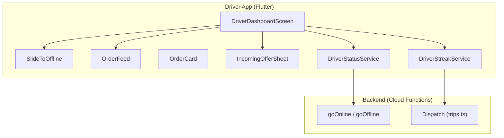
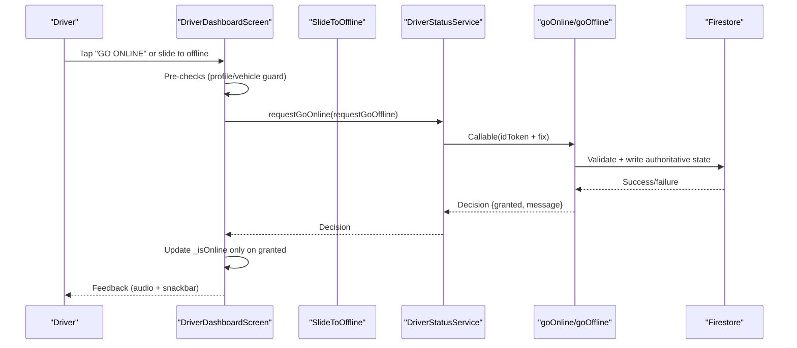
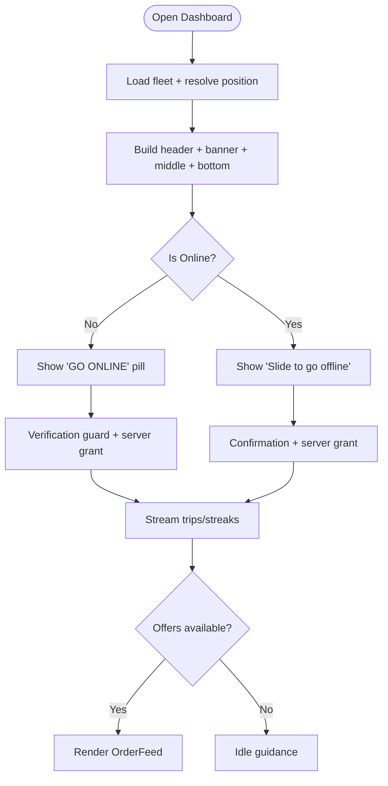
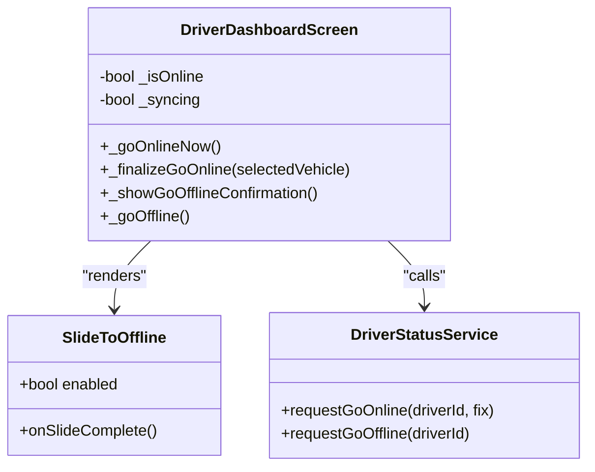
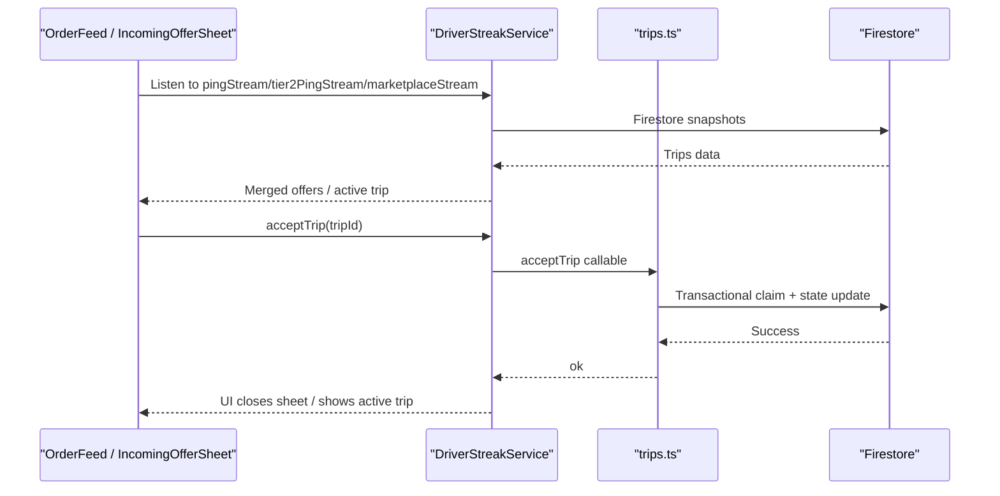
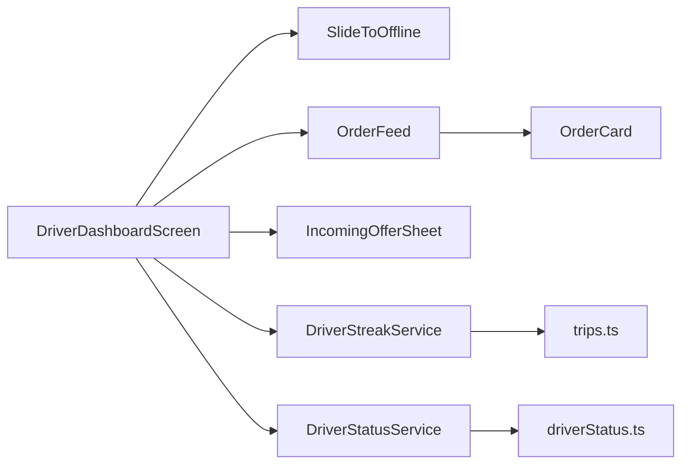

# Driver Dashboard & Status Management

<cite>
**Referenced Files in This Document**
- [driver_dashboard_screen.dart](file://sese_ride/lib/features/driver/presentation/driver_dashboard_screen.dart)
- [slide_to_offline.dart](file://sese_ride/lib/features/driver/presentation/widgets/slide_to_offline.dart)
- [driver_status_service.dart](file://sese_ride/lib/features/driver/services/driver_status_service.dart)
- [incoming_offer_sheet.dart](file://sese_ride/lib/features/driver/presentation/widgets/incoming_offer_sheet.dart)
- [order_feed.dart](file://sese_ride/lib/features/driver/presentation/widgets/order_feed.dart)
- [order_card.dart](file://sese_ride/lib/features/driver/presentation/widgets/order_card.dart)
- [driver_streak_service.dart](file://sese_ride/lib/features/driver/services/driver_streak_service.dart)
- [driverStatus.ts](file://functions/src/driverStatus.ts)
- [trips.ts](file://functions/src/trips.ts)
</cite>

## Table of Contents
1. [Introduction](#introduction)
2. [Project Structure](#project-structure)
3. [Core Components](#core-components)
4. [Architecture Overview](#architecture-overview)
5. [Detailed Component Analysis](#detailed-component-analysis)
6. [Dependency Analysis](#dependency-analysis)
7. [Performance Considerations](#performance-considerations)
8. [Troubleshooting Guide](#troubleshooting-guide)
9. [Conclusion](#conclusion)

## Introduction
This document explains the driver dashboard interface and status management system, focusing on:
- Online/offline toggle via a slide-to-offline widget
- Real-time status updates and dispatch integration
- Trip request viewing and incoming offer interaction
- Dashboard layout, key metrics, and navigation patterns
- State persistence, error recovery, and UX considerations for critical status changes

The system is zero-trust: the client never asserts online state; every transition requires server authorization.

## Project Structure
The driver dashboard is implemented as a Flutter screen with supporting widgets and services. The backend uses Firebase Cloud Functions to enforce policy and persist authoritative state.

**Diagram sources**
- [driver_dashboard_screen.dart:22-54](file://sese_ride/lib/features/driver/presentation/driver_dashboard_screen.dart#L22-L54)
- [slide_to_offline.dart:9-21](file://sese_ride/lib/features/driver/presentation/widgets/slide_to_offline.dart#L9-L21)
- [order_feed.dart:20-40](file://sese_ride/lib/features/driver/presentation/widgets/order_feed.dart#L20-L40)
- [order_card.dart:21-46](file://sese_ride/lib/features/driver/presentation/widgets/order_card.dart#L21-L46)
- [incoming_offer_sheet.dart:22-45](file://sese_ride/lib/features/driver/presentation/widgets/incoming_offer_sheet.dart#L22-L45)
- [driver_streak_service.dart:65-80](file://sese_ride/lib/features/driver/services/driver_streak_service.dart#L65-L80)
- [driver_status_service.dart:158-168](file://sese_ride/lib/features/driver/services/driver_status_service.dart#L158-L168)
- [driverStatus.ts:32-164](file://functions/src/driverStatus.ts#L32-L164)
- [trips.ts:373-384](file://functions/src/trips.ts#L373-L384)

**Section sources**
- [driver_dashboard_screen.dart:22-54](file://sese_ride/lib/features/driver/presentation/driver_dashboard_screen.dart#L22-L54)
- [driver_status_service.dart:158-168](file://sese_ride/lib/features/driver/services/driver_status_service.dart#L158-L168)
- [driver_streak_service.dart:65-80](file://sese_ride/lib/features/driver/services/driver_streak_service.dart#L65-L80)

## Core Components
- DriverDashboardScreen: Main dashboard UI that composes the online power pill, verification banner, active trip slot, order feed, and streak banner. It orchestrates location resolution, fleet loading, and status transitions.
- SlideToOffline: Custom slider widget used when online to initiate going offline safely.
- DriverStatusService: Zero-trust availability handshake service that calls Cloud Functions to authorize online/offline transitions.
- DriverStreakService: Streams streak state, pings, marketplace offers, and performs trip actions through callables.
- IncomingOfferSheet: Full-screen offer view with route preview and Accept/Decline actions.
- OrderFeed and OrderCard: Feed of incoming offers and individual offer cards with accept/bid actions.

Key responsibilities:
- Online/offline toggle guarded by verification and server grant
- Real-time streams for trips and streaks
- Safe user flows for critical status changes

**Section sources**
- [driver_dashboard_screen.dart:56-90](file://sese_ride/lib/features/driver/presentation/driver_dashboard_screen.dart#L56-L90)
- [slide_to_offline.dart:9-21](file://sese_ride/lib/features/driver/presentation/widgets/slide_to_offline.dart#L9-L21)
- [driver_status_service.dart:158-168](file://sese_ride/lib/features/driver/services/driver_status_service.dart#L158-L168)
- [driver_streak_service.dart:65-80](file://sese_ride/lib/features/driver/services/driver_streak_service.dart#L65-L80)
- [incoming_offer_sheet.dart:22-45](file://sese_ride/lib/features/driver/presentation/widgets/incoming_offer_sheet.dart#L22-L45)
- [order_feed.dart:20-40](file://sese_ride/lib/features/driver/presentation/widgets/order_feed.dart#L20-L40)
- [order_card.dart:21-46](file://sese_ride/lib/features/driver/presentation/widgets/order_card.dart#L21-L46)

## Architecture Overview
The dashboard integrates three layers:
- Presentation: Dashboard screen, slide-to-offline widget, offer sheet, order feed/cards
- Services: Status and streak services abstracting backend interactions
- Backend: Cloud Functions enforcing policy and managing dispatch state

**Diagram sources**
- [driver_dashboard_screen.dart:258-416](file://sese_ride/lib/features/driver/presentation/driver_dashboard_screen.dart#L258-L416)
- [driver_status_service.dart:206-231](file://sese_ride/lib/features/driver/services/driver_status_service.dart#L206-L231)
- [driverStatus.ts:32-164](file://functions/src/driverStatus.ts#L32-L164)

## Detailed Component Analysis

### Dashboard Layout and Navigation
- Top: Online power pill (offline shows “GO ONLINE”; online shows “Slide to go offline”)
- Below top: Verification banner (shown while pending)
- Middle: Active trip card when assigned; otherwise order feed when online
- Bottom: Streak progress banner fixed above bottom navigation

Navigation patterns:
- Fleet & Vehicles opens from verification guards or explicit menu action
- Incoming offers open full-screen when backend pings the driver
- No map on home; map appears only on incoming offer sheet

**Diagram sources**
- [driver_dashboard_screen.dart:432-481](file://sese_ride/lib/features/driver/presentation/driver_dashboard_screen.dart#L432-L481)
- [driver_dashboard_screen.dart:483-547](file://sese_ride/lib/features/driver/presentation/driver_dashboard_screen.dart#L483-L547)
- [driver_dashboard_screen.dart:549-604](file://sese_ride/lib/features/driver/presentation/driver_dashboard_screen.dart#L549-L604)
- [driver_dashboard_screen.dart:606-641](file://sese_ride/lib/features/driver/presentation/driver_dashboard_screen.dart#L606-L641)

**Section sources**
- [driver_dashboard_screen.dart:432-481](file://sese_ride/lib/features/driver/presentation/driver_dashboard_screen.dart#L432-L481)
- [driver_dashboard_screen.dart:483-547](file://sese_ride/lib/features/driver/presentation/driver_dashboard_screen.dart#L483-L547)
- [driver_dashboard_screen.dart:549-604](file://sese_ride/lib/features/driver/presentation/driver_dashboard_screen.dart#L549-L604)
- [driver_dashboard_screen.dart:606-641](file://sese_ride/lib/features/driver/presentation/driver_dashboard_screen.dart#L606-L641)

### Online/Offline Toggle and Slide-to-Offline Widget
- Offline state: Tapping “GO ONLINE” triggers profile and vehicle verification checks, then a live camera shield modal before calling the server. The UI flips online only after server grant.
- Online state: Sliding the thumb past ~80% triggers a confirmation sheet; the actual offline transition occurs only after server confirmation.
- Location handling: Best-effort GPS fix is collected and sent to the server; if unavailable, a fallback with unknown accuracy is used so the server decides.

**Diagram sources**
- [driver_dashboard_screen.dart:258-416](file://sese_ride/lib/features/driver/presentation/driver_dashboard_screen.dart#L258-L416)
- [slide_to_offline.dart:9-21](file://sese_ride/lib/features/driver/presentation/widgets/slide_to_offline.dart#L9-L21)
- [driver_status_service.dart:206-231](file://sese_ride/lib/features/driver/services/driver_status_service.dart#L206-L231)

**Section sources**
- [driver_dashboard_screen.dart:258-416](file://sese_ride/lib/features/driver/presentation/driver_dashboard_screen.dart#L258-L416)
- [slide_to_offline.dart:9-107](file://sese_ride/lib/features/driver/presentation/widgets/slide_to_offline.dart#L9-L107)
- [driver_status_service.dart:158-231](file://sese_ride/lib/features/driver/services/driver_status_service.dart#L158-L231)

### Real-Time Status Updates and Dispatch Integration
- Streams:
  - Streak state and config
  - Tier 1 exclusive ping
  - Tier 2 simultaneous pings
  - Tier 3 marketplace broadcast
  - Active trip stream
- Offer presentation:
  - Full-screen IncomingOfferSheet with route preview and Accept/Decline
  - OrderFeed merges all tiers into one list with “Show new requests” pill
- Server enforcement:
  - Dispatch lifecycle managed by Cloud Functions
  - Ping timeouts and promotions handled by scheduled sweep
  - Accept/decline/cancel/advance are callable operations

**Diagram sources**
- [driver_streak_service.dart:89-162](file://sese_ride/lib/features/driver/services/driver_streak_service.dart#L89-L162)
- [incoming_offer_sheet.dart:122-160](file://sese_ride/lib/features/driver/presentation/widgets/incoming_offer_sheet.dart#L122-L160)
- [order_feed.dart:118-221](file://sese_ride/lib/features/driver/presentation/widgets/order_feed.dart#L118-L221)
- [trips.ts:591-653](file://functions/src/trips.ts#L591-L653)

**Section sources**
- [driver_streak_service.dart:89-162](file://sese_ride/lib/features/driver/services/driver_streak_service.dart#L89-L162)
- [incoming_offer_sheet.dart:122-160](file://sese_ride/lib/features/driver/presentation/widgets/incoming_offer_sheet.dart#L122-L160)
- [order_feed.dart:118-221](file://sese_ride/lib/features/driver/presentation/widgets/order_feed.dart#L118-L221)
- [trips.ts:373-384](file://functions/src/trips.ts#L373-L384)
- [trips.ts:591-653](file://functions/src/trips.ts#L591-L653)

### User Experience Considerations
- Critical changes require explicit confirmation:
  - Going offline requires sliding and confirmation sheet
  - Going online requires profile/vehicle verification and server grant
- Immediate feedback:
  - Audio cues for online/offline and incoming orders
  - SnackBars for errors and confirmations
- Safety and clarity:
  - “Skipping or letting expire breaks your daily streak” messaging
  - Verified customer badges and fare transparency
- Accessibility:
  - Clear labels and large CTAs
  - Minimal taps to accept offers

**Section sources**
- [driver_dashboard_screen.dart:204-256](file://sese_ride/lib/features/driver/presentation/driver_dashboard_screen.dart#L204-L256)
- [incoming_offer_sheet.dart:383-408](file://sese_ride/lib/features/driver/presentation/widgets/incoming_offer_sheet.dart#L383-L408)
- [order_card.dart:424-466](file://sese_ride/lib/features/driver/presentation/widgets/order_card.dart#L424-L466)

## Dependency Analysis

**Diagram sources**
- [driver_dashboard_screen.dart:22-54](file://sese_ride/lib/features/driver/presentation/driver_dashboard_screen.dart#L22-L54)
- [order_feed.dart:20-40](file://sese_ride/lib/features/driver/presentation/widgets/order_feed.dart#L20-L40)
- [order_card.dart:21-46](file://sese_ride/lib/features/driver/presentation/widgets/order_card.dart#L21-L46)
- [driver_streak_service.dart:65-80](file://sese_ride/lib/features/driver/services/driver_streak_service.dart#L65-L80)
- [driver_status_service.dart:158-168](file://sese_ride/lib/features/driver/services/driver_status_service.dart#L158-L168)
- [trips.ts:373-384](file://functions/src/trips.ts#L373-L384)
- [driverStatus.ts:32-164](file://functions/src/driverStatus.ts#L32-L164)

**Section sources**
- [driver_dashboard_screen.dart:22-54](file://sese_ride/lib/features/driver/presentation/driver_dashboard_screen.dart#L22-L54)
- [order_feed.dart:20-40](file://sese_ride/lib/features/driver/presentation/widgets/order_feed.dart#L20-L40)
- [order_card.dart:21-46](file://sese_ride/lib/features/driver/presentation/widgets/order_card.dart#L21-L46)
- [driver_streak_service.dart:65-80](file://sese_ride/lib/features/driver/services/driver_streak_service.dart#L65-L80)
- [driver_status_service.dart:158-168](file://sese_ride/lib/features/driver/services/driver_status_service.dart#L158-L168)

## Performance Considerations
- Streams handle denied reads gracefully by returning defaults/null and ending to avoid retry storms.
- Location resolution is best-effort; failures fall back to seeded coordinates to keep UI responsive.
- Offer merging de-duplicates by tripId and prioritizes exclusive pings.
- Map routes load asynchronously and fit viewport once ready.

[No sources needed since this section provides general guidance]

## Troubleshooting Guide
Common issues and resolutions:
- Cannot go online due to verification:
  - Profile or vehicle not verified: follow prompts to manage fleet and documents
  - Server rejects due to suspension or spoofed GPS: check account status and disable mock locations
- Cannot go offline during an active trip:
  - Complete the current trip before changing status
- Network/backend errors:
  - SnackBar messages indicate session expiry, deadline exceeded, or network failure; re-authenticate or retry later

Error surfaces:
- DriverStatusException for status handshakes
- DriverStreakException for trip actions with user-friendly messages

**Section sources**
- [driver_dashboard_screen.dart:194-201](file://sese_ride/lib/features/driver/presentation/driver_dashboard_screen.dart#L194-L201)
- [driver_dashboard_screen.dart:408-415](file://sese_ride/lib/features/driver/presentation/driver_dashboard_screen.dart#L408-L415)
- [driver_status_service.dart:59-67](file://sese_ride/lib/features/driver/services/driver_status_service.dart#L59-L67)
- [driver_streak_service.dart:221-249](file://sese_ride/lib/features/driver/services/driver_streak_service.dart#L221-L249)

## Conclusion
The driver dashboard provides a secure, real-time experience for managing availability and interacting with trip offers. The slide-to-offline widget and verification shields ensure safe, intentional status changes, while server-side policies guarantee correctness. Streams deliver live updates for streaks and dispatch, and the UI offers clear feedback and actionable insights throughout the workflow.