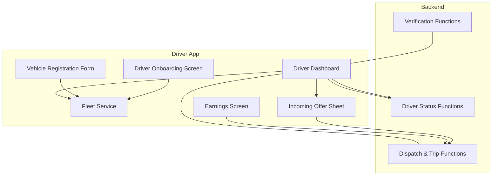
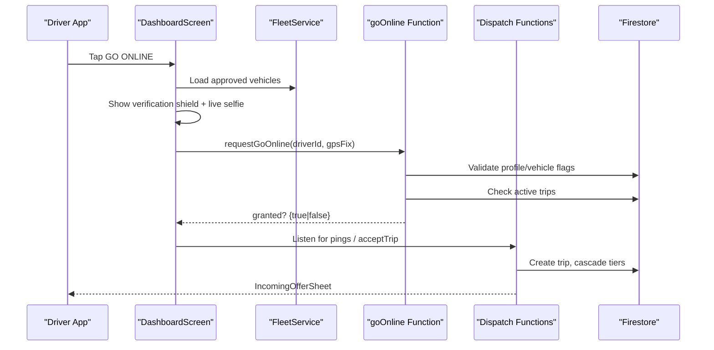
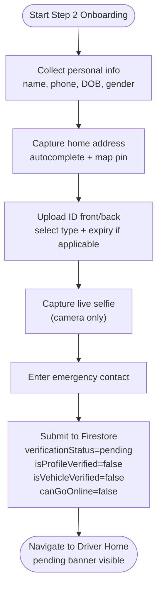
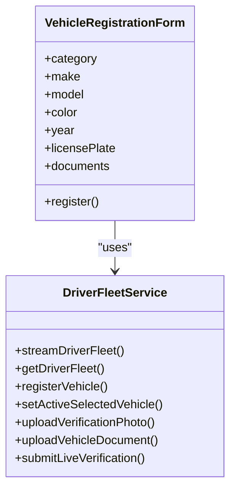
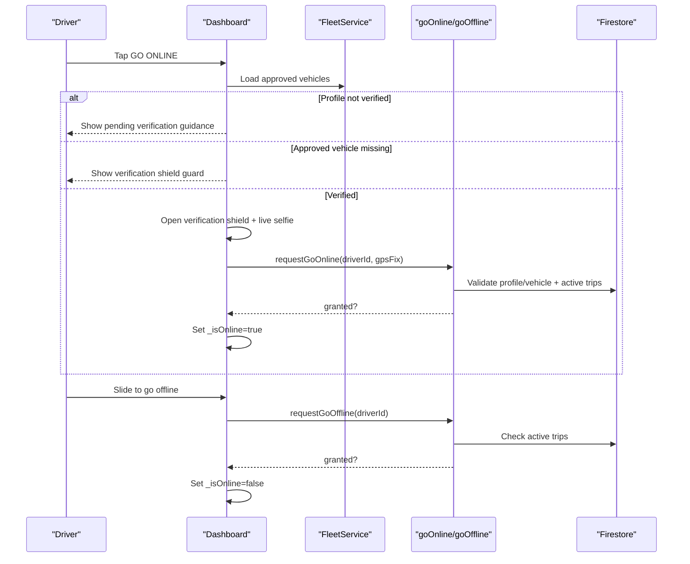
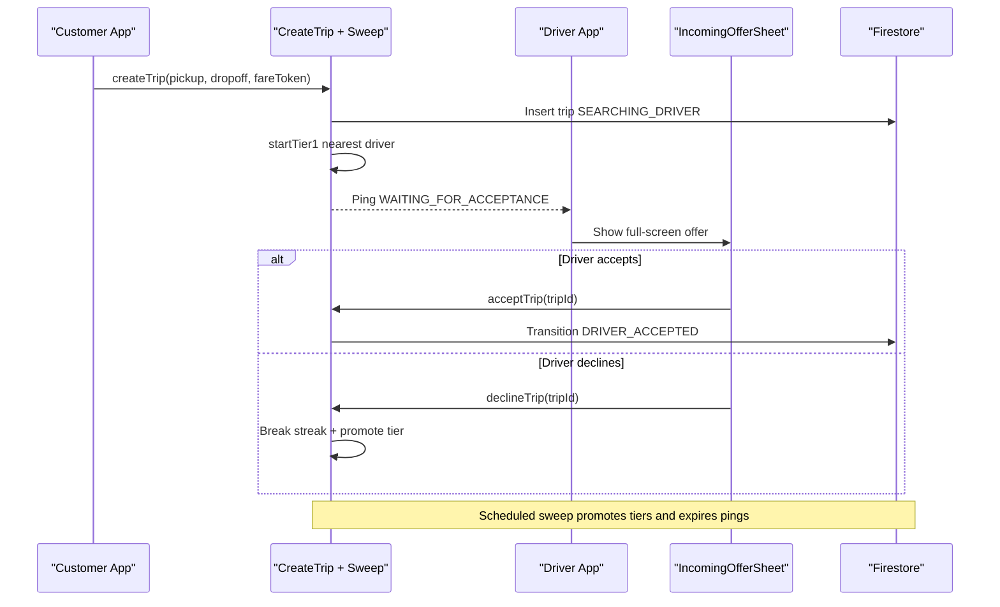
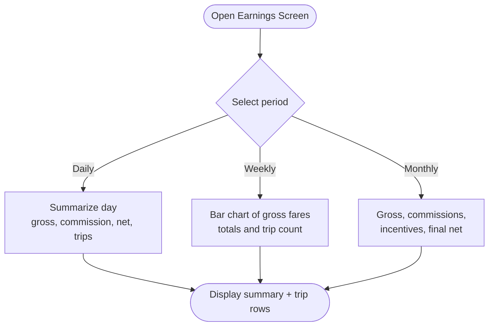
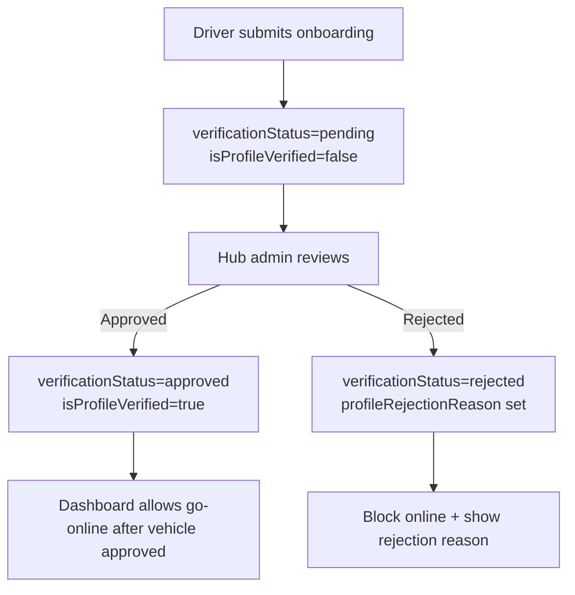
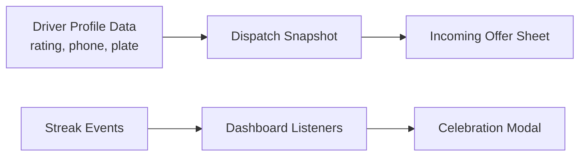
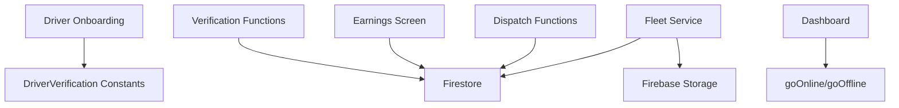

# Driver Management Features

<cite>
**Referenced Files in This Document**   
- [driver_onboarding_screen.dart](file://sese_ride/lib/features/driver/presentation/driver_onboarding_screen.dart)
- [vehicle_registration_form.dart](file://sese_ride/lib/features/driver/presentation/widgets/vehicle_registration_form.dart)
- [driver_fleet_service.dart](file://sese_ride/lib/features/driver/services/driver_fleet_service.dart)
- [driver_dashboard_screen.dart](file://sese_ride/lib/features/driver/presentation/driver_dashboard_screen.dart)
- [incoming_offer_sheet.dart](file://sese_ride/lib/features/driver/presentation/widgets/incoming_offer_sheet.dart)
- [earnings_screen.dart](file://sese_ride/lib/features/wallet/earnings_screen.dart)
- [driver_verification.dart](file://sese_core/lib/models/driver_verification.dart)
- [verification.ts](file://functions/src/verification.ts)
- [driverStatus.ts](file://functions/src/driverStatus.ts)
- [trips.ts](file://functions/src/trips.ts)
</cite>

## Table of Contents
1. [Introduction](#introduction)
2. [Project Structure](#project-structure)
3. [Core Components](#core-components)
4. [Architecture Overview](#architecture-overview)
5. [Detailed Component Analysis](#detailed-component-analysis)
6. [Dependency Analysis](#dependency-analysis)
7. [Performance Considerations](#performance-considerations)
8. [Troubleshooting Guide](#troubleshooting-guide)
9. [Conclusion](#conclusion)

## Introduction
This document explains the driver-focused features implemented in the Sese Ride app. It covers the complete driver onboarding and KYC workflow, vehicle registration and verification, the driver dashboard, trip acceptance and dispatch flow, earnings tracking, performance incentives, real-time status management (online/offline), fleet and compliance requirements, and support/communication touchpoints exposed to drivers.

The implementation is split between:
- The Flutter driver app (`sese_ride`): UI screens, services, and local state for onboarding, fleet management, dashboard, offers, and earnings.
- Cloud Functions (`functions`): server-authoritative dispatch, verification review, availability handshake, streak logic, and payment/pricing helpers.
- Shared core constants (`sese_core`): verification lifecycle tokens used by both driver and hub apps.

## Project Structure
Driver-related code lives primarily under `sese_ride/lib/features/driver`, with supporting wallet and trip models elsewhere. Backend orchestration lives under `functions/src`.

**Diagram sources**
- [driver_onboarding_screen.dart:18-36](file://sese_ride/lib/features/driver/presentation/driver_onboarding_screen.dart#L18-L36)
- [vehicle_registration_form.dart:19-30](file://sese_ride/lib/features/driver/presentation/widgets/vehicle_registration_form.dart#L19-L30)
- [driver_fleet_service.dart:60-99](file://sese_ride/lib/features/driver/services/driver_fleet_service.dart#L60-L99)
- [driver_dashboard_screen.dart:22-50](file://sese_ride/lib/features/driver/presentation/driver_dashboard_screen.dart#L22-L50)
- [incoming_offer_sheet.dart:14-21](file://sese_ride/lib/features/driver/presentation/widgets/incoming_offer_sheet.dart#L14-L21)
- [earnings_screen.dart:9-18](file://sese_ride/lib/features/wallet/earnings_screen.dart#L9-L18)
- [verification.ts:133-140](file://functions/src/verification.ts#L133-L140)
- [driverStatus.ts:6-10](file://functions/src/driverStatus.ts#L6-L10)
- [trips.ts:12-26](file://functions/src/trips.ts#L12-L26)

**Section sources**
- [driver_onboarding_screen.dart:18-36](file://sese_ride/lib/features/driver/presentation/driver_onboarding_screen.dart#L18-L36)
- [driver_fleet_service.dart:60-99](file://sese_ride/lib/features/driver/services/driver_fleet_service.dart#L60-L99)
- [driver_dashboard_screen.dart:22-50](file://sese_ride/lib/features/driver/presentation/driver_dashboard_screen.dart#L22-L50)
- [trips.ts:12-26](file://functions/src/trips.ts#L12-L26)

## Core Components
- Driver onboarding screen collects personal information, address, government ID documents, and a live selfie, then writes a pending profile record.
- Vehicle registration form captures vehicle details and required documentation per category, uploads photos to storage, and registers the vehicle as pending verification.
- Fleet service manages Firestore collections for vehicles and live verification audit records, including camera-only snapshot enforcement.
- Driver dashboard orchestrates online/offline transitions, verification shields, incoming offer handling, and streak banners.
- Incoming offer sheet shows route preview, fare, and allows accept/decline actions.
- Earnings screen aggregates completed trips and wallet incentive credits into daily/weekly/monthly views.
- Backend functions enforce verification reviews, zero-trust online handshakes, and cascading dispatch tiers.

**Section sources**
- [driver_onboarding_screen.dart:18-36](file://sese_ride/lib/features/driver/presentation/driver_onboarding_screen.dart#L18-L36)
- [vehicle_registration_form.dart:19-30](file://sese_ride/lib/features/driver/presentation/widgets/vehicle_registration_form.dart#L19-L30)
- [driver_fleet_service.dart:60-99](file://sese_ride/lib/features/driver/services/driver_fleet_service.dart#L60-L99)
- [driver_dashboard_screen.dart:22-50](file://sese_ride/lib/features/driver/presentation/driver_dashboard_screen.dart#L22-L50)
- [incoming_offer_sheet.dart:14-21](file://sese_ride/lib/features/driver/presentation/widgets/incoming_offer_sheet.dart#L14-L21)
- [earnings_screen.dart:9-18](file://sese_ride/lib/features/wallet/earnings_screen.dart#L9-L18)

## Architecture Overview
The driver experience is governed by a zero-trust backend model:
- Client UI never self-asserts critical states such as online status or trip eligibility.
- Verification and fleet approval are enforced server-side before allowing online mode.
- Dispatch is server-authoritative with cascading tiers and scheduled promotion.

**Diagram sources**
- [driver_dashboard_screen.dart:258-416](file://sese_ride/lib/features/driver/presentation/driver_dashboard_screen.dart#L258-L416)
- [driver_fleet_service.dart:156-205](file://sese_ride/lib/features/driver/services/driver_fleet_service.dart#L156-L205)
- [driverStatus.ts:32-164](file://functions/src/driverStatus.ts#L32-L164)
- [trips.ts:125-225](file://functions/src/trips.ts#L125-L225)

## Detailed Component Analysis

### Driver Onboarding and Document Verification Workflow
The onboarding process is a multi-step KYC flow:
- Personal information: name, phone, date of birth (18+), gender.
- Home address: Nominatim autocomplete plus interactive map pinning.
- Government ID: country-aware document types, front/back images, optional expiry, and a live selfie captured only from the camera.
- Emergency contact: next-of-kin details.
- Submission writes the driver profile with pending verification flags and routes the driver to the home shell with a persistent pending banner.

**Diagram sources**
- [driver_onboarding_screen.dart:18-36](file://sese_ride/lib/features/driver/presentation/driver_onboarding_screen.dart#L18-L36)
- [driver_onboarding_screen.dart:281-372](file://sese_ride/lib/features/driver/presentation/driver_onboarding_screen.dart#L281-L372)

Key behaviors:
- Age validation enforces minimum age.
- Phone normalization uses international format rules.
- Selfie capture is restricted to camera to ensure genuine face verification.
- Submission sets explicit verification flags that gate online access.

**Section sources**
- [driver_onboarding_screen.dart:18-36](file://sese_ride/lib/features/driver/presentation/driver_onboarding_screen.dart#L18-L36)
- [driver_onboarding_screen.dart:281-372](file://sese_ride/lib/features/driver/presentation/driver_onboarding_screen.dart#L281-L372)
- [driver_verification.dart:1-24](file://sese_core/lib/models/driver_verification.dart#L1-L24)

### Vehicle Registration and Fleet Management
Drivers register vehicles through a dynamic form:
- Category selection drives required documents and inspection angles.
- Cascading make/model/color/year fields with “Other” free-text options.
- License plate entry when required by category.
- Photo guide modal for inspection angles.
- Uploads go to Firebase Storage; URLs stored in Firestore.
- Newly registered vehicles are always marked pending verification and set driver-level review flags.

**Diagram sources**
- [vehicle_registration_form.dart:31-55](file://sese_ride/lib/features/driver/presentation/widgets/vehicle_registration_form.dart#L31-L55)
- [driver_fleet_service.dart:64-99](file://sese_ride/lib/features/driver/services/driver_fleet_service.dart#L64-L99)

Important constraints:
- All new vehicles start with verification status pending.
- Live verification snapshots must be camera-only and recorded as pending audit.
- Selecting a vehicle for live verification also marks it active-selected for the driver.

**Section sources**
- [vehicle_registration_form.dart:19-30](file://sese_ride/lib/features/driver/presentation/widgets/vehicle_registration_form.dart#L19-L30)
- [vehicle_registration_form.dart:230-254](file://sese_ride/lib/features/driver/presentation/widgets/vehicle_registration_form.dart#L230-L254)
- [driver_fleet_service.dart:156-205](file://sese_ride/lib/features/driver/services/driver_fleet_service.dart#L156-L205)
- [driver_fleet_service.dart:293-322](file://sese_ride/lib/features/driver/services/driver_fleet_service.dart#L293-L322)

### Driver Dashboard and Status Management (Online/Offline)
The dashboard is the central control surface:
- Online power toggle at the top.
- Verification banner while pending.
- Active trip card when assigned.
- Order feed when idle and online.
- Daily streak progress banner at the bottom.

Online transition requires:
- Profile verified flag true.
- At least one approved vehicle.
- Pre-online verification shield with live camera snapshot.
- Server grant via zero-trust handshake including GPS fix validation.

Offline transition requires:
- No active live trip.
- Server confirmation before flipping UI state.

**Diagram sources**
- [driver_dashboard_screen.dart:258-416](file://sese_ride/lib/features/driver/presentation/driver_dashboard_screen.dart#L258-L416)
- [driver_status_service.dart] (service seam referenced in dashboard)
- [driverStatus.ts:32-164](file://functions/src/driverStatus.ts#L32-L164)
- [driverStatus.ts:170-219](file://functions/src/driverStatus.ts#L170-L219)

**Section sources**
- [driver_dashboard_screen.dart:22-50](file://sese_ride/lib/features/driver/presentation/driver_dashboard_screen.dart#L22-L50)
- [driver_dashboard_screen.dart:258-416](file://sese_ride/lib/features/driver/presentation/driver_dashboard_screen.dart#L258-L416)
- [driverStatus.ts:32-164](file://functions/src/driverStatus.ts#L32-L164)
- [driverStatus.ts:170-219](file://functions/src/driverStatus.ts#L170-L219)

### Trip Acceptance System and Real-Time Dispatch
Dispatch is server-authoritative and cascades through tiers:
- Tier 1: exclusive ping to nearest online driver.
- Tier 2: simultaneous ping to next two nearest drivers.
- Tier 3: marketplace broadcast to all nearby online drivers.

A scheduled sweep promotes waiting offers and expires ignored pings, breaking streaks accordingly. Drivers receive an incoming offer sheet with route preview, fare, and time/distance metrics. Acceptance is atomic and first-wins; declining breaks the streak and advances dispatch.

**Diagram sources**
- [trips.ts:125-225](file://functions/src/trips.ts#L125-L225)
- [trips.ts:295-370](file://functions/src/trips.ts#L295-L370)
- [trips.ts:401-512](file://functions/src/trips.ts#L401-L512)
- [trips.ts:591-653](file://functions/src/trips.ts#L591-L653)
- [trips.ts:662-714](file://functions/src/trips.ts#L662-L714)
- [incoming_offer_sheet.dart:122-160](file://sese_ride/lib/features/driver/presentation/widgets/incoming_offer_sheet.dart#L122-L160)

**Section sources**
- [trips.ts:12-26](file://functions/src/trips.ts#L12-L26)
- [trips.ts:295-370](file://functions/src/trips.ts#L295-L370)
- [trips.ts:401-512](file://functions/src/trips.ts#L401-L512)
- [incoming_offer_sheet.dart:14-21](file://sese_ride/lib/features/driver/presentation/widgets/incoming_offer_sheet.dart#L14-L21)
- [incoming_offer_sheet.dart:122-160](file://sese_ride/lib/features/driver/presentation/widgets/incoming_offer_sheet.dart#L122-L160)

### Earnings Tracking and Performance Metrics
Earnings are presented across three periods:
- Daily: gross fare income, commission paid, net profit, and trip breakdown.
- Weekly: bar chart of gross fares with totals and trip counts.
- Monthly: gross revenue, commissions, referral/incentive earnings, and final net.

Data comes from completed trip settlement snapshots and wallet incentive credits.

**Diagram sources**
- [earnings_screen.dart:9-18](file://sese_ride/lib/features/wallet/earnings_screen.dart#L9-L18)
- [earnings_screen.dart:132-198](file://sese_ride/lib/features/wallet/earnings_screen.dart#L132-L198)
- [earnings_screen.dart:238-322](file://sese_ride/lib/features/wallet/earnings_screen.dart#L238-L322)
- [earnings_screen.dart:372-418](file://sese_ride/lib/features/wallet/earnings_screen.dart#L372-L418)

**Section sources**
- [earnings_screen.dart:9-18](file://sese_ride/lib/features/wallet/earnings_screen.dart#L9-L18)
- [earnings_screen.dart:132-198](file://sese_ride/lib/features/wallet/earnings_screen.dart#L132-L198)
- [earnings_screen.dart:238-322](file://sese_ride/lib/features/wallet/earnings_screen.dart#L238-L322)
- [earnings_screen.dart:372-418](file://sese_ride/lib/features/wallet/earnings_screen.dart#L372-L418)

### Compliance Requirements and Verification Review
Compliance is enforced through shared verification constants and backend review functions:
- Driver profile lifecycle: pending_onboarding → pending → approved/rejected.
- Hub admin calls approve/reject driver verification, updating Firestore and setting custom claims.
- Firestore triggers synchronize claims and send push notifications.
- Dashboard blocks going online until both profile and vehicle are verified.

**Diagram sources**
- [driver_verification.dart:1-24](file://sese_core/lib/models/driver_verification.dart#L1-L24)
- [verification.ts:133-240](file://functions/src/verification.ts#L133-L240)
- [verification.ts:304-350](file://functions/src/verification.ts#L304-L350)
- [driver_dashboard_screen.dart:258-357](file://sese_ride/lib/features/driver/presentation/driver_dashboard_screen.dart#L258-L357)

**Section sources**
- [driver_verification.dart:1-24](file://sese_core/lib/models/driver_verification.dart#L1-L24)
- [verification.ts:133-240](file://functions/src/verification.ts#L133-L240)
- [verification.ts:304-350](file://functions/src/verification.ts#L304-L350)
- [driver_dashboard_screen.dart:258-357](file://sese_ride/lib/features/driver/presentation/driver_dashboard_screen.dart#L258-L357)

### Support Features, Rating System, and Communication Tools
- Driver profile includes rating and contact fields surfaced during dispatch and trip interactions.
- The driver dashboard integrates streak-based incentives and celebration modals tied to backend streak events.
- Support chat functionality exists in the app structure; communication with customers occurs through trip data and verified customer badges.

**Diagram sources**
- [trips.ts:554-580](file://functions/src/trips.ts#L554-L580)
- [incoming_offer_sheet.dart:317-346](file://sese_ride/lib/features/driver/presentation/widgets/incoming_offer_sheet.dart#L317-L346)
- [driver_dashboard_screen.dart:645-792](file://sese_ride/lib/features/driver/presentation/driver_dashboard_screen.dart#L645-L792)

**Section sources**
- [trips.ts:554-580](file://functions/src/trips.ts#L554-L580)
- [incoming_offer_sheet.dart:317-346](file://sese_ride/lib/features/driver/presentation/widgets/incoming_offer_sheet.dart#L317-L346)
- [driver_dashboard_screen.dart:645-792](file://sese_ride/lib/features/driver/presentation/driver_dashboard_screen.dart#L645-L792)

## Dependency Analysis
The driver feature set depends on:
- Firestore for driver profiles, vehicles, verification audits, and trip state.
- Firebase Storage for document and verification photo uploads.
- Cloud Functions for verification review, availability handshake, and dispatch orchestration.
- Core constants for verification lifecycle tokens.

**Diagram sources**
- [driver_onboarding_screen.dart:18-36](file://sese_ride/lib/features/driver/presentation/driver_onboarding_screen.dart#L18-L36)
- [driver_fleet_service.dart:60-99](file://sese_ride/lib/features/driver/services/driver_fleet_service.dart#L60-L99)
- [driverStatus.ts:32-164](file://functions/src/driverStatus.ts#L32-L164)
- [trips.ts:125-225](file://functions/src/trips.ts#L125-L225)
- [earnings_screen.dart:9-18](file://sese_ride/lib/features/wallet/earnings_screen.dart#L9-L18)
- [verification.ts:133-240](file://functions/src/verification.ts#L133-L240)
- [driver_verification.dart:1-24](file://sese_core/lib/models/driver_verification.dart#L1-L24)

**Section sources**
- [driver_fleet_service.dart:60-99](file://sese_ride/lib/features/driver/services/driver_fleet_service.dart#L60-L99)
- [driverStatus.ts:32-164](file://functions/src/driverStatus.ts#L32-L164)
- [trips.ts:125-225](file://functions/src/trips.ts#L125-L225)
- [earnings_screen.dart:9-18](file://sese_ride/lib/features/wallet/earnings_screen.dart#L9-L18)
- [verification.ts:133-240](file://functions/src/verification.ts#L133-L240)
- [driver_verification.dart:1-24](file://sese_core/lib/models/driver_verification.dart#L1-L24)

## Performance Considerations
- Use streaming listeners for fleet and streak data to keep UI responsive without polling.
- Prefer server-authoritative checks for online/offline and trip eligibility to avoid client-side race conditions.
- Limit image upload sizes and compress where possible to reduce storage bandwidth.
- Batch updates for fleet selections to minimize write operations.
- Leverage scheduled sweeps for dispatch promotions instead of frequent client polling.

[No sources needed since this section provides general guidance]

## Troubleshooting Guide
Common issues and resolutions:
- Cannot go online due to pending verification: ensure profile is approved and at least one vehicle is approved.
- Mock location detected: disable mock locations and retry with accurate GPS.
- Network errors during document upload: check connectivity and re-upload; sanitized messages hide backend details.
- Trip ping expired: accept within deadline or let sweep promote to next tier; declining breaks streak.
- Unable to submit onboarding: verify age, selfie capture, and phone normalization.

**Section sources**
- [driverStatus.ts:32-57](file://functions/src/driverStatus.ts#L32-L57)
- [driver_fleet_service.dart:24-58](file://sese_ride/lib/features/driver/services/driver_fleet_service.dart#L24-L58)
- [driver_onboarding_screen.dart:281-372](file://sese_ride/lib/features/driver/presentation/driver_onboarding_screen.dart#L281-L372)
- [trips.ts:401-512](file://functions/src/trips.ts#L401-L512)

## Conclusion
The driver management features implement a secure, server-authoritative pipeline for onboarding, verification, fleet management, dispatch, and earnings. The design emphasizes zero-trust validation, strict compliance gates, and clear user feedback throughout the driver lifecycle. Drivers interact with a streamlined dashboard that guides them through verification, fleet setup, and trip acceptance while earning incentives and maintaining performance metrics.

[No sources needed since this section summarizes without analyzing specific files]