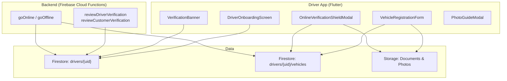
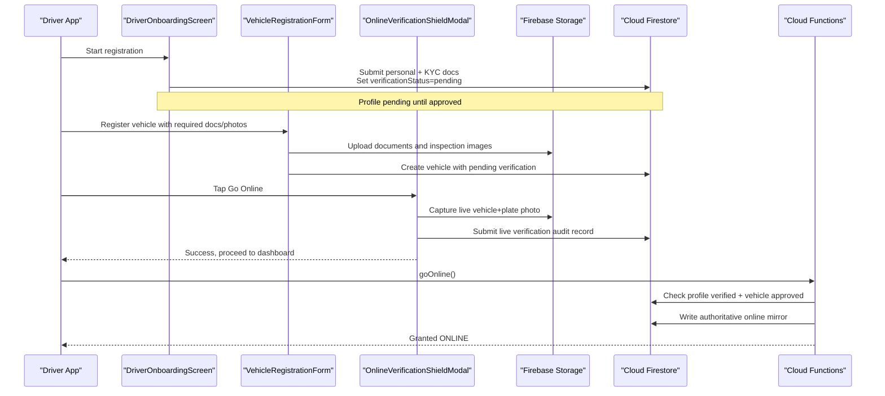
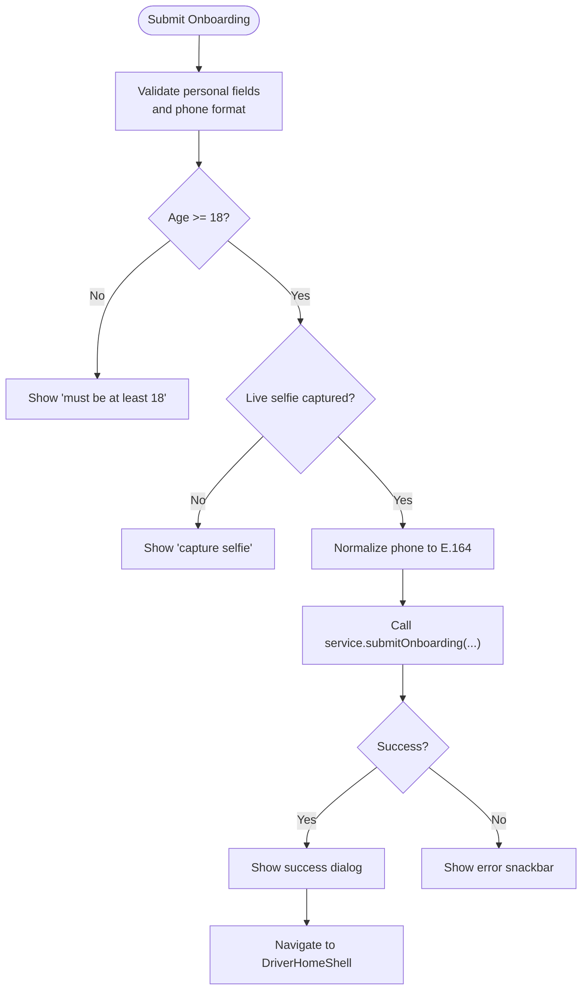
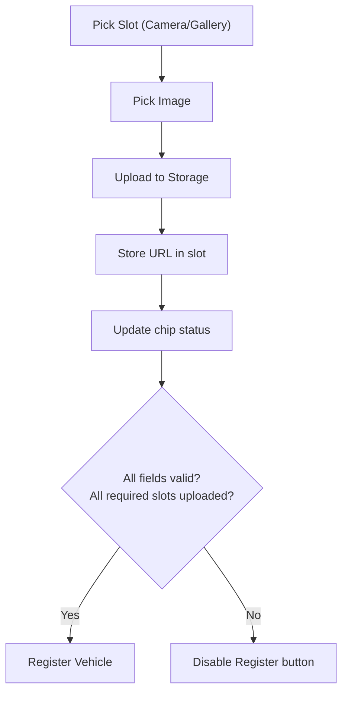
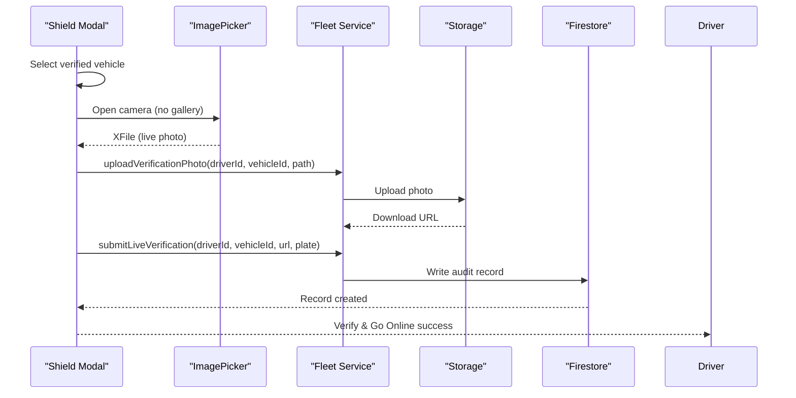
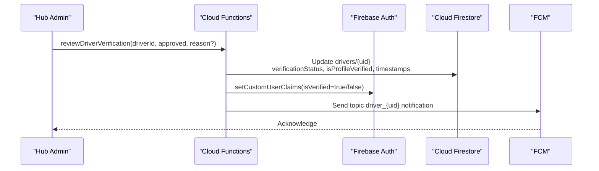
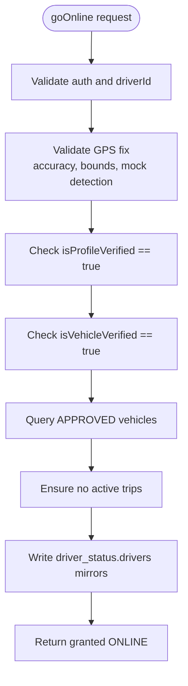
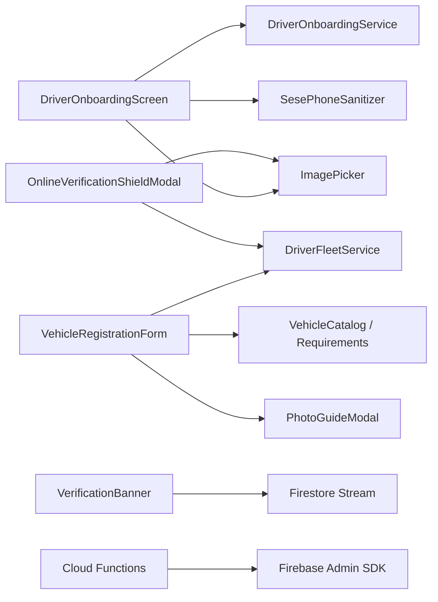

# Driver Onboarding & Verification

<cite>
**Referenced Files in This Document**
- [driver_onboarding_screen.dart](file://sese_ride/lib/features/driver/presentation/driver_onboarding_screen.dart)
- [vehicle_registration_form.dart](file://sese_ride/lib/features/driver/presentation/widgets/vehicle_registration_form.dart)
- [verification_banner.dart](file://sese_ride/lib/features/driver/presentation/widgets/verification_banner.dart)
- [online_verification_shield_modal.dart](file://sese_ride/lib/features/driver/presentation/online_verification_shield_modal.dart)
- [photo_guide_modal.dart](file://sese_ride/lib/features/driver/presentation/widgets/photo_guide_modal.dart)
- [verification.ts](file://functions/src/verification.ts)
- [driverStatus.ts](file://functions/src/driverStatus.ts)
</cite>

## Table of Contents
1. [Introduction](#introduction)
2. [Project Structure](#project-structure)
3. [Core Components](#core-components)
4. [Architecture Overview](#architecture-overview)
5. [Detailed Component Analysis](#detailed-component-analysis)
6. [Dependency Analysis](#dependency-analysis)
7. [Performance Considerations](#performance-considerations)
8. [Troubleshooting Guide](#troubleshooting-guide)
9. [Conclusion](#conclusion)

## Introduction
This document explains the driver onboarding and verification system end-to-end. It covers:
- Step-by-step registration for drivers, including personal information, address selection, government ID capture, selfie verification, and emergency contact details.
- Vehicle registration requirements by vehicle category, including required documents and inspection photos.
- The verification workflow from submission to admin approval, status tracking, and compliance checks.
- Integration points with backend Cloud Functions for review and online/offline state enforcement.
- Error handling, validation rules, and user feedback mechanisms throughout the journey.

## Project Structure
The driver onboarding and verification features are implemented across Flutter UI components and Firebase Cloud Functions:
- Driver onboarding form and submission logic live in the ride app’s driver presentation layer.
- Vehicle registration is a dynamic form that adapts to vehicle categories and enforces required uploads.
- A persistent banner shows pending verification status.
- A security shield modal enforces live camera capture before going online.
- Backend functions handle admin reviews, Firestore updates, custom claims, and FCM notifications.
- Server-side guards enforce profile and vehicle verification before allowing drivers to go online.

**Diagram sources**
- [driver_onboarding_screen.dart:18-36](file://sese_ride/lib/features/driver/presentation/driver_onboarding_screen.dart#L18-L36)
- [vehicle_registration_form.dart:19-30](file://sese_ride/lib/features/driver/presentation/widgets/vehicle_registration_form.dart#L19-L30)
- [verification_banner.dart:5-11](file://sese_ride/lib/features/driver/presentation/widgets/verification_banner.dart#L5-L11)
- [online_verification_shield_modal.dart:8-12](file://sese_ride/lib/features/driver/presentation/online_verification_shield_modal.dart#L8-L12)
- [verification.ts:133-241](file://functions/src/verification.ts#L133-L241)
- [driverStatus.ts:32-164](file://functions/src/driverStatus.ts#L32-L164)

**Section sources**
- [driver_onboarding_screen.dart:18-36](file://sese_ride/lib/features/driver/presentation/driver_onboarding_screen.dart#L18-L36)
- [vehicle_registration_form.dart:19-30](file://sese_ride/lib/features/driver/presentation/widgets/vehicle_registration_form.dart#L19-L30)
- [verification_banner.dart:5-11](file://sese_ride/lib/features/driver/presentation/widgets/verification_banner.dart#L5-L11)
- [online_verification_shield_modal.dart:8-12](file://sese_ride/lib/features/driver/presentation/online_verification_shield_modal.dart#L8-L12)
- [verification.ts:133-241](file://functions/src/verification.ts#L133-L241)
- [driverStatus.ts:32-164](file://functions/src/driverStatus.ts#L32-L164)

## Core Components
- DriverOnboardingScreen: Collects personal data, home address, government ID, selfie, and next-of-kin details; validates age and phone; submits to Firestore with pending verification flags.
- VehicleRegistrationForm: Dynamic per-category form for make/model/color/year, license plate, required documents, and inspection photos; integrates photo guide and upload progress.
- VerificationBanner: Streams driver profile status and displays a dismissible alert while verification is pending or incomplete.
- OnlineVerificationShieldModal: Two-step flow to select a verified vehicle and capture a live front+plate photo; uploads audit record and triggers online status after success.
- PhotoGuideModal: Shows angle-specific guidance for required inspection photos based on vehicle category.
- Backend Functions: Admin review endpoints update driver/customer verification states and send FCM notifications; server-side goOnline guard enforces profile and vehicle verification plus GPS integrity.

**Section sources**
- [driver_onboarding_screen.dart:18-36](file://sese_ride/lib/features/driver/presentation/driver_onboarding_screen.dart#L18-L36)
- [vehicle_registration_form.dart:19-30](file://sese_ride/lib/features/driver/presentation/widgets/vehicle_registration_form.dart#L19-L30)
- [verification_banner.dart:5-11](file://sese_ride/lib/features/driver/presentation/widgets/verification_banner.dart#L5-L11)
- [online_verification_shield_modal.dart:8-12](file://sese_ride/lib/features/driver/presentation/online_verification_shield_modal.dart#L8-L12)
- [photo_guide_modal.dart:4-9](file://sese_ride/lib/features/driver/presentation/widgets/photo_guide_modal.dart#L4-L9)
- [verification.ts:133-241](file://functions/src/verification.ts#L133-L241)
- [driverStatus.ts:32-164](file://functions/src/driverStatus.ts#L32-L164)

## Architecture Overview
The onboarding and verification architecture combines client-side forms and validations with server-side policy enforcement and admin workflows.

**Diagram sources**
- [driver_onboarding_screen.dart:281-372](file://sese_ride/lib/features/driver/presentation/driver_onboarding_screen.dart#L281-L372)
- [vehicle_registration_form.dart:168-254](file://sese_ride/lib/features/driver/presentation/widgets/vehicle_registration_form.dart#L168-L254)
- [online_verification_shield_modal.dart:103-145](file://sese_ride/lib/features/driver/presentation/online_verification_shield_modal.dart#L103-L145)
- [driverStatus.ts:32-164](file://functions/src/driverStatus.ts#L32-L164)

## Detailed Component Analysis

### Driver Onboarding Screen
Responsibilities:
- Personal information: first/last name, phone number, date of birth (18+), gender.
- Home address: Nominatim autocomplete and interactive map pinning producing latitude/longitude.
- Government ID: country-aware document type (Nigeria vs other countries), front/back uploads, optional expiry date for expiring IDs.
- Live selfie: camera-only capture for face verification.
- Emergency contact: next of kin name, relationship, phone, address.
- Submission: writes driver profile with pending verification flags and routes to driver home with persistent banner.

Validation and error handling:
- Age check enforced at submit time.
- Phone normalization and E.164 validation.
- Required fields validated via FormState.
- User-friendly snackbars for errors; specific handling for permission-denied and network failures.

**Diagram sources**
- [driver_onboarding_screen.dart:281-372](file://sese_ride/lib/features/driver/presentation/driver_onboarding_screen.dart#L281-L372)

Key implementation notes:
- Country-aware ID types and non-expiring ID sets.
- State/region dropdown populated by selected country.
- Address search debounced to reduce API calls.
- Back navigation offers options to continue, switch to customer mode, or sign out.

**Section sources**
- [driver_onboarding_screen.dart:18-36](file://sese_ride/lib/features/driver/presentation/driver_onboarding_screen.dart#L18-L36)
- [driver_onboarding_screen.dart:172-200](file://sese_ride/lib/features/driver/presentation/driver_onboarding_screen.dart#L172-L200)
- [driver_onboarding_screen.dart:212-277](file://sese_ride/lib/features/driver/presentation/driver_onboarding_screen.dart#L212-L277)
- [driver_onboarding_screen.dart:281-372](file://sese_ride/lib/features/driver/presentation/driver_onboarding_screen.dart#L281-L372)
- [driver_onboarding_screen.dart:395-445](file://sese_ride/lib/features/driver/presentation/driver_onboarding_screen.dart#L395-L445)

### Vehicle Registration Form
Responsibilities:
- Category-driven requirements: bicycles skip plate/license/insurance; bikes/keke need two plate photos; cars/vans/trucks need five photos.
- Cascading Make/Model/Color/Year with “Other” free-text escape hatches.
- License plate field when required.
- Required documentation and inspection slots rendered as chips with upload status.
- Photo guide modal accessible per category.
- Validation gates: all fields valid, all required uploads complete, no uploads in flight.

Upload flow:
- Chooser allows Camera or Gallery per slot.
- Image picked via image_picker with size/quality constraints.
- Uploaded through fleet service to Storage; URL stored per slot.
- Errors sanitized and surfaced to user without exposing backend internals.

**Diagram sources**
- [vehicle_registration_form.dart:168-254](file://sese_ride/lib/features/driver/presentation/widgets/vehicle_registration_form.dart#L168-L254)

Key implementation notes:
- Per-slot upload state tracks local path, URL, uploading flag, and error.
- Effective values computed for custom inputs.
- Car tier preview shown based on year thresholds.
- Reset clears all inputs and uploads after successful registration.

**Section sources**
- [vehicle_registration_form.dart:11-30](file://sese_ride/lib/features/driver/presentation/widgets/vehicle_registration_form.dart#L11-L30)
- [vehicle_registration_form.dart:62-132](file://sese_ride/lib/features/driver/presentation/widgets/vehicle_registration_form.dart#L62-L132)
- [vehicle_registration_form.dart:168-254](file://sese_ride/lib/features/driver/presentation/widgets/vehicle_registration_form.dart#L168-L254)
- [vehicle_registration_form.dart:273-491](file://sese_ride/lib/features/driver/presentation/widgets/vehicle_registration_form.dart#L273-L491)

### Verification Banner
Responsibilities:
- Stream driver profile document and show a dismissible banner when verification is pending or incomplete.
- Supports legacy statuses and current flags.
- Allows navigation to Fleet/Vehicles while pending.

Behavior:
- Reads verificationStatus and isProfileVerified.
- Dismissable locally within the session.
- Styled for light/dark themes.

**Section sources**
- [verification_banner.dart:5-11](file://sese_ride/lib/features/driver/presentation/widgets/verification_banner.dart#L5-L11)
- [verification_banner.dart:21-125](file://sese_ride/lib/features/driver/presentation/widgets/verification_banner.dart#L21-L125)

### Online Verification Shield Modal
Responsibilities:
- Enforce vehicle selection from verified fleet.
- Require one-time live camera snapshot of vehicle front and license plate.
- Block gallery uploads strictly.
- Upload photo and submit audit record; then pass verification callback to allow going online.

Flow:
- Step 0: Select verified vehicle.
- Step 1: Live camera capture only; preview alignment; retake or verify.
- On success: show success snackbar and close modal.

**Diagram sources**
- [online_verification_shield_modal.dart:56-98](file://sese_ride/lib/features/driver/presentation/online_verification_shield_modal.dart#L56-L98)
- [online_verification_shield_modal.dart:103-145](file://sese_ride/lib/features/driver/presentation/online_verification_shield_modal.dart#L103-L145)

**Section sources**
- [online_verification_shield_modal.dart:8-12](file://sese_ride/lib/features/driver/presentation/online_verification_shield_modal.dart#L8-L12)
- [online_verification_shield_modal.dart:56-98](file://sese_ride/lib/features/driver/presentation/online_verification_shield_modal.dart#L56-L98)
- [online_verification_shield_modal.dart:103-145](file://sese_ride/lib/features/driver/presentation/online_verification_shield_modal.dart#L103-L145)
- [online_verification_shield_modal.dart:148-488](file://sese_ride/lib/features/driver/presentation/online_verification_shield_modal.dart#L148-L488)

### Photo Guide Modal
Responsibilities:
- Display framing guidelines for each required inspection angle based on vehicle category.
- Provide universal tips: daylight, clean lens, readable plates/documents.

Usage:
- Triggered from VehicleRegistrationForm via showVehiclePhotoGuide(context, category).

**Section sources**
- [photo_guide_modal.dart:4-9](file://sese_ride/lib/features/driver/presentation/widgets/photo_guide_modal.dart#L4-L9)
- [photo_guide_modal.dart:10-96](file://sese_ride/lib/features/driver/presentation/widgets/photo_guide_modal.dart#L10-L96)

### Backend Integration: Admin Approval and Status Tracking
Admin review endpoints:
- reviewDriverVerification: approves/rejects driver profile, updates Firestore fields, sets custom claim isVerified, sends FCM notification.
- reviewCustomerVerification: similar flow for customers.

Status tracking:
- Drivers see pending verification via VerificationBanner until approved.
- Backend triggers synchronize custom claims and send notifications on direct Firestore updates.

**Diagram sources**
- [verification.ts:133-241](file://functions/src/verification.ts#L133-L241)

**Section sources**
- [verification.ts:133-241](file://functions/src/verification.ts#L133-L241)
- [verification.ts:249-350](file://functions/src/verification.ts#L249-L350)

### Compliance Checks: Going Online
Server-side guard ensures:
- Driver authenticated and not attempting to act on another account.
- Valid GPS fix with anti-spoofing checks (mock location, accuracy bounds).
- Profile verified and vehicle verified flags present and true.
- At least one APPROVED vehicle exists in fleet.
- No active trip in progress.
- Writes authoritative online mirror and driver last seen/location.

**Diagram sources**
- [driverStatus.ts:32-164](file://functions/src/driverStatus.ts#L32-L164)

**Section sources**
- [driverStatus.ts:32-164](file://functions/src/driverStatus.ts#L32-L164)

## Dependency Analysis
- DriverOnboardingScreen depends on:
  - SesePhoneSanitizer for phone normalization/validation.
  - DriverOnboardingService for address search and submission.
  - ImagePicker for ID and selfie capture.
  - Firestore and Storage indirectly via service.
- VehicleRegistrationForm depends on:
  - DriverFleetService for document upload and vehicle registration.
  - VehicleCatalog and VehicleDocumentRequirements for category-driven rules.
  - PhotoGuideModal for inspection guidance.
- OnlineVerificationShieldModal depends on:
  - DriverFleetService for verification photo upload and audit submission.
  - ImagePicker for camera-only capture.
- VerificationBanner depends on:
  - Firestore stream of drivers/{uid}.
- Backend functions depend on:
  - Firebase Admin SDK for Firestore, Auth, Messaging.
  - Cloud Functions v2 for callable endpoints and document triggers.

**Diagram sources**
- [driver_onboarding_screen.dart:18-36](file://sese_ride/lib/features/driver/presentation/driver_onboarding_screen.dart#L18-L36)
- [vehicle_registration_form.dart:19-30](file://sese_ride/lib/features/driver/presentation/widgets/vehicle_registration_form.dart#L19-L30)
- [online_verification_shield_modal.dart:8-12](file://sese_ride/lib/features/driver/presentation/online_verification_shield_modal.dart#L8-L12)
- [verification_banner.dart:5-11](file://sese_ride/lib/features/driver/presentation/widgets/verification_banner.dart#L5-L11)
- [verification.ts:1-5](file://functions/src/verification.ts#L1-L5)

**Section sources**
- [driver_onboarding_screen.dart:18-36](file://sese_ride/lib/features/driver/presentation/driver_onboarding_screen.dart#L18-L36)
- [vehicle_registration_form.dart:19-30](file://sese_ride/lib/features/driver/presentation/widgets/vehicle_registration_form.dart#L19-L30)
- [online_verification_shield_modal.dart:8-12](file://sese_ride/lib/features/driver/presentation/online_verification_shield_modal.dart#L8-L12)
- [verification_banner.dart:5-11](file://sese_ride/lib/features/driver/presentation/widgets/verification_banner.dart#L5-L11)
- [verification.ts:1-5](file://functions/src/verification.ts#L1-L5)

## Performance Considerations
- Debounced address search reduces unnecessary API calls during typing.
- Image quality and max width constraints balance clarity and storage/network efficiency.
- Streaming verification status avoids polling and provides real-time UI updates.
- Server-side guards prevent unnecessary client retries by failing fast on invalid conditions (GPS, suspension, missing approvals).

[No sources needed since this section provides general guidance]

## Troubleshooting Guide
Common issues and resolutions:
- Missing selfie: Ensure camera-only capture is completed; gallery uploads are blocked for face verification.
- Invalid phone number: Use the provided phone input field which normalizes to E.164; ensure correct country code.
- Permission denied on submission: Indicates Firestore rules or authentication issue; retry or contact support.
- Vehicle upload errors: Generic messages hide backend details; reattempt upload and ensure proper permissions.
- Cannot go online:
  - Profile pending verification: Wait for admin approval or check VerificationBanner.
  - No verified vehicle: Register and get vehicle approved.
  - Active trip: Complete current trip before changing status.
  - GPS spoof or low accuracy: Move to open sky and disable mock locations.

**Section sources**
- [driver_onboarding_screen.dart:281-372](file://sese_ride/lib/features/driver/presentation/driver_onboarding_screen.dart#L281-L372)
- [vehicle_registration_form.dart:215-227](file://sese_ride/lib/features/driver/presentation/widgets/vehicle_registration_form.dart#L215-L227)
- [online_verification_shield_modal.dart:89-98](file://sese_ride/lib/features/driver/presentation/online_verification_shield_modal.dart#L89-L98)
- [driverStatus.ts:32-164](file://functions/src/driverStatus.ts#L32-L164)

## Conclusion
The driver onboarding and verification system provides a robust, secure, and user-friendly journey from registration to operational readiness. It enforces strict validation, requires live captures for identity and vehicle verification, and integrates tightly with admin review processes and server-side compliance checks. Persistent status tracking and clear user feedback ensure drivers understand their verification state and can take corrective actions efficiently.

[No sources needed since this section summarizes without analyzing specific files]