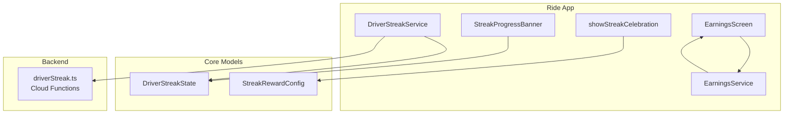
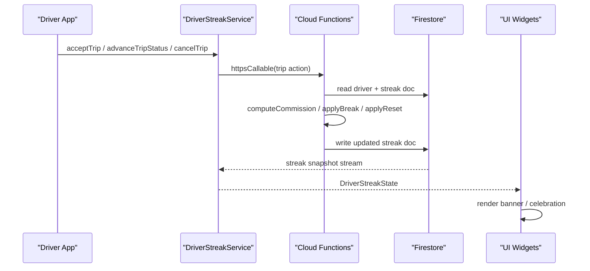
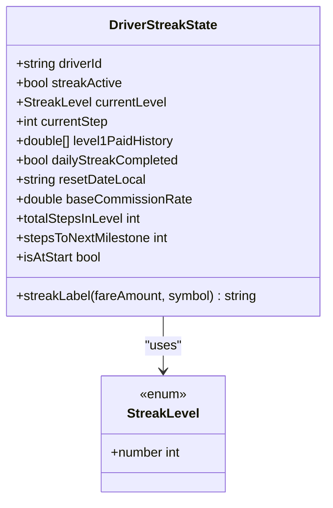
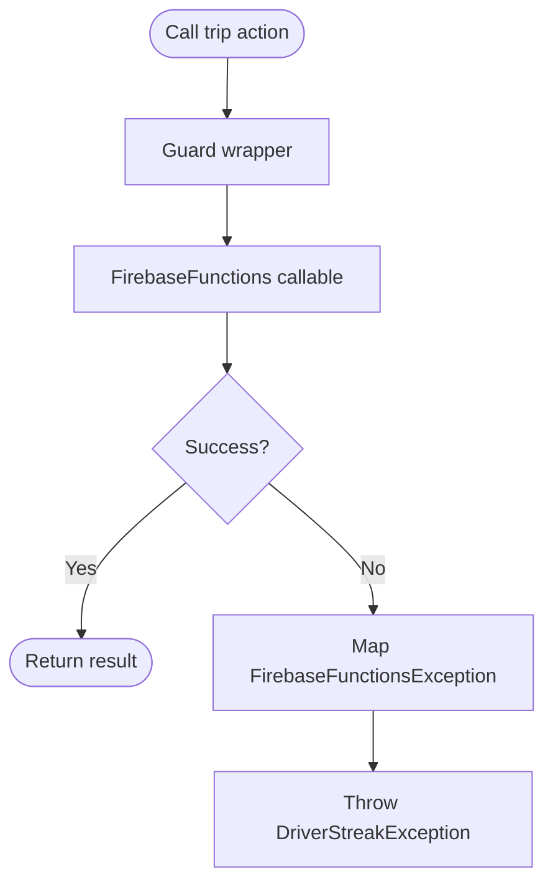
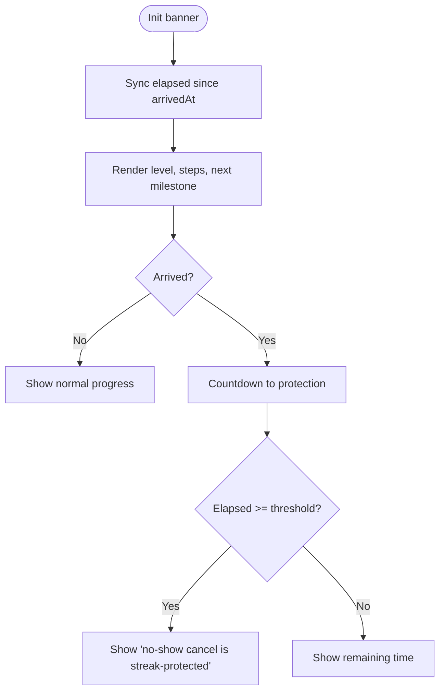
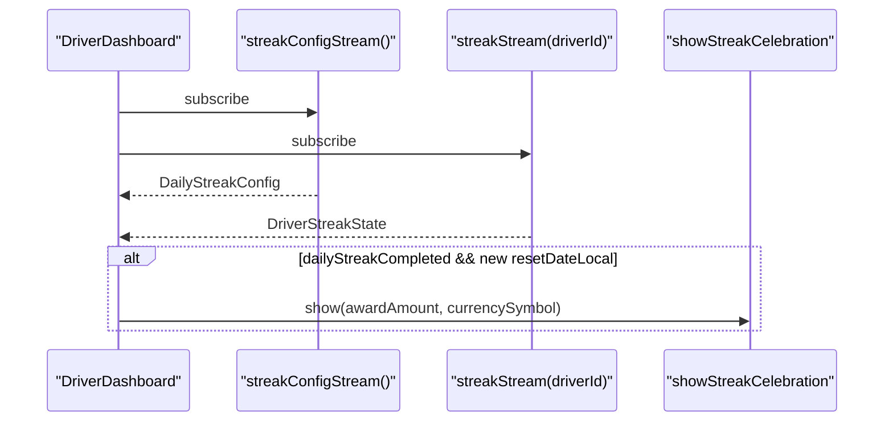
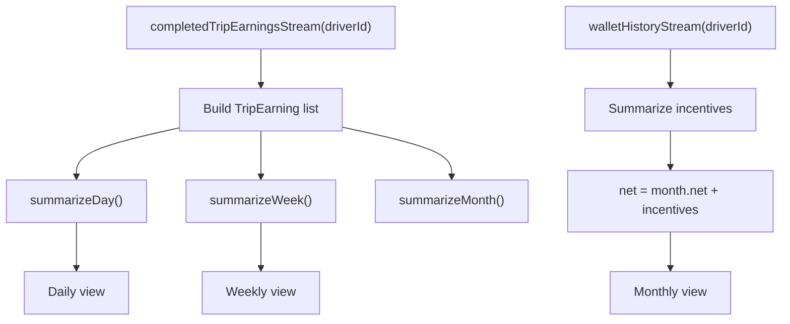
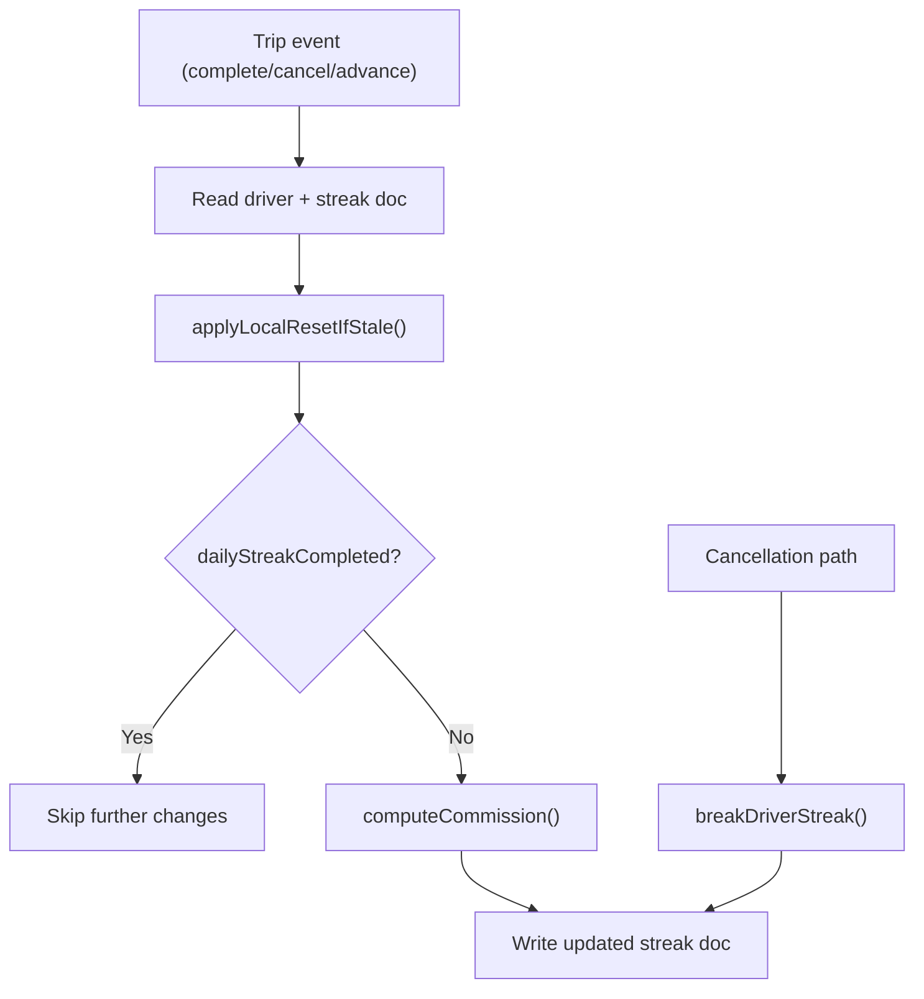
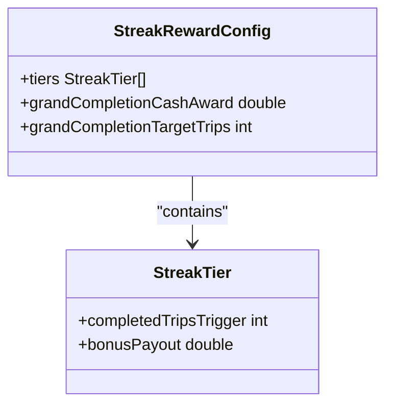
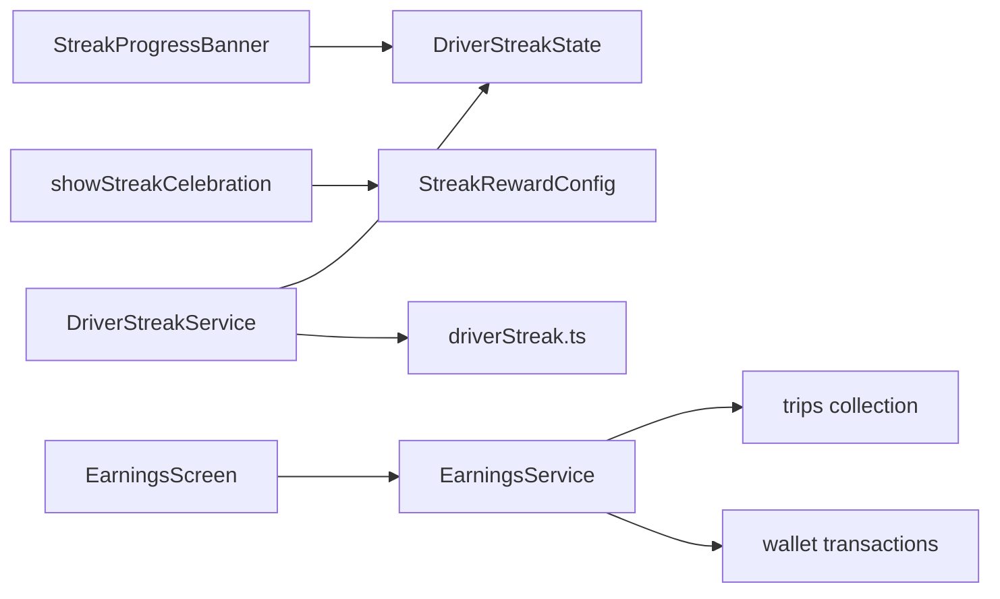

# Earnings Tracking & Performance Metrics

<cite>
**Referenced Files in This Document**   
- [driver_streak_state.dart](file://sese_core/lib/models/driver_streak_state.dart)
- [driver_streak_service.dart](file://sese_ride/lib/features/driver/services/driver_streak_service.dart)
- [streak_progress_banner.dart](file://sese_ride/lib/features/driver/presentation/widgets/streak_progress_banner.dart)
- [streak_celebration_modal.dart](file://sese_ride/lib/features/driver/presentation/widgets/streak_celebration_modal.dart)
- [earnings_screen.dart](file://sese_ride/lib/features/wallet/earnings_screen.dart)
- [earnings_service.dart](file://sese_ride/lib/features/wallet/earnings_service.dart)
- [pricing_config.dart](file://sese_core/lib/models/pricing_config.dart)
- [driverStreak.ts](file://functions/src/driverStreak.ts)
</cite>

## Table of Contents
1. [Introduction](#introduction)
2. [Project Structure](#project-structure)
3. [Core Components](#core-components)
4. [Architecture Overview](#architecture-overview)
5. [Detailed Component Analysis](#detailed-component-analysis)
6. [Dependency Analysis](#dependency-analysis)
7. [Performance Considerations](#performance-considerations)
8. [Troubleshooting Guide](#troubleshooting-guide)
9. [Conclusion](#conclusion)

## Introduction
This document explains the earnings tracking and performance monitoring system for drivers, focusing on:
- The daily commission streak engine that reduces fees, refunds commissions, and grants cash bonuses.
- The progress banner that visualizes current level, step progress, next rewards, and no-show protection timing.
- The celebration modal shown when a driver completes all three levels and receives the grand award.
- The earnings breakdown dashboard showing daily, weekly, and monthly income, platform commissions, incentives, and net profit.
- How backend Cloud Functions compute and persist streak state, how client services stream it, and how UI components render and interact with it.

The goal is to help developers and product stakeholders understand data flows, calculation rules, user-facing milestones, and operational safeguards such as midnight resets, regional enablement, and cancellation protections.

## Project Structure
The streak and earnings features span three layers:
- Core models define immutable streak state, reward configuration, and earnings summaries.
- Ride app UI streams live streak state and trip data from Firestore and renders banners, dashboards, and modals.
- Backend Cloud Functions are the authoritative source for streak computation, persistence, and reset scheduling.

**Diagram sources**
- [driver_streak_state.dart:1-216](file://sese_core/lib/models/driver_streak_state.dart#L1-L216)
- [driver_streak_service.dart:58-202](file://sese_ride/lib/features/driver/services/driver_streak_service.dart#L58-L202)
- [streak_progress_banner.dart:1-235](file://sese_ride/lib/features/driver/presentation/widgets/streak_progress_banner.dart#L1-L235)
- [streak_celebration_modal.dart:1-77](file://sese_ride/lib/features/driver/presentation/widgets/streak_celebration_modal.dart#L1-L77)
- [earnings_screen.dart:1-456](file://sese_ride/lib/features/wallet/earnings_screen.dart#L1-L456)
- [earnings_service.dart:1-184](file://sese_ride/lib/features/wallet/earnings_service.dart#L1-L184)
- [pricing_config.dart:98-134](file://sese_core/lib/models/pricing_config.dart#L98-L134)
- [driverStreak.ts:426-559](file://functions/src/driverStreak.ts#L426-L559)

**Section sources**
- [driver_streak_state.dart:1-216](file://sese_core/lib/models/driver_streak_state.dart#L1-L216)
- [driver_streak_service.dart:58-202](file://sese_ride/lib/features/driver/services/driver_streak_service.dart#L58-L202)
- [streak_progress_banner.dart:1-235](file://sese_ride/lib/features/driver/presentation/widgets/streak_progress_banner.dart#L1-L235)
- [streak_celebration_modal.dart:1-77](file://sese_ride/lib/features/driver/presentation/widgets/streak_celebration_modal.dart#L1-L77)
- [earnings_screen.dart:1-456](file://sese_ride/lib/features/wallet/earnings_screen.dart#L1-L456)
- [earnings_service.dart:1-184](file://sese_ride/lib/features/wallet/earnings_service.dart#L1-L184)
- [pricing_config.dart:98-134](file://sese_core/lib/models/pricing_config.dart#L98-L134)
- [driverStreak.ts:426-559](file://functions/src/driverStreak.ts#L426-L559)

## Core Components
- Driver streak state model: defines levels, steps, labels, refund logic, and milestone helpers.
- Driver streak service: streams streak state, trip pings, marketplace offers, and config; exposes server-call wrappers for trip actions.
- Progress banner: displays current level, step progress, next-milestone text, and no-show wait timer.
- Celebration modal: shows a trophy-style dialog with the grand award amount after completing Level 3 Step 6.
- Earnings screen and service: streams completed trips and wallet transactions, summarizes daily/weekly/monthly earnings, and integrates incentive credits.
- Backend streak function: computes commission, updates streak state, handles breaks, and schedules local-midnight resets.

Key responsibilities:
- Backend owns streak mutation and reset logic.
- Client reads streak state via streams and triggers trip actions through callables.
- UI renders progress and celebrations based on streamed state and configuration.
- Earnings dashboard aggregates completed-trip settlements and wallet incentives.

**Section sources**
- [driver_streak_state.dart:20-182](file://sese_core/lib/models/driver_streak_state.dart#L20-L182)
- [driver_streak_service.dart:58-202](file://sese_ride/lib/features/driver/services/driver_streak_service.dart#L58-L202)
- [streak_progress_banner.dart:11-100](file://sese_ride/lib/features/driver/presentation/widgets/streak_progress_banner.dart#L11-L100)
- [streak_celebration_modal.dart:4-77](file://sese_ride/lib/features/driver/presentation/widgets/streak_celebration_modal.dart#L4-L77)
- [earnings_screen.dart:19-97](file://sese_ride/lib/features/wallet/earnings_screen.dart#L19-L97)
- [earnings_service.dart:61-184](file://sese_ride/lib/features/wallet/earnings_service.dart#L61-L184)
- [driverStreak.ts:426-559](file://functions/src/driverStreak.ts#L426-L559)

## Architecture Overview
The streak system follows a server-authoritative pattern:
- Firestore stores `driver_streaks/{driverId}` documents written only by Cloud Functions.
- The ride app streams this document and uses `DriverStreakState` to render UI.
- Trip lifecycle events (accept, advance status, cancel) go through callable functions that update streak state and apply break/reset rules.
- A scheduled job performs lazy local-midnight resets per driver timezone.

**Diagram sources**
- [driver_streak_service.dart:89-202](file://sese_ride/lib/features/driver/services/driver_streak_service.dart#L89-L202)
- [driverStreak.ts:426-559](file://functions/src/driverStreak.ts#L426-L559)

## Detailed Component Analysis

### Driver Streak State Model
The core data structure captures:
- Whether the streak is active for the driver’s region.
- Current level (1–3) and step index within that level.
- History of Level 1 commissions paid, used for Level 2 refunds.
- Completion flag for the day and last reset date.
- Base commission rate applied when streak is inactive or broken.

Important behaviors:
- Labels describe current fee/bonus/refund.
- Level 1 rates decrease from 15% down to 0%.
- Level 2 refunds previous Level 1 commissions in reverse order.
- Level 3 bonus percentages increase up to 20%.
- Total steps and steps-to-next-milestone support progress indicators.

**Diagram sources**
- [driver_streak_state.dart:12-18](file://sese_core/lib/models/driver_streak_state.dart#L12-L18)
- [driver_streak_state.dart:24-182](file://sese_core/lib/models/driver_streak_state.dart#L24-L182)

**Section sources**
- [driver_streak_state.dart:20-182](file://sese_core/lib/models/driver_streak_state.dart#L20-L182)

### Driver Streak Service
Responsibilities:
- Stream the driver’s streak state from Firestore.
- Stream trip pings and marketplace offers.
- Wrap callable trip actions with error mapping and safe fallbacks.
- Stream global streak configuration (wait threshold, grand award).

Error handling:
- Network or permission errors resolve to safe defaults and stop retrying to avoid hot loops.
- Callable errors are mapped to user-friendly messages.

**Diagram sources**
- [driver_streak_service.dart:221-249](file://sese_ride/lib/features/driver/services/driver_streak_service.dart#L221-L249)

**Section sources**
- [driver_streak_service.dart:58-202](file://sese_ride/lib/features/driver/services/driver_streak_service.dart#L58-L202)
- [driver_streak_service.dart:221-249](file://sese_ride/lib/features/driver/services/driver_streak_service.dart#L221-L249)

### Streak Progress Banner
Displays:
- Current level badge.
- Human-readable label from `DriverStreakState.streakLabel`.
- Step segments indicating progress within the level.
- Next-milestone hint (next fee rate, cash-back, or grand award).
- Optional no-show protection timer once the driver taps “Arrived”.

Timer behavior:
- Counts elapsed time since arrival.
- Shows remaining time until protection activates.
- Switches to a protected state once the configured threshold is reached.

**Diagram sources**
- [streak_progress_banner.dart:35-63](file://sese_ride/lib/features/driver/presentation/widgets/streak_progress_banner.dart#L35-L63)
- [streak_progress_banner.dart:71-100](file://sese_ride/lib/features/driver/presentation/widgets/streak_progress_banner.dart#L71-L100)
- [streak_progress_banner.dart:189-229](file://sese_ride/lib/features/driver/presentation/widgets/streak_progress_banner.dart#L189-L229)

**Section sources**
- [streak_progress_banner.dart:11-100](file://sese_ride/lib/features/driver/presentation/widgets/streak_progress_banner.dart#L11-L100)
- [streak_progress_banner.dart:104-235](file://sese_ride/lib/features/driver/presentation/widgets/streak_progress_banner.dart#L104-L235)

### Celebration Modal
Triggered when:
- The driver completes Level 3 Step 6.
- The admin-configured grand award has been credited to their wallet.

Behavior:
- Shows a celebratory dialog with trophy icon, completion message, and grand award amount.
- Uses currency symbol from configuration.
- Dismissable by tapping “Keep Earning”.

**Diagram sources**
- [streak_celebration_modal.dart:4-77](file://sese_ride/lib/features/driver/presentation/widgets/streak_celebration_modal.dart#L4-L77)
- [driver_streak_service.dart:189-202](file://sese_ride/lib/features/driver/services/driver_streak_service.dart#L189-L202)

**Section sources**
- [streak_celebration_modal.dart:4-77](file://sese_ride/lib/features/driver/presentation/widgets/streak_celebration_modal.dart#L4-L77)

### Earnings Screen and Service
Earnings screen:
- Provides segmented controls for daily, weekly, and monthly views.
- Streams completed-trip earnings and wallet history.
- Renders stat cards, trip rows, bar charts, and monthly summaries.

Earnings service:
- Streams completed trips filtered by driver ID and status.
- Converts trips into `TripEarning` objects using fare and commission rate.
- Aggregates daily, weekly, and monthly totals.
- Adds referral/incentive wallet credits to monthly net.

Data flow:
- Completed trips come from Firestore `trips`, filtered client-side by status.
- Wallet incentive credits come from wallet transaction history.
- Money math is consistent across views: gross = fare, commission = fare × rate, net = gross − commission.

**Diagram sources**
- [earnings_service.dart:80-184](file://sese_ride/lib/features/wallet/earnings_service.dart#L80-L184)
- [earnings_screen.dart:68-97](file://sese_ride/lib/features/wallet/earnings_screen.dart#L68-L97)
- [earnings_screen.dart:132-197](file://sese_ride/lib/features/wallet/earnings_screen.dart#L132-L197)
- [earnings_screen.dart:238-321](file://sese_ride/lib/features/wallet/earnings_screen.dart#L238-L321)
- [earnings_screen.dart:372-418](file://sese_ride/lib/features/wallet/earnings_screen.dart#L372-L418)

**Section sources**
- [earnings_screen.dart:19-97](file://sese_ride/lib/features/wallet/earnings_screen.dart#L19-L97)
- [earnings_screen.dart:132-197](file://sese_ride/lib/features/wallet/earnings_screen.dart#L132-L197)
- [earnings_screen.dart:238-321](file://sese_ride/lib/features/wallet/earnings_screen.dart#L238-L321)
- [earnings_screen.dart:372-418](file://sese_ride/lib/features/wallet/earnings_screen.dart#L372-L418)
- [earnings_service.dart:6-42](file://sese_ride/lib/features/wallet/earnings_service.dart#L6-L42)
- [earnings_service.dart:80-184](file://sese_ride/lib/features/wallet/earnings_service.dart#L80-L184)

### Backend Streak Computation and Resets
Cloud Functions:
- Compute commission based on current streak state and regional configuration.
- Persist updated streak state to `driver_streaks/{driverId}`.
- Break streaks on specific cancellation paths while protecting customer cancellations and no-show waits.
- Apply lazy local-midnight resets when stored reset date differs from the driver’s local date.
- Schedule periodic sweeps to reset stale streaks.

**Diagram sources**
- [driverStreak.ts:426-559](file://functions/src/driverStreak.ts#L426-L559)

**Section sources**
- [driverStreak.ts:426-559](file://functions/src/driverStreak.ts#L426-L559)

### Reward System and Goal Setting
Reward configuration:
- Tiered bonuses tied to completed trip counts.
- Grand completion cash award and target trip count.
- These values are consumed by UI to display expected awards and trigger celebrations.

Goal setting:
- The streak itself acts as a daily motivational loop: reduce fees, earn refunds, and unlock cash bonuses.
- Completing Level 3 Step 6 triggers the grand award and resets at midnight.

**Diagram sources**
- [pricing_config.dart:98-134](file://sese_core/lib/models/pricing_config.dart#L98-L134)

**Section sources**
- [pricing_config.dart:98-134](file://sese_core/lib/models/pricing_config.dart#L98-L134)

## Dependency Analysis
- UI depends on core models for rendering and formatting.
- Services depend on Firestore streams and callable functions.
- Backend functions depend on Firestore reads/writes and scheduler jobs.
- Earnings screen depends on both trip settlement data and wallet incentive data.

**Diagram sources**
- [driver_streak_state.dart:20-182](file://sese_core/lib/models/driver_streak_state.dart#L20-L182)
- [driver_streak_service.dart:58-202](file://sese_ride/lib/features/driver/services/driver_streak_service.dart#L58-L202)
- [earnings_screen.dart:19-97](file://sese_ride/lib/features/wallet/earnings_screen.dart#L19-L97)
- [earnings_service.dart:80-184](file://sese_ride/lib/features/wallet/earnings_service.dart#L80-L184)
- [driverStreak.ts:426-559](file://functions/src/driverStreak.ts#L426-L559)

**Section sources**
- [driver_streak_service.dart:58-202](file://sese_ride/lib/features/driver/services/driver_streak_service.dart#L58-L202)
- [earnings_screen.dart:19-97](file://sese_ride/lib/features/wallet/earnings_screen.dart#L19-L97)
- [earnings_service.dart:80-184](file://sese_ride/lib/features/wallet/earnings_service.dart#L80-L184)
- [driverStreak.ts:426-559](file://functions/src/driverStreak.ts#L426-L559)

## Performance Considerations
- Streams use single-field queries where possible to avoid composite indexes.
- Denied listens resolve to safe defaults and terminate to prevent infinite retries.
- Client-side filtering is used for trip status checks to simplify indexing.
- Earnings aggregation runs locally on small lists derived from streams.
- Banner timer uses a periodic timer with mounted checks to avoid leaks.

[No sources needed since this section provides general guidance]

## Troubleshooting Guide
Common issues and resolutions:
- Permission denied on streak or config streams: resolves to default state and ends the stream; ensure the user is authenticated and authorized.
- Callable trip action failures: wrapped exceptions map codes like unauthenticated, failed-precondition, deadline-exceeded, not-found to user-friendly messages.
- No-show protection not activating: verify the arrived timestamp and wait threshold configuration; check that the elapsed timer reaches the threshold.
- Earnings not updating: confirm completed trips have correct status and timestamps; verify wallet incentive transactions exist for the month.

Operational tips:
- Check Firestore documents for `driver_streaks/{driverId}` and `system_configs/global_default`.
- Validate backend logs for streak computation and reset operations.
- Use test seams in services to inject mock streams and backends during development.

**Section sources**
- [driver_streak_service.dart:89-102](file://sese_ride/lib/features/driver/services/driver_streak_service.dart#L89-L102)
- [driver_streak_service.dart:221-249](file://sese_ride/lib/features/driver/services/driver_streak_service.dart#L221-L249)
- [streak_progress_banner.dart:35-63](file://sese_ride/lib/features/driver/presentation/widgets/streak_progress_banner.dart#L35-L63)
- [earnings_service.dart:80-101](file://sese_ride/lib/features/wallet/earnings_service.dart#L80-L101)

## Conclusion
The earnings tracking and performance monitoring system combines a robust backend streak engine with responsive client UI:
- Backend enforces fairness and consistency through centralized computation, breaks, and resets.
- Client streams provide real-time feedback for drivers, including progress, protection timers, and celebrations.
- Earnings dashboards translate raw trip and wallet data into actionable insights across daily, weekly, and monthly horizons.
Together, these features motivate drivers through transparent fee reductions, refunds, bonuses, and clear financial reporting.

[No sources needed since this section summarizes without analyzing specific files]