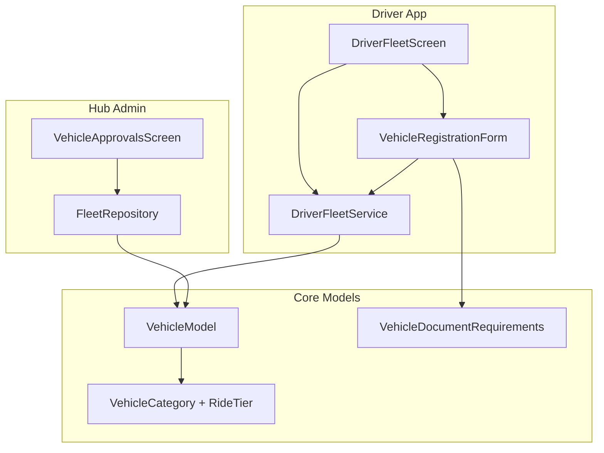
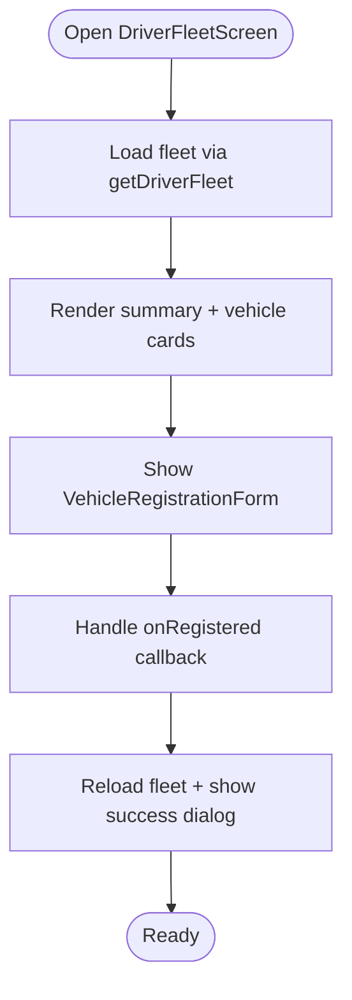
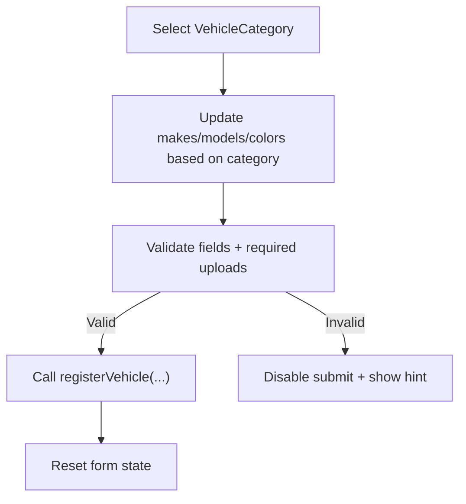
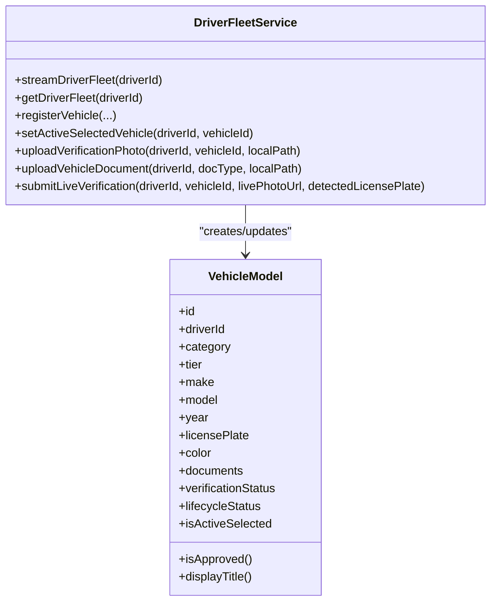
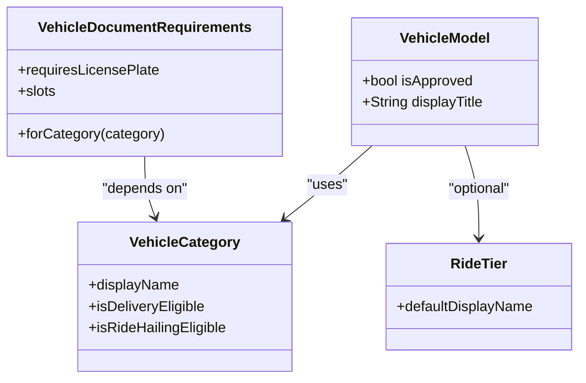
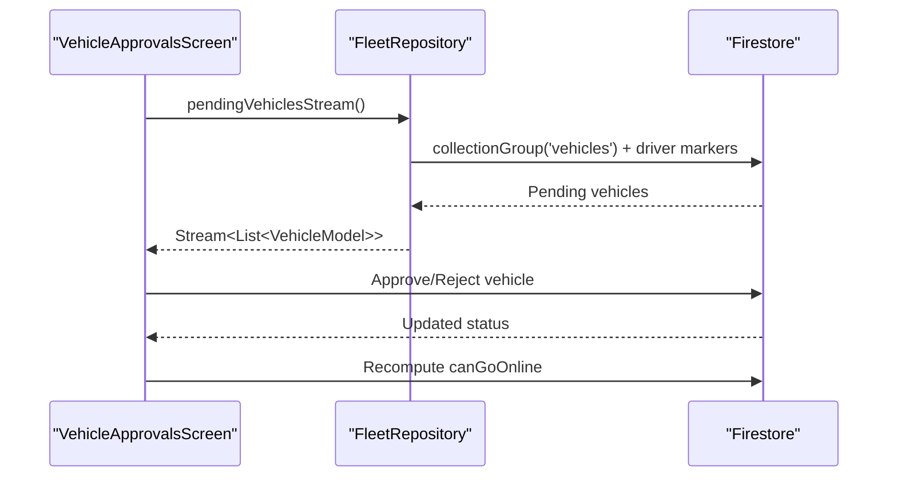
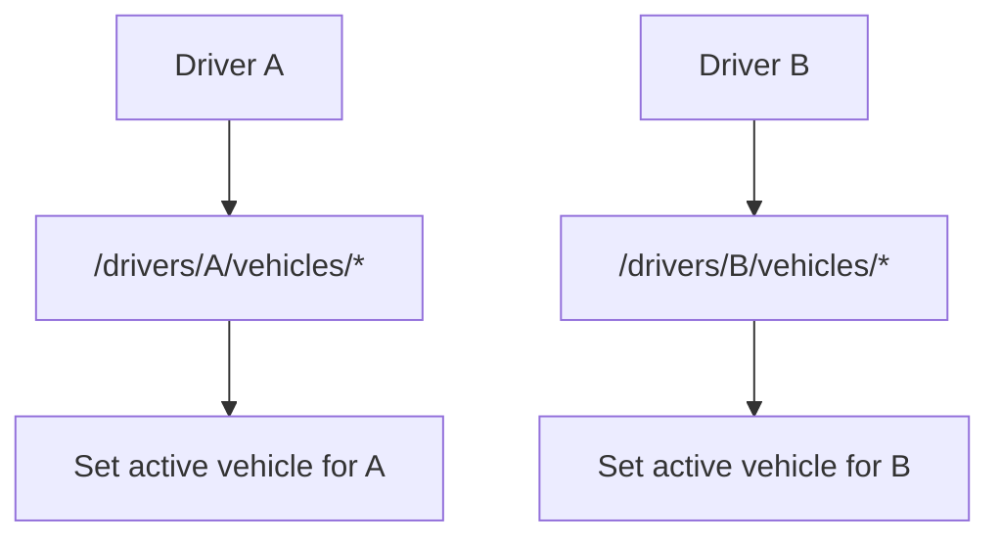
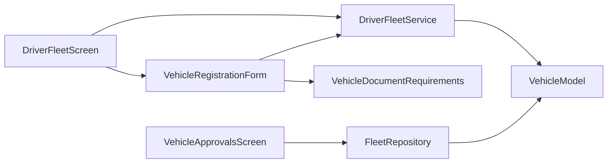

# Fleet Management & Vehicle Tracking

<cite>
**Referenced Files in This Document**
- [driver_fleet_screen.dart](file://sese_ride/lib/features/driver/presentation/driver_fleet_screen.dart)
- [driver_dashboard_screen.dart](file://sese_ride/lib/features/driver/presentation/driver_dashboard_screen.dart)
- [vehicle_registration_form.dart](file://sese_ride/lib/features/driver/presentation/widgets/vehicle_registration_form.dart)
- [driver_fleet_service.dart](file://sese_ride/lib/features/driver/services/driver_fleet_service.dart)
- [vehicle_model.dart](file://sese_core/lib/models/vehicle_model.dart)
- [vehicle_documents.dart](file://sese_core/lib/models/vehicle_documents.dart)
- [vehicle_category.dart](file://sese_core/lib/models/vehicle_category.dart)
- [fleet_repository.dart](file://sese_hub/lib/features/verification/services/fleet_repository.dart)
- [vehicle_approvals_screen.dart](file://sese_hub/lib/features/verification/presentation/vehicle_approvals_screen.dart)
</cite>

## Table of Contents
1. [Introduction](#introduction)
2. [Project Structure](#project-structure)
3. [Core Components](#core-components)
4. [Architecture Overview](#architecture-overview)
5. [Detailed Component Analysis](#detailed-component-analysis)
6. [Dependency Analysis](#dependency-analysis)
7. [Performance Considerations](#performance-considerations)
8. [Troubleshooting Guide](#troubleshooting-guide)
9. [Conclusion](#conclusion)

## Introduction
This document explains the fleet management system that enables drivers to register and manage multiple vehicles, upload required documents, track verification status, and participate in a secure administrative approval workflow. It also covers vehicle categorization, ride-tier classification for cars, compliance tracking, and how administrative staff review and approve or reject vehicles. The system supports multi-vehicle fleets, active vehicle selection, and strict security guards that prevent unverified vehicles from receiving orders.

## Project Structure
The fleet feature spans three main areas:
- Driver app UI for fleet overview and registration
- Core data models and category/document requirements
- Hub admin UI for approvals and audit logs



**Diagram sources**
- [driver_fleet_screen.dart:7-130](file://sese_ride/lib/features/driver/presentation/driver_fleet_screen.dart#L7-L130)
- [vehicle_registration_form.dart:31-254](file://sese_ride/lib/features/driver/presentation/widgets/vehicle_registration_form.dart#L31-L254)
- [driver_fleet_service.dart:64-205](file://sese_ride/lib/features/driver/services/driver_fleet_service.dart#L64-L205)
- [vehicle_model.dart:5-112](file://sese_core/lib/models/vehicle_model.dart#L5-L112)
- [vehicle_category.dart:5-69](file://sese_core/lib/models/vehicle_category.dart#L5-L69)
- [vehicle_documents.dart:41-169](file://sese_core/lib/models/vehicle_documents.dart#L41-L169)
- [vehicle_approvals_screen.dart:10-40](file://sese_hub/lib/features/verification/presentation/vehicle_approvals_screen.dart#L10-L40)
- [fleet_repository.dart:35-70](file://sese_hub/lib/features/verification/services/fleet_repository.dart#L35-L70)

**Section sources**
- [driver_fleet_screen.dart:7-130](file://sese_ride/lib/features/driver/presentation/driver_fleet_screen.dart#L7-L130)
- [vehicle_registration_form.dart:31-254](file://sese_ride/lib/features/driver/presentation/widgets/vehicle_registration_form.dart#L31-L254)
- [driver_fleet_service.dart:64-205](file://sese_ride/lib/features/driver/services/driver_fleet_service.dart#L64-L205)
- [vehicle_model.dart:5-112](file://sese_core/lib/models/vehicle_model.dart#L5-L112)
- [vehicle_category.dart:5-69](file://sese_core/lib/models/vehicle_category.dart#L5-L69)
- [vehicle_documents.dart:41-169](file://sese_core/lib/models/vehicle_documents.dart#L41-L169)
- [vehicle_approvals_screen.dart:10-40](file://sese_hub/lib/features/verification/presentation/vehicle_approvals_screen.dart#L10-L40)
- [fleet_repository.dart:35-70](file://sese_hub/lib/features/verification/services/fleet_repository.dart#L35-L70)

## Core Components
- DriverFleetScreen: Displays driver’s registered vehicles, summary counts, and an embedded registration form.
- VehicleRegistrationForm: Dynamic form with cascading make/model/color/year fields, category-driven document and inspection uploads, and submission guardrails.
- DriverFleetService: Backend service for Firestore and Storage operations, including vehicle registration, active vehicle selection, document uploads, live verification submission, and fleet queries.
- VehicleModel: Canonical vehicle entity with verification and lifecycle statuses, tier assignment, and helper methods.
- VehicleCategory and RideTier: Enumerations defining eligible vehicle types and car ride tiers.
- VehicleDocumentRequirements: Category-specific rules for required documents and inspection photos.
- FleetRepository: Tolerant pending queue stream for hub approvals, merging canonical and legacy fields.
- VehicleApprovalsScreen: Hub interface for approving/rejecting vehicles, viewing uploaded documents, and reviewing pre-online verification logs.

**Section sources**
- [driver_fleet_screen.dart:7-130](file://sese_ride/lib/features/driver/presentation/driver_fleet_screen.dart#L7-L130)
- [vehicle_registration_form.dart:31-254](file://sese_ride/lib/features/driver/presentation/widgets/vehicle_registration_form.dart#L31-L254)
- [driver_fleet_service.dart:64-205](file://sese_ride/lib/features/driver/services/driver_fleet_service.dart#L64-L205)
- [vehicle_model.dart:5-112](file://sese_core/lib/models/vehicle_model.dart#L5-L112)
- [vehicle_category.dart:5-69](file://sese_core/lib/models/vehicle_category.dart#L5-L69)
- [vehicle_documents.dart:41-169](file://sese_core/lib/models/vehicle_documents.dart#L41-L169)
- [fleet_repository.dart:35-70](file://sese_hub/lib/features/verification/services/fleet_repository.dart#L35-L70)
- [vehicle_approvals_screen.dart:10-40](file://sese_hub/lib/features/verification/presentation/vehicle_approvals_screen.dart#L10-L40)

## Architecture Overview
The system enforces a strict verification pipeline:
- Drivers register vehicles; all new vehicles start as pending verification.
- Documents and inspection photos are uploaded and stored securely.
- Hub admins review pending vehicles, cross-check license plates against uploaded licenses, and approve or reject.
- Only approved vehicles can be selected to go online and receive orders.

```mermaid
sequenceDiagram
participant DriverUI as "DriverFleetScreen"
participant RegForm as "VehicleRegistrationForm"
participant FleetSvc as "DriverFleetService"
participant DB as "Firestore"
participant Store as "Firebase Storage"
participant HubUI as "VehicleApprovalsScreen"
participant Repo as "FleetRepository"
DriverUI->>RegForm : Open registration form
RegForm->>Store : Upload required docs/photos
Store-->>RegForm : Return URLs
RegForm->>FleetSvc : registerVehicle(...)
FleetSvc->>DB : Create vehicle (PENDING)
FleetSvc->>DB : Mark driver pending_verification
Note over DriverUI,FleetSvc : New vehicle is PENDING; cannot accept orders
HubUI->>Repo : Stream pendingVehiclesStream()
Repo->>DB : Query vehicles + driver markers
Repo-->>HubUI : Pending vehicles list
HubUI->>DB : Approve or Reject vehicle
DB-->>HubUI : Updated status
HubUI->>DB : Recompute canGoOnline
```

**Diagram sources**
- [driver_fleet_screen.dart:51-95](file://sese_ride/lib/features/driver/presentation/driver_fleet_screen.dart#L51-L95)
- [vehicle_registration_form.dart:230-254](file://sese_ride/lib/features/driver/presentation/widgets/vehicle_registration_form.dart#L230-L254)
- [driver_fleet_service.dart:156-205](file://sese_ride/lib/features/driver/services/driver_fleet_service.dart#L156-L205)
- [fleet_repository.dart:54-70](file://sese_hub/lib/features/verification/services/fleet_repository.dart#L54-L70)
- [vehicle_approvals_screen.dart:47-144](file://sese_hub/lib/features/verification/presentation/vehicle_approvals_screen.dart#L47-L144)

## Detailed Component Analysis

### Driver Fleet Screen Interface
- Loads and displays the driver’s fleet with summary statistics (total, verified, pending).
- Shows each vehicle card with category icon, display title, color, verification chip, and optional car tier class.
- Enforces a strict guard message indicating that newly registered vehicles are pending verification and cannot accept orders until approved.
- Embeds the registration form for adding additional vehicles.



**Diagram sources**
- [driver_fleet_screen.dart:42-95](file://sese_ride/lib/features/driver/presentation/driver_fleet_screen.dart#L42-L95)
- [driver_fleet_screen.dart:137-171](file://sese_ride/lib/features/driver/presentation/driver_fleet_screen.dart#L137-L171)
- [driver_fleet_screen.dart:173-279](file://sese_ride/lib/features/driver/presentation/driver_fleet_screen.dart#L173-L279)

**Section sources**
- [driver_fleet_screen.dart:7-130](file://sese_ride/lib/features/driver/presentation/driver_fleet_screen.dart#L7-L130)
- [driver_fleet_screen.dart:137-279](file://sese_ride/lib/features/driver/presentation/driver_fleet_screen.dart#L137-L279)

### Vehicle Registration Form
- Provides dynamic fields: category, make/model (cascading), color, year, and license plate when required.
- Computes effective values for custom entries and validates inputs before enabling registration.
- Uses VehicleDocumentRequirements.forCategory to determine required documents and inspection angles per vehicle type.
- Supports camera/gallery image picking and uploads through DriverFleetService with sanitized error messages.
- Submits registration only when all fields and required uploads are complete.



**Diagram sources**
- [vehicle_registration_form.dart:144-166](file://sese_ride/lib/features/driver/presentation/widgets/vehicle_registration_form.dart#L144-L166)
- [vehicle_registration_form.dart:168-228](file://sese_ride/lib/features/driver/presentation/widgets/vehicle_registration_form.dart#L168-L228)
- [vehicle_registration_form.dart:230-254](file://sese_ride/lib/features/driver/presentation/widgets/vehicle_registration_form.dart#L230-L254)
- [vehicle_documents.dart:41-169](file://sese_core/lib/models/vehicle_documents.dart#L41-L169)

**Section sources**
- [vehicle_registration_form.dart:31-254](file://sese_ride/lib/features/driver/presentation/widgets/vehicle_registration_form.dart#L31-L254)
- [vehicle_documents.dart:41-169](file://sese_core/lib/models/vehicle_documents.dart#L41-L169)

### Fleet Service Operations
- Streams and fetches vehicles under `/drivers/{driverId}/vehicles`.
- Registers vehicles with strict verification guard: always sets verificationStatus to pending and marks driver as pending_verification.
- Manages active vehicle selection across a driver’s fleet using batch updates.
- Uploads verification photos and vehicle documents to Firebase Storage with session checks and sanitized errors.
- Submits live camera verification records and auto-selects the associated vehicle.



**Diagram sources**
- [driver_fleet_service.dart:64-205](file://sese_ride/lib/features/driver/services/driver_fleet_service.dart#L64-L205)
- [driver_fleet_service.dart:207-322](file://sese_ride/lib/features/driver/services/driver_fleet_service.dart#L207-L322)
- [vehicle_model.dart:5-112](file://sese_core/lib/models/vehicle_model.dart#L5-L112)

**Section sources**
- [driver_fleet_service.dart:64-205](file://sese_ride/lib/features/driver/services/driver_fleet_service.dart#L64-L205)
- [driver_fleet_service.dart:207-322](file://sese_ride/lib/features/driver/services/driver_fleet_service.dart#L207-L322)

### Vehicle Model and Categorization
- VehicleModel stores all vehicle attributes, maps to/from Firestore, and provides helpers like isApproved and displayTitle.
- VehicleCategory defines supported vehicle scopes and eligibility for delivery vs. ride-hailing (only cars for ride-hailing).
- RideTier classifies cars into comfort/premium/luxe based on manufacture year.
- VehicleDocumentRequirements defines per-category required documents and inspection angles.



**Diagram sources**
- [vehicle_model.dart:5-112](file://sese_core/lib/models/vehicle_model.dart#L5-L112)
- [vehicle_category.dart:5-69](file://sese_core/lib/models/vehicle_category.dart#L5-L69)
- [vehicle_documents.dart:41-169](file://sese_core/lib/models/vehicle_documents.dart#L41-L169)

**Section sources**
- [vehicle_model.dart:5-112](file://sese_core/lib/models/vehicle_model.dart#L5-L112)
- [vehicle_category.dart:5-69](file://sese_core/lib/models/vehicle_category.dart#L5-L69)
- [vehicle_documents.dart:41-169](file://sese_core/lib/models/vehicle_documents.dart#L41-L169)

### Administrative Oversight and Compliance Tracking
- FleetRepository streams a tolerant pending queue by merging canonical and legacy fields, excluding rejected/approved vehicles.
- VehicleApprovalsScreen allows hub staff to approve or reject vehicles, update legacy aliases for compatibility, and recompute driver canGoOnline flags.
- Includes a live audit log tab showing pre-online verification submissions with enforced camera-only capture mode.



**Diagram sources**
- [fleet_repository.dart:54-70](file://sese_hub/lib/features/verification/services/fleet_repository.dart#L54-L70)
- [vehicle_approvals_screen.dart:47-144](file://sese_hub/lib/features/verification/presentation/vehicle_approvals_screen.dart#L47-L144)

**Section sources**
- [fleet_repository.dart:35-70](file://sese_hub/lib/features/verification/services/fleet_repository.dart#L35-L70)
- [vehicle_approvals_screen.dart:47-144](file://sese_hub/lib/features/verification/presentation/vehicle_approvals_screen.dart#L47-L144)

### Multi-Vehicle Fleet Scenarios and Sharing Between Drivers
- Each driver has a dedicated vehicle collection under `/drivers/{driverId}/vehicles`, ensuring isolation between drivers.
- Active vehicle selection is scoped per driver; selecting one vehicle unselects others for that driver.
- There is no shared vehicle ownership model in the analyzed code; vehicles are tied to a single driverId.



**Diagram sources**
- [driver_fleet_service.dart:89-99](file://sese_ride/lib/features/driver/services/driver_fleet_service.dart#L89-L99)
- [driver_fleet_service.dart:207-233](file://sese_ride/lib/features/driver/services/driver_fleet_service.dart#L207-L233)

**Section sources**
- [driver_fleet_service.dart:89-99](file://sese_ride/lib/features/driver/services/driver_fleet_service.dart#L89-L99)
- [driver_fleet_service.dart:207-233](file://sese_ride/lib/features/driver/services/driver_fleet_service.dart#L207-L233)

## Dependency Analysis
- DriverFleetScreen depends on DriverFleetService and VehicleRegistrationForm.
- VehicleRegistrationForm depends on DriverFleetService and VehicleDocumentRequirements.
- DriverFleetService depends on VehicleModel and core enums.
- FleetRepository depends on VehicleModel parsing and Firestore streams.
- VehicleApprovalsScreen depends on FleetRepository and performs direct Firestore writes for approvals.



**Diagram sources**
- [driver_fleet_screen.dart:7-130](file://sese_ride/lib/features/driver/presentation/driver_fleet_screen.dart#L7-L130)
- [vehicle_registration_form.dart:31-254](file://sese_ride/lib/features/driver/presentation/widgets/vehicle_registration_form.dart#L31-L254)
- [driver_fleet_service.dart:64-205](file://sese_ride/lib/features/driver/services/driver_fleet_service.dart#L64-L205)
- [fleet_repository.dart:35-70](file://sese_hub/lib/features/verification/services/fleet_repository.dart#L35-L70)
- [vehicle_approvals_screen.dart:10-40](file://sese_hub/lib/features/verification/presentation/vehicle_approvals_screen.dart#L10-L40)

**Section sources**
- [driver_fleet_screen.dart:7-130](file://sese_ride/lib/features/driver/presentation/driver_fleet_screen.dart#L7-L130)
- [vehicle_registration_form.dart:31-254](file://sese_ride/lib/features/driver/presentation/widgets/vehicle_registration_form.dart#L31-L254)
- [driver_fleet_service.dart:64-205](file://sese_ride/lib/features/driver/services/driver_fleet_service.dart#L64-L205)
- [fleet_repository.dart:35-70](file://sese_hub/lib/features/verification/services/fleet_repository.dart#L35-L70)
- [vehicle_approvals_screen.dart:10-40](file://sese_hub/lib/features/verification/presentation/vehicle_approvals_screen.dart#L10-L40)

## Performance Considerations
- Use streaming where possible (e.g., pending vehicles) to reduce polling overhead.
- Batch updates when toggling active vehicle selection to minimize round trips.
- Sanitize and avoid exposing backend details in user-facing messages to reduce noise and improve UX.
- Keep image uploads efficient by limiting dimensions and quality in the picker.

[No sources needed since this section provides general guidance]

## Troubleshooting Guide
- Image upload failures: The service sanitizes raw errors into safe messages for network/auth issues and shows user-friendly prompts.
- Session validation: Uploads require an active driver session; otherwise, a sanitized exception is thrown.
- Pending queue visibility: If pending vehicles do not appear, verify both canonical and legacy fields are correctly set; the repository merges and de-duplicates results.
- Approval side effects: Approving a vehicle also updates driver-level flags and recomputes canGoOnline.

**Section sources**
- [driver_fleet_service.dart:21-58](file://sese_ride/lib/features/driver/services/driver_fleet_service.dart#L21-L58)
- [driver_fleet_service.dart:101-121](file://sese_ride/lib/features/driver/services/driver_fleet_service.dart#L101-L121)
- [fleet_repository.dart:189-230](file://sese_hub/lib/features/verification/services/fleet_repository.dart#L189-L230)
- [vehicle_approvals_screen.dart:47-144](file://sese_hub/lib/features/verification/presentation/vehicle_approvals_screen.dart#L47-L144)

## Conclusion
The fleet management system provides a robust, secure workflow for drivers to register multiple vehicles, manage required documentation, and track verification status. Administrative oversight ensures compliance through a clear approval process, while strict guards prevent unverified vehicles from participating in dispatch. The design emphasizes safety, clarity, and maintainability through well-defined models, services, and UI components.

[No sources needed since this section summarizes without analyzing specific files]