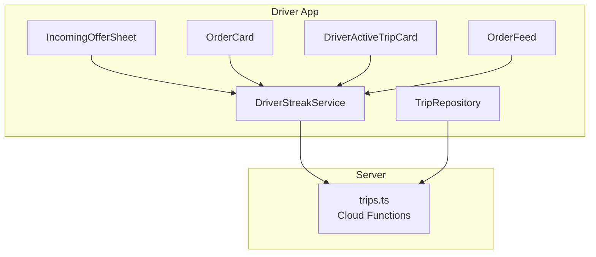
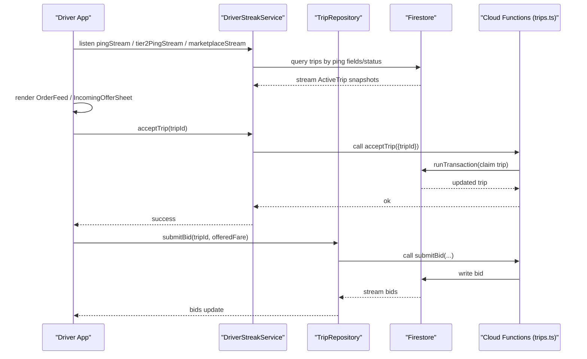
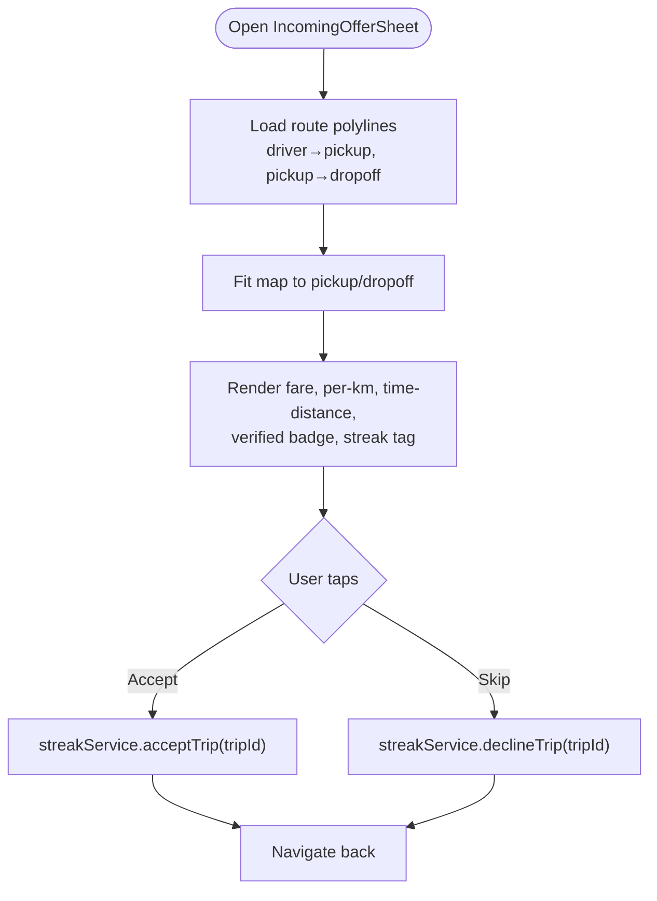
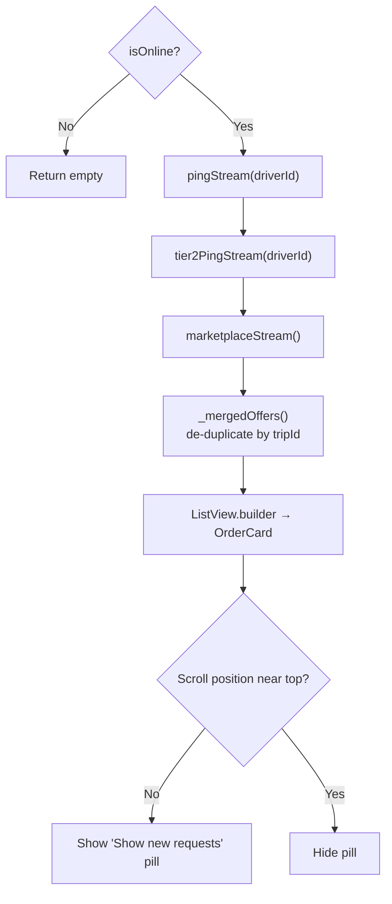
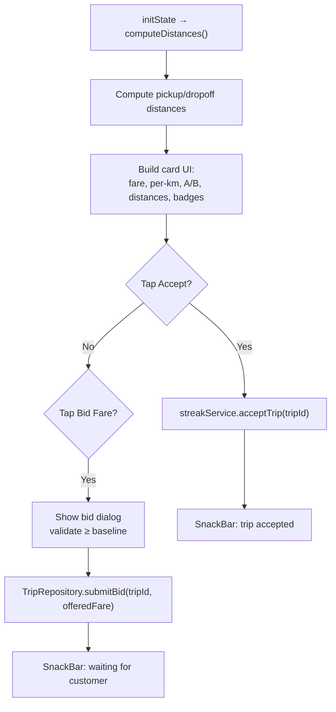
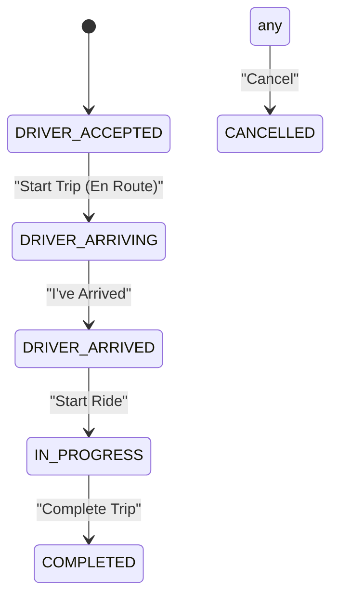
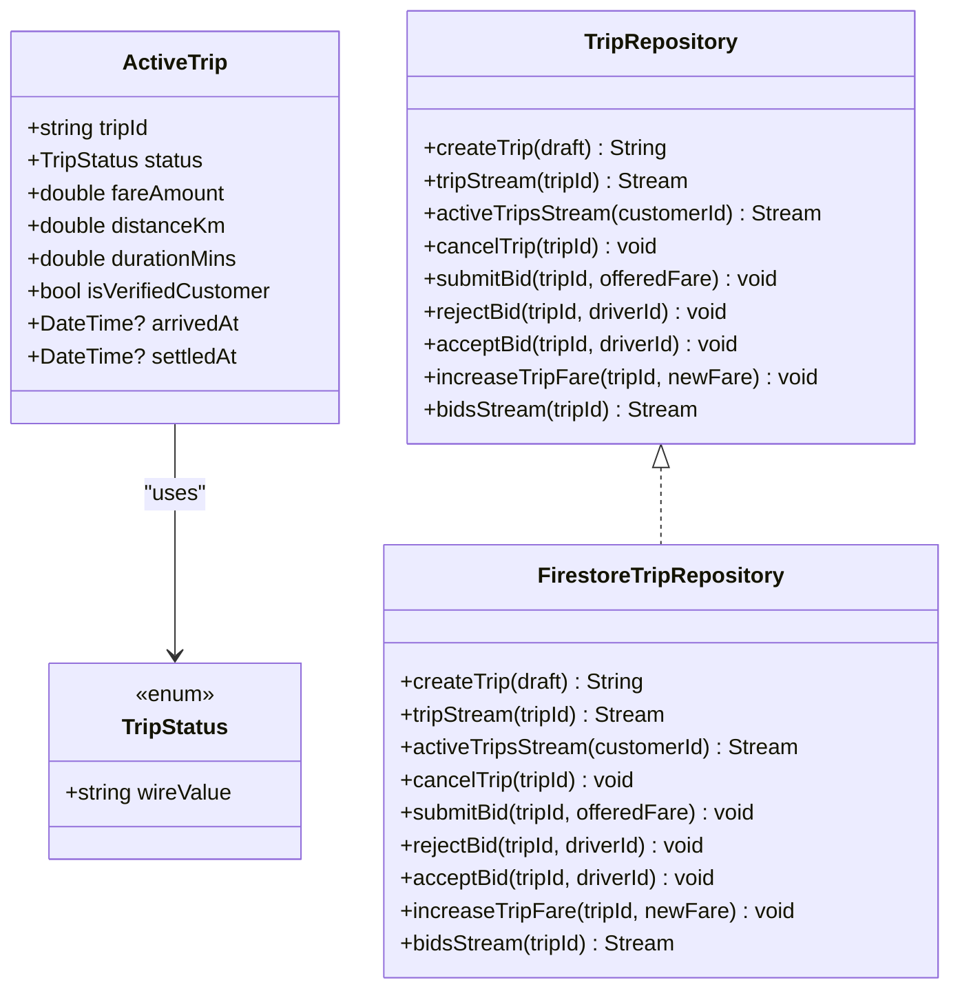
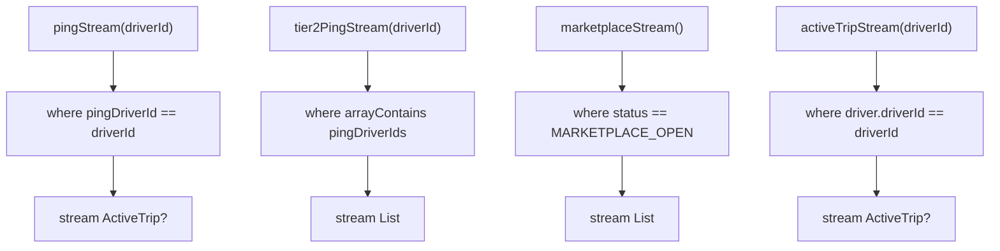
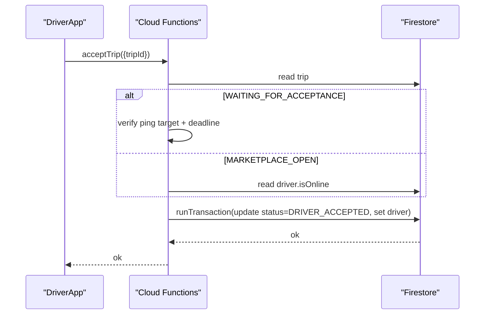
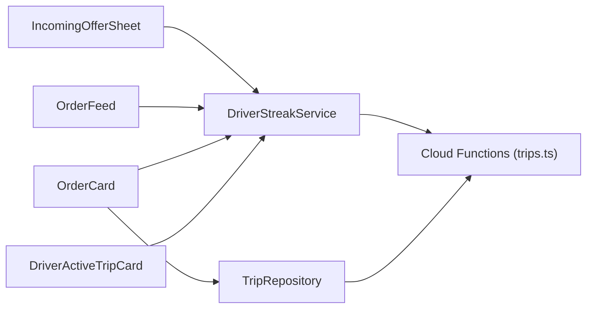

# Trip Acceptance & Management

<cite>
**Referenced Files in This Document**
- [incoming_offer_sheet.dart](file://sese_ride/lib/features/driver/presentation/widgets/incoming_offer_sheet.dart)
- [order_feed.dart](file://sese_ride/lib/features/driver/presentation/widgets/order_feed.dart)
- [order_card.dart](file://sese_ride/lib/features/driver/presentation/widgets/order_card.dart)
- [driver_active_trip_card.dart](file://sese_ride/lib/features/driver/presentation/widgets/driver_active_trip_card.dart)
- [trip_models.dart](file://sese_ride/lib/features/trips/models/trip_models.dart)
- [trip_service.dart](file://sese_ride/lib/features/trips/services/trip_service.dart)
- [driver_streak_service.dart](file://sese_ride/lib/features/driver/services/driver_streak_service.dart)
- [trips.ts](file://functions/src/trips.ts)
</cite>

## Table of Contents
1. Introduction
2. Project Structure
3. Core Components
4. Architecture Overview
5. Detailed Component Analysis
6. Dependency Analysis
7. Performance Considerations
8. Troubleshooting Guide
9. Conclusion

## Introduction
This document explains the trip acceptance and management system for drivers. It covers how incoming offers are presented, how drivers evaluate and accept trips, how active trips progress through their lifecycle, and how real-time updates flow between the client and server. It also documents fare and distance calculations, customer rating visibility, cancellation policies, streak-related consequences, and handling of edge cases such as network interruptions and trip disputes.

## Project Structure
The driver-facing trip acceptance and management features live under the driver presentation layer and services:
- Incoming offer sheet: full-screen route preview with Accept/Decline actions.
- Order feed: scrollable list merging exclusive pings, group pings, and marketplace broadcasts.
- Order card: compact card showing fare, per-km rate, addresses, distances, and Accept/Bid actions.
- Active trip card: driver-side action card to advance trip status or cancel.
- Trip models and repository: shared domain model and transport seam for trip data and bidding.
- Driver streak service: streams for pings/marketplace and driver actions (accept/decline/advance/cancel).
- Server functions: authoritative state machine for dispatch, acceptance, location updates, and status transitions.

**Diagram sources**
- [incoming_offer_sheet.dart:22-45](file://sese_ride/lib/features/driver/presentation/widgets/incoming_offer_sheet.dart#L22-L45)
- [order_feed.dart:20-39](file://sese_ride/lib/features/driver/presentation/widgets/order_feed.dart#L20-L39)
- [order_card.dart:21-46](file://sese_ride/lib/features/driver/presentation/widgets/order_card.dart#L21-L46)
- [driver_active_trip_card.dart:12-26](file://sese_ride/lib/features/driver/presentation/widgets/driver_active_trip_card.dart#L12-L26)
- [driver_streak_service.dart:65-80](file://sese_ride/lib/features/driver/services/driver_streak_service.dart#L65-L80)
- [trip_service.dart:26-64](file://sese_ride/lib/features/trips/services/trip_service.dart#L26-L64)
- [trips.ts:591-653](file://functions/src/trips.ts#L591-L653)

**Section sources**
- [incoming_offer_sheet.dart:14-21](file://sese_ride/lib/features/driver/presentation/widgets/incoming_offer_sheet.dart#L14-L21)
- [order_feed.dart:8-19](file://sese_ride/lib/features/driver/presentation/widgets/order_feed.dart#L8-L19)
- [order_card.dart:14-20](file://sese_ride/lib/features/driver/presentation/widgets/order_card.dart#L14-L20)
- [driver_active_trip_card.dart:6-11](file://sese_ride/lib/features/driver/presentation/widgets/driver_active_trip_card.dart#L6-L11)
- [trip_models.dart:1-6](file://sese_ride/lib/features/trips/models/trip_models.dart#L1-L6)
- [trip_service.dart:20-25](file://sese_ride/lib/features/trips/services/trip_service.dart#L20-L25)
- [driver_streak_service.dart:58-64](file://sese_ride/lib/features/driver/services/driver_streak_service.dart#L58-L64)
- [trips.ts:12-26](file://functions/src/trips.ts#L12-L26)

## Core Components
- IncomingOfferSheet: Full-screen offer with map preview, fare/per-km/time-distance labels, verified-customer badge, streak tag, and Accept/Decline CTAs.
- OrderFeed: Merges Tier 1 exclusive ping, Tier 2 simultaneous pings, and Tier 3 marketplace broadcast into one feed; shows “Show new requests” pill when scrolled down.
- OrderCard: Shows customer name/rating, fare/per-km, A/B addresses with live distances, category label, Accept and Bid Fare actions.
- DriverActiveTripCard: Compact card to advance trip status along the server chain or cancel; warns about streak impact.
- DriverStreakService: Streams for pings/marketplace and wrappers for driver actions (accept/decline/advance/cancel).
- TripRepository: Transport seam for trip creation, cancellation, bidding, and bid stream.
- ActiveTrip/TripStatus: Shared domain model and lifecycle states.
- trips.ts: Server-authoritative state machine for dispatch, acceptance, location updates, and status transitions.

**Section sources**
- [incoming_offer_sheet.dart:22-45](file://sese_ride/lib/features/driver/presentation/widgets/incoming_offer_sheet.dart#L22-L45)
- [order_feed.dart:20-39](file://sese_ride/lib/features/driver/presentation/widgets/order_feed.dart#L20-L39)
- [order_card.dart:21-46](file://sese_ride/lib/features/driver/presentation/widgets/order_card.dart#L21-L46)
- [driver_active_trip_card.dart:12-26](file://sese_ride/lib/features/driver/presentation/widgets/driver_active_trip_card.dart#L12-L26)
- [driver_streak_service.dart:65-80](file://sese_ride/lib/features/driver/services/driver_streak_service.dart#L65-L80)
- [trip_service.dart:26-64](file://sese_ride/lib/features/trips/services/trip_service.dart#L26-L64)
- [trip_models.dart:11-53](file://sese_ride/lib/features/trips/models/trip_models.dart#L11-L53)
- [trips.ts:12-26](file://functions/src/trips.ts#L12-L26)

## Architecture Overview
The system is server-driven: clients subscribe to Firestore streams and call Cloud Functions for mutations. Dispatch cascades through tiers, and acceptance is atomic via transactions.

**Diagram sources**
- [driver_streak_service.dart:104-162](file://sese_ride/lib/features/driver/services/driver_streak_service.dart#L104-L162)
- [trip_service.dart:135-200](file://sese_ride/lib/features/trips/services/trip_service.dart#L135-L200)
- [trips.ts:591-653](file://functions/src/trips.ts#L591-L653)

## Detailed Component Analysis

### Incoming Offer Sheet
- Purpose: Full-screen offer with route preview from driver leg to pickup and pickup to drop-off, plus fare, per-km, time-distance, verified-customer badge, streak tag, and Accept/Decline.
- Key behaviors:
  - Loads polyline routes for both legs and fits the map to pickup/dropoff.
  - Computes per-km rate and formatted fare label.
  - Accept calls streak service; Decline calls streak service.
  - Stops urgent alert sound on accept/skip.
  - Warns that skipping/expiring breaks the daily streak.

**Diagram sources**
- [incoming_offer_sheet.dart:79-90](file://sese_ride/lib/features/driver/presentation/widgets/incoming_offer_sheet.dart#L79-L90)
- [incoming_offer_sheet.dart:92-120](file://sese_ride/lib/features/driver/presentation/widgets/incoming_offer_sheet.dart#L92-L120)
- [incoming_offer_sheet.dart:122-160](file://sese_ride/lib/features/driver/presentation/widgets/incoming_offer_sheet.dart#L122-L160)

**Section sources**
- [incoming_offer_sheet.dart:14-21](file://sese_ride/lib/features/driver/presentation/widgets/incoming_offer_sheet.dart#L14-L21)
- [incoming_offer_sheet.dart:58-90](file://sese_ride/lib/features/driver/presentation/widgets/incoming_offer_sheet.dart#L58-L90)
- [incoming_offer_sheet.dart:92-120](file://sese_ride/lib/features/driver/presentation/widgets/incoming_offer_sheet.dart#L92-L120)
- [incoming_offer_sheet.dart:122-160](file://sese_ride/lib/features/driver/presentation/widgets/incoming_offer_sheet.dart#L122-L160)
- [incoming_offer_sheet.dart:283-411](file://sese_ride/lib/features/driver/presentation/widgets/incoming_offer_sheet.dart#L283-L411)

### Order Feed
- Purpose: Vertical feed merging Tier 1 exclusive ping, Tier 2 simultaneous pings, and Tier 3 marketplace broadcast into a single scrollable list.
- Key behaviors:
  - De-duplicates by tripId; exclusive offers take precedence.
  - Tracks unseen arrivals and shows a floating “Show new requests” pill when scrolled down.
  - Only renders when driver is online.

**Diagram sources**
- [order_feed.dart:69-90](file://sese_ride/lib/features/driver/presentation/widgets/order_feed.dart#L69-L90)
- [order_feed.dart:92-115](file://sese_ride/lib/features/driver/presentation/widgets/order_feed.dart#L92-L115)
- [order_feed.dart:117-225](file://sese_ride/lib/features/driver/presentation/widgets/order_feed.dart#L117-L225)

**Section sources**
- [order_feed.dart:8-19](file://sese_ride/lib/features/driver/presentation/widgets/order_feed.dart#L8-L19)
- [order_feed.dart:69-90](file://sese_ride/lib/features/driver/presentation/widgets/order_feed.dart#L69-L90)
- [order_feed.dart:92-115](file://sese_ride/lib/features/driver/presentation/widgets/order_feed.dart#L92-L115)
- [order_feed.dart:117-225](file://sese_ride/lib/features/driver/presentation/widgets/order_feed.dart#L117-L225)

### Order Card
- Purpose: One incoming ride card showing customer info, rating, fare/per-km, A/B addresses with live distances, category label, and Accept/Bid Fare actions.
- Key behaviors:
  - Computes distances from driver position to pickup/dropoff using Haversine-like distance utility.
  - Accept calls streak service; Bid opens dialog and submits via TripRepository.submitBid.
  - Validates bid must be ≥ baseline fare.

**Diagram sources**
- [order_card.dart:75-89](file://sese_ride/lib/features/driver/presentation/widgets/order_card.dart#L75-L89)
- [order_card.dart:121-137](file://sese_ride/lib/features/driver/presentation/widgets/order_card.dart#L121-L137)
- [order_card.dart:139-216](file://sese_ride/lib/features/driver/presentation/widgets/order_card.dart#L139-L216)

**Section sources**
- [order_card.dart:14-20](file://sese_ride/lib/features/driver/presentation/widgets/order_card.dart#L14-L20)
- [order_card.dart:75-89](file://sese_ride/lib/features/driver/presentation/widgets/order_card.dart#L75-L89)
- [order_card.dart:121-137](file://sese_ride/lib/features/driver/presentation/widgets/order_card.dart#L121-L137)
- [order_card.dart:139-216](file://sese_ride/lib/features/driver/presentation/widgets/order_card.dart#L139-L216)
- [order_card.dart:218-473](file://sese_ride/lib/features/driver/presentation/widgets/order_card.dart#L218-L473)

### Driver Active Trip Card
- Purpose: Compact driver-side action card for the assigned live trip.
- Key behaviors:
  - Displays current status label and next allowed transition.
  - Buttons call streak service to advance trip status or cancel.
  - Warns about streak impact before arrival; after arrival, no-show wait threshold protects streak if cancelled later.

**Diagram sources**
- [driver_active_trip_card.dart:49-97](file://sese_ride/lib/features/driver/presentation/widgets/driver_active_trip_card.dart#L49-L97)
- [driver_active_trip_card.dart:171-200](file://sese_ride/lib/features/driver/presentation/widgets/driver_active_trip_card.dart#L171-L200)

**Section sources**
- [driver_active_trip_card.dart:6-11](file://sese_ride/lib/features/driver/presentation/widgets/driver_active_trip_card.dart#L6-L11)
- [driver_active_trip_card.dart:49-97](file://sese_ride/lib/features/driver/presentation/widgets/driver_active_trip_card.dart#L49-L97)
- [driver_active_trip_card.dart:100-206](file://sese_ride/lib/features/driver/presentation/widgets/driver_active_trip_card.dart#L100-L206)

### Data Model and Repository
- ActiveTrip: Snapshot of trip document including status, locations, fares, driver info, streak settlement annotations, and timestamps.
- TripStatus: Lifecycle states matching wire values.
- TripRepository: Abstract interface implemented by FirestoreTripRepository for creating trips, streaming live data, cancelling, and bidding operations.

**Diagram sources**
- [trip_models.dart:11-53](file://sese_ride/lib/features/trips/models/trip_models.dart#L11-L53)
- [trip_models.dart:116-339](file://sese_ride/lib/features/trips/models/trip_models.dart#L116-L339)
- [trip_service.dart:26-64](file://sese_ride/lib/features/trips/services/trip_service.dart#L26-L64)
- [trip_service.dart:67-217](file://sese_ride/lib/features/trips/services/trip_service.dart#L67-L217)

**Section sources**
- [trip_models.dart:11-53](file://sese_ride/lib/features/trips/models/trip_models.dart#L11-L53)
- [trip_models.dart:116-339](file://sese_ride/lib/features/trips/models/trip_models.dart#L116-L339)
- [trip_service.dart:26-64](file://sese_ride/lib/features/trips/services/trip_service.dart#L26-L64)
- [trip_service.dart:67-217](file://sese_ride/lib/features/trips/services/trip_service.dart#L67-L217)

### Driver Streak Service
- Streams:
  - pingStream: Tier 1 exclusive ping.
  - tier2PingStream: Tier 2 simultaneous pings.
  - marketplaceStream: Tier 3 open marketplace.
  - activeTripStream: currently assigned live trip.
- Actions:
  - acceptTrip, declineTrip, advanceTripStatus, cancelTrip.
- Error mapping: Converts FirebaseFunctionsException codes to user-friendly messages.

**Diagram sources**
- [driver_streak_service.dart:104-183](file://sese_ride/lib/features/driver/services/driver_streak_service.dart#L104-L183)

**Section sources**
- [driver_streak_service.dart:58-64](file://sese_ride/lib/features/driver/services/driver_streak_service.dart#L58-L64)
- [driver_streak_service.dart:104-183](file://sese_ride/lib/features/driver/services/driver_streak_service.dart#L104-L183)
- [driver_streak_service.dart:204-249](file://sese_ride/lib/features/driver/services/driver_streak_service.dart#L204-L249)

### Server State Machine and Acceptance
- Dispatch cascade:
  - Tier 1: exclusive nearest driver.
  - Tier 2: simultaneous next two drivers.
  - Tier 3: marketplace broadcast.
- Acceptance:
  - Atomic first-wins claim inside a transaction.
  - For WAITING_FOR_ACCEPTANCE: caller must be ping target and within deadline.
  - For MARKETPLACE_OPEN: any online driver may claim; losers abort once driver is set.
- Status transitions:
  - DRIVER_ACCEPTED → DRIVER_ARRIVING → DRIVER_ARRIVED → IN_PROGRESS → COMPLETED.
- Location updates:
  - updateDriverLocation writes trip-level driverLocation and mirrors lastLocation on driver doc.

**Diagram sources**
- [trips.ts:591-653](file://functions/src/trips.ts#L591-L653)
- [trips.ts:756-796](file://functions/src/trips.ts#L756-L796)
- [trips.ts:716-754](file://functions/src/trips.ts#L716-L754)

**Section sources**
- [trips.ts:31-43](file://functions/src/trips.ts#L31-L43)
- [trips.ts:295-370](file://functions/src/trips.ts#L295-L370)
- [trips.ts:591-653](file://functions/src/trips.ts#L591-L653)
- [trips.ts:716-754](file://functions/src/trips.ts#L716-L754)
- [trips.ts:756-796](file://functions/src/trips.ts#L756-L796)

## Dependency Analysis
- UI components depend on DriverStreakService for streams and actions.
- OrderCard optionally depends on TripRepository for bidding.
- All mutation paths go through Cloud Functions; reads use Firestore streams.
- No circular dependencies observed between UI and services.

**Diagram sources**
- [incoming_offer_sheet.dart:22-45](file://sese_ride/lib/features/driver/presentation/widgets/incoming_offer_sheet.dart#L22-L45)
- [order_feed.dart:20-39](file://sese_ride/lib/features/driver/presentation/widgets/order_feed.dart#L20-L39)
- [order_card.dart:21-46](file://sese_ride/lib/features/driver/presentation/widgets/order_card.dart#L21-L46)
- [driver_active_trip_card.dart:12-26](file://sese_ride/lib/features/driver/presentation/widgets/driver_active_trip_card.dart#L12-L26)
- [driver_streak_service.dart:65-80](file://sese_ride/lib/features/driver/services/driver_streak_service.dart#L65-L80)
- [trip_service.dart:26-64](file://sese_ride/lib/features/trips/services/trip_service.dart#L26-L64)
- [trips.ts:591-653](file://functions/src/trips.ts#L591-L653)

**Section sources**
- [incoming_offer_sheet.dart:22-45](file://sese_ride/lib/features/driver/presentation/widgets/incoming_offer_sheet.dart#L22-L45)
- [order_feed.dart:20-39](file://sese_ride/lib/features/driver/presentation/widgets/order_feed.dart#L20-L39)
- [order_card.dart:21-46](file://sese_ride/lib/features/driver/presentation/widgets/order_card.dart#L21-L46)
- [driver_active_trip_card.dart:12-26](file://sese_ride/lib/features/driver/presentation/widgets/driver_active_trip_card.dart#L12-L26)
- [driver_streak_service.dart:65-80](file://sese_ride/lib/features/driver/services/driver_streak_service.dart#L65-L80)
- [trip_service.dart:26-64](file://sese_ride/lib/features/trips/services/trip_service.dart#L26-L64)
- [trips.ts:591-653](file://functions/src/trips.ts#L591-L653)

## Performance Considerations
- Streams are single-field queries where possible to avoid composite index requirements; terminal states filtered client-side.
- Streams handle errors gracefully by returning fallback defaults or empty lists rather than retrying indefinitely.
- Distance computations are performed locally only when coordinates change.
- Map route loading is asynchronous and falls back to simple polylines when unavailable.

[No sources needed since this section provides general guidance]

## Troubleshooting Guide
Common issues and resolutions:
- Network or auth failures:
  - DriverStreakService maps unauthenticated and network errors to friendly messages.
  - TripRepository maps invalid-argument, not-found, failed-precondition, and network-error to user messages.
- Ping expiration:
  - Declining or ignoring a ping breaks the streak; sweep cron promotes tiers and re-dispatches.
- Double assignment prevention:
  - Acceptance uses a transaction; losers receive failed-precondition.
- Bidding validation:
  - Backend enforces offeredFare ≥ baselineFare; UI prevents lower bids.

**Section sources**
- [driver_streak_service.dart:221-249](file://sese_ride/lib/features/driver/services/driver_streak_service.dart#L221-L249)
- [trip_service.dart:202-215](file://sese_ride/lib/features/trips/services/trip_service.dart#L202-L215)
- [trips.ts:655-714](file://functions/src/trips.ts#L655-L714)
- [trips.ts:591-653](file://functions/src/trips.ts#L591-L653)
- [trips.ts:976-1004](file://functions/src/trips.ts#L976-L1004)

## Conclusion
The trip acceptance and management system combines a clear driver UI with a robust, server-enforced state machine. Drivers receive offers through a unified feed, evaluate fare and distance details, and accept trips atomically. The active trip lifecycle is driven by server transitions, with real-time location updates and streak protections. Edge cases like ping expiration, network errors, and double claims are handled explicitly, ensuring a reliable experience for drivers and customers alike.

[No sources needed since this section summarizes without analyzing specific files]