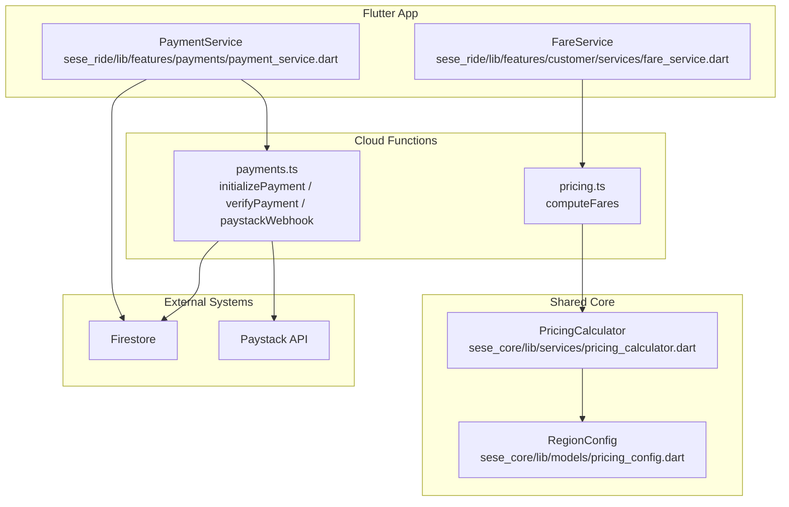
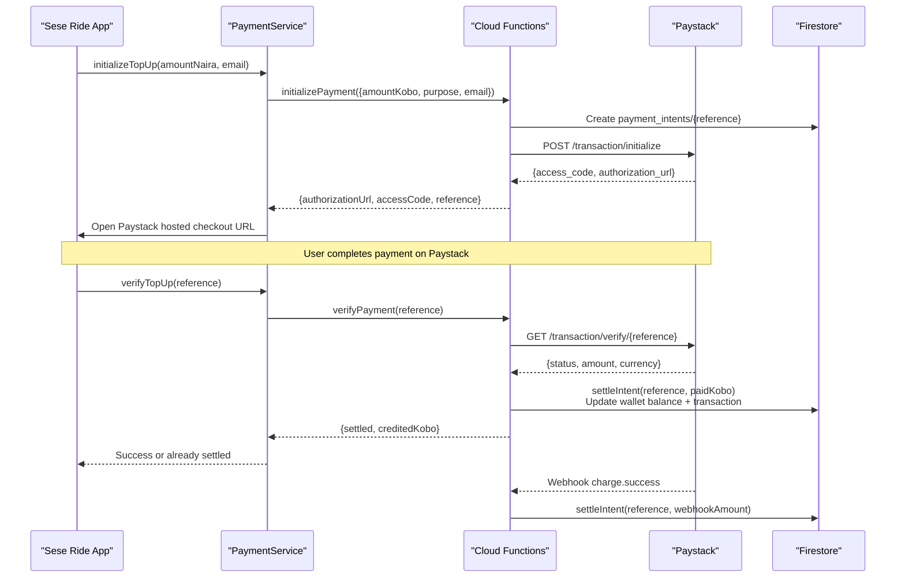
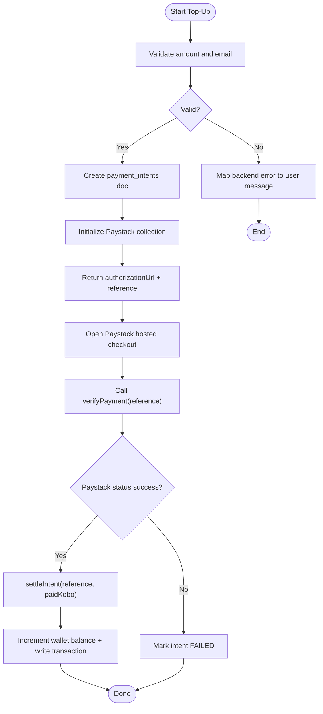
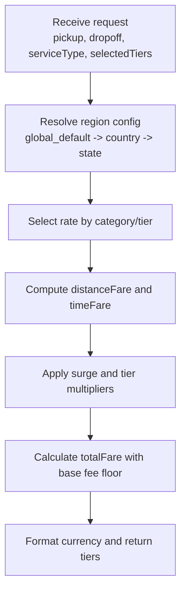
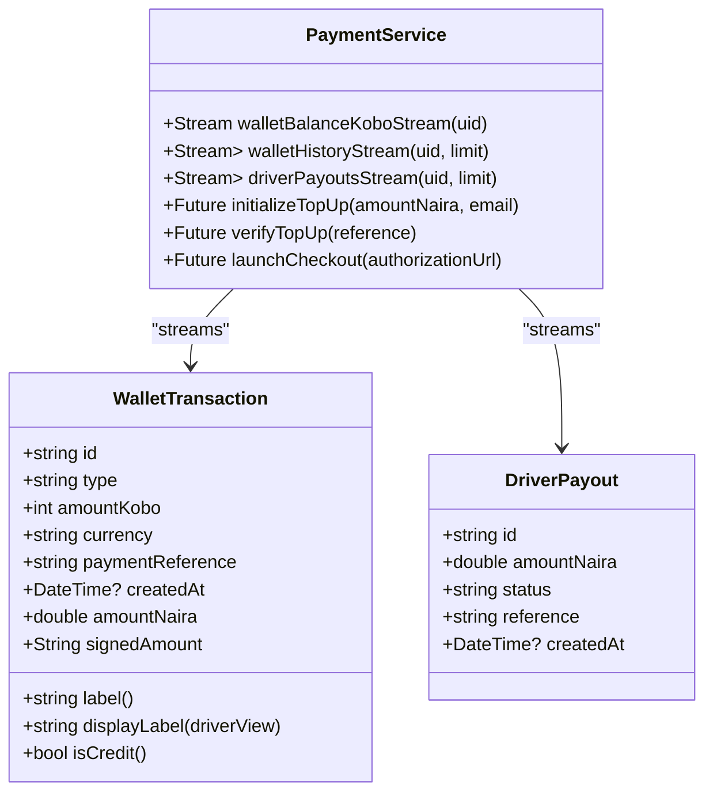
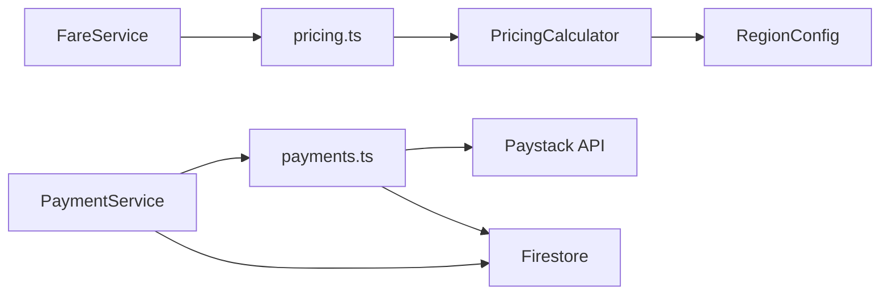

# Payment Processing

<cite>
**Referenced Files in This Document**   
- [payment_service.dart](file://sese_ride/lib/features/payments/payment_service.dart)
- [payments.ts](file://functions/src/payments.ts)
- [fare_service.dart](file://sese_ride/lib/features/customer/services/fare_service.dart)
- [pricing.ts](file://functions/src/pricing.ts)
- [pricing_config.dart](file://sese_core/lib/models/pricing_config.dart)
- [pricing_calculator.dart](file://sese_core/lib/services/pricing_calculator.dart)
- [payment_service_test.dart](file://sese_ride/test/payment_service_test.dart)
</cite>

## Table of Contents
1. [Introduction](#introduction)
2. [Project Structure](#project-structure)
3. [Core Components](#core-components)
4. [Architecture Overview](#architecture-overview)
5. [Detailed Component Analysis](#detailed-component-analysis)
6. [Dependency Analysis](#dependency-analysis)
7. [Performance Considerations](#performance-considerations)
8. [Troubleshooting Guide](#troubleshooting-guide)
9. [Conclusion](#conclusion)

## Introduction
This document explains the payment processing features for the Sese Ride app. It covers secure payment flows, fare estimation, transaction handling, wallet management, receipt generation, and error handling. The system uses a zero-trust design: sensitive pricing and payment logic runs server-side in Cloud Functions, while the Flutter client opens Paystack’s hosted checkout and verifies settlement through secure backend calls.

Key responsibilities:
- Secure payment initiation and verification via Paystack.
- Server-side fare calculation with regional pricing, surge multipliers, and car-tier adjustments.
- Wallet balance streaming, transaction history, and driver payout tracking.
- Webhook-based settlement with HMAC signature verification.
- User-facing error mapping and safe messaging.

## Project Structure
The payment-related code spans three main areas:
- Client-side Flutter service for payments and fare requests.
- Server-side Cloud Functions for payment orchestration and fare computation.
- Shared core models and calculators for pricing configuration and algorithms.

**Diagram sources**
- [payment_service.dart:1-433](file://sese_ride/lib/features/payments/payment_service.dart#L1-L433)
- [payments.ts:1-371](file://functions/src/payments.ts#L1-L371)
- [fare_service.dart:1-108](file://sese_ride/lib/features/customer/services/fare_service.dart#L1-L108)
- [pricing.ts:1-237](file://functions/src/pricing.ts#L1-L237)
- [pricing_calculator.dart:1-147](file://sese_core/lib/services/pricing_calculator.dart#L1-L147)
- [pricing_config.dart:1-499](file://sese_core/lib/models/pricing_config.dart#L1-L499)

**Section sources**
- [payment_service.dart:1-433](file://sese_ride/lib/features/payments/payment_service.dart#L1-L433)
- [payments.ts:1-371](file://functions/src/payments.ts#L1-L371)
- [fare_service.dart:1-108](file://sese_ride/lib/features/customer/services/fare_service.dart#L1-L108)
- [pricing.ts:1-237](file://functions/src/pricing.ts#L1-L237)
- [pricing_calculator.dart:1-147](file://sese_core/lib/services/pricing_calculator.dart#L1-L147)
- [pricing_config.dart:1-499](file://sese_core/lib/models/pricing_config.dart#L1-L499)

## Core Components
- PaymentService (client): Initializes top-ups, verifies payments, launches Paystack checkout, streams wallet balance and transactions, and maps backend errors to user-friendly messages.
- Payments Cloud Function (server): Validates inputs, creates payment intents, initializes Paystack collections, verifies payments, settles wallets idempotently, and handles webhooks with HMAC verification.
- FareService (client): Sends pickup/dropoff coordinates and selected tiers to the server; never computes fares locally.
- Pricing Cloud Function (server): Resolves regional pricing from Firestore, applies surge and tier multipliers, and returns formatted fare tiers.
- PricingCalculator and RegionConfig (shared core): Define pricing formulas, vehicle categories, car-tier thresholds, and currency formatting.

**Section sources**
- [payment_service.dart:14-24](file://sese_ride/lib/features/payments/payment_service.dart#L14-L24)
- [payment_service.dart:240-433](file://sese_ride/lib/features/payments/payment_service.dart#L240-L433)
- [payments.ts:5-26](file://functions/src/payments.ts#L5-L26)
- [payments.ts:108-197](file://functions/src/payments.ts#L108-L197)
- [payments.ts:206-271](file://functions/src/payments.ts#L206-L271)
- [payments.ts:283-326](file://functions/src/payments.ts#L283-L326)
- [payments.ts:333-371](file://functions/src/payments.ts#L333-L371)
- [fare_service.dart:7-17](file://sese_ride/lib/features/customer/services/fare_service.dart#L7-L17)
- [fare_service.dart:34-107](file://sese_ride/lib/features/customer/services/fare_service.dart#L34-L107)
- [pricing.ts:60-147](file://functions/src/pricing.ts#L60-L147)
- [pricing.ts:166-237](file://functions/src/pricing.ts#L166-L237)
- [pricing_calculator.dart:7-60](file://sese_core/lib/services/pricing_calculator.dart#L7-L60)
- [pricing_config.dart:251-331](file://sese_core/lib/models/pricing_config.dart#L251-L331)

## Architecture Overview
The secure payment flow is designed so that the client never touches amounts or secrets. All monetary operations are performed server-side.

**Diagram sources**
- [payment_service.dart:331-390](file://sese_ride/lib/features/payments/payment_service.dart#L331-L390)
- [payments.ts:108-197](file://functions/src/payments.ts#L108-L197)
- [payments.ts:206-271](file://functions/src/payments.ts#L206-L271)
- [payments.ts:283-326](file://functions/src/payments.ts#L283-L326)
- [payments.ts:333-371](file://functions/src/payments.ts#L333-L371)

## Detailed Component Analysis

### Secure Payment Flow Integration
Responsibilities:
- Validate minimum and maximum top-up amounts.
- Initialize a payment intent and create a Paystack collection.
- Launch Paystack hosted checkout in an external browser.
- Verify payment server-side and credit the wallet exactly once.
- Handle webhooks with HMAC signature verification.

Security measures:
- Secret key only in Cloud Functions environment variables.
- Amount validation and currency checks server-side.
- Idempotent settlement using Firestore transactions.
- Webhook signature verification before processing events.

Error handling:
- Maps backend codes like unauthenticated, invalid-argument, not-found, failed-precondition, permission-denied into safe user messages.
- Network failures return generic messages without exposing internals.

**Diagram sources**
- [payment_service.dart:331-403](file://sese_ride/lib/features/payments/payment_service.dart#L331-L403)
- [payments.ts:108-197](file://functions/src/payments.ts#L108-L197)
- [payments.ts:206-271](file://functions/src/payments.ts#L206-L271)
- [payments.ts:283-326](file://functions/src/payments.ts#L283-L326)

**Section sources**
- [payment_service.dart:6-12](file://sese_ride/lib/features/payments/payment_service.dart#L6-L12)
- [payment_service.dart:331-403](file://sese_ride/lib/features/payments/payment_service.dart#L331-L403)
- [payments.ts:5-26](file://functions/src/payments.ts#L5-L26)
- [payments.ts:108-197](file://functions/src/payments.ts#L108-L197)
- [payments.ts:206-271](file://functions/src/payments.ts#L206-L271)
- [payments.ts:283-326](file://functions/src/payments.ts#L283-L326)
- [payments.ts:333-371](file://functions/src/payments.ts#L333-L371)

### Fare Calculation Service
Responsibilities:
- Zero-trust fare calculation: client sends pickup/dropoff coordinates and selected tiers; server computes fares.
- Resolve regional pricing from Firestore with fallback chain: global default -> country rule -> state override.
- Apply distance/time rates, regional surge multiplier, and per-vehicle or per-tier multipliers.
- Return formatted fare tiers for UI rendering.

Algorithm highlights:
- Distance fare = distanceKm × distanceRatePerKm.
- Time fare = durationMinutes × timeRatePerMinute.
- Variable fare = (distanceFare + timeFare) × surge × tierMultiplier.
- Total fare = max(baseFee, baseFee + variableFare), rounded to two decimals.

**Diagram sources**
- [fare_service.dart:7-17](file://sese_ride/lib/features/customer/services/fare_service.dart#L7-L17)
- [fare_service.dart:44-89](file://sese_ride/lib/features/customer/services/fare_service.dart#L44-L89)
- [pricing.ts:60-147](file://functions/src/pricing.ts#L60-L147)
- [pricing.ts:166-237](file://functions/src/pricing.ts#L166-L237)
- [pricing_calculator.dart:11-60](file://sese_core/lib/services/pricing_calculator.dart#L11-L60)

**Section sources**
- [fare_service.dart:7-17](file://sese_ride/lib/features/customer/services/fare_service.dart#L7-L17)
- [fare_service.dart:44-89](file://sese_ride/lib/features/customer/services/fare_service.dart#L44-L89)
- [pricing.ts:60-147](file://functions/src/pricing.ts#L60-L147)
- [pricing.ts:166-237](file://functions/src/pricing.ts#L166-L237)
- [pricing_calculator.dart:11-60](file://sese_core/lib/services/pricing_calculator.dart#L11-L60)

### Transaction Handling and Wallet Management
Responsibilities:
- Stream live wallet balance in kobo.
- Stream wallet transaction history newest first.
- Parse legacy fields defensively (naira vs kobo).
- Track driver payouts and sort by date.

Data model notes:
- WalletTransaction includes type, amountKobo, currency, paymentReference, createdAt.
- DriverPayout supports multiple amount formats and timestamps.

**Diagram sources**
- [payment_service.dart:26-148](file://sese_ride/lib/features/payments/payment_service.dart#L26-L148)
- [payment_service.dart:150-199](file://sese_ride/lib/features/payments/payment_service.dart#L150-L199)
- [payment_service.dart:240-329](file://sese_ride/lib/features/payments/payment_service.dart#L240-L329)

**Section sources**
- [payment_service.dart:26-148](file://sese_ride/lib/features/payments/payment_service.dart#L26-L148)
- [payment_service.dart:150-199](file://sese_ride/lib/features/payments/payment_service.dart#L150-L199)
- [payment_service.dart:240-329](file://sese_ride/lib/features/payments/payment_service.dart#L240-L329)

### Receipt Generation
Receipt data is derived from payment intents and wallet transactions:
- Payment intents store userId, email, amountKobo, currency, purpose, tripId, status, timestamps, and Paystack metadata.
- Wallet transactions include type, amountKobo, amount (naira), currency, paymentReference, tripId, createdAt.
- The backend requires a valid email for receipts and writes both the intent and transaction upon successful settlement.

Operational guidance:
- Use the payment reference to locate the original intent and associated transaction.
- For trip payments, link the transaction to the tripId stored in the intent.
- Display receipt details using the currency symbol from the region configuration.

**Section sources**
- [payments.ts:142-167](file://functions/src/payments.ts#L142-L167)
- [payments.ts:253-268](file://functions/src/payments.ts#L253-L268)
- [payment_service.dart:26-148](file://sese_ride/lib/features/payments/payment_service.dart#L26-L148)

### Refund Processing
The current repository does not implement refund endpoints or refund-specific flows. Settlement is idempotent and credits the wallet; there is no dedicated refund mechanism exposed in the analyzed files. If refunds are required, they should be implemented server-side with explicit reversal logic, audit trails, and compliance checks.

[No sources needed since this section summarizes absence of functionality]

### External Payment Gateway Integration
Integration points:
- Initialize Paystack collection via POST /transaction/initialize.
- Verify payment via GET /transaction/verify/{reference}.
- Receive webhook events for charge.success with HMAC signature verification.

Security considerations:
- SECRET key is read from environment variables and never embedded in the client.
- Public test key is safe to embed in the client.
- Webhook endpoint validates x-paystack-signature against the raw body using HMAC-SHA512.

**Section sources**
- [payment_service.dart:6-12](file://sese_ride/lib/features/payments/payment_service.dart#L6-L12)
- [payments.ts:39-48](file://functions/src/payments.ts#L39-L48)
- [payments.ts:55-95](file://functions/src/payments.ts#L55-L95)
- [payments.ts:333-371](file://functions/src/payments.ts#L333-L371)

### Webhook Handling
Behavior:
- Accepts POST requests only.
- Verifies HMAC signature using the secret key.
- Processes charge.success events to settle intents idempotently.
- Returns 200 even for unknown references to prevent Paystack retries.

Error handling:
- Invalid signature returns 401.
- Missing secret returns 500.
- Unknown references are logged but do not fail the webhook response.

**Section sources**
- [payments.ts:333-371](file://functions/src/payments.ts#L333-L371)

### Transaction Security Measures
- Zero-trust architecture: client never computes or controls amounts.
- Input validation: minimum/maximum amounts, required fields, email format.
- Currency enforcement: NGN expected; unexpected currency rejected.
- Idempotent settlement: Firestore transaction prevents double crediting.
- Ownership checks: verifyPayment ensures the reference belongs to the authenticated user.
- Webhook signature verification: HMAC-SHA512 protects against tampering.

**Section sources**
- [payments.ts:116-150](file://functions/src/payments.ts#L116-L150)
- [payments.ts:206-271](file://functions/src/payments.ts#L206-L271)
- [payments.ts:283-326](file://functions/src/payments.ts#L283-L326)
- [payments.ts:333-371](file://functions/src/payments.ts#L333-L371)

### Fare Estimation Algorithms and Surge Pricing Display
Algorithm summary:
- Base fee acts as a floor price for any trip.
- Distance and time components are summed and multiplied by surge and tier multipliers.
- Regional surge multiplier is applied globally; per-vehicle and per-tier multipliers refine pricing.
- Final total is rounded to two decimal places.

Surge pricing display:
- The server returns computed tiers with formatted currency strings.
- UI renders tiers verbatim, including recommended flags and formatted fares.

**Section sources**
- [pricing_calculator.dart:11-60](file://sese_core/lib/services/pricing_calculator.dart#L11-L60)
- [pricing.ts:166-237](file://functions/src/pricing.ts#L166-L237)
- [fare_service.dart:44-89](file://sese_ride/lib/features/customer/services/fare_service.dart#L44-L89)

### Payment Status Tracking
Client-side:
- Streams wallet balance and transaction history.
- Parses transaction types and labels for display.
- Provides signed amount formatting for ledger rows.

Server-side:
- Tracks payment intent lifecycle: INITIALIZED → PENDING → SUCCEEDED or FAILED.
- Records settlement timestamp and failure reasons when applicable.

**Section sources**
- [payment_service.dart:270-329](file://sese_ride/lib/features/payments/payment_service.dart#L270-L329)
- [payments.ts:152-197](file://functions/src/payments.ts#L152-L197)
- [payments.ts:264-268](file://functions/src/payments.ts#L264-L268)

## Dependency Analysis
Component relationships:
- PaymentService depends on Cloud Functions for payment initialization and verification.
- FareService depends on Cloud Functions for fare calculation.
- Pricing Cloud Function depends on Firestore for region configuration and uses shared core pricing logic.
- Payment Cloud Function depends on Paystack API and Firestore for intents and wallet updates.

**Diagram sources**
- [payment_service.dart:214-238](file://sese_ride/lib/features/payments/payment_service.dart#L214-L238)
- [fare_service.dart:18-32](file://sese_ride/lib/features/customer/services/fare_service.dart#L18-L32)
- [payments.ts:108-197](file://functions/src/payments.ts#L108-L197)
- [pricing.ts:60-147](file://functions/src/pricing.ts#L60-L147)
- [pricing_calculator.dart:1-147](file://sese_core/lib/services/pricing_calculator.dart#L1-L147)
- [pricing_config.dart:251-331](file://sese_core/lib/models/pricing_config.dart#L251-L331)

**Section sources**
- [payment_service.dart:214-238](file://sese_ride/lib/features/payments/payment_service.dart#L214-L238)
- [fare_service.dart:18-32](file://sese_ride/lib/features/customer/services/fare_service.dart#L18-L32)
- [payments.ts:108-197](file://functions/src/payments.ts#L108-L197)
- [pricing.ts:60-147](file://functions/src/pricing.ts#L60-L147)
- [pricing_calculator.dart:1-147](file://sese_core/lib/services/pricing_calculator.dart#L1-L147)
- [pricing_config.dart:251-331](file://sese_core/lib/models/pricing_config.dart#L251-L331)

## Performance Considerations
- Prefer server-side calculations to avoid client-side rounding issues and to centralize pricing logic.
- Use streams for wallet balance and transaction history to reduce polling overhead.
- Limit transaction history queries with pagination limits to improve responsiveness.
- Cache region configuration at the function level if frequent calls occur within the same invocation context.
- Ensure Paystack API calls are retried with backoff for transient network errors.

[No sources needed since this section provides general guidance]

## Troubleshooting Guide
Common issues and resolutions:
- Unauthenticated: Prompt the user to sign in again.
- Invalid argument: Validate input fields such as amount, email, and tripId.
- Not found: Ensure the payment reference exists and belongs to the user.
- Failed precondition: Payment may have expired or been completed; guide the user to start a new payment.
- Permission denied: Prevent cross-account payment operations.
- Network errors: Provide generic messages and retry options.

Testing utilities:
- PaymentService tests use a scripted backend to validate behavior without calling Firebase.
- Tests assert that invalid amounts throw specific exceptions and that backend calls are not made prematurely.

**Section sources**
- [payment_service.dart:416-431](file://sese_ride/lib/features/payments/payment_service.dart#L416-L431)
- [payment_service_test.dart:1-37](file://sese_ride/test/payment_service_test.dart#L1-L37)

## Conclusion
The Sese Ride payment system follows a secure, zero-trust design where all monetary operations are handled server-side. Payment initiation and verification integrate with Paystack, while fare calculation leverages regional pricing, surge multipliers, and tier adjustments. Wallet management and transaction history provide transparent visibility for users. Error handling is robust, mapping backend statuses to safe user messages. Refund processing is not present in the current codebase and would require additional server-side implementation.

[No sources needed since this section summarizes without analyzing specific files]