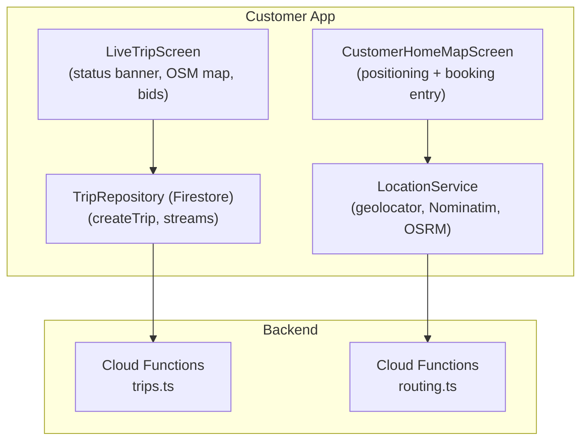
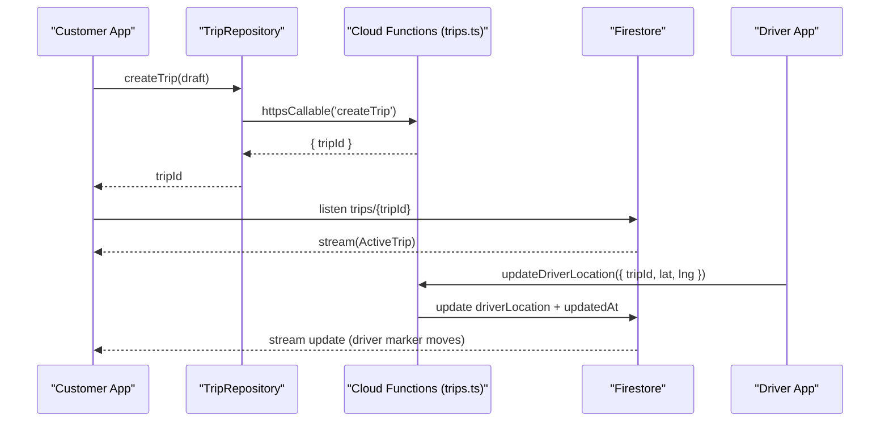
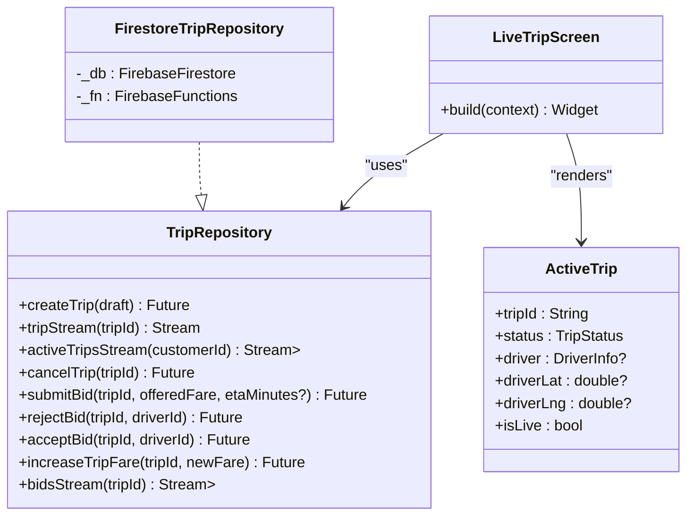
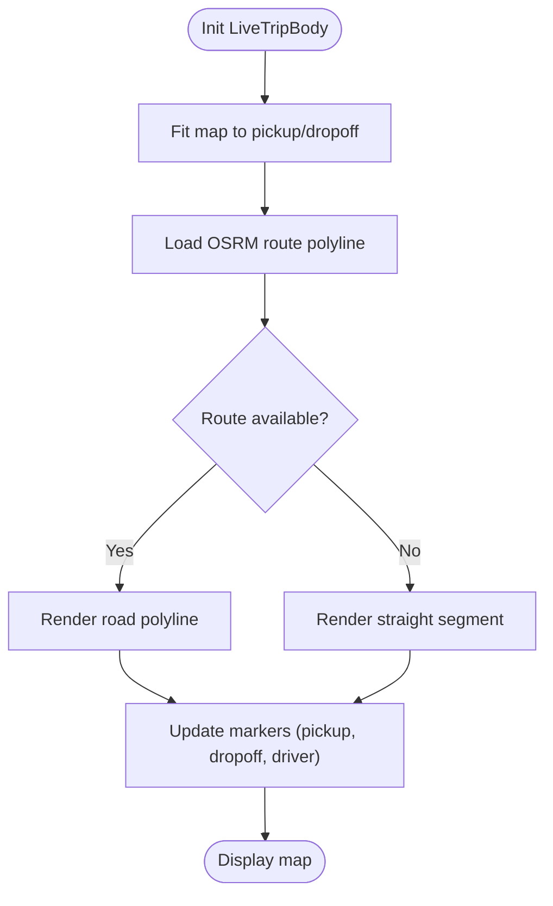
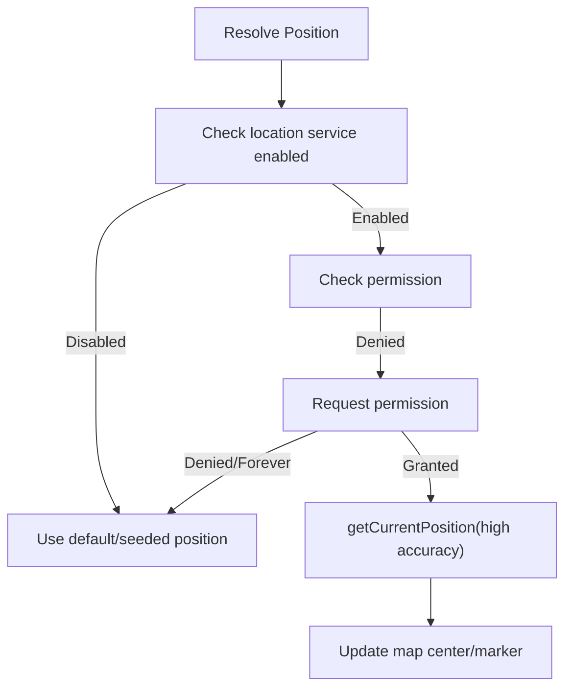
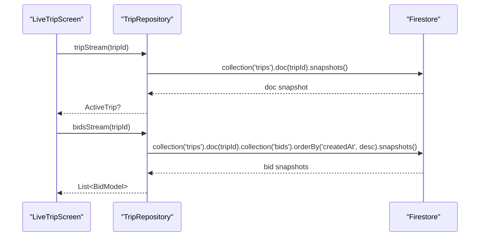
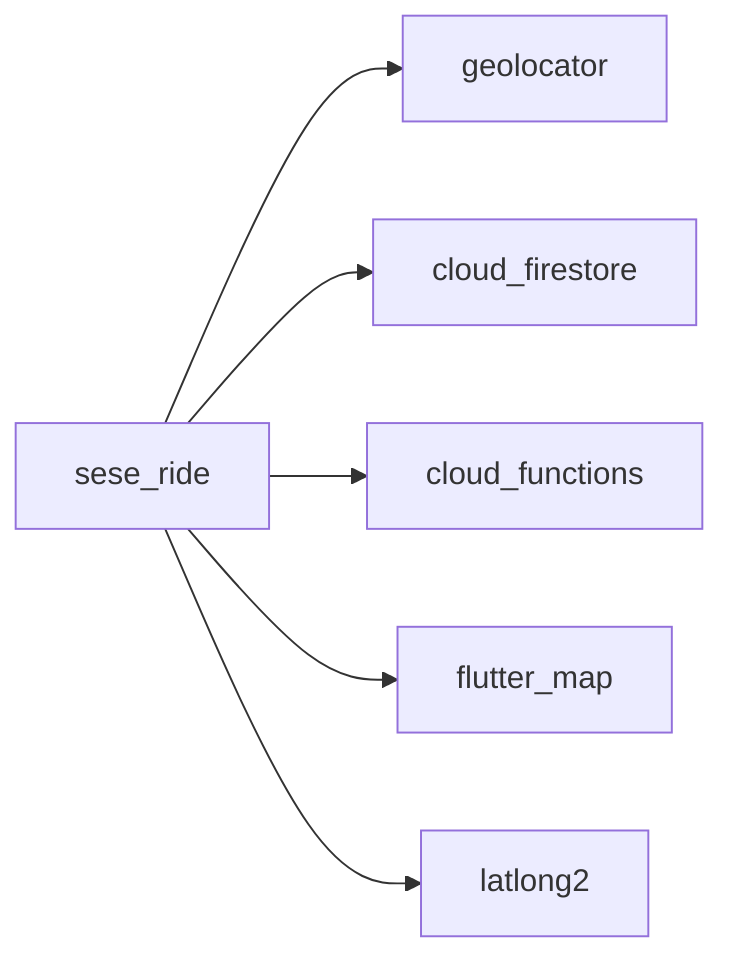

# Real-Time & Location Services

<cite>
**Referenced Files in This Document**
- [main.dart](file://sese_ride/lib/main.dart)
- [pubspec.yaml](file://sese_ride/pubspec.yaml)
- [location_service.dart](file://sese_ride/lib/features/customer/services/location_service.dart)
- [customer_home_map_screen.dart](file://sese_ride/lib/features/customer/presentation/customer_home_map_screen.dart)
- [trip_service.dart](file://sese_ride/lib/features/trips/services/trip_service.dart)
- [live_trip_screen.dart](file://sese_ride/lib/features/trips/presentation/live_trip_screen.dart)
- [trip_models.dart](file://sese_ride/lib/features/trips/models/trip_models.dart)
- [trips.ts](file://functions/src/trips.ts)
- [routing.ts](file://functions/src/routing.ts)
</cite>

## Table of Contents
1. [Introduction](#introduction)
2. [Project Structure](#project-structure)
3. [Core Components](#core-components)
4. [Architecture Overview](#architecture-overview)
5. [Detailed Component Analysis](#detailed-component-analysis)
6. [Dependency Analysis](#dependency-analysis)
7. [Performance Considerations](#performance-considerations)
8. [Troubleshooting Guide](#troubleshooting-guide)
9. [Conclusion](#conclusion)

## Introduction
This document explains the real-time and location services powering Sese Ride’s live trip tracking, driver-customer coordination, and dynamic routing. It covers:
- Live trip tracking via Firestore snapshots and server-driven state transitions
- Driver GPS heartbeat updates for real-time customer maps
- Location permission handling and best-effort positioning
- OpenStreetMap-based geocoding, autocomplete, and OSRM route geometry
- Cloud Functions integration for dispatch, bidding, and routing
- Offline-first patterns using Firestore streams and client-side filtering
- Performance strategies for location updates and map rendering

## Project Structure
The relevant code is organized by feature modules within the `sese_ride` app, with shared domain models and a Firebase Functions backend:
- Customer-facing location and mapping UI
- Trip repository and live trip screen
- Domain models for trips and drivers
- Backend functions for dispatch, driver location updates, and routing

**Diagram sources**
- [customer_home_map_screen.dart:1-301](file://sese_ride/lib/features/customer/presentation/customer_home_map_screen.dart#L1-L301)
- [location_service.dart:1-298](file://sese_ride/lib/features/customer/services/location_service.dart#L1-L298)
- [trip_service.dart:1-217](file://sese_ride/lib/features/trips/services/trip_service.dart#L1-L217)
- [live_trip_screen.dart:1-800](file://sese_ride/lib/features/trips/presentation/live_trip_screen.dart#L1-L800)
- [trips.ts:1-761](file://functions/src/trips.ts#L1-L761)
- [routing.ts:1-109](file://functions/src/routing.ts#L1-L109)

**Section sources**
- [main.dart:13-41](file://sese_ride/lib/main.dart#L13-L41)
- [pubspec.yaml:10-30](file://sese_ride/pubspec.yaml#L10-L30)

## Core Components
- LocationService: GPS acquisition, reverse/forward geocoding via OpenStreetMap Nominatim, and OSRM route geometry. All network calls are best-effort to keep UX smooth.
- TripRepository: Server-driven dispatch via Cloud Functions callable endpoints and Firestore streams for live trip data and bid lists.
- LiveTripScreen: Renders status banners, OpenStreetMap markers/polylines, accepted-driver sheet, and bid carousel driven by trip streams.
- CustomerHomeMapScreen: Entry point for booking flows; resolves device position and centers the map.
- Domain Models: TripStatus enum, ActiveTrip snapshot, DriverInfo, and TripDraft payload shape.
- Backend Functions: Dispatch state machine, driver location heartbeat, and OSRM routing helper.

**Section sources**
- [location_service.dart:23-39](file://sese_ride/lib/features/customer/services/location_service.dart#L23-L39)
- [trip_service.dart:20-64](file://sese_ride/lib/features/trips/services/trip_service.dart#L20-L64)
- [live_trip_screen.dart:14-20](file://sese_ride/lib/features/trips/presentation/live_trip_screen.dart#L14-L20)
- [customer_home_map_screen.dart:9-14](file://sese_ride/lib/features/customer/presentation/customer_home_map_screen.dart#L9-L14)
- [trip_models.dart:8-53](file://sese_ride/lib/features/trips/models/trip_models.dart#L8-L53)
- [trips.ts:12-26](file://functions/src/trips.ts#L12-L26)

## Architecture Overview
The system uses a server-authoritative dispatch model:
- The client creates a trip through a Cloud Function callable, which mints a Firestore document in SEARCHING_DRIVER.
- The backend owns all state transitions (matchmaking, ping timeouts, re-broadcasts).
- The customer app listens to Firestore streams for live trip updates and bid changes.
- Drivers send periodic GPS heartbeats that update the trip’s driverLocation field, enabling live map markers.
- Routing and distance/duration estimates come from OSRM (public demo or self-hosted), used both on the client and server.

**Diagram sources**
- [trip_service.dart:73-99](file://sese_ride/lib/features/trips/services/trip_service.dart#L73-L99)
- [trips.ts:716-754](file://functions/src/trips.ts#L716-L754)
- [live_trip_screen.dart:34-86](file://sese_ride/lib/features/trips/presentation/live_trip_screen.dart#L34-L86)

## Detailed Component Analysis

### Live Trip Tracking and Driver-Customer Coordination
- LiveTripScreen subscribes to a single trip stream and renders:
  - Status banner reflecting server-driven states
  - OpenStreetMap markers for pickup, dropoff, and driver location
  - Accepted-driver info sheet and cancel action
  - Bid carousel when applicable
- TripRepository exposes:
  - createTrip via Cloud Functions callable
  - tripStream and activeTripsStream via Firestore snapshots
  - Bid management (submit, accept, reject) and fare increase

**Diagram sources**
- [trip_service.dart:26-64](file://sese_ride/lib/features/trips/services/trip_service.dart#L26-L64)
- [trip_service.dart:66-217](file://sese_ride/lib/features/trips/services/trip_service.dart#L66-L217)
- [live_trip_screen.dart:20-88](file://sese_ride/lib/features/trips/presentation/live_trip_screen.dart#L20-L88)
- [trip_models.dart:116-340](file://sese_ride/lib/features/trips/models/trip_models.dart#L116-L340)

**Section sources**
- [live_trip_screen.dart:14-88](file://sese_ride/lib/features/trips/presentation/live_trip_screen.dart#L14-L88)
- [trip_service.dart:66-217](file://sese_ride/lib/features/trips/services/trip_service.dart#L66-L217)
- [trip_models.dart:116-340](file://sese_ride/lib/features/trips/models/trip_models.dart#L116-L340)

### Dynamic Route Updates and Map Rendering
- LiveTripScreen computes road-network route points via LocationService.fetchRoutePolyline and displays them as polylines on the OpenStreetMap view.
- If OSRM fails or returns no route, it falls back to a straight line between pickup and dropoff.
- Map controller fits the viewport to pickup/dropoff and supports recenter actions.

**Diagram sources**
- [live_trip_screen.dart:256-294](file://sese_ride/lib/features/trips/presentation/live_trip_screen.dart#L256-L294)
- [location_service.dart:231-278](file://sese_ride/lib/features/customer/services/location_service.dart#L231-L278)

**Section sources**
- [live_trip_screen.dart:256-342](file://sese_ride/lib/features/trips/presentation/live_trip_screen.dart#L256-L342)
- [location_service.dart:231-278](file://sese_ride/lib/features/customer/services/location_service.dart#L231-L278)

### Location Permission Handling and Positioning
- CustomerHomeMapScreen attempts to resolve current position using Geolocator, requesting permissions if denied.
- LocationService.getCurrentLatLng encapsulates permission checks, service enablement, and high-accuracy positioning with timeouts.
- Both components gracefully handle unavailable locations by falling back to defaults or seeded positions.

**Diagram sources**
- [customer_home_map_screen.dart:49-70](file://sese_ride/lib/features/customer/presentation/customer_home_map_screen.dart#L49-L70)
- [location_service.dart:73-101](file://sese_ride/lib/features/customer/services/location_service.dart#L73-L101)

**Section sources**
- [customer_home_map_screen.dart:49-70](file://sese_ride/lib/features/customer/presentation/customer_home_map_screen.dart#L49-L70)
- [location_service.dart:73-101](file://sese_ride/lib/features/customer/services/location_service.dart#L73-L101)

### Background Location Tracking and Battery Optimization
- The app uses best-effort positioning rather than continuous background location polling in the analyzed files.
- High-accuracy requests include explicit time limits to avoid long-running scans.
- Network calls to geocoding/routing services use timeouts and return safe fallbacks to prevent blocking UI.

Key implementation notes:
- Timeouts and best-effort behavior ensure battery-friendly operation.
- No persistent background task is implemented in the referenced files; live tracking relies on short-lived location reads and Firestore stream updates.

**Section sources**
- [location_service.dart:90-96](file://sese_ride/lib/features/customer/services/location_service.dart#L90-L96)
- [location_service.dart:122-124](file://sese_ride/lib/features/customer/services/location_service.dart#L122-L124)
- [location_service.dart:190-192](file://sese_ride/lib/features/customer/services/location_service.dart#L190-L192)
- [location_service.dart:245-247](file://sese_ride/lib/features/customer/services/location_service.dart#L245-L247)

### Integration with OpenStreetMap and OSRM
- Reverse geocoding and forward search use OpenStreetMap Nominatim with a required User-Agent header.
- Route geometry uses OSRM public demo endpoint; GeoJSON coordinates are converted to LatLng for rendering.
- Production guidance recommends self-hosting or caching at scale due to fair-use limits.

**Section sources**
- [location_service.dart:23-39](file://sese_ride/lib/features/customer/services/location_service.dart#L23-L39)
- [location_service.dart:113-143](file://sese_ride/lib/features/customer/services/location_service.dart#L113-L143)
- [location_service.dart:181-212](file://sese_ride/lib/features/customer/services/location_service.dart#L181-L212)
- [location_service.dart:231-278](file://sese_ride/lib/features/customer/services/location_service.dart#L231-L278)
- [routing.ts:1-109](file://functions/src/routing.ts#L1-L109)

### Real-Time Data Synchronization with Firestore
- TripRepository uses Firestore snapshots for:
  - Single trip stream (tripId)
  - Active trips list filtered client-side by isLive
  - Bid collection ordered by creation time
- Errors and missing documents are handled gracefully in the UI layer.

**Diagram sources**
- [trip_service.dart:101-122](file://sese_ride/lib/features/trips/services/trip_service.dart#L101-L122)
- [trip_service.dart:189-200](file://sese_ride/lib/features/trips/services/trip_service.dart#L189-L200)
- [live_trip_screen.dart:34-86](file://sese_ride/lib/features/trips/presentation/live_trip_screen.dart#L34-L86)

**Section sources**
- [trip_service.dart:101-122](file://sese_ride/lib/features/trips/services/trip_service.dart#L101-L122)
- [trip_service.dart:189-200](file://sese_ride/lib/features/trips/services/trip_service.dart#L189-L200)
- [live_trip_screen.dart:34-86](file://sese_ride/lib/features/trips/presentation/live_trip_screen.dart#L34-L86)

### Offline-First Patterns
- Firestore streams provide offline persistence automatically; clients render cached snapshots until connectivity resumes.
- Client-side filtering (e.g., ActiveTrip.isLive) reduces unnecessary UI updates and avoids composite index requirements.
- Best-effort external services (Nominatim/OSRM) ensure the core flow remains usable even when third-party APIs fail.

**Section sources**
- [trip_service.dart:110-122](file://sese_ride/lib/features/trips/services/trip_service.dart#L110-L122)
- [trip_models.dart:231-232](file://sese_ride/lib/features/trips/models/trip_models.dart#L231-L232)
- [location_service.dart:23-39](file://sese_ride/lib/features/customer/services/location_service.dart#L23-L39)

## Dependency Analysis
External dependencies relevant to real-time and location features:
- geolocator: platform location access
- cloud_firestore: real-time database streams
- cloud_functions: callable endpoints for dispatch and bidding
- flutter_map: underlying map rendering (used via OSM map widget)
- latlong2: coordinate types

**Diagram sources**
- [pubspec.yaml:10-30](file://sese_ride/pubspec.yaml#L10-L30)

**Section sources**
- [pubspec.yaml:10-30](file://sese_ride/pubspec.yaml#L10-L30)

## Performance Considerations
- Limit location request frequency: prefer one-off reads for UI positioning; avoid continuous polling unless explicitly required.
- Use timeouts on network calls to geocoding and routing services to prevent UI stalls.
- Prefer server-side dispatch logic to minimize client-side state complexity and reduce redundant computations.
- Cache route geometry where appropriate (e.g., per trip) to avoid repeated OSRM calls during a session.
- Keep Firestore queries simple (single-field filters) and filter terminal states client-side to avoid index overhead.
- Defer heavy operations off the main thread and batch UI updates to maintain smooth map interactions.

[No sources needed since this section provides general guidance]

## Troubleshooting Guide
Common issues and resolutions:
- Location permission denied:
  - Ensure the app requests location permission before reading position.
  - Handle deniedForever by guiding users to system settings.
- No route returned by OSRM:
  - Verify coordinates are valid and reachable.
  - Fall back to straight-line segments while investigating.
- Firestore stream errors or missing documents:
  - Display user-friendly messages and allow retry/back navigation.
  - Validate tripId and authentication context.
- Cloud Functions callable failures:
  - Map error codes to user messages and surface actionable feedback.

**Section sources**
- [customer_home_map_screen.dart:49-70](file://sese_ride/lib/features/customer/presentation/customer_home_map_screen.dart#L49-L70)
- [location_service.dart:73-101](file://sese_ride/lib/features/customer/services/location_service.dart#L73-L101)
- [trip_service.dart:202-215](file://sese_ride/lib/features/trips/services/trip_service.dart#L202-L215)
- [live_trip_screen.dart:34-86](file://sese_ride/lib/features/trips/presentation/live_trip_screen.dart#L34-L86)

## Conclusion
Sese Ride’s real-time and location architecture combines lightweight client positioning, robust OpenStreetMap-based geocoding and routing, and a server-authoritative dispatch system backed by Firestore streams. This design ensures reliable live tracking, efficient battery usage, and resilient user experiences under varying network conditions. For production scale, consider self-hosting geocoding/routing services and adding caching layers to mitigate rate limits and improve responsiveness.