# Sese Ride App

<cite>
**Referenced Files in This Document**
- [sese_ride/lib/main.dart](file://sese_ride/lib/main.dart)
- [sese_hub/lib/main.dart](file://sese_hub/lib/main.dart)
- [sese_core/lib/sese_core.dart](file://sese_core/lib/sese_core.dart)
- [sese_core/lib/auth/firebase_auth_repository.dart](file://sese_core/lib/auth/firebase_auth_repository.dart)
- [sese_core/lib/models/user_model.dart](file://sese_core/lib/models/user_model.dart)
- [sese_core/lib/models/user_role.dart](file://sese_core/lib/models/user_role.dart)
- [sese_ride/pubspec.yaml](file://sese_ride/pubspec.yaml)
- [sese_hub/pubspec.yaml](file://sese_hub/pubspec.yaml)
- [sese_core/pubspec.yaml](file://sese_core/pubspec.yaml)
- [functions/src/index.ts](file://functions/src/index.ts)
- [functions/src/payments.ts](file://functions/src/payments.ts)
- [sese_ride/lib/features/home/customer_home_shell.dart](file://sese_ride/lib/features/home/customer_home_shell.dart)
- [sese_ride/lib/features/home/driver_home_shell.dart](file://sese_ride/lib/features/home/driver_home_shell.dart)
- [sese_ride/lib/features/customer/services/location_service.dart](file://sese_ride/lib/features/customer/services/location_service.dart)
- [sese_ride/lib/widgets/location_picker_map.dart](file://sese_ride/lib/widgets/location_picker_map.dart)
- [sese_ride/lib/features/payments/payment_service.dart](file://sese_ride/lib/features/payments/payment_service.dart)
</cite>

## Table of Contents
1. [Introduction](#introduction)
2. [Project Structure](#project-structure)
3. [Core Components](#core-components)
4. [Architecture Overview](#architecture-overview)
5. [Detailed Component Analysis](#detailed-component-analysis)
6. [Dependency Analysis](#dependency-analysis)
7. [Performance Considerations](#performance-considerations)
8. [Troubleshooting Guide](#troubleshooting-guide)
9. [Conclusion](#conclusion)

## Introduction
Sese Ride is a dual-role Flutter application that serves both customers and drivers within the same app, backed by Firebase services and shared core logic. The customer experience centers around booking rides and deliveries, while the driver experience includes fleet management, earnings, and trip handling. A separate Sese Hub app provides staff operations and admin capabilities. Both apps share a common core library for models, authentication, theming, and reusable widgets.

This document explains:
- Entry point and initialization flow
- Role-based navigation and routing
- Authentication and role resolution
- Real-time location tracking and map integration
- Payment processing via Cloud Functions and Paystack
- Shared core library usage
- Build configuration and deployment considerations

## Project Structure
The repository contains three main packages:
- `sese_ride`: Customer and Driver mobile app
- `sese_hub`: Staff operations app
- `sese_core`: Shared models, repositories, services, and UI components
- `functions`: Backend Cloud Functions for trips, pricing, payments, verification, and support

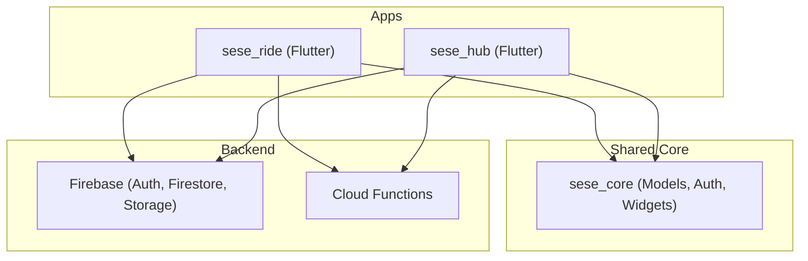

**Diagram sources**
- [sese_ride/lib/main.dart:13-40](file://sese_ride/lib/main.dart#L13-L40)
- [sese_hub/lib/main.dart:13-37](file://sese_hub/lib/main.dart#L13-L37)
- [sese_core/lib/sese_core.dart:1-34](file://sese_core/lib/sese_core.dart#L1-L34)
- [functions/src/index.ts:1-53](file://functions/src/index.ts#L1-L53)

**Section sources**
- [sese_ride/pubspec.yaml:1-38](file://sese_ride/pubspec.yaml#L1-L38)
- [sese_hub/pubspec.yaml:1-29](file://sese_hub/pubspec.yaml#L1-L29)
- [sese_core/pubspec.yaml:1-33](file://sese_core/pubspec.yaml#L1-L33)

## Core Components
- Application entry points initialize Firebase, enable App Check, detect country code, and render the root app with theme support.
- Role-based gate routes users to either Customer or Driver shells based on authenticated user data.
- Shared core exposes auth repository, user model, roles, and reusable widgets.

Key responsibilities:
- Initialization and environment setup
- Theme persistence and system appearance
- Authentication state stream and role resolution
- Navigation shells per role

**Section sources**
- [sese_ride/lib/main.dart:13-40](file://sese_ride/lib/main.dart#L13-L40)
- [sese_hub/lib/main.dart:13-37](file://sese_hub/lib/main.dart#L13-L37)
- [sese_core/lib/sese_core.dart:1-34](file://sese_core/lib/sese_core.dart#L1-L34)

## Architecture Overview
The runtime architecture follows a zero-trust backend pattern:
- Client apps authenticate via Firebase Auth and receive an AppUser object.
- Firestore stores user profiles, driver records, trips, wallets, and payment intents.
- Cloud Functions enforce business rules, compute fares, and process payments securely.

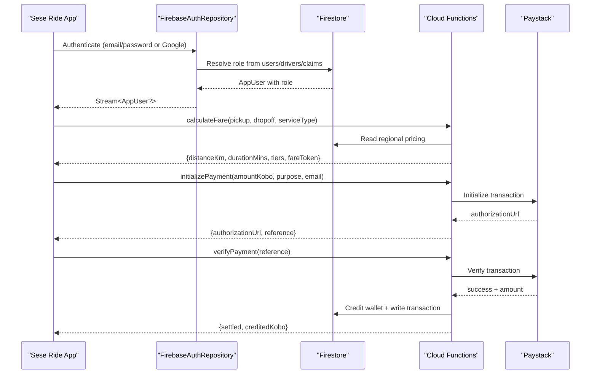

**Diagram sources**
- [sese_core/lib/auth/firebase_auth_repository.dart:82-122](file://sese_core/lib/auth/firebase_auth_repository.dart#L82-L122)
- [functions/src/index.ts:81-198](file://functions/src/index.ts#L81-L198)
- [functions/src/payments.ts:108-197](file://functions/src/payments.ts#L108-L197)
- [functions/src/payments.ts:283-326](file://functions/src/payments.ts#L283-L326)

## Detailed Component Analysis

### Entry Point and Initialization
- Initializes Flutter binding and Firebase with platform-specific options.
- Activates Firebase App Check using debug providers in debug builds and production providers in release builds.
- Detects user’s country code at startup for phone input defaults.
- Renders the root app with splash screen and theme controller.

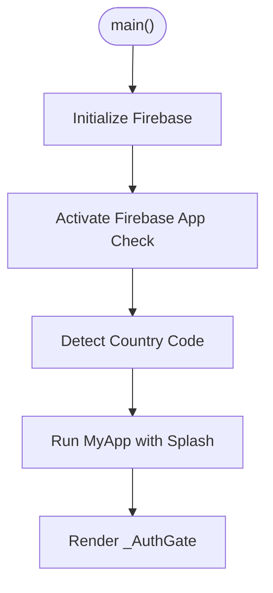

**Diagram sources**
- [sese_ride/lib/main.dart:13-40](file://sese_ride/lib/main.dart#L13-L40)

**Section sources**
- [sese_ride/lib/main.dart:13-40](file://sese_ride/lib/main.dart#L13-L40)

### Role-Based Navigation System
- `_AuthGate` listens to the auth state stream and renders:
  - Login page when no user
  - Driver onboarding if driver pending onboarding
  - Customer shell for customers
  - Driver shell for drivers
  - Wrong-app screen for hub staff opening ride app

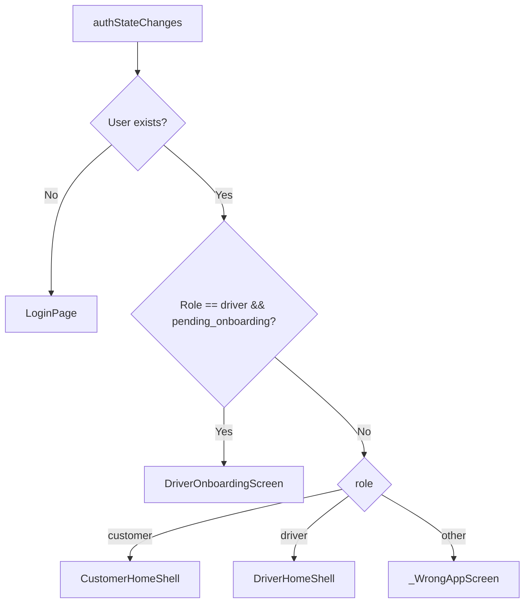

**Diagram sources**
- [sese_ride/lib/main.dart:91-145](file://sese_ride/lib/main.dart#L91-L145)

**Section sources**
- [sese_ride/lib/main.dart:91-145](file://sese_ride/lib/main.dart#L91-L145)

### Authentication Flows and Role Resolution
- Production auth repository integrates Firebase Auth and Firestore.
- Role resolution order:
  1. Owner bootstrap email mapped to super role
  2. ID-token custom claims set by Cloud Functions
  3. Hub staff lookup in `admin_users` (hub app only)
  4. Driver record in `drivers/{uid}`
  5. Customer record in `users/{uid}`
  6. Default to customer for new users
- Supports sign-in with email/password and Google Sign-In across web and mobile.

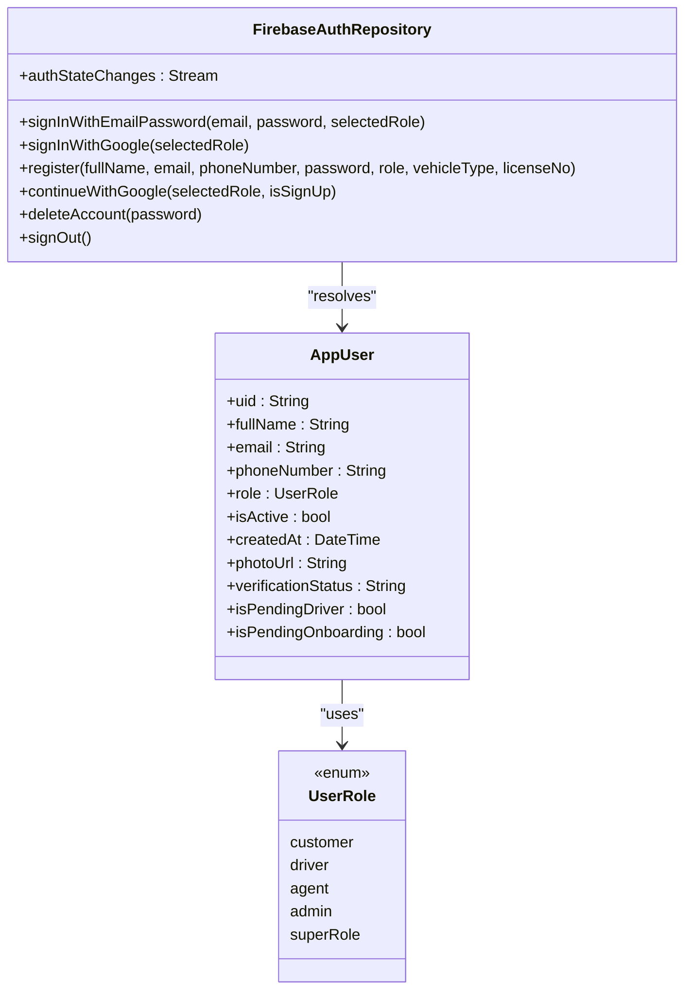

**Diagram sources**
- [sese_core/lib/auth/firebase_auth_repository.dart:20-70](file://sese_core/lib/auth/firebase_auth_repository.dart#L20-L70)
- [sese_core/lib/models/user_model.dart:5-39](file://sese_core/lib/models/user_model.dart#L5-L39)
- [sese_core/lib/models/user_role.dart:5-11](file://sese_core/lib/models/user_role.dart#L5-L11)

**Section sources**
- [sese_core/lib/auth/firebase_auth_repository.dart:82-122](file://sese_core/lib/auth/firebase_auth_repository.dart#L82-L122)
- [sese_core/lib/auth/firebase_auth_repository.dart:519-671](file://sese_core/lib/auth/firebase_auth_repository.dart#L519-L671)
- [sese_core/lib/models/user_model.dart:5-39](file://sese_core/lib/models/user_model.dart#L5-L39)
- [sese_core/lib/models/user_role.dart:5-54](file://sese_core/lib/models/user_role.dart#L5-L54)

### Customer Home Shell
- Provides bottom navigation with Trips, Home (map), and Profile tabs.
- Shows active trip banner and optional verification banner.
- Handles back press behavior and double-tap exit protection.

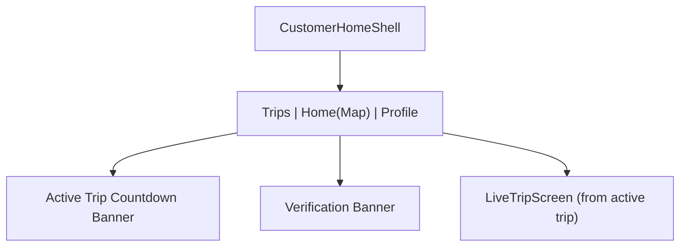

**Diagram sources**
- [sese_ride/lib/features/home/customer_home_shell.dart:21-48](file://sese_ride/lib/features/home/customer_home_shell.dart#L21-L48)
- [sese_ride/lib/features/home/customer_home_shell.dart:133-154](file://sese_ride/lib/features/home/customer_home_shell.dart#L133-L154)

**Section sources**
- [sese_ride/lib/features/home/customer_home_shell.dart:21-48](file://sese_ride/lib/features/home/customer_home_shell.dart#L21-L48)
- [sese_ride/lib/features/home/customer_home_shell.dart:133-154](file://sese_ride/lib/features/home/customer_home_shell.dart#L133-L154)

### Driver Home Shell
- Provides five-tab navigation: Menu, Earnings, Home (Go Online), Trips, Help.
- Includes menu actions: profile, switch to customer mode, manage fleet, wallet, earnings, trips history, support, theme picker, sign out, delete account.
- Protects against accidental exits with double-tap back on Home tab.

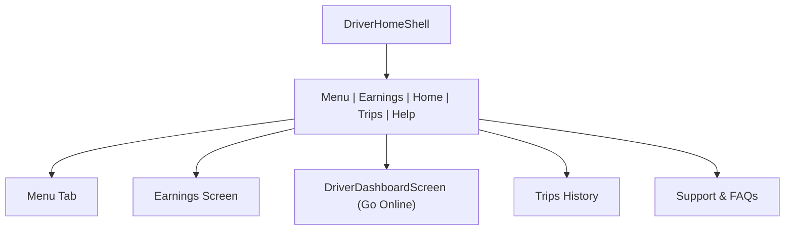

**Diagram sources**
- [sese_ride/lib/features/home/driver_home_shell.dart:21-47](file://sese_ride/lib/features/home/driver_home_shell.dart#L21-L47)
- [sese_ride/lib/features/home/driver_home_shell.dart:104-126](file://sese_ride/lib/features/home/driver_home_shell.dart#L104-L126)

**Section sources**
- [sese_ride/lib/features/home/driver_home_shell.dart:21-47](file://sese_ride/lib/features/home/driver_home_shell.dart#L21-L47)
- [sese_ride/lib/features/home/driver_home_shell.dart:104-126](file://sese_ride/lib/features/home/driver_home_shell.dart#L104-L126)

### Real-Time Location Tracking and Map Integration
- LocationService uses Geolocator to request current position and reverse geocode via Nominatim.
- LocationPickerMap renders OpenStreetMap tiles with flutter_map and updates address on camera idle.

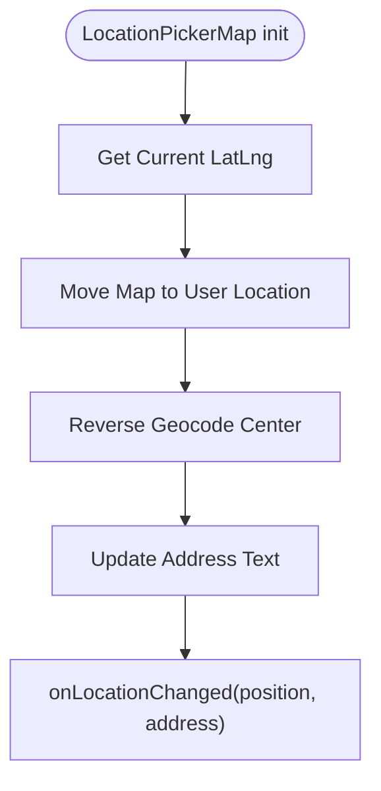

**Diagram sources**
- [sese_ride/lib/widgets/location_picker_map.dart:49-68](file://sese_ride/lib/widgets/location_picker_map.dart#L49-L68)
- [sese_ride/lib/widgets/location_picker_map.dart:87-105](file://sese_ride/lib/widgets/location_picker_map.dart#L87-L105)
- [sese_ride/lib/features/customer/services/location_service.dart:69-103](file://sese_ride/lib/features/customer/services/location_service.dart#L69-L103)

**Section sources**
- [sese_ride/lib/widgets/location_picker_map.dart:1-114](file://sese_ride/lib/widgets/location_picker_map.dart#L1-L114)
- [sese_ride/lib/features/customer/services/location_service.dart:69-103](file://sese_ride/lib/features/customer/services/location_service.dart#L69-L103)

### Payment Processing
- Client calls Cloud Functions to initialize and verify payments; secrets never leave the server.
- Flow:
  - initializePayment validates inputs, creates payment intent, initializes Paystack, returns authorization URL
  - User completes payment on Paystack hosted checkout
  - verifyPayment checks Paystack response, credits wallet exactly once (idempotent), writes transaction
  - Webhook path also settles successful charges

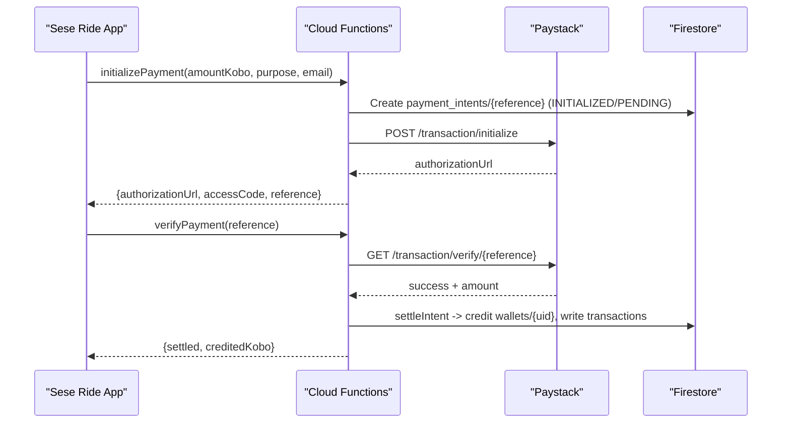

**Diagram sources**
- [functions/src/payments.ts:108-197](file://functions/src/payments.ts#L108-L197)
- [functions/src/payments.ts:283-326](file://functions/src/payments.ts#L283-L326)
- [functions/src/payments.ts:206-271](file://functions/src/payments.ts#L206-L271)

**Section sources**
- [functions/src/payments.ts:108-197](file://functions/src/payments.ts#L108-L197)
- [functions/src/payments.ts:283-326](file://functions/src/payments.ts#L283-L326)
- [sese_ride/lib/features/payments/payment_service.dart:1-44](file://sese_ride/lib/features/payments/payment_service.dart#L1-L44)

### Fare Calculation and Zero-Trust Pricing
- Callable function enforces authentication, validates coordinates and service type, computes road distance and duration, applies regional pricing, and returns a signed fare token.

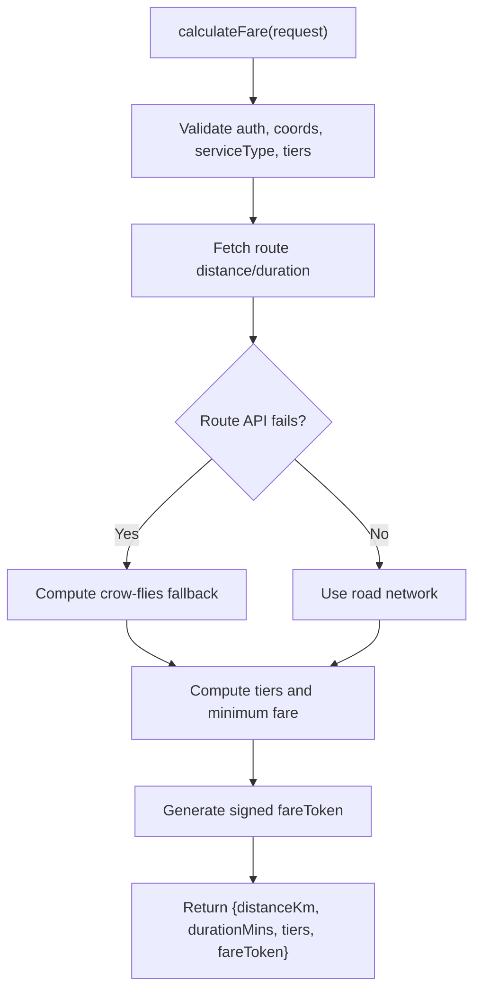

**Diagram sources**
- [functions/src/index.ts:81-198](file://functions/src/index.ts#L81-L198)

**Section sources**
- [functions/src/index.ts:81-198](file://functions/src/index.ts#L81-L198)

## Dependency Analysis
- `sese_ride` depends on `sese_core` and Firebase services including Auth, Firestore, Storage, App Check, Cloud Functions, Geolocator, flutter_map, and utilities.
- `sese_hub` shares `sese_core` and Firebase services tailored for staff operations.
- `sese_core` exports shared models, auth repository, services, and widgets used by both apps.

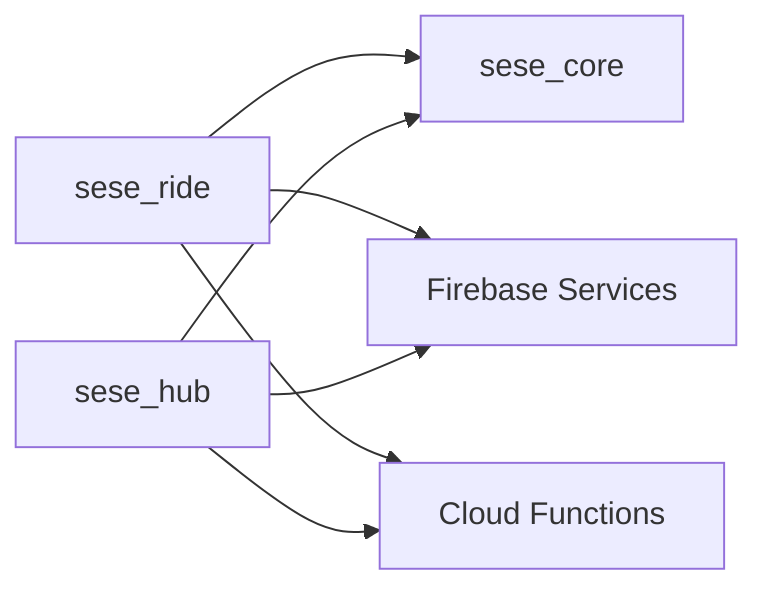

**Diagram sources**
- [sese_ride/pubspec.yaml:10-30](file://sese_ride/pubspec.yaml#L10-L30)
- [sese_hub/pubspec.yaml:10-21](file://sese_hub/pubspec.yaml#L10-L21)
- [sese_core/pubspec.yaml:9-21](file://sese_core/pubspec.yaml#L9-L21)

**Section sources**
- [sese_ride/pubspec.yaml:10-30](file://sese_ride/pubspec.yaml#L10-L30)
- [sese_hub/pubspec.yaml:10-21](file://sese_hub/pubspec.yaml#L10-L21)
- [sese_core/pubspec.yaml:9-21](file://sese_core/pubspec.yaml#L9-L21)

## Performance Considerations
- Use debounced reverse geocoding on map pan to reduce API calls.
- Prefer high accuracy location requests but respect timeouts to avoid blocking UI.
- Cache theme and country detection results to minimize repeated work.
- Ensure Firestore queries are scoped to authenticated users and use indexes where needed.
- Keep Cloud Function payloads minimal and validate inputs early to fail fast.

[No sources needed since this section provides general guidance]

## Troubleshooting Guide
Common issues and resolutions:
- Google Sign-In missing idToken on Android:
  - Ensure SHA-1/SHA-256 configured in Firebase console
  - Verify google-services.json is up to date
  - Confirm Google Play Services availability on device
- App Check PERMISSION_DENIED on Firestore:
  - Activate App Check with appropriate providers per build variant
  - Debug builds use debug providers; release builds use Play Integrity / DeviceCheck
- Wrong App screen appears:
  - Hub staff accounts should use sese_hub instead of sese_ride
- Payments not settling:
  - Verify Paystack secret configured in Cloud Functions
  - Check webhook signature validation and event payload
  - Inspect payment_intents status transitions

**Section sources**
- [sese_core/lib/auth/firebase_auth_repository.dart:326-361](file://sese_core/lib/auth/firebase_auth_repository.dart#L326-L361)
- [sese_ride/lib/main.dart:17-34](file://sese_ride/lib/main.dart#L17-L34)
- [sese_ride/lib/main.dart:147-183](file://sese_ride/lib/main.dart#L147-L183)
- [functions/src/payments.ts:333-371](file://functions/src/payments.ts#L333-L371)

## Conclusion
Sese Ride implements a robust, secure, and scalable ride-hailing ecosystem with clear separation between customer and driver experiences, powered by Firebase and Cloud Functions. The shared core library ensures consistency across apps, while zero-trust backend logic protects sensitive operations like fare calculation and payments. Proper initialization, role-based navigation, and platform configurations provide a solid foundation for development, testing, and deployment across Android and iOS.

[No sources needed since this section summarizes without analyzing specific files]