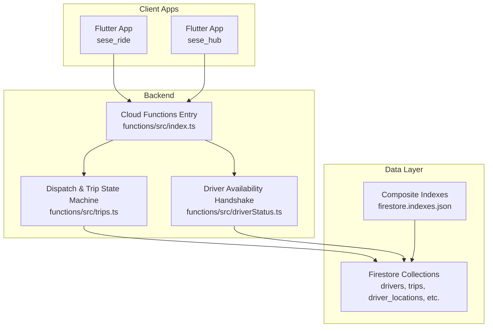
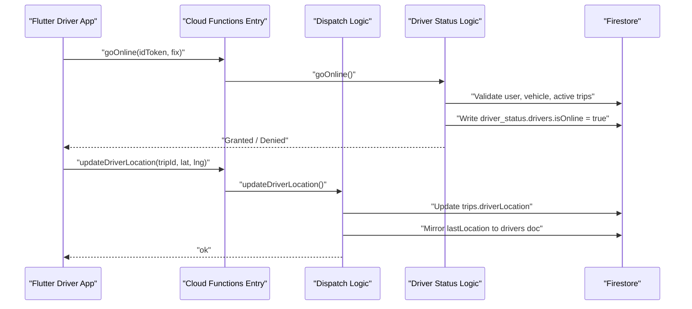
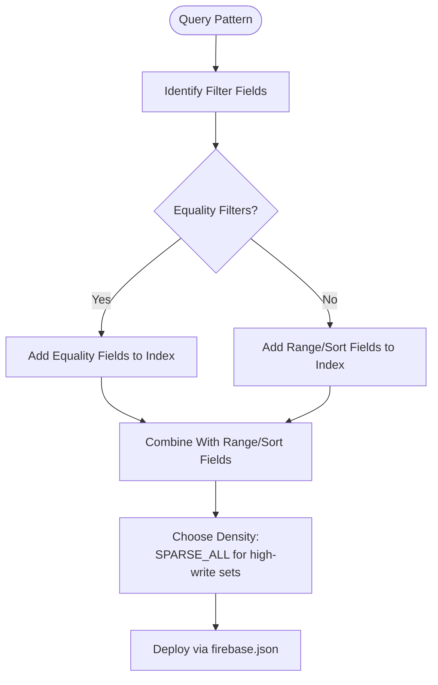
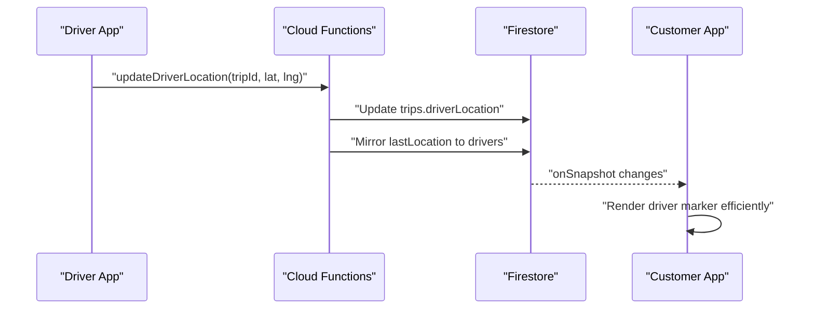
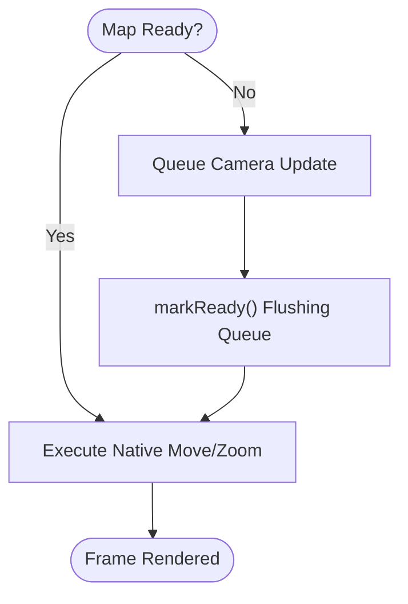
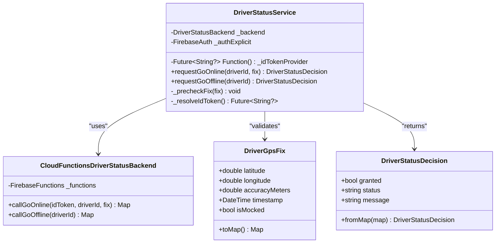
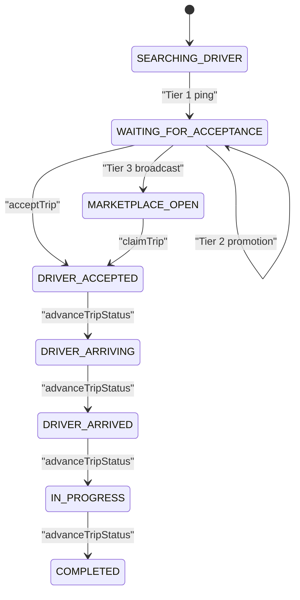
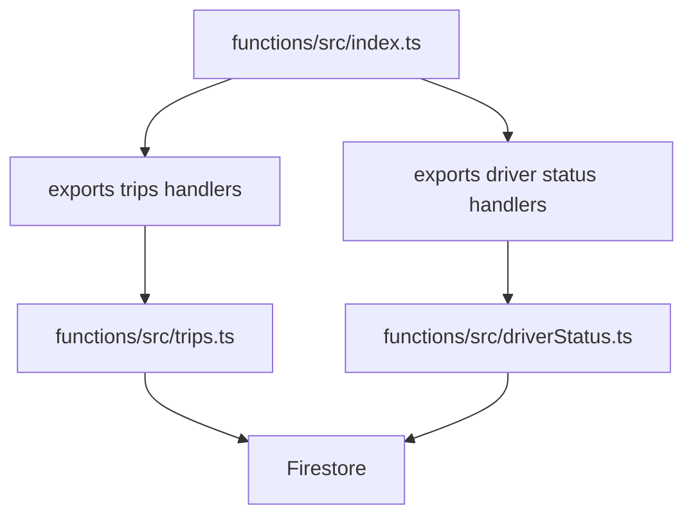

# Performance Optimization

<cite>
**Referenced Files in This Document**   
- [firestore.indexes.json](file://firestore.indexes.json)
- [functions/src/index.ts](file://functions/src/index.ts)
- [functions/src/trips.ts](file://functions/src/trips.ts)
- [functions/src/driverStatus.ts](file://functions/src/driverStatus.ts)
- [sese_ride/lib/features/driver/services/driver_status_service.dart](file://sese_ride/lib/features/driver/services/driver_status_service.dart)
- [sese_ride/lib/widgets/osm_map_view.dart](file://sese_ride/lib/widgets/osm_map_view.dart)
- [firebase.json](file://firebase.json)
</cite>

## Table of Contents
1. [Introduction](#introduction)
2. [Project Structure](#project-structure)
3. [Core Components](#core-components)
4. [Architecture Overview](#architecture-overview)
5. [Detailed Component Analysis](#detailed-component-analysis)
6. [Dependency Analysis](#dependency-analysis)
7. [Performance Considerations](#performance-considerations)
8. [Troubleshooting Guide](#troubleshooting-guide)
9. [Conclusion](#conclusion)

## Introduction
This document provides performance optimization guidance for a ride-hailing system built with Flutter, Firebase Cloud Functions, and Firestore. It focuses on:
- Database query optimization and indexing strategies for Firestore
- Real-time data synchronization efficiency
- Network efficiency through callable functions and zero-trust validation
- Memory management and efficient rendering for mobile applications
- Profiling, monitoring, bottleneck identification, scaling, load balancing, and resource optimization for high-traffic scenarios

The repository includes:
- A root-level `firestore.indexes.json` defining composite indexes for high-cardinality collections
- Cloud Functions that implement server-authoritative dispatch, fare calculation, and driver status handshakes
- Flutter client code that performs safe, authenticated calls to the backend and renders live map data efficiently

## Project Structure
At a high level, the project is organized into:
- Root configuration and security files (Firestore indexes, rules, hosting config)
- Backend logic in Cloud Functions (TypeScript)
- Flutter apps (`sese_ride`, `sese_hub`) containing feature services and UI widgets

**Diagram sources**
- [functions/src/index.ts:1-20](file://functions/src/index.ts#L1-L20)
- [functions/src/trips.ts:12-26](file://functions/src/trips.ts#L12-L26)
- [functions/src/driverStatus.ts:6-10](file://functions/src/driverStatus.ts#L6-L10)
- [firestore.indexes.json:1-20](file://firestore.indexes.json#L1-L20)

**Section sources**
- [functions/src/index.ts:1-20](file://functions/src/index.ts#L1-L20)
- [firestore.indexes.json:1-20](file://firestore.indexes.json#L1-L20)

## Core Components
Key components impacting performance:
- Firestore index definitions for complex queries across drivers, trips, locations, and operational collections
- Cloud Functions entrypoint initializing Admin SDK and exporting callable endpoints
- Dispatch state machine handling trip lifecycle, matchmaking tiers, and scheduled sweeps
- Driver availability handshake enforcing zero-trust online/offline transitions
- Flutter driver status service wrapping callable calls with pre-checks and error handling
- Map view controller queuing camera updates to avoid redundant native calls

**Section sources**
- [firestore.indexes.json:1-20](file://firestore.indexes.json#L1-L20)
- [functions/src/index.ts:1-20](file://functions/src/index.ts#L1-L20)
- [functions/src/trips.ts:12-26](file://functions/src/trips.ts#L12-L26)
- [functions/src/driverStatus.ts:6-10](file://functions/src/driverStatus.ts#L6-L10)
- [sese_ride/lib/features/driver/services/driver_status_service.dart:147-158](file://sese_ride/lib/features/driver/services/driver_status_service.dart#L147-L158)
- [sese_ride/lib/widgets/osm_map_view.dart:225-275](file://sese_ride/lib/widgets/osm_map_view.dart#L225-L275)

## Architecture Overview
The system follows a zero-trust architecture where clients never mutate authoritative state directly; all critical operations go through Cloud Functions. Real-time tracking uses Firestore listeners from the client side, while server-side scheduling maintains dispatch continuity even when clients are offline.

**Diagram sources**
- [functions/src/index.ts:21-53](file://functions/src/index.ts#L21-L53)
- [functions/src/driverStatus.ts:32-163](file://functions/src/driverStatus.ts#L32-L163)
- [functions/src/trips.ts:716-753](file://functions/src/trips.ts#L716-L753)

## Detailed Component Analysis

### Firestore Indexing Strategy
Indexes define how queries scale with dataset size. The repository defines many collection-group indexes for high-throughput operations such as driver location lookups, trip dispatch filtering, audit logs, and campaign queries.

Key patterns observed:
- Composite indexes combining equality filters with range/sort fields
- Sparse density for large, frequently updated datasets
- Ordering by timestamps or IDs to support pagination and recent-first views

Examples include:
- Drivers indexed by online status and recency
- Trips indexed by status and dispatch tier deadlines
- Driver locations indexed by region, online status, vehicle type, and geohash
- Audit and admin logs indexed by timestamp and category

**Diagram sources**
- [firestore.indexes.json:1-20](file://firestore.indexes.json#L1-L20)
- [firebase.json:1-200](file://firebase.json#L1-L200)

**Section sources**
- [firestore.indexes.json:1-20](file://firestore.indexes.json#L1-L20)
- [firestore.indexes.json:23-40](file://firestore.indexes.json#L23-L40)
- [firestore.indexes.json:370-426](file://firestore.indexes.json#L370-L426)
- [firestore.indexes.json:447-468](file://firestore.indexes.json#L447-L468)
- [firebase.json:1-200](file://firebase.json#L1-L200)

### Real-Time Data Synchronization Optimization
Real-time features rely on Firestore listeners and server-driven state machines:
- Clients subscribe to trip and driver location updates
- Server-side sweep promotes offers and re-dispatches long-waiting searches
- Driver GPS heartbeats update both trip and driver documents for accurate ranking and tracking

Optimization techniques:
- Use targeted queries with proper indexes to limit snapshot sizes
- Debounce or throttle frequent updates at the client layer before calling backend APIs
- Keep real-time listeners scoped to relevant documents/collections to reduce bandwidth

**Diagram sources**
- [functions/src/trips.ts:716-753](file://functions/src/trips.ts#L716-L753)
- [sese_ride/lib/widgets/osm_map_view.dart:225-275](file://sese_ride/lib/widgets/osm_map_view.dart#L225-L275)

**Section sources**
- [functions/src/trips.ts:372-384](file://functions/src/trips.ts#L372-L384)
- [functions/src/trips.ts:401-512](file://functions/src/trips.ts#L401-L512)
- [functions/src/trips.ts:716-753](file://functions/src/trips.ts#L716-L753)
- [sese_ride/lib/widgets/osm_map_view.dart:225-275](file://sese_ride/lib/widgets/osm_map_view.dart#L225-L275)

### Efficient Rendering Techniques for Mobile Applications
The map view controller queues camera movements until the underlying map is ready, reducing redundant native calls and improving frame stability.

Best practices:
- Queue UI mutations until the widget tree is initialized
- Clamp zoom levels to valid ranges to prevent expensive re-renders
- Batch updates and avoid synchronous heavy computations on the main thread

**Diagram sources**
- [sese_ride/lib/widgets/osm_map_view.dart:225-275](file://sese_ride/lib/widgets/osm_map_view.dart#L225-L275)

**Section sources**
- [sese_ride/lib/widgets/osm_map_view.dart:225-275](file://sese_ride/lib/widgets/osm_map_view.dart#L225-L275)

### Zero-Trust Driver Availability Handshake
The driver status service enforces strict pre-checks and delegates authority to the backend:
- Client validates GPS accuracy and mock-location flags
- Callable function verifies JWT, suspension, profile/vehicle verification, and active trips
- Authoritative state is written only by the backend

**Diagram sources**
- [sese_ride/lib/features/driver/services/driver_status_service.dart:9-55](file://sese_ride/lib/features/driver/services/driver_status_service.dart#L9-L55)
- [sese_ride/lib/features/driver/services/driver_status_service.dart:85-145](file://sese_ride/lib/features/driver/services/driver_status_service.dart#L85-L145)
- [sese_ride/lib/features/driver/services/driver_status_service.dart:158-231](file://sese_ride/lib/features/driver/services/driver_status_service.dart#L158-L231)
- [functions/src/driverStatus.ts:32-163](file://functions/src/driverStatus.ts#L32-L163)

**Section sources**
- [sese_ride/lib/features/driver/services/driver_status_service.dart:9-55](file://sese_ride/lib/features/driver/services/driver_status_service.dart#L9-L55)
- [sese_ride/lib/features/driver/services/driver_status_service.dart:85-145](file://sese_ride/lib/features/driver/services/driver_status_service.dart#L85-L145)
- [sese_ride/lib/features/driver/services/driver_status_service.dart:158-231](file://sese_ride/lib/features/driver/services/driver_status_service.dart#L158-L231)
- [functions/src/driverStatus.ts:32-163](file://functions/src/driverStatus.ts#L32-L163)

### Dispatch State Machine and Scheduled Sweeps
The dispatch logic implements a cascading tiered approach:
- Tier 1: exclusive offer to nearest driver
- Tier 2: simultaneous offer to next two nearest drivers
- Tier 3: marketplace broadcast to nearby drivers

A scheduled sweep promotes offers and restarts dispatch for long-waiting searches, ensuring resilience when clients disconnect.

**Diagram sources**
- [functions/src/trips.ts:12-26](file://functions/src/trips.ts#L12-L26)
- [functions/src/trips.ts:295-370](file://functions/src/trips.ts#L295-L370)
- [functions/src/trips.ts:401-512](file://functions/src/trips.ts#L401-L512)

**Section sources**
- [functions/src/trips.ts:12-26](file://functions/src/trips.ts#L12-L26)
- [functions/src/trips.ts:295-370](file://functions/src/trips.ts#L295-L370)
- [functions/src/trips.ts:401-512](file://functions/src/trips.ts#L401-L512)

## Dependency Analysis
Cloud Functions entrypoint initializes Admin SDK and exports callable endpoints for trip lifecycle, driver status, payments, pricing, routing, and more. The dispatch logic depends on Firestore for state persistence and scheduling.

**Diagram sources**
- [functions/src/index.ts:21-53](file://functions/src/index.ts#L21-L53)
- [functions/src/trips.ts:12-26](file://functions/src/trips.ts#L12-L26)
- [functions/src/driverStatus.ts:6-10](file://functions/src/driverStatus.ts#L6-L10)

**Section sources**
- [functions/src/index.ts:21-53](file://functions/src/index.ts#L21-L53)
- [functions/src/trips.ts:12-26](file://functions/src/trips.ts#L12-L26)
- [functions/src/driverStatus.ts:6-10](file://functions/src/driverStatus.ts#L6-L10)

## Performance Considerations
- Database Query Optimization
  - Ensure every compound query has a matching composite index defined in `firestore.indexes.json`
  - Prefer equality filters followed by range/sort fields in index definitions
  - Use sparse density for high-write collections like driver locations and audit logs
  - Limit snapshot sizes with precise `where` clauses and `limit`

- Caching Strategies
  - For non-realtime reads, consider local caches or Remote Config patterns to minimize network calls
  - Use persistent caching policies where supported by your SDKs to reduce latency and improve offline behavior

- Network Efficiency
  - Route all critical mutations through callable functions to enforce authentication and validation
  - Avoid sending large payloads; prefer server-resolved values (e.g., distance, duration, fares)
  - Throttle GPS heartbeats and batch updates to reduce Firestore write pressure

- Memory Management
  - Defer UI mutations until widgets are ready to avoid unnecessary rebuilds
  - Clamp UI parameters (e.g., zoom levels) to valid ranges to prevent expensive recalculations
  - Dispose of listeners and timers to prevent memory leaks

- Real-Time Synchronization
  - Scope listeners to specific documents or small collections
  - Debounce frequent updates on the client before invoking backend APIs
  - Use server-side scheduling to maintain state continuity when clients disconnect

- Profiling and Monitoring
  - Use Flutter DevTools to analyze frame times, memory usage, and widget rebuilds
  - Monitor Cloud Functions cold starts, execution time, and error rates
  - Track Firestore read/write costs and query performance via Firebase console metrics

- Bottleneck Identification
  - Identify slow queries by reviewing Firestore query logs and index usage
  - Profile CPU-heavy operations in Cloud Functions and move them off the hot path
  - Inspect UI jank using frame profiling and reduce layout thrashing

- Scaling and Load Balancing
  - Scale Cloud Functions horizontally by increasing concurrency limits and optimizing request processing
  - Partition data to distribute load across collections and use sharding strategies for high-volume writes
  - Use scheduled tasks to spread heavy workloads over time

- Resource Optimization
  - Exempt high-write, non-queryable fields from automatic indexing to reduce storage and write overhead
  - Compress payloads and avoid redundant fields in documents
  - Use field-level updates instead of full document replacements

[No sources needed since this section provides general guidance]

## Troubleshooting Guide
Common issues and resolutions:
- Missing Index Errors
  - Symptom: Firestore throws an error indicating a required index
  - Resolution: Define the composite index in `firestore.indexes.json` and deploy it
- Unauthenticated Calls
  - Symptom: Callable functions reject requests due to missing auth
  - Resolution: Ensure ID tokens are attached and validated by the backend
- GPS Spoofing or Inaccurate Fixes
  - Symptom: Driver cannot go online due to mock location or poor accuracy
  - Resolution: Validate GPS fixes client-side and require server-side checks
- Active Trip Blocking Status Changes
  - Symptom: Driver cannot go offline while in a live trip
  - Resolution: Complete the trip or handle business logic to allow status transitions
- Map Rendering Jank
  - Symptom: Stuttering during camera moves or zoom changes
  - Resolution: Queue camera updates until the map is ready and clamp zoom levels

**Section sources**
- [functions/src/index.ts:81-124](file://functions/src/index.ts#L81-L124)
- [functions/src/driverStatus.ts:32-57](file://functions/src/driverStatus.ts#L32-L57)
- [functions/src/driverStatus.ts:123-138](file://functions/src/driverStatus.ts#L123-L138)
- [sese_ride/lib/features/driver/services/driver_status_service.dart:189-204](file://sese_ride/lib/features/driver/services/driver_status_service.dart#L189-L204)
- [sese_ride/lib/widgets/osm_map_view.dart:225-275](file://sese_ride/lib/widgets/osm_map_view.dart#L225-L275)

## Conclusion
This performance optimization guide emphasizes:
- Defining and deploying composite indexes to ensure scalable Firestore queries
- Implementing zero-trust callable functions for secure and efficient backend operations
- Optimizing real-time synchronization with targeted listeners and server-side scheduling
- Improving mobile rendering performance by deferring UI mutations and clamping parameters
- Applying profiling, monitoring, and bottleneck identification techniques to maintain high performance under load

By following these patterns, the system can handle high traffic, maintain responsiveness, and scale effectively.

[No sources needed since this section summarizes without analyzing specific files]