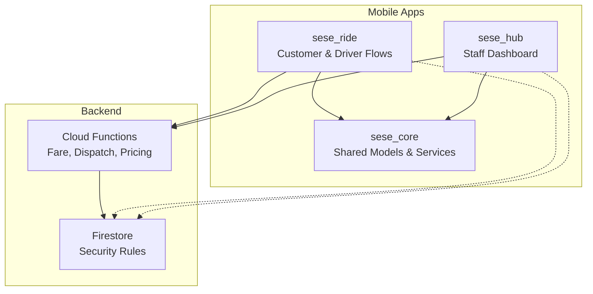
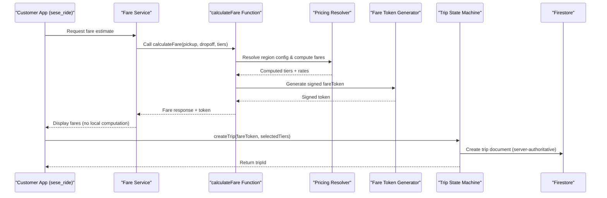
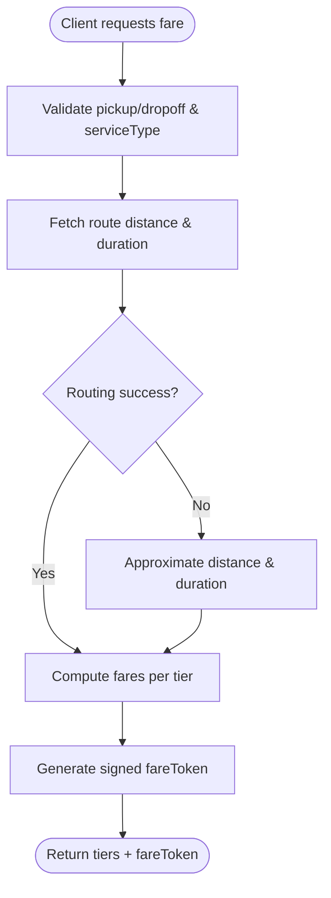
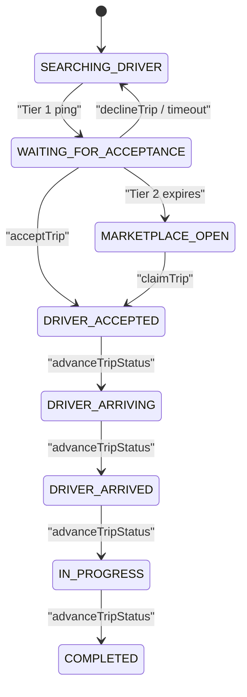
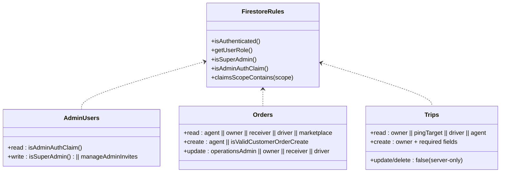
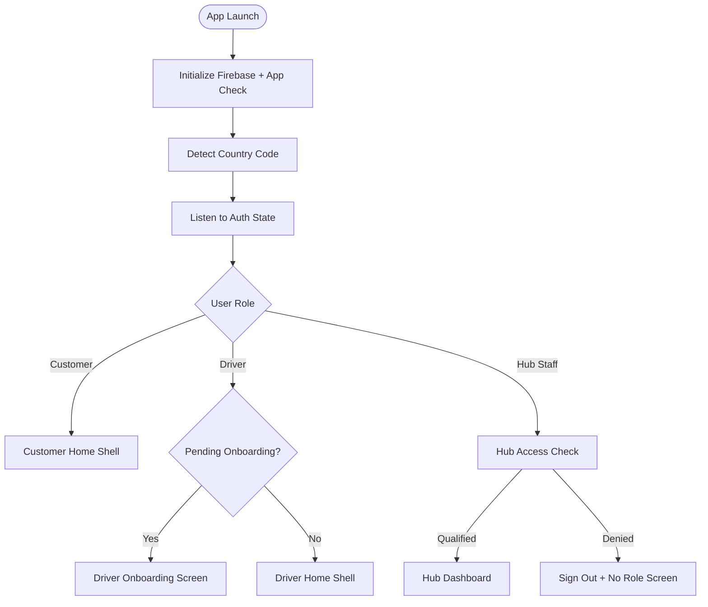
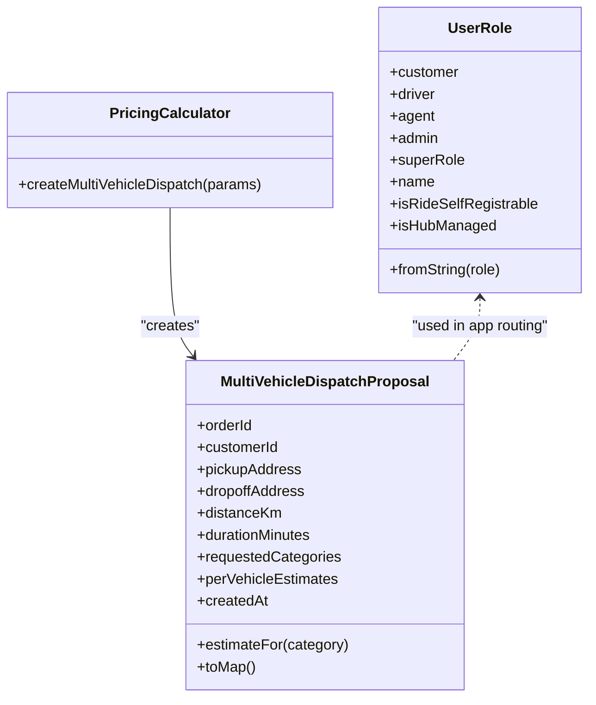
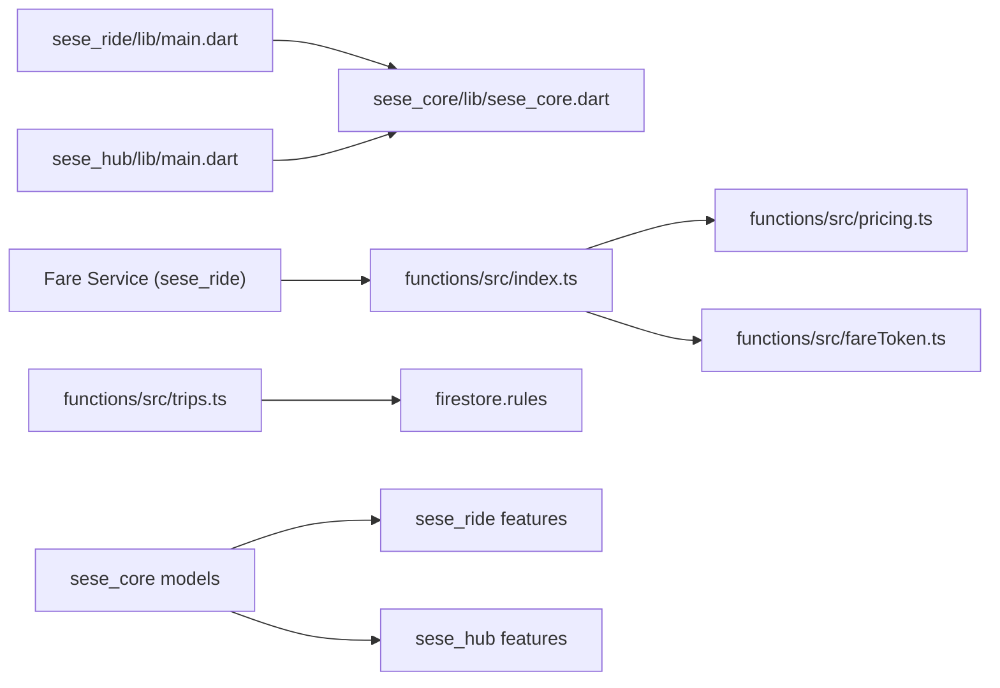

# Project Overview

<cite>
**Referenced Files in This Document**
- [functions/src/index.ts](file://functions/src/index.ts)
- [functions/src/trips.ts](file://functions/src/trips.ts)
- [functions/src/pricing.ts](file://functions/src/pricing.ts)
- [functions/src/fareToken.ts](file://functions/src/fareToken.ts)
- [sese_core/lib/sese_core.dart](file://sese_core/lib/sese_core.dart)
- [sese_core/lib/services/pricing_calculator.dart](file://sese_core/lib/services/pricing_calculator.dart)
- [sese_core/lib/models/trip_estimate.dart](file://sese_core/lib/models/trip_estimate.dart)
- [sese_core/lib/models/user_role.dart](file://sese_core/lib/models/user_role.dart)
- [sese_ride/lib/main.dart](file://sese_ride/lib/main.dart)
- [sese_hub/lib/main.dart](file://sese_hub/lib/main.dart)
- [firestore.rules](file://firestore.rules)
</cite>

## Table of Contents
1. [Introduction](#introduction)
2. [Project Structure](#project-structure)
3. [Core Components](#core-components)
4. [Architecture Overview](#architecture-overview)
5. [Detailed Component Analysis](#detailed-component-analysis)
6. [Dependency Analysis](#dependency-analysis)
7. [Performance Considerations](#performance-considerations)
8. [Troubleshooting Guide](#troubleshooting-guide)
9. [Conclusion](#conclusion)

## Introduction
SeSe App is a ride-hailing and package delivery platform built as a monorepo with three main applications:
- `sese_ride`: Customer and driver mobile apps for booking rides, dispatching deliveries, tracking trips, and managing driver profiles.
- `sese_hub`: Administrative dashboard for staff operations, including verification queues, fleet approvals, system configuration, and access control.
- `sese_core`: Shared Flutter/Dart library providing models, services, theme, authentication abstractions, and cross-app utilities.

The platform emphasizes security and reliability through zero-trust fare calculation, server-authoritative real-time dispatch, and role-based access control enforced by Firestore Security Rules and Firebase App Check.

## Project Structure
At the top level, the repository contains:
- `functions/`: TypeScript Cloud Functions implementing zero-trust fare calculation, trip state machine, pricing resolution, payments, support bot, streak management, and verification workflows.
- `sese_core/`: Shared Dart library exposing core models (user roles, vehicle categories, trip estimates), services (pricing calculator, country detection, phone sanitizer), and UI primitives.
- `sese_ride/`: Flutter application entry point, feature modules for customer/driver flows, and shared widgets.
- `sese_hub/`: Flutter application entry point for hub staff dashboards, RBAC checks, and operational tools.
- `firestore.rules`: Centralized security rules enforcing role-based access control, data validation, and server-only mutations.

**Diagram sources**
- [sese_ride/lib/main.dart:1-40](file://sese_ride/lib/main.dart#L1-L40)
- [sese_hub/lib/main.dart:1-38](file://sese_hub/lib/main.dart#L1-L38)
- [sese_core/lib/sese_core.dart:1-34](file://sese_core/lib/sese_core.dart#L1-L34)
- [functions/src/index.ts:1-25](file://functions/src/index.ts#L1-L25)
- [firestore.rules:1-20](file://firestore.rules#L1-L20)

**Section sources**
- [sese_ride/lib/main.dart:1-40](file://sese_ride/lib/main.dart#L1-L40)
- [sese_hub/lib/main.dart:1-38](file://sese_hub/lib/main.dart#L1-L38)
- [sese_core/lib/sese_core.dart:1-34](file://sese_core/lib/sese_core.dart#L1-L34)
- [functions/src/index.ts:1-25](file://functions/src/index.ts#L1-L25)
- [firestore.rules:1-20](file://firestore.rules#L1-L20)

## Core Components
- Zero-trust fare calculation: The client never computes fares locally; it calls a secure callable function that validates inputs, resolves road distance and duration, applies regional pricing, and returns a signed fare token to prevent tampering.
- Real-time dispatch: A server-authoritative trip state machine orchestrates tiered matchmaking (exclusive ping, group ping, marketplace broadcast), handles accept/decline transitions, and persists live trip snapshots for real-time tracking.
- Role-based access control: Firestore Security Rules enforce strict permissions based on user roles and custom claims, ensuring only authorized clients can read/write sensitive data.
- Shared domain models: `sese_core` provides common types such as user roles, vehicle categories, trip estimates, and multi-vehicle dispatch proposals used across both apps.

Key responsibilities:
- Fare service and backend transport in `sese_ride`.
- Trip repository and trip state handling in `sese_ride`.
- Hub access service and dashboard in `sese_hub`.
- Pricing calculator and multi-vehicle dispatch proposal in `sese_core`.
- Cloud Functions for fare calculation, trip lifecycle, and pricing resolution.

**Section sources**
- [functions/src/index.ts:71-199](file://functions/src/index.ts#L71-L199)
- [functions/src/trips.ts:12-26](file://functions/src/trips.ts#L12-L26)
- [functions/src/pricing.ts:60-147](file://functions/src/pricing.ts#L60-L147)
- [sese_core/lib/services/pricing_calculator.dart:105-146](file://sese_core/lib/services/pricing_calculator.dart#L105-L146)
- [sese_core/lib/models/trip_estimate.dart:75-122](file://sese_core/lib/models/trip_estimate.dart#L75-L122)
- [sese_core/lib/models/user_role.dart:1-54](file://sese_core/lib/models/user_role.dart#L1-L54)

## Architecture Overview
The SeSe App architecture follows these principles:
- Zero-trust architecture: All authoritative computations (fare calculation, trip creation, status transitions) occur server-side. Clients receive signed tokens or verified responses.
- Event-driven architecture: Firestore triggers and scheduled functions drive dispatch progression, sweep logic, streak updates, and notifications.
- MVVM and Repository pattern: Flutter apps separate UI from business logic via view models and repositories, abstracting network and database interactions.
- Role-based access control: Firestore Security Rules define granular permissions per document/collection, integrating with custom claims and hub staff provisioning.

**Diagram sources**
- [functions/src/index.ts:71-199](file://functions/src/index.ts#L71-L199)
- [functions/src/pricing.ts:166-237](file://functions/src/pricing.ts#L166-L237)
- [functions/src/fareToken.ts:21-58](file://functions/src/fareToken.ts#L21-L58)
- [functions/src/trips.ts:125-225](file://functions/src/trips.ts#L125-L225)

## Detailed Component Analysis

### Zero-Trust Fare Calculation
The fare calculation flow enforces zero-trust principles:
- Authentication check ensures only signed-in users can request fares.
- Input validation rejects malformed coordinates and invalid service types.
- Road-network routing fetches accurate distance and duration; fallback uses crow-flies approximation if external routing fails.
- Regional pricing is resolved via a fallback chain (global -> country -> state).
- A signed HMAC-SHA256 fare token is generated to prevent client-side tampering.

**Diagram sources**
- [functions/src/index.ts:81-199](file://functions/src/index.ts#L81-L199)
- [functions/src/pricing.ts:60-147](file://functions/src/pricing.ts#L60-L147)
- [functions/src/fareToken.ts:21-58](file://functions/src/fareToken.ts#L21-L58)

**Section sources**
- [functions/src/index.ts:71-199](file://functions/src/index.ts#L71-L199)
- [functions/src/pricing.ts:60-147](file://functions/src/pricing.ts#L60-L147)
- [functions/src/fareToken.ts:21-58](file://functions/src/fareToken.ts#L21-L58)

### Real-Time Dispatch System
The dispatch system implements a server-authoritative trip state machine:
- Tiered matchmaking: Tier 1 exclusive ping, Tier 2 group ping, Tier 3 marketplace broadcast.
- Scheduled sweep promotes offers when deadlines pass and restarts search if no drivers are online.
- Accept/decline transitions are atomic and validated against current state and eligibility.
- Live GPS updates mirror driver location for real-time tracking and nearest-driver ranking.

**Diagram sources**
- [functions/src/trips.ts:12-26](file://functions/src/trips.ts#L12-L26)
- [functions/src/trips.ts:295-370](file://functions/src/trips.ts#L295-L370)
- [functions/src/trips.ts:591-653](file://functions/src/trips.ts#L591-L653)

**Section sources**
- [functions/src/trips.ts:12-26](file://functions/src/trips.ts#L12-L26)
- [functions/src/trips.ts:295-370](file://functions/src/trips.ts#L295-L370)
- [functions/src/trips.ts:591-653](file://functions/src/trips.ts#L591-L653)

### Role-Based Access Control (RBAC)
Firestore Security Rules enforce RBAC:
- Custom claims and hub staff records determine access levels.
- Sensitive collections (admin logs, financial vault, runtime configs) are restricted to super admins or scoped roles.
- Orders, trips, and bids have fine-grained read/write permissions based on ownership and roles.
- Suspension checks prevent suspended users from performing actions.

**Diagram sources**
- [firestore.rules:116-157](file://firestore.rules#L116-L157)
- [firestore.rules:166-189](file://firestore.rules#L166-L189)
- [firestore.rules:237-295](file://firestore.rules#L237-L295)
- [firestore.rules:315-366](file://firestore.rules#L315-L366)

**Section sources**
- [firestore.rules:116-157](file://firestore.rules#L116-L157)
- [firestore.rules:166-189](file://firestore.rules#L166-L189)
- [firestore.rules:237-295](file://firestore.rules#L237-L295)
- [firestore.rules:315-366](file://firestore.rules#L315-L366)

### Application Entry Points and Routing
Both apps initialize Firebase, activate App Check, detect country codes, and route users based on roles:
- `sese_ride`: Routes customers to home shell, drivers to onboarding/home shell, and blocks hub staff accounts.
- `sese_hub`: Enforces hub staff qualification via `HubAccessService`, grants dashboard access with permissions, and signs out unauthorized users.

**Diagram sources**
- [sese_ride/lib/main.dart:13-40](file://sese_ride/lib/main.dart#L13-L40)
- [sese_ride/lib/main.dart:89-145](file://sese_ride/lib/main.dart#L89-L145)
- [sese_hub/lib/main.dart:13-38](file://sese_hub/lib/main.dart#L13-L38)
- [sese_hub/lib/main.dart:87-197](file://sese_hub/lib/main.dart#L87-L197)

**Section sources**
- [sese_ride/lib/main.dart:13-40](file://sese_ride/lib/main.dart#L13-L40)
- [sese_ride/lib/main.dart:89-145](file://sese_ride/lib/main.dart#L89-L145)
- [sese_hub/lib/main.dart:13-38](file://sese_hub/lib/main.dart#L13-L38)
- [sese_hub/lib/main.dart:87-197](file://sese_hub/lib/main.dart#L87-L197)

### Shared Domain Models and Services
`sese_core` provides foundational models and services:
- User roles: Enumerated roles for customers, drivers, agents, admins, and super roles.
- Trip estimates and multi-vehicle dispatch proposals: Used for package delivery with per-vehicle dynamic pricing.
- Pricing calculator: Computes estimates for multiple vehicle categories and generates dispatch proposals.

**Diagram sources**
- [sese_core/lib/models/user_role.dart:1-54](file://sese_core/lib/models/user_role.dart#L1-L54)
- [sese_core/lib/models/trip_estimate.dart:75-122](file://sese_core/lib/models/trip_estimate.dart#L75-L122)
- [sese_core/lib/services/pricing_calculator.dart:105-146](file://sese_core/lib/services/pricing_calculator.dart#L105-L146)

**Section sources**
- [sese_core/lib/models/user_role.dart:1-54](file://sese_core/lib/models/user_role.dart#L1-L54)
- [sese_core/lib/models/trip_estimate.dart:75-122](file://sese_core/lib/models/trip_estimate.dart#L75-L122)
- [sese_core/lib/services/pricing_calculator.dart:105-146](file://sese_core/lib/services/pricing_calculator.dart#L105-L146)

## Dependency Analysis
The following diagram illustrates key dependencies between components:

**Diagram sources**
- [sese_ride/lib/main.dart:1-40](file://sese_ride/lib/main.dart#L1-L40)
- [sese_hub/lib/main.dart:1-38](file://sese_hub/lib/main.dart#L1-L38)
- [sese_core/lib/sese_core.dart:1-34](file://sese_core/lib/sese_core.dart#L1-L34)
- [functions/src/index.ts:1-25](file://functions/src/index.ts#L1-L25)
- [functions/src/pricing.ts:1-20](file://functions/src/pricing.ts#L1-L20)
- [functions/src/fareToken.ts:1-15](file://functions/src/fareToken.ts#L1-L15)
- [functions/src/trips.ts:1-10](file://functions/src/trips.ts#L1-L10)
- [firestore.rules:1-20](file://firestore.rules#L1-L20)

**Section sources**
- [sese_ride/lib/main.dart:1-40](file://sese_ride/lib/main.dart#L1-L40)
- [sese_hub/lib/main.dart:1-38](file://sese_hub/lib/main.dart#L1-L38)
- [sese_core/lib/sese_core.dart:1-34](file://sese_core/lib/sese_core.dart#L1-L34)
- [functions/src/index.ts:1-25](file://functions/src/index.ts#L1-L25)
- [functions/src/pricing.ts:1-20](file://functions/src/pricing.ts#L1-L20)
- [functions/src/fareToken.ts:1-15](file://functions/src/fareToken.ts#L1-L15)
- [functions/src/trips.ts:1-10](file://functions/src/trips.ts#L1-L10)
- [firestore.rules:1-20](file://firestore.rules#L1-L20)

## Performance Considerations
- Zero-trust fare calculation minimizes client-side computation and reduces tampering risks while leveraging server-side routing and pricing engines.
- Real-time dispatch uses scheduled sweeps to promote offers efficiently without constant polling, reducing Firestore reads and improving scalability.
- Firestore Security Rules enforce server-only mutations for critical documents, preventing unnecessary client writes and ensuring data integrity.
- Shared models in `sese_core` reduce duplication and improve consistency across apps, aiding maintainability and performance.

[No sources needed since this section provides general guidance]

## Troubleshooting Guide
Common issues and resolutions:
- Unauthenticated fare requests: Ensure Firebase App Check is activated and users are signed in before calling fare calculation.
- Invalid fare tokens: Verify that the token was generated server-side and not tampered with; re-request fares if expired.
- Dispatch timeouts: Check scheduled sweep functions and Firestore triggers; ensure tier deadlines are properly set and promoted.
- Access denied in hub: Confirm hub staff records exist and permissions are assigned; verify custom claims and scope settings.

**Section sources**
- [functions/src/index.ts:81-90](file://functions/src/index.ts#L81-L90)
- [functions/src/fareToken.ts:33-58](file://functions/src/fareToken.ts#L33-L58)
- [functions/src/trips.ts:401-512](file://functions/src/trips.ts#L401-L512)
- [sese_hub/lib/main.dart:87-197](file://sese_hub/lib/main.dart#L87-L197)

## Conclusion
SeSe App delivers a robust ride-hailing and delivery platform through zero-trust fare calculation, real-time dispatch, and role-based access control. The monorepo structure separates concerns across `sese_ride`, `sese_hub`, and `sese_core`, enabling scalable development and clear architectural boundaries. By leveraging Firebase ecosystem capabilities and TypeScript/Flutter technologies, the platform ensures security, reliability, and extensibility for future enhancements.

[No sources needed since this section summarizes without analyzing specific files]