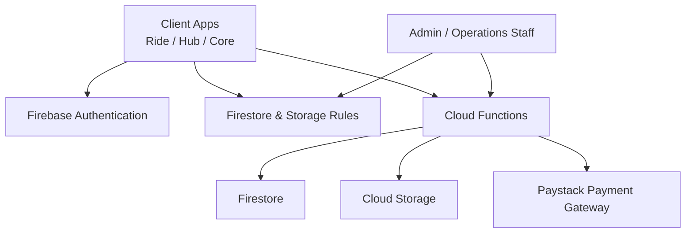
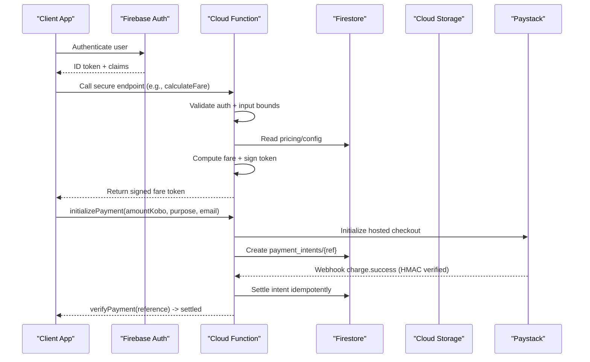
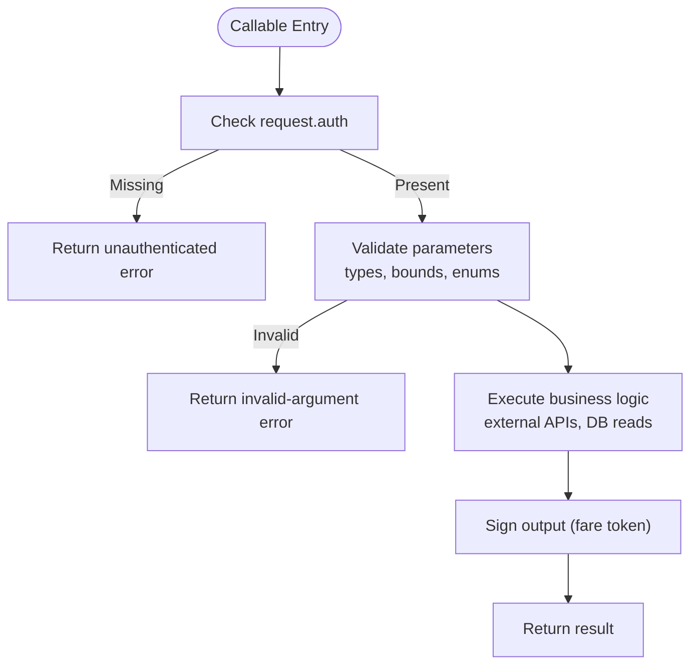
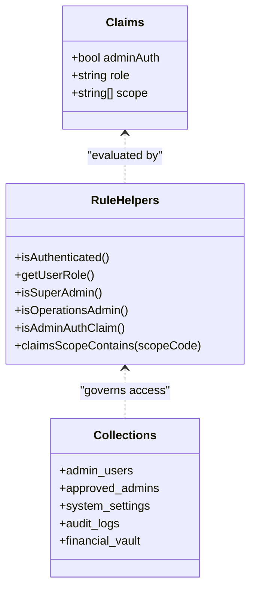
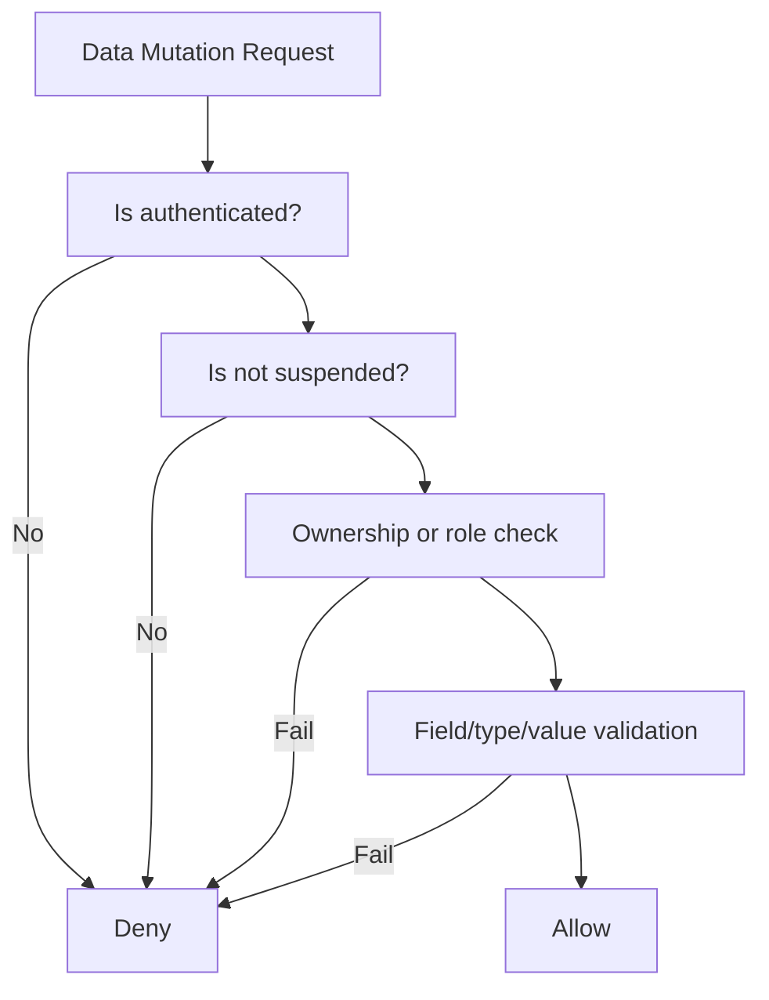
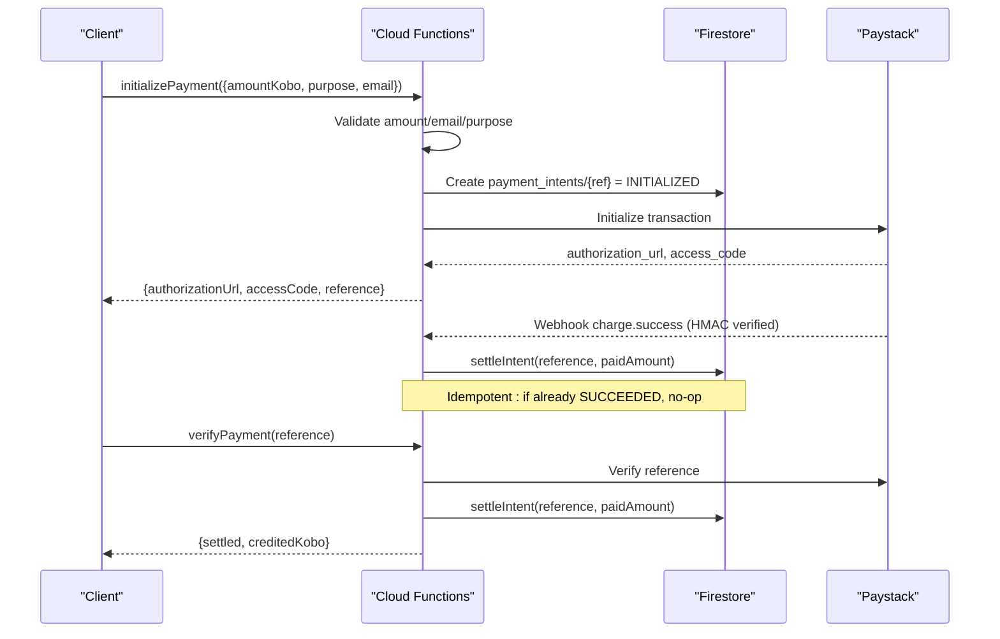
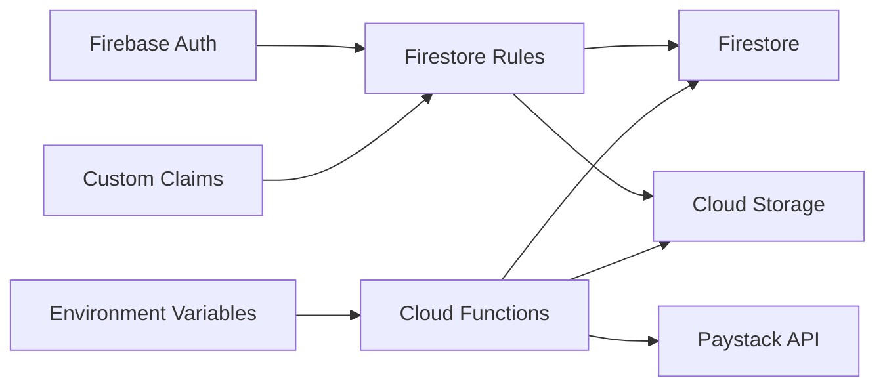

# Security Considerations

<cite>
**Referenced Files in This Document**   
- [firestore.rules](file://firestore.rules)
- [storage.rules](file://storage.rules)
- [functions/src/index.ts](file://functions/src/index.ts)
- [functions/src/payments.ts](file://functions/src/payments.ts)
- [functions/src/fareToken.ts](file://functions/src/fareToken.ts)
- [.agents/skills/firebase-security-rules-auditor/SKILL.md](file://.agents/skills/firebase-security-rules-auditor/SKILL.md)
- [.agents/skills/firestore-rules-creation/SKILL.md](file://.agents/skills/firestore-rules-creation/SKILL.md)
</cite>

## Table of Contents
1. [Introduction](#introduction)
2. [Project Structure](#project-structure)
3. [Core Components](#core-components)
4. [Architecture Overview](#architecture-overview)
5. [Detailed Component Analysis](#detailed-component-analysis)
6. [Dependency Analysis](#dependency-analysis)
7. [Performance Considerations](#performance-considerations)
8. [Troubleshooting Guide](#troubleshooting-guide)
9. [Conclusion](#conclusion)
10. [Appendices](#appendices)

## Introduction
This document describes the security posture of the project with a focus on zero-trust architecture, data protection, authentication and authorization strategies, role-based access control (RBAC), security rules, data validation, vulnerability assessment procedures, secure coding practices, security monitoring, data privacy, compliance considerations, and best practices for handling sensitive information such as payment data and user credentials.

The system relies on:
- Firebase Authentication for identity.
- Firestore Security Rules for fine-grained, server-enforced authorization and data validation.
- Cloud Storage Security Rules for file upload/download controls.
- Cloud Functions for authoritative business logic, payment processing, fare calculation, and signed tokens.
- Custom claims and scoped permissions for RBAC.
- Immutable audit trails and server-only writes for financial and operational state.

## Project Structure
Security-relevant code is concentrated in:
- Firestore and Storage security rules at repository root.
- Cloud Functions source under `functions/src/`.
- Security guidance and auditor skills under `.agents/skills/`.

**Diagram sources**
- [firestore.rules:1-1604](file://firestore.rules#L1-L1604)
- [storage.rules:1-110](file://storage.rules#L1-L110)
- [functions/src/index.ts:1-199](file://functions/src/index.ts#L1-L199)
- [functions/src/payments.ts:1-371](file://functions/src/payments.ts#L1-L371)

**Section sources**
- [firestore.rules:1-1604](file://firestore.rules#L1-L1604)
- [storage.rules:1-110](file://storage.rules#L1-L110)
- [functions/src/index.ts:1-199](file://functions/src/index.ts#L1-L199)

## Core Components
- Zero-trust callable endpoints that reject unauthenticated requests and validate all inputs before performing business operations.
- Firestore Security Rules implementing default-deny, least privilege, ownership checks, suspension gates, and scope-based admin access.
- Cloud Storage Security Rules enforcing authenticated uploads, owner-scoped paths, allowed MIME types, and size limits.
- Payment flow through Cloud Functions with amount validation, idempotent settlement, webhook signature verification, and secret management via environment variables.
- Signed fare tokens to prevent client-side tampering of pricing data.
- RBAC using custom claims (`adminAuth`, `role`, `scope`) and helper functions in rules.

**Section sources**
- [functions/src/index.ts:71-199](file://functions/src/index.ts#L71-L199)
- [functions/src/payments.ts:1-371](file://functions/src/payments.ts#L1-L371)
- [functions/src/fareToken.ts:1-59](file://functions/src/fareToken.ts#L1-L59)
- [firestore.rules:1-1604](file://firestore.rules#L1-L1604)
- [storage.rules:1-110](file://storage.rules#L1-L110)

## Architecture Overview
The security model follows a zero-trust approach: clients are never trusted with sensitive business state or monetary values. All critical mutations occur in Cloud Functions or are enforced by Firestore Security Rules.

**Diagram sources**
- [functions/src/index.ts:71-199](file://functions/src/index.ts#L71-L199)
- [functions/src/payments.ts:108-371](file://functions/src/payments.ts#L108-L371)
- [functions/src/fareToken.ts:17-59](file://functions/src/fareToken.ts#L17-L59)

## Detailed Component Analysis

### Zero-Trust Callable Endpoints
Key responsibilities:
- Reject unauthenticated callers.
- Validate input types and ranges.
- Enforce business constraints server-side.
- Produce signed outputs that clients cannot forge.

Examples:
- Fare calculation validates coordinates, service type, tier arrays, calls routing API, computes fares, and returns a signed fare token.
- Payment initialization validates amounts, purpose, email, creates an intent, and initializes Paystack.
- Payment verification verifies reference ownership, calls Paystack, and settles idempotently.

**Diagram sources**
- [functions/src/index.ts:81-199](file://functions/src/index.ts#L81-L199)
- [functions/src/payments.ts:108-198](file://functions/src/payments.ts#L108-L198)

**Section sources**
- [functions/src/index.ts:71-199](file://functions/src/index.ts#L71-L199)
- [functions/src/payments.ts:108-198](file://functions/src/payments.ts#L108-L198)

### Role-Based Access Control (RBAC)
RBAC is implemented through:
- Custom claims minted server-side and attached to ID tokens.
- Rule helpers checking `adminAuth`, `role`, and `scope`.
- Scope codes mapped from verbose permission names to compact codes.
- Super-admin wildcard scope bypassing per-scope checks.
- Bootstrapping fallbacks for primary owner and hub staff.

Important rule behaviors:
- Admin IAM and audit collections require `isAdminAuthClaim()` and specific scopes.
- System settings and secrets require super-admin or operations-admin roles.
- Many collections deny direct client writes; only server callables may mutate them.

**Diagram sources**
- [firestore.rules:10-157](file://firestore.rules#L10-L157)
- [firestore.rules:159-212](file://firestore.rules#L159-L212)
- [firestore.rules:888-1026](file://firestore.rules#L888-L1026)

**Section sources**
- [firestore.rules:10-157](file://firestore.rules#L10-L157)
- [firestore.rules:159-212](file://firestore.rules#L159-L212)
- [firestore.rules:888-1026](file://firestore.rules#L888-L1026)

### Data Protection and Validation
Firestore rules enforce:
- Default deny and explicit allow patterns.
- Ownership checks (`request.auth.uid == resource.data.userId`).
- Suspension gate preventing suspended users from mutating data.
- Field-level validation using `hasAll`/`hasOnly` and type checks.
- Server-only writes for financial records, ledgers, and sensitive state.

Storage rules enforce:
- Authenticated access.
- Owner-scoped write paths.
- Allowed MIME types (images/PDF).
- Size caps per path.

**Diagram sources**
- [firestore.rules:6-114](file://firestore.rules#L6-L114)
- [firestore.rules:61-83](file://firestore.rules#L61-L83)
- [storage.rules:1-110](file://storage.rules#L1-L110)

**Section sources**
- [firestore.rules:6-114](file://firestore.rules#L6-L114)
- [firestore.rules:61-83](file://firestore.rules#L61-L83)
- [storage.rules:1-110](file://storage.rules#L1-L110)

### Payment Security and Sensitive Data Handling
The payment flow is designed to be zero-trust:
- Clients never set monetary amounts directly into wallets.
- Amounts are validated server-side against min/max thresholds.
- Paystack-hosted checkout is used; client does not handle card details.
- Webhooks are HMAC-signed and verified server-side.
- Settlement is idempotent via Firestore transactions.
- Secrets are read from environment variables, never embedded in client code.

**Diagram sources**
- [functions/src/payments.ts:108-198](file://functions/src/payments.ts#L108-L198)
- [functions/src/payments.ts:206-272](file://functions/src/payments.ts#L206-L272)
- [functions/src/payments.ts:283-371](file://functions/src/payments.ts#L283-L371)

**Section sources**
- [functions/src/payments.ts:1-371](file://functions/src/payments.ts#L1-L371)

### Secure Tokenization and Tamper Resistance
Fare tokens:
- Are generated server-side with HMAC-SHA256.
- Include payload fields and timestamp.
- Can be verified server-side with timing-safe comparison and expiration checks.

This prevents clients from forging or altering fare calculations.

**Section sources**
- [functions/src/fareToken.ts:1-59](file://functions/src/fareToken.ts#L1-L59)

### Data Privacy and Compliance Considerations
- Region-tagged data support is present in rules, indicating awareness of regional compliance requirements.
- KYC documents and submissions have dedicated collections with restricted access.
- Audit logs and immutable records are enforced for sensitive operations.
- Secrets and configuration vaults are protected behind admin-only rules.

**Section sources**
- [firestore.rules:513-520](file://firestore.rules#L513-L520)
- [firestore.rules:714-735](file://firestore.rules#L714-L735)
- [firestore.rules:595-606](file://firestore.rules#L595-L606)

## Dependency Analysis
Security dependencies:
- Firestore rules depend on authentication context and custom claims.
- Cloud Functions depend on environment variables for secrets and external APIs.
- Storage rules depend on authenticated requests and owner-scoped paths.
- Payment flow depends on Paystack API and webhook signatures.

**Diagram sources**
- [firestore.rules:1-1604](file://firestore.rules#L1-L1604)
- [storage.rules:1-110](file://storage.rules#L1-L110)
- [functions/src/payments.ts:1-371](file://functions/src/payments.ts#L1-L371)

**Section sources**
- [firestore.rules:1-1604](file://firestore.rules#L1-L1604)
- [storage.rules:1-110](file://storage.rules#L1-L110)
- [functions/src/payments.ts:1-371](file://functions/src/payments.ts#L1-L371)

## Performance Considerations
- Firestore rules perform reads and gets for cross-document checks; keep queries minimal and avoid deep recursion where possible.
- Use server-side computations (Cloud Functions) to offload heavy logic and reduce client complexity.
- Prefer append-only immutable logs for auditability and concurrency safety.
- Cache public configuration in clients when appropriate, but ensure updates are propagated securely.

[No sources needed since this section provides general guidance]

## Troubleshooting Guide
Common issues and mitigations:
- Unauthenticated callable calls: Ensure the client passes a valid ID token; functions return clear errors for missing auth.
- Invalid arguments: Validate inputs on the client side to provide immediate feedback; server still enforces strict checks.
- Payment mismatches: The settlement function compares expected vs verified amounts; discrepancies cause failures.
- Webhook signature failures: Ensure correct HMAC verification and secret configuration.
- Permission denied: Review Firestore rules for the target collection and confirm user role/ownership.

Operational tips:
- Use emulator suites for local testing of rules and functions.
- Monitor audit logs and failed payout queues for anomalies.
- Rotate secrets and update environment variables securely.

**Section sources**
- [functions/src/index.ts:81-124](file://functions/src/index.ts#L81-L124)
- [functions/src/payments.ts:116-150](file://functions/src/payments.ts#L116-L150)
- [functions/src/payments.ts:333-371](file://functions/src/payments.ts#L333-L371)

## Conclusion
The project implements a robust zero-trust security model:
- Authentication and custom claims gate access.
- Firestore and Storage rules enforce least privilege, ownership, and validation.
- Cloud Functions centralize sensitive business logic and payments.
- Signed tokens and immutable audit trails protect integrity.
- Environment-managed secrets and webhook verification safeguard external integrations.

Adhering to these patterns ensures strong protection for sensitive data, including payments and credentials, while supporting compliance and operational transparency.

[No sources needed since this section summarizes without analyzing specific files]

## Appendices

### Vulnerability Assessment Procedures
Recommended steps aligned with the security rules auditor skill:
- Compare create vs update rules to detect bypasses.
- Validate authority sources for sensitive fields.
- Assess storage abuse risks (size limits, MIME types).
- Check type safety and field-level vs identity-level security.
- Review admin bootstrapping and privilege escalation paths.

**Section sources**
- [.agents/skills/firebase-security-rules-auditor/SKILL.md:1-74](file://.agents/skills/firebase-security-rules-auditor/SKILL.md#L1-L74)

### Secure Coding Practices
Guidelines derived from the rules creation skill:
- Default deny and least privilege.
- Mandatory validator functions for create/update.
- Authentication and authorization checks.
- UID protection and initial restriction of collections.
- Strict RBAC: no self-assigned roles, no privilege escalation.

**Section sources**
- [.agents/skills/firestore-rules-creation/SKILL.md:45-284](file://.agents/skills/firestore-rules-creation/SKILL.md#L45-L284)