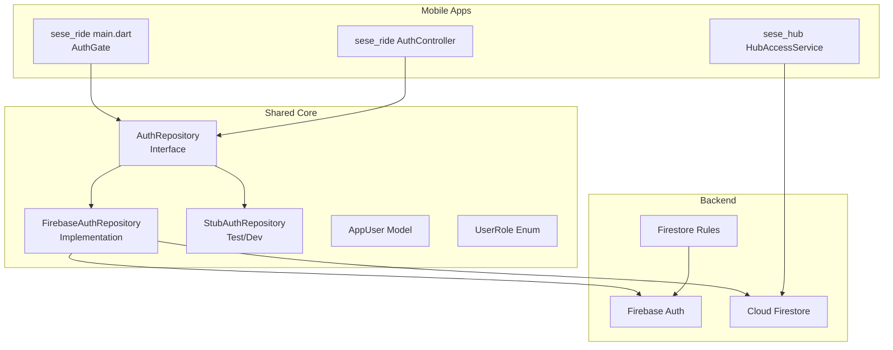
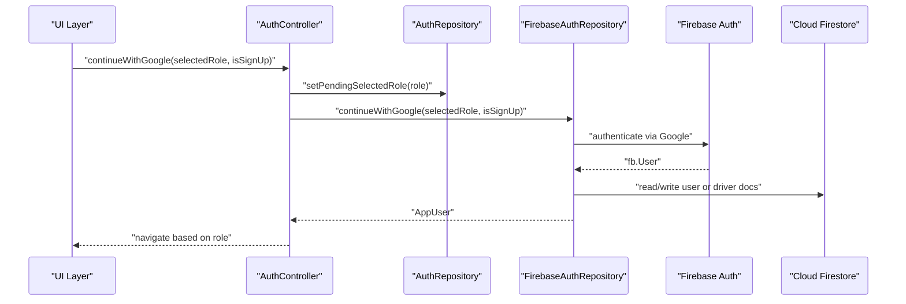
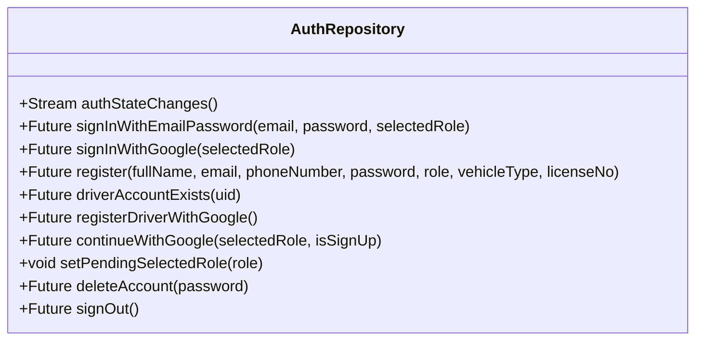
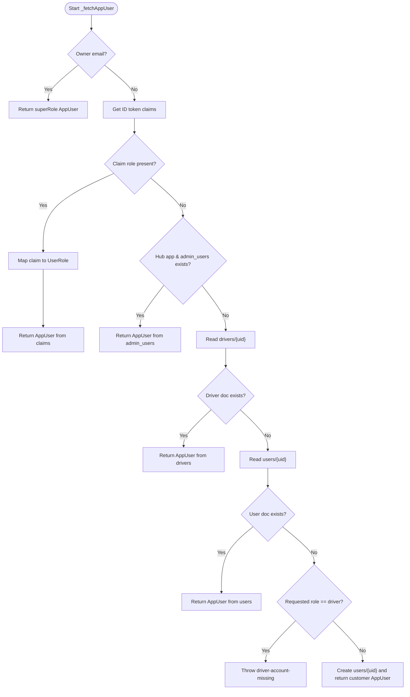
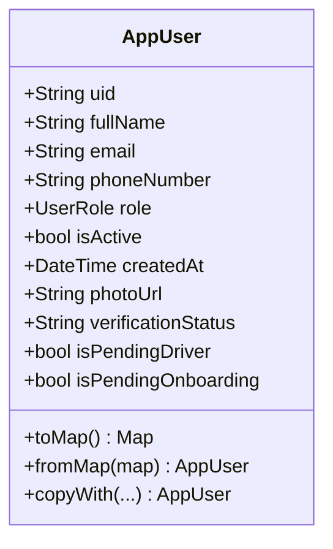
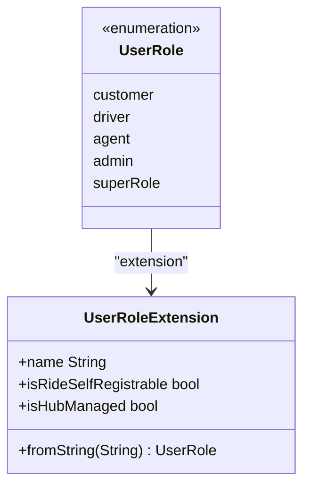
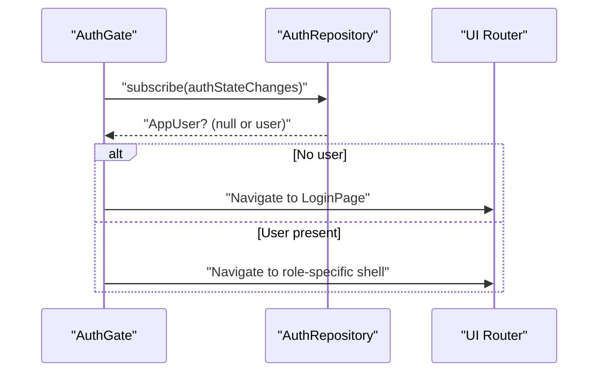
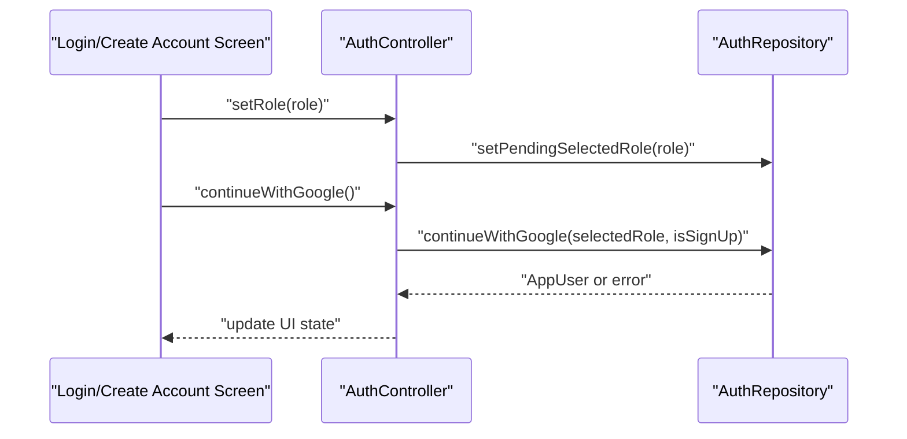
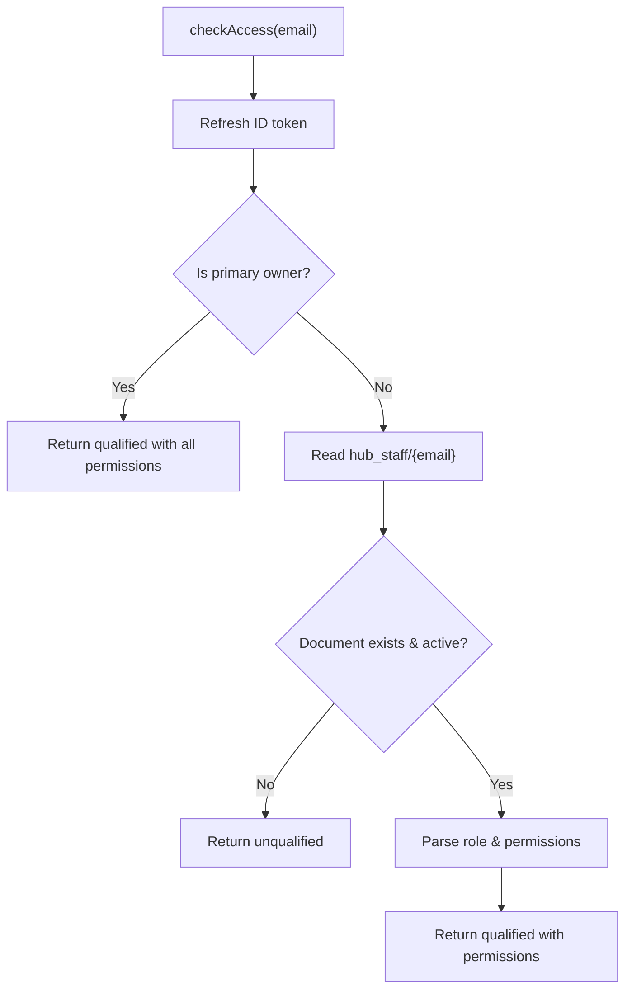
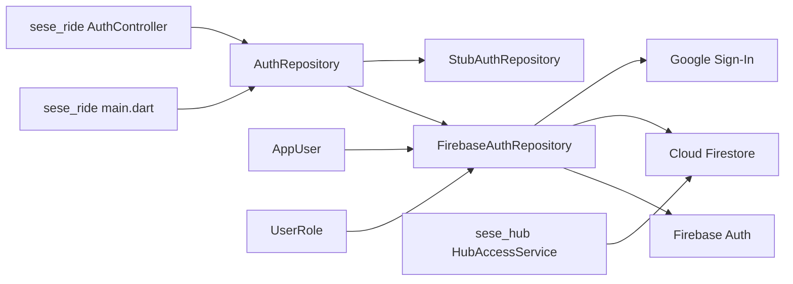

# Authentication System

<cite>
**Referenced Files in This Document**
- [auth_repository.dart](file://sese_core/lib/auth/auth_repository.dart)
- [firebase_auth_repository.dart](file://sese_core/lib/auth/firebase_auth_repository.dart)
- [stub_auth_repository.dart](file://sese_core/lib/auth/stub_auth_repository.dart)
- [user_model.dart](file://sese_core/lib/models/user_model.dart)
- [user_role.dart](file://sese_core/lib/models/user_role.dart)
- [main.dart](file://sese_ride/lib/main.dart)
- [auth_controller.dart](file://sese_ride/lib/features/auth/auth_controller.dart)
- [hub_access_service.dart](file://sese_hub/lib/features/staff/services/hub_access_service.dart)
- [firestore.rules](file://firestore.rules)
</cite>

## Table of Contents
1. [Introduction](#introduction)
2. [Project Structure](#project-structure)
3. [Core Components](#core-components)
4. [Architecture Overview](#architecture-overview)
5. [Detailed Component Analysis](#detailed-component-analysis)
6. [Dependency Analysis](#dependency-analysis)
7. [Performance Considerations](#performance-considerations)
8. [Troubleshooting Guide](#troubleshooting-guide)
9. [Conclusion](#conclusion)

## Introduction
This document explains the authentication system implemented in the shared core library and how it integrates with mobile applications (sese_ride, sese_hub), user profile management, and security token handling. It covers:
- Firebase authentication repository implementation
- User session management via streams
- Role-based access control for customer, driver, agent, admin, and super roles
- Authentication state handling and routing
- Multi-role support and permission checking mechanisms
- Error handling patterns and best practices for secure authentication

The system uses Firebase Auth for identity, Google Sign-In for federated login, Cloud Firestore for user profiles, and custom claims for server-side role enforcement.

## Project Structure
The authentication subsystem is centered in the shared core package and consumed by both apps:
- Core abstractions and implementations live under `sese_core/lib/auth`
- User model and role definitions live under `sese_core/lib/models`
- Mobile app integration points include an auth gate and controller in `sese_ride`
- Hub staff access control lives in `sese_hub`

**Diagram sources**
- [auth_repository.dart:1-83](file://sese_core/lib/auth/auth_repository.dart#L1-L83)
- [firebase_auth_repository.dart:1-706](file://sese_core/lib/auth/firebase_auth_repository.dart#L1-L706)
- [stub_auth_repository.dart:1-68](file://sese_core/lib/auth/stub_auth_repository.dart#L1-L68)
- [user_model.dart:1-109](file://sese_core/lib/models/user_model.dart#L1-L109)
- [user_role.dart:1-55](file://sese_core/lib/models/user_role.dart#L1-L55)
- [main.dart:89-121](file://sese_ride/lib/main.dart#L89-L121)
- [auth_controller.dart:1-122](file://sese_ride/lib/features/auth/auth_controller.dart#L1-L122)
- [hub_access_service.dart:1-334](file://sese_hub/lib/features/staff/services/hub_access_service.dart#L1-L334)
- [firestore.rules:116-140](file://firestore.rules#L116-L140)

**Section sources**
- [auth_repository.dart:1-83](file://sese_core/lib/auth/auth_repository.dart#L1-L83)
- [firebase_auth_repository.dart:1-706](file://sese_core/lib/auth/firebase_auth_repository.dart#L1-L706)
- [user_model.dart:1-109](file://sese_core/lib/models/user_model.dart#L1-L109)
- [user_role.dart:1-55](file://sese_core/lib/models/user_role.dart#L1-L55)
- [main.dart:89-121](file://sese_ride/lib/main.dart#L89-L121)
- [auth_controller.dart:1-122](file://sese_ride/lib/features/auth/auth_controller.dart#L1-L122)
- [hub_access_service.dart:1-334](file://sese_hub/lib/features/staff/services/hub_access_service.dart#L1-L334)
- [firestore.rules:116-140](file://firestore.rules#L116-L140)

## Core Components
- AuthRepository: Defines the contract for authentication operations used by both apps.
- FirebaseAuthRepository: Production implementation backed by Firebase Auth and Firestore.
- StubAuthRepository: Test/dev placeholder that satisfies the interface without Firebase.
- AppUser: Canonical user model representing authenticated users across apps.
- UserRole: Shared enum for roles (customer, driver, agent, admin, superRole).

Key responsibilities:
- Session lifecycle: sign-in, sign-out, account deletion, and stream-based auth state changes.
- Profile creation and resolution: creating and reading user documents in Firestore.
- Role resolution: combining Firestore data, ID-token custom claims, and owner bootstrap logic.
- Multi-role support: enabling customer/driver flows in ride app and agent/admin/super flows in hub.

**Section sources**
- [auth_repository.dart:1-83](file://sese_core/lib/auth/auth_repository.dart#L1-L83)
- [firebase_auth_repository.dart:1-706](file://sese_core/lib/auth/firebase_auth_repository.dart#L1-L706)
- [stub_auth_repository.dart:1-68](file://sese_core/lib/auth/stub_auth_repository.dart#L1-L68)
- [user_model.dart:1-109](file://sese_core/lib/models/user_model.dart#L1-L109)
- [user_role.dart:1-55](file://sese_core/lib/models/user_role.dart#L1-L55)

## Architecture Overview
The authentication architecture combines client-side session management with server-side policy enforcement:
- Client side:
  - UI components subscribe to `authStateChanges` to react to sign-in/sign-out events.
  - Controllers orchestrate sign-in/sign-up flows and propagate selected roles.
- Server side:
  - Firestore rules enforce RBAC using custom claims and scopes.
  - Custom claims are minted by backend functions and injected into ID tokens.

**Diagram sources**
- [auth_controller.dart:48-67](file://sese_ride/lib/features/auth/auth_controller.dart#L48-L67)
- [firebase_auth_repository.dart:191-321](file://sese_core/lib/auth/firebase_auth_repository.dart#L191-L321)
- [firebase_auth_repository.dart:326-361](file://sese_core/lib/auth/firebase_auth_repository.dart#L326-L361)

**Section sources**
- [auth_controller.dart:1-122](file://sese_ride/lib/features/auth/auth_controller.dart#L1-L122)
- [firebase_auth_repository.dart:191-361](file://sese_core/lib/auth/firebase_auth_repository.dart#L191-L361)

## Detailed Component Analysis

### AuthRepository Interface
Defines the unified API for authentication:
- Stream-based auth state (`authStateChanges`)
- Email/password and Google sign-in
- Registration flows for customers and drivers
- Driver account existence checks
- Unified Google continue flow supporting sign-in and sign-up modes
- Pending role propagation to avoid race conditions during background auth listeners
- Account deletion and sign-out

**Diagram sources**
- [auth_repository.dart:1-83](file://sese_core/lib/auth/auth_repository.dart#L1-L83)

**Section sources**
- [auth_repository.dart:1-83](file://sese_core/lib/auth/auth_repository.dart#L1-L83)

### FirebaseAuthRepository Implementation
Production implementation integrating Firebase Auth and Firestore:
- Role resolution order:
  1. Owner email bootstrap -> superRole
  2. ID-token custom claims (role)
  3. Hub admin_users lookup (hub-only)
  4. drivers/{uid} authoritative for driver accounts
  5. users/{uid} for customer accounts
  6. Default to customer if new user
- Google authentication:
  - Web: popup flow
  - Mobile: GoogleSignIn with idToken/accessToken validation
- Registration:
  - Customers: create users/{uid} with role 'customer'
  - Drivers: create drivers/{uid} with verificationStatus pending_onboarding
- Continue with Google:
  - Sign-in mode enforces driver account existence; otherwise throws a specific error
  - Sign-up mode creates or merges profile documents
- Account deletion:
  - Re-authentication required (password or Google)
  - Soft-delete and archival metadata written to Firestore
  - Purge Firebase Auth account and sign out

**Diagram sources**
- [firebase_auth_repository.dart:519-671](file://sese_core/lib/auth/firebase_auth_repository.dart#L519-L671)

**Section sources**
- [firebase_auth_repository.dart:1-706](file://sese_core/lib/auth/firebase_auth_repository.dart#L1-L706)

### AppUser Model
Canonical representation of authenticated users:
- Fields: uid, fullName, email, phoneNumber, role, isActive, createdAt, photoUrl, verificationStatus
- Helpers:
  - isPendingDriver: driver not active
  - isPendingOnboarding: driver awaiting Step 2 onboarding
- Serialization:
  - toMap/fromMap robustly parse timestamps and normalize fields

**Diagram sources**
- [user_model.dart:1-109](file://sese_core/lib/models/user_model.dart#L1-L109)

**Section sources**
- [user_model.dart:1-109](file://sese_core/lib/models/user_model.dart#L1-L109)

### UserRole Enum and Extensions
Shared roles across apps:
- Roles: customer, driver, agent, admin, superRole
- Extensions:
  - name: string representation
  - fromString: parsing
  - isRideSelfRegistrable: customer/driver allowed self-registration
  - isHubManaged: agent/admin/super managed inside hub

**Diagram sources**
- [user_role.dart:1-55](file://sese_core/lib/models/user_role.dart#L1-L55)

**Section sources**
- [user_role.dart:1-55](file://sese_core/lib/models/user_role.dart#L1-L55)

### AuthGate and Session Handling
In the ride app, the AuthGate listens to the auth state stream and routes users accordingly:
- While waiting: shows loading indicator
- If no user: navigates to login page
- If user exists: proceeds to role-based dashboard routing

**Diagram sources**
- [main.dart:89-121](file://sese_ride/lib/main.dart#L89-L121)

**Section sources**
- [main.dart:89-121](file://sese_ride/lib/main.dart#L89-L121)

### AuthController (Unified Google Flow)
Orchestrates Google sign-in/sign-up with role selection:
- Maintains selected role and sign-up mode
- Propagates selected role to repository via setPendingSelectedRole
- Handles OAuth pre-populated profile fields
- Wraps continueWithGoogle with loading/error states

**Diagram sources**
- [auth_controller.dart:40-67](file://sese_ride/lib/features/auth/auth_controller.dart#L40-L67)

**Section sources**
- [auth_controller.dart:1-122](file://sese_ride/lib/features/auth/auth_controller.dart#L1-L122)

### Hub Access Service (RBAC for Hub Staff)
Provides zero-trust qualification checks for hub staff:
- Primary owner email has permanent full access
- Reads hub_staff/{email} for role and assignedPermissions
- Computes visible tabs based on role and permissions
- Enforces provisioning constraints (owner-only)

**Diagram sources**
- [hub_access_service.dart:233-284](file://sese_hub/lib/features/staff/services/hub_access_service.dart#L233-L284)

**Section sources**
- [hub_access_service.dart:1-334](file://sese_hub/lib/features/staff/services/hub_access_service.dart#L1-L334)

## Dependency Analysis
The authentication system exhibits clear separation between interfaces and implementations, with minimal coupling to platform specifics:
- AuthRepository decouples apps from Firebase details
- FirebaseAuthRepository depends on Firebase Auth, Google Sign-In, and Firestore
- AppUser and UserRole provide shared domain types
- HubAccessService depends on Firestore and Firebase Auth for staff authorization

**Diagram sources**
- [auth_repository.dart:1-83](file://sese_core/lib/auth/auth_repository.dart#L1-L83)
- [firebase_auth_repository.dart:1-706](file://sese_core/lib/auth/firebase_auth_repository.dart#L1-L706)
- [stub_auth_repository.dart:1-68](file://sese_core/lib/auth/stub_auth_repository.dart#L1-L68)
- [user_model.dart:1-109](file://sese_core/lib/models/user_model.dart#L1-L109)
- [user_role.dart:1-55](file://sese_core/lib/models/user_role.dart#L1-L55)
- [main.dart:89-121](file://sese_ride/lib/main.dart#L89-L121)
- [auth_controller.dart:1-122](file://sese_ride/lib/features/auth/auth_controller.dart#L1-L122)
- [hub_access_service.dart:1-334](file://sese_hub/lib/features/staff/services/hub_access_service.dart#L1-L334)

**Section sources**
- [auth_repository.dart:1-83](file://sese_core/lib/auth/auth_repository.dart#L1-L83)
- [firebase_auth_repository.dart:1-706](file://sese_core/lib/auth/firebase_auth_repository.dart#L1-L706)
- [user_model.dart:1-109](file://sese_core/lib/models/user_model.dart#L1-L109)
- [user_role.dart:1-55](file://sese_core/lib/models/user_role.dart#L1-L55)
- [main.dart:89-121](file://sese_ride/lib/main.dart#L89-L121)
- [auth_controller.dart:1-122](file://sese_ride/lib/features/auth/auth_controller.dart#L1-L122)
- [hub_access_service.dart:1-334](file://sese_hub/lib/features/staff/services/hub_access_service.dart#L1-L334)

## Performance Considerations
- Stream-based auth state avoids polling and reduces unnecessary network calls.
- Role resolution prioritizes lightweight checks (owner email, claims) before Firestore reads.
- Google Sign-In path validates idToken presence early to fail fast on misconfiguration.
- HubAccessService refreshes ID tokens before reads to minimize UNAUTHENTICATED retries.

[No sources needed since this section provides general guidance]

## Troubleshooting Guide
Common issues and resolutions:
- Firebase uninitialized errors:
  - Ensure Firebase is initialized before calling repository methods.
  - Repository throws specific exceptions when services are unavailable.
- Google Sign-In missing idToken:
  - Verify SHA-1/SHA-256 configuration, google-services.json freshness, and device Google Play Services availability.
- Driver sign-in denied due to missing account:
  - Driver sign-in requires an existing drivers/{uid} document; otherwise, prompt registration.
- Permission denied on admin_users:
  - Skip admin_users lookup in non-hub apps to avoid PERMISSION_DENIED for regular users.
- Account deletion failures:
  - Re-authentication is required; ensure correct provider credentials are provided.

**Section sources**
- [firebase_auth_repository.dart:97-122](file://sese_core/lib/auth/firebase_auth_repository.dart#L97-L122)
- [firebase_auth_repository.dart:326-361](file://sese_core/lib/auth/firebase_auth_repository.dart#L326-L361)
- [firebase_auth_repository.dart:425-487](file://sese_core/lib/auth/firebase_auth_repository.dart#L425-L487)

## Conclusion
The authentication system provides a robust, multi-role foundation for both mobile applications:
- Clear separation of concerns via AuthRepository
- Secure and extensible role resolution combining Firestore and custom claims
- Comprehensive flows for customer and driver onboarding
- Zero-trust hub staff access control with explicit permissions
- Strong error handling and defensive checks for edge cases

Adhering to these patterns ensures consistent, secure, and maintainable authentication across platforms.