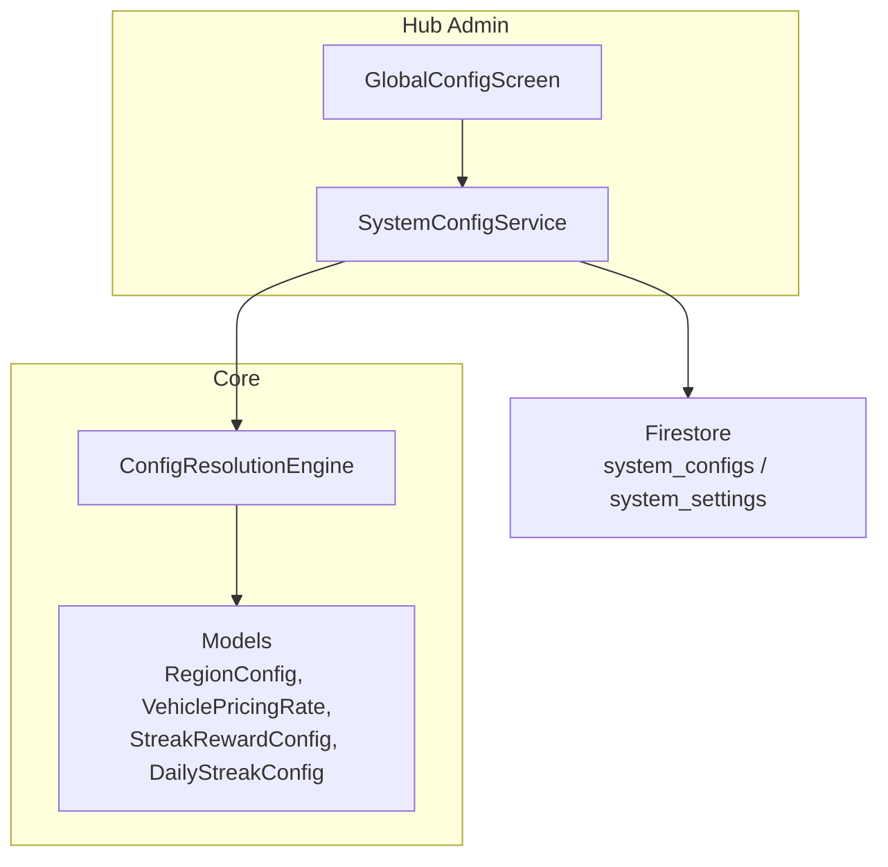
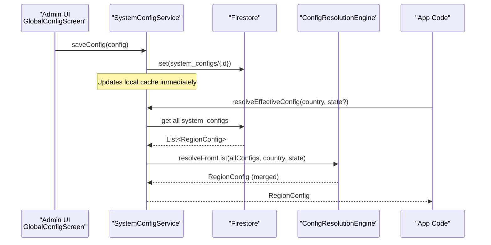
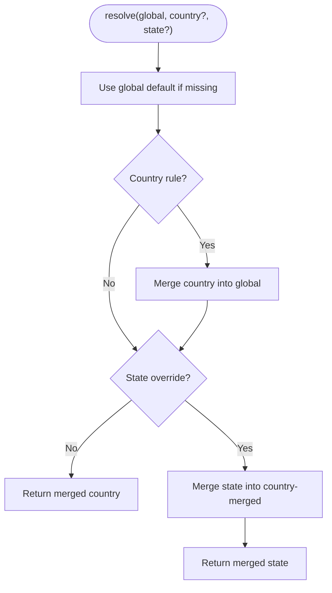
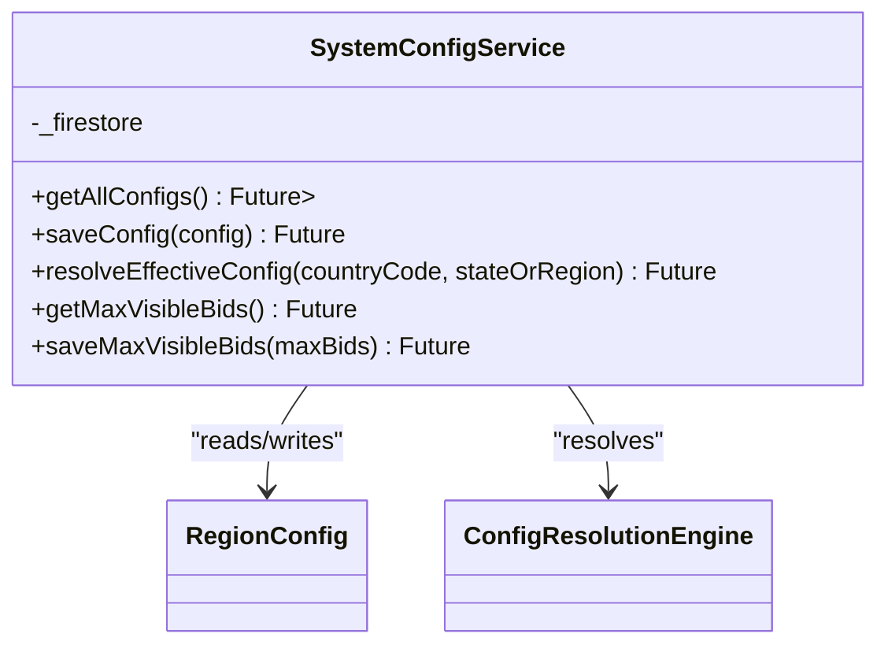
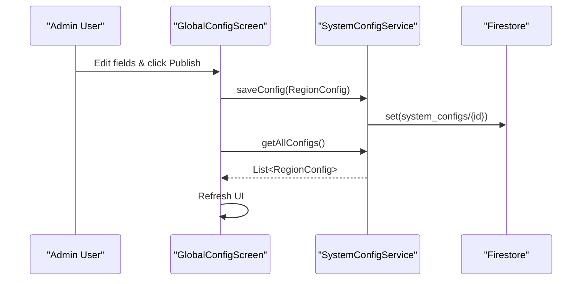
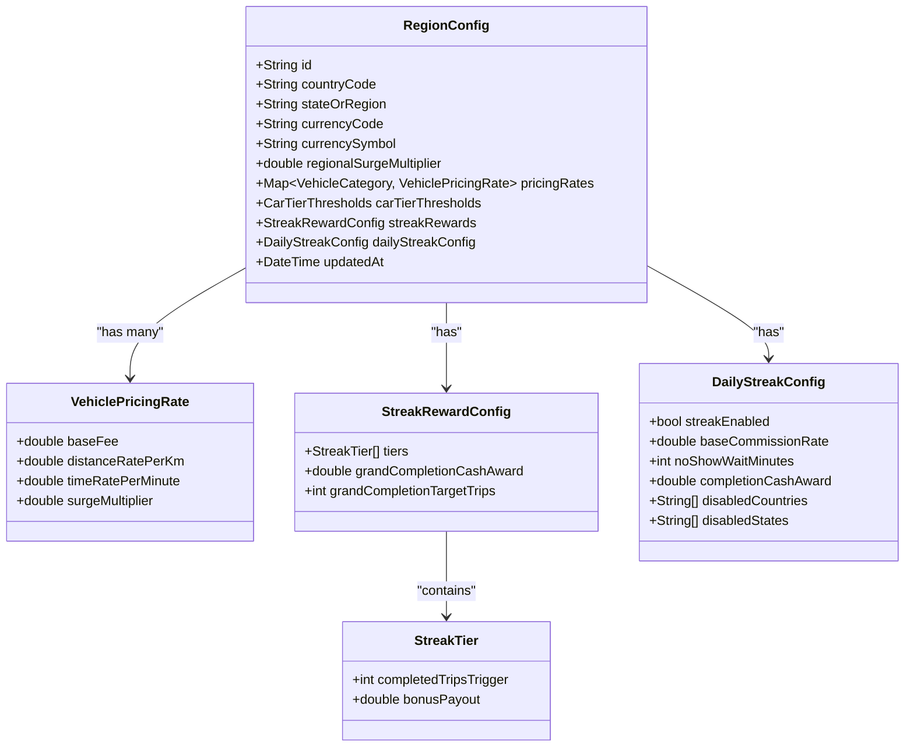
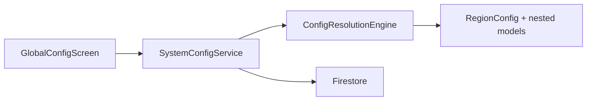

# Configuration Services

<cite>
**Referenced Files in This Document**
- [config_resolution_engine.dart](file://sese_core/lib/services/config_resolution_engine.dart)
- [pricing_config.dart](file://sese_core/lib/models/pricing_config.dart)
- [system_config_service.dart](file://sese_hub/lib/features/config/services/system_config_service.dart)
- [global_config_screen.dart](file://sese_hub/lib/features/config/presentation/global_config_screen.dart)
- [dynamic_system_config_test.dart](file://sese_core/test/dynamic_system_config_test.dart)
- [daily_streak_config_test.dart](file://sese_core/test/daily_streak_config_test.dart)
</cite>

## Table of Contents
1. [Introduction](#introduction)
2. [Project Structure](#project-structure)
3. [Core Components](#core-components)
4. [Architecture Overview](#architecture-overview)
5. [Detailed Component Analysis](#detailed-component-analysis)
6. [Dependency Analysis](#dependency-analysis)
7. [Performance Considerations](#performance-considerations)
8. [Troubleshooting Guide](#troubleshooting-guide)
9. [Conclusion](#conclusion)
10. [Appendices](#appendices)

## Introduction
This document explains the configuration management system that powers dynamic, region-aware settings across the application. It focuses on:
- The ConfigResolutionEngine for resolving effective configuration from a three-tier hierarchy (Global Default → Country Rule → State Override).
- SystemConfigService for loading and persisting configurations to Firestore with an in-memory fallback cache.
- The GlobalConfigScreen admin UI for editing and publishing regional configurations.
- Practical guidance for feature flags, A/B testing, localized content, schema validation, migration strategies, debugging, security, and caching.

The system is designed to be resilient, predictable, and safe to evolve over time.

## Project Structure
Configuration-related code is organized into core models and services, plus a Hub-side admin interface:
- Core models define typed configuration structures and defaults.
- The resolution engine merges configurations deterministically.
- The Hub service reads/writes to Firestore and provides a cached fallback.
- The Hub screen exposes an admin console for operational changes.

**Diagram sources**
- [pricing_config.dart:255-499](file://sese_core/lib/models/pricing_config.dart#L255-L499)
- [config_resolution_engine.dart:7-217](file://sese_core/lib/services/config_resolution_engine.dart#L7-L217)
- [system_config_service.dart:8-181](file://sese_hub/lib/features/config/services/system_config_service.dart#L8-L181)
- [global_config_screen.dart:5-315](file://sese_hub/lib/features/config/presentation/global_config_screen.dart#L5-L315)

**Section sources**
- [pricing_config.dart:255-499](file://sese_core/lib/models/pricing_config.dart#L255-L499)
- [config_resolution_engine.dart:7-217](file://sese_core/lib/services/config_resolution_engine.dart#L7-L217)
- [system_config_service.dart:8-181](file://sese_hub/lib/features/config/services/system_config_service.dart#L8-L181)
- [global_config_screen.dart:5-315](file://sese_hub/lib/features/config/presentation/global_config_screen.dart#L5-L315)

## Core Components
- RegionConfig and related models encapsulate pricing, car tier thresholds, streak rewards, and daily commission/streak behavior. They provide serialization helpers and sensible defaults.
- ConfigResolutionEngine implements deterministic merging across Global → Country → State scopes.
- SystemConfigService loads all configs from Firestore, caches them locally, and resolves the effective config for a given country/state.
- GlobalConfigScreen is the admin UI used to edit and publish configurations.

Key responsibilities:
- Data modeling and defaults: [pricing_config.dart:255-499](file://sese_core/lib/models/pricing_config.dart#L255-L499)
- Merging logic and precedence: [config_resolution_engine.dart:7-217](file://sese_core/lib/services/config_resolution_engine.dart#L7-L217)
- Persistence and caching: [system_config_service.dart:8-181](file://sese_hub/lib/features/config/services/system_config_service.dart#L8-L181)
- Admin editing and publishing: [global_config_screen.dart:5-315](file://sese_hub/lib/features/config/presentation/global_config_screen.dart#L5-L315)

**Section sources**
- [pricing_config.dart:255-499](file://sese_core/lib/models/pricing_config.dart#L255-L499)
- [config_resolution_engine.dart:7-217](file://sese_core/lib/services/config_resolution_engine.dart#L7-L217)
- [system_config_service.dart:8-181](file://sese_hub/lib/features/config/services/system_config_service.dart#L8-L181)
- [global_config_screen.dart:5-315](file://sese_hub/lib/features/config/presentation/global_config_screen.dart#L5-L315)

## Architecture Overview
The runtime flow for resolving configuration is:
1. Admin edits values in GlobalConfigScreen and publishes to Firestore via SystemConfigService.
2. Client or Hub calls SystemConfigService.resolveEffectiveConfig(countryCode, stateOrRegion).
3. SystemConfigService fetches all documents from Firestore; if unavailable, falls back to local cache.
4. ConfigResolutionEngine selects global/country/state docs and merges them using well-defined precedence rules.

**Diagram sources**
- [global_config_screen.dart:217-315](file://sese_hub/lib/features/config/presentation/global_config_screen.dart#L217-L315)
- [system_config_service.dart:92-145](file://sese_hub/lib/features/config/services/system_config_service.dart#L92-L145)
- [config_resolution_engine.dart:36-66](file://sese_core/lib/services/config_resolution_engine.dart#L36-L66)

## Detailed Component Analysis

### ConfigResolutionEngine
Implements a strict three-tier merge:
- Global Default is mandatory baseline.
- Country Rule overlays Global where present.
- State Override overlays Country where present.

Merge semantics:
- Pricing rates are merged per vehicle category; child overrides parent entries.
- Car tier thresholds use sentinel/default checks so unspecified fields inherit from parent.
- Streak rewards merge per field; unspecified fields inherit from parent.
- Daily streak configuration uses AND semantics for enablement and union semantics for disabled lists; scalar overrides apply only when customized.

**Diagram sources**
- [config_resolution_engine.dart:12-34](file://sese_core/lib/services/config_resolution_engine.dart#L12-L34)
- [config_resolution_engine.dart:68-165](file://sese_core/lib/services/config_resolution_engine.dart#L68-L165)

Key behaviors validated by tests:
- Three-tier fallback hierarchy and inheritance of multipliers and streak rewards.
- Daily streak disable cascades and master toggle off behavior.

**Section sources**
- [config_resolution_engine.dart:7-217](file://sese_core/lib/services/config_resolution_engine.dart#L7-L217)
- [dynamic_system_config_test.dart:94-260](file://sese_core/test/dynamic_system_config_test.dart#L94-L260)
- [daily_streak_config_test.dart:51-112](file://sese_core/test/daily_streak_config_test.dart#L51-L112)

### SystemConfigService
Responsibilities:
- Read all RegionConfig documents from Firestore under system_configs.
- Maintain an in-memory cache for development/offline scenarios.
- Save updated configurations and update the cache.
- Provide a convenience method to resolve effective config for a given country/state.
- Manage additional system settings such as max visible bids.

Caching strategy:
- Local cache initialized with a global default and sample country/state entries.
- On successful read, the cache is refreshed with remote documents.
- On failure, returns cached values to keep the app functional.

**Diagram sources**
- [system_config_service.dart:8-181](file://sese_hub/lib/features/config/services/system_config_service.dart#L8-L181)
- [pricing_config.dart:255-499](file://sese_core/lib/models/pricing_config.dart#L255-L499)
- [config_resolution_engine.dart:7-217](file://sese_core/lib/services/config_resolution_engine.dart#L7-L217)

**Section sources**
- [system_config_service.dart:8-181](file://sese_hub/lib/features/config/services/system_config_service.dart#L8-L181)

### GlobalConfigScreen (Admin Console)
Purpose:
- Provides a rich UI for selecting scope (Global/Country/State), editing pricing, car tiers, streak rewards, and daily streak settings.
- Publishes changes to Firestore through SystemConfigService and refreshes the view.

Highlights:
- Scope selector drives target document ID generation.
- Form population uses resolved config when a specific doc does not exist.
- Validation and user feedback via snackbars.

**Diagram sources**
- [global_config_screen.dart:121-131](file://sese_hub/lib/features/config/presentation/global_config_screen.dart#L121-L131)
- [global_config_screen.dart:217-315](file://sese_hub/lib/features/config/presentation/global_config_screen.dart#L217-L315)
- [system_config_service.dart:92-145](file://sese_hub/lib/features/config/services/system_config_service.dart#L92-L145)

**Section sources**
- [global_config_screen.dart:5-315](file://sese_hub/lib/features/config/presentation/global_config_screen.dart#L5-L315)

### Data Model Summary
- VehiclePricingRate: base fee, distance/time rates, surge multiplier.
- StreakRewardConfig: legacy milestone tiers and grand award/target trips.
- DailyStreakConfig: active flag, flat commission rate, no-show wait, completion award, disabled countries/states.
- RegionConfig: scoped configuration combining currency, regional surge, pricing rates, car tier thresholds, streak rewards, and daily streak config.

**Diagram sources**
- [pricing_config.dart:5-64](file://sese_core/lib/models/pricing_config.dart#L5-L64)
- [pricing_config.dart:67-149](file://sese_core/lib/models/pricing_config.dart#L67-L149)
- [pricing_config.dart:156-249](file://sese_core/lib/models/pricing_config.dart#L156-L249)
- [pricing_config.dart:255-499](file://sese_core/lib/models/pricing_config.dart#L255-L499)

**Section sources**
- [pricing_config.dart:5-499](file://sese_core/lib/models/pricing_config.dart#L5-L499)

## Dependency Analysis
- GlobalConfigScreen depends on SystemConfigService for persistence and on ConfigResolutionEngine for preview/resolution.
- SystemConfigService depends on Firestore and ConfigResolutionEngine.
- ConfigResolutionEngine depends on RegionConfig and nested models.

**Diagram sources**
- [global_config_screen.dart:5-315](file://sese_hub/lib/features/config/presentation/global_config_screen.dart#L5-L315)
- [system_config_service.dart:8-181](file://sese_hub/lib/features/config/services/system_config_service.dart#L8-L181)
- [config_resolution_engine.dart:7-217](file://sese_core/lib/services/config_resolution_engine.dart#L7-L217)
- [pricing_config.dart:255-499](file://sese_core/lib/models/pricing_config.dart#L255-L499)

**Section sources**
- [global_config_screen.dart:5-315](file://sese_hub/lib/features/config/presentation/global_config_screen.dart#L5-L315)
- [system_config_service.dart:8-181](file://sese_hub/lib/features/config/services/system_config_service.dart#L8-L181)
- [config_resolution_engine.dart:7-217](file://sese_core/lib/services/config_resolution_engine.dart#L7-L217)
- [pricing_config.dart:255-499](file://sese_core/lib/models/pricing_config.dart#L255-L499)

## Performance Considerations
- Prefer “load new values for next startup” pattern: activate previously fetched values immediately on startup and fetch new values in the background for subsequent runs.
- Use real-time listeners where appropriate to reflect server-side configuration changes instantly without manual refresh.
- Cache aggressively at the service layer; avoid repeated network calls for the same configuration set.
- Keep Remote Config templates minimal and versioned; leverage CLI tools for auditing and rollback.

[No sources needed since this section provides general guidance]

## Troubleshooting Guide
Common issues and resolutions:
- Firestore read failures: SystemConfigService falls back to local cache and logs diagnostic messages. Verify connectivity and permissions.
- Unexpected inheritance: Ensure child configs do not unintentionally reset fields to model defaults; the engine preserves parent values unless explicitly customized.
- Daily streak unexpectedly disabled: Check master toggle and disabled lists; disables cascade down the hierarchy.
- Publishing not reflected: Confirm document IDs match expected scoping patterns and that the admin UI successfully saved to Firestore.

Operational tips:
- Validate serialized maps round-trip correctly for complex objects like DailyStreakConfig.
- Inspect resolved configuration via the admin screen’s form population logic to confirm effective values.

**Section sources**
- [system_config_service.dart:92-131](file://sese_hub/lib/features/config/services/system_config_service.dart#L92-L131)
- [daily_streak_config_test.dart:16-48](file://sese_core/test/daily_streak_config_test.dart#L16-L48)
- [dynamic_system_config_test.dart:180-260](file://sese_core/test/dynamic_system_config_test.dart#L180-L260)

## Conclusion
The configuration system combines robust data modeling, deterministic merging, and resilient persistence to deliver accurate, region-specific behavior. With clear precedence rules, strong defaults, and comprehensive admin tooling, teams can safely evolve features, run experiments, and localize content while maintaining stability and performance.

[No sources needed since this section summarizes without analyzing specific files]

## Appendices

### Configuration Precedence and Environment-Specific Settings
- Precedence: Global Default → Country Rule → State Override.
- Environment-specific settings: Use country/state documents to tailor pricing, surges, and feature toggles per market.
- Runtime updates: Admin publishes changes; clients re-resolve effective config on demand or via real-time listeners.

**Section sources**
- [config_resolution_engine.dart:12-34](file://sese_core/lib/services/config_resolution_engine.dart#L12-L34)
- [system_config_service.dart:92-145](file://sese_hub/lib/features/config/services/system_config_service.dart#L92-L145)

### Feature Flags, A/B Testing, and Localized Content
- Feature flags: Represented by boolean toggles within DailyStreakConfig.streakEnabled or custom flags added to RegionConfig.
- A/B testing: Use Remote Config parameters to assign experiment variants and gate behavior accordingly.
- Localized content: Store localized strings or labels in RegionConfig (e.g., car tier labels) and render based on resolved config.

[No sources needed since this section provides general guidance]

### Schema Validation and Migration Strategies
- Validation: Rely on typed models and factory constructors that supply defaults for missing fields.
- Migration: Introduce new fields with safe defaults; ensure merge logic ignores unspecified child fields to preserve parent values.
- Rollback: Use Remote Config template versioning and Firestore document history to revert changes.

**Section sources**
- [pricing_config.dart:333-371](file://sese_core/lib/models/pricing_config.dart#L333-L371)
- [config_resolution_engine.dart:68-165](file://sese_core/lib/services/config_resolution_engine.dart#L68-L165)

### Security Considerations for Sensitive Values
- Restrict access: Firestore rules should allow read for authenticated users and write for super admins.
- Avoid secrets in client-side configs: Do not store tokens or secrets in Remote Config or Firestore documents consumed by clients.
- Least privilege: Limit admin UI access and audit changes.

**Section sources**
- [system_config_service.dart:5-7](file://sese_hub/lib/features/config/services/system_config_service.dart#L5-L7)

### Caching Strategies for Optimal Performance
- In-memory cache: SystemConfigService maintains a local map of RegionConfig keyed by document ID.
- Fallback path: If Firestore is unavailable, return cached values to keep the app responsive.
- Cache refresh: On successful read, refresh cache with remote documents.

**Section sources**
- [system_config_service.dart:11-80](file://sese_hub/lib/features/config/services/system_config_service.dart#L11-L80)
- [system_config_service.dart:92-117](file://sese_hub/lib/features/config/services/system_config_service.dart#L92-L117)