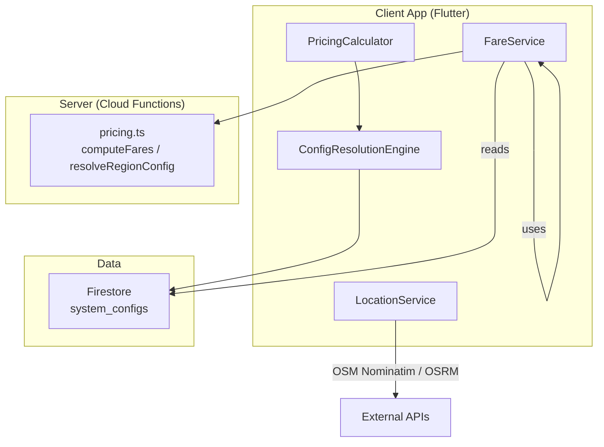
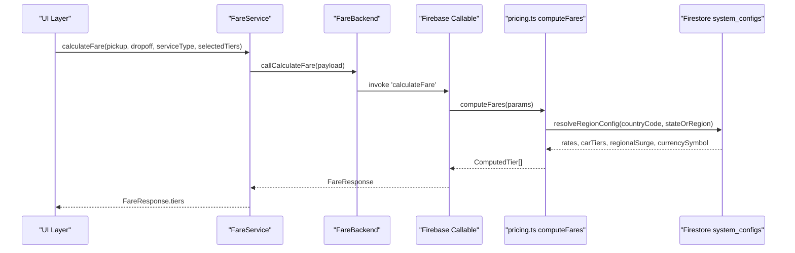
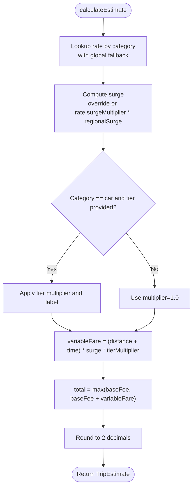
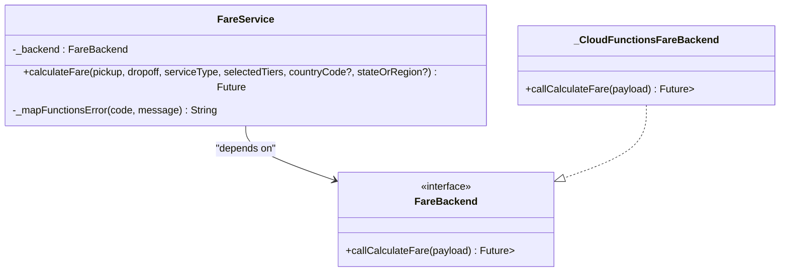
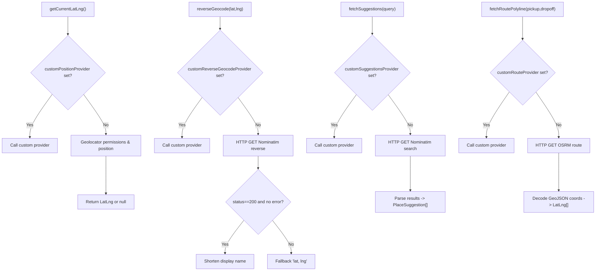
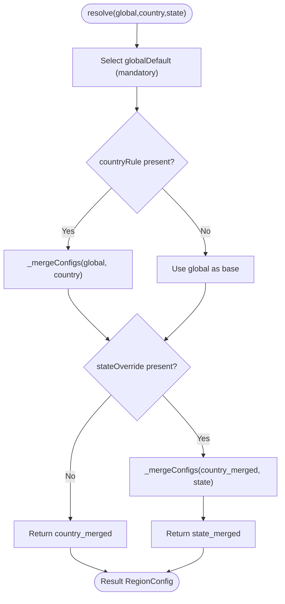
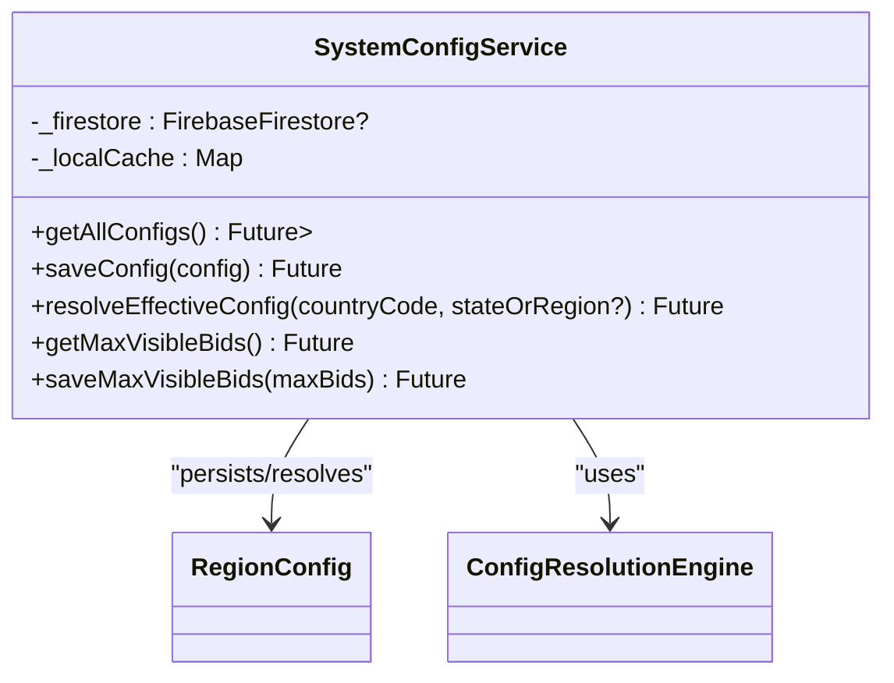
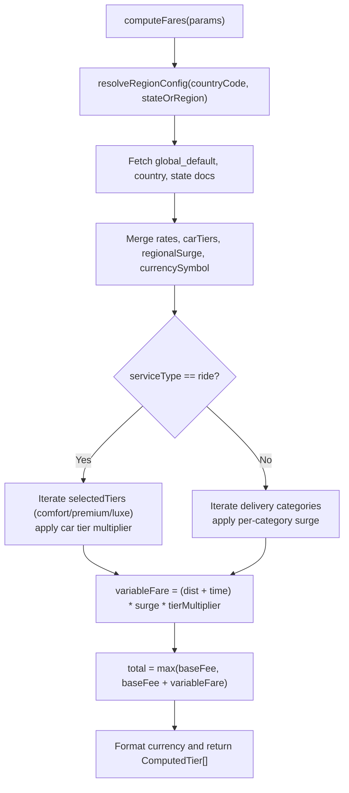
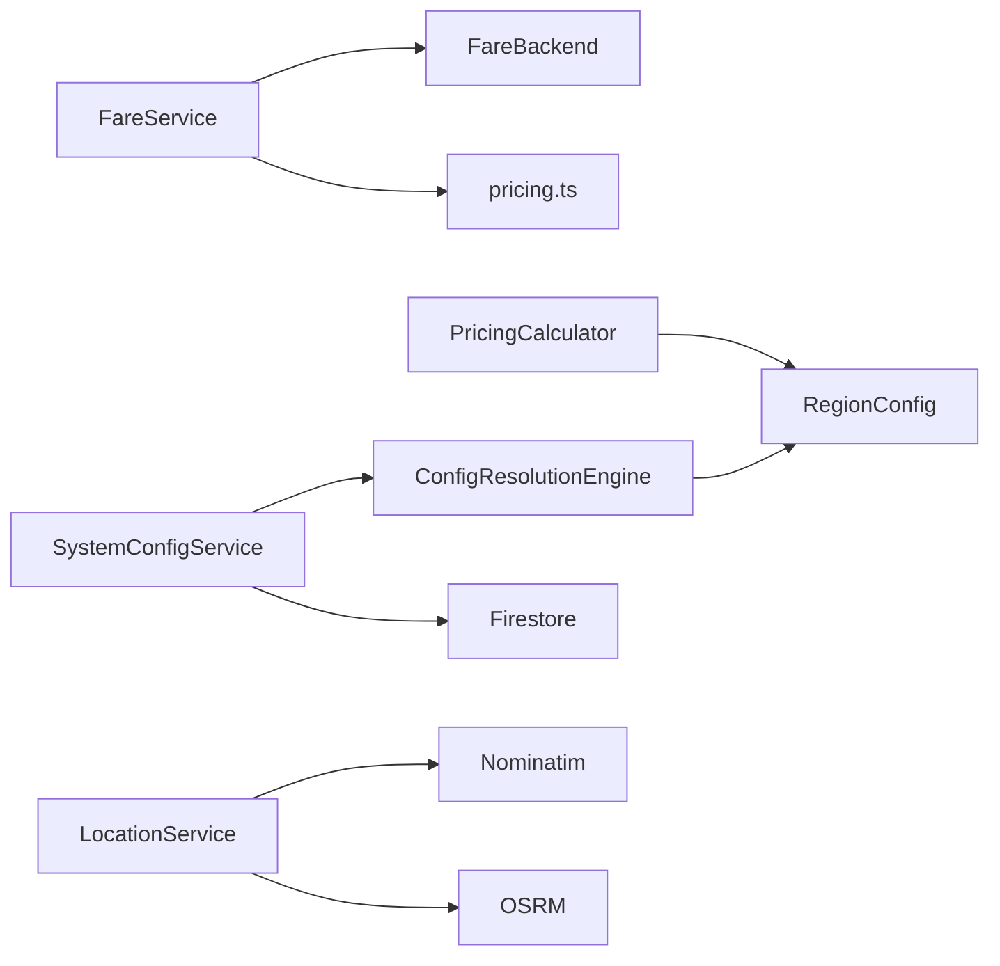

# Core Services

<cite>
**Referenced Files in This Document**
- [pricing_calculator.dart](file://sese_core/lib/services/pricing_calculator.dart)
- [fare_service.dart](file://sese_ride/lib/features/customer/services/fare_service.dart)
- [location_service.dart](file://sese_ride/lib/features/customer/services/location_service.dart)
- [config_resolution_engine.dart](file://sese_core/lib/services/config_resolution_engine.dart)
- [system_config_service.dart](file://sese_hub/lib/features/config/services/system_config_service.dart)
- [pricing.ts](file://functions/src/pricing.ts)
- [pricing_config.dart](file://sese_core/lib/models/pricing_config.dart)
</cite>

## Table of Contents
1. [Introduction](#introduction)
2. [Project Structure](#project-structure)
3. [Core Components](#core-components)
4. [Architecture Overview](#architecture-overview)
5. [Detailed Component Analysis](#detailed-component-analysis)
6. [Dependency Analysis](#dependency-analysis)
7. [Performance Considerations](#performance-considerations)
8. [Troubleshooting Guide](#troubleshooting-guide)
9. [Conclusion](#conclusion)

## Introduction
This document explains the core services layer that provides business logic and data access abstractions for pricing, fare calculation, location utilities, and configuration management. It focuses on:
- PricingCalculator: deterministic, server-aligned pricing engine used by client code and tests.
- FareService: zero-trust client service that delegates fare computation to a secure backend callable function.
- LocationService: GPS, geocoding, autocomplete, and routing utilities backed by OpenStreetMap and OSRM.
- Configuration services: ConfigResolutionEngine (pure merge logic) and SystemConfigService (Firestore-backed persistence with caching).

The design emphasizes testability via dependency injection, clear error handling, and separation between client-facing services and server-side pricing logic.

## Project Structure
The relevant code spans three modules:
- sese_core: shared models and pure services (pricing calculator, config resolution engine).
- sese_ride: customer-facing features (fare service, location service).
- functions: server-side pricing logic (Firebase Cloud Functions).

**Diagram sources**
- [fare_service.dart:1-108](file://sese_ride/lib/features/customer/services/fare_service.dart#L1-L108)
- [location_service.dart:1-298](file://sese_ride/lib/features/customer/services/location_service.dart#L1-L298)
- [pricing_calculator.dart:1-147](file://sese_core/lib/services/pricing_calculator.dart#L1-L147)
- [config_resolution_engine.dart:1-218](file://sese_core/lib/services/config_resolution_engine.dart#L1-L218)
- [system_config_service.dart:1-181](file://sese_hub/lib/features/config/services/system_config_service.dart#L1-L181)
- [pricing.ts:1-237](file://functions/src/pricing.ts#L1-L237)

**Section sources**
- [pricing_calculator.dart:1-147](file://sese_core/lib/services/pricing_calculator.dart#L1-L147)
- [fare_service.dart:1-108](file://sese_ride/lib/features/customer/services/fare_service.dart#L1-L108)
- [location_service.dart:1-298](file://sese_ride/lib/features/customer/services/location_service.dart#L1-L298)
- [config_resolution_engine.dart:1-218](file://sese_core/lib/services/config_resolution_engine.dart#L1-L218)
- [system_config_service.dart:1-181](file://sese_hub/lib/features/config/services/system_config_service.dart#L1-L181)
- [pricing.ts:1-237](file://functions/src/pricing.ts#L1-L237)

## Core Components
- PricingCalculator: Pure static engine computing trip estimates using RegionConfig and VehicleCategory. Applies surge and tier multipliers, enforces base fee floor, and returns structured TripEstimate objects. Also supports batch calculations for delivery categories and ride tiers, plus multi-vehicle dispatch proposals.
- FareService: Zero-trust client wrapper around a backend interface (FareBackend). Production uses Firebase Callable Functions; testing injects a mock backend. Normalizes errors into user-friendly messages and deserializes server responses into FareResponse.
- LocationService: Provides GPS acquisition, reverse/forward geocoding, autocomplete suggestions, and route geometry fetching using OSM Nominatim and OSRM. Exposes static test seams to replace network calls in tests.
- ConfigResolutionEngine: Pure service that merges Global → Country → State configurations with well-defined override semantics for pricing rates, car tier thresholds, streak rewards, and daily commission settings.
- SystemConfigService: Firestore-backed persistence for RegionConfig documents with an in-memory cache fallback. Exposes helpers to read, write, and resolve effective configuration per country/state.

**Section sources**
- [pricing_calculator.dart:1-147](file://sese_core/lib/services/pricing_calculator.dart#L1-L147)
- [fare_service.dart:1-108](file://sese_ride/lib/features/customer/services/fare_service.dart#L1-L108)
- [location_service.dart:1-298](file://sese_ride/lib/features/customer/services/location_service.dart#L1-L298)
- [config_resolution_engine.dart:1-218](file://sese_core/lib/services/config_resolution_engine.dart#L1-L218)
- [system_config_service.dart:1-181](file://sese_hub/lib/features/config/services/system_config_service.dart#L1-L181)

## Architecture Overview
The system follows a layered architecture:
- Client UI calls FareService for fare quotes.
- FareService forwards requests to a secure backend callable function.
- Backend resolves region-specific pricing from Firestore and computes fares aligned with PricingCalculator’s formulas.
- LocationService supplies coordinates and route geometry without blocking the booking flow.
- SystemConfigService manages dynamic configuration with caching and fallbacks.

**Diagram sources**
- [fare_service.dart:18-108](file://sese_ride/lib/features/customer/services/fare_service.dart#L18-L108)
- [pricing.ts:60-237](file://functions/src/pricing.ts#L60-L237)

## Detailed Component Analysis

### PricingCalculator
Responsibilities:
- Compute trip estimates for a given vehicle category, distance, duration, optional surge override, and optional passenger tier multiplier.
- Provide batch methods for all delivery categories and ride tiers.
- Generate multi-vehicle dispatch proposals with immutable inputs/outputs.

Key behaviors:
- Uses RegionConfig.pricingRates to select per-category rates.
- Applies surge = rate.surgeMultiplier * config.regionalSurgeMultiplier unless overridden.
- For car rides, applies tier multiplier and label from CarTierThresholds.
- Enforces base fee floor: total cannot be less than baseFee.
- Rounds final fare to two decimals.

Complexity:
- Single estimate: O(1).
- Delivery options: O(k) where k is number of eligible delivery categories.
- Ride tiers: O(t) where t is number of ride tiers.
- Multi-vehicle dispatch: O(n) for n selected categories.

Error handling:
- No exceptions thrown; relies on caller-provided valid RegionConfig and numeric inputs.

Optimization opportunities:
- Cache repeated calculations when inputs are identical.
- Precompute tier labels/multipliers if many calls per session.

**Diagram sources**
- [pricing_calculator.dart:11-60](file://sese_core/lib/services/pricing_calculator.dart#L11-L60)

**Section sources**
- [pricing_calculator.dart:1-147](file://sese_core/lib/services/pricing_calculator.dart#L1-L147)

### FareService
Responsibilities:
- Encapsulate zero-trust fare calculation by delegating to a backend abstraction.
- Map backend errors to user-friendly messages.
- Serialize request payload and deserialize server response into FareResponse.

Design patterns:
- Dependency Injection: accepts an optional FareBackend implementation; defaults to cloud functions transport.
- Error Mapping: translates FirebaseFunctionsException codes to friendly messages.

Testing:
- Tests provide a MockFareBackend returning predefined payloads.

Integration points:
- Calls Firebase Callable Function named calculateFare.
- Produces FareResponse containing distanceKm, durationMins, tiers, and fareToken.

**Diagram sources**
- [fare_service.dart:18-108](file://sese_ride/lib/features/customer/services/fare_service.dart#L18-L108)

**Section sources**
- [fare_service.dart:1-108](file://sese_ride/lib/features/customer/services/fare_service.dart#L1-L108)

### LocationService
Responsibilities:
- Acquire current device location with permission handling.
- Reverse geocode lat/lng to human-readable address via OSM Nominatim.
- Forward geocode and autocomplete search via OSM Nominatim.
- Fetch driving route polyline via OSRM public demo server.

Test seams:
- Static fields allow injecting custom providers for position, reverse geocode, suggestions, search, and route polyline.
- resetTestSeams clears injected providers.

Network behavior:
- All external calls are best-effort; failures return safe fallbacks (null, empty list, or coordinate string) so the booking flow remains resilient.

**Diagram sources**
- [location_service.dart:46-290](file://sese_ride/lib/features/customer/services/location_service.dart#L46-L290)

**Section sources**
- [location_service.dart:1-298](file://sese_ride/lib/features/customer/services/location_service.dart#L1-L298)

### ConfigResolutionEngine
Responsibilities:
- Merge configuration across a strict hierarchy: Global Default → Country Rule → State Override.
- Merge pricing rates per vehicle category.
- Merge car tier thresholds with sentinel-based inheritance.
- Merge streak rewards and daily commission settings with AND semantics for enablement and union semantics for disable lists.

Key behaviors:
- resolveFromList selects appropriate configs by country and state, then applies merge rules.
- _mergeConfigs performs field-level merging with explicit defaults and inheritance rules.

Complexity:
- Merging is linear in the number of fields and nested structures; typically constant-time per call due to fixed schema size.

**Diagram sources**
- [config_resolution_engine.dart:12-34](file://sese_core/lib/services/config_resolution_engine.dart#L12-L34)
- [config_resolution_engine.dart:68-165](file://sese_core/lib/services/config_resolution_engine.dart#L68-L165)

**Section sources**
- [config_resolution_engine.dart:1-218](file://sese_core/lib/services/config_resolution_engine.dart#L1-L218)

### SystemConfigService
Responsibilities:
- Persist and retrieve RegionConfig documents under system_configs.
- Maintain an in-memory cache for development/stub mode and as a fallback when Firestore is unavailable.
- Resolve effective configuration for a given country and optional state using ConfigResolutionEngine.

Caching strategy:
- On successful reads, updates local cache with remote docs.
- Writes update local cache immediately and attempt Firestore persistence asynchronously.

**Diagram sources**
- [system_config_service.dart:8-181](file://sese_hub/lib/features/config/services/system_config_service.dart#L8-L181)
- [config_resolution_engine.dart:1-218](file://sese_core/lib/services/config_resolution_engine.dart#L1-L218)

**Section sources**
- [system_config_service.dart:1-181](file://sese_hub/lib/features/config/services/system_config_service.dart#L1-L181)

### Server-Side Pricing (pricing.ts)
Responsibilities:
- Resolve effective regional configuration from Firestore with a fallback chain: global_default → country_NG → state_NG_LAGOS.
- Normalize and merge pricing rates and car tier thresholds.
- Compute fares for ride and delivery services, applying surge and tier multipliers, enforcing base fee floor, and formatting currency.

Alignment:
- The server formula mirrors PricingCalculator’s approach: base fee floor, variable fare composed of distance and time multiplied by surge and tier multiplier.

**Diagram sources**
- [pricing.ts:60-237](file://functions/src/pricing.ts#L60-L237)

**Section sources**
- [pricing.ts:1-237](file://functions/src/pricing.ts#L1-L237)

## Dependency Analysis
- FareService depends on FareBackend abstraction; production binds to Firebase Callable Functions; tests bind to mocks.
- PricingCalculator depends on RegionConfig and VehicleCategory models.
- ConfigResolutionEngine depends on RegionConfig and related model types.
- SystemConfigService depends on Firestore and ConfigResolutionEngine.
- LocationService depends on platform geolocation and external HTTP services (Nominatim, OSRM).

**Diagram sources**
- [fare_service.dart:18-108](file://sese_ride/lib/features/customer/services/fare_service.dart#L18-L108)
- [pricing.ts:60-237](file://functions/src/pricing.ts#L60-L237)
- [pricing_calculator.dart:1-147](file://sese_core/lib/services/pricing_calculator.dart#L1-L147)
- [config_resolution_engine.dart:1-218](file://sese_core/lib/services/config_resolution_engine.dart#L1-L218)
- [system_config_service.dart:1-181](file://sese_hub/lib/features/config/services/system_config_service.dart#L1-L181)
- [location_service.dart:1-298](file://sese_ride/lib/features/customer/services/location_service.dart#L1-L298)

**Section sources**
- [fare_service.dart:1-108](file://sese_ride/lib/features/customer/services/fare_service.dart#L1-L108)
- [pricing.ts:1-237](file://functions/src/pricing.ts#L1-L237)
- [pricing_calculator.dart:1-147](file://sese_core/lib/services/pricing_calculator.dart#L1-L147)
- [config_resolution_engine.dart:1-218](file://sese_core/lib/services/config_resolution_engine.dart#L1-L218)
- [system_config_service.dart:1-181](file://sese_hub/lib/features/config/services/system_config_service.dart#L1-L181)
- [location_service.dart:1-298](file://sese_ride/lib/features/customer/services/location_service.dart#L1-L298)

## Performance Considerations
- PricingCalculator: Stateless and fast; consider memoization for repeated identical inputs within a session.
- FareService: Network-bound; ensure retries/backoff at the UI layer and avoid redundant calls for unchanged pickup/dropoff pairs.
- LocationService: Best-effort external calls; leverage test seams to eliminate network latency in tests; consider caching recent suggestions and routes locally.
- SystemConfigService: In-memory cache reduces Firestore reads; batch reads and debounce refreshes to minimize cold starts.
- Server-side pricing: Firestore reads are bounded to at most three documents; consider caching frequently accessed configs in memory at runtime.

[No sources needed since this section provides general guidance]

## Troubleshooting Guide
Common issues and resolutions:
- FareService errors:
  - Unauthenticated: prompt sign-in again.
  - Invalid argument: validate pickup/dropoff coordinates.
  - Not found: no route exists between locations.
  - Unavailable/resource-exhausted: retry after delay.
- LocationService failures:
  - Permission denied: guide user to enable location services.
  - Network timeouts: fall back gracefully to coordinate strings or empty suggestion lists.
- Configuration resolution:
  - Missing country/state docs: falls back to global defaults; verify document IDs and naming conventions.
  - Unexpected overrides: check sentinel values and inheritance rules in ConfigResolutionEngine.

**Section sources**
- [fare_service.dart:76-106](file://sese_ride/lib/features/customer/services/fare_service.dart#L76-L106)
- [location_service.dart:73-101](file://sese_ride/lib/features/customer/services/location_service.dart#L73-L101)
- [location_service.dart:113-143](file://sese_ride/lib/features/customer/services/location_service.dart#L113-L143)
- [config_resolution_engine.dart:68-165](file://sese_core/lib/services/config_resolution_engine.dart#L68-L165)

## Conclusion
The core services layer cleanly separates concerns:
- PricingCalculator encapsulates deterministic pricing math aligned with server-side logic.
- FareService provides a secure, testable client entry point for fare computation.
- LocationService offers resilient geospatial utilities with comprehensive test seams.
- ConfigResolutionEngine and SystemConfigService deliver robust, hierarchical configuration management with caching and fallbacks.

Adopting these patterns ensures scalability, maintainability, and strong test coverage while keeping the user experience responsive and reliable.