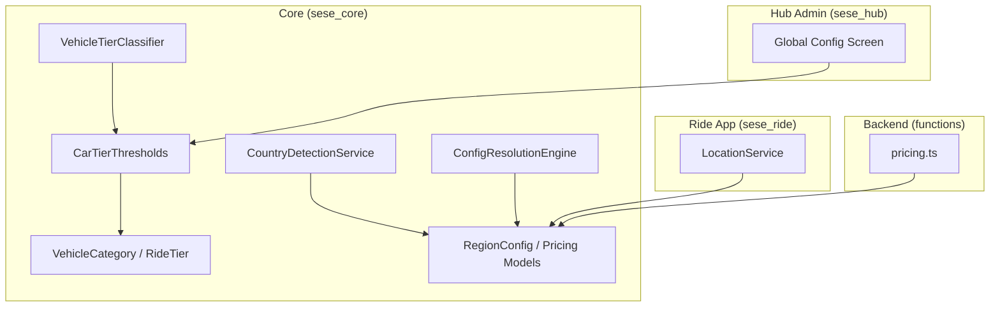
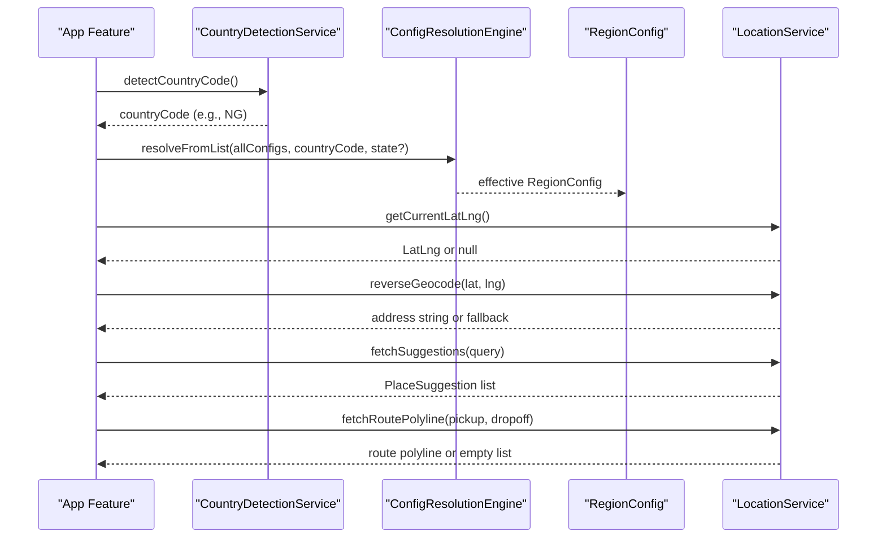
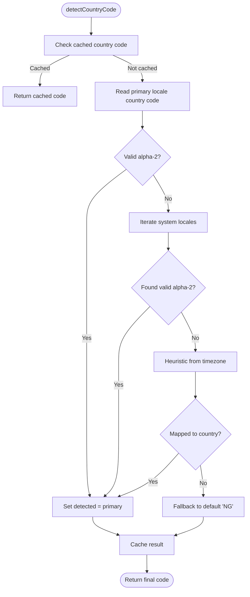
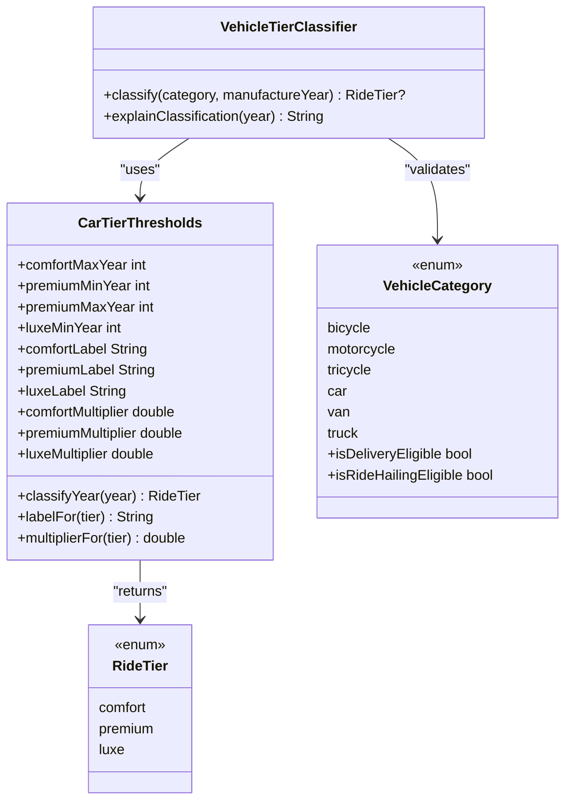
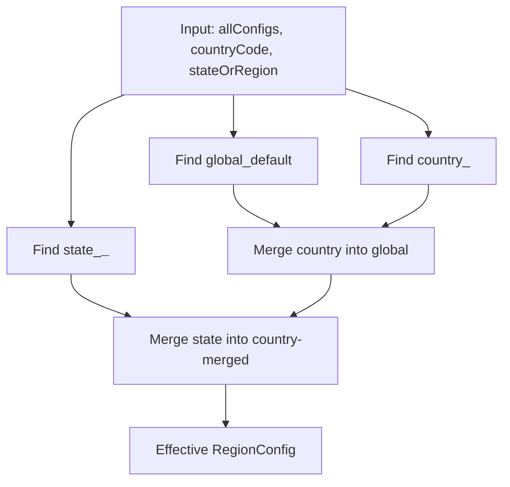
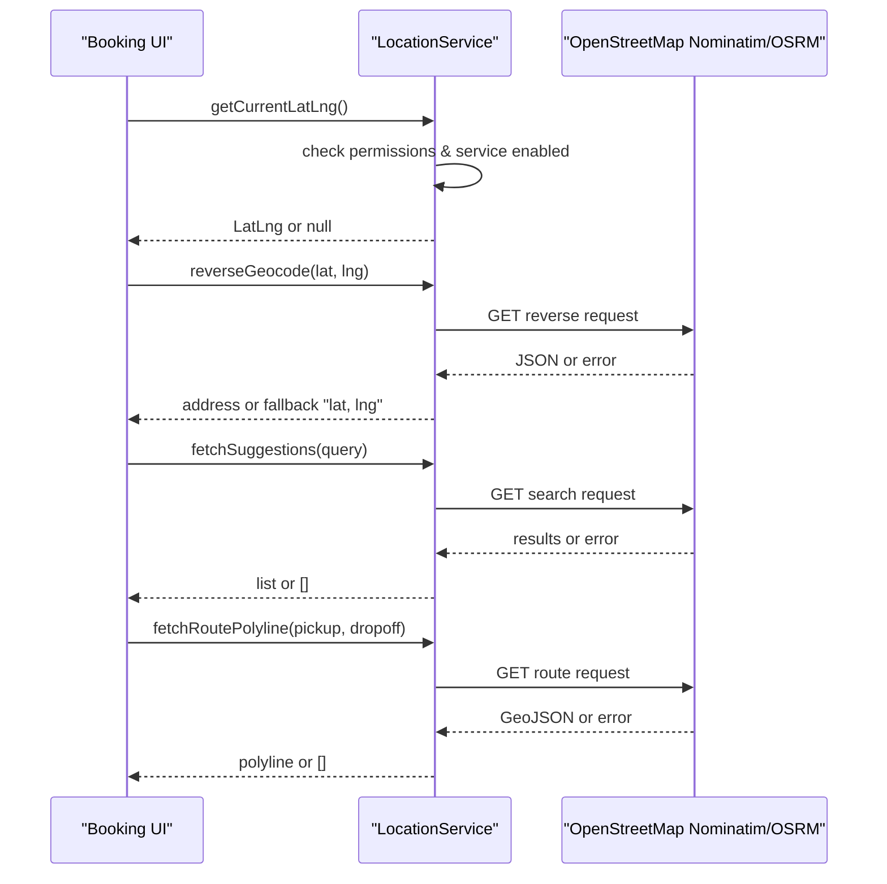
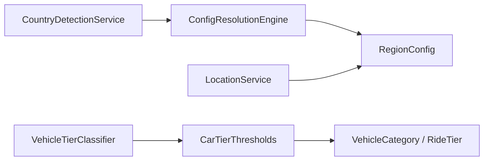

# Location Services

<cite>
**Referenced Files in This Document**
- [country_detection_service.dart](file://sese_core/lib/services/country_detection_service.dart)
- [vehicle_tier_classifier.dart](file://sese_core/lib/services/vehicle_tier_classifier.dart)
- [car_tier_thresholds.dart](file://sese_core/lib/models/car_tier_thresholds.dart)
- [vehicle_category.dart](file://sese_core/lib/models/vehicle_category.dart)
- [pricing_config.dart](file://sese_core/lib/models/pricing_config.dart)
- [config_resolution_engine.dart](file://sese_core/lib/services/config_resolution_engine.dart)
- [location_service.dart](file://sese_ride/lib/features/customer/services/location_service.dart)
- [dynamic_system_config_test.dart](file://sese_core/test/dynamic_system_config_test.dart)
- [global_config_screen.dart](file://sese_hub/lib/features/config/presentation/global_config_screen.dart)
- [pricing.ts](file://functions/src/pricing.ts)
</cite>

## Table of Contents
1. [Introduction](#introduction)
2. [Project Structure](#project-structure)
3. [Core Components](#core-components)
4. [Architecture Overview](#architecture-overview)
5. [Detailed Component Analysis](#detailed-component-analysis)
6. [Dependency Analysis](#dependency-analysis)
7. [Performance Considerations](#performance-considerations)
8. [Troubleshooting Guide](#troubleshooting-guide)
9. [Conclusion](#conclusion)

## Introduction
This document explains the location-based services and vehicle classification logic used across the application. It focuses on:
- Automatic region detection through `CountryDetectionService`.
- Vehicle tier classification for passenger cars via `VehicleTierClassifier` and `CarTierThresholds`.
- Regional configuration loading and merging using `ConfigResolutionEngine` and `RegionConfig`.
- GPS integration, geocoding, routing, fallback mechanisms, and privacy considerations through `LocationService`.
- Examples of location-aware feature activation, regional configuration loading, and vehicle type validation.

The goal is to make these systems understandable for both technical and non-technical readers while providing concrete code references and diagrams.

## Project Structure
The relevant implementation spans three main areas:
- Core business logic and models in `sese_core`: country detection, vehicle categories, pricing configuration, and configuration resolution.
- Ride app location utilities in `sese_ride`: GPS, reverse/forward geocoding, and routing using OpenStreetMap services.
- Hub admin UI and backend functions for configuring car tiers and resolving region-specific pricing.

**Diagram sources**
- [country_detection_service.dart:1-114](file://sese_core/lib/services/country_detection_service.dart#L1-L114)
- [vehicle_tier_classifier.dart:1-36](file://sese_core/lib/services/vehicle_tier_classifier.dart#L1-L36)
- [car_tier_thresholds.dart:1-137](file://sese_core/lib/models/car_tier_thresholds.dart#L1-L137)
- [vehicle_category.dart:1-142](file://sese_core/lib/models/vehicle_category.dart#L1-L142)
- [pricing_config.dart:1-499](file://sese_core/lib/models/pricing_config.dart#L1-L499)
- [config_resolution_engine.dart:1-218](file://sese_core/lib/services/config_resolution_engine.dart#L1-L218)
- [location_service.dart:1-298](file://sese_ride/lib/features/customer/services/location_service.dart#L1-L298)
- [global_config_screen.dart:690-879](file://sese_hub/lib/features/config/presentation/global_config_screen.dart#L690-L879)
- [pricing.ts:86-109](file://functions/src/pricing.ts#L86-L109)

**Section sources**
- [country_detection_service.dart:1-114](file://sese_core/lib/services/country_detection_service.dart#L1-L114)
- [vehicle_tier_classifier.dart:1-36](file://sese_core/lib/services/vehicle_tier_classifier.dart#L1-L36)
- [car_tier_thresholds.dart:1-137](file://sese_core/lib/models/car_tier_thresholds.dart#L1-L137)
- [vehicle_category.dart:1-142](file://sese_core/lib/models/vehicle_category.dart#L1-L142)
- [pricing_config.dart:1-499](file://sese_core/lib/models/pricing_config.dart#L1-L499)
- [config_resolution_engine.dart:1-218](file://sese_core/lib/services/config_resolution_engine.dart#L1-L218)
- [location_service.dart:1-298](file://sese_ride/lib/features/customer/services/location_service.dart#L1-L298)
- [global_config_screen.dart:690-879](file://sese_hub/lib/features/config/presentation/global_config_screen.dart#L690-L879)
- [pricing.ts:86-109](file://functions/src/pricing.ts#L86-L109)

## Core Components
- CountryDetectionService: Detects ISO-3166-1 alpha-2 country codes from device locale, system locales, or timezone heuristics, with a default fallback to Nigeria.
- VehicleTierClassifier: Classifies passenger vehicles into ride tiers based on manufacture year and configurable thresholds.
- CarTierThresholds: Defines year ranges, labels, and multipliers for comfort/premium/luxe tiers.
- VehicleCategory and RideTier: Enumerations defining eligible vehicle types and passenger ride tiers.
- RegionConfig and Pricing Models: Represent per-region pricing rates, currency, surge multipliers, car tier thresholds, streak rewards, and daily commission settings.
- ConfigResolutionEngine: Merges global, country, and state configurations into an effective configuration.
- LocationService: Provides GPS, reverse/forward geocoding, and routing using OpenStreetMap, with robust fallbacks and test seams.

**Section sources**
- [country_detection_service.dart:1-114](file://sese_core/lib/services/country_detection_service.dart#L1-L114)
- [vehicle_tier_classifier.dart:1-36](file://sese_core/lib/services/vehicle_tier_classifier.dart#L1-L36)
- [car_tier_thresholds.dart:1-137](file://sese_core/lib/models/car_tier_thresholds.dart#L1-L137)
- [vehicle_category.dart:1-142](file://sese_core/lib/models/vehicle_category.dart#L1-L142)
- [pricing_config.dart:1-499](file://sese_core/lib/models/pricing_config.dart#L1-L499)
- [config_resolution_engine.dart:1-218](file://sese_core/lib/services/config_resolution_engine.dart#L1-L218)
- [location_service.dart:1-298](file://sese_ride/lib/features/customer/services/location_service.dart#L1-L298)

## Architecture Overview
The location-aware architecture combines device-based region detection, regional configuration resolution, and GPS/geocoding/routing capabilities. The flow typically starts with detecting the user’s country, then resolves region-specific pricing and features, and finally uses GPS and mapping services for booking and routing.

**Diagram sources**
- [country_detection_service.dart:20-63](file://sese_core/lib/services/country_detection_service.dart#L20-L63)
- [config_resolution_engine.dart:36-66](file://sese_core/lib/services/config_resolution_engine.dart#L36-L66)
- [pricing_config.dart:251-371](file://sese_core/lib/models/pricing_config.dart#L251-L371)
- [location_service.dart:67-101](file://sese_ride/lib/features/customer/services/location_service.dart#L67-L101)
- [location_service.dart:113-143](file://sese_ride/lib/features/customer/services/location_service.dart#L113-L143)
- [location_service.dart:167-179](file://sese_ride/lib/features/customer/services/location_service.dart#L167-L179)
- [location_service.dart:231-278](file://sese_ride/lib/features/customer/services/location_service.dart#L231-L278)

## Detailed Component Analysis

### CountryDetectionService
Purpose:
- Provide automatic country detection based on device locale and timezone heuristics.
- Offer synchronous access to the current detected country code.
- Allow manual override and reset for testing or user settings.

Key behaviors:
- Primary check reads the primary locale country code.
- Secondary checks iterate system locales and apply timezone heuristics.
- Default fallback is Nigeria (`NG`) when no valid code is found.
- Results are cached in memory for fast synchronous access.

**Diagram sources**
- [country_detection_service.dart:20-63](file://sese_core/lib/services/country_detection_service.dart#L20-L63)
- [country_detection_service.dart:85-112](file://sese_core/lib/services/country_detection_service.dart#L85-L112)

Usage examples:
- Activate location-aware features by checking the detected country code before enabling region-specific functionality.
- Load regional configuration by passing the detected country code to the configuration resolver.

Privacy considerations:
- Uses device locale/timezone metadata; does not send network requests.
- Avoids collecting precise location data at this stage.

**Section sources**
- [country_detection_service.dart:1-114](file://sese_core/lib/services/country_detection_service.dart#L1-L114)

### VehicleTierClassifier and CarTierThresholds
Purpose:
- Classify passenger vehicles into ride tiers based on manufacture year.
- Provide human-readable explanations for tier assignments.
- Support dynamic thresholds configured by administrators.

Key behaviors:
- Only applies to `VehicleCategory.car`; returns null for other vehicle types.
- Uses `CarTierThresholds` to map years to tiers: comfort (< threshold), premium (range), luxe (>= threshold).
- Labels and multipliers can be customized per region.

**Diagram sources**
- [vehicle_tier_classifier.dart:1-36](file://sese_core/lib/services/vehicle_tier_classifier.dart#L1-L36)
- [car_tier_thresholds.dart:1-137](file://sese_core/lib/models/car_tier_thresholds.dart#L1-L137)
- [vehicle_category.dart:1-142](file://sese_core/lib/models/vehicle_category.dart#L1-L142)

Examples:
- During vehicle registration, classify a car’s year to determine its ride tier and associated multiplier.
- Display tier explanation text to users or support staff.

Validation:
- Non-car categories return null from classifier, ensuring only passenger cars are tiered.

**Section sources**
- [vehicle_tier_classifier.dart:1-36](file://sese_core/lib/services/vehicle_tier_classifier.dart#L1-L36)
- [car_tier_thresholds.dart:1-137](file://sese_core/lib/models/car_tier_thresholds.dart#L1-L137)
- [vehicle_category.dart:1-142](file://sese_core/lib/models/vehicle_category.dart#L1-L142)
- [dynamic_system_config_test.dart:30-68](file://sese_core/test/dynamic_system_config_test.dart#L30-L68)

### Regional Configuration Loading and Feature Activation
Purpose:
- Resolve effective configuration by merging global, country, and state overrides.
- Apply region-specific pricing, currency, surge multipliers, car tier thresholds, and streak controls.

Key behaviors:
- `ConfigResolutionEngine.resolveFromList` selects global, country, and state configs and merges them.
- `RegionConfig` includes pricing rates per vehicle category, car tier thresholds, streak rewards, and daily streak configuration.
- Backend function `pricing.ts` loads config documents in order and applies overrides.

**Diagram sources**
- [config_resolution_engine.dart:36-66](file://sese_core/lib/services/config_resolution_engine.dart#L36-L66)
- [pricing_config.dart:251-371](file://sese_core/lib/models/pricing_config.dart#L251-L371)
- [pricing.ts:86-109](file://functions/src/pricing.ts#L86-L109)

Feature activation examples:
- Use `DailyStreakConfig.isEnabledForRegion(countryCode, stateOrRegion)` to enable/disable streak mechanics per region.
- Use `RegionConfig.pricingRates[category]` to get base fee, distance rate, time rate, and surge multiplier for a given vehicle type.

Admin UI:
- Global config screen allows Super Admins to configure car tier thresholds, labels, and multipliers.

**Section sources**
- [config_resolution_engine.dart:1-218](file://sese_core/lib/services/config_resolution_engine.dart#L1-L218)
- [pricing_config.dart:151-249](file://sese_core/lib/models/pricing_config.dart#L151-L249)
- [pricing_config.dart:251-499](file://sese_core/lib/models/pricing_config.dart#L251-L499)
- [global_config_screen.dart:690-879](file://sese_hub/lib/features/config/presentation/global_config_screen.dart#L690-L879)
- [pricing.ts:86-109](file://functions/src/pricing.ts#L86-L109)

### GPS Integration Patterns and Fallback Mechanisms
Purpose:
- Provide GPS location retrieval, reverse/forward geocoding, and routing using OpenStreetMap services.
- Ensure robust fallback behavior so booking flows are never blocked by location service failures.

Key behaviors:
- `getCurrentLatLng` requests permission if needed and returns null on failure.
- Reverse geocoding falls back to coordinate string on errors.
- Forward search and suggestions return empty lists/null on failure.
- Route polyline returns empty list on failure.
- Test seams allow mocking location and geocoding in tests.

**Diagram sources**
- [location_service.dart:67-101](file://sese_ride/lib/features/customer/services/location_service.dart#L67-L101)
- [location_service.dart:113-143](file://sese_ride/lib/features/customer/services/location_service.dart#L113-L143)
- [location_service.dart:167-179](file://sese_ride/lib/features/customer/services/location_service.dart#L167-L179)
- [location_service.dart:231-278](file://sese_ride/lib/features/customer/services/location_service.dart#L231-L278)

Privacy considerations:
- All network calls use public OpenStreetMap endpoints without API keys.
- Requests include a User-Agent header to comply with fair-use policy.
- Failures are best-effort; no sensitive location data is persisted here.
- For production scale, consider self-hosting Nominatim/OSRM or fronting with a caching backend.

**Section sources**
- [location_service.dart:1-298](file://sese_ride/lib/features/customer/services/location_service.dart#L1-L298)

## Dependency Analysis
The components interact as follows:
- `CountryDetectionService` provides the country code used by configuration resolution.
- `ConfigResolutionEngine` merges configurations and produces an effective `RegionConfig`.
- `VehicleTierClassifier` depends on `CarTierThresholds` and validates against `VehicleCategory`.
- `LocationService` is independent but often used alongside resolved configuration for pricing and routing.

**Diagram sources**
- [country_detection_service.dart:1-114](file://sese_core/lib/services/country_detection_service.dart#L1-L114)
- [config_resolution_engine.dart:1-218](file://sese_core/lib/services/config_resolution_engine.dart#L1-L218)
- [vehicle_tier_classifier.dart:1-36](file://sese_core/lib/services/vehicle_tier_classifier.dart#L1-L36)
- [car_tier_thresholds.dart:1-137](file://sese_core/lib/models/car_tier_thresholds.dart#L1-L137)
- [vehicle_category.dart:1-142](file://sese_core/lib/models/vehicle_category.dart#L1-L142)
- [pricing_config.dart:1-499](file://sese_core/lib/models/pricing_config.dart#L1-L499)
- [location_service.dart:1-298](file://sese_ride/lib/features/customer/services/location_service.dart#L1-L298)

**Section sources**
- [country_detection_service.dart:1-114](file://sese_core/lib/services/country_detection_service.dart#L1-L114)
- [config_resolution_engine.dart:1-218](file://sese_core/lib/services/config_resolution_engine.dart#L1-L218)
- [vehicle_tier_classifier.dart:1-36](file://sese_core/lib/services/vehicle_tier_classifier.dart#L1-L36)
- [car_tier_thresholds.dart:1-137](file://sese_core/lib/models/car_tier_thresholds.dart#L1-L137)
- [vehicle_category.dart:1-142](file://sese_core/lib/models/vehicle_category.dart#L1-L142)
- [pricing_config.dart:1-499](file://sese_core/lib/models/pricing_config.dart#L1-L499)
- [location_service.dart:1-298](file://sese_ride/lib/features/customer/services/location_service.dart#L1-L298)

## Performance Considerations
- Country detection caches results in memory to avoid repeated checks.
- Configuration resolution performs linear scans over provided config lists; keep lists small and pre-filtered where possible.
- LocationService uses timeouts and best-effort handling to prevent blocking the UI; consider adding local caching for frequent geocoding queries.
- Public OpenStreetMap endpoints have fair-use limits; at scale, self-host or cache responses to reduce latency and quota usage.

[No sources needed since this section provides general guidance]

## Troubleshooting Guide
Common issues and resolutions:
- Country detection returns default Nigeria:
  - Verify device locale and timezone settings.
  - Use `reset()` to force re-detection after changing settings.
- Vehicle tier classification returns null:
  - Ensure the vehicle category is `car`; other categories are not tiered.
  - Confirm manufacture year is valid and within expected ranges.
- Regional configuration not applied:
  - Check that global, country, and state configs exist and are correctly merged.
  - Validate that disable lists do not inadvertently disable features.
- GPS or geocoding fails:
  - Check location permissions and service availability.
  - Inspect network connectivity and OpenStreetMap endpoint status.
  - Use test seams to mock responses during development.

**Section sources**
- [country_detection_service.dart:65-78](file://sese_core/lib/services/country_detection_service.dart#L65-L78)
- [vehicle_tier_classifier.dart:11-21](file://sese_core/lib/services/vehicle_tier_classifier.dart#L11-L21)
- [config_resolution_engine.dart:138-204](file://sese_core/lib/services/config_resolution_engine.dart#L138-L204)
- [location_service.dart:67-101](file://sese_ride/lib/features/customer/services/location_service.dart#L67-L101)
- [location_service.dart:113-143](file://sese_ride/lib/features/customer/services/location_service.dart#L113-L143)

## Conclusion
The location-based services combine device-driven region detection, robust regional configuration resolution, and flexible vehicle tier classification. GPS integration leverages OpenStreetMap with strong fallbacks to ensure reliable user experiences. By understanding these components and their interactions, teams can implement location-aware features, manage regional configurations effectively, and maintain privacy-conscious location handling.

[No sources needed since this section summarizes without analyzing specific files]