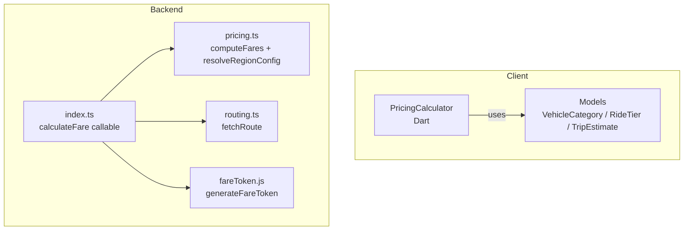
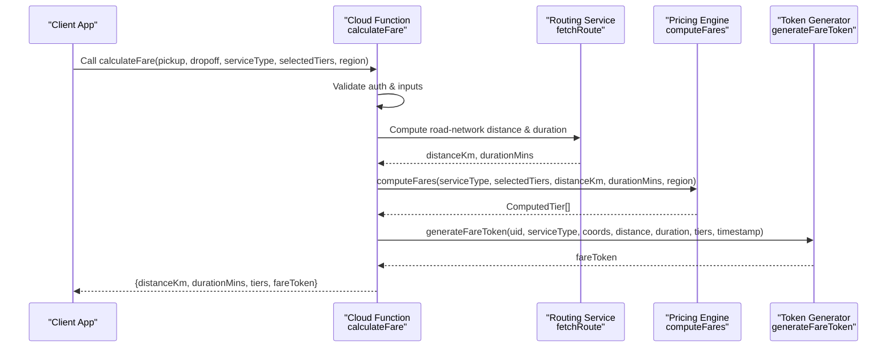
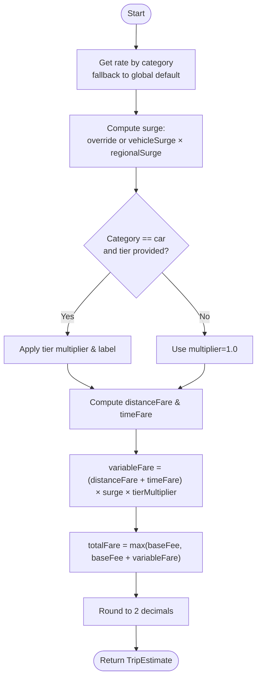
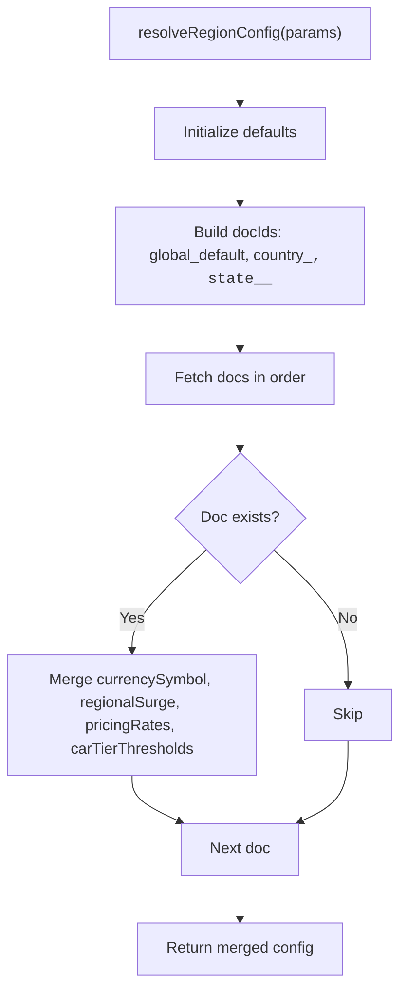
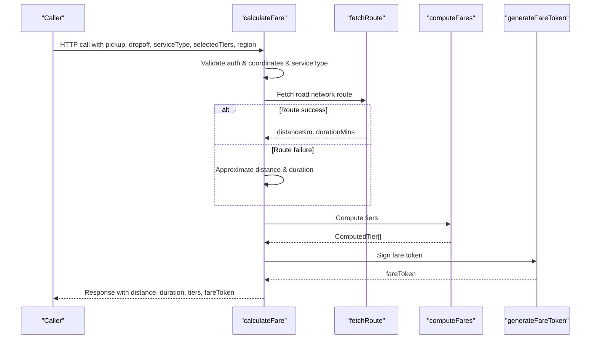
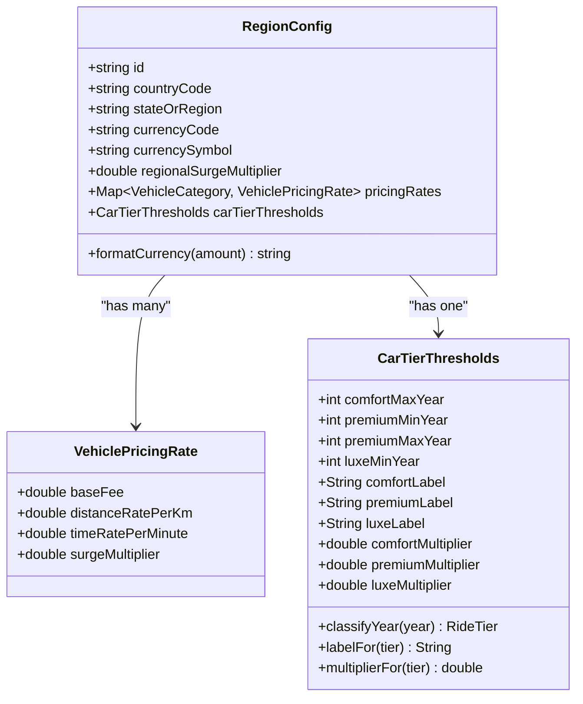
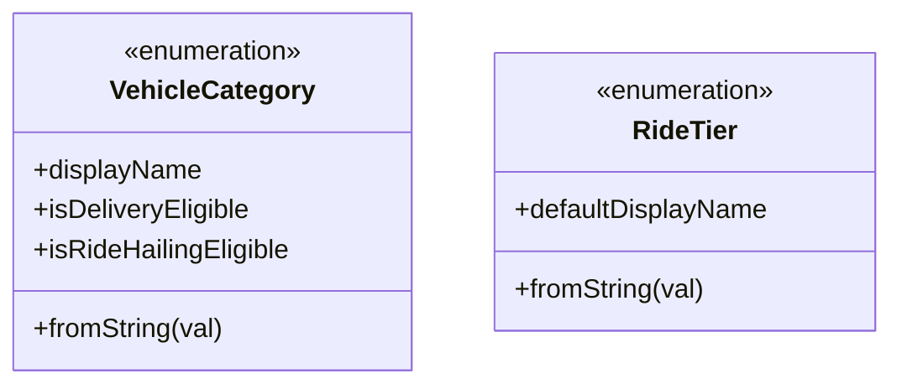
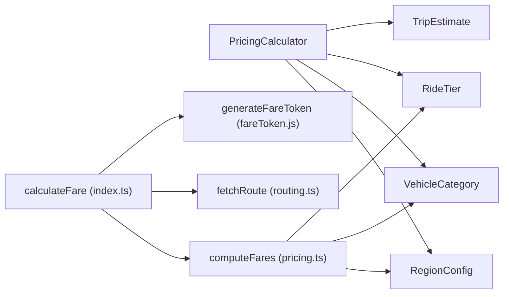

# Pricing Services

<cite>
**Referenced Files in This Document**
- [pricing.ts](file://functions/src/pricing.ts)
- [index.ts](file://functions/src/index.ts)
- [fareToken.js](file://functions/lib/fareToken.js)
- [pricing_calculator.dart](file://sese_core/lib/services/pricing_calculator.dart)
- [pricing_config.dart](file://sese_core/lib/models/pricing_config.dart)
- [car_tier_thresholds.dart](file://sese_core/lib/models/car_tier_thresholds.dart)
- [vehicle_category.dart](file://sese_core/lib/models/vehicle_category.dart)
- [trip_estimate.dart](file://sese_core/lib/models/trip_estimate.dart)
- [fare_models.dart](file://sese_ride/lib/features/customer/models/fare_models.dart)
- [fare_service_test.dart](file://sese_ride/test/fare_service_test.dart)
- [dynamic_system_config_test.dart](file://sese_core/test/dynamic_system_config_test.dart)
</cite>

## Table of Contents
1. [Introduction](#introduction)
2. [Project Structure](#project-structure)
3. [Core Components](#core-components)
4. [Architecture Overview](#architecture-overview)
5. [Detailed Component Analysis](#detailed-component-analysis)
6. [Dependency Analysis](#dependency-analysis)
7. [Performance Considerations](#performance-considerations)
8. [Troubleshooting Guide](#troubleshooting-guide)
9. [Conclusion](#conclusion)
10. [Appendices](#appendices)

## Introduction
This document explains the pricing calculation services across the backend Cloud Functions and the client-side core library. It focuses on:
- The server-side fare computation pipeline that enforces zero-trust pricing via signed tokens.
- The client-side PricingCalculator engine for dynamic trip and delivery estimates.
- Regional pricing logic, surge handling, vehicle tier classification, and currency formatting.
- Configuration resolution, error handling, caching strategies, performance optimizations, and testing approaches.

## Project Structure
The pricing system spans two main areas:
- Backend (Cloud Functions): Callable endpoint calculateFare orchestrates routing, regional configuration, fare computation, and token signing.
- Client Core: PricingCalculator computes estimates using regionally resolved configuration and vehicle/tier multipliers.

**Diagram sources**
- [index.ts:81-198](file://functions/src/index.ts#L81-L198)
- [pricing.ts:65-236](file://functions/src/pricing.ts#L65-L236)
- [pricing_calculator.dart:7-145](file://sese_core/lib/services/pricing_calculator.dart#L7-L145)

**Section sources**
- [index.ts:81-198](file://functions/src/index.ts#L81-L198)
- [pricing.ts:65-236](file://functions/src/pricing.ts#L65-L236)
- [pricing_calculator.dart:7-145](file://sese_core/lib/services/pricing_calculator.dart#L7-L145)

## Core Components
- PricingCalculator (client-side): Computes per-vehicle or per-tier estimates with base fee floor, distance/time rates, surge multiplier, and car tier multipliers.
- computeFares (server-side): Resolves regional configuration from Firestore, applies vehicle-specific rates, surge, and car tier multipliers, and returns computed tiers.
- RegionConfig and CarTierThresholds: Define per-region pricing rates, currency, surge, and car tier labels/multipliers.
- VehicleCategory and RideTier: Enumerations defining eligible vehicles and passenger tiers.
- Fare models and service tests: Validate client payload mapping and response parsing.

Key responsibilities:
- Server: Zero-trust authentication, route-based distance/duration, authoritative fare computation, signed fare token generation.
- Client: Deterministic estimate calculations aligned with server formulas; optional local fallback when server is unavailable.

**Section sources**
- [pricing_calculator.dart:7-145](file://sese_core/lib/services/pricing_calculator.dart#L7-L145)
- [pricing.ts:18-58](file://functions/src/pricing.ts#L18-L58)
- [pricing.ts:65-147](file://functions/src/pricing.ts#L65-L147)
- [pricing.ts:166-236](file://functions/src/pricing.ts#L166-L236)
- [pricing_config.dart:251-499](file://sese_core/lib/models/pricing_config.dart#L251-L499)
- [car_tier_thresholds.dart:10-137](file://sese_core/lib/models/car_tier_thresholds.dart#L10-L137)
- [vehicle_category.dart:5-69](file://sese_core/lib/models/vehicle_category.dart#L5-L69)

## Architecture Overview
The zero-trust fare calculation flow ensures fares are never trusted from the client.

**Diagram sources**
- [index.ts:81-198](file://functions/src/index.ts#L81-L198)
- [pricing.ts:166-236](file://functions/src/pricing.ts#L166-L236)
- [fareToken.js:1-200](file://functions/lib/fareToken.js#L1-L200)

## Detailed Component Analysis

### PricingCalculator (Client-Side Engine)
Responsibilities:
- Resolve rate for a given VehicleCategory, falling back to global defaults if missing.
- Apply surge multiplier: either explicit override or product of vehicle surge and regional surge.
- For car rides, apply tier multiplier and label based on CarTierThresholds.
- Compute variable fare from distance and time, then enforce base fee floor.
- Provide helpers to compute all delivery options, ride-hailing tiers, and multi-vehicle dispatch proposals.

Algorithm highlights:
- Distance fare = distanceKm × distanceRatePerKm
- Time fare = durationMinutes × timeRatePerMinute
- Variable fare = (distanceFare + timeFare) × surgeMultiplier × tierMultiplier
- Total fare = max(baseFee, baseFee + variableFare), rounded to two decimals

**Diagram sources**
- [pricing_calculator.dart:11-60](file://sese_core/lib/services/pricing_calculator.dart#L11-L60)
- [pricing_calculator.dart:62-103](file://sese_core/lib/services/pricing_calculator.dart#L62-L103)
- [pricing_calculator.dart:105-145](file://sese_core/lib/services/pricing_calculator.dart#L105-L145)

**Section sources**
- [pricing_calculator.dart:7-145](file://sese_core/lib/services/pricing_calculator.dart#L7-L145)
- [car_tier_thresholds.dart:45-78](file://sese_core/lib/models/car_tier_thresholds.dart#L45-L78)
- [vehicle_category.dart:5-69](file://sese_core/lib/models/vehicle_category.dart#L5-L69)

### Server-Side Fare Calculation (computeFares)
Responsibilities:
- Resolve effective regional configuration via a three-tier fallback chain: Global Default → Country Rule → State Override.
- Merge per-vehicle pricing rates and car tier thresholds from Firestore.
- Compute fares for ride or delivery service types, applying surge and tier multipliers where applicable.
- Format currency amounts and return structured tier results.

Regional configuration resolution:
- Reads system_configs documents in order: global_default, country_<CODE>, state_<CODE>_<REGION>.
- Merges fields incrementally so child configs override only specified fields.
- Normalizes currency symbol, regional surge multiplier, and per-vehicle rates.

**Diagram sources**
- [pricing.ts:65-147](file://functions/src/pricing.ts#L65-L147)

Car tier normalization:
- Maps various tier identifiers (e.g., comfort, car_standard, standard, premium, executive, luxe, car_luxe) to canonical IDs and labels/multipliers.

Fare computation:
- Ride: iterate selected tiers (default comfort/premium/luxe), apply car tier multiplier to variable fare, enforce base fee floor.
- Delivery: iterate selected categories (default all six), apply vehicle surge and regional surge, enforce base fee floor.

**Section sources**
- [pricing.ts:18-58](file://functions/src/pricing.ts#L18-L58)
- [pricing.ts:65-147](file://functions/src/pricing.ts#L65-L147)
- [pricing.ts:149-164](file://functions/src/pricing.ts#L149-L164)
- [pricing.ts:166-236](file://functions/src/pricing.ts#L166-L236)

### Zero-Trust Callable Endpoint (calculateFare)
Responsibilities:
- Enforce authentication and input validation.
- Compute road-network distance and duration; fall back to crow-flies approximation with a winding factor if routing fails.
- Delegate fare computation to computeFares.
- Generate a signed fare token containing request context and computed fares to prevent tampering.

**Diagram sources**
- [index.ts:81-198](file://functions/src/index.ts#L81-L198)
- [pricing.ts:166-236](file://functions/src/pricing.ts#L166-L236)
- [fareToken.js:1-200](file://functions/lib/fareToken.js#L1-L200)

**Section sources**
- [index.ts:81-198](file://functions/src/index.ts#L81-L198)

### Configuration Model (RegionConfig, VehiclePricingRate, CarTierThresholds)
- RegionConfig encapsulates currency, regional surge, per-vehicle pricing rates, car tier thresholds, streak rewards, and timestamps.
- VehiclePricingRate defines base fee, distance/time rates, and per-vehicle surge multiplier.
- CarTierThresholds define year-based classification rules and display labels/multipliers for car tiers.

**Diagram sources**
- [pricing_config.dart:251-499](file://sese_core/lib/models/pricing_config.dart#L251-L499)
- [car_tier_thresholds.dart:10-137](file://sese_core/lib/models/car_tier_thresholds.dart#L10-L137)

**Section sources**
- [pricing_config.dart:5-64](file://sese_core/lib/models/pricing_config.dart#L5-L64)
- [pricing_config.dart:251-499](file://sese_core/lib/models/pricing_config.dart#L251-L499)
- [car_tier_thresholds.dart:10-137](file://sese_core/lib/models/car_tier_thresholds.dart#L10-L137)

### Vehicle Category and Ride Tier Classification
- VehicleCategory enumerates all supported vehicles and indicates eligibility for delivery and ride-hailing.
- RideTier enumerates passenger car tiers with default display names and string conversion utilities.

**Diagram sources**
- [vehicle_category.dart:5-69](file://sese_core/lib/models/vehicle_category.dart#L5-L69)

**Section sources**
- [vehicle_category.dart:5-69](file://sese_core/lib/models/vehicle_category.dart#L5-L69)

### Fare Models and Client Tests
- FareResponse and FareTier model the server response structure, including formatted fare strings and amount values.
- FareService tests verify deserialization of server payloads and correct mapping of service type strings for cloud functions.

**Section sources**
- [fare_models.dart:79-153](file://sese_ride/lib/features/customer/models/fare_models.dart#L79-L153)
- [fare_service_test.dart:1-101](file://sese_ride/test/fare_service_test.dart#L1-L101)

## Dependency Analysis
The following diagram shows how components depend on each other across client and server layers.

**Diagram sources**
- [pricing_calculator.dart:7-145](file://sese_core/lib/services/pricing_calculator.dart#L7-L145)
- [pricing_config.dart:251-499](file://sese_core/lib/models/pricing_config.dart#L251-L499)
- [vehicle_category.dart:5-69](file://sese_core/lib/models/vehicle_category.dart#L5-L69)
- [trip_estimate.dart:1-123](file://sese_core/lib/models/trip_estimate.dart#L1-L123)
- [index.ts:81-198](file://functions/src/index.ts#L81-L198)
- [pricing.ts:166-236](file://functions/src/pricing.ts#L166-L236)
- [fareToken.js:1-200](file://functions/lib/fareToken.js#L1-L200)

**Section sources**
- [pricing_calculator.dart:7-145](file://sese_core/lib/services/pricing_calculator.dart#L7-L145)
- [index.ts:81-198](file://functions/src/index.ts#L81-L198)
- [pricing.ts:166-236](file://functions/src/pricing.ts#L166-L236)

## Performance Considerations
- Server-side caching of system_configs:
  - The resolver reads at most three documents (global, country, state). Consider adding an in-memory cache layer keyed by region to reduce Firestore reads under load.
- Routing fallback:
  - When Google Routes API is unreachable, the function falls back to crow-flies distance with a winding factor. This keeps latency bounded but may reduce accuracy.
- Multi-vehicle dispatch:
  - Computing multiple vehicle estimates is O(n) over selected categories; batch computations should be minimized by limiting selectedCategories to relevant ones.
- Currency formatting:
  - Formatting is done server-side to ensure consistent presentation; avoid redundant client-side reformatting.
- Client-side rounding:
  - All totals are rounded to two decimal places to prevent floating-point drift.

[No sources needed since this section provides general guidance]

## Troubleshooting Guide
Common issues and resolutions:
- Unauthenticated requests:
  - The callable rejects calls without a valid session. Ensure the client is signed in before calling calculateFare.
- Invalid arguments:
  - Missing or malformed pickup/dropoff coordinates, invalid serviceType, or malformed selectedTiers will throw errors. Validate inputs on the client side.
- Routing failures:
  - If fetchRoute fails, the function uses approximate distance and duration. Check external routing service availability and consider retry/backoff strategies.
- Regional configuration not found:
  - The resolver falls back to defaults if Firestore is unreachable or documents are missing. Verify system_configs entries exist for the target region.
- Fare token mismatch:
  - Always use the server-provided fareToken during booking confirmation to prevent tampering. Do not modify fareAmount or tierId on the client.

**Section sources**
- [index.ts:81-142](file://functions/src/index.ts#L81-L142)
- [index.ts:144-166](file://functions/src/index.ts#L144-L166)
- [pricing.ts:79-147](file://functions/src/pricing.ts#L79-L147)

## Conclusion
The pricing services implement a robust, zero-trust architecture:
- The server computes authoritative fares using road-network data, regional configuration, and strict validation.
- The client’s PricingCalculator mirrors server-side logic for deterministic estimates and supports multi-vehicle dispatch.
- Regional pricing, surge handling, and car tier classification are configurable and testable.
- Signed fare tokens protect against tampering throughout the booking lifecycle.

[No sources needed since this section summarizes without analyzing specific files]

## Appendices

### Fare Estimation Workflow Examples
- Ride hailing:
  - Request serviceType "ride", optionally select tiers ["comfort", "premium", "luxe"].
  - Server computes per-tier fares with car tier multipliers applied to variable fare.
- Package delivery:
  - Request serviceType "send_item" or "receive_item", optionally select categories like ["motorcycle", "car"].
  - Server computes fares for each category using vehicle-specific rates and surge.

**Section sources**
- [index.ts:168-178](file://functions/src/index.ts#L168-L178)
- [pricing.ts:184-232](file://functions/src/pricing.ts#L184-L232)

### Surge Pricing Handling
- Vehicle-level surge:
  - Each VehiclePricingRate includes a surgeMultiplier.
- Regional surge:
  - RegionConfig.regionalSurgeMultiplier scales all surges within a region.
- Effective surge:
  - On the client: surge = vehicleSurge × regionalSurge (or explicit override).
  - On the server: surge = vehicleSurge × regionalSurge.

**Section sources**
- [pricing_calculator.dart:19-24](file://sese_core/lib/services/pricing_calculator.dart#L19-L24)
- [pricing.ts:192-199](file://functions/src/pricing.ts#L192-L199)

### Currency Conversion and Formatting
- Currency symbol and code:
  - RegionConfig carries currencyCode and currencySymbol.
- Server formatting:
  - formatCurrency formats amounts with localized symbols.
- Client formatting:
  - TripEstimate.formattedTotal and RegionConfig.formatCurrency provide consistent display.

**Section sources**
- [pricing.ts:54-58](file://functions/src/pricing.ts#L54-L58)
- [pricing_config.dart:307-310](file://sese_core/lib/models/pricing_config.dart#L307-L310)
- [trip_estimate.dart:35-36](file://sese_core/lib/models/trip_estimate.dart#L35-L36)

### Configuration Parameters
- RegionConfig fields:
  - id, countryCode, stateOrRegion, currencyCode, currencySymbol, regionalSurgeMultiplier, pricingRates, carTierThresholds, streakRewards, dailyStreakConfig, updatedAt.
- VehiclePricingRate fields:
  - baseFee, distanceRatePerKm, timeRatePerMinute, surgeMultiplier.
- CarTierThresholds fields:
  - Year thresholds, labels, and multipliers for comfort/premium/luxe.

**Section sources**
- [pricing_config.dart:251-499](file://sese_core/lib/models/pricing_config.dart#L251-L499)
- [car_tier_thresholds.dart:10-137](file://sese_core/lib/models/car_tier_thresholds.dart#L10-L137)

### Error Handling for Failed Calculations
- Input validation errors:
  - Thrown for missing/invalid coordinates, serviceType, or selectedTiers.
- Routing fallback:
  - Graceful degradation to approximate metrics when routing fails.
- Firestore fallback:
  - Defaults used when system_configs cannot be read.

**Section sources**
- [index.ts:95-142](file://functions/src/index.ts#L95-L142)
- [index.ts:144-166](file://functions/src/index.ts#L144-L166)
- [pricing.ts:79-147](file://functions/src/pricing.ts#L79-L147)

### Caching Strategies for Repeated Fare Requests
- Client-side:
  - Cache TripEstimate objects keyed by (category, distanceKm, durationMinutes, surgeOverride) to avoid recomputation.
- Server-side:
  - Cache resolved RegionConfig by region key (country/state) to minimize Firestore reads.
- Token reuse:
  - Reuse fareToken for booking confirmation within its validity window to prevent tampering.

[No sources needed since this section provides general guidance]

### Testing Approaches
- Client tests:
  - FareService tests validate payload mapping and response parsing.
  - Dynamic system config tests assert PricingCalculator behavior and multi-vehicle dispatch guarantees.
- Server tests:
  - Unit tests for computeFares covering regional overrides, surge application, and tier normalization.

**Section sources**
- [fare_service_test.dart:1-101](file://sese_ride/test/fare_service_test.dart#L1-L101)
- [dynamic_system_config_test.dart:263-336](file://sese_core/test/dynamic_system_config_test.dart#L263-L336)