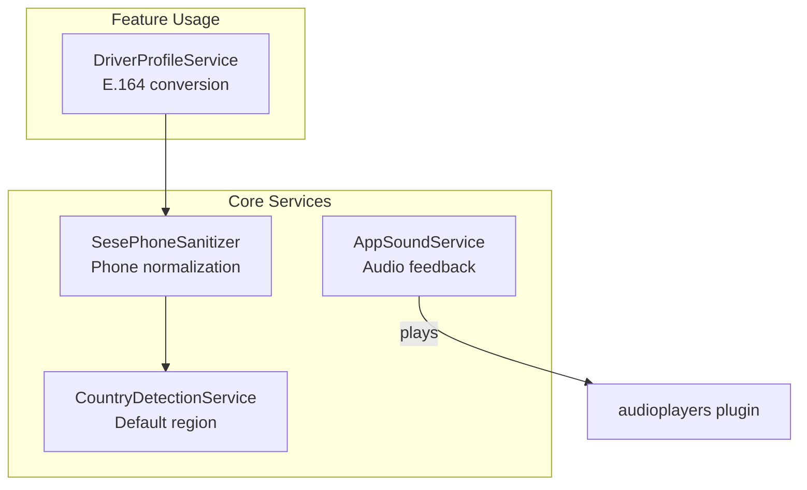
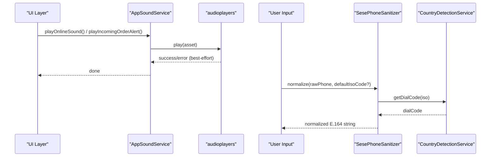
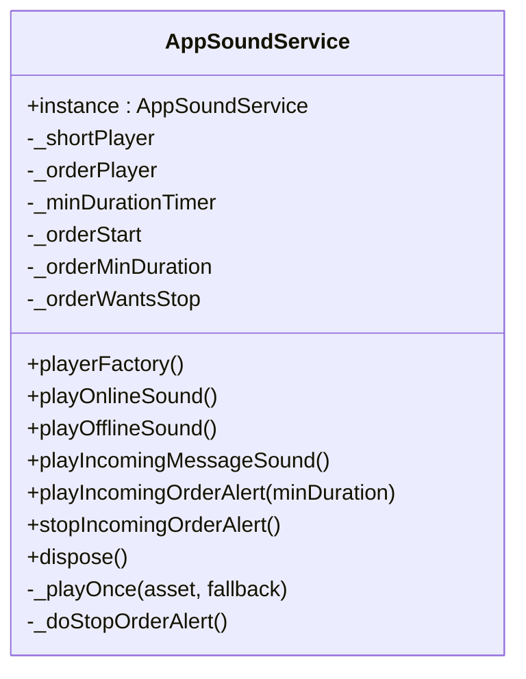
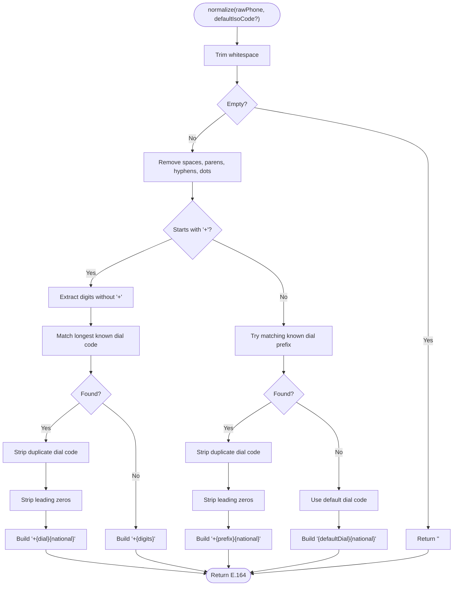
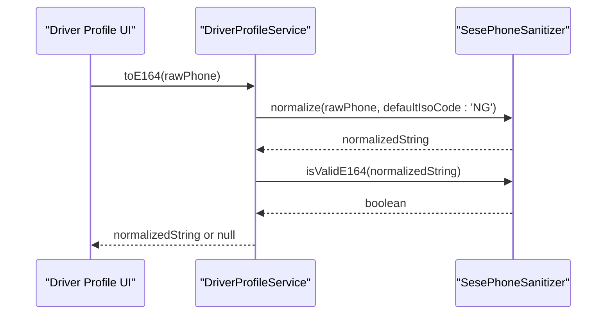
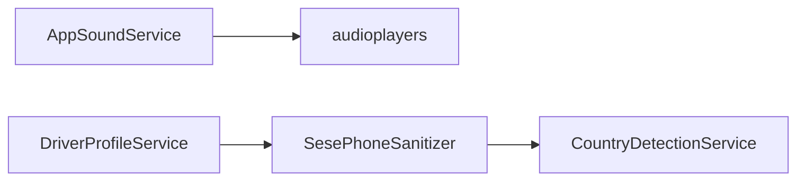

# Utility Services

<cite>
**Referenced Files in This Document**
- [app_sound_service.dart](file://sese_core/lib/services/app_sound_service.dart)
- [phone_sanitizer.dart](file://sese_core/lib/services/phone_sanitizer.dart)
- [country_detection_service.dart](file://sese_core/lib/services/country_detection_service.dart)
- [driver_profile_service.dart](file://sese_ride/lib/features/driver/services/driver_profile_service.dart)
</cite>

## Table of Contents
1. [Introduction](#introduction)
2. [Project Structure](#project-structure)
3. [Core Components](#core-components)
4. [Architecture Overview](#architecture-overview)
5. [Detailed Component Analysis](#detailed-component-analysis)
6. [Dependency Analysis](#dependency-analysis)
7. [Performance Considerations](#performance-considerations)
8. [Troubleshooting Guide](#troubleshooting-guide)
9. [Conclusion](#conclusion)

## Introduction
This document describes two utility services that provide shared functionality across the application:

- AppSoundService: Centralized audio feedback for user interactions, notifications, and alerts. It manages short chimes and looping alerts with best-effort error handling so audio never blocks UX.
- SesePhoneSanitizer: Phone number normalization, validation, and internationalization support to ensure consistent E.164 formatting before storage or authentication.

These utilities are designed to be platform-agnostic at the API level while delegating platform-specific behavior (audio playback, country detection) to underlying services and plugins.

## Project Structure
The relevant code is organized under the core library and consumed by feature modules:

- Core utilities live in `sese_core/lib/services`:
  - Audio feedback: `app_sound_service.dart`
  - Phone normalization: `phone_sanitizer.dart`
  - Country detection helper: `country_detection_service.dart`
- Feature usage example:
  - Driver profile service uses phone normalization: `sese_ride/lib/features/driver/services/driver_profile_service.dart`

**Diagram sources**
- [app_sound_service.dart:1-181](file://sese_core/lib/services/app_sound_service.dart#L1-L181)
- [phone_sanitizer.dart:1-192](file://sese_core/lib/services/phone_sanitizer.dart#L1-L192)
- [country_detection_service.dart:1-114](file://sese_core/lib/services/country_detection_service.dart#L1-L114)
- [driver_profile_service.dart:129-136](file://sese_ride/lib/features/driver/services/driver_profile_service.dart#L129-L136)

**Section sources**
- [app_sound_service.dart:1-181](file://sese_core/lib/services/app_sound_service.dart#L1-L181)
- [phone_sanitizer.dart:1-192](file://sese_core/lib/services/phone_sanitizer.dart#L1-L192)
- [country_detection_service.dart:1-114](file://sese_core/lib/services/country_detection_service.dart#L1-L114)
- [driver_profile_service.dart:129-136](file://sese_ride/lib/features/driver/services/driver_profile_service.dart#L129-L136)

## Core Components
- AppSoundService
  - Singleton audio manager for short chimes and looping alerts.
  - Provides methods for online/offline chimes, incoming message chime, and incoming order alert loop with minimum duration enforcement.
  - Uses audioplayers with asset fallback paths for robustness across environments.
- SesePhoneSanitizer
  - Normalizes raw phone inputs to strict E.164 format.
  - Strips non-digit characters, duplicate dial codes, and leading zeros.
  - Validates E.164 compliance and provides legacy Nigerian number validation.
  - Integrates with CountryDetectionService for default region when none is provided.

**Section sources**
- [app_sound_service.dart:6-181](file://sese_core/lib/services/app_sound_service.dart#L6-L181)
- [phone_sanitizer.dart:3-192](file://sese_core/lib/services/phone_sanitizer.dart#L3-L192)

## Architecture Overview
High-level flow for audio feedback and phone normalization:

**Diagram sources**
- [app_sound_service.dart:62-163](file://sese_core/lib/services/app_sound_service.dart#L62-L163)
- [phone_sanitizer.dart:66-177](file://sese_core/lib/services/phone_sanitizer.dart#L66-L177)
- [country_detection_service.dart:66-71](file://sese_core/lib/services/country_detection_service.dart#L66-L71)

## Detailed Component Analysis

### AppSoundService
Responsibilities:
- Manage one-shot chimes for driver state changes and messages.
- Manage a looping urgent alert for incoming orders with a minimum audible duration.
- Provide testability via an injectable player factory.

Key behaviors:
- Asset resolution: attempts package-prefixed assets first, then falls back to local assets.
- Best-effort execution: all failures are logged and do not throw; audio never blocks UX.
- Minimum duration enforcement: if stop is requested too early, it defers until the minimum duration elapses.

**Diagram sources**
- [app_sound_service.dart:18-181](file://sese_core/lib/services/app_sound_service.dart#L18-L181)

Usage examples:
- Trigger online/offline chimes on driver status change.
- Play incoming message chime when chat/support messages arrive.
- Start looping order alert when new offers appear; stop after acceptance or dismissal.

Volume control and platform-specific audio handling:
- The service does not expose volume control APIs; it delegates playback to audioplayers.
- Platform-specific behavior (e.g., media session, background audio) is handled by the underlying plugin.
- For accessibility, consider integrating system haptics or visual cues alongside audio.

Accessibility considerations:
- Ensure audio events are optional and respect user preferences (e.g., silent mode).
- Provide alternative feedback (visual indicators, haptics) for users who prefer non-audio cues.
- Avoid overly loud or frequent alerts; enforce minimum durations and allow immediate stop.

**Section sources**
- [app_sound_service.dart:6-181](file://sese_core/lib/services/app_sound_service.dart#L6-L181)

### SesePhoneSanitizer
Responsibilities:
- Normalize raw phone numbers to strict E.164 format.
- Validate E.164 compliance and offer legacy Nigerian number validation.
- Resolve default dial code using CountryDetectionService when no ISO code is provided.

Normalization rules:
- Strip spaces, parentheses, hyphens, dots.
- Remove duplicate dial codes if present.
- Strip leading zeros from national numbers.
- If input starts with '+', detect known dial codes (longest match first).
- If input lacks '+', try matching known dial code prefixes; otherwise prepend default dial code.

Validation rules:
- E.164: must start with '+', followed by 7–15 digits, starting with 1–9.
- Legacy Nigerian validation: enforces specific national patterns after normalization.

**Diagram sources**
- [phone_sanitizer.dart:108-177](file://sese_core/lib/services/phone_sanitizer.dart#L108-L177)

Integration example:
- Driver profile service normalizes and validates phone numbers before persistence.

**Diagram sources**
- [driver_profile_service.dart:129-136](file://sese_ride/lib/features/driver/services/driver_profile_service.dart#L129-L136)
- [phone_sanitizer.dart:108-184](file://sese_core/lib/services/phone_sanitizer.dart#L108-L184)

Internationalization best practices:
- Always store phones in E.164 to simplify cross-region logic.
- Use CountryDetectionService to infer default region when needed.
- Present localized formats to users but persist normalized values.

**Section sources**
- [phone_sanitizer.dart:3-192](file://sese_core/lib/services/phone_sanitizer.dart#L3-L192)
- [country_detection_service.dart:1-114](file://sese_core/lib/services/country_detection_service.dart#L1-L114)
- [driver_profile_service.dart:129-136](file://sese_ride/lib/features/driver/services/driver_profile_service.dart#L129-L136)

## Dependency Analysis
Component relationships:

**Diagram sources**
- [app_sound_service.dart:1-181](file://sese_core/lib/services/app_sound_service.dart#L1-L181)
- [phone_sanitizer.dart:1-192](file://sese_core/lib/services/phone_sanitizer.dart#L1-L192)
- [country_detection_service.dart:1-114](file://sese_core/lib/services/country_detection_service.dart#L1-L114)
- [driver_profile_service.dart:129-136](file://sese_ride/lib/features/driver/services/driver_profile_service.dart#L129-L136)

Coupling and cohesion:
- AppSoundService is cohesive around audio feedback and depends only on audioplayers.
- SesePhoneSanitizer is cohesive around phone normalization and depends on CountryDetectionService for defaults.
- DriverProfileService has a focused responsibility to convert and validate phone numbers using the sanitizer.

Potential circular dependencies:
- None observed between these components.

External dependencies:
- audioplayers for audio playback.
- Flutter foundation APIs for logging and platform locale access.

**Section sources**
- [app_sound_service.dart:1-181](file://sese_core/lib/services/app_sound_service.dart#L1-L181)
- [phone_sanitizer.dart:1-192](file://sese_core/lib/services/phone_sanitizer.dart#L1-L192)
- [country_detection_service.dart:1-114](file://sese_core/lib/services/country_detection_service.dart#L1-L114)
- [driver_profile_service.dart:129-136](file://sese_ride/lib/features/driver/services/driver_profile_service.dart#L129-L136)

## Performance Considerations
- AppSoundService
  - Reuses dedicated players for short sounds and looping alerts to avoid repeated initialization overhead.
  - All operations are asynchronous and best-effort; errors are logged rather than propagated.
  - Minimum duration timer ensures predictable alert behavior without blocking threads.
- SesePhoneSanitizer
  - Normalization uses simple regex and string operations; complexity is linear in input length.
  - Dial code lookup uses constant-time map lookups after trimming and cleaning.

[No sources needed since this section provides general guidance]

## Troubleshooting Guide
Common issues and resolutions:

- Audio not playing
  - Verify asset paths resolve correctly; the service tries package-prefixed assets first and falls back to local assets.
  - Check device media settings (silent mode, Do Not Disturb) and app permissions for audio playback.
  - Inspect debug logs for failure messages from the service.

- Order alert not stopping immediately
  - The service enforces a minimum audible duration; stopping too early will defer until the minimum elapses.
  - Call stop method again after the minimum duration if necessary.

- Phone normalization produces unexpected results
  - Ensure input is trimmed and contains expected characters.
  - Confirm default region is set appropriately via CountryDetectionService or explicit ISO code.
  - Validate final output with isValidE164 before persistence.

**Section sources**
- [app_sound_service.dart:62-163](file://sese_core/lib/services/app_sound_service.dart#L62-L163)
- [phone_sanitizer.dart:108-184](file://sese_core/lib/services/phone_sanitizer.dart#L108-L184)

## Conclusion
AppSoundService and SesePhoneSanitizer provide essential, reusable utilities for audio feedback and phone number standardization. They are designed for reliability, testability, and internationalization support. By following the usage patterns and guidelines outlined here, teams can deliver consistent user experiences across platforms and regions while maintaining clean separation of concerns.

[No sources needed since this section summarizes without analyzing specific files]