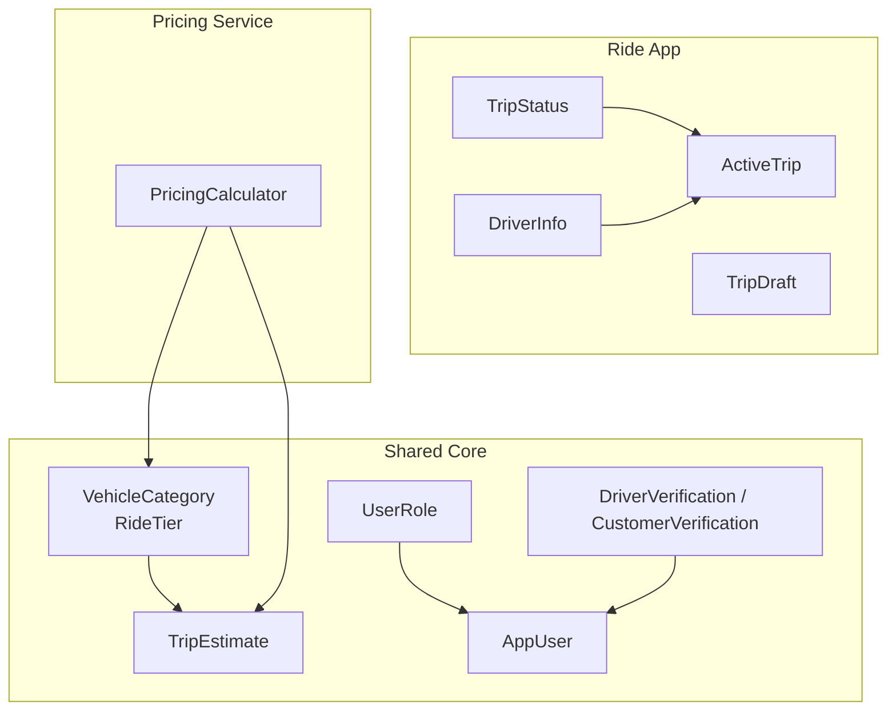
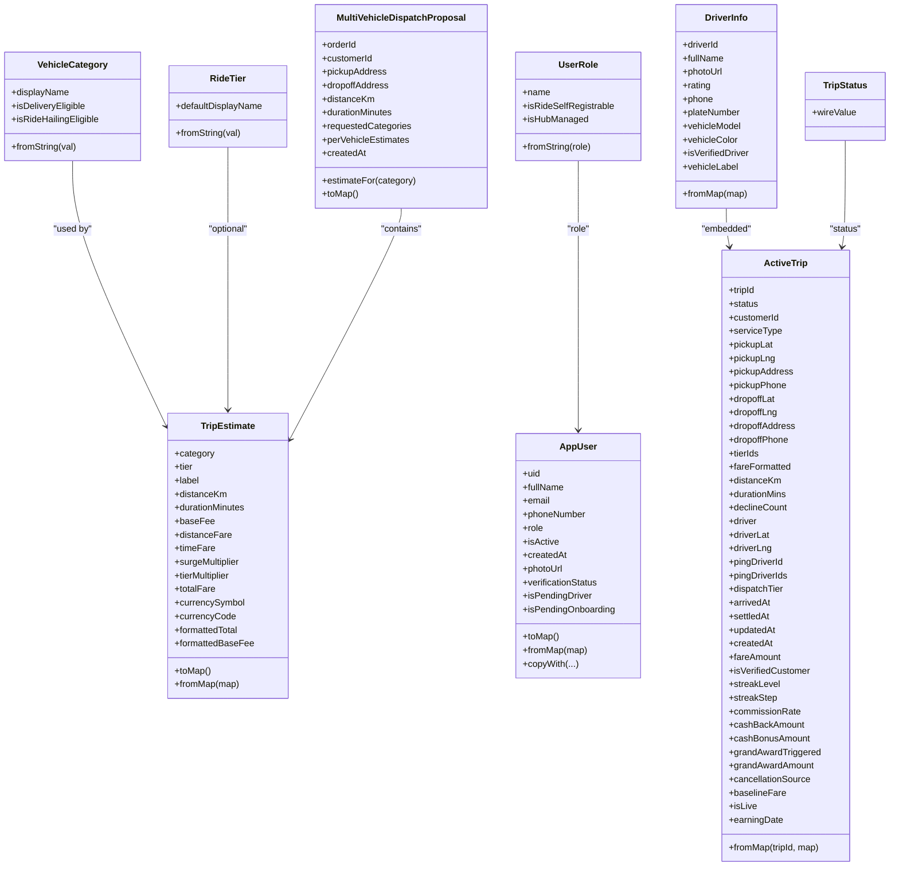
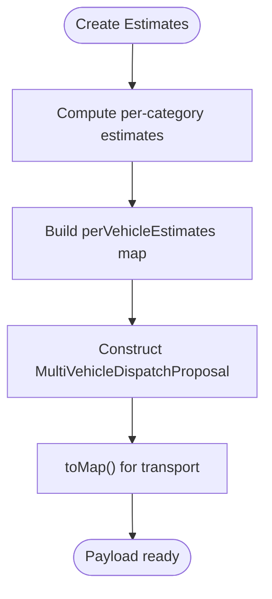
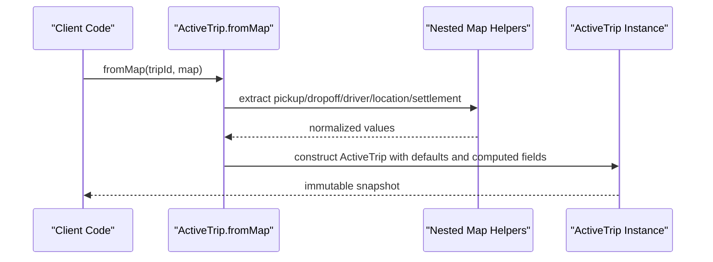
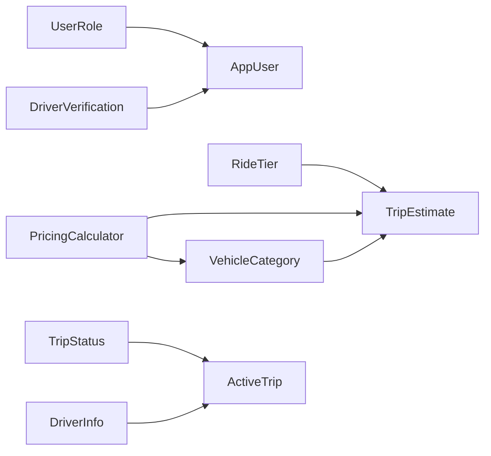

# Data Models

<cite>
**Referenced Files in This Document**
- [trip_estimate.dart](file://sese_core/lib/models/trip_estimate.dart)
- [vehicle_category.dart](file://sese_core/lib/models/vehicle_category.dart)
- [user_model.dart](file://sese_core/lib/models/user_model.dart)
- [user_role.dart](file://sese_core/lib/models/user_role.dart)
- [driver_verification.dart](file://sese_core/lib/models/driver_verification.dart)
- [trip_models.dart](file://sese_ride/lib/features/trips/models/trip_models.dart)
- [pricing_calculator.dart](file://sese_core/lib/services/pricing_calculator.dart)
- [trip_models_test.dart](file://sese_ride/test/trip_models_test.dart)
</cite>

## Table of Contents
1. [Introduction](#introduction)
2. [Project Structure](#project-structure)
3. [Core Components](#core-components)
4. [Architecture Overview](#architecture-overview)
5. [Detailed Component Analysis](#detailed-component-analysis)
6. [Dependency Analysis](#dependency-analysis)
7. [Performance Considerations](#performance-considerations)
8. [Troubleshooting Guide](#troubleshooting-guide)
9. [Conclusion](#conclusion)

## Introduction
This document describes the shared data models used across the ride and hub applications. It focuses on immutable domain entities, their relationships, validation and serialization patterns, and transformation logic. The primary models covered are TripEstimate, VehicleCategory, RideTier, AppUser (representing UserProfile), ActiveTrip, DriverInfo, TripStatus, and supporting enums/constants for roles and verification states.

The design emphasizes:
- Immutability via const constructors and final fields
- Safe deserialization with robust fromMap factories
- Clear separation between client snapshots and server wire formats
- Consistent enum-based state modeling with explicit wire mappings
- Factory methods and conversion utilities for pricing and dispatch payloads

## Project Structure
The core data models live in the shared library under sese_core, while trip-specific live models reside in the ride application. Pricing logic that produces estimates is implemented as a service that consumes these models.

**Diagram sources**
- [vehicle_category.dart:5-69](file://sese_core/lib/models/vehicle_category.dart#L5-L69)
- [trip_estimate.dart:4-73](file://sese_core/lib/models/trip_estimate.dart#L4-L73)
- [user_model.dart:5-70](file://sese_core/lib/models/user_model.dart#L5-L70)
- [user_role.dart:5-54](file://sese_core/lib/models/user_role.dart#L5-L54)
- [driver_verification.dart:14-68](file://sese_core/lib/models/driver_verification.dart#L14-L68)
- [trip_models.dart:11-53](file://sese_ride/lib/features/trips/models/trip_models.dart#L11-L53)
- [trip_models.dart:64-113](file://sese_ride/lib/features/trips/models/trip_models.dart#L64-L113)
- [trip_models.dart:116-340](file://sese_ride/lib/features/trips/models/trip_models.dart#L116-L340)
- [trip_models.dart:344-421](file://sese_ride/lib/features/trips/models/trip_models.dart#L344-L421)
- [pricing_calculator.dart:62-146](file://sese_core/lib/services/pricing_calculator.dart#L62-L146)

**Section sources**
- [vehicle_category.dart:1-142](file://sese_core/lib/models/vehicle_category.dart#L1-L142)
- [trip_estimate.dart:1-123](file://sese_core/lib/models/trip_estimate.dart#L1-L123)
- [user_model.dart:1-109](file://sese_core/lib/models/user_model.dart#L1-L109)
- [user_role.dart:1-55](file://sese_core/lib/models/user_role.dart#L1-L55)
- [driver_verification.dart:1-69](file://sese_core/lib/models/driver_verification.dart#L1-L69)
- [trip_models.dart:1-422](file://sese_ride/lib/features/trips/models/trip_models.dart#L1-L422)
- [pricing_calculator.dart:62-146](file://sese_core/lib/services/pricing_calculator.dart#L62-L146)

## Core Components
- TripEstimate: Immutable fare estimate for a vehicle category or car ride tier, including breakdown fields and currency metadata. Provides toMap/fromMap for persistence and display helpers.
- VehicleCategory and RideTier: Enumerations defining eligible vehicle types and passenger tiers, with string parsing and display names.
- AppUser: Central user profile model with role, verification status, and safe date parsing; includes copyWith for derived profiles.
- TripStatus, DriverInfo, ActiveTrip, TripDraft: Live trip domain models representing Firestore snapshots and booking payloads.
- DriverVerification/CustomerVerification: Shared constants and helpers for driver and customer KYC lifecycle states.

Key behaviors:
- All models use immutable constructors and final fields.
- Deserialization handles multiple input shapes (strings, numbers, timestamps).
- Enums provide both display names and wire-safe conversions.
- Factories encapsulate complex mapping logic (e.g., ActiveTrip.fromMap).

**Section sources**
- [trip_estimate.dart:4-73](file://sese_core/lib/models/trip_estimate.dart#L4-L73)
- [vehicle_category.dart:5-69](file://sese_core/lib/models/vehicle_category.dart#L5-L69)
- [user_model.dart:5-108](file://sese_core/lib/models/user_model.dart#L5-L108)
- [trip_models.dart:11-53](file://sese_ride/lib/features/trips/models/trip_models.dart#L11-L53)
- [trip_models.dart:64-113](file://sese_ride/lib/features/trips/models/trip_models.dart#L64-L113)
- [trip_models.dart:116-340](file://sese_ride/lib/features/trips/models/trip_models.dart#L116-L340)
- [trip_models.dart:344-421](file://sese_ride/lib/features/trips/models/trip_models.dart#L344-L421)
- [driver_verification.dart:14-68](file://sese_core/lib/models/driver_verification.dart#L14-L68)

## Architecture Overview
The data layer separates concerns into:
- Domain models (TripEstimate, VehicleCategory, RideTier, AppUser, ActiveTrip, etc.)
- State enums with explicit wire values (TripStatus)
- Services that compute derived data (PricingCalculator)
- Persistence adapters via toMap/fromMap

**Diagram sources**
- [vehicle_category.dart:5-69](file://sese_core/lib/models/vehicle_category.dart#L5-L69)
- [trip_estimate.dart:4-122](file://sese_core/lib/models/trip_estimate.dart#L4-L122)
- [user_role.dart:5-54](file://sese_core/lib/models/user_role.dart#L5-L54)
- [user_model.dart:5-108](file://sese_core/lib/models/user_model.dart#L5-L108)
- [trip_models.dart:11-53](file://sese_ride/lib/features/trips/models/trip_models.dart#L11-L53)
- [trip_models.dart:64-113](file://sese_ride/lib/features/trips/models/trip_models.dart#L64-L113)
- [trip_models.dart:116-340](file://sese_ride/lib/features/trips/models/trip_models.dart#L116-L340)

## Detailed Component Analysis

### TripEstimate and Multi-Vehicle Dispatch
TripEstimate represents a complete fare calculation for a given vehicle category or ride tier. It exposes formatted display helpers and supports serialization to maps for storage or transmission. MultiVehicleDispatchProposal aggregates per-category estimates for package delivery broadcasts.

**Diagram sources**
- [pricing_calculator.dart:62-146](file://sese_core/lib/services/pricing_calculator.dart#L62-L146)
- [trip_estimate.dart:75-122](file://sese_core/lib/models/trip_estimate.dart#L75-L122)

Validation and transformation rules:
- Category and tier are validated through enum parsers.
- Numeric fields default safely when missing.
- Currency symbol and code are preserved for UI formatting.

Usage examples:
- Generate ride-hailing tier estimates using the pricing calculator.
- Generate delivery options for all eligible categories.

**Section sources**
- [trip_estimate.dart:4-73](file://sese_core/lib/models/trip_estimate.dart#L4-L73)
- [trip_estimate.dart:75-122](file://sese_core/lib/models/trip_estimate.dart#L75-L122)
- [pricing_calculator.dart:62-146](file://sese_core/lib/services/pricing_calculator.dart#L62-L146)

### VehicleCategory, RideTier, and Verification Enums
VehicleCategory defines supported vehicle types and eligibility flags for delivery and ride-hailing. RideTier defines passenger car tiers. Both include string parsing for robust deserialization. VehicleVerificationStatus and VehicleLifecycleStatus provide database-aligned states with display names and DB string converters.

Key points:
- isDeliveryEligible and isRideHailingEligible gate feature availability.
- fromString tolerates case-insensitive inputs and falls back to defaults.
- toDbString ensures consistent Firestore values.

**Section sources**
- [vehicle_category.dart:5-69](file://sese_core/lib/models/vehicle_category.dart#L5-L69)
- [vehicle_category.dart:71-141](file://sese_core/lib/models/vehicle_category.dart#L71-L141)

### AppUser (UserProfile)
AppUser is the canonical user profile model used across apps. It includes role, verification status, and robust date parsing. It provides toMap for persistence and copyWith for derived updates.

Patterns:
- Role parsed via UserRoleExtension.fromString with safe defaults.
- Date parsing supports DateTime, milliseconds, ISO strings, and Firestore Timestamp-like objects.
- Phone normalization writes both phoneNumber and phoneNumberE164.

Testing strategy:
- Validate date parsing across multiple input types.
- Verify role mapping and default behavior.

**Section sources**
- [user_model.dart:5-108](file://sese_core/lib/models/user_model.dart#L5-L108)
- [user_role.dart:5-54](file://sese_core/lib/models/user_role.dart#L5-L54)
- [auth_repository_test.dart:28-58](file://sese_core/test/auth_repository_test.dart#L28-L58)

### TripStatus, DriverInfo, ActiveTrip, and TripDraft
TripStatus enumerates trip lifecycle states with explicit wire values matching Firestore. DriverInfo captures assigned driver details and provides a vehicle label helper. ActiveTrip is a comprehensive snapshot of a trip document, including pickup/dropoff locations, driver info, timestamps, and settlement annotations. TripDraft is a client-side payload for creating trips.

**Diagram sources**
- [trip_models.dart:116-340](file://sese_ride/lib/features/trips/models/trip_models.dart#L116-L340)

Validation and transformation rules:
- Status mapped via tripStatusFromString with unknown fallback.
- Nested maps handled defensively; missing keys yield safe defaults.
- Timestamps support multiple formats (DateTime, milliseconds, strings).
- Fare amount resolved from selected tier or first tier if unspecified.

Testing strategy:
- Unit tests assert nested field parsing and derived properties like vehicleLabel and isLive.

**Section sources**
- [trip_models.dart:11-53](file://sese_ride/lib/features/trips/models/trip_models.dart#L11-L53)
- [trip_models.dart:64-113](file://sese_ride/lib/features/trips/models/trip_models.dart#L64-L113)
- [trip_models.dart:116-340](file://sese_ride/lib/features/trips/models/trip_models.dart#L116-L340)
- [trip_models.dart:344-421](file://sese_ride/lib/features/trips/models/trip_models.dart#L344-L421)
- [trip_models_test.dart:56-95](file://sese_ride/test/trip_models_test.dart#L56-L95)

### Driver and Customer Verification Constants
DriverVerification and CustomerVerification define shared lifecycle states and Firestore field names for KYC flows. They also provide helper methods to determine pending/verified/blocked submission states.

Design notes:
- Backward compatibility maintained for legacy statuses.
- Boolean helpers simplify UI gating logic.

**Section sources**
- [driver_verification.dart:14-68](file://sese_core/lib/models/driver_verification.dart#L14-L68)

## Dependency Analysis
The following diagram shows how models depend on each other and where services consume them.

**Diagram sources**
- [vehicle_category.dart:5-69](file://sese_core/lib/models/vehicle_category.dart#L5-L69)
- [trip_estimate.dart:4-73](file://sese_core/lib/models/trip_estimate.dart#L4-L73)
- [user_role.dart:5-54](file://sese_core/lib/models/user_role.dart#L5-L54)
- [user_model.dart:5-70](file://sese_core/lib/models/user_model.dart#L5-L70)
- [driver_verification.dart:14-68](file://sese_core/lib/models/driver_verification.dart#L14-L68)
- [trip_models.dart:11-53](file://sese_ride/lib/features/trips/models/trip_models.dart#L11-L53)
- [trip_models.dart:64-113](file://sese_ride/lib/features/trips/models/trip_models.dart#L64-L113)
- [pricing_calculator.dart:62-146](file://sese_core/lib/services/pricing_calculator.dart#L62-L146)

Coupling and cohesion:
- TripEstimate depends only on VehicleCategory and RideTier, keeping it cohesive.
- ActiveTrip composes DriverInfo and uses TripStatus, maintaining clear boundaries.
- PricingCalculator orchestrates estimation without mutating domain models.

Potential circular dependencies:
- None observed; models are leaf nodes except for composed references.

External integration points:
- Firestore timestamp handling in fromMap factories.
- Serialization to maps for persistence and network payloads.

**Section sources**
- [trip_estimate.dart:4-73](file://sese_core/lib/models/trip_estimate.dart#L4-L73)
- [trip_models.dart:116-340](file://sese_ride/lib/features/trips/models/trip_models.dart#L116-L340)
- [pricing_calculator.dart:62-146](file://sese_core/lib/services/pricing_calculator.dart#L62-L146)

## Performance Considerations
- Prefer immutable models to avoid accidental mutations and enable safe caching.
- Use fromMap factories to centralize parsing and reduce repeated conditional logic.
- Avoid heavy computations in UI layers; delegate to services like PricingCalculator.
- Minimize object allocations by reusing computed maps where appropriate.
- Keep enum parsing efficient; prefer direct lookups and small fallback sets.

[No sources needed since this section provides general guidance]

## Troubleshooting Guide
Common issues and resolutions:
- Missing or malformed dates in user or trip documents:
  - Ensure fromMap handles DateTime, milliseconds, ISO strings, and Firestore Timestamp-like objects.
  - Validate createdAt and settledAt fields during ingestion.
- Inconsistent role strings:
  - Use UserRoleExtension.fromString with safe defaults to prevent nulls.
- Incorrect trip status rendering:
  - Confirm wireValue matches Firestore exactly; unknown states fall back gracefully.
- Phone number validation failures:
  - Normalize to E.164 before persisting; reject invalid inputs early.

Relevant patterns:
- Defensive parsing in ActiveTrip.fromMap and AppUser.fromMap.
- Explicit wire mappings in TripStatus.
- Validation helpers in DriverVerification/CustomerVerification.

**Section sources**
- [user_model.dart:73-83](file://sese_core/lib/models/user_model.dart#L73-L83)
- [trip_models.dart:55-61](file://sese_ride/lib/features/trips/models/trip_models.dart#L55-L61)
- [trip_models.dart:237-340](file://sese_ride/lib/features/trips/models/trip_models.dart#L237-L340)
- [driver_verification.dart:56-68](file://sese_core/lib/models/driver_verification.dart#L56-L68)

## Conclusion
The shared data models form a robust, immutable foundation for the ride and hub applications. By standardizing enums, providing resilient fromMap factories, and isolating computation in services, the system achieves consistency, testability, and clarity. Adhering to these patterns ensures reliable serialization, predictable state transitions, and maintainable evolution of the domain model.

[No sources needed since this section summarizes without analyzing specific files]