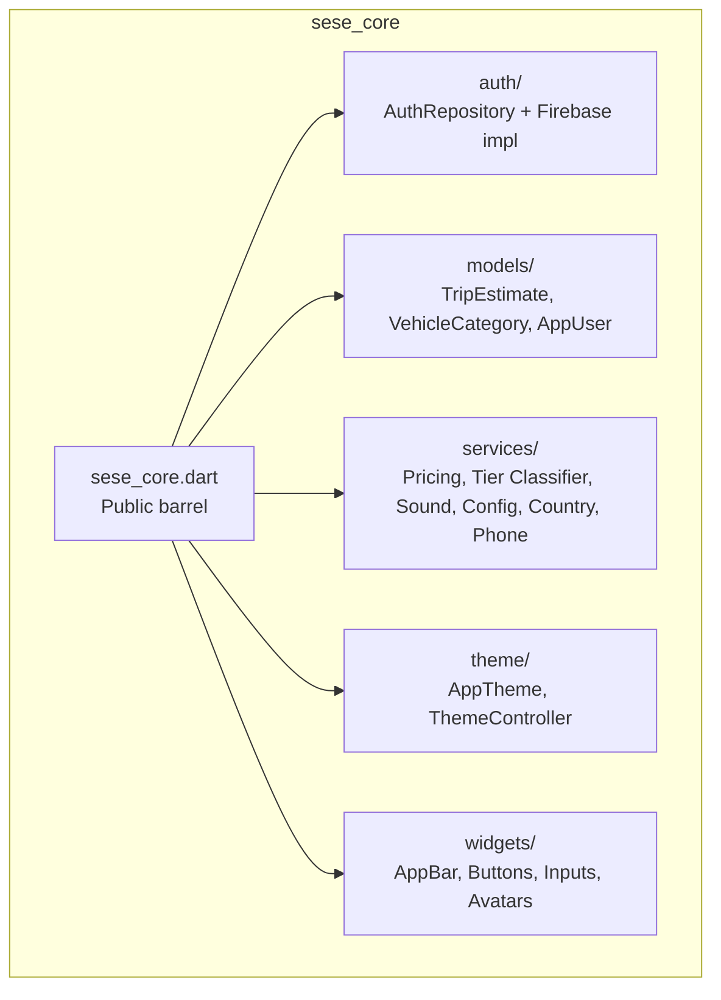
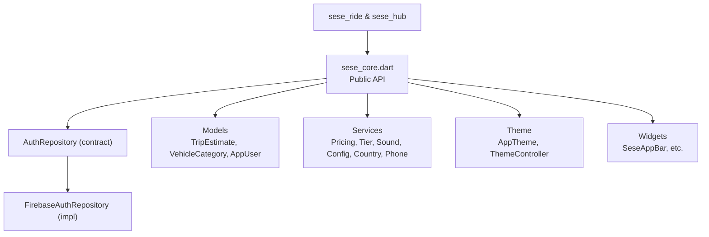
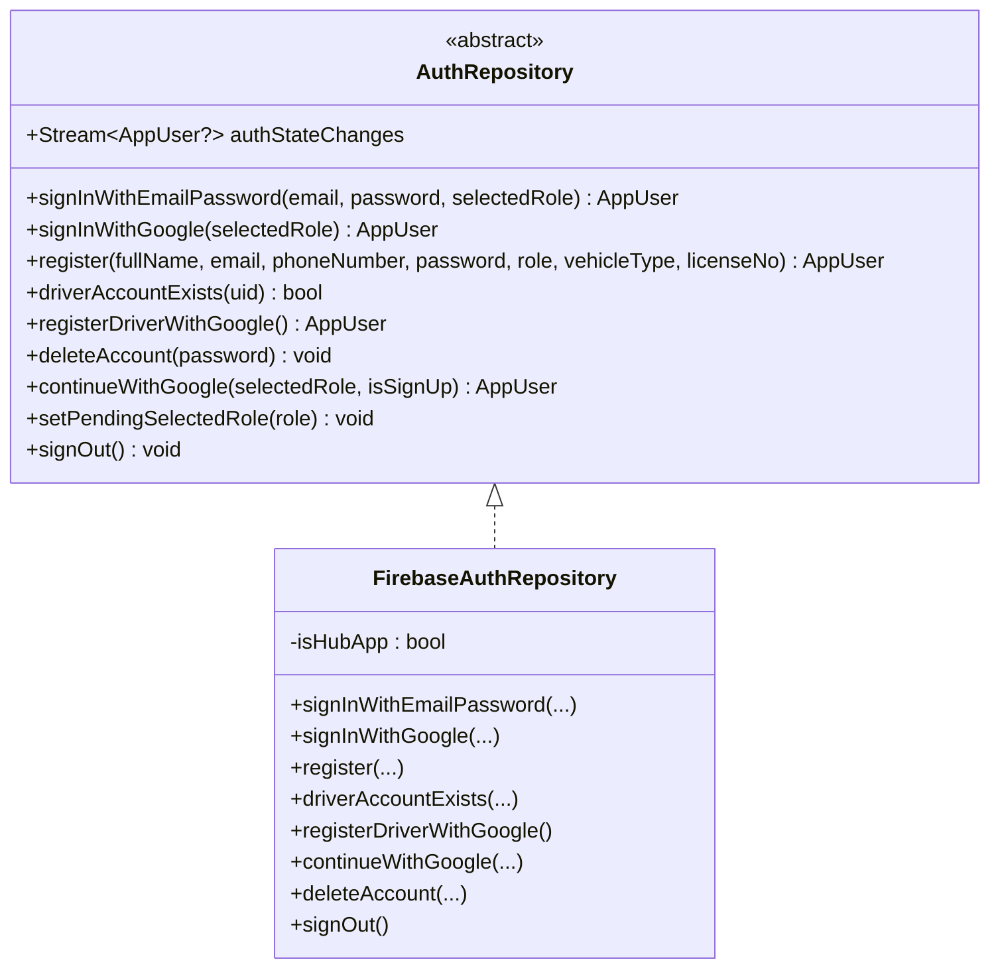
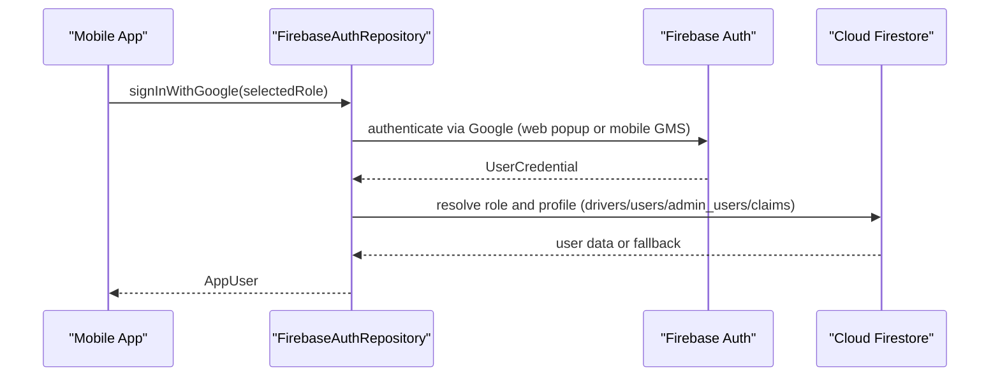
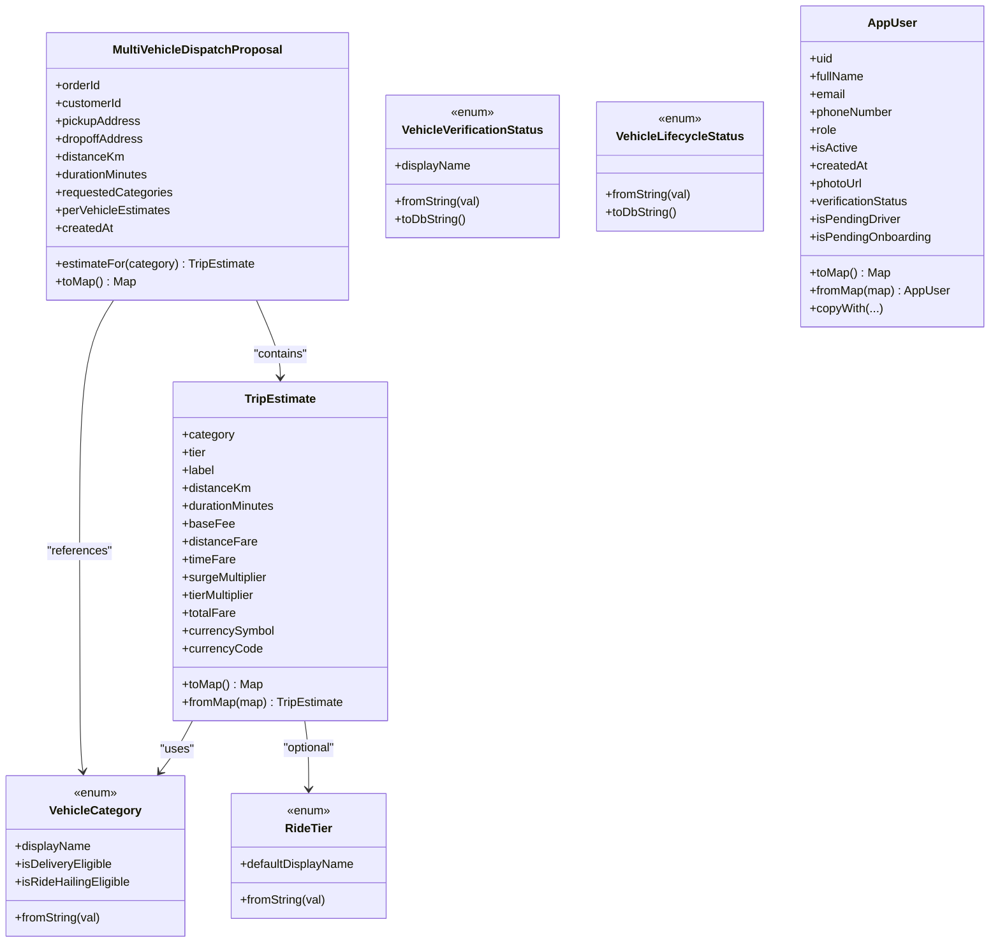
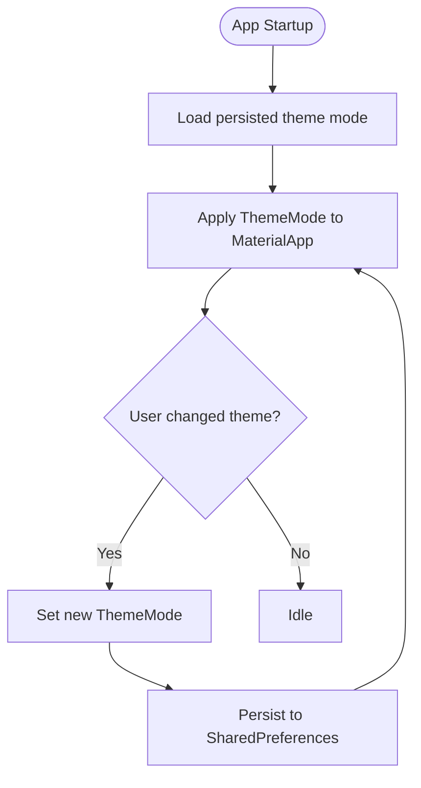
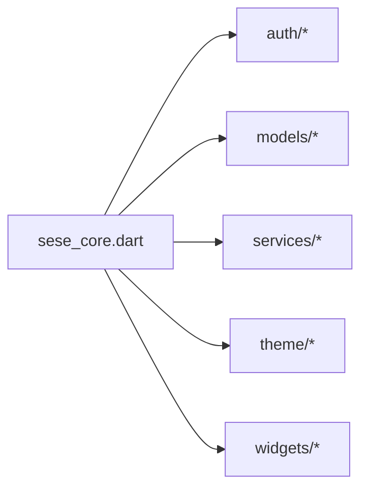

# Shared Core Library

<cite>
**Referenced Files in This Document**
- [sese_core.dart](file://sese_core/lib/sese_core.dart)
- [pubspec.yaml](file://sese_core/pubspec.yaml)
- [auth_repository.dart](file://sese_core/lib/auth/auth_repository.dart)
- [firebase_auth_repository.dart](file://sese_core/lib/auth/firebase_auth_repository.dart)
- [trip_estimate.dart](file://sese_core/lib/models/trip_estimate.dart)
- [vehicle_category.dart](file://sese_core/lib/models/vehicle_category.dart)
- [user_model.dart](file://sese_core/lib/models/user_model.dart)
- [app_theme.dart](file://sese_core/lib/theme/app_theme.dart)
- [theme_controller.dart](file://sese_core/lib/theme/theme_controller.dart)
- [sese_app_bar.dart](file://sese_core/lib/widgets/sese_app_bar.dart)
</cite>

## Table of Contents
1. [Introduction](#introduction)
2. [Project Structure](#project-structure)
3. [Core Components](#core-components)
4. [Architecture Overview](#architecture-overview)
5. [Detailed Component Analysis](#detailed-component-analysis)
6. [Dependency Analysis](#dependency-analysis)
7. [Performance Considerations](#performance-considerations)
8. [Troubleshooting Guide](#troubleshooting-guide)
9. [Conclusion](#conclusion)
10. [Appendices](#appendices)

## Introduction
This document describes the shared core library that provides common functionality for both mobile applications (sese_ride and sese_hub). It covers:
- Authentication repository contract and production implementation
- Common models for trip estimates, vehicle categories, and user profiles
- Reusable services (pricing, vehicle tier classification, sound, configuration resolution, country detection, phone sanitization)
- UI widgets and theme management system
- Public API surface, integration patterns with apps, customization options, extension points, versioning strategy, testing approaches, and best practices

The library is a Flutter package consumed by both apps to ensure consistent behavior, branding, and domain modeling across platforms.

## Project Structure
The core library is organized into focused modules:
- auth: authentication contracts and implementations
- models: shared domain data types
- services: reusable business logic and utilities
- theme: centralized theming and appearance controller
- widgets: reusable UI components
- Root barrel file exports the public API

**Diagram sources**
- [sese_core.dart:1-34](file://sese_core/lib/sese_core.dart#L1-L34)

**Section sources**
- [sese_core.dart:1-34](file://sese_core/lib/sese_core.dart#L1-L34)
- [pubspec.yaml:1-33](file://sese_core/pubspec.yaml#L1-L33)

## Core Components
This section summarizes the primary building blocks exposed by the library.

- Authentication
  - AuthRepository: abstract contract used by both apps for sign-in, registration, role handling, and account lifecycle.
  - FirebaseAuthRepository: production implementation backed by Firebase Auth and Cloud Firestore.

- Models
  - TripEstimate: fare estimate details per vehicle category or ride tier.
  - MultiVehicleDispatchProposal: multi-vehicle dispatch payload with per-category estimates.
  - VehicleCategory: enum for supported vehicles and eligibility rules.
  - RideTier: passenger car tiers.
  - VehicleVerificationStatus / VehicleLifecycleStatus: enums for vehicle verification and lifecycle states.
  - AppUser: canonical user profile model used across apps.

- Services
  - Pricing calculator, vehicle tier classifier, app sound service, config resolution engine, country detection service, phone sanitizer.

- Theme
  - AppTheme: centralized Material theme definitions using brand colors.
  - ThemeController: persistent theme mode selection with test seam.

- Widgets
  - SeseAppBar and other reusable UI components.

**Section sources**
- [auth_repository.dart:1-83](file://sese_core/lib/auth/auth_repository.dart#L1-L83)
- [firebase_auth_repository.dart:1-707](file://sese_core/lib/auth/firebase_auth_repository.dart#L1-L707)
- [trip_estimate.dart:1-123](file://sese_core/lib/models/trip_estimate.dart#L1-L123)
- [vehicle_category.dart:1-142](file://sese_core/lib/models/vehicle_category.dart#L1-L142)
- [user_model.dart:1-109](file://sese_core/lib/models/user_model.dart#L1-L109)
- [app_theme.dart:1-85](file://sese_core/lib/theme/app_theme.dart#L1-L85)
- [theme_controller.dart:1-90](file://sese_core/lib/theme/theme_controller.dart#L1-L90)
- [sese_app_bar.dart:1-39](file://sese_core/lib/widgets/sese_app_bar.dart#L1-L39)

## Architecture Overview
The library follows a layered architecture:
- Domain layer: models define shared entities and enumerations.
- Application layer: services encapsulate cross-cutting logic (pricing, classification, sounds, configuration, country detection, phone sanitization).
- Infrastructure layer: authentication repository abstracts identity providers; the production implementation uses Firebase.
- Presentation layer: theme and widgets provide consistent UI primitives.

**Diagram sources**
- [sese_core.dart:1-34](file://sese_core/lib/sese_core.dart#L1-L34)
- [auth_repository.dart:1-83](file://sese_core/lib/auth/auth_repository.dart#L1-L83)
- [firebase_auth_repository.dart:1-707](file://sese_core/lib/auth/firebase_auth_repository.dart#L1-L707)

## Detailed Component Analysis

### Authentication Repository
Responsibilities:
- Provide a unified interface for email/password and Google sign-in flows.
- Handle registration for customers and drivers, including driver onboarding state.
- Enforce driver sign-in constraints (driver account must exist).
- Manage account deletion with soft-deletion and archival semantics.
- Expose a stream of authenticated user changes for routing and UI gating.

Key behaviors:
- Role resolution order: owner bootstrap, ID-token claims, admin_users (hub only), drivers/{uid}, users/{uid}, default customer.
- Driver sign-in enforcement: missing driver documents cause a specific error code.
- Google flow differences between web and mobile platforms.

**Diagram sources**
- [auth_repository.dart:1-83](file://sese_core/lib/auth/auth_repository.dart#L1-L83)
- [firebase_auth_repository.dart:1-707](file://sese_core/lib/auth/firebase_auth_repository.dart#L1-L707)

**Diagram sources**
- [firebase_auth_repository.dart:115-122](file://sese_core/lib/auth/firebase_auth_repository.dart#L115-L122)
- [firebase_auth_repository.dart:519-671](file://sese_core/lib/auth/firebase_auth_repository.dart#L519-L671)

**Section sources**
- [auth_repository.dart:1-83](file://sese_core/lib/auth/auth_repository.dart#L1-L83)
- [firebase_auth_repository.dart:1-707](file://sese_core/lib/auth/firebase_auth_repository.dart#L1-L707)

### Models: Trip Estimates, Vehicle Categories, User Profiles
TripEstimate
- Represents fare breakdown for a given vehicle category or ride tier.
- Provides serialization helpers for persistence and transport.
- Includes currency symbol and code for display and backend alignment.

MultiVehicleDispatchProposal
- Carries per-vehicle estimates for multiple requested categories.
- Useful for dispatch workflows where multiple vehicle types may be considered.

VehicleCategory and RideTier
- Enumerations defining supported vehicles and passenger tiers.
- Include helper methods for string conversion and eligibility checks.

VehicleVerificationStatus and VehicleLifecycleStatus
- Enums for vehicle verification and lifecycle states aligned with storage rules.

AppUser
- Canonical user profile model used across apps.
- Encodes role, activation status, creation time, photo URL, and driver verification status.
- Provides map conversion and copy-with helpers.

**Diagram sources**
- [trip_estimate.dart:1-123](file://sese_core/lib/models/trip_estimate.dart#L1-L123)
- [vehicle_category.dart:1-142](file://sese_core/lib/models/vehicle_category.dart#L1-L142)
- [user_model.dart:1-109](file://sese_core/lib/models/user_model.dart#L1-L109)

**Section sources**
- [trip_estimate.dart:1-123](file://sese_core/lib/models/trip_estimate.dart#L1-L123)
- [vehicle_category.dart:1-142](file://sese_core/lib/models/vehicle_category.dart#L1-L142)
- [user_model.dart:1-109](file://sese_core/lib/models/user_model.dart#L1-L109)

### Reusable Services
- Pricing calculator: computes fares based on distance, time, surge, and tier multipliers.
- Vehicle tier classifier: determines ride tier from vehicle attributes.
- App sound service: plays localized audio assets for events.
- Config resolution engine: resolves runtime configuration values.
- Country detection service: infers country context.
- Phone sanitizer: normalizes phone numbers.

These services are exported through the barrel file and can be composed by feature layers in both apps.

**Section sources**
- [sese_core.dart:16-19](file://sese_core/lib/sese_core.dart#L16-L19)

### UI Widgets
- SeseAppBar: branded application bar implementing PreferredSizeWidget.
- Additional widgets include sign-in buttons, logo, splash screen, country/state dropdowns, phone input field, and user avatar.

Usage pattern:
- Compose within Scaffold.appBar or custom layouts.
- Leverage shared theme colors and typography from AppTheme.

**Section sources**
- [sese_app_bar.dart:1-39](file://sese_core/lib/widgets/sese_app_bar.dart#L1-L39)
- [sese_core.dart:26-34](file://sese_core/lib/sese_core.dart#L26-L34)

### Theme Management System
AppTheme
- Centralized Material theme definitions using brand colors.
- Provides light and dark themes with consistent color schemes and icon/list tile styling.

ThemeController
- Persistent theme mode selection (light/dark/system).
- Uses SharedPreferences with a test seam for unit tests.
- Emits value changes for reactive UI updates.

**Diagram sources**
- [theme_controller.dart:21-75](file://sese_core/lib/theme/theme_controller.dart#L21-L75)
- [app_theme.dart:23-84](file://sese_core/lib/theme/app_theme.dart#L23-L84)

**Section sources**
- [app_theme.dart:1-85](file://sese_core/lib/theme/app_theme.dart#L1-L85)
- [theme_controller.dart:1-90](file://sese_core/lib/theme/theme_controller.dart#L1-L90)

## Dependency Analysis
The library’s public surface is defined by the barrel file, which re-exports:
- Authentication contracts and implementations
- Models for trips, vehicles, and users
- Services for pricing, classification, sound, configuration, country detection, and phone sanitization
- Theme and widgets

**Diagram sources**
- [sese_core.dart:1-34](file://sese_core/lib/sese_core.dart#L1-L34)

External dependencies declared in the package manifest include Firebase Auth, Firestore, Google Sign-In, shared preferences, intl phone number input, SVG support, and audio playback.

**Section sources**
- [sese_core.dart:1-34](file://sese_core/lib/sese_core.dart#L1-L34)
- [pubspec.yaml:1-33](file://sese_core/pubspec.yaml#L1-L33)

## Performance Considerations
- Authentication
  - Stream-based auth state minimizes redundant lookups.
  - Firestore reads are guarded and logged; avoid unnecessary reads by leveraging cached tokens when possible.
- Theming
  - ThemeController persists mode to avoid repeated OS queries.
- Media
  - Audio assets are bundled; preloading should be done sparingly to reduce memory pressure.
- Data models
  - Use map conversions judiciously; prefer immutable objects and avoid deep copies unless necessary.

[No sources needed since this section provides general guidance]

## Troubleshooting Guide
Common issues and resolutions:
- Google Sign-In token missing on mobile
  - Symptom: exception indicating no idToken returned.
  - Resolution: verify SHA-1/SHA-256 fingerprints, google-services.json freshness, and Google Play Services availability on device.
- Driver sign-in blocked due to missing driver account
  - Symptom: specific error code indicates driver account does not exist.
  - Resolution: route user to driver registration flow before sign-in.
- Hub-only permissions errors
  - Symptom: PERMISSION_DENIED when accessing admin_users outside hub app.
  - Resolution: ensure isHubApp flag is set appropriately so admin_users lookup is skipped in non-hub apps.
- Theme persistence failures
  - Symptom: theme resets after restart.
  - Resolution: check SharedPreferences availability; use testPreferences in tests to isolate behavior.

**Section sources**
- [firebase_auth_repository.dart:326-361](file://sese_core/lib/auth/firebase_auth_repository.dart#L326-L361)
- [firebase_auth_repository.dart:207-223](file://sese_core/lib/auth/firebase_auth_repository.dart#L207-L223)
- [firebase_auth_repository.dart:558-588](file://sese_core/lib/auth/firebase_auth_repository.dart#L558-L588)
- [theme_controller.dart:33-51](file://sese_core/lib/theme/theme_controller.dart#L33-L51)

## Conclusion
The shared core library centralizes authentication, domain models, services, theming, and UI primitives to ensure consistency across sesе_ride and sesе_hub. Its modular design enables easy extension, clear separation of concerns, and robust testing strategies. By following the documented integration patterns and best practices, teams can safely evolve the shared codebase while maintaining compatibility across applications.

[No sources needed since this section summarizes without analyzing specific files]

## Appendices

### Public API Surface
The library exposes:
- Authentication: AuthRepository and FirebaseAuthRepository
- Models: TripEstimate, MultiVehicleDispatchProposal, VehicleCategory, RideTier, VehicleVerificationStatus, VehicleLifecycleStatus, AppUser
- Services: pricing calculator, vehicle tier classifier, app sound service, config resolution engine, country detection service, phone sanitizer
- Theme: AppTheme, ThemeController
- Widgets: SeseAppBar and additional UI components

**Section sources**
- [sese_core.dart:1-34](file://sese_core/lib/sese_core.dart#L1-L34)

### Versioning Strategy
- Package version is managed in pubspec.yaml.
- Semantic versioning recommended: MAJOR.MINOR.PATCH.
- Breaking changes require major version increments; deprecate APIs gradually with migration notes.

**Section sources**
- [pubspec.yaml:1-7](file://sese_core/pubspec.yaml#L1-L7)

### Testing Approaches
- Unit tests for services and models.
- Widget tests for UI components.
- ThemeController supports test seams via SharedPreferences injection.
- Authentication repository can be tested against mocks for Firebase and Firestore.

**Section sources**
- [theme_controller.dart:28-31](file://sese_core/lib/theme/theme_controller.dart#L28-L31)

### Best Practices for Maintaining the Shared Codebase
- Keep models immutable and provide map conversion helpers.
- Prefer composition over inheritance for services.
- Centralize branding and theming; avoid ad-hoc color usage in features.
- Export only stable APIs through the barrel file.
- Add comprehensive tests for critical flows (authentication, pricing, theme persistence).
- Document breaking changes and migration paths in release notes.

[No sources needed since this section provides general guidance]