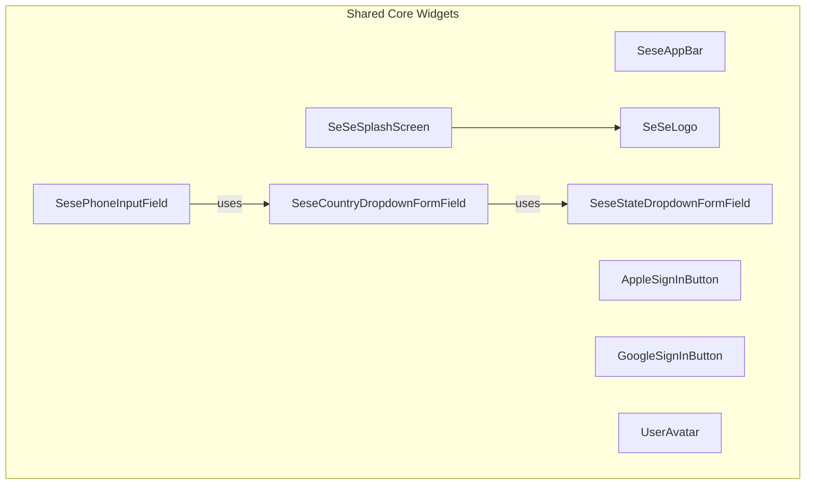
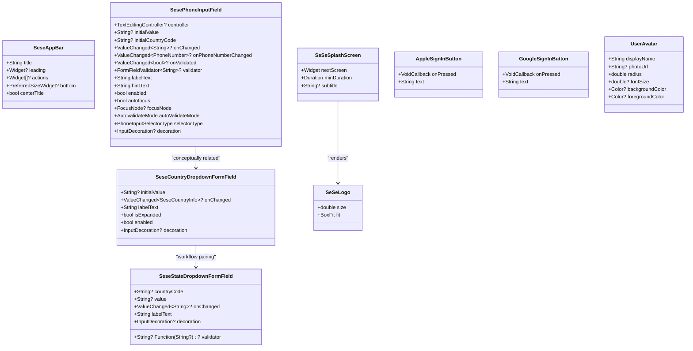
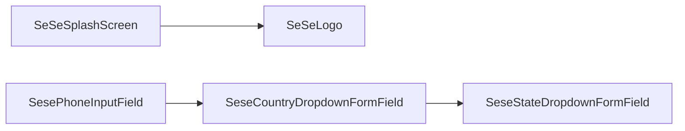

# UI Widgets

<cite>
**Referenced Files in This Document**
- [sese_app_bar.dart](file://sese_core/lib/widgets/sese_app_bar.dart)
- [sese_country_dropdown.dart](file://sese_core/lib/widgets/sese_country_dropdown.dart)
- [sese_state_dropdown.dart](file://sese_core/lib/widgets/sese_state_dropdown.dart)
- [sese_phone_input_field.dart](file://sese_core/lib/widgets/sese_phone_input_field.dart)
- [apple_sign_in_button.dart](file://sese_core/lib/widgets/apple_sign_in_button.dart)
- [google_sign_in_button.dart](file://sese_core/lib/widgets/google_sign_in_button.dart)
- [user_avatar.dart](file://sese_core/lib/widgets/user_avatar.dart)
- [sese_logo.dart](file://sese_core/lib/widgets/sese_logo.dart)
- [sese_splash_screen.dart](file://sese_core/lib/widgets/sese_splash_screen.dart)
</cite>

## Table of Contents
1. [Introduction](#introduction)
2. [Project Structure](#project-structure)
3. [Core Components](#core-components)
4. [Architecture Overview](#architecture-overview)
5. [Detailed Component Analysis](#detailed-component-analysis)
6. [Dependency Analysis](#dependency-analysis)
7. [Performance Considerations](#performance-considerations)
8. [Troubleshooting Guide](#troubleshooting-guide)
9. [Conclusion](#conclusion)
10. [Appendices](#appendices)

## Introduction
This document describes the reusable UI widget library used across SeSe applications. It covers custom widgets, form components, navigation helpers, and common UI patterns. You will learn how to compose widgets, customize them, apply themes, ensure accessibility, integrate with app themes, and build responsive interfaces. The guide also includes testing strategies, performance tips, and guidelines for creating new reusable components.

## Project Structure
The widget library is organized by feature within the shared core package:
- Navigation and layout helpers: App bar and splash screen
- Form inputs: Country dropdown, state dropdown, phone input
- Branding and identity: Logo, user avatar
- Authentication buttons: Apple and Google sign-in

**Diagram sources**
- [sese_app_bar.dart:1-39](file://sese_core/lib/widgets/sese_app_bar.dart#L1-L39)
- [sese_splash_screen.dart:1-136](file://sese_core/lib/widgets/sese_splash_screen.dart#L1-L136)
- [sese_country_dropdown.dart:1-73](file://sese_core/lib/widgets/sese_country_dropdown.dart#L1-L73)
- [sese_state_dropdown.dart:1-100](file://sese_core/lib/widgets/sese_state_dropdown.dart#L1-L100)
- [sese_phone_input_field.dart:1-188](file://sese_core/lib/widgets/sese_phone_input_field.dart#L1-L188)
- [apple_sign_in_button.dart:1-31](file://sese_core/lib/widgets/apple_sign_in_button.dart#L1-L31)
- [google_sign_in_button.dart:1-60](file://sese_core/lib/widgets/google_sign_in_button.dart#L1-L60)
- [user_avatar.dart:1-132](file://sese_core/lib/widgets/user_avatar.dart#L1-L132)
- [sese_logo.dart:1-61](file://sese_core/lib/widgets/sese_logo.dart#L1-L61)

**Section sources**
- [sese_app_bar.dart:1-39](file://sese_core/lib/widgets/sese_app_bar.dart#L1-L39)
- [sese_splash_screen.dart:1-136](file://sese_core/lib/widgets/sese_splash_screen.dart#L1-L136)
- [sese_country_dropdown.dart:1-73](file://sese_core/lib/widgets/sese_country_dropdown.dart#L1-L73)
- [sese_state_dropdown.dart:1-100](file://sese_core/lib/widgets/sese_state_dropdown.dart#L1-L100)
- [sese_phone_input_field.dart:1-188](file://sese_core/lib/widgets/sese_phone_input_field.dart#L1-L188)
- [apple_sign_in_button.dart:1-31](file://sese_core/lib/widgets/apple_sign_in_button.dart#L1-L31)
- [google_sign_in_button.dart:1-60](file://sese_core/lib/widgets/google_sign_in_button.dart#L1-L60)
- [user_avatar.dart:1-132](file://sese_core/lib/widgets/user_avatar.dart#L1-L132)
- [sese_logo.dart:1-61](file://sese_core/lib/widgets/sese_logo.dart#L1-L61)

## Core Components
- SeseAppBar: A branded AppBar wrapper implementing PreferredSizeWidget for consistent header behavior.
- SeSeSplashScreen: Animated splash with adaptive theme and automatic transition to a next screen.
- SeseCountryDropdownFormField: Country selector with flag emoji, name, and dial code; supports initial selection by ISO code or name.
- SeseStateDropdownFormField: State/province selector dependent on a country code; disables when no states are available.
- SesePhoneInputField: Unified phone input with auto country detection, E.164 normalization, validation, and flexible decoration.
- AppleSignInButton / GoogleSignInButton: Consistent brand-compliant sign-in buttons sized for mobile forms.
- UserAvatar: Profile image fallback to initials with deterministic colors and error handling.
- SeSeLogo: Vector-rendered brand logo without external assets.

Key customization points include labels, hints, validators, decorations, enabled/disabled states, initial values, and theme-aware styling.

**Section sources**
- [sese_app_bar.dart:1-39](file://sese_core/lib/widgets/sese_app_bar.dart#L1-L39)
- [sese_splash_screen.dart:1-136](file://sese_core/lib/widgets/sese_splash_screen.dart#L1-L136)
- [sese_country_dropdown.dart:1-73](file://sese_core/lib/widgets/sese_country_dropdown.dart#L1-L73)
- [sese_state_dropdown.dart:1-100](file://sese_core/lib/widgets/sese_state_dropdown.dart#L1-L100)
- [sese_phone_input_field.dart:1-188](file://sese_core/lib/widgets/sese_phone_input_field.dart#L1-L188)
- [apple_sign_in_button.dart:1-31](file://sese_core/lib/widgets/apple_sign_in_button.dart#L1-L31)
- [google_sign_in_button.dart:1-60](file://sese_core/lib/widgets/google_sign_in_button.dart#L1-L60)
- [user_avatar.dart:1-132](file://sese_core/lib/widgets/user_avatar.dart#L1-L132)
- [sese_logo.dart:1-61](file://sese_core/lib/widgets/sese_logo.dart#L1-L61)

## Architecture Overview
The widget library emphasizes composition and separation of concerns:
- Presentation-only widgets (e.g., SeseAppBar, SeSeLogo) focus on rendering and theming.
- Form widgets encapsulate validation, formatting, and data binding hooks.
- Branding and UX components (splash, logo, avatars) provide consistent visual language.
- Authentication buttons standardize third-party login entry points.

**Diagram sources**
- [sese_app_bar.dart:1-39](file://sese_core/lib/widgets/sese_app_bar.dart#L1-L39)
- [sese_splash_screen.dart:1-136](file://sese_core/lib/widgets/sese_splash_screen.dart#L1-L136)
- [sese_country_dropdown.dart:1-73](file://sese_core/lib/widgets/sese_country_dropdown.dart#L1-L73)
- [sese_state_dropdown.dart:1-100](file://sese_core/lib/widgets/sese_state_dropdown.dart#L1-L100)
- [sese_phone_input_field.dart:1-188](file://sese_core/lib/widgets/sese_phone_input_field.dart#L1-L188)
- [apple_sign_in_button.dart:1-31](file://sese_core/lib/widgets/apple_sign_in_button.dart#L1-L31)
- [google_sign_in_button.dart:1-60](file://sese_core/lib/widgets/google_sign_in_button.dart#L1-L60)
- [user_avatar.dart:1-132](file://sese_core/lib/widgets/user_avatar.dart#L1-L132)
- [sese_logo.dart:1-61](file://sese_core/lib/widgets/sese_logo.dart#L1-L61)

## Detailed Component Analysis

### SeseAppBar
A thin wrapper around Flutter’s AppBar that enforces consistent sizing and structure. It exposes title, leading, actions, bottom, and centerTitle options. It implements PreferredSizeWidget so it can be dropped into Scaffold.appBar directly.

Usage highlights:
- Provide a title string and optional leading/actions.
- Attach a bottom tab bar or indicator via bottom.
- Center the title if needed.

Accessibility:
- Ensure leading and actions have accessible semantics where applicable.
- Use semantic labels for custom leading icons.

Styling:
- Inherits Material theme; override via parent Theme or wrap with custom AppBarTheme as needed.

**Section sources**
- [sese_app_bar.dart:1-39](file://sese_core/lib/widgets/sese_app_bar.dart#L1-L39)

### SeSeSplashScreen
Animated splash screen with scale/fade transitions, adaptive background color based on theme brightness, and automatic navigation to a next screen after a minimum duration.

Behavior:
- Starts animations immediately.
- Navigates using pushReplacement after minDuration.
- Displays an optional subtitle and a progress indicator.

Customization:
- Adjust minDuration and subtitle.
- Replace nextScreen with your app’s entry route.

Accessibility:
- Avoid blocking assistive tech during animation; keep transitions smooth and short.

**Section sources**
- [sese_splash_screen.dart:1-136](file://sese_core/lib/widgets/sese_splash_screen.dart#L1-L136)

### SeseCountryDropdownFormField
A dropdown for selecting countries from a catalog. Each item shows flag emoji, country name, and dial code. Supports initial selection by ISO code or country name.

Key behaviors:
- Resolves initial selection intelligently.
- Renders items with consistent layout and truncation.
- Integrates with Form via InputDecoration and ValueChanged.

Customization:
- Set labelText, isExpanded, enabled, and decoration.
- Provide fieldKey for testing and debugging.

Validation:
- Combine with a parent Form and validator to enforce required selection.

**Section sources**
- [sese_country_dropdown.dart:1-73](file://sese_core/lib/widgets/sese_country_dropdown.dart#L1-L73)

### SeseStateDropdownFormField
A dynamic state/province dropdown driven by a country code. When no states are available, the field is disabled and shows a hint instructing users to select a country first.

Key behaviors:
- Disables itself when no states exist for the given country.
- Resets effective selection when the current value becomes invalid.
- Uses a stable key to rebuild correctly on parent-driven changes.

Customization:
- Provide labelText, decoration, and validator.
- Bind value and onChanged to manage selected state.

Integration pattern:
- Pair with SeseCountryDropdownFormField to cascade selections.

**Section sources**
- [sese_state_dropdown.dart:1-100](file://sese_core/lib/widgets/sese_state_dropdown.dart#L1-L100)

### SesePhoneInputField
Unified phone input with automatic country detection, E.164 normalization, and robust validation. It wraps an international phone input component and adds SeSe-specific logic.

Features:
- Auto-detects initial country code (explicit prop -> detected -> default).
- Normalizes input to E.164 and strips leading zeros when appropriate.
- Exposes both normalized string and structured PhoneNumber callbacks.
- Provides built-in validator and supports custom validators.

Configuration:
- Controller, initialValue, initialCountryCode, enabled, autofocus, focusNode, autoValidateMode, selectorType, and decoration.

Data flow:
- Input changes trigger normalization and emit both raw and structured events.

Accessibility:
- Provide meaningful label and hint.
- Ensure keyboard navigation and screen reader announcements for validation messages.

**Section sources**
- [sese_phone_input_field.dart:1-188](file://sese_core/lib/widgets/sese_phone_input_field.dart#L1-L188)

### AppleSignInButton and GoogleSignInButton
Consistent sign-in buttons styled per platform branding guidelines. Both are full-width and sized to match form fields.

Differences:
- AppleSignInButton uses a predefined button style.
- GoogleSignInButton uses a builder to control colors, padding, and logo sizing.

Usage:
- Provide onPressed and optional text.
- Gate onPressed with your own loading state to prevent duplicate submissions.

Accessibility:
- Ensure the button has a clear label and is focusable.
- Announce loading state externally if needed.

**Section sources**
- [apple_sign_in_button.dart:1-31](file://sese_core/lib/widgets/apple_sign_in_button.dart#L1-L31)
- [google_sign_in_button.dart:1-60](file://sese_core/lib/widgets/google_sign_in_button.dart#L1-L60)

### UserAvatar
Displays a profile photo when available; otherwise renders initials with a deterministic background color or a person icon for empty names.

Capabilities:
- Network image with error and loading fallbacks.
- Deterministic color palette based on display name.
- Configurable radius, font size, and colors.

Best practices:
- Provide a meaningful displayName for initials.
- Cache images at the application layer to avoid repeated network calls.

**Section sources**
- [user_avatar.dart:1-132](file://sese_core/lib/widgets/user_avatar.dart#L1-L132)

### SeSeLogo
Vector-rendered brand logo with an amber gold gradient and enclosing ring. No external asset dependencies; rendered in-memory.

Customization:
- Control size and BoxFit.

Performance:
- Prefer vector rendering for crisp scaling across densities.

**Section sources**
- [sese_logo.dart:1-61](file://sese_core/lib/widgets/sese_logo.dart#L1-L61)

## Dependency Analysis
High-level relationships among widgets:
- SeSeSplashScreen composes SeSeLogo for branding.
- SesePhoneInputField conceptually pairs with SeseCountryDropdownFormField in multi-step forms.
- SeseCountryDropdownFormField and SeseStateDropdownFormField often work together to drive cascading selections.

**Diagram sources**
- [sese_splash_screen.dart:1-136](file://sese_core/lib/widgets/sese_splash_screen.dart#L1-L136)
- [sese_logo.dart:1-61](file://sese_core/lib/widgets/sese_logo.dart#L1-L61)
- [sese_phone_input_field.dart:1-188](file://sese_core/lib/widgets/sese_phone_input_field.dart#L1-L188)
- [sese_country_dropdown.dart:1-73](file://sese_core/lib/widgets/sese_country_dropdown.dart#L1-L73)
- [sese_state_dropdown.dart:1-100](file://sese_core/lib/widgets/sese_state_dropdown.dart#L1-L100)

**Section sources**
- [sese_splash_screen.dart:1-136](file://sese_core/lib/widgets/sese_splash_screen.dart#L1-L136)
- [sese_logo.dart:1-61](file://sese_core/lib/widgets/sese_logo.dart#L1-L61)
- [sese_phone_input_field.dart:1-188](file://sese_core/lib/widgets/sese_phone_input_field.dart#L1-L188)
- [sese_country_dropdown.dart:1-73](file://sese_core/lib/widgets/sese_country_dropdown.dart#L1-L73)
- [sese_state_dropdown.dart:1-100](file://sese_core/lib/widgets/sese_state_dropdown.dart#L1-L100)

## Performance Considerations
- Prefer StatelessWidgets where possible to reduce rebuild overhead.
- Reuse controllers and focus nodes at the parent level to avoid unnecessary allocations.
- For images, implement caching at the application layer and handle errors gracefully.
- Keep splash animations short and non-blocking; dispose animation controllers promptly.
- Avoid heavy computations inside build methods; move logic to services or memoized values.
- Use stable keys for list items and controlled inputs to minimize rebuilds.

[No sources needed since this section provides general guidance]

## Troubleshooting Guide
Common issues and resolutions:
- Phone number validation fails:
  - Ensure the active country code matches the expected region.
  - Confirm normalization to E.164 before submission.
- State dropdown disabled unexpectedly:
  - Verify the provided country code exists in the states map.
  - Reset the selected state when the country changes.
- Initial selection not applied:
  - For country dropdown, pass a valid ISO code or exact country name.
  - For state dropdown, ensure the current value is present in the updated state list.
- Sign-in button does not respond:
  - Wrap onPressed with your own loading guard to prevent multiple taps.
  - Check that the button is enabled and not covered by another widget.
- Avatar shows placeholder instead of image:
  - Validate the image URL and network permissions.
  - Inspect errorBuilder fallback to ensure it displays initials.

**Section sources**
- [sese_phone_input_field.dart:1-188](file://sese_core/lib/widgets/sese_phone_input_field.dart#L1-L188)
- [sese_state_dropdown.dart:1-100](file://sese_core/lib/widgets/sese_state_dropdown.dart#L1-L100)
- [sese_country_dropdown.dart:1-73](file://sese_core/lib/widgets/sese_country_dropdown.dart#L1-L73)
- [google_sign_in_button.dart:1-60](file://sese_core/lib/widgets/google_sign_in_button.dart#L1-L60)
- [apple_sign_in_button.dart:1-31](file://sese_core/lib/widgets/apple_sign_in_button.dart#L1-L31)
- [user_avatar.dart:1-132](file://sese_core/lib/widgets/user_avatar.dart#L1-L132)

## Conclusion
The SeSe widget library provides a cohesive set of reusable UI building blocks for navigation, forms, branding, and authentication. By composing these widgets, you can deliver consistent, accessible, and performant experiences across platforms. Follow the customization and testing guidelines to extend the library safely and maintain high quality.

[No sources needed since this section summarizes without analyzing specific files]

## Appendices

### Widget Usage Examples
- App Bar:
  - Pass title, optional leading/actions, and a bottom widget to SeseAppBar.
- Splash Screen:
  - Provide nextScreen and adjust minDuration for your onboarding flow.
- Country and State Selection:
  - Bind SeseCountryDropdownFormField to a selected country code.
  - Feed that code into SeseStateDropdownFormField to populate states.
- Phone Input:
  - Use SesePhoneInputField with initialValue and initialCountryCode when editing existing numbers.
  - Listen to onChanged for normalized E.164 strings.
- Sign-In Buttons:
  - Wrap onPressed with loading state management to prevent duplicate requests.
- User Avatar:
  - Provide displayName and optional photoUrl; configure radius and colors as needed.
- Logo:
  - Embed SeSeLogo in headers, splash screens, or onboarding flows.

[No sources needed since this section provides general guidance]

### Testing Strategies
- Unit tests:
  - Validate normalization and validation logic for phone input.
  - Test initial selection resolution for country and state dropdowns.
- Widget tests:
  - Assert presence of labels, hints, and validation messages.
  - Simulate user interactions (tap, type, select) and verify callbacks.
- Integration tests:
  - Verify cascading country-to-state selection.
  - Confirm splash navigation timing and final destination.

[No sources needed since this section provides general guidance]

### Accessibility Checklist
- Provide descriptive labels and hints for all inputs.
- Ensure focus order and keyboard navigation are logical.
- Announce validation errors clearly and persistently.
- Maintain sufficient color contrast for text and icons.
- Offer alternative text or descriptions for non-text content where applicable.

[No sources needed since this section provides general guidance]

### Responsive Design Patterns
- Use flexible layouts and constraints to adapt to small screens.
- Scale typography and spacing proportionally.
- Ensure touch targets meet minimum sizes.
- Test on various device widths and orientations.

[No sources needed since this section provides general guidance]

### Guidelines for Creating New Reusable Components
- Keep components focused and single-purpose.
- Favor StatelessWidgets unless internal state is necessary.
- Expose clear configuration properties and callbacks.
- Integrate with Form and validation patterns consistently.
- Support theming via Theme.of and Material defaults.
- Include comprehensive documentation and examples.
- Write unit and widget tests covering normal and edge cases.

[No sources needed since this section provides general guidance]