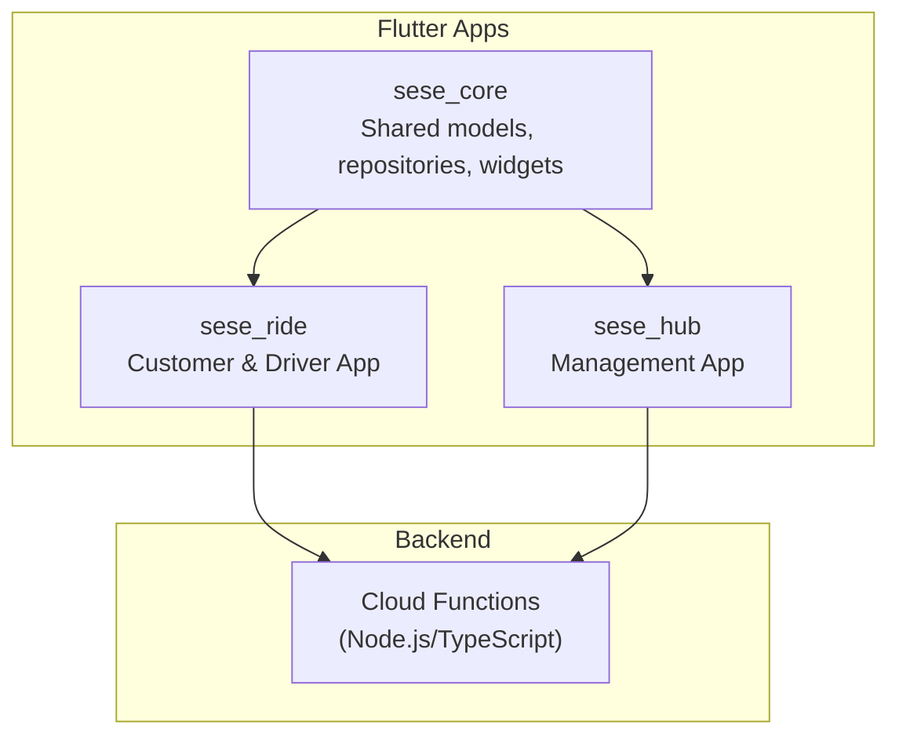
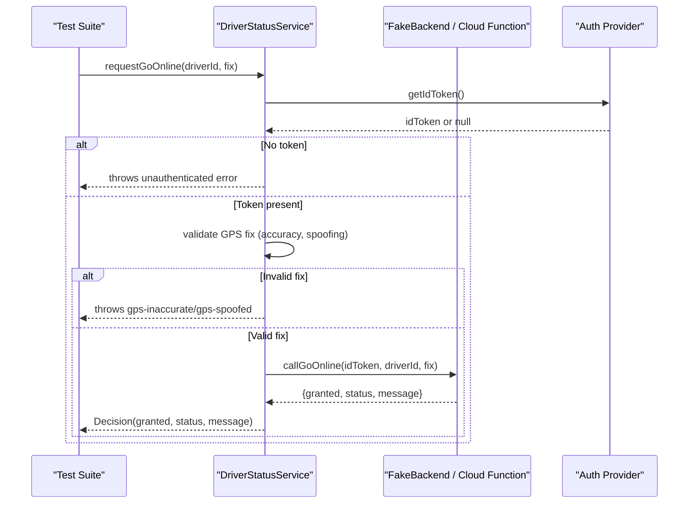
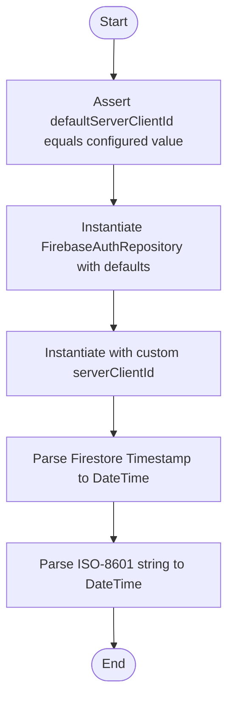
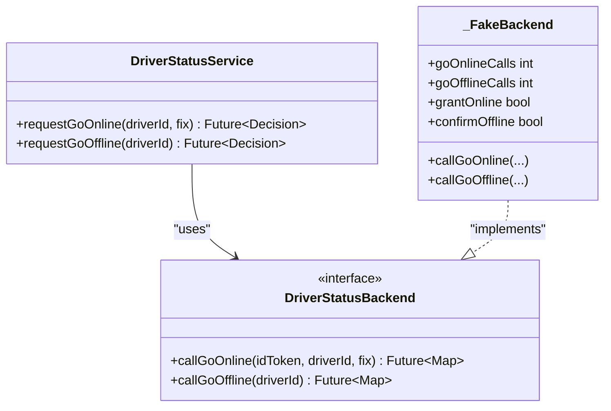
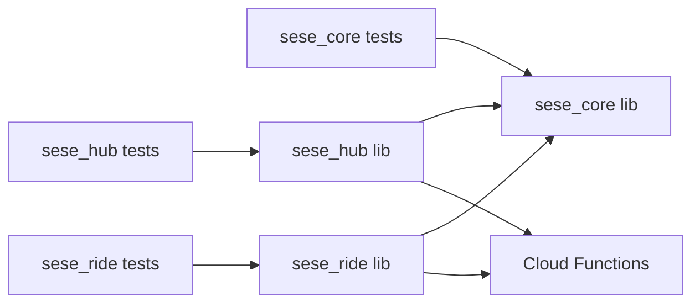

# Testing Strategy

<cite>
**Referenced Files in This Document**
- [sese_core/pubspec.yaml](file://sese_core/pubspec.yaml)
- [sese_hub/pubspec.yaml](file://sese_hub/pubspec.yaml)
- [sese_ride/pubspec.yaml](file://sese_ride/pubspec.yaml)
- [functions/package.json](file://functions/package.json)
- [sese_core/test/auth_repository_test.dart](file://sese_core/test/auth_repository_test.dart)
- [sese_ride/test/driver_status_service_test.dart](file://sese_ride/test/driver_status_service_test.dart)
</cite>

## Table of Contents
1. [Introduction](#introduction)
2. [Project Structure](#project-structure)
3. [Core Components](#core-components)
4. [Architecture Overview](#architecture-overview)
5. [Detailed Component Analysis](#detailed-component-analysis)
6. [Dependency Analysis](#dependency-analysis)
7. [Performance Considerations](#performance-considerations)
8. [Troubleshooting Guide](#troubleshooting-guide)
9. [Conclusion](#conclusion)
10. [Appendices](#appendices)

## Introduction
This document defines the testing strategy for the SeSe monorepo, covering unit tests, integration tests, and end-to-end (E2E) tests across:
- Flutter apps: sese_core (shared package), sese_hub (management app), sese_ride (customer & driver app)
- Cloud Functions backend

It outlines frameworks, test organization patterns, mocking strategies, and best practices for business logic, UI components, authentication flows, real-time features, cloud functions, database operations, and third-party integrations. It also includes guidance for continuous integration and performance testing.

## Project Structure
The repository is a multi-app monorepo with clear separation between shared code, platform apps, and serverless functions. Each Flutter app and the shared core package include a test directory with unit tests. The functions module contains TypeScript-based Cloud Functions.

**Diagram sources**
- [sese_core/pubspec.yaml:1-33](file://sese_core/pubspec.yaml#L1-L33)
- [sese_hub/pubspec.yaml:1-29](file://sese_hub/pubspec.yaml#L1-L29)
- [sese_ride/pubspec.yaml:1-38](file://sese_ride/pubspec.yaml#L1-L38)
- [functions/package.json:1-24](file://functions/package.json#L1-L24)

**Section sources**
- [sese_core/pubspec.yaml:1-33](file://sese_core/pubspec.yaml#L1-L33)
- [sese_hub/pubspec.yaml:1-29](file://sese_hub/pubspec.yaml#L1-L29)
- [sese_ride/pubspec.yaml:1-38](file://sese_ride/pubspec.yaml#L1-L38)
- [functions/package.json:1-24](file://functions/package.json#L1-L24)

## Core Components
This section summarizes the testing foundations per component.

- Shared core (sese_core)
  - Framework: flutter_test
  - Focus areas: auth repository configuration, model parsing robustness, theme/config utilities
  - Example coverage: Google OAuth client ID exposure, Firestore Timestamp vs ISO-8601 date parsing

- Management app (sese_hub)
  - Framework: flutter_test
  - Focus areas: RBAC/access control, fleet repository, global config, support chat, vehicle approvals
  - Typical patterns: widget tests for UI, repository/service tests with mocked Firebase dependencies

- Ride app (sese_ride)
  - Framework: flutter_test
  - Focus areas: navigation flows, live trip screen, driver status service, fare/payment services, map/place interactions, role controller, streak banners, wizard navigation
  - Notable pattern: zero-trust driver status handshake tested with an in-memory fake backend

- Cloud Functions (functions)
  - Framework: Node.js ecosystem; use firebase-functions-test or Jest with emulator
  - Focus areas: fare calculation, pricing, routing, payments, trips, verification, support bot, driver streak/status, account deletion
  - Integration approach: run against local emulators for Firestore/Auth/Functions

**Section sources**
- [sese_core/pubspec.yaml:22-25](file://sese_core/pubspec.yaml#L22-L25)
- [sese_hub/pubspec.yaml:22-25](file://sese_hub/pubspec.yaml#L22-L25)
- [sese_ride/pubspec.yaml:31-34](file://sese_ride/pubspec.yaml#L31-L34)
- [functions/package.json:1-24](file://functions/package.json#L1-L24)

## Architecture Overview
Testing spans multiple layers:

- Unit tests: Validate pure logic, services, repositories, and UI widgets in isolation using flutter_test and mocks/fakes.
- Integration tests: Exercise cross-boundary flows such as auth + data layer, or service + cloud functions via emulators.
- E2E tests: Drive full user journeys on real devices/simulators or web, including authentication, real-time updates, and cloud function triggers.

**Diagram sources**
- [sese_ride/test/driver_status_service_test.dart:1-147](file://sese_ride/test/driver_status_service_test.dart#L1-L147)

## Detailed Component Analysis

### Authentication Repository Tests (sese_core)
Scope:
- Verify default and custom Google OAuth server client IDs are correctly exposed and accepted by the repository constructor.
- Validate AppUser.fromMap handles both Firestore Timestamp and ISO-8601 strings without errors and preserves expected fields.

Key behaviors validated:
- Default server client ID matches configured value
- Repository instantiation succeeds with defaults and custom overrides
- Date parsing robustness for createdAt field

**Diagram sources**
- [sese_core/test/auth_repository_test.dart:1-60](file://sese_core/test/auth_repository_test.dart#L1-L60)

**Section sources**
- [sese_core/test/auth_repository_test.dart:1-60](file://sese_core/test/auth_repository_test.dart#L1-L60)

### Driver Status Service Tests (sese_ride)
Scope:
- Zero-trust handshake for going online/offline with strict GPS validation and server approval.
- Uses an in-memory fake backend to avoid external dependencies and ensure deterministic outcomes.

Key behaviors validated:
- Online request granted when server approves and forwards signed GPS fix
- Spoofed GPS rejected before any backend call
- Low-accuracy GPS rejected before any backend call
- Server denial surfaces without granting
- Requires valid auth token before calling backend
- Offline confirmation requires server acknowledgement; mid-ride offline refused

**Diagram sources**
- [sese_ride/test/driver_status_service_test.dart:1-147](file://sese_ride/test/driver_status_service_test.dart#L1-L147)

**Section sources**
- [sese_ride/test/driver_status_service_test.dart:1-147](file://sese_ride/test/driver_status_service_test.dart#L1-L147)

### UI and Widget Testing Patterns
- Use flutter_test and widget testing utilities to render isolated widgets.
- Provide mock providers/services for Firebase, geolocation, maps, and network calls.
- Assert visual state changes after user interactions (e.g., navigation, toggling online/offline).

Recommended patterns:
- Isolate UI from business logic via dependency injection.
- Use pumpWidget with overridden providers.
- Verify state transitions and side effects through callbacks or streams.

[No sources needed since this section provides general guidance]

### Real-Time Features Testing
- For live trip screens and real-time updates, simulate stream emissions and verify UI reacts appropriately.
- Mock Firestore streams or use in-memory implementations to assert reactive behavior deterministically.

[No sources needed since this section provides general guidance]

### Cloud Functions Testing
- Build and deploy locally using the Firebase Emulator Suite.
- Use firebase-functions-test or Jest to invoke functions programmatically.
- Seed Firestore/Auth state via admin SDK within tests.
- Validate security rules by running rule tests alongside function tests.

Recommended scripts:
- build: compile TypeScript
- serve: build and start emulators for functions
- deploy: deploy functions

**Section sources**
- [functions/package.json:5-10](file://functions/package.json#L5-L10)

## Dependency Analysis
Flutter apps depend on shared core and Firebase services. Tests should isolate these dependencies:

- sese_core depends on Firebase Auth/Firestore and other utilities; tests focus on repository and model correctness.
- sese_hub and sese_ride depend on sese_core and Firebase; tests cover feature-specific logic and UI.
- Cloud Functions depend on Firebase Admin SDK; tests run against emulators.

**Diagram sources**
- [sese_core/pubspec.yaml:1-33](file://sese_core/pubspec.yaml#L1-L33)
- [sese_hub/pubspec.yaml:1-29](file://sese_hub/pubspec.yaml#L1-L29)
- [sese_ride/pubspec.yaml:1-38](file://sese_ride/pubspec.yaml#L1-L38)
- [functions/package.json:1-24](file://functions/package.json#L1-L24)

**Section sources**
- [sese_core/pubspec.yaml:1-33](file://sese_core/pubspec.yaml#L1-L33)
- [sese_hub/pubspec.yaml:1-29](file://sese_hub/pubspec.yaml#L1-L29)
- [sese_ride/pubspec.yaml:1-38](file://sese_ride/pubspec.yaml#L1-L38)
- [functions/package.json:1-24](file://functions/package.json#L1-L24)

## Performance Considerations
- Keep unit tests fast and deterministic; avoid real network calls and heavy I/O.
- Use fakes/mocks for expensive services (maps, geolocation, storage).
- For real-time features, limit stream subscriptions in tests and use controlled emission.
- For cloud functions, run tests against emulators to avoid cold-start variability; batch test data creation.
- Profile critical paths (e.g., fare calculation, route computation) with benchmarks where applicable.

[No sources needed since this section provides general guidance]

## Troubleshooting Guide
Common issues and resolutions:

- Flaky auth tests
  - Ensure consistent provider configuration and reset state between tests.
  - Mock or stub auth state to avoid real sign-ins during unit tests.

- GPS validation failures
  - Confirm accuracy thresholds and spoof detection logic in tests match production constraints.
  - Use explicit fixtures for GPS fixes to stabilize assertions.

- Firestore timestamp parsing
  - Handle both Timestamp and ISO-8601 strings in models; add tests for edge cases.

- Cloud functions not invoking
  - Verify emulator is running and functions are built; check logs from emulator suite.
  - Ensure required environment variables and secrets are set in emulator config.

- UI tests timing out
  - Avoid relying on async animations; pump until stable states or use tester.pumpAndSettle.
  - Mock external services to prevent long-running operations.

**Section sources**
- [sese_core/test/auth_repository_test.dart:1-60](file://sese_core/test/auth_repository_test.dart#L1-L60)
- [sese_ride/test/driver_status_service_test.dart:1-147](file://sese_ride/test/driver_status_service_test.dart#L1-L147)

## Conclusion
This testing strategy ensures comprehensive coverage across the monorepo:
- Unit tests validate core logic, models, and services with deterministic inputs and outputs.
- Integration tests exercise cross-layer flows using emulators and fakes.
- E2E tests drive complete user journeys on real platforms.
- Cloud functions are tested against emulators with seeded data and rule validations.
Adopting these patterns improves reliability, accelerates feedback loops, and supports safe evolution of the system.

[No sources needed since this section summarizes without analyzing specific files]

## Appendices

### Testing Best Practices Checklist
- Prefer pure functions and dependency injection for testability.
- Use descriptive test names that reflect scenarios and expectations.
- Organize tests by feature and layer; keep setup minimal and reusable.
- Mock only external boundaries (network, filesystem, device APIs).
- Validate both success and failure paths, including edge cases.
- Keep tests independent and idempotent; reset shared state between tests.

[No sources needed since this section provides general guidance]

### Continuous Integration Testing
- Run flutter test for all packages/apps in parallel.
- Lint and analyze code with flutter analyze and dart analyze.
- Execute cloud function tests against emulators in CI.
- Publish artifacts and collect test reports.
- Gate merges on passing tests and coverage thresholds.

[No sources needed since this section provides general guidance]